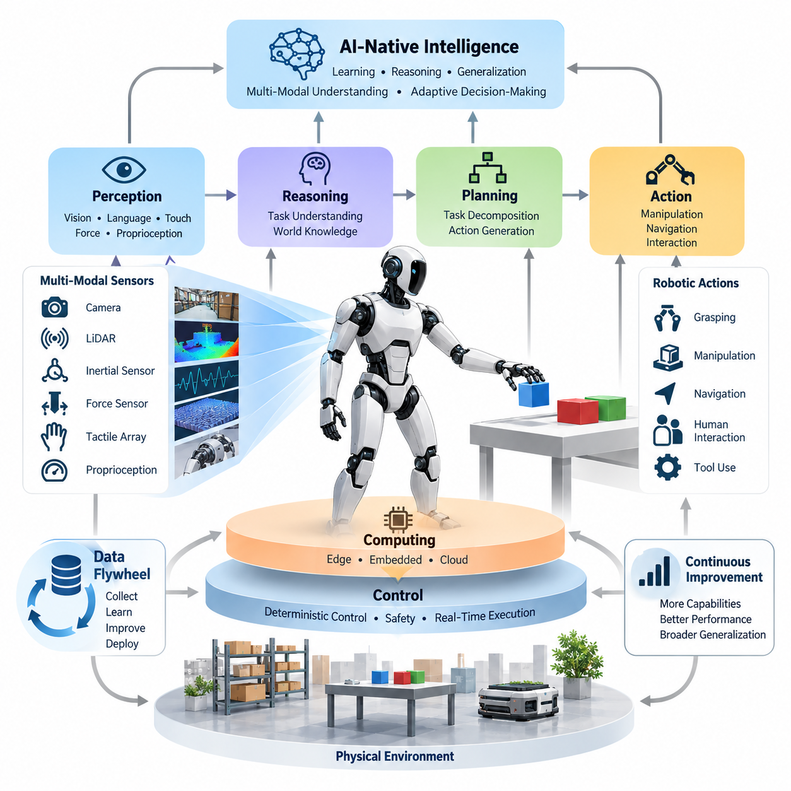
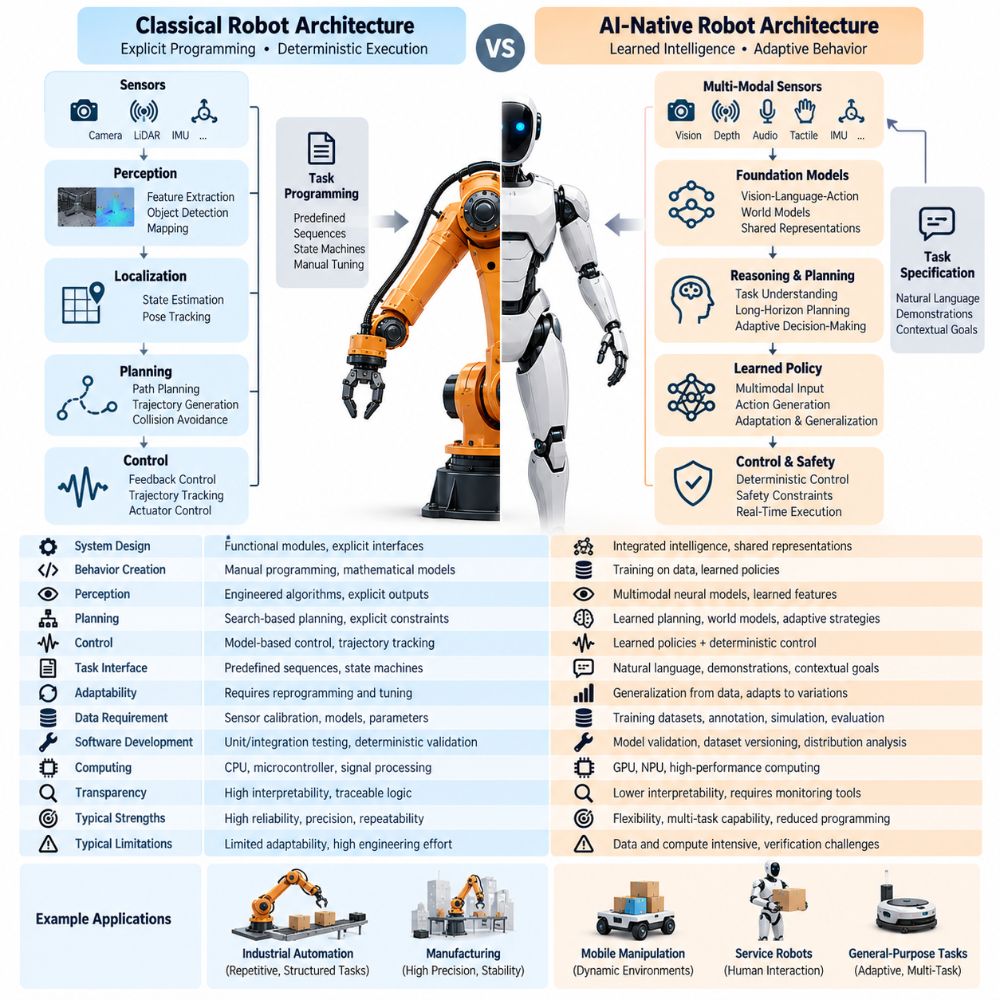
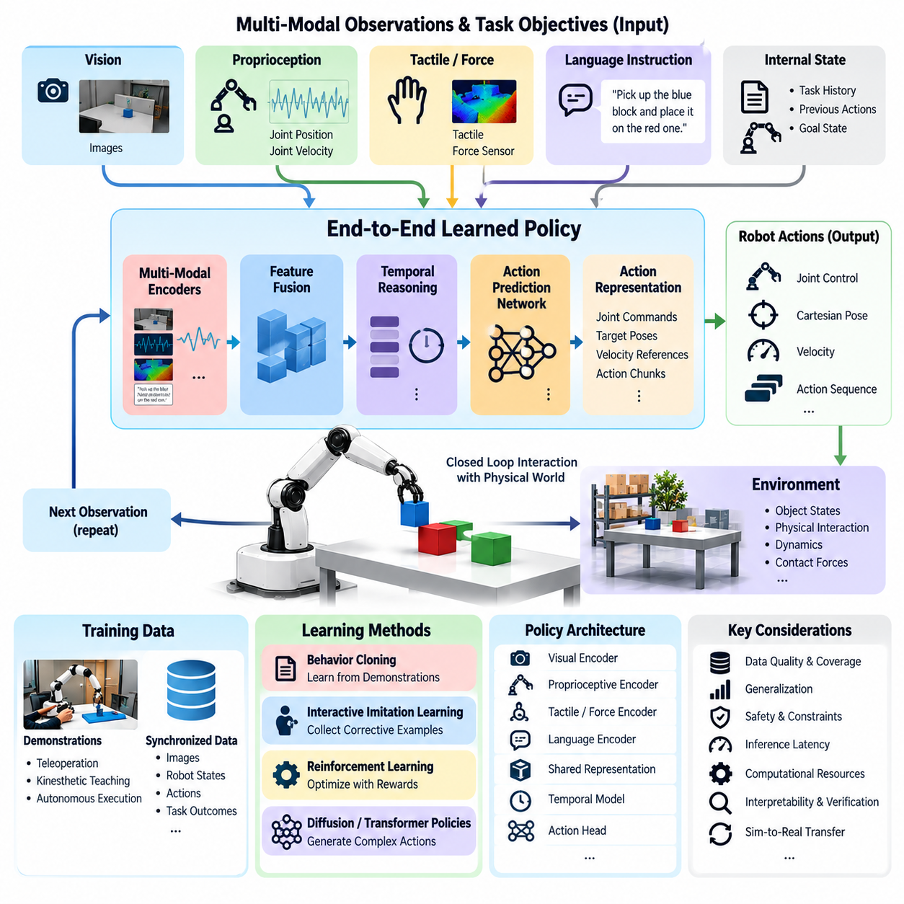
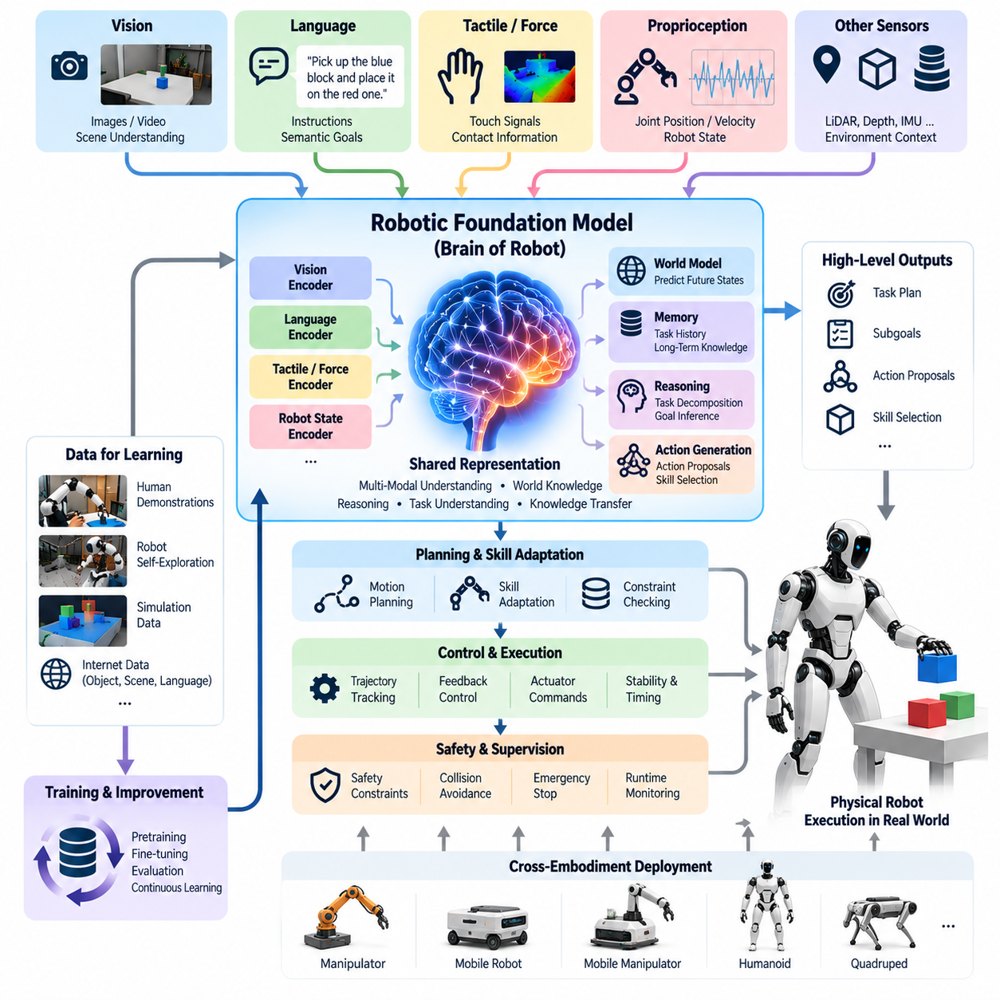
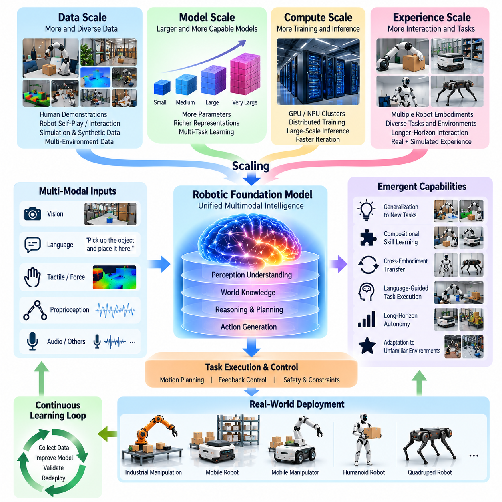
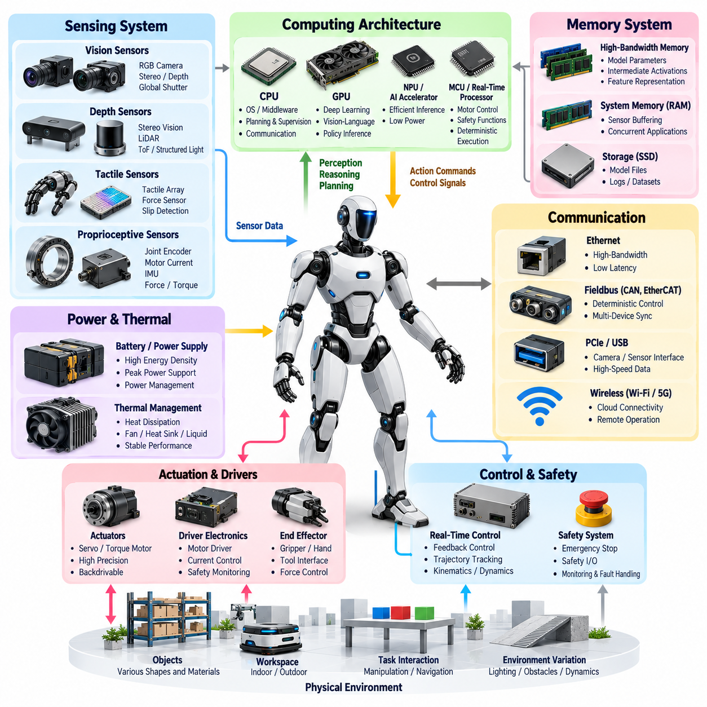
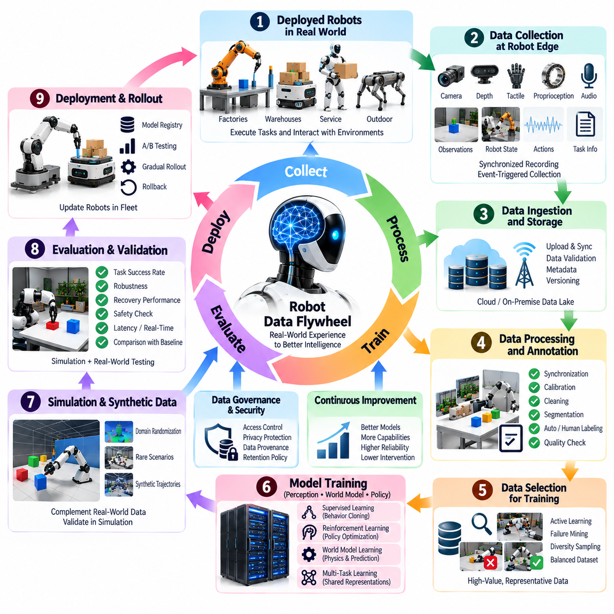
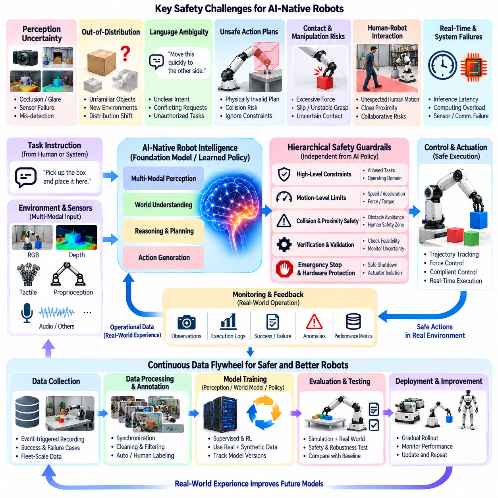
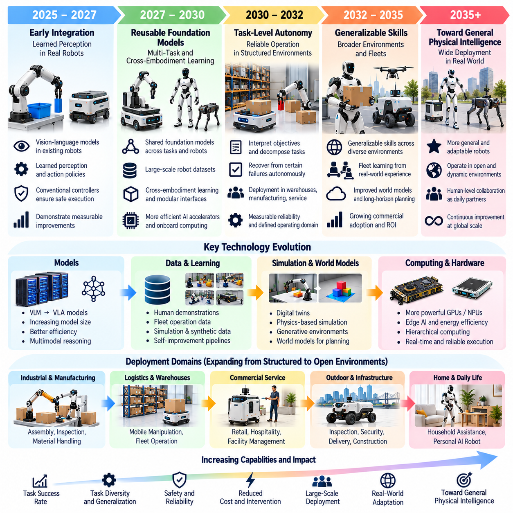
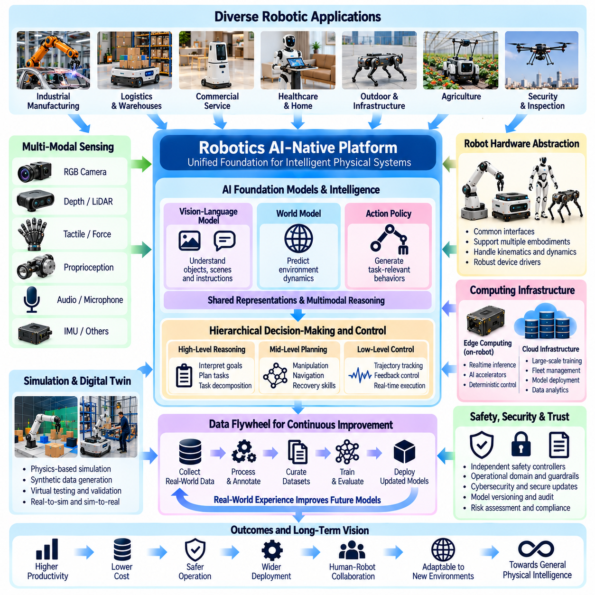

**Volume 27. Future AI Native Robotics**

# Chapter 01. AI Native Robot Fundamentals

## 01.01. AI Native Robot Vision and Definition

{width="7.268055555555556in" height="7.268055555555556in"}

AI-native robotics represents a fundamental transformation in how intelligent robotic systems are conceived, developed, deployed, and continuously improved. Rather than treating artificial intelligence as an optional software component, an AI-native robot places learning, reasoning, perception, and adaptive decision-making at the center of its architecture. Its intelligence becomes an organizing principle that influences hardware design, software integration, and operational behavior.

Traditional robots generally execute predefined instructions through deterministic control algorithms, structured task sequences, and explicitly programmed responses. These systems achieve excellent reliability in controlled environments but often require extensive engineering whenever tasks or environmental conditions change. AI-native robots pursue a different objective: acquiring reusable capabilities from data and adapting their behavior to situations that were not individually programmed during development.

The defining characteristic of an AI-native robot is not simply the presence of neural networks or computer vision algorithms. It is the systematic integration of learned intelligence into the perception, reasoning, planning, and action processes of the machine. An AI-native architecture allows learned representations to influence decisions across multiple functional layers while preserving the deterministic mechanisms required for physical safety, timing guarantees, and dependable actuator control.

An AI-native robot can be understood as an embodied intelligent system that continuously interprets sensory observations, estimates its physical and operational state, selects actions according to objectives, and evaluates the resulting environmental changes. This process establishes a closed interaction loop between intelligence and physical reality. Unlike purely digital AI systems, robotic intelligence must account for gravity, friction, inertia, contact forces, sensor uncertainty, actuator limitations, and irreversible physical consequences.

The architectural vision of AI-native robotics involves moving from collections of narrowly specialized algorithms toward integrated intelligence platforms capable of supporting diverse tasks. Conventional navigation, manipulation, object recognition, and task planning modules may gradually incorporate shared learned representations. Such integration can improve information consistency across subsystems and potentially reduce the engineering effort required to introduce new capabilities, although it also creates additional verification challenges.

Foundation models provide an important technological direction for this transformation. Models trained on large and diverse datasets can learn representations that support multiple perception and reasoning tasks. When adapted to robotics, these models may connect visual observations, language instructions, spatial relationships, and physical actions. Their significance lies in the possibility of transferring previously acquired knowledge to new robotic tasks rather than constructing every capability independently.

Vision-language-action models extend this concept by connecting multimodal observations and natural-language objectives to executable robotic behaviors. A robot receiving an instruction to organize objects on a workstation must interpret the request, identify relevant objects, understand spatial constraints, and generate suitable actions. The intelligence system therefore connects semantic understanding with physical execution, while downstream controllers ensure that generated commands remain compatible with robot dynamics and operational constraints.

An essential objective of AI-native robotics is generalization beyond the exact conditions represented in training data. A capable robot should recognize familiar relationships within unfamiliar scenes, adapt manipulation strategies to variations in object geometry, and respond appropriately to environmental changes. However, generalization is not equivalent to unrestricted autonomy. Every learned capability has a practical operating domain, and performance outside that domain requires explicit evaluation and appropriate fallback mechanisms.

AI-native intelligence also changes the relationship between robot hardware and software. Sensors become sources of rich multimodal information rather than isolated inputs to dedicated algorithms. Cameras, LiDAR, inertial sensors, force sensors, tactile arrays, and proprioceptive measurements can contribute to shared representations of the robot and its environment. Their selection must consider observability, synchronization, computational requirements, robustness, and the information needed by learned policies.

Computational architecture becomes equally important because intelligent robots must execute sophisticated models under strict physical constraints. High-performance processors and AI accelerators may support perception and inference, while embedded controllers maintain deterministic motor operation and safety supervision. Effective designs distribute computation according to latency, energy consumption, reliability, and criticality, ensuring that advanced intelligence does not compromise essential real-time behavior.

The distinction between intelligence and control remains fundamental. A learned policy may decide which object to grasp, where to move, or how to accomplish a task, but physical execution still requires stable control of actuators and mechanical interactions. AI-native robotics therefore does not eliminate classical control theory. Instead, it establishes an architecture in which learned decision-making and model-based or deterministic control cooperate through clearly defined interfaces and operational boundaries.

Another defining principle is the treatment of data as a strategic system resource. Robot observations, actions, operator interventions, task outcomes, and failure events can provide information for subsequent model improvement. When organized into a governed development process, these records support dataset construction, model training, evaluation, and controlled deployment. The resulting improvement cycle can progressively increase capability, provided that data quality and operational representativeness are maintained.

Simulation and digital twins play an important role in developing this intelligence. Virtual environments allow robotic policies to encounter diverse objects, layouts, disturbances, and task configurations without exposing physical equipment to every experimental condition. Synthetic observations and simulated interactions can accelerate learning and testing. Nevertheless, differences between simulated and real-world dynamics require systematic calibration, domain adaptation, and physical validation before deployment.

AI-native robotics also introduces a new perspective on software-defined robotic platforms. Hardware abstraction, standardized interfaces, modular execution environments, and controlled software updates can allow intelligent capabilities to evolve independently of some mechanical components. A common intelligence platform may support multiple robot configurations through embodiment-specific adapters. Achieving this flexibility requires careful management of sensor configurations, actuator limits, coordinate systems, and model compatibility.

Cloud and edge computing further expand the possible architecture of intelligent robotic systems. Local processors provide immediate perception, decision-making, and safety-critical operation, while cloud infrastructure may support large-scale training, fleet analytics, shared knowledge, and computationally expensive reasoning. This distribution enables collective learning across deployed robots, but communication delays, network failures, cybersecurity risks, and data governance requirements constrain which functions can depend on remote services.

A long-term vision is the development of generalist robotic intelligence capable of performing multiple tasks across different environments and physical embodiments. Instead of maintaining entirely separate intelligence stacks for warehouse vehicles, manipulators, service robots, and humanoids, developers may reuse shared representations and transferable policies. Such systems remain a research and engineering objective, with substantial unresolved challenges involving embodiment differences, physical reasoning, reliability, and task generalization.

Safety must remain a foundational architectural requirement rather than an additional feature introduced after model development. Learned systems may produce unexpected outputs when confronted with ambiguous instructions, unfamiliar objects, sensor degradation, or distribution shifts. Independent safety monitors, operational limits, runtime validation, emergency-stop mechanisms, and human intervention procedures are therefore necessary to constrain intelligent behavior within acceptable physical boundaries.

Trustworthy AI-native robotics also requires measurable evidence of performance. Evaluation must extend beyond prediction accuracy to include task completion, recovery capability, latency, energy efficiency, collision avoidance, robustness, and behavior under abnormal conditions. Testing should cover both expected operating scenarios and carefully selected failure conditions. Model updates must undergo regression testing because improvements in one task can introduce performance degradation in another.

Human interaction represents another essential dimension of the AI-native vision. Natural-language interfaces, demonstrations, corrective feedback, and shared task planning can make robotic systems more accessible to operators without specialized programming knowledge. However, the robot must distinguish user intent from executable authority, recognize ambiguous commands, and communicate uncertainty. Effective collaboration depends on predictable behavior, transparent limitations, and appropriate human oversight.

The economic significance of AI-native robotics arises from its potential to reduce task-specific engineering and increase the reuse of intelligent capabilities. Robots that can be adapted through data, demonstrations, or software updates may become practical across a wider range of applications. Commercial success nevertheless depends on total operating cost, maintenance requirements, deployment complexity, safety assurance, and measurable productivity rather than intelligence capability alone.

The transition toward AI-native robotics should therefore be understood as an evolutionary engineering process rather than an immediate replacement of established robotic technologies. Classical control, embedded software, middleware, safety engineering, and industrial automation remain essential foundations. Learning-based intelligence progressively expands the range of tasks that these foundations can support, creating hybrid architectures in which adaptability and deterministic reliability complement each other.

Ultimately, the vision of AI-native robotics is to establish physical machines whose capabilities can evolve through accumulated experience, transferable knowledge, and systematic software improvement. The defining achievement will not be the integration of increasingly large AI models alone, but the creation of dependable embodied systems that transform learned intelligence into useful physical actions. This vision provides the conceptual foundation for future software-defined robots, world-model-based autonomy, generalist intelligence, and self-improving robotic platforms.

AI 네이티브 로보틱스(AI-Native Robotics)는 지능형 로봇 시스템(Intelligent Robotic Systems)의 개념 설계, 개발, 배포 및 지속적인 개선 방식에 근본적인 변화를 의미한다. 인공지능(Artificial Intelligence)을 선택적인 소프트웨어 구성요소로 취급하는 대신, AI 네이티브 로봇(AI-Native Robot)은 학습(Learning), 추론(Reasoning), 인식(Perception), 적응형 의사결정(Adaptive Decision-Making)을 시스템 아키텍처(System Architecture)의 중심에 배치한다. 지능은 하드웨어 설계, 소프트웨어 통합 및 운영 동작에 영향을 미치는 핵심 설계 원리가 된다.

전통적인 로봇(Traditional Robot)은 일반적으로 결정론적 제어 알고리즘(Deterministic Control Algorithms), 구조화된 작업 순서(Structured Task Sequences), 명시적으로 프로그래밍된 응답을 통해 사전에 정의된 명령을 실행한다. 이러한 시스템은 통제된 환경에서 높은 신뢰성을 제공하지만, 작업이나 환경 조건이 변경될 때 상당한 엔지니어링 작업이 필요하다. AI 네이티브 로봇은 데이터로부터 재사용 가능한 능력을 습득하고 개발 과정에서 개별적으로 프로그래밍되지 않은 상황에도 동작을 적응시키는 것을 목표로 한다.

AI 네이티브 로봇의 핵심 특징은 단순히 신경망(Neural Networks)이나 컴퓨터 비전(Computer Vision) 알고리즘을 탑재하는 것이 아니다. 기계의 인식, 추론, 계획(Planning), 행동(Action) 과정에 학습된 지능을 체계적으로 통합하는 것이다. AI 네이티브 아키텍처(AI-Native Architecture)는 학습된 표현(Learned Representations)이 여러 기능 계층의 의사결정에 영향을 미치도록 하면서, 물리적 안전성(Physical Safety), 시간 보장(Timing Guarantees), 안정적인 액추에이터 제어(Actuator Control)에 필요한 결정론적 메커니즘을 유지한다.

AI 네이티브 로봇은 감각 관측(Sensory Observations)을 지속적으로 해석하고, 물리적 상태와 운영 상태를 추정하며, 목표에 따라 행동을 선택하고, 그 결과 발생하는 환경 변화를 평가하는 체화 지능 시스템(Embodied Intelligent System)으로 이해할 수 있다. 이러한 과정은 지능과 물리적 현실 사이에 폐루프 상호작용(Closed-Loop Interaction)을 형성한다. 순수 디지털 AI 시스템과 달리 로봇 지능은 중력, 마찰, 관성, 접촉력, 센서 불확실성, 액추에이터 한계 및 되돌릴 수 없는 물리적 결과를 고려해야 한다.

AI 네이티브 로보틱스의 아키텍처 비전(Architectural Vision)은 좁은 기능에 특화된 알고리즘의 집합에서 다양한 작업을 지원하는 통합 지능 플랫폼(Integrated Intelligence Platform)으로 전환하는 것이다. 기존의 내비게이션(Navigation), 조작(Manipulation), 객체 인식(Object Recognition), 작업 계획(Task Planning) 모듈은 점진적으로 공유 학습 표현(Shared Learned Representations)을 활용할 수 있다. 이러한 통합은 하위 시스템 간 정보 일관성을 높이고 새로운 기능 도입에 필요한 엔지니어링 노력을 줄일 가능성이 있지만, 추가적인 검증 과제도 발생시킨다.

파운데이션 모델(Foundation Models)은 이러한 전환을 위한 중요한 기술적 방향을 제공한다. 대규모의 다양한 데이터셋(Datasets)으로 학습된 모델은 여러 인식 및 추론 작업을 지원하는 표현을 학습할 수 있다. 로보틱스에 적용되면 이러한 모델은 시각 관측, 언어 명령, 공간적 관계 및 물리적 행동을 연결할 수 있다. 핵심적인 의미는 모든 기능을 독립적으로 구축하는 대신 기존에 습득한 지식을 새로운 로봇 작업으로 전이(Transfer)할 수 있다는 가능성에 있다.

비전-언어-행동 모델(Vision-Language-Action Models, VLA)은 다중모달 관측(Multimodal Observations)과 자연어 목표를 실행 가능한 로봇 동작에 연결함으로써 이러한 개념을 확장한다. 작업대 위의 물체를 정리하라는 명령을 받은 로봇은 요청을 해석하고, 관련 물체를 식별하며, 공간적 제약을 이해하고, 적절한 행동을 생성해야 한다. 따라서 지능 시스템은 의미적 이해(Semantic Understanding)를 물리적 실행과 연결하며, 하위 제어기는 생성된 명령이 로봇 동역학(Robot Dynamics) 및 운영 제약과 일치하도록 보장한다.

AI 네이티브 로보틱스의 핵심 목표 중 하나는 학습 데이터에 포함된 정확한 조건을 넘어서는 일반화(Generalization) 능력이다. 유능한 로봇은 익숙하지 않은 장면에서도 기존에 학습한 관계를 인식하고, 물체 형상의 변화에 따라 조작 전략을 조정하며, 환경 변화에 적절하게 대응해야 한다. 그러나 일반화가 제한 없는 자율성(Unrestricted Autonomy)을 의미하지는 않는다. 모든 학습 기반 기능에는 실제적인 운영 영역(Operating Domain)이 존재하며, 해당 영역을 벗어나는 성능에는 명시적인 평가와 적절한 대체 동작 메커니즘(Fallback Mechanisms)이 필요하다.

AI 네이티브 지능은 로봇 하드웨어와 소프트웨어 사이의 관계도 변화시킨다. 센서는 개별 알고리즘에 입력을 제공하는 독립적인 장치가 아니라 풍부한 다중모달 정보의 원천이 된다. 카메라, 라이다(LiDAR), 관성 센서(Inertial Sensors), 힘 센서(Force Sensors), 촉각 배열(Tactile Arrays), 고유수용감각 측정(Proprioceptive Measurements)은 로봇과 환경에 대한 공유 표현을 구성하는 데 기여한다. 센서 선정에서는 관측 가능성(Observability), 동기화(Synchronization), 연산 요구사항, 강건성(Robustness), 학습 정책에 필요한 정보를 함께 고려해야 한다.

지능형 로봇은 엄격한 물리적 제약 아래에서 복잡한 모델을 실행해야 하므로 컴퓨팅 아키텍처(Computing Architecture) 역시 중요해진다. 고성능 프로세서와 AI 가속기(AI Accelerators)는 인식 및 추론을 지원하고, 임베디드 제어기(Embedded Controllers)는 결정론적 모터 동작과 안전 감시를 유지할 수 있다. 효과적인 설계는 지연시간(Latency), 에너지 소비, 신뢰성 및 중요도(Criticality)에 따라 연산을 분산하여 고급 지능이 필수적인 실시간 동작을 저해하지 않도록 한다.

지능(Intelligence)과 제어(Control)의 구분은 여전히 근본적으로 중요하다. 학습된 정책(Learned Policy)은 어떤 물체를 잡을지, 어디로 이동할지, 작업을 어떻게 수행할지 결정할 수 있지만, 물리적 실행에는 액추에이터와 기계적 상호작용에 대한 안정적인 제어가 필요하다. 따라서 AI 네이티브 로보틱스는 고전 제어 이론(Classical Control Theory)을 제거하지 않는다. 대신 학습 기반 의사결정과 모델 기반 또는 결정론적 제어가 명확하게 정의된 인터페이스와 운영 경계를 통해 협력하는 아키텍처를 구축한다.

또 다른 핵심 원칙은 데이터(Data)를 전략적 시스템 자원(Strategic System Resource)으로 취급하는 것이다. 로봇 관측, 행동, 운영자 개입, 작업 결과 및 실패 이벤트는 이후 모델 개선에 필요한 정보를 제공할 수 있다. 이러한 기록을 체계적으로 관리되는 개발 프로세스로 구성하면 데이터셋 구축, 모델 학습, 평가 및 통제된 배포를 지원한다. 데이터 품질과 실제 운영 환경에 대한 대표성이 유지된다면, 이러한 개선 순환 구조(Improvement Cycle)는 로봇의 능력을 점진적으로 향상시킬 수 있다.

시뮬레이션(Simulation)과 디지털 트윈(Digital Twin)은 이러한 지능을 개발하는 데 중요한 역할을 한다. 가상 환경(Virtual Environments)은 실제 장비를 모든 실험 조건에 노출하지 않고도 로봇 정책이 다양한 물체, 배치, 외란(Disturbances), 작업 구성에 대응하도록 한다. 합성 관측(Synthetic Observations)과 시뮬레이션 상호작용은 학습과 시험을 가속할 수 있다. 그러나 시뮬레이션과 실제 환경의 동역학 차이를 해결하기 위해서는 배포 전에 체계적인 보정(Calibration), 도메인 적응(Domain Adaptation), 물리적 검증(Physical Validation)이 필요하다.

AI 네이티브 로보틱스는 소프트웨어 정의 로봇 플랫폼(Software-Defined Robotic Platforms)에 대한 새로운 관점도 제시한다. 하드웨어 추상화(Hardware Abstraction), 표준화된 인터페이스, 모듈형 실행 환경(Modular Execution Environments), 통제된 소프트웨어 업데이트를 통해 일부 기계적 구성요소와 독립적으로 지능형 기능을 발전시킬 수 있다. 공통 지능 플랫폼은 로봇 형태별 어댑터(Embodiment-Specific Adapters)를 통해 여러 로봇 구성을 지원할 수 있다. 이러한 유연성을 구현하려면 센서 구성, 액추에이터 한계, 좌표계 및 모델 호환성을 신중하게 관리해야 한다.

클라우드 및 엣지 컴퓨팅(Cloud and Edge Computing)은 지능형 로봇 시스템의 아키텍처 가능성을 더욱 확장한다. 로컬 프로세서는 즉각적인 인식, 의사결정 및 안전 필수 동작(Safety-Critical Operation)을 제공하고, 클라우드 인프라는 대규모 학습, 로봇 군집 분석(Fleet Analytics), 공유 지식 및 높은 연산량이 필요한 추론을 지원할 수 있다. 이러한 분산 구조는 배포된 로봇 간 집단 학습(Collective Learning)을 가능하게 하지만, 통신 지연, 네트워크 장애, 사이버보안 위험 및 데이터 거버넌스(Data Governance) 요구사항은 원격 서비스에 의존할 수 있는 기능을 제한한다.

장기적인 비전은 서로 다른 환경과 물리적 형태에서 여러 작업을 수행할 수 있는 범용 로봇 지능(Generalist Robotic Intelligence)의 개발이다. 창고 운반 로봇, 매니퓰레이터(Manipulator), 서비스 로봇, 휴머노이드(Humanoid)를 위해 완전히 분리된 지능 소프트웨어 스택(Intelligence Stacks)을 유지하는 대신, 개발자는 공유 표현과 전이 가능한 정책(Transferable Policies)을 재사용할 수 있다. 그러나 이러한 시스템은 여전히 연구 및 엔지니어링 목표이며, 로봇 형태의 차이, 물리적 추론, 신뢰성 및 작업 일반화와 관련된 상당한 미해결 과제가 존재한다.

안전성(Safety)은 모델 개발 이후 추가되는 기능이 아니라 기본적인 아키텍처 요구사항이어야 한다. 학습 기반 시스템은 모호한 명령, 익숙하지 않은 물체, 센서 성능 저하 또는 분포 변화(Distribution Shift)에 직면했을 때 예상하지 못한 출력을 생성할 수 있다. 따라서 독립적인 안전 감시기(Safety Monitors), 운영 한계, 실행시간 검증(Runtime Validation), 비상정지 메커니즘(Emergency-Stop Mechanisms), 인간 개입 절차(Human Intervention Procedures)를 통해 지능형 동작을 허용 가능한 물리적 경계 안으로 제한해야 한다.

신뢰할 수 있는 AI 네이티브 로보틱스(Trustworthy AI-Native Robotics)는 측정 가능한 성능 근거도 요구한다. 평가는 예측 정확도(Prediction Accuracy)를 넘어 작업 완료율, 복구 능력, 지연시간, 에너지 효율, 충돌 회피, 강건성 및 비정상 조건에서의 동작을 포함해야 한다. 시험은 예상 운영 시나리오뿐 아니라 신중하게 선정된 실패 조건까지 다루어야 한다. 한 작업의 개선이 다른 작업의 성능 저하를 초래할 수 있으므로 모델 업데이트에는 회귀 시험(Regression Testing)이 반드시 필요하다.

인간과의 상호작용(Human Interaction)은 AI 네이티브 비전의 또 다른 필수 요소이다. 자연어 인터페이스(Natural-Language Interfaces), 시연(Demonstrations), 교정 피드백(Corrective Feedback), 공동 작업 계획(Shared Task Planning)은 전문적인 프로그래밍 지식이 없는 운영자도 로봇 시스템을 쉽게 활용하도록 지원한다. 그러나 로봇은 사용자의 의도와 실행 권한을 구분하고, 모호한 명령을 인식하며, 불확실성을 전달해야 한다. 효과적인 협업은 예측 가능한 동작, 명확하게 공개된 한계 및 적절한 인간 감독(Human Oversight)에 달려 있다.

AI 네이티브 로보틱스의 경제적 중요성은 작업별 엔지니어링 비용을 줄이고 지능형 기능의 재사용성을 높일 수 있다는 잠재력에서 비롯된다. 데이터, 시연 또는 소프트웨어 업데이트를 통해 적응할 수 있는 로봇은 더욱 다양한 응용 분야에서 실용성을 확보할 수 있다. 그러나 상업적 성공은 지능 수준만으로 결정되지 않으며, 총운영비용(Total Operating Cost), 유지보수 요구사항, 배포 복잡성, 안전성 보증(Safety Assurance), 측정 가능한 생산성에 달려 있다.

따라서 AI 네이티브 로보틱스로의 전환은 기존 로봇 기술을 즉시 대체하는 과정이 아니라 점진적으로 발전하는 엔지니어링 프로세스(Evolutionary Engineering Process)로 이해해야 한다. 고전 제어, 임베디드 소프트웨어, 미들웨어(Middleware), 안전 엔지니어링(Safety Engineering), 산업 자동화(Industrial Automation)는 여전히 필수적인 기반이다. 학습 기반 지능은 이러한 기반이 지원할 수 있는 작업 범위를 점진적으로 확장하며, 적응성과 결정론적 신뢰성이 상호 보완하는 하이브리드 아키텍처(Hybrid Architecture)를 형성한다.

궁극적으로 AI 네이티브 로보틱스의 비전은 축적된 경험, 전이 가능한 지식 및 체계적인 소프트웨어 개선을 통해 능력이 발전하는 물리적 기계를 구축하는 것이다. 핵심적인 성과는 단순히 더 큰 AI 모델을 통합하는 것이 아니라 학습된 지능을 유용한 물리적 행동으로 변환하는 신뢰할 수 있는 체화 시스템(Embodied Systems)을 구현하는 데 있다. 이러한 비전은 미래의 소프트웨어 정의 로봇(Software-Defined Robots), 세계 모델 기반 자율성(World-Model-Based Autonomy), 범용 지능(Generalist Intelligence), 자기 개선 로봇 플랫폼(Self-Improving Robotic Platforms)을 위한 개념적 기반을 제공한다.

## 01.02. AI Native vs Classical Robot Architecture Contrast

{width="7.268055555555556in" height="7.268055555555556in"}

Classical robot architecture and AI-native robot architecture represent two different approaches to organizing robotic intelligence, control, and system behavior. Classical systems emphasize explicit programming, deterministic execution, and functional decomposition, while AI-native systems place learned representations and adaptive decision-making at the center of their design. Understanding this distinction is essential for evaluating future robotic platforms and determining appropriate engineering strategies.

A classical robotic system typically separates perception, localization, planning, and control into specialized functional modules. Each module receives defined inputs, executes an established algorithm, and produces outputs through standardized interfaces. This decomposition supports independent development, debugging, and verification. However, overall system performance depends on the accuracy of intermediate representations and the assumptions embedded within individual algorithms.

AI-native architecture introduces learned models that can connect multiple functional stages through shared representations. Instead of relying exclusively on independently engineered perception and planning pipelines, an intelligent policy may jointly interpret sensory observations, task objectives, and action possibilities. This integration can reduce information loss between modules, although it may also make internal decisions less transparent and complicate fault isolation.

The most fundamental difference concerns how robotic behavior is created. Classical robots acquire capabilities primarily through software engineering, mathematical modeling, and manual parameter configuration. AI-native robots acquire a substantial portion of their behavior through training on demonstrations, interactions, and structured datasets. Their operational capabilities therefore depend not only on source code but also on training data, model parameters, learning objectives, and evaluation procedures.

Classical perception systems commonly use carefully selected algorithms for feature extraction, object detection, geometric reconstruction, and sensor fusion. Their outputs are often expressed through explicit representations such as coordinates, occupancy grids, and object trajectories. AI-native perception may employ multimodal neural networks that encode visual, spatial, tactile, and semantic information into learned feature spaces suitable for downstream reasoning and action generation.

Planning illustrates another important architectural contrast. Classical motion planners search geometric or configuration spaces using explicit constraints, cost functions, and robot models. AI-native planners may use learned policies or predictive world models to estimate promising actions from previous experience. These methods can complement rather than replace classical planning, particularly when strict collision constraints, dynamic feasibility, and predictable execution are required.

Control architecture also changes, but not necessarily through complete replacement. Classical robots employ feedback controllers, model predictive control, and trajectory tracking to regulate physical motion. AI-native systems may introduce learned controllers or policies that adapt behavior to complex interactions. Nevertheless, deterministic servo loops, actuator protection, stability constraints, and emergency-stop mechanisms remain essential for dependable physical operation.

The relationship between task specification and execution differs significantly. Classical automation generally requires tasks to be translated into predefined sequences, state machines, or programmed motion routines. AI-native systems may interpret natural-language instructions, demonstrations, and contextual objectives. This capability potentially reduces application-specific programming, but ambiguous instructions must still be resolved into executable actions with explicit safety and operational constraints.

Adaptability provides a major motivation for AI-native architecture. Classical robots often require algorithm modifications, parameter tuning, or additional rules when encountering unfamiliar conditions. Learned policies can potentially generalize across variations in object appearance, workspace configuration, and task context. However, such generalization is limited by training coverage and model robustness, making unfamiliar operating conditions a significant engineering concern.

Data requirements reveal a structural difference between the two approaches. Classical robotics primarily depends on calibrated sensors, mathematical models, configuration parameters, and carefully defined interfaces. AI-native robotics additionally requires representative training datasets, annotation strategies, simulation environments, and model evaluation pipelines. Data quality becomes an architectural dependency because dataset limitations can directly influence physical behavior and operational reliability.

Software development practices must evolve accordingly. Classical robot software can often be evaluated through unit testing, integration testing, static analysis, and deterministic regression procedures. AI-native software additionally requires model validation, dataset versioning, distribution-shift analysis, and statistical performance evaluation. Reproducibility depends on recording training configurations, model versions, data provenance, and deployment conditions alongside conventional software artifacts.

Computational requirements also differ. Classical robotic pipelines frequently use CPUs, microcontrollers, and specialized signal-processing hardware to execute predictable workloads. AI-native systems may require GPUs, neural processing units, and substantial memory bandwidth for multimodal inference. Their architectures must balance model capacity against latency, thermal constraints, energy consumption, and the computational resources available on mobile robotic platforms.

The distinction becomes especially visible in real-time execution. Classical control software is commonly designed around bounded execution times and deterministic scheduling. Neural network inference introduces workloads whose timing may depend on model architecture, hardware contention, and execution configuration. AI-native systems must therefore establish explicit timing budgets and isolate safety-critical control functions from computationally intensive intelligence processes.

Fault diagnosis presents another architectural challenge. In classical systems, engineers can often trace unexpected behavior through algorithm outputs, state transitions, and parameter values. In AI-native systems, failures may originate from training-data deficiencies, learned representation errors, or interactions between model components. Effective diagnosis requires synchronized telemetry, model confidence indicators, scenario reconstruction, and systematic analysis of both software and data.

Safety assurance differs because learned behavior cannot always be exhaustively described through explicit rules. Classical architectures can provide strong verification evidence for well-defined algorithms and bounded operating conditions. AI-native systems require additional safeguards, including independent runtime monitors, constrained action interfaces, uncertainty detection, and controlled fallback behavior. Safety-critical functions should remain independently enforceable even when learned intelligence behaves unexpectedly.

Simulation has different roles within these architectures. Classical robotics uses simulation extensively for controller tuning, motion verification, and system integration. AI-native robotics additionally uses simulated interactions to generate training experiences, evaluate policy generalization, and expose models to rare scenarios. This increased dependence makes simulation fidelity, domain randomization, and sim-to-real transfer central elements of the development process.

Scalability also follows different patterns. Classical robot platforms often scale by reusing software modules and configuring task-specific applications. AI-native platforms may scale through shared foundation models, transferable representations, and reusable learned policies. A common intelligence model could support multiple robot embodiments, provided that differences in sensors, actuators, kinematics, and physical capabilities are handled through appropriate adaptation mechanisms.

Operational maintenance extends beyond conventional software updates. Classical robots typically receive firmware improvements, parameter revisions, and application changes. AI-native robots may additionally receive updated model weights, new learned skills, and revised perception capabilities. Every update must be evaluated for compatibility, performance regression, cybersecurity exposure, and unintended behavioral changes before deployment to operational equipment.

A warehouse robot provides a practical example of this contrast. A classical autonomous mobile robot may use predefined maps, geometric localization, rule-based traffic management, and conventional path planning. An AI-native extension could interpret semantic instructions, recognize unfamiliar workspace conditions, and adapt task strategies using learned representations. Reliable deployment would still depend on validated navigation constraints, fleet coordination, and independent safety functions.

Industrial manipulation offers another illustration. A classical manipulator executes programmed trajectories using calibrated object positions and established grasping procedures. An AI-native manipulator may infer grasp strategies from visual and tactile observations, accommodate object variations, and respond to language-based task descriptions. However, force limits, collision avoidance, joint constraints, and stable motion control remain necessary regardless of how the task policy is generated.

The most practical future architecture is therefore likely to combine established robotic engineering with increasingly capable learned intelligence. Classical modules provide deterministic execution, explicit constraints, and verifiable safety boundaries, while AI-native components contribute semantic understanding, adaptive planning, and reusable task knowledge. The architectural challenge is to define interfaces that allow these complementary capabilities to operate without compromising reliability.

Ultimately, the transition from classical to AI-native robotics is not simply a substitution of algorithms with neural networks. It changes how capabilities are developed, represented, validated, deployed, and improved throughout the robot lifecycle. Successful AI-native architecture must combine learning-based adaptability with disciplined systems engineering, ensuring that expanding intelligence translates into measurable operational capability while preserving physical safety and predictable system behavior.

고전적 로봇 아키텍처(Classical Robot Architecture)와 AI 네이티브 로봇 아키텍처(AI-Native Robot Architecture)는 로봇 지능(Robotic Intelligence), 제어(Control), 시스템 동작(System Behavior)을 구성하는 두 가지 서로 다른 접근 방식을 나타낸다. 고전적 시스템은 명시적 프로그래밍(Explicit Programming), 결정론적 실행(Deterministic Execution), 기능적 분해(Functional Decomposition)를 강조하는 반면, AI 네이티브 시스템은 학습된 표현(Learned Representations)과 적응형 의사결정(Adaptive Decision-Making)을 설계의 중심에 배치한다. 이러한 차이를 이해하는 것은 미래 로봇 플랫폼을 평가하고 적절한 엔지니어링 전략을 결정하는 데 필수적이다.

고전적 로봇 시스템(Classical Robotic System)은 일반적으로 인식(Perception), 위치 추정(Localization), 계획(Planning), 제어(Control)를 전문화된 기능 모듈(Functional Modules)로 분리한다. 각 모듈은 정의된 입력을 받아 정해진 알고리즘을 실행하고 표준화된 인터페이스(Standardized Interfaces)를 통해 출력을 생성한다. 이러한 기능 분해는 독립적인 개발, 디버깅(Debugging), 검증(Verification)을 지원한다. 그러나 전체 시스템의 성능은 중간 표현(Intermediate Representations)의 정확성과 개별 알고리즘에 포함된 가정에 의존한다.

AI 네이티브 아키텍처(AI-Native Architecture)는 공유 표현(Shared Representations)을 통해 여러 기능 단계를 연결할 수 있는 학습 모델(Learned Models)을 도입한다. 독립적으로 설계된 인식 및 계획 파이프라인(Perception and Planning Pipelines)에만 의존하는 대신, 지능형 정책(Intelligent Policy)이 센서 관측, 작업 목표 및 가능한 행동을 통합적으로 해석할 수 있다. 이러한 통합은 모듈 사이의 정보 손실을 줄일 수 있지만, 내부 의사결정의 투명성을 낮추고 결함 원인 분리(Fault Isolation)를 복잡하게 만들 수도 있다.

가장 근본적인 차이는 로봇 동작(Robotic Behavior)이 생성되는 방식에 있다. 고전적 로봇은 주로 소프트웨어 엔지니어링(Software Engineering), 수학적 모델링(Mathematical Modeling), 수동 매개변수 설정(Manual Parameter Configuration)을 통해 기능을 확보한다. AI 네이티브 로봇은 시연(Demonstrations), 상호작용(Interactions), 구조화된 데이터셋(Structured Datasets)을 학습하여 상당 부분의 동작 능력을 획득한다. 따라서 운영 능력은 소스 코드뿐 아니라 학습 데이터, 모델 매개변수, 학습 목표 및 평가 절차에도 의존한다.

고전적 인식 시스템(Classical Perception Systems)은 일반적으로 특징 추출(Feature Extraction), 객체 감지(Object Detection), 기하학적 재구성(Geometric Reconstruction), 센서 융합(Sensor Fusion)을 위해 신중하게 선정된 알고리즘을 사용한다. 출력은 좌표(Coordinates), 점유 격자(Occupancy Grids), 객체 궤적(Object Trajectories)과 같은 명시적 표현으로 나타나는 경우가 많다. AI 네이티브 인식(AI-Native Perception)은 시각, 공간, 촉각 및 의미 정보를 학습된 특징 공간(Learned Feature Spaces)에 인코딩하는 다중모달 신경망(Multimodal Neural Networks)을 활용하여 후속 추론과 행동 생성을 지원할 수 있다.

계획(Planning)은 또 다른 중요한 아키텍처 차이를 보여준다. 고전적 동작 계획기(Classical Motion Planners)는 명시적인 제약조건(Constraints), 비용 함수(Cost Functions), 로봇 모델(Robot Models)을 사용하여 기하학적 공간 또는 구성 공간(Configuration Spaces)을 탐색한다. AI 네이티브 계획기(AI-Native Planners)는 학습된 정책(Learned Policies)이나 예측형 세계 모델(Predictive World Models)을 활용하여 이전 경험으로부터 유망한 행동을 추정할 수 있다. 이러한 방법은 엄격한 충돌 제약, 동역학적 실행 가능성(Dynamic Feasibility), 예측 가능한 실행이 요구되는 경우 고전적 계획을 대체하기보다 보완할 수 있다.

제어 아키텍처(Control Architecture) 역시 변화하지만 반드시 완전한 대체를 의미하지는 않는다. 고전적 로봇은 피드백 제어기(Feedback Controllers), 모델 예측 제어(Model Predictive Control), 궤적 추종(Trajectory Tracking)을 사용하여 물리적 움직임을 조절한다. AI 네이티브 시스템은 복잡한 상호작용에 동작을 적응시키는 학습 기반 제어기(Learned Controllers) 또는 정책을 도입할 수 있다. 그러나 결정론적 서보 루프(Deterministic Servo Loops), 액추에이터 보호(Actuator Protection), 안정성 제약(Stability Constraints), 비상정지 메커니즘(Emergency-Stop Mechanisms)은 신뢰할 수 있는 물리적 동작을 위해 여전히 필수적이다.

작업 명세(Task Specification)와 실행(Execution)의 관계도 상당히 다르다. 고전적 자동화(Classical Automation)는 일반적으로 작업을 사전에 정의된 순서, 상태 기계(State Machines), 프로그래밍된 동작 절차로 변환해야 한다. AI 네이티브 시스템은 자연어 명령(Natural-Language Instructions), 시연 및 상황별 목표(Contextual Objectives)를 해석할 수 있다. 이러한 능력은 응용 분야별 프로그래밍을 줄일 가능성이 있지만, 모호한 명령은 여전히 명시적인 안전 및 운영 제약을 갖춘 실행 가능한 행동으로 변환되어야 한다.

적응성(Adaptability)은 AI 네이티브 아키텍처를 도입하는 주요 동기 중 하나이다. 고전적 로봇은 익숙하지 않은 조건에 직면하면 알고리즘 수정, 매개변수 조정(Parameter Tuning), 추가 규칙이 필요한 경우가 많다. 학습된 정책은 물체 외관, 작업 공간 구성(Workspace Configuration), 작업 맥락(Task Context)의 변화에 걸쳐 일반화(Generalization)할 가능성이 있다. 그러나 이러한 일반화는 학습 데이터의 범위(Training Coverage)와 모델 강건성(Model Robustness)에 의해 제한되므로, 익숙하지 않은 운영 조건은 중요한 엔지니어링 과제가 된다.

데이터 요구사항(Data Requirements)은 두 접근 방식 사이의 구조적 차이를 보여준다. 고전적 로보틱스는 주로 보정된 센서(Calibrated Sensors), 수학적 모델, 구성 매개변수(Configuration Parameters), 명확하게 정의된 인터페이스에 의존한다. AI 네이티브 로보틱스는 여기에 대표성 있는 학습 데이터셋(Representative Training Datasets), 데이터 주석 전략(Annotation Strategies), 시뮬레이션 환경(Simulation Environments), 모델 평가 파이프라인(Model Evaluation Pipelines)을 추가로 요구한다. 데이터셋의 한계가 물리적 동작과 운영 신뢰성에 직접적인 영향을 미칠 수 있으므로 데이터 품질(Data Quality)은 아키텍처의 핵심 의존 요소가 된다.

이에 따라 소프트웨어 개발 방식(Software Development Practices)도 발전해야 한다. 고전적 로봇 소프트웨어는 일반적으로 단위 시험(Unit Testing), 통합 시험(Integration Testing), 정적 분석(Static Analysis), 결정론적 회귀 시험(Deterministic Regression Testing)을 통해 평가할 수 있다. AI 네이티브 소프트웨어는 모델 검증(Model Validation), 데이터셋 버전 관리(Dataset Versioning), 분포 변화 분석(Distribution-Shift Analysis), 통계적 성능 평가(Statistical Performance Evaluation)를 추가로 요구한다. 재현성(Reproducibility)은 기존 소프트웨어 산출물과 함께 학습 구성, 모델 버전, 데이터 출처(Data Provenance), 배포 조건을 기록하는 데 달려 있다.

연산 요구사항(Computational Requirements)도 서로 다르다. 고전적 로봇 파이프라인은 예측 가능한 작업 부하(Workloads)를 실행하기 위해 CPU, 마이크로컨트롤러(Microcontrollers), 특수 신호처리 하드웨어(Specialized Signal-Processing Hardware)를 사용하는 경우가 많다. AI 네이티브 시스템은 다중모달 추론(Multimodal Inference)을 위해 GPU, 신경망 처리 장치(Neural Processing Units, NPU), 높은 메모리 대역폭(Memory Bandwidth)을 요구할 수 있다. 따라서 모델 용량(Model Capacity)과 지연시간, 열적 제약(Thermal Constraints), 에너지 소비 및 이동형 로봇 플랫폼에서 사용 가능한 연산 자원 사이의 균형을 고려해야 한다.

이러한 차이는 실시간 실행(Real-Time Execution)에서 특히 명확하게 나타난다. 고전적 제어 소프트웨어는 일반적으로 실행시간 상한(Bounded Execution Times)과 결정론적 스케줄링(Deterministic Scheduling)을 중심으로 설계된다. 신경망 추론(Neural Network Inference)은 모델 아키텍처, 하드웨어 자원 경합(Hardware Contention), 실행 구성에 따라 처리시간이 달라질 수 있는 작업 부하를 도입한다. 따라서 AI 네이티브 시스템은 명시적인 시간 예산(Timing Budgets)을 설정하고 안전 필수 제어 기능(Safety-Critical Control Functions)을 연산 집약적인 지능 처리 과정으로부터 격리해야 한다.

결함 진단(Fault Diagnosis)은 또 다른 아키텍처 과제를 제시한다. 고전적 시스템에서는 엔지니어가 알고리즘 출력, 상태 전이(State Transitions), 매개변수 값을 추적하여 예상하지 못한 동작의 원인을 파악할 수 있는 경우가 많다. AI 네이티브 시스템에서는 학습 데이터 부족, 학습된 표현의 오류(Learned Representation Errors), 모델 구성요소 간 상호작용으로 인해 장애가 발생할 수 있다. 효과적인 진단을 위해서는 동기화된 원격 측정 데이터(Synchronized Telemetry), 모델 신뢰도 지표(Model Confidence Indicators), 시나리오 재구성(Scenario Reconstruction), 소프트웨어와 데이터에 대한 체계적인 분석이 필요하다.

안전성 보증(Safety Assurance)은 학습된 동작을 항상 명시적인 규칙으로 완전하게 기술할 수 없다는 점에서 차이가 있다. 고전적 아키텍처는 명확하게 정의된 알고리즘과 제한된 운영 조건에 대해 강력한 검증 근거(Verification Evidence)를 제공할 수 있다. AI 네이티브 시스템은 독립적인 실행시간 감시기(Runtime Monitors), 제약된 행동 인터페이스(Constrained Action Interfaces), 불확실성 감지(Uncertainty Detection), 통제된 대체 동작(Controlled Fallback Behavior)을 포함하는 추가 안전장치가 필요하다. 학습된 지능이 예상하지 못한 동작을 하더라도 안전 필수 기능은 독립적으로 강제될 수 있어야 한다.

시뮬레이션(Simulation)은 두 아키텍처에서 서로 다른 역할을 수행한다. 고전적 로보틱스는 제어기 조정(Controller Tuning), 동작 검증(Motion Verification), 시스템 통합(System Integration)에 시뮬레이션을 광범위하게 활용한다. AI 네이티브 로보틱스는 여기에 학습 경험 생성(Training Experience Generation), 정책 일반화 평가(Policy Generalization Evaluation), 드문 시나리오(Rare Scenarios)에 대한 모델 노출을 추가한다. 이러한 의존성 증가는 시뮬레이션 충실도(Simulation Fidelity), 도메인 무작위화(Domain Randomization), 시뮬레이션-현실 전이(Sim-to-Real Transfer)를 개발 과정의 핵심 요소로 만든다.

확장성(Scalability) 역시 서로 다른 양상을 보인다. 고전적 로봇 플랫폼은 일반적으로 소프트웨어 모듈을 재사용하고 작업별 응용 프로그램을 구성하는 방식으로 확장된다. AI 네이티브 플랫폼은 공유 파운데이션 모델(Shared Foundation Models), 전이 가능한 표현(Transferable Representations), 재사용 가능한 학습 정책(Reusable Learned Policies)을 통해 확장될 수 있다. 센서, 액추에이터, 운동학(Kinematics), 물리적 능력의 차이를 적절한 적응 메커니즘(Adaptation Mechanisms)으로 처리할 수 있다면 공통 지능 모델(Common Intelligence Model)이 다양한 로봇 형태(Robot Embodiments)를 지원할 수 있다.

운영 유지보수(Operational Maintenance)는 기존 소프트웨어 업데이트의 범위를 넘어 확장된다. 고전적 로봇은 일반적으로 펌웨어 개선(Firmware Improvements), 매개변수 수정(Parameter Revisions), 응용 프로그램 변경(Application Changes)을 적용받는다. AI 네이티브 로봇은 여기에 갱신된 모델 가중치(Model Weights), 새로운 학습 기술(Learned Skills), 개선된 인식 기능(Perception Capabilities)을 추가로 제공받을 수 있다. 모든 업데이트는 운영 장비에 배포되기 전에 호환성(Compatibility), 성능 회귀(Performance Regression), 사이버보안 노출(Cybersecurity Exposure), 의도하지 않은 동작 변화(Unintended Behavioral Changes)에 대해 평가되어야 한다.

창고 로봇(Warehouse Robot)은 이러한 차이를 보여주는 실용적인 사례이다. 고전적 자율이동로봇(Autonomous Mobile Robot, AMR)은 사전에 정의된 지도(Predefined Maps), 기하학적 위치 추정(Geometric Localization), 규칙 기반 교통 관리(Rule-Based Traffic Management), 전통적인 경로 계획(Conventional Path Planning)을 사용할 수 있다. AI 네이티브 확장 시스템은 의미적 명령(Semantic Instructions)을 해석하고, 익숙하지 않은 작업 공간 조건을 인식하며, 학습된 표현을 이용하여 작업 전략을 조정할 수 있다. 그러나 신뢰할 수 있는 배포를 위해서는 검증된 내비게이션 제약, 로봇 군집 조정(Fleet Coordination), 독립적인 안전 기능이 여전히 필요하다.

산업용 조작(Industrial Manipulation)은 또 다른 사례를 제공한다. 고전적 매니퓰레이터(Classical Manipulator)는 보정된 물체 위치(Calibrated Object Positions)와 정해진 파지 절차(Grasping Procedures)를 사용하여 프로그래밍된 궤적(Programmed Trajectories)을 실행한다. AI 네이티브 매니퓰레이터(AI-Native Manipulator)는 시각 및 촉각 관측으로부터 파지 전략(Grasp Strategies)을 추론하고, 물체의 변화에 대응하며, 언어 기반 작업 설명(Language-Based Task Descriptions)에 따라 동작할 수 있다. 그러나 작업 정책의 생성 방식과 관계없이 힘 제한(Force Limits), 충돌 회피(Collision Avoidance), 관절 제약(Joint Constraints), 안정적인 동작 제어가 반드시 필요하다.

따라서 가장 실용적인 미래 아키텍처는 기존 로봇 엔지니어링과 점점 더 발전하는 학습 기반 지능(Learned Intelligence)을 결합하는 형태가 될 가능성이 높다. 고전적 모듈(Classical Modules)은 결정론적 실행, 명시적 제약, 검증 가능한 안전 경계(Verifiable Safety Boundaries)를 제공하고, AI 네이티브 구성요소(AI-Native Components)는 의미적 이해, 적응형 계획(Adaptive Planning), 재사용 가능한 작업 지식(Reusable Task Knowledge)을 제공한다. 핵심적인 아키텍처 과제는 이러한 상호 보완적 기능이 신뢰성을 저해하지 않고 함께 동작할 수 있도록 인터페이스를 정의하는 것이다.

궁극적으로 고전적 로보틱스에서 AI 네이티브 로보틱스로의 전환은 단순히 기존 알고리즘을 신경망으로 대체하는 것이 아니다. 이는 로봇 수명주기(Robot Lifecycle) 전반에서 기능을 개발하고, 표현하고, 검증하고, 배포하고, 개선하는 방식을 변화시킨다. 성공적인 AI 네이티브 아키텍처는 학습 기반 적응성(Learning-Based Adaptability)과 체계적인 시스템 엔지니어링(Disciplined Systems Engineering)을 결합해야 한다. 이를 통해 지능의 확장이 측정 가능한 운영 능력으로 이어지면서 물리적 안전성과 예측 가능한 시스템 동작을 유지할 수 있어야 한다.

## 01.03. End to End Learned Robot Policy Principles

{width="7.268055555555556in" height="7.268055555555556in"}

End-to-end learned robot policies represent a fundamental shift in how robotic intelligence is constructed and executed. Instead of connecting independently engineered perception, planning, and decision modules, an end-to-end policy learns a direct functional relationship between observations, task objectives, and actions. This approach allows robotic behavior to emerge from training data and optimization while reducing dependence on manually designed intermediate processing stages.

The central principle is to represent robotic decision-making as a parameterized policy that maps sensory observations and internal states into executable actions. A policy may receive camera images, joint positions, tactile measurements, and language instructions as inputs. Its outputs may include target poses, joint commands, velocity references, or action sequences. Neural network parameters are optimized to produce actions that accomplish specified objectives under representative operating conditions.

End-to-end learning differs from classical modular robotics because intermediate representations are not necessarily specified by engineers. Traditional architectures explicitly construct object positions, maps, trajectories, and task states before generating commands. Learned policies can develop internal representations that support action generation without exposing every intermediate variable. This flexibility may improve task adaptation but reduces interpretability and complicates systematic verification.

A typical learned policy contains sensory encoders, multimodal fusion mechanisms, temporal reasoning components, and action prediction networks. Visual encoders extract information from images, while proprioceptive encoders represent joint configurations and robot motion. Language encoders may capture task objectives and semantic constraints. These features are integrated into a shared representation from which the policy predicts actions appropriate to the current situation.

Training data provides the foundation for policy behavior. Demonstrations collected through teleoperation, kinesthetic teaching, or autonomous execution can establish relationships between observations and successful actions. Each training sample may contain synchronized sensor measurements, robot states, action commands, and task outcomes. Accurate timestamps, consistent coordinate frames, and reliable action labels are essential because alignment errors can produce physically incorrect learned behavior.

Behavior cloning is a common starting point for end-to-end policy development. A neural network learns to reproduce actions demonstrated by experienced operators by minimizing prediction errors between generated and recorded commands. This method can efficiently transfer manipulation and navigation skills, but its performance depends heavily on demonstration quality. Small errors may accumulate when the robot encounters states that were insufficiently represented during training.

Interactive imitation learning addresses some limitations of static demonstrations by collecting corrective examples from states encountered by the learned policy. Human supervisors or reference controllers provide improved actions when the robot deviates from desired behavior. This process expands training coverage around difficult situations and reduces distribution mismatch. However, physical exploration must remain constrained by safety limits and supervised operating procedures.

Reinforcement learning provides another approach by optimizing actions according to task rewards and environmental feedback. A robot may learn grasp stability, locomotion strategies, or contact-rich manipulation through repeated interaction. Unlike behavior cloning, reinforcement learning can discover strategies not explicitly demonstrated. Nevertheless, reward specification, sample efficiency, exploration safety, and transfer from simulation to physical hardware remain substantial engineering challenges.

Temporal information is particularly important because robotic actions influence future observations. A single image may not reveal object velocity, contact stability, or the progress of a manipulation sequence. Recurrent networks, temporal transformers, and history-conditioned policies can integrate observations across time. Such mechanisms support decisions based on motion trends, previous actions, and task progression rather than isolated sensory measurements.

Action representation strongly influences the effectiveness of learned policies. Direct joint torque prediction offers detailed control authority but requires high-frequency execution and careful stability management. Joint positions, Cartesian poses, and velocity references provide alternative interfaces with different levels of abstraction. Action chunks containing multiple future commands can improve temporal consistency, although execution must accommodate unexpected environmental changes.

Diffusion-based policies have emerged as an important approach for generating complex robotic actions. Instead of predicting a single deterministic command, a diffusion model progressively transforms sampled noise into a structured action sequence conditioned on observations and objectives. This approach can represent multiple valid manipulation strategies and complex action distributions. Its practical deployment requires careful consideration of inference latency and action feasibility.

Transformer-based policies provide another mechanism for connecting observations, instructions, and actions. Attention mechanisms can identify relationships between visual objects, robot states, and task descriptions across multiple time steps. When trained on diverse datasets, these models may support reusable behavior across tasks. However, attention-based architectures can introduce significant computational and memory demands, especially when processing high-resolution sensory streams.

Generalization remains a central objective of end-to-end learning. A policy trained to grasp particular objects should ideally adapt to variations in shape, orientation, texture, and placement. Dataset diversity, domain randomization, augmentation, and representation learning can improve robustness. Yet performance on familiar benchmarks does not guarantee reliability in unfamiliar physical conditions, making systematic out-of-distribution evaluation essential.

The relationship between policy learning and robot embodiment introduces additional complexity. Different robots possess different kinematic structures, actuator limits, sensor configurations, and action spaces. A policy trained on one manipulator cannot automatically control another without suitable adaptation. Embodiment-aware representations, normalized action interfaces, and robot-specific control adapters can support transfer while preserving physical compatibility.

End-to-end learning does not eliminate the need for system architecture. Learned policies must operate within software frameworks that manage sensor synchronization, inference scheduling, actuator communication, and operational monitoring. Middleware and hardware abstraction layers provide stable interfaces between neural models and physical equipment. This separation enables policy replacement and model updates without redesigning every low-level control component.

Real-time execution introduces strict requirements that differ from offline model evaluation. A policy may achieve excellent prediction accuracy while producing actions too slowly for stable physical interaction. Engineers must establish inference deadlines, action update frequencies, memory budgets, and fallback behavior. Model compression, quantization, optimized inference engines, and dedicated accelerators can improve execution efficiency on embedded robotic platforms.

Safety constraints must be enforced independently of learned action predictions. A neural policy may generate commands that violate joint limits, collision boundaries, force thresholds, or operational restrictions. Runtime safety filters, constrained controllers, and supervisory monitors can reject or modify unsafe commands. Emergency-stop functions and protective control mechanisms should remain effective even when the learned policy produces invalid or unpredictable outputs.

Policy evaluation must consider complete task execution rather than isolated prediction accuracy. Relevant measures include success rate, completion time, intervention frequency, collision occurrence, recovery performance, and robustness to environmental disturbances. Testing should include repeated trials, unseen objects, sensor degradation, and changes in operating conditions. Statistical confidence and reproducible experimental procedures are necessary for meaningful comparisons between policies.

A practical manipulation example illustrates the end-to-end principle. A robot receives camera observations and an instruction to place an unfamiliar object into a container. The learned policy interprets the scene, estimates an appropriate grasp, and generates a sequence of movements. Feedback from vision and proprioception allows subsequent actions to adapt as the object moves. Independent controllers enforce joint limits and collision constraints throughout execution.

The development lifecycle of an end-to-end policy extends beyond initial model training. Operational telemetry, failed attempts, human corrections, and successful task executions can be collected for subsequent improvement. Dataset curation and controlled retraining allow engineers to address identified weaknesses. Every revised policy must undergo regression evaluation because improved performance in one scenario may degrade behavior in another.

Ultimately, end-to-end learned robot policies provide a foundation for scalable and adaptable physical intelligence. Their value lies in learning relationships between perception, objectives, and actions that would be difficult to engineer manually. However, successful deployment requires more than model accuracy. Robust data pipelines, real-time execution, safety supervision, systematic validation, and compatibility with deterministic control systems are essential for transforming learned behavior into dependable robotic capability.

종단 간 학습 로봇 정책(End-to-End Learned Robot Policies)은 로봇 지능(Robotic Intelligence)을 구성하고 실행하는 방식의 근본적인 전환을 의미한다. 독립적으로 설계된 인식(Perception), 계획(Planning), 의사결정(Decision-Making) 모듈을 연결하는 대신, 종단 간 정책(End-to-End Policy)은 관측(Observations), 작업 목표(Task Objectives), 행동(Actions) 사이의 직접적인 함수 관계를 학습한다. 이러한 접근 방식은 학습 데이터와 최적화(Optimization)를 통해 로봇 동작을 형성하며, 수동으로 설계된 중간 처리 단계에 대한 의존성을 줄인다.

핵심 원리는 로봇의 의사결정을 감각 관측(Sensory Observations)과 내부 상태(Internal States)를 실행 가능한 행동으로 변환하는 매개변수화된 정책(Parameterized Policy)으로 표현하는 것이다. 정책은 카메라 영상, 관절 위치(Joint Positions), 촉각 측정값(Tactile Measurements), 언어 명령(Language Instructions)을 입력으로 받을 수 있다. 출력에는 목표 자세(Target Poses), 관절 명령(Joint Commands), 속도 참조값(Velocity References), 행동 시퀀스(Action Sequences)가 포함될 수 있다. 신경망 매개변수(Neural Network Parameters)는 대표적인 운영 조건에서 지정된 목표를 달성하는 행동을 생성하도록 최적화된다.

종단 간 학습(End-to-End Learning)은 중간 표현(Intermediate Representations)을 반드시 엔지니어가 명시적으로 정의하지 않아도 된다는 점에서 고전적 모듈형 로보틱스(Classical Modular Robotics)와 구별된다. 전통적인 아키텍처는 명령을 생성하기 전에 객체 위치(Object Positions), 지도(Maps), 궤적(Trajectories), 작업 상태(Task States)를 명시적으로 구성한다. 반면 학습된 정책(Learned Policies)은 모든 중간 변수를 외부에 노출하지 않고도 행동 생성에 필요한 내부 표현(Internal Representations)을 형성할 수 있다. 이러한 유연성은 작업 적응성을 향상시킬 수 있지만, 해석 가능성(Interpretability)을 낮추고 체계적인 검증(Verification)을 복잡하게 만든다.

일반적인 학습 정책(Learned Policy)은 감각 인코더(Sensory Encoders), 다중모달 융합 메커니즘(Multimodal Fusion Mechanisms), 시간적 추론 구성요소(Temporal Reasoning Components), 행동 예측 네트워크(Action Prediction Networks)로 구성된다. 시각 인코더(Visual Encoders)는 영상에서 정보를 추출하고, 고유수용감각 인코더(Proprioceptive Encoders)는 관절 구성과 로봇 움직임을 표현한다. 언어 인코더(Language Encoders)는 작업 목표와 의미적 제약(Semantic Constraints)을 포착할 수 있다. 이러한 특징은 공유 표현(Shared Representation)으로 통합되며, 정책은 이를 바탕으로 현재 상황에 적합한 행동을 예측한다.

학습 데이터(Training Data)는 정책 동작의 기반을 제공한다. 원격조작(Teleoperation), 운동감각 교시(Kinesthetic Teaching), 자율 실행(Autonomous Execution)을 통해 수집된 시연 데이터(Demonstration Data)는 관측과 성공적인 행동 사이의 관계를 형성할 수 있다. 각 학습 샘플(Training Sample)에는 동기화된 센서 측정값, 로봇 상태, 행동 명령 및 작업 결과가 포함될 수 있다. 시간표시(Timestamps)의 정확성, 일관된 좌표계(Coordinate Frames), 신뢰할 수 있는 행동 레이블(Action Labels)은 정렬 오류(Alignment Errors)가 물리적으로 잘못된 학습 동작을 유발할 수 있으므로 필수적이다.

행동 복제(Behavior Cloning)는 종단 간 정책 개발의 일반적인 출발점이다. 신경망은 생성된 명령과 기록된 명령 사이의 예측 오차(Prediction Errors)를 최소화하여 숙련된 작업자가 시연한 행동을 재현하도록 학습한다. 이 방법은 조작(Manipulation) 및 내비게이션(Navigation) 기술을 효율적으로 전이할 수 있지만, 성능은 시연 데이터의 품질(Demonstration Quality)에 크게 의존한다. 학습 과정에서 충분히 표현되지 않은 상태를 로봇이 만나면 작은 오차가 누적될 수 있다.

상호작용형 모방 학습(Interactive Imitation Learning)은 학습된 정책이 실제로 경험하는 상태에서 교정 사례(Corrective Examples)를 수집하여 정적인 시연 데이터의 일부 한계를 해결한다. 로봇이 원하는 동작에서 벗어나면 인간 감독자(Human Supervisors)나 참조 제어기(Reference Controllers)가 개선된 행동을 제공한다. 이러한 과정은 어려운 상황에 대한 학습 범위를 확장하고 분포 불일치(Distribution Mismatch)를 줄인다. 그러나 물리적 탐색(Physical Exploration)은 안전 한계(Safety Limits)와 감독된 운영 절차(Supervised Operating Procedures) 내에서 수행되어야 한다.

강화학습(Reinforcement Learning)은 작업 보상(Task Rewards)과 환경 피드백(Environmental Feedback)에 따라 행동을 최적화하는 또 다른 접근 방식이다. 로봇은 반복적인 상호작용을 통해 파지 안정성(Grasp Stability), 보행 전략(Locomotion Strategies), 접촉이 많은 조작(Contact-Rich Manipulation)을 학습할 수 있다. 행동 복제와 달리 강화학습은 명시적으로 시연되지 않은 전략을 발견할 수 있다. 그러나 보상 설계(Reward Specification), 샘플 효율성(Sample Efficiency), 탐색 안전성(Exploration Safety), 시뮬레이션에서 실제 하드웨어로의 전이(Sim-to-Real Transfer)는 여전히 중요한 엔지니어링 과제이다.

로봇의 행동은 미래의 관측에 영향을 미치므로 시간적 정보(Temporal Information)가 특히 중요하다. 단일 영상만으로는 물체 속도(Object Velocity), 접촉 안정성(Contact Stability), 조작 시퀀스의 진행 상태를 파악하기 어려울 수 있다. 순환 신경망(Recurrent Networks), 시간적 트랜스포머(Temporal Transformers), 이력 조건부 정책(History-Conditioned Policies)은 시간에 따른 관측을 통합할 수 있다. 이러한 메커니즘은 개별 감각 측정값이 아니라 움직임의 변화 추세, 이전 행동 및 작업 진행 상황을 바탕으로 의사결정을 지원한다.

행동 표현(Action Representation)은 학습 정책의 효과에 큰 영향을 미친다. 직접적인 관절 토크 예측(Direct Joint Torque Prediction)은 세밀한 제어 권한(Control Authority)을 제공하지만, 높은 주파수의 실행과 신중한 안정성 관리가 필요하다. 관절 위치(Joint Positions), 데카르트 좌표계 자세(Cartesian Poses), 속도 참조값(Velocity References)은 서로 다른 추상화 수준(Abstraction Levels)을 갖는 대체 인터페이스를 제공한다. 여러 미래 명령을 포함하는 행동 청크(Action Chunks)는 시간적 일관성(Temporal Consistency)을 향상시킬 수 있지만, 실행 과정에서는 예상하지 못한 환경 변화에 대응할 수 있어야 한다.

확산 기반 정책(Diffusion-Based Policies)은 복잡한 로봇 행동을 생성하는 중요한 접근 방식으로 등장하였다. 단일 결정론적 명령(Deterministic Command)을 예측하는 대신, 확산 모델(Diffusion Model)은 관측과 목표를 조건으로 샘플링된 잡음(Sampled Noise)을 구조화된 행동 시퀀스로 점진적으로 변환한다. 이러한 접근 방식은 여러 가지 유효한 조작 전략과 복잡한 행동 분포(Action Distributions)를 표현할 수 있다. 실제 배포에서는 추론 지연시간(Inference Latency)과 행동 실행 가능성(Action Feasibility)을 신중하게 고려해야 한다.

트랜스포머 기반 정책(Transformer-Based Policies)은 관측, 명령 및 행동을 연결하는 또 다른 메커니즘을 제공한다. 어텐션 메커니즘(Attention Mechanisms)은 여러 시간 단계에 걸쳐 시각적 객체, 로봇 상태 및 작업 설명 사이의 관계를 식별할 수 있다. 다양한 데이터셋으로 학습된 이러한 모델은 여러 작업에서 재사용 가능한 동작을 지원할 수 있다. 그러나 어텐션 기반 아키텍처(Attention-Based Architectures)는 특히 고해상도 감각 데이터 스트림(High-Resolution Sensory Streams)을 처리할 때 상당한 연산량과 메모리 자원을 요구할 수 있다.

일반화(Generalization)는 종단 간 학습의 핵심 목표로 남아 있다. 특정 물체를 파지하도록 학습된 정책은 이상적으로 형상(Shape), 방향(Orientation), 질감(Texture), 배치(Placement)의 변화에 적응해야 한다. 데이터셋 다양성(Dataset Diversity), 도메인 무작위화(Domain Randomization), 데이터 증강(Data Augmentation), 표현 학습(Representation Learning)은 강건성(Robustness)을 향상시킬 수 있다. 그러나 익숙한 벤치마크(Benchmarks)에서의 성능이 낯선 물리적 조건에서의 신뢰성을 보장하지는 않으므로, 체계적인 분포 외 평가(Out-of-Distribution Evaluation)가 필수적이다.

정책 학습(Policy Learning)과 로봇의 물리적 형태(Robot Embodiment) 사이의 관계는 추가적인 복잡성을 발생시킨다. 서로 다른 로봇은 운동학적 구조(Kinematic Structures), 액추에이터 한계(Actuator Limits), 센서 구성(Sensor Configurations), 행동 공간(Action Spaces)이 다르다. 하나의 매니퓰레이터(Manipulator)에서 학습된 정책은 적절한 적응 과정 없이 다른 매니퓰레이터를 자동으로 제어할 수 없다. 로봇 형태 인식 표현(Embodiment-Aware Representations), 정규화된 행동 인터페이스(Normalized Action Interfaces), 로봇별 제어 어댑터(Robot-Specific Control Adapters)는 물리적 호환성(Physical Compatibility)을 유지하면서 정책 전이(Policy Transfer)를 지원할 수 있다.

종단 간 학습은 시스템 아키텍처(System Architecture)의 필요성을 제거하지 않는다. 학습된 정책은 센서 동기화(Sensor Synchronization), 추론 스케줄링(Inference Scheduling), 액추에이터 통신(Actuator Communication), 운영 감시(Operational Monitoring)를 관리하는 소프트웨어 프레임워크(Software Frameworks) 내에서 실행되어야 한다. 미들웨어(Middleware)와 하드웨어 추상화 계층(Hardware Abstraction Layers)은 신경망 모델과 물리적 장비 사이에 안정적인 인터페이스를 제공한다. 이러한 분리는 모든 저수준 제어 구성요소를 재설계하지 않고도 정책 교체와 모델 업데이트를 가능하게 한다.

실시간 실행(Real-Time Execution)은 오프라인 모델 평가(Offline Model Evaluation)와 다른 엄격한 요구사항을 제시한다. 정책이 높은 예측 정확도(Prediction Accuracy)를 달성하더라도 안정적인 물리적 상호작용에 필요한 속도로 행동을 생성하지 못할 수 있다. 엔지니어는 추론 마감시간(Inference Deadlines), 행동 갱신 주파수(Action Update Frequencies), 메모리 예산(Memory Budgets), 대체 동작(Fallback Behavior)을 설정해야 한다. 모델 압축(Model Compression), 양자화(Quantization), 최적화된 추론 엔진(Optimized Inference Engines), 전용 가속기(Dedicated Accelerators)는 임베디드 로봇 플랫폼(Embedded Robotic Platforms)의 실행 효율성을 향상시킬 수 있다.

안전 제약(Safety Constraints)은 학습된 행동 예측과 독립적으로 강제되어야 한다. 신경망 정책(Neural Policy)은 관절 한계(Joint Limits), 충돌 경계(Collision Boundaries), 힘 임계값(Force Thresholds), 운영 제한(Operational Restrictions)을 위반하는 명령을 생성할 수 있다. 실행시간 안전 필터(Runtime Safety Filters), 제약 기반 제어기(Constrained Controllers), 감독 감시기(Supervisory Monitors)는 안전하지 않은 명령을 거부하거나 수정할 수 있다. 비상정지 기능(Emergency-Stop Functions)과 보호 제어 메커니즘(Protective Control Mechanisms)은 학습 정책이 유효하지 않거나 예측할 수 없는 출력을 생성하더라도 정상적으로 작동해야 한다.

정책 평가(Policy Evaluation)는 개별 예측 정확도보다 전체 작업 실행(Complete Task Execution)을 중심으로 이루어져야 한다. 주요 평가 지표에는 성공률(Success Rate), 완료 시간(Completion Time), 개입 빈도(Intervention Frequency), 충돌 발생(Collision Occurrence), 복구 성능(Recovery Performance), 환경 외란(Environmental Disturbances)에 대한 강건성이 포함된다. 시험은 반복 실험(Repeated Trials), 학습되지 않은 물체(Unseen Objects), 센서 성능 저하(Sensor Degradation), 운영 조건 변화를 포함해야 한다. 정책 간 의미 있는 비교를 위해서는 통계적 신뢰도(Statistical Confidence)와 재현 가능한 실험 절차(Reproducible Experimental Procedures)가 필요하다.

실제 조작 사례(Practical Manipulation Example)는 종단 간 학습 원리를 보여준다. 로봇은 카메라 관측과 익숙하지 않은 물체를 용기에 넣으라는 명령을 받는다. 학습된 정책은 장면을 해석하고 적절한 파지 방법(Grasp)을 추정하며 일련의 움직임을 생성한다. 시각 및 고유수용감각(Proprioception)에서 제공되는 피드백(Feedback)을 통해 물체가 움직이는 동안 후속 행동을 조정할 수 있다. 독립적인 제어기는 전체 실행 과정에서 관절 한계와 충돌 제약을 강제한다.

종단 간 정책의 개발 수명주기(Development Lifecycle)는 초기 모델 학습 이후까지 확장된다. 운영 원격 측정 데이터(Operational Telemetry), 실패한 시도(Failed Attempts), 인간의 교정(Human Corrections), 성공적인 작업 실행 결과를 수집하여 후속 개선에 활용할 수 있다. 데이터셋 정제(Dataset Curation)와 통제된 재학습(Controlled Retraining)을 통해 엔지니어는 확인된 취약점을 해결할 수 있다. 특정 시나리오에서 성능이 향상되더라도 다른 상황에서 동작이 저하될 수 있으므로 수정된 모든 정책은 회귀 평가(Regression Evaluation)를 거쳐야 한다.

궁극적으로 종단 간 학습 로봇 정책(End-to-End Learned Robot Policies)은 확장 가능하고 적응성이 높은 물리적 지능(Scalable and Adaptable Physical Intelligence)의 기반을 제공한다. 그 가치는 수동으로 설계하기 어려운 인식, 목표 및 행동 사이의 관계를 학습하는 데 있다. 그러나 성공적인 배포에는 모델 정확도 이상의 요소가 필요하다. 강건한 데이터 파이프라인(Robust Data Pipelines), 실시간 실행, 안전 감독(Safety Supervision), 체계적인 검증(Systematic Validation), 결정론적 제어 시스템(Deterministic Control Systems)과의 호환성은 학습된 동작을 신뢰할 수 있는 로봇 능력으로 전환하기 위한 필수 조건이다.

## 01.04. Foundation Model as the Brain of Robot

{width="7.268055555555556in" height="7.268055555555556in"}

A foundation model serving as the brain of a robot represents a major architectural transformation in physical artificial intelligence. Rather than relying exclusively on independent algorithms for perception, planning, and task execution, the robot uses a broadly trained model to coordinate intelligent behavior. This model provides shared representations of objects, environments, instructions, and actions, enabling multiple robotic capabilities to operate through a common intelligence framework.

The concept of a robotic brain should be understood as a computational abstraction rather than a direct replacement for biological intelligence. A foundation model integrates learned knowledge and generates decisions from sensory observations and task objectives. However, physical execution still depends on embedded controllers, actuator interfaces, safety mechanisms, and feedback systems. The resulting architecture combines high-level intelligence with dependable low-level robotic control.

Foundation models acquire reusable representations through pretraining on large and diverse datasets. These datasets may include images, videos, language descriptions, robot demonstrations, spatial measurements, and physical interaction records. By learning statistical relationships across these sources, the model develops representations that can support multiple downstream tasks. The objective is to reduce dependence on separately trained models for every individual robotic function.

Multimodal learning is essential because robots interact with environments containing information that cannot be represented adequately through a single sensor modality. Visual observations describe object appearance and spatial structure, while tactile measurements reveal contact conditions. Proprioceptive signals describe robot configuration and movement. Language provides semantic objectives, allowing the foundation model to connect physical observations with human intentions.

A typical robotic foundation model contains modality-specific encoders, shared representation layers, reasoning components, and task-dependent output mechanisms. Visual encoders transform images into feature tokens, while language encoders represent instructions and contextual knowledge. Robot-state encoders process joint positions, velocities, and other internal measurements. These representations are integrated to support task interpretation, action selection, and interaction with the physical environment.

The foundation model can function as a central reasoning component that translates abstract objectives into structured robotic intentions. For example, a command to prepare a workstation requires identifying relevant objects, understanding their relationships, and determining an appropriate task sequence. The model may generate intermediate goals or executable action proposals. Dedicated planning and control components then evaluate feasibility and enforce operational constraints.

Vision-language-action models extend foundation-model capabilities toward direct physical execution. By combining visual observations, language instructions, and robot action data, these models can learn relationships between task descriptions and motor behavior. Their outputs may represent Cartesian poses, joint targets, or sequences of actions. Such models provide a pathway toward more integrated robotic intelligence, although reliable execution requires feedback and independent safety supervision.

An important capability of foundation models is knowledge transfer across tasks and environments. Representations learned from one collection of objects or manipulation activities may support related tasks with limited additional training. This transfer can reduce the engineering effort required to introduce new applications. Nevertheless, successful transfer depends on the similarity of operating conditions, the quality of learned representations, and compatibility with the target robot.

Cross-embodiment learning expands this principle to robots with different mechanical structures. A shared foundation model may encode general concepts such as reaching, grasping, transporting, and obstacle avoidance, while embodiment-specific interfaces translate these concepts into suitable commands. Differences in kinematics, sensor configurations, payload capacity, and actuator dynamics require explicit adaptation. Universal robotic intelligence therefore remains an engineering objective rather than an established capability.

World models provide another potential component of the robotic brain. A learned world model estimates how the environment may evolve after candidate actions, enabling predictive reasoning about physical interactions. Such models can support planning by evaluating possible consequences before execution. However, prediction accuracy depends on training coverage and physical consistency, so imagined outcomes must be checked against real observations and established safety constraints.

Memory is also important for intelligent robotic operation. Short-term memory maintains recent observations, actions, and task progress, while longer-term memory may preserve environmental knowledge and previously successful procedures. Retrieval mechanisms can provide relevant context when similar situations arise. Effective memory management must address outdated information, conflicting observations, storage limitations, and the risk of using irrelevant experiences.

The relationship between foundation models and classical robotics is best organized through hierarchical intelligence. The foundation model may interpret goals, reason about tasks, and propose actions at a relatively high level. Motion planners and controllers translate these intentions into physically feasible trajectories and actuator commands. Independent safety systems supervise execution. This hierarchy allows flexible reasoning without requiring every low-level control function to depend on probabilistic model outputs.

Training a robotic foundation model requires substantial data infrastructure and computational resources. Internet-scale visual and language datasets can provide general semantic knowledge, but physical competence requires robot-specific interaction data. Demonstrations, simulation trajectories, force measurements, and successful or failed executions provide information about embodiment and dynamics. Dataset diversity, synchronization, provenance, and quality control strongly influence learned capabilities.

Pretraining and adaptation serve different purposes within this development process. Pretraining establishes broadly reusable representations, while fine-tuning specializes the model for particular robots, tasks, or environments. Parameter-efficient adaptation methods may reduce computational costs when introducing new capabilities. However, adaptation must be evaluated for catastrophic forgetting, unintended behavior changes, and performance degradation on previously supported tasks.

Inference architecture determines whether foundation-model intelligence can operate effectively on physical robots. Large models may require substantial memory, processing power, and energy, creating difficulties for mobile platforms. Edge accelerators, model quantization, distillation, and optimized execution can reduce these demands. Hybrid cloud-edge architectures may support complex reasoning remotely while retaining time-critical perception, control, and safety functions locally.

Latency is especially important when connecting foundation-model decisions to physical actions. High-level reasoning may tolerate relatively long processing intervals, whereas contact control and balance stabilization require rapid feedback. The architecture should therefore separate reasoning frequency from servo-control frequency. Action buffering, asynchronous inference, and supervisory control can help maintain continuity, but stale or delayed commands must be detected and rejected when necessary.

Safety and reliability remain central limitations of foundation-model-driven robotics. A model may misunderstand instructions, hallucinate object properties, misinterpret unfamiliar scenes, or generate physically infeasible actions. Confidence estimates alone cannot guarantee correctness. Runtime monitors, constrained action interfaces, independent collision checking, and verified emergency responses are necessary to prevent model errors from directly causing hazardous physical behavior.

Evaluation of a robotic foundation model must extend beyond language understanding and visual recognition. Relevant measures include task completion, action feasibility, recovery performance, generalization to unfamiliar objects, computational latency, and physical safety. Testing should include unseen environments, ambiguous instructions, sensor disturbances, and mechanical limitations. Controlled experiments and repeated physical trials are required to establish dependable operational performance.

A practical warehouse example illustrates the robotic-brain concept. A mobile manipulator receives an instruction to collect specified items and arrange them at a packing station. The foundation model interprets the request, identifies relevant objects, and proposes task-level actions. Navigation, manipulation, and safety subsystems execute and supervise the resulting commands. Sensor feedback allows the intelligence system to revise its plan when conditions change.

Continuous improvement can transform foundation models from static intelligence components into evolving robotic platforms. Operational data, human corrections, failed actions, and newly encountered situations can be collected for model refinement. Updated models may improve task understanding and adaptability across deployed robots. Nevertheless, training changes must pass controlled evaluation, version management, and deployment approval before replacing validated operational models.

Ultimately, the foundation model as the brain of a robot provides a unifying architectural vision for AI-native robotics. Its purpose is not to eliminate specialized algorithms or deterministic control, but to coordinate perception, knowledge, reasoning, and action through reusable learned intelligence. The long-term objective is a dependable robotic platform capable of understanding diverse objectives, transferring experience across tasks, and adapting safely to changing physical environments.

로봇의 두뇌 역할을 수행하는 파운데이션 모델(Foundation Model)은 물리적 인공지능(Physical Artificial Intelligence)의 아키텍처에 중대한 변화를 가져온다. 로봇은 인식(Perception), 계획(Planning), 작업 실행(Task Execution)을 위한 독립적인 알고리즘에만 의존하는 대신, 광범위하게 학습된 모델을 사용하여 지능형 동작(Intelligent Behavior)을 조정한다. 이 모델은 객체, 환경, 명령 및 행동에 대한 공유 표현(Shared Representations)을 제공하며, 여러 로봇 기능이 공통 지능 프레임워크(Common Intelligence Framework)를 통해 작동하도록 지원한다.

로봇 두뇌(Robotic Brain)의 개념은 생물학적 지능(Biological Intelligence)을 직접 대체하는 것이 아니라 계산적 추상화(Computational Abstraction)로 이해해야 한다. 파운데이션 모델은 학습된 지식(Learned Knowledge)을 통합하고 감각 관측(Sensory Observations)과 작업 목표(Task Objectives)로부터 의사결정을 생성한다. 그러나 물리적 실행(Physical Execution)은 여전히 임베디드 제어기(Embedded Controllers), 액추에이터 인터페이스(Actuator Interfaces), 안전 메커니즘(Safety Mechanisms), 피드백 시스템(Feedback Systems)에 의존한다. 따라서 이러한 아키텍처는 고수준 지능(High-Level Intelligence)과 신뢰할 수 있는 저수준 로봇 제어(Low-Level Robotic Control)를 결합한다.

파운데이션 모델은 대규모의 다양한 데이터셋(Diverse Datasets)에 대한 사전학습(Pretraining)을 통해 재사용 가능한 표현(Reusable Representations)을 획득한다. 이러한 데이터셋에는 이미지, 비디오, 언어 설명(Language Descriptions), 로봇 시연(Robot Demonstrations), 공간 측정값(Spatial Measurements), 물리적 상호작용 기록(Physical Interaction Records)이 포함될 수 있다. 모델은 이러한 데이터 사이의 통계적 관계(Statistical Relationships)를 학습하여 여러 후속 작업(Downstream Tasks)을 지원할 수 있는 표현을 개발한다. 그 목적은 개별 로봇 기능마다 별도로 학습된 모델에 대한 의존성을 줄이는 것이다.

다중모달 학습(Multimodal Learning)은 로봇이 단일 센서 모달리티(Sensor Modality)만으로 충분히 표현할 수 없는 정보를 포함한 환경과 상호작용하기 때문에 필수적이다. 시각 관측(Visual Observations)은 객체의 외관과 공간 구조(Spatial Structure)를 설명하고, 촉각 측정값(Tactile Measurements)은 접촉 상태(Contact Conditions)를 나타낸다. 고유수용감각 신호(Proprioceptive Signals)는 로봇의 구성과 움직임을 설명한다. 언어(Language)는 의미적 목표(Semantic Objectives)를 제공하여 파운데이션 모델이 물리적 관측과 인간의 의도(Human Intentions)를 연결하도록 한다.

일반적인 로봇 파운데이션 모델(Robotic Foundation Model)은 모달리티별 인코더(Modality-Specific Encoders), 공유 표현 계층(Shared Representation Layers), 추론 구성요소(Reasoning Components), 작업별 출력 메커니즘(Task-Dependent Output Mechanisms)으로 구성된다. 시각 인코더(Visual Encoders)는 이미지를 특징 토큰(Feature Tokens)으로 변환하고, 언어 인코더(Language Encoders)는 명령과 맥락적 지식(Contextual Knowledge)을 표현한다. 로봇 상태 인코더(Robot-State Encoders)는 관절 위치(Joint Positions), 속도(Velocities), 기타 내부 측정값을 처리한다. 이러한 표현은 작업 해석(Task Interpretation), 행동 선택(Action Selection), 물리적 환경과의 상호작용을 지원하도록 통합된다.

파운데이션 모델은 추상적 목표(Abstract Objectives)를 구조화된 로봇 실행 의도(Structured Robotic Intentions)로 변환하는 중앙 추론 구성요소(Central Reasoning Component)로 기능할 수 있다. 예를 들어 작업대를 준비하라는 명령은 관련 객체를 식별하고, 객체 사이의 관계를 이해하며, 적절한 작업 순서(Task Sequence)를 결정해야 한다. 모델은 중간 목표(Intermediate Goals) 또는 실행 가능한 행동 제안(Executable Action Proposals)을 생성할 수 있다. 이후 전용 계획 및 제어 구성요소(Dedicated Planning and Control Components)가 실행 가능성(Feasibility)을 평가하고 운영 제약(Operational Constraints)을 강제한다.

시각-언어-행동 모델(Vision-Language-Action Models, VLA)은 파운데이션 모델의 능력을 직접적인 물리적 실행으로 확장한다. 이러한 모델은 시각 관측, 언어 명령 및 로봇 행동 데이터를 결합하여 작업 설명과 운동 동작(Motor Behavior) 사이의 관계를 학습할 수 있다. 출력은 데카르트 좌표계 자세(Cartesian Poses), 관절 목표값(Joint Targets), 행동 시퀀스(Action Sequences)를 나타낼 수 있다. 이러한 모델은 더욱 통합된 로봇 지능으로 발전하는 경로를 제공하지만, 신뢰할 수 있는 실행을 위해서는 피드백(Feedback)과 독립적인 안전 감독(Independent Safety Supervision)이 필요하다.

파운데이션 모델의 중요한 능력 중 하나는 작업과 환경 사이의 지식 전이(Knowledge Transfer)이다. 특정 객체 집합이나 조작 활동(Manipulation Activities)에서 학습된 표현은 제한적인 추가 학습만으로 관련 작업을 지원할 수 있다. 이러한 전이는 새로운 응용 분야를 도입하는 데 필요한 엔지니어링 작업량을 줄일 수 있다. 그러나 성공적인 전이는 운영 조건(Operating Conditions)의 유사성, 학습된 표현의 품질, 대상 로봇(Target Robot)과의 호환성(Compatibility)에 달려 있다.

로봇 형태 간 학습(Cross-Embodiment Learning)은 이러한 원리를 서로 다른 기계적 구조(Mechanical Structures)를 가진 로봇으로 확장한다. 공유 파운데이션 모델(Shared Foundation Model)은 도달(Reaching), 파지(Grasping), 운반(Transporting), 장애물 회피(Obstacle Avoidance)와 같은 일반적인 개념을 인코딩할 수 있으며, 로봇 형태별 인터페이스(Embodiment-Specific Interfaces)는 이러한 개념을 적절한 명령으로 변환한다. 운동학(Kinematics), 센서 구성(Sensor Configurations), 적재 용량(Payload Capacity), 액추에이터 동역학(Actuator Dynamics)의 차이는 명시적인 적응(Adaptation)을 요구한다. 따라서 범용 로봇 지능(Universal Robotic Intelligence)은 이미 확립된 능력이 아니라 여전히 달성해야 할 엔지니어링 목표이다.

세계 모델(World Models)은 로봇 두뇌의 또 다른 잠재적 구성요소이다. 학습된 세계 모델(Learned World Model)은 후보 행동(Candidate Actions)을 실행한 이후 환경이 어떻게 변화할지를 추정하여 물리적 상호작용에 대한 예측적 추론(Predictive Reasoning)을 가능하게 한다. 이러한 모델은 실행 전에 가능한 결과를 평가함으로써 계획을 지원할 수 있다. 그러나 예측 정확도(Prediction Accuracy)는 학습 범위(Training Coverage)와 물리적 일관성(Physical Consistency)에 의존하므로, 모델이 예측한 결과는 실제 관측과 기존 안전 제약을 통해 확인되어야 한다.

기억(Memory) 역시 지능형 로봇 운영(Intelligent Robotic Operation)에 중요하다. 단기 기억(Short-Term Memory)은 최근 관측, 행동 및 작업 진행 상태를 유지하며, 장기 기억(Long-Term Memory)은 환경 지식(Environmental Knowledge)과 이전에 성공한 절차를 보존할 수 있다. 검색 메커니즘(Retrieval Mechanisms)은 유사한 상황이 발생했을 때 관련 맥락을 제공할 수 있다. 효과적인 기억 관리(Memory Management)는 오래된 정보(Outdated Information), 상충되는 관측(Conflicting Observations), 저장 용량 제한(Storage Limitations), 관련성이 없는 경험을 사용하는 위험을 해결해야 한다.

파운데이션 모델과 고전적 로보틱스(Classical Robotics)의 관계는 계층적 지능(Hierarchical Intelligence)을 통해 구성하는 것이 가장 적절하다. 파운데이션 모델은 상대적으로 높은 수준에서 목표를 해석하고, 작업을 추론하며, 행동을 제안할 수 있다. 동작 계획기(Motion Planners)와 제어기(Controllers)는 이러한 실행 의도를 물리적으로 실현 가능한 궤적(Physically Feasible Trajectories)과 액추에이터 명령(Actuator Commands)으로 변환한다. 독립적인 안전 시스템(Independent Safety Systems)은 실행을 감독한다. 이러한 계층 구조는 모든 저수준 제어 기능이 확률적 모델 출력(Probabilistic Model Outputs)에 의존하지 않으면서도 유연한 추론을 가능하게 한다.

로봇 파운데이션 모델을 학습하려면 상당한 데이터 인프라(Data Infrastructure)와 연산 자원(Computational Resources)이 필요하다. 인터넷 규모의 시각 및 언어 데이터셋(Internet-Scale Visual and Language Datasets)은 일반적인 의미적 지식(Semantic Knowledge)을 제공할 수 있지만, 물리적 수행 능력(Physical Competence)을 확보하려면 로봇별 상호작용 데이터(Robot-Specific Interaction Data)가 필요하다. 시연, 시뮬레이션 궤적(Simulation Trajectories), 힘 측정값(Force Measurements), 성공하거나 실패한 실행 기록은 로봇의 물리적 형태(Embodiment)와 동역학(Dynamics)에 관한 정보를 제공한다. 데이터셋 다양성, 동기화(Synchronization), 데이터 출처(Data Provenance), 품질 관리(Quality Control)는 학습 능력에 큰 영향을 미친다.

사전학습(Pretraining)과 적응(Adaptation)은 이러한 개발 과정에서 서로 다른 목적을 수행한다. 사전학습은 광범위하게 재사용 가능한 표현을 구축하고, 미세조정(Fine-Tuning)은 특정 로봇, 작업 또는 환경에 맞게 모델을 특화한다. 매개변수 효율적 적응 방법(Parameter-Efficient Adaptation Methods)은 새로운 기능을 도입할 때 연산 비용을 줄일 수 있다. 그러나 적응 과정에서는 치명적 망각(Catastrophic Forgetting), 의도하지 않은 동작 변화(Unintended Behavior Changes), 기존에 지원하던 작업의 성능 저하(Performance Degradation)를 평가해야 한다.

추론 아키텍처(Inference Architecture)는 파운데이션 모델의 지능이 실제 로봇에서 효과적으로 작동할 수 있는지를 결정한다. 대규모 모델(Large Models)은 상당한 메모리, 처리 능력 및 에너지를 요구할 수 있어 이동형 플랫폼(Mobile Platforms)에 적용하기 어렵다. 엣지 가속기(Edge Accelerators), 모델 양자화(Model Quantization), 지식 증류(Distillation), 최적화된 실행(Optimized Execution)은 이러한 요구사항을 줄일 수 있다. 하이브리드 클라우드-엣지 아키텍처(Hybrid Cloud-Edge Architecture)는 복잡한 추론을 원격으로 처리하면서 시간에 민감한 인식, 제어 및 안전 기능을 로봇 내부에 유지하도록 지원할 수 있다.

파운데이션 모델의 의사결정을 물리적 행동에 연결할 때 지연시간(Latency)은 특히 중요하다. 고수준 추론(High-Level Reasoning)은 상대적으로 긴 처리 간격을 허용할 수 있지만, 접촉 제어(Contact Control)와 균형 안정화(Balance Stabilization)는 빠른 피드백을 요구한다. 따라서 아키텍처는 추론 주파수(Reasoning Frequency)와 서보 제어 주파수(Servo-Control Frequency)를 분리해야 한다. 행동 버퍼링(Action Buffering), 비동기 추론(Asynchronous Inference), 감독 제어(Supervisory Control)는 동작의 연속성을 유지하는 데 도움이 될 수 있지만, 오래되거나 지연된 명령(Stale or Delayed Commands)은 필요할 경우 감지하여 거부해야 한다.

안전성과 신뢰성(Safety and Reliability)은 파운데이션 모델 기반 로보틱스(Foundation-Model-Driven Robotics)의 핵심적인 한계로 남아 있다. 모델은 명령을 잘못 이해하거나, 객체의 속성을 환각(Hallucination)하거나, 익숙하지 않은 장면을 잘못 해석하거나, 물리적으로 실행 불가능한 행동(Physically Infeasible Actions)을 생성할 수 있다. 신뢰도 추정값(Confidence Estimates)만으로는 정확성을 보장할 수 없다. 모델 오류가 직접적으로 위험한 물리적 동작을 유발하지 않도록 실행시간 감시기(Runtime Monitors), 제약된 행동 인터페이스(Constrained Action Interfaces), 독립적인 충돌 검사(Independent Collision Checking), 검증된 비상 대응(Verified Emergency Responses)이 필요하다.

로봇 파운데이션 모델의 평가(Evaluation)는 언어 이해(Language Understanding)와 시각 인식(Visual Recognition)을 넘어 확장되어야 한다. 주요 평가 지표에는 작업 완료(Task Completion), 행동 실행 가능성(Action Feasibility), 복구 성능(Recovery Performance), 익숙하지 않은 객체에 대한 일반화(Generalization), 연산 지연시간(Computational Latency), 물리적 안전성(Physical Safety)이 포함된다. 시험에는 학습되지 않은 환경(Unseen Environments), 모호한 명령(Ambiguous Instructions), 센서 교란(Sensor Disturbances), 기계적 한계(Mechanical Limitations)가 포함되어야 한다. 신뢰할 수 있는 운영 성능을 확립하려면 통제된 실험(Controlled Experiments)과 반복적인 물리적 시험(Repeated Physical Trials)이 필요하다.

실제 창고 사례(Practical Warehouse Example)는 로봇 두뇌의 개념을 보여준다. 이동형 매니퓰레이터(Mobile Manipulator)는 지정된 물품을 수집하여 포장 작업대(Packing Station)에 정리하라는 명령을 받는다. 파운데이션 모델은 요청을 해석하고, 관련 객체를 식별하며, 작업 수준의 행동(Task-Level Actions)을 제안한다. 내비게이션(Navigation), 조작(Manipulation), 안전 하위 시스템(Safety Subsystems)은 생성된 명령을 실행하고 감독한다. 센서 피드백(Sensor Feedback)을 통해 지능 시스템은 조건이 변화할 때 계획을 수정할 수 있다.

지속적인 개선(Continuous Improvement)은 파운데이션 모델을 정적인 지능 구성요소(Static Intelligence Components)에서 진화하는 로봇 플랫폼(Evolving Robotic Platforms)으로 전환할 수 있다. 운영 데이터(Operational Data), 인간의 교정(Human Corrections), 실패한 행동(Failed Actions), 새롭게 경험한 상황을 수집하여 모델 개선(Model Refinement)에 활용할 수 있다. 업데이트된 모델은 배포된 여러 로봇에서 작업 이해(Task Understanding)와 적응성(Adaptability)을 향상시킬 수 있다. 그러나 학습 변경사항(Training Changes)은 검증된 운영 모델(Validated Operational Models)을 교체하기 전에 통제된 평가(Controlled Evaluation), 버전 관리(Version Management), 배포 승인(Deployment Approval)을 통과해야 한다.

궁극적으로 로봇의 두뇌로서 파운데이션 모델(Foundation Model as the Brain of a Robot)은 AI 네이티브 로보틱스(AI-Native Robotics)를 위한 통합적인 아키텍처 비전(Unifying Architectural Vision)을 제공한다. 그 목적은 전문화된 알고리즘(Specialized Algorithms)이나 결정론적 제어(Deterministic Control)를 제거하는 것이 아니라, 재사용 가능한 학습 지능(Reusable Learned Intelligence)을 통해 인식, 지식, 추론 및 행동을 조정하는 것이다. 장기적인 목표는 다양한 목적을 이해하고, 작업 간 경험을 전이하며, 변화하는 물리적 환경에 안전하게 적응할 수 있는 신뢰성 높은 로봇 플랫폼(Dependable Robotic Platform)을 구현하는 것이다.

## 01.05. Emergent Robot Capabilities from Scale

{width="7.268055555555556in" height="7.268055555555556in"}

Emergent robot capabilities from scale describe how increasingly capable behaviors may arise as robotic learning systems expand in model capacity, training data, computational resources, and interaction experience. Rather than engineering every skill independently, researchers seek general representations that support multiple tasks. Scaling can improve performance and reveal new combinations of learned abilities, although such improvements are not guaranteed to occur uniformly or predictably.

The concept of emergence refers to capabilities that become observable when a system reaches sufficient learning capacity or experience. In robotics, these may include adapting manipulation strategies, interpreting unfamiliar instructions, or transferring skills between related tasks. However, apparent emergence can depend on evaluation thresholds and measurement methods. A sudden increase in benchmark success does not necessarily indicate a discontinuous change in underlying intelligence.

Model scale influences the complexity of relationships that a robotic policy can represent. Larger neural networks may encode richer associations between visual observations, language instructions, spatial relationships, and physical actions. Increased parameter capacity can support more diverse behaviors within a shared architecture. Nevertheless, larger models also introduce greater computational demands and may overfit when training data lacks sufficient diversity or quality.

Data scale is equally important because robotic intelligence depends on exposure to physical situations. Large collections of demonstrations, sensor recordings, trajectories, and interaction outcomes provide examples of how actions affect environments. As datasets expand across objects, workspaces, and tasks, models may learn reusable behavioral patterns. The value of additional data depends on coverage, consistency, and relevance rather than sample count alone.

Task diversity can be more influential than repeatedly collecting examples of a single operation. A robot trained across grasping, sorting, assembly, navigation, and tool use may discover shared representations of objects, motion, and task structure. These representations can support adaptation to related activities. However, combining heterogeneous tasks requires compatible action descriptions, meaningful task labels, and careful balancing to prevent dominant datasets from overwhelming others.

Cross-embodiment data introduces another dimension of scale. Training across robotic arms, mobile manipulators, humanoids, and other platforms can expose a model to different physical capabilities and control strategies. Shared representations may capture general interaction principles while embodiment-specific adapters handle mechanical differences. Successful transfer remains constrained by variations in kinematics, actuator dynamics, sensing, and available degrees of freedom.

Multimodal scale expands the information available for learning. Images and video provide visual context, language expresses objectives, proprioception describes internal motion, and tactile signals reveal contact behavior. Training models to connect these modalities can improve grounding between abstract concepts and physical execution. The resulting representations may support instruction following and task adaptation, but sensor synchronization and data alignment remain essential.

Language grounding becomes particularly important as models encounter increasingly varied task descriptions. A scalable vision-language-action system may associate phrases such as placing, aligning, stacking, and opening with relevant physical interactions. Exposure to diverse instructions can improve semantic flexibility. However, linguistic understanding does not automatically establish physical competence, and every proposed action must remain compatible with the robot\'s actual capabilities.

Compositional generalization is a potential benefit of large-scale robotic learning. A model that has separately learned object recognition, grasping, placement, and tool interaction may combine these capabilities to address unfamiliar task sequences. This reduces dependence on explicitly programmed routines for every combination. Yet successful composition requires accurate state tracking, suitable action interfaces, and recovery mechanisms when intermediate steps fail.

Long-horizon behavior presents a more demanding scaling challenge. Completing a complex task requires maintaining objectives across many actions while responding to environmental changes. Larger models and richer training histories may improve temporal reasoning and task decomposition. Nevertheless, small action errors can accumulate over extended execution periods. Hierarchical planning, memory, feedback, and periodic verification remain important for reliable operation.

Scaling can also improve adaptation to unfamiliar objects and environments when training coverage includes meaningful variation. Domain randomization, synthetic scenes, and diverse physical demonstrations expose policies to changes in appearance, geometry, and operating conditions. These methods may reduce dependence on narrow laboratory settings. However, robustness must be demonstrated through independent tests rather than inferred from dataset size or model complexity.

Simulation provides a mechanism for expanding interaction experience without requiring every training episode to occur on physical hardware. Parallel environments can generate trajectories involving navigation, manipulation, contact dynamics, and recovery behavior. Simulation also permits controlled exposure to rare situations. Its effectiveness depends on physical fidelity, realistic sensor models, and validation against real-world outcomes to limit the simulation-to-reality gap.

Synthetic data can complement physical demonstrations by increasing coverage of object arrangements, lighting conditions, and task variations. Generative models and procedural environments may produce training examples that would otherwise be expensive to collect. However, unrealistic geometry, incorrect dynamics, and artificial correlations can introduce misleading patterns. Synthetic data therefore requires quality controls and evaluation against representative physical scenarios.

Compute scaling enables larger training runs, more extensive experimentation, and increasingly complex policy architectures. Distributed training systems can process multimodal datasets and optimize models across diverse tasks. Yet additional computation does not automatically improve physical intelligence. Training efficiency, optimization stability, data quality, and architecture selection determine whether increased resources translate into useful capabilities.

Scaling relationships should be examined through controlled experiments rather than assumed to follow universal laws. Researchers can measure how task success changes with model parameters, dataset size, training computation, and environmental diversity. Such measurements help identify diminishing returns and bottlenecks. Unlike language prediction, robotic performance depends on embodiment, control frequency, physical constraints, and the distribution of evaluation tasks.

Unexpected capabilities require especially careful evaluation. A robot may appear to solve a previously unseen task by exploiting similarities to training examples or shortcuts in the environment. Benchmark leakage, favorable object arrangements, and permissive success criteria can exaggerate apparent generalization. Independent test sets, controlled task variations, and repeated physical trials are necessary to distinguish transferable competence from incidental success.

Safety does not necessarily improve as model capability increases. A larger policy may complete more tasks while still producing unpredictable actions under unfamiliar conditions. Rare failures become particularly important when robots operate near people, equipment, or valuable materials. Independent safety monitors, bounded action interfaces, collision constraints, and verified fallback procedures must remain effective regardless of model scale or demonstrated intelligence.

Operational deployment creates a valuable opportunity to expand learning data through real-world experience. Robots can record task outcomes, operator interventions, difficult observations, and unsuccessful actions. Aggregating this information across fleets may reveal failure patterns that isolated development environments cannot expose. Privacy protection, data provenance, consistent telemetry formats, and controlled collection procedures are necessary for responsible fleet-scale learning.

The economics of scaling introduce practical limits. Larger models require substantial training investment, inference hardware, memory capacity, and energy. Physical data collection also involves equipment wear, supervision, and operational risk. Engineering decisions should therefore evaluate improvements in task coverage, success rate, and intervention frequency against lifecycle costs. Smaller specialized models may remain preferable when workloads are stable and tightly constrained.

An industrial manipulation platform illustrates how scaling may produce broader capability. Initial training on a limited set of objects may support only familiar grasping operations. Expanding the dataset to include diverse shapes, materials, tools, and task instructions can improve adaptation and skill reuse. Combining this experience with multimodal representations may enable new task combinations, but physical testing must establish whether those behaviors remain reliable.

Ultimately, emergent robot capabilities from scale should be understood as an engineering hypothesis supported by measurable learning progress rather than an automatic consequence of larger models. Greater data diversity, computational capacity, and interaction experience can expand the range of behaviors a shared policy supports. The long-term objective is to convert these improvements into generalizable, efficient, and verifiably safe physical intelligence through disciplined training, evaluation, and systems integration.

규모 확장에 따른 로봇 능력의 창발(Emergent Robot Capabilities from Scale)은 로봇 학습 시스템(Robotic Learning Systems)의 모델 용량(Model Capacity), 학습 데이터(Training Data), 연산 자원(Computational Resources), 상호작용 경험(Interaction Experience)이 증가함에 따라 더욱 발전된 동작 능력이 나타날 수 있는 현상을 설명한다. 연구자들은 모든 기술을 독립적으로 설계하는 대신 여러 작업을 지원하는 범용 표현(General Representations)을 추구한다. 규모 확장(Scaling)은 성능을 향상시키고 학습된 능력의 새로운 조합을 가능하게 할 수 있지만, 이러한 개선이 항상 균일하거나 예측 가능하게 발생하는 것은 아니다.

창발(Emergence)의 개념은 시스템이 충분한 학습 능력(Learning Capacity)이나 경험에 도달했을 때 관찰 가능해지는 능력을 의미한다. 로보틱스에서는 조작 전략(Manipulation Strategies)의 적응, 익숙하지 않은 명령의 해석, 관련 작업 사이의 기술 전이(Skill Transfer) 등이 이에 해당할 수 있다. 그러나 겉으로 나타나는 창발 현상은 평가 임계값(Evaluation Thresholds)과 측정 방법(Measurement Methods)에 따라 달라질 수 있다. 벤치마크 성공률(Benchmark Success Rate)이 갑자기 증가했다고 해서 반드시 기저 지능(Underlying Intelligence)에 불연속적인 변화가 발생한 것은 아니다.

모델 규모(Model Scale)는 로봇 정책(Robotic Policy)이 표현할 수 있는 관계의 복잡성에 영향을 미친다. 더 큰 신경망(Neural Networks)은 시각 관측(Visual Observations), 언어 명령(Language Instructions), 공간적 관계(Spatial Relationships), 물리적 행동(Physical Actions) 사이의 더욱 풍부한 연관성을 인코딩할 수 있다. 증가된 매개변수 용량(Parameter Capacity)은 공유 아키텍처(Shared Architecture) 내에서 더욱 다양한 동작을 지원할 수 있다. 그러나 대규모 모델은 연산 요구량을 증가시키며, 학습 데이터의 다양성이나 품질이 충분하지 않으면 과적합(Overfitting)이 발생할 수도 있다.

데이터 규모(Data Scale) 역시 중요하다. 로봇 지능(Robotic Intelligence)은 다양한 물리적 상황에 노출되는 경험에 의존하기 때문이다. 대규모 시연(Demonstrations), 센서 기록(Sensor Recordings), 궤적(Trajectories), 상호작용 결과(Interaction Outcomes)는 행동이 환경에 어떤 영향을 미치는지에 관한 사례를 제공한다. 데이터셋이 객체, 작업 공간 및 작업 전반으로 확장되면 모델은 재사용 가능한 동작 패턴(Reusable Behavioral Patterns)을 학습할 수 있다. 추가 데이터의 가치는 단순한 샘플 수(Sample Count)가 아니라 데이터 범위(Coverage), 일관성(Consistency), 관련성(Relevance)에 따라 결정된다.

작업 다양성(Task Diversity)은 단일 작업의 사례를 반복적으로 수집하는 것보다 더 큰 영향을 미칠 수 있다. 파지(Grasping), 분류(Sorting), 조립(Assembly), 내비게이션(Navigation), 도구 사용(Tool Use)에 걸쳐 학습된 로봇은 객체, 움직임 및 작업 구조(Task Structure)에 대한 공유 표현(Shared Representations)을 발견할 수 있다. 이러한 표현은 관련 활동에 대한 적응을 지원한다. 그러나 이질적인 작업(Heterogeneous Tasks)을 결합하려면 호환 가능한 행동 기술(Action Descriptions), 의미 있는 작업 레이블(Task Labels), 특정 데이터셋이 다른 데이터셋을 압도하지 않도록 하는 신중한 균형 조정(Balancing)이 필요하다.

로봇 형태 간 데이터(Cross-Embodiment Data)는 규모 확장의 또 다른 차원을 도입한다. 로봇 팔(Robotic Arms), 이동형 매니퓰레이터(Mobile Manipulators), 휴머노이드(Humanoids), 기타 플랫폼에 걸친 학습은 모델이 서로 다른 물리적 능력과 제어 전략(Control Strategies)을 경험하도록 한다. 공유 표현은 일반적인 상호작용 원리(General Interaction Principles)를 포착하고, 로봇 형태별 어댑터(Embodiment-Specific Adapters)는 기계적 차이를 처리할 수 있다. 성공적인 전이는 운동학(Kinematics), 액추에이터 동역학(Actuator Dynamics), 센싱(Sensing), 사용 가능한 자유도(Degrees of Freedom)의 차이에 의해 제한된다.

다중모달 규모 확장(Multimodal Scaling)은 학습에 사용할 수 있는 정보의 범위를 넓힌다. 이미지와 비디오는 시각적 맥락(Visual Context)을 제공하고, 언어는 목표(Objectives)를 표현하며, 고유수용감각(Proprioception)은 내부 움직임을 설명하고, 촉각 신호(Tactile Signals)는 접촉 동작(Contact Behavior)을 나타낸다. 이러한 모달리티(Modality)를 연결하도록 모델을 학습하면 추상적 개념과 물리적 실행 사이의 연결(Grounding)을 향상시킬 수 있다. 결과적으로 형성된 표현은 명령 수행(Instruction Following)과 작업 적응(Task Adaptation)을 지원할 수 있지만, 센서 동기화(Sensor Synchronization)와 데이터 정렬(Data Alignment)은 여전히 필수적이다.

언어 기반 연결(Language Grounding)은 모델이 점점 더 다양한 작업 설명(Task Descriptions)을 접할수록 특히 중요해진다. 확장 가능한 시각-언어-행동 시스템(Vision-Language-Action System, VLA)은 배치(Placing), 정렬(Aligning), 적층(Stacking), 개방(Opening)과 같은 표현을 관련된 물리적 상호작용과 연결할 수 있다. 다양한 명령에 대한 학습은 의미적 유연성(Semantic Flexibility)을 향상시킬 수 있다. 그러나 언어 이해(Linguistic Understanding)가 자동으로 물리적 수행 능력(Physical Competence)을 보장하지는 않으며, 제안된 모든 행동은 로봇의 실제 능력과 호환되어야 한다.

조합적 일반화(Compositional Generalization)는 대규모 로봇 학습(Large-Scale Robotic Learning)의 잠재적인 이점이다. 객체 인식(Object Recognition), 파지, 배치(Placement), 도구 상호작용(Tool Interaction)을 개별적으로 학습한 모델은 이러한 능력을 결합하여 익숙하지 않은 작업 시퀀스(Task Sequences)를 수행할 수 있다. 이는 모든 조합에 대해 명시적으로 프로그래밍된 절차(Programmed Routines)에 대한 의존성을 줄인다. 그러나 성공적인 조합을 위해서는 정확한 상태 추적(State Tracking), 적절한 행동 인터페이스(Action Interfaces), 중간 단계에서 실패가 발생했을 때의 복구 메커니즘(Recovery Mechanisms)이 필요하다.

장기 작업 수행(Long-Horizon Behavior)은 규모 확장에서 더욱 어려운 과제를 제시한다. 복잡한 작업을 완료하려면 환경 변화에 대응하면서 여러 행동에 걸쳐 목표를 유지해야 한다. 더 큰 모델과 풍부한 학습 이력(Training Histories)은 시간적 추론(Temporal Reasoning)과 작업 분해(Task Decomposition)를 향상시킬 수 있다. 그러나 작은 행동 오류(Action Errors)는 장시간 실행 과정에서 누적될 수 있다. 따라서 계층적 계획(Hierarchical Planning), 기억(Memory), 피드백(Feedback), 주기적 검증(Periodic Verification)은 신뢰할 수 있는 운영을 위해 여전히 중요하다.

학습 범위(Training Coverage)에 의미 있는 다양성이 포함되어 있다면 규모 확장은 익숙하지 않은 객체와 환경에 대한 적응 능력도 향상시킬 수 있다. 도메인 무작위화(Domain Randomization), 합성 장면(Synthetic Scenes), 다양한 물리적 시연(Physical Demonstrations)은 정책을 외관, 기하학적 형상(Geometry), 운영 조건(Operating Conditions)의 변화에 노출한다. 이러한 방법은 제한적인 실험실 환경에 대한 의존성을 줄일 수 있다. 그러나 강건성(Robustness)은 데이터셋 크기나 모델 복잡성에서 추론하는 것이 아니라 독립적인 시험(Independent Tests)을 통해 입증해야 한다.

시뮬레이션(Simulation)은 모든 학습 에피소드(Training Episodes)를 실제 하드웨어에서 수행하지 않고도 상호작용 경험을 확장할 수 있는 메커니즘을 제공한다. 병렬 환경(Parallel Environments)은 내비게이션, 조작, 접촉 동역학(Contact Dynamics), 복구 동작(Recovery Behavior)을 포함하는 궤적을 생성할 수 있다. 또한 시뮬레이션은 드문 상황(Rare Situations)에 대한 통제된 노출을 가능하게 한다. 그 효과는 물리적 충실도(Physical Fidelity), 현실적인 센서 모델(Realistic Sensor Models), 시뮬레이션과 현실 사이의 격차(Simulation-to-Reality Gap)를 줄이기 위한 실제 결과와의 검증에 달려 있다.

합성 데이터(Synthetic Data)는 객체 배치(Object Arrangements), 조명 조건(Lighting Conditions), 작업 변형(Task Variations)의 범위를 확대하여 실제 시연 데이터를 보완할 수 있다. 생성 모델(Generative Models)과 절차적 환경(Procedural Environments)은 수집 비용이 높은 학습 사례를 생성할 수 있다. 그러나 비현실적인 기하학적 구조(Unrealistic Geometry), 부정확한 동역학(Incorrect Dynamics), 인위적 상관관계(Artificial Correlations)는 잘못된 패턴을 도입할 수 있다. 따라서 합성 데이터는 품질 관리(Quality Controls)와 대표적인 물리적 시나리오(Representative Physical Scenarios)에 대한 평가가 필요하다.

연산 규모 확장(Compute Scaling)은 더 큰 학습 실행(Training Runs), 광범위한 실험, 더욱 복잡한 정책 아키텍처(Policy Architectures)를 가능하게 한다. 분산 학습 시스템(Distributed Training Systems)은 다중모달 데이터셋을 처리하고 다양한 작업에 걸쳐 모델을 최적화할 수 있다. 그러나 추가적인 연산 자원이 자동으로 물리적 지능을 향상시키는 것은 아니다. 학습 효율성(Training Efficiency), 최적화 안정성(Optimization Stability), 데이터 품질(Data Quality), 아키텍처 선택(Architecture Selection)이 증가된 자원이 유용한 능력으로 전환되는지를 결정한다.

규모 확장 관계(Scaling Relationships)는 보편적인 법칙(Universal Laws)을 따른다고 가정하기보다 통제된 실험(Controlled Experiments)을 통해 검토해야 한다. 연구자는 모델 매개변수(Model Parameters), 데이터셋 크기(Dataset Size), 학습 연산량(Training Computation), 환경 다양성(Environmental Diversity)에 따라 작업 성공률(Task Success)이 어떻게 변화하는지 측정할 수 있다. 이러한 측정은 수익 체감(Diminishing Returns)과 병목 현상(Bottlenecks)을 식별하는 데 도움이 된다. 언어 예측(Language Prediction)과 달리 로봇 성능은 물리적 형태(Embodiment), 제어 주파수(Control Frequency), 물리적 제약(Physical Constraints), 평가 작업의 분포(Evaluation Task Distribution)에 의존한다.

예상하지 못한 능력(Unexpected Capabilities)은 특히 신중한 평가가 필요하다. 로봇은 학습 사례와의 유사성이나 환경 내 지름길(Shortcuts)을 활용하여 이전에 접하지 않은 작업을 해결하는 것처럼 보일 수 있다. 벤치마크 누출(Benchmark Leakage), 유리한 객체 배치(Favorable Object Arrangements), 관대한 성공 기준(Permissive Success Criteria)은 겉으로 나타나는 일반화 능력을 과장할 수 있다. 전이 가능한 수행 능력(Transferable Competence)과 우연한 성공(Incidental Success)을 구별하려면 독립적인 시험 데이터셋(Independent Test Sets), 통제된 작업 변형(Controlled Task Variations), 반복적인 물리적 시험(Repeated Physical Trials)이 필요하다.

모델 능력이 증가한다고 해서 안전성(Safety)이 반드시 향상되는 것은 아니다. 더 큰 정책은 더 많은 작업을 완료하면서도 익숙하지 않은 조건에서 예측 불가능한 행동(Unpredictable Actions)을 생성할 수 있다. 로봇이 사람, 장비 또는 고가의 자재 근처에서 작동할 때는 드물게 발생하는 실패(Rare Failures)가 특히 중요해진다. 독립적인 안전 감시기(Independent Safety Monitors), 제한된 행동 인터페이스(Bounded Action Interfaces), 충돌 제약(Collision Constraints), 검증된 대체 절차(Verified Fallback Procedures)는 모델 규모나 입증된 지능 수준과 관계없이 효과적으로 작동해야 한다.

운영 배포(Operational Deployment)는 실제 경험을 통해 학습 데이터를 확장할 수 있는 중요한 기회를 제공한다. 로봇은 작업 결과(Task Outcomes), 작업자 개입(Operator Interventions), 어려운 관측 상황(Difficult Observations), 실패한 행동(Unsuccessful Actions)을 기록할 수 있다. 로봇 군집(Fleets) 전체에서 이러한 정보를 집계하면 개별 개발 환경에서는 발견하기 어려운 실패 패턴(Failure Patterns)을 확인할 수 있다. 책임 있는 군집 규모 학습(Fleet-Scale Learning)을 위해서는 개인정보 보호(Privacy Protection), 데이터 출처 관리(Data Provenance), 일관된 원격 측정 데이터 형식(Consistent Telemetry Formats), 통제된 데이터 수집 절차(Controlled Collection Procedures)가 필요하다.

규모 확장의 경제성(Economics of Scaling)은 실질적인 한계를 제시한다. 대규모 모델은 상당한 학습 투자(Training Investment), 추론 하드웨어(Inference Hardware), 메모리 용량(Memory Capacity), 에너지를 요구한다. 물리적 데이터 수집 역시 장비 마모(Equipment Wear), 감독(Supervision), 운영 위험(Operational Risk)을 수반한다. 따라서 엔지니어링 의사결정은 작업 적용 범위(Task Coverage), 성공률(Success Rate), 개입 빈도(Intervention Frequency)의 개선 효과를 수명주기 비용(Lifecycle Costs)과 비교하여 평가해야 한다. 작업 부하가 안정적이고 엄격하게 제한된 경우에는 더 작은 전문화 모델(Specialized Models)이 여전히 적합할 수 있다.

산업용 조작 플랫폼(Industrial Manipulation Platform)은 규모 확장이 어떻게 더욱 폭넓은 능력을 만들어낼 수 있는지를 보여준다. 제한된 객체 집합에 대한 초기 학습은 익숙한 파지 작업만 지원할 수 있다. 데이터셋을 다양한 형상, 재료(Materials), 도구(Tools), 작업 명령(Task Instructions)으로 확장하면 적응성과 기술 재사용(Skill Reuse)이 향상될 수 있다. 이러한 경험을 다중모달 표현(Multimodal Representations)과 결합하면 새로운 작업 조합(Task Combinations)이 가능해질 수 있지만, 물리적 시험을 통해 해당 동작이 지속적으로 신뢰할 수 있는지 확인해야 한다.

궁극적으로 규모 확장에 따른 로봇 능력의 창발(Emergent Robot Capabilities from Scale)은 더 큰 모델에서 자동으로 발생하는 결과가 아니라, 측정 가능한 학습 발전(Measurable Learning Progress)에 의해 뒷받침되는 엔지니어링 가설(Engineering Hypothesis)로 이해해야 한다. 데이터 다양성(Data Diversity), 연산 용량(Computational Capacity), 상호작용 경험(Interaction Experience)의 증가는 공유 정책(Shared Policy)이 지원할 수 있는 동작 범위를 확장할 수 있다. 장기적인 목표는 체계적인 학습(Disciplined Training), 평가(Evaluation), 시스템 통합(Systems Integration)을 통해 이러한 개선을 일반화 가능하고(Generalizable), 효율적이며(Efficient), 검증 가능한 안전성을 갖춘(Verifiably Safe) 물리적 지능(Physical Intelligence)으로 전환하는 것이다.

## 01.06. AI Native Robot HW Requirements Compute Sensors

{width="7.268055555555556in" height="7.268055555555556in"}

AI-native robots require hardware architectures designed to support continuous perception, learned reasoning, and adaptive physical control. Unlike conventional robots that primarily execute predefined algorithms, AI-native platforms must process large volumes of multimodal data while running computationally intensive neural networks. Their hardware design must integrate computing, sensing, communication, and actuation within strict limits on latency, energy consumption, thermal performance, and operational reliability.

Computing architecture forms the foundation of an AI-native robotic platform. Central processing units manage operating systems, middleware, communication, and supervisory functions, while graphics processing units and neural accelerators execute deep learning workloads. Microcontrollers and real-time processors handle deterministic control tasks. Effective hardware partitioning allows intelligent decision-making and time-critical physical control to operate together without compromising execution predictability.

AI accelerators are increasingly important because foundation models, vision-language-action policies, and multimodal perception networks demand substantial parallel computation. GPUs provide flexible execution for diverse neural architectures, while neural processing units can offer improved energy efficiency for supported inference operations. Accelerator selection should consider memory capacity, supported numerical precision, software compatibility, sustained throughput, and worst-case inference latency.

Memory architecture can become a greater limitation than raw computational throughput. Large neural models require storage for parameters, intermediate activations, attention caches, and multimodal feature representations. High-bandwidth memory improves data movement between processors and accelerators, while sufficient system memory supports sensor buffering and concurrent applications. Engineers must evaluate peak memory usage, bandwidth contention, and predictable allocation under realistic workloads.

Real-time computing requirements differ across robotic functions. Motor current regulation and joint stabilization may require execution at kilohertz frequencies, while perception and learned planning can operate at lower rates. These processes should be separated through real-time operating systems, dedicated controllers, or carefully scheduled computing partitions. Explicit timing budgets and watchdog mechanisms are necessary to prevent delayed AI inference from disrupting safety-critical motion control.

Vision sensors provide a primary source of environmental information for AI-native robots. RGB cameras capture appearance and semantic context, while stereo cameras and depth sensors support geometric understanding. Global-shutter cameras are useful when rapid motion would otherwise introduce image distortion. Sensor selection must consider resolution, frame rate, exposure control, dynamic range, synchronization capability, and performance under challenging illumination conditions.

Depth sensing enables robots to estimate object geometry, obstacle distances, and spatial relationships. Stereo vision derives depth from corresponding image features, while structured-light and time-of-flight sensors use active optical measurements. LiDAR provides geometric observations over potentially larger operating areas. Each technology has limitations involving reflective surfaces, ambient lighting, range, interference, and measurement uncertainty that must be addressed during system integration.

Proprioceptive sensing is essential for connecting learned intelligence to physical movement. Joint encoders, motor current sensors, inertial measurement units, and force sensors provide information about robot configuration and dynamic behavior. These measurements support state estimation, feedback control, and action verification. Sensor accuracy, sampling frequency, calibration stability, and timestamp consistency directly influence the reliability of learned policies and conventional controllers.

Tactile sensing becomes particularly important for dexterous manipulation and contact-rich tasks. Distributed pressure sensors, fingertip force measurements, and slip detection mechanisms provide information unavailable from vision alone. Such feedback helps estimate grasp stability, contact location, and object interaction forces. Integrating tactile signals into multimodal policies requires suitable sampling rates, robust calibration, and representations that preserve meaningful contact information.

Sensor fusion requires more than connecting multiple devices to a computing platform. Measurements must share consistent coordinate frames, calibrated transformations, and synchronized timestamps. Hardware triggering and precision time synchronization can reduce temporal misalignment between cameras, inertial sensors, and joint measurements. Without reliable synchronization, learned models may associate observations with incorrect actions, producing unstable or inaccurate physical behavior.

Communication infrastructure must transport high-bandwidth sensor data and time-sensitive control messages without excessive interference. Ethernet, industrial fieldbuses, PCI Express, and high-speed camera interfaces serve different architectural requirements. Deterministic networks are particularly valuable for coordinated actuator control. Designers must account for bandwidth utilization, packet loss, electromagnetic compatibility, isolation, and fault recovery across distributed hardware components.

Power architecture is a major constraint for mobile AI-native robots. Computing accelerators, cameras, communication devices, and actuators compete for limited battery energy. Peak computational demand may coincide with high mechanical power consumption during demanding tasks. Power distribution systems must provide stable voltage, transient protection, and accurate energy monitoring. Hardware and software power management should coordinate inference workloads with mobility and manipulation requirements.

Thermal management strongly influences sustained AI performance. Neural accelerators can generate substantial heat during continuous inference, and excessive temperature may trigger frequency throttling or protective shutdown. Heat sinks, forced-air cooling, conductive structures, and environmental sealing must be selected according to platform constraints. Thermal design should be validated under sustained workloads rather than relying exclusively on short-duration benchmark measurements.

Mechanical integration affects sensor quality and computational reliability. Camera placement determines field of view, occlusion, and geometric observability, while vibration can degrade imaging and inertial measurements. Computing modules require protection against shock, dust, moisture, and electromagnetic interference. Cable routing, connector retention, and service accessibility must be considered early because mechanical weaknesses can undermine otherwise capable AI algorithms.

Hardware safety architecture must remain independent of learned decision-making whenever hazardous motion is possible. Emergency-stop circuits, protective stop functions, actuator power isolation, and safety-rated monitoring should operate without relying on neural inference. Redundant sensing may be necessary for selected safety functions, but redundancy alone does not establish functional safety. Risk assessment and applicable safety standards must determine the required protection architecture.

Reliability engineering should address both component failures and computational degradation. A camera may disconnect, an accelerator may overheat, or memory pressure may delay inference without causing an immediate system shutdown. Hardware health monitoring should detect sensor faults, communication errors, abnormal temperatures, and processing delays. The supervisory system must transition to defined degraded operating modes or safe states when essential capabilities become unavailable.

Edge computing is generally necessary for functions requiring immediate physical responses. Local processors can execute perception, policy inference, and control without depending on continuous network connectivity. Cloud resources may support large-scale training, fleet analytics, model distribution, and computationally demanding noncritical reasoning. A hybrid architecture should explicitly define which functions remain available during communication loss and how remote decisions are validated before execution.

Hardware abstraction and software compatibility influence long-term platform scalability. Standardized device interfaces, supported accelerator runtimes, and modular sensor drivers simplify integration of new components. However, different computing architectures may produce different inference timing, numerical behavior, and power characteristics. Hardware substitutions therefore require regression testing to establish that previously validated robotic behavior remains acceptable.

An AI-native mobile manipulator illustrates the integration challenge. Multiple cameras and depth sensors provide environmental observations, while joint encoders and force sensors describe physical interaction. An embedded accelerator executes multimodal perception and learned action policies, and dedicated real-time controllers regulate actuators. A supervisory processor coordinates task execution, system health, and communication while independent protective functions enforce safety boundaries.

Hardware validation must evaluate the complete robotic platform under representative operating conditions. Relevant measurements include sensor latency, synchronization error, inference throughput, control jitter, power consumption, thermal stability, and fault recovery time. Testing should include simultaneous sensor acquisition, sustained AI workloads, dynamic motion, and degraded component conditions. Component specifications alone cannot demonstrate satisfactory integrated system performance.

Ultimately, AI-native robot hardware must be designed as a coordinated physical intelligence platform rather than a collection of powerful processors and advanced sensors. Computing capacity enables learned reasoning, sensors provide grounded observations, and deterministic controllers convert decisions into physical action. Successful architecture balances intelligence, timing, energy, safety, and maintainability, creating a dependable foundation for increasingly capable robotic systems.

AI 네이티브 로봇(AI-Native Robots)은 지속적인 인식(Continuous Perception), 학습 기반 추론(Learned Reasoning), 적응형 물리적 제어(Adaptive Physical Control)를 지원하도록 설계된 하드웨어 아키텍처(Hardware Architecture)가 필요하다. 주로 사전에 정의된 알고리즘을 실행하는 기존 로봇과 달리, AI 네이티브 플랫폼(AI-Native Platforms)은 연산 집약적인 신경망(Neural Networks)을 실행하면서 대량의 다중모달 데이터(Multimodal Data)를 처리해야 한다. 하드웨어 설계는 지연시간(Latency), 에너지 소비(Energy Consumption), 열적 성능(Thermal Performance), 운영 신뢰성(Operational Reliability)에 대한 엄격한 제약 내에서 연산, 센싱, 통신 및 구동 기능을 통합해야 한다.

연산 아키텍처(Computing Architecture)는 AI 네이티브 로봇 플랫폼의 기반을 형성한다. 중앙처리장치(Central Processing Unit, CPU)는 운영체제(Operating Systems), 미들웨어(Middleware), 통신(Communication), 감독 기능(Supervisory Functions)을 관리하며, 그래픽처리장치(Graphics Processing Unit, GPU)와 신경망 가속기(Neural Accelerators)는 딥러닝 작업 부하(Deep Learning Workloads)를 실행한다. 마이크로컨트롤러(Microcontrollers)와 실시간 프로세서(Real-Time Processors)는 결정론적 제어 작업(Deterministic Control Tasks)을 처리한다. 효과적인 하드웨어 분할(Hardware Partitioning)은 지능형 의사결정(Intelligent Decision-Making)과 시간 필수 물리적 제어(Time-Critical Physical Control)가 실행의 예측 가능성을 저해하지 않으면서 함께 작동하도록 한다.

AI 가속기(AI Accelerators)는 파운데이션 모델(Foundation Models), 시각-언어-행동 정책(Vision-Language-Action Policies), 다중모달 인식 네트워크(Multimodal Perception Networks)가 상당한 병렬 연산(Parallel Computation)을 요구하기 때문에 점점 더 중요해지고 있다. GPU는 다양한 신경망 아키텍처(Neural Architectures)에 대해 유연한 실행 환경을 제공하며, 신경망 처리 장치(Neural Processing Unit, NPU)는 지원되는 추론 연산(Inference Operations)에서 향상된 에너지 효율성(Energy Efficiency)을 제공할 수 있다. 가속기 선정 시에는 메모리 용량(Memory Capacity), 지원되는 수치 정밀도(Numerical Precision), 소프트웨어 호환성(Software Compatibility), 지속 처리량(Sustained Throughput), 최악 조건 추론 지연시간(Worst-Case Inference Latency)을 고려해야 한다.

메모리 아키텍처(Memory Architecture)는 순수한 연산 처리량(Raw Computational Throughput)보다 더 큰 제약 요소가 될 수 있다. 대규모 신경망 모델은 매개변수(Parameters), 중간 활성화 값(Intermediate Activations), 어텐션 캐시(Attention Caches), 다중모달 특징 표현(Multimodal Feature Representations)을 저장할 공간이 필요하다. 고대역폭 메모리(High-Bandwidth Memory)는 프로세서와 가속기 사이의 데이터 이동을 개선하며, 충분한 시스템 메모리(System Memory)는 센서 버퍼링(Sensor Buffering)과 동시 실행 응용 프로그램(Concurrent Applications)을 지원한다. 엔지니어는 실제 작업 부하에서 최대 메모리 사용량(Peak Memory Usage), 대역폭 경합(Bandwidth Contention), 예측 가능한 메모리 할당(Predictable Allocation)을 평가해야 한다.

실시간 연산 요구사항(Real-Time Computing Requirements)은 로봇 기능에 따라 다르다. 모터 전류 조절(Motor Current Regulation)과 관절 안정화(Joint Stabilization)는 킬로헤르츠(Kilohertz) 수준의 실행 주파수를 요구할 수 있지만, 인식과 학습 기반 계획(Learned Planning)은 상대적으로 낮은 주파수에서 작동할 수 있다. 이러한 프로세스는 실시간 운영체제(Real-Time Operating Systems), 전용 제어기(Dedicated Controllers), 신중하게 스케줄링된 연산 파티션(Computing Partitions)을 통해 분리해야 한다. 지연된 AI 추론이 안전 필수 동작 제어(Safety-Critical Motion Control)를 방해하지 않도록 명시적인 시간 예산(Timing Budgets)과 감시 타이머 메커니즘(Watchdog Mechanisms)이 필요하다.

시각 센서(Vision Sensors)는 AI 네이티브 로봇에 환경 정보를 제공하는 주요 수단이다. RGB 카메라(RGB Cameras)는 외관과 의미적 맥락(Semantic Context)을 포착하며, 스테레오 카메라(Stereo Cameras)와 깊이 센서(Depth Sensors)는 기하학적 이해(Geometric Understanding)를 지원한다. 전역 셔터 카메라(Global-Shutter Cameras)는 빠른 움직임으로 인해 영상 왜곡(Image Distortion)이 발생할 수 있는 환경에서 유용하다. 센서 선정 시에는 해상도(Resolution), 프레임 속도(Frame Rate), 노출 제어(Exposure Control), 동적 범위(Dynamic Range), 동기화 기능(Synchronization Capability), 까다로운 조명 조건에서의 성능을 고려해야 한다.

깊이 센싱(Depth Sensing)은 로봇이 객체의 기하학적 형상(Object Geometry), 장애물 거리(Obstacle Distances), 공간적 관계(Spatial Relationships)를 추정하도록 한다. 스테레오 비전(Stereo Vision)은 대응하는 영상 특징(Corresponding Image Features)으로부터 깊이를 계산하며, 구조광 센서(Structured-Light Sensors)와 비행시간 센서(Time-of-Flight Sensors)는 능동 광학 측정(Active Optical Measurements)을 사용한다. 라이다(Light Detection and Ranging, LiDAR)는 잠재적으로 더 넓은 운영 영역에서 기하학적 관측을 제공한다. 각 기술에는 반사 표면(Reflective Surfaces), 주변 조명(Ambient Lighting), 측정 거리(Range), 간섭(Interference), 측정 불확실성(Measurement Uncertainty)과 관련된 한계가 있으며, 시스템 통합 과정에서 이를 해결해야 한다.

고유수용감각 센싱(Proprioceptive Sensing)은 학습된 지능을 물리적 움직임과 연결하는 데 필수적이다. 관절 엔코더(Joint Encoders), 모터 전류 센서(Motor Current Sensors), 관성측정장치(Inertial Measurement Units, IMU), 힘 센서(Force Sensors)는 로봇의 구성 상태(Robot Configuration)와 동적 동작(Dynamic Behavior)에 관한 정보를 제공한다. 이러한 측정값은 상태 추정(State Estimation), 피드백 제어(Feedback Control), 행동 검증(Action Verification)을 지원한다. 센서 정확도(Sensor Accuracy), 샘플링 주파수(Sampling Frequency), 보정 안정성(Calibration Stability), 시간표시 일관성(Timestamp Consistency)은 학습된 정책(Learned Policies)과 기존 제어기의 신뢰성에 직접적인 영향을 미친다.

촉각 센싱(Tactile Sensing)은 정교한 조작(Dexterous Manipulation)과 접촉이 많은 작업(Contact-Rich Tasks)에서 특히 중요해진다. 분산 압력 센서(Distributed Pressure Sensors), 손가락 끝 힘 측정(Fingertip Force Measurements), 미끄러짐 감지 메커니즘(Slip Detection Mechanisms)은 시각만으로는 얻을 수 없는 정보를 제공한다. 이러한 피드백은 파지 안정성(Grasp Stability), 접촉 위치(Contact Location), 객체 상호작용 힘(Object Interaction Forces)을 추정하는 데 도움이 된다. 촉각 신호를 다중모달 정책(Multimodal Policies)에 통합하려면 적절한 샘플링 속도(Sampling Rates), 강건한 보정(Robust Calibration), 의미 있는 접촉 정보를 보존하는 표현(Representations)이 필요하다.

센서 융합(Sensor Fusion)은 여러 장치를 연산 플랫폼에 연결하는 것 이상의 작업을 요구한다. 측정값은 일관된 좌표계(Coordinate Frames), 보정된 좌표 변환(Calibrated Transformations), 동기화된 시간표시(Synchronized Timestamps)를 공유해야 한다. 하드웨어 트리거링(Hardware Triggering)과 정밀 시간 동기화(Precision Time Synchronization)는 카메라, 관성 센서(Inertial Sensors), 관절 측정값 사이의 시간적 정렬 오차(Temporal Misalignment)를 줄일 수 있다. 신뢰할 수 있는 동기화가 없으면 학습 모델은 관측을 잘못된 행동과 연결할 수 있으며, 그 결과 불안정하거나 부정확한 물리적 동작이 발생할 수 있다.

통신 인프라(Communication Infrastructure)는 고대역폭 센서 데이터(High-Bandwidth Sensor Data)와 시간에 민감한 제어 메시지(Time-Sensitive Control Messages)를 과도한 간섭 없이 전송해야 한다. 이더넷(Ethernet), 산업용 필드버스(Industrial Fieldbuses), PCI 익스프레스(PCI Express), 고속 카메라 인터페이스(High-Speed Camera Interfaces)는 서로 다른 아키텍처 요구사항을 충족한다. 결정론적 네트워크(Deterministic Networks)는 조정된 액추에이터 제어(Coordinated Actuator Control)에 특히 유용하다. 설계자는 분산 하드웨어 구성요소 전반에 걸쳐 대역폭 사용률(Bandwidth Utilization), 패킷 손실(Packet Loss), 전자기 적합성(Electromagnetic Compatibility), 격리(Isolation), 결함 복구(Fault Recovery)를 고려해야 한다.

전력 아키텍처(Power Architecture)는 이동형 AI 네이티브 로봇(Mobile AI-Native Robots)의 주요 제약 요소이다. 연산 가속기(Computing Accelerators), 카메라, 통신 장치, 액추에이터는 제한된 배터리 에너지(Battery Energy)를 함께 사용한다. 까다로운 작업에서는 최대 연산 수요(Peak Computational Demand)와 높은 기계적 전력 소비(Mechanical Power Consumption)가 동시에 발생할 수 있다. 전력 분배 시스템(Power Distribution Systems)은 안정적인 전압(Stable Voltage), 과도 상태 보호(Transient Protection), 정확한 에너지 모니터링(Energy Monitoring)을 제공해야 한다. 하드웨어 및 소프트웨어 전력 관리(Power Management)는 추론 작업 부하(Inference Workloads)를 이동 및 조작 요구사항과 조정해야 한다.

열 관리(Thermal Management)는 지속적인 AI 성능(Sustained AI Performance)에 큰 영향을 미친다. 신경망 가속기(Neural Accelerators)는 연속 추론(Continuous Inference) 과정에서 상당한 열을 발생시킬 수 있으며, 과도한 온도는 주파수 스로틀링(Frequency Throttling)이나 보호 정지(Protective Shutdown)를 유발할 수 있다. 방열판(Heat Sinks), 강제 공랭(Forced-Air Cooling), 열전도 구조(Conductive Structures), 환경 밀봉(Environmental Sealing)은 플랫폼의 제약조건에 따라 선정해야 한다. 열 설계(Thermal Design)는 짧은 시간의 벤치마크 측정(Short-Duration Benchmark Measurements)에만 의존하지 않고 지속적인 작업 부하에서 검증해야 한다.

기계적 통합(Mechanical Integration)은 센서 품질과 연산 신뢰성(Computational Reliability)에 영향을 미친다. 카메라 배치(Camera Placement)는 시야각(Field of View), 가림 현상(Occlusion), 기하학적 관측 가능성(Geometric Observability)을 결정하며, 진동(Vibration)은 영상 품질과 관성 측정값을 저하시킬 수 있다. 연산 모듈(Computing Modules)은 충격(Shock), 먼지(Dust), 습기(Moisture), 전자기 간섭(Electromagnetic Interference)으로부터 보호되어야 한다. 케이블 배선(Cable Routing), 커넥터 고정(Connector Retention), 유지보수 접근성(Service Accessibility)은 초기 단계부터 고려해야 하며, 기계적 취약점이 우수한 AI 알고리즘의 성능을 저해할 수 있기 때문이다.

하드웨어 안전 아키텍처(Hardware Safety Architecture)는 위험한 움직임(Hazardous Motion)이 발생할 가능성이 있는 경우 학습 기반 의사결정(Learned Decision-Making)과 독립적으로 유지되어야 한다. 비상정지 회로(Emergency-Stop Circuits), 보호 정지 기능(Protective Stop Functions), 액추에이터 전력 차단(Actuator Power Isolation), 안전 등급 감시(Safety-Rated Monitoring)는 신경망 추론(Neural Inference)에 의존하지 않고 작동해야 한다. 특정 안전 기능에는 중복 센싱(Redundant Sensing)이 필요할 수 있지만, 중복성(Redundancy)만으로 기능 안전(Functional Safety)이 확보되는 것은 아니다. 위험성 평가(Risk Assessment)와 적용 가능한 안전 표준(Applicable Safety Standards)에 따라 필요한 보호 아키텍처(Protection Architecture)를 결정해야 한다.

신뢰성 엔지니어링(Reliability Engineering)은 구성요소 고장(Component Failures)과 연산 성능 저하(Computational Degradation)를 모두 다루어야 한다. 카메라 연결이 끊어지거나 가속기가 과열되거나 메모리 압박(Memory Pressure)으로 인해 추론이 지연되더라도 시스템이 즉시 종료되지 않을 수 있다. 하드웨어 상태 감시(Hardware Health Monitoring)는 센서 결함(Sensor Faults), 통신 오류(Communication Errors), 비정상 온도(Abnormal Temperatures), 처리 지연(Processing Delays)을 감지해야 한다. 필수 기능을 사용할 수 없게 되면 감독 시스템(Supervisory System)은 정의된 성능 저하 운영 모드(Degraded Operating Modes) 또는 안전 상태(Safe States)로 전환해야 한다.

즉각적인 물리적 대응이 필요한 기능에는 일반적으로 엣지 컴퓨팅(Edge Computing)이 필요하다. 로컬 프로세서(Local Processors)는 지속적인 네트워크 연결에 의존하지 않고 인식, 정책 추론(Policy Inference), 제어를 실행할 수 있다. 클라우드 자원(Cloud Resources)은 대규모 학습(Large-Scale Training), 로봇 군집 분석(Fleet Analytics), 모델 배포(Model Distribution), 연산량이 많은 비안전필수 추론(Noncritical Reasoning)을 지원할 수 있다. 하이브리드 아키텍처(Hybrid Architecture)는 통신이 끊어진 상태에서도 유지되어야 하는 기능과 원격 의사결정을 실행하기 전에 검증하는 방법을 명시적으로 정의해야 한다.

하드웨어 추상화(Hardware Abstraction)와 소프트웨어 호환성(Software Compatibility)은 장기적인 플랫폼 확장성(Platform Scalability)에 영향을 미친다. 표준화된 장치 인터페이스(Standardized Device Interfaces), 지원되는 가속기 런타임(Accelerator Runtimes), 모듈형 센서 드라이버(Modular Sensor Drivers)는 새로운 구성요소의 통합을 단순화한다. 그러나 서로 다른 연산 아키텍처는 추론 타이밍(Inference Timing), 수치적 동작(Numerical Behavior), 전력 특성(Power Characteristics)에 차이를 발생시킬 수 있다. 따라서 하드웨어 교체(Hardware Substitutions) 시에는 이전에 검증된 로봇 동작이 여전히 허용 가능한 수준을 유지하는지 확인하기 위한 회귀 시험(Regression Testing)이 필요하다.

AI 네이티브 이동형 매니퓰레이터(AI-Native Mobile Manipulator)는 이러한 통합 과제를 보여준다. 여러 카메라와 깊이 센서(Depth Sensors)는 환경 관측(Environmental Observations)을 제공하고, 관절 엔코더와 힘 센서는 물리적 상호작용(Physical Interaction)을 설명한다. 임베디드 가속기(Embedded Accelerator)는 다중모달 인식(Multimodal Perception)과 학습된 행동 정책(Learned Action Policies)을 실행하며, 전용 실시간 제어기(Dedicated Real-Time Controllers)는 액추에이터를 조절한다. 감독 프로세서(Supervisory Processor)는 작업 실행, 시스템 상태(System Health), 통신을 조정하고, 독립적인 보호 기능(Independent Protective Functions)은 안전 경계(Safety Boundaries)를 강제한다.

하드웨어 검증(Hardware Validation)은 대표적인 운영 조건(Representative Operating Conditions)에서 전체 로봇 플랫폼을 평가해야 한다. 주요 측정 항목에는 센서 지연시간(Sensor Latency), 동기화 오차(Synchronization Error), 추론 처리량(Inference Throughput), 제어 지터(Control Jitter), 전력 소비(Power Consumption), 열적 안정성(Thermal Stability), 결함 복구 시간(Fault Recovery Time)이 포함된다. 시험에는 동시 센서 데이터 수집(Simultaneous Sensor Acquisition), 지속적인 AI 작업 부하(Sustained AI Workloads), 동적 움직임(Dynamic Motion), 구성요소 성능 저하 조건(Degraded Component Conditions)이 포함되어야 한다. 개별 구성요소의 사양만으로는 통합 시스템의 성능이 충분하다는 것을 입증할 수 없다.

궁극적으로 AI 네이티브 로봇 하드웨어(AI-Native Robot Hardware)는 강력한 프로세서와 첨단 센서의 단순한 집합이 아니라, 조정된 물리적 지능 플랫폼(Coordinated Physical Intelligence Platform)으로 설계되어야 한다. 연산 능력(Computing Capacity)은 학습 기반 추론을 가능하게 하고, 센서는 실제 환경에 기반한 관측(Grounded Observations)을 제공하며, 결정론적 제어기(Deterministic Controllers)는 의사결정을 물리적 행동으로 변환한다. 성공적인 아키텍처는 지능(Intelligence), 시간적 요구사항(Timing), 에너지(Energy), 안전성(Safety), 유지보수성(Maintainability) 사이의 균형을 확보하여 점점 더 발전하는 로봇 시스템을 위한 신뢰할 수 있는 기반을 구축한다.

## 01.07. AI Native Robot Data Flywheel Architecture

{width="7.268055555555556in" height="7.268055555555556in"}

An AI-native robot data flywheel is a continuous improvement architecture that transforms operational experience into increasingly capable robotic intelligence. Instead of treating model training and robot deployment as separate activities, the flywheel connects data collection, evaluation, learning, validation, and redeployment. Each operating cycle can generate evidence for improving perception, planning, and action policies, creating a feedback mechanism that links real-world performance to future model development.

The fundamental principle is that deployed robots generate valuable learning signals through physical interaction. Camera observations, joint measurements, task instructions, action commands, and execution outcomes reveal how policies behave under practical conditions. Successful operations provide examples of effective behavior, while failures identify capability gaps. A well-designed flywheel converts these observations into structured training resources rather than accumulating unorganized operational logs.

Data acquisition begins at the robot edge, where synchronized sensors and control systems record selected operating events. Visual streams, depth measurements, proprioceptive states, force feedback, and policy outputs may be captured alongside task metadata. Accurate timestamps and coordinate transformations preserve relationships between observations and actions. Collection policies must balance information value against storage capacity, communication bandwidth, computational overhead, and privacy requirements.

Continuous recording of every sensor stream is often impractical for large robotic fleets. Event-triggered collection can prioritize failed grasps, unexpected obstacles, human interventions, low-confidence predictions, and safety-related anomalies. Periodic sampling of successful operations remains necessary to preserve representative behavior distributions. Combining targeted collection with unbiased sampling reduces data volume while limiting selection bias in subsequent training.

The ingestion layer transfers selected robot experiences into centralized or distributed data infrastructure. Upload services validate file integrity, schema compatibility, timestamps, and device identities before accepting records. Network interruptions require buffering, resumable transfers, and duplicate detection. Each dataset should preserve information about robot configuration, software versions, calibration parameters, operating conditions, and the policy responsible for generating the recorded actions.

Data governance establishes whether collected information can be trusted and reused. Provenance records identify where data originated, how it was processed, and which permissions govern its use. Access controls, encryption, retention policies, and sensitive-information filtering protect operational environments. Dataset versioning supports reproducibility by connecting individual training runs to identifiable collections of observations, labels, and processing transformations.

Raw robotic data requires extensive preparation before it becomes suitable for model learning. Processing pipelines synchronize modalities, correct calibration inconsistencies, remove corrupted samples, and normalize coordinate conventions. Segmentation separates continuous recordings into meaningful task episodes. Quality checks identify missing frames, invalid actuator values, inconsistent annotations, and incomplete outcomes that could otherwise introduce misleading relationships into learned policies.

Annotation transforms recorded experience into interpretable learning signals. Task descriptions, object identities, action boundaries, success indicators, and failure categories provide context for supervised learning and evaluation. Human reviewers may correct ambiguous outcomes or identify previously unknown failure mechanisms. Automated labeling can reduce effort, but generated annotations require auditing because systematic labeling errors can propagate through large training datasets.

Data selection determines which experiences contribute most effectively to policy improvement. Active learning can prioritize uncertain observations, rare operating conditions, and scenarios where model predictions disagree. Failure mining identifies recurring weaknesses, while diversity sampling prevents training sets from becoming dominated by repetitive operations. Selection strategies must also preserve ordinary successful behavior to avoid producing models that perform well on exceptional cases but poorly in routine operation.

The training layer converts curated datasets into updated perception models, world models, or action policies. Supervised learning may reproduce demonstrated actions, while reinforcement learning and offline policy optimization can use recorded interaction outcomes. Training infrastructure tracks model parameters, optimization settings, dataset versions, and evaluation artifacts. Controlled experimentation is necessary to distinguish genuine improvements from changes caused by data composition or random variation.

Simulation strengthens the flywheel by reproducing difficult physical scenarios and generating additional training experiences. Real-world failure logs can initialize simulated environments containing similar objects, disturbances, or contact conditions. Domain randomization expands environmental variation beyond observed examples. However, synthetic trajectories must be evaluated for physical plausibility, and simulation improvements should not be treated as proof of equivalent real-world performance.

Model evaluation acts as a quality gate between learning and deployment. Candidate policies are compared with established baselines using task success, recovery performance, intervention frequency, latency, and safety-related measures. Holdout datasets should contain independent environments and previously unseen conditions. Regression testing is especially important because improvements in one task category may unintentionally degrade behavior in another.

Physical validation provides evidence that offline improvements transfer into actual robotic operation. Testing can progress from simulation and hardware-in-the-loop environments to supervised robot trials and restricted production pilots. Engineers should evaluate sensor degradation, unexpected contacts, dynamic obstacles, and communication failures. Deployment approval must depend on documented acceptance criteria rather than aggregate benchmark scores alone.

The deployment layer distributes validated models to compatible robotic platforms. A model registry maintains approved versions, hardware requirements, training provenance, and release status. Secure distribution mechanisms verify artifact integrity and authenticity before installation. Staged rollout, canary deployment, and rollback capabilities reduce operational risk by allowing engineers to detect problems before a new policy reaches an entire fleet.

Fleet-level observability closes the feedback loop by measuring how updated policies behave after deployment. Telemetry systems aggregate task outcomes, inference timing, actuator conditions, operator interventions, and fault events. Performance dashboards can identify differences between robot types, locations, and operating conditions. Monitoring should distinguish changes caused by model updates from changes in hardware health, environment, or workload composition.

Human feedback remains valuable even when robotic systems become increasingly autonomous. Operators can demonstrate corrective actions, classify failures, and provide explanations for difficult task outcomes. Remote assistance systems may capture successful recovery procedures that later become training examples. Human-in-the-loop workflows should record intervention context and ensure that demonstrations are compatible with the robot\'s physical and safety constraints.

Cross-robot learning can accelerate improvement when many platforms contribute compatible experiences. Shared representations allow related robots to benefit from common perception and task knowledge, while embodiment-specific adapters handle differences in sensors and actuators. Data standardization becomes essential because inconsistent coordinate frames or action definitions can corrupt transfer learning. Fleet diversity is valuable only when the learning architecture can interpret those differences correctly.

The flywheel must account for distribution shift as operating environments evolve. New products, lighting conditions, floor layouts, tools, and human behaviors may gradually invalidate assumptions embedded in earlier training data. Drift detection can compare recent observations and task outcomes against validated reference distributions. Significant changes should trigger targeted evaluation, additional data collection, or controlled retraining rather than unrestricted autonomous model modification.

Safety governance prevents the improvement cycle from becoming an uncontrolled self-modifying system. Robots should not automatically replace validated policies solely because new data becomes available. Training, verification, approval, and deployment must remain traceable processes with defined responsibilities. Independent safety functions should continue operating during data collection and experimentation, while hazardous exploration must remain within authorized operating boundaries.

Economic efficiency determines whether the flywheel can operate sustainably at scale. Sensor recording, data transmission, annotation, storage, training, and validation all incur costs. Engineers should measure the value of collected experiences through improvements in task success, reduced interventions, and broader operational coverage. Selective data acquisition, automated quality checks, and reusable datasets can improve learning efficiency without requiring unlimited infrastructure expansion.

A warehouse manipulation fleet illustrates the architecture in practice. Robots performing picking operations record failed grasps, unusual object orientations, and successful recovery actions. A centralized pipeline organizes these experiences, identifies recurring weaknesses, and prepares targeted training datasets. Updated policies undergo simulation and physical testing before staged deployment. Subsequent fleet telemetry determines whether the changes improve real operational performance.

Ultimately, the AI-native robot data flywheel connects physical experience with disciplined model improvement throughout the robotic lifecycle. Its effectiveness depends on more than collecting large datasets or frequently retraining neural networks. Reliable synchronization, data quality, representative sampling, reproducible learning, safety validation, and controlled deployment are essential. When these elements operate together, robotic fleets can accumulate useful experience and progressively expand their capabilities without sacrificing operational trust.

AI 네이티브 로봇 데이터 플라이휠(AI-Native Robot Data Flywheel)은 운영 경험(Operational Experience)을 점점 더 발전된 로봇 지능(Robotic Intelligence)으로 전환하는 지속적 개선 아키텍처(Continuous Improvement Architecture)이다. 모델 학습(Model Training)과 로봇 배포(Robot Deployment)를 별개의 활동으로 취급하는 대신, 데이터 플라이휠은 데이터 수집(Data Collection), 평가(Evaluation), 학습(Learning), 검증(Validation), 재배포(Redeployment)를 연결한다. 각 운영 주기(Operating Cycle)는 인식(Perception), 계획(Planning), 행동 정책(Action Policies)을 개선하기 위한 근거를 생성하며, 실제 운영 성능과 향후 모델 개발을 연결하는 피드백 메커니즘(Feedback Mechanism)을 형성한다.

핵심 원리는 배포된 로봇(Deployed Robots)이 물리적 상호작용(Physical Interaction)을 통해 가치 있는 학습 신호(Learning Signals)를 생성한다는 것이다. 카메라 관측(Camera Observations), 관절 측정값(Joint Measurements), 작업 명령(Task Instructions), 행동 명령(Action Commands), 실행 결과(Execution Outcomes)는 실제 조건에서 정책이 어떻게 작동하는지를 보여준다. 성공적인 작업은 효과적인 동작의 사례를 제공하고, 실패는 능력의 부족한 부분(Capability Gaps)을 식별한다. 잘 설계된 플라이휠은 이러한 관측을 체계화되지 않은 운영 로그(Operational Logs)로 축적하는 대신 구조화된 학습 자원(Structured Training Resources)으로 전환한다.

데이터 수집(Data Acquisition)은 동기화된 센서(Synchronized Sensors)와 제어 시스템(Control Systems)이 선택된 운영 이벤트(Operating Events)를 기록하는 로봇 엣지(Robot Edge)에서 시작된다. 시각 데이터 스트림(Visual Streams), 깊이 측정값(Depth Measurements), 고유수용감각 상태(Proprioceptive States), 힘 피드백(Force Feedback), 정책 출력(Policy Outputs)은 작업 메타데이터(Task Metadata)와 함께 수집될 수 있다. 정확한 시간표시(Timestamps)와 좌표 변환(Coordinate Transformations)은 관측과 행동 사이의 관계를 보존한다. 데이터 수집 정책(Collection Policies)은 정보 가치(Information Value)와 저장 용량(Storage Capacity), 통신 대역폭(Communication Bandwidth), 연산 오버헤드(Computational Overhead), 개인정보 보호 요구사항(Privacy Requirements) 사이의 균형을 유지해야 한다.

대규모 로봇 군집(Robotic Fleets)에서는 모든 센서 스트림(Sensor Streams)을 지속적으로 기록하는 것이 비현실적인 경우가 많다. 이벤트 기반 데이터 수집(Event-Triggered Collection)은 파지 실패(Failed Grasps), 예상하지 못한 장애물(Unexpected Obstacles), 인간 개입(Human Interventions), 낮은 신뢰도의 예측(Low-Confidence Predictions), 안전 관련 이상 현상(Safety-Related Anomalies)을 우선적으로 수집할 수 있다. 정상적으로 성공한 작업에 대한 주기적 샘플링(Periodic Sampling)도 대표적인 동작 분포(Representative Behavior Distributions)를 유지하기 위해 필요하다. 표적 수집(Targeted Collection)과 편향 없는 샘플링(Unbiased Sampling)을 결합하면 후속 학습에서 선택 편향(Selection Bias)을 제한하면서 데이터 양을 줄일 수 있다.

데이터 수집·수용 계층(Ingestion Layer)은 선택된 로봇 경험을 중앙 집중식 또는 분산형 데이터 인프라(Centralized or Distributed Data Infrastructure)로 전송한다. 업로드 서비스(Upload Services)는 기록을 수용하기 전에 파일 무결성(File Integrity), 스키마 호환성(Schema Compatibility), 시간표시, 장치 식별 정보(Device Identities)를 검증한다. 네트워크 중단(Network Interruptions)에 대응하려면 버퍼링(Buffering), 재개 가능한 전송(Resumable Transfers), 중복 데이터 감지(Duplicate Detection)가 필요하다. 각 데이터셋은 로봇 구성(Robot Configuration), 소프트웨어 버전(Software Versions), 보정 매개변수(Calibration Parameters), 운영 조건(Operating Conditions), 기록된 행동을 생성한 정책에 관한 정보를 보존해야 한다.

데이터 거버넌스(Data Governance)는 수집된 정보를 신뢰하고 재사용할 수 있는지를 결정한다. 데이터 출처 기록(Provenance Records)은 데이터가 어디에서 생성되었고, 어떻게 처리되었으며, 어떤 사용 권한(Permissions)이 적용되는지를 식별한다. 접근 제어(Access Controls), 암호화(Encryption), 보존 정책(Retention Policies), 민감 정보 필터링(Sensitive-Information Filtering)은 운영 환경을 보호한다. 데이터셋 버전 관리(Dataset Versioning)는 개별 학습 실행(Training Runs)을 식별 가능한 관측, 레이블(Labels), 처리 변환(Processing Transformations)의 집합과 연결하여 재현성(Reproducibility)을 지원한다.

원시 로봇 데이터(Raw Robotic Data)는 모델 학습(Model Learning)에 적합해지기 전에 광범위한 준비 과정이 필요하다. 처리 파이프라인(Processing Pipelines)은 모달리티(Modality)를 동기화하고, 보정 불일치(Calibration Inconsistencies)를 수정하며, 손상된 샘플(Corrupted Samples)을 제거하고, 좌표계 규약(Coordinate Conventions)을 정규화한다. 분할 처리(Segmentation)는 연속 기록을 의미 있는 작업 에피소드(Task Episodes)로 구분한다. 품질 검사(Quality Checks)는 누락된 프레임(Missing Frames), 유효하지 않은 액추에이터 값(Invalid Actuator Values), 일관되지 않은 주석(Inconsistent Annotations), 불완전한 결과(Incomplete Outcomes)를 식별하여 학습된 정책에 잘못된 관계가 도입되는 것을 방지한다.

데이터 주석(Annotation)은 기록된 경험을 해석 가능한 학습 신호(Interpretable Learning Signals)로 전환한다. 작업 설명(Task Descriptions), 객체 식별 정보(Object Identities), 행동 경계(Action Boundaries), 성공 지표(Success Indicators), 실패 범주(Failure Categories)는 지도학습(Supervised Learning)과 평가에 필요한 맥락을 제공한다. 인간 검토자(Human Reviewers)는 모호한 결과를 수정하거나 이전에 알려지지 않은 실패 메커니즘(Failure Mechanisms)을 식별할 수 있다. 자동 레이블링(Automated Labeling)은 작업량을 줄일 수 있지만, 체계적인 레이블링 오류(Systematic Labeling Errors)가 대규모 학습 데이터셋에 전파될 수 있으므로 생성된 주석에 대한 감사(Auditing)가 필요하다.

데이터 선택(Data Selection)은 어떤 경험이 정책 개선(Policy Improvement)에 가장 효과적으로 기여하는지를 결정한다. 능동학습(Active Learning)은 불확실한 관측(Uncertain Observations), 드문 운영 조건(Rare Operating Conditions), 모델 예측이 서로 일치하지 않는 시나리오를 우선적으로 선정할 수 있다. 실패 사례 탐색(Failure Mining)은 반복적으로 나타나는 취약점을 식별하며, 다양성 샘플링(Diversity Sampling)은 학습 데이터셋이 반복적인 작업에 의해 지배되는 것을 방지한다. 또한 선택 전략(Selection Strategies)은 예외적인 상황에서는 우수하지만 일상적인 작업에서는 성능이 낮은 모델이 생성되지 않도록 일반적인 성공 동작도 보존해야 한다.

학습 계층(Training Layer)은 정제된 데이터셋(Curated Datasets)을 업데이트된 인식 모델(Perception Models), 세계 모델(World Models), 행동 정책(Action Policies)으로 전환한다. 지도학습(Supervised Learning)은 시연된 행동(Demonstrated Actions)을 재현할 수 있으며, 강화학습(Reinforcement Learning)과 오프라인 정책 최적화(Offline Policy Optimization)는 기록된 상호작용 결과(Interaction Outcomes)를 활용할 수 있다. 학습 인프라(Training Infrastructure)는 모델 매개변수(Model Parameters), 최적화 설정(Optimization Settings), 데이터셋 버전, 평가 산출물(Evaluation Artifacts)을 추적한다. 실제 성능 개선과 데이터 구성(Data Composition) 또는 무작위 변동(Random Variation)에 의해 발생한 변화를 구별하려면 통제된 실험(Controlled Experimentation)이 필요하다.

시뮬레이션(Simulation)은 어려운 물리적 시나리오(Physical Scenarios)를 재현하고 추가적인 학습 경험을 생성하여 데이터 플라이휠을 강화한다. 실제 환경에서 발생한 실패 로그(Real-World Failure Logs)는 유사한 객체, 외란(Disturbances), 접촉 조건(Contact Conditions)을 포함하는 시뮬레이션 환경을 초기화하는 데 활용할 수 있다. 도메인 무작위화(Domain Randomization)는 관측된 사례를 넘어 환경적 다양성(Environmental Variation)을 확장한다. 그러나 합성 궤적(Synthetic Trajectories)은 물리적 타당성(Physical Plausibility)에 대한 평가가 필요하며, 시뮬레이션에서의 개선을 실제 환경에서도 동일한 성능이 확보되었다는 증거로 간주해서는 안 된다.

모델 평가(Model Evaluation)는 학습과 배포 사이의 품질 관문(Quality Gate) 역할을 수행한다. 후보 정책(Candidate Policies)은 작업 성공률(Task Success), 복구 성능(Recovery Performance), 개입 빈도(Intervention Frequency), 지연시간(Latency), 안전 관련 지표(Safety-Related Measures)를 사용하여 기존 기준 모델(Baselines)과 비교된다. 별도 검증 데이터셋(Holdout Datasets)은 독립적인 환경과 이전에 접하지 않은 조건을 포함해야 한다. 한 작업 범주(Task Category)에서의 개선이 다른 범주의 동작을 의도하지 않게 저하시킬 수 있으므로 회귀 시험(Regression Testing)이 특히 중요하다.

물리적 검증(Physical Validation)은 오프라인 개선(Offline Improvements)이 실제 로봇 운영으로 전이되는지를 보여주는 근거를 제공한다. 시험은 시뮬레이션과 하드웨어 인 더 루프 환경(Hardware-in-the-Loop Environments)에서 시작하여 감독된 로봇 시험(Supervised Robot Trials)과 제한적인 실제 운영 시범 적용(Restricted Production Pilots)으로 발전할 수 있다. 엔지니어는 센서 성능 저하(Sensor Degradation), 예상하지 못한 접촉(Unexpected Contacts), 동적 장애물(Dynamic Obstacles), 통신 장애(Communication Failures)를 평가해야 한다. 배포 승인(Deployment Approval)은 종합적인 벤치마크 점수(Aggregate Benchmark Scores)만이 아니라 문서화된 승인 기준(Documented Acceptance Criteria)에 따라 결정되어야 한다.

배포 계층(Deployment Layer)은 검증된 모델(Validated Models)을 호환 가능한 로봇 플랫폼(Compatible Robotic Platforms)에 배포한다. 모델 레지스트리(Model Registry)는 승인된 버전(Approved Versions), 하드웨어 요구사항(Hardware Requirements), 학습 데이터 출처(Training Provenance), 릴리스 상태(Release Status)를 관리한다. 보안 배포 메커니즘(Secure Distribution Mechanisms)은 설치 전에 산출물 무결성(Artifact Integrity)과 진위성(Authenticity)을 검증한다. 단계적 출시(Staged Rollout), 카나리 배포(Canary Deployment), 롤백 기능(Rollback Capabilities)은 새로운 정책이 전체 로봇 군집에 적용되기 전에 문제를 발견할 수 있도록 하여 운영 위험(Operational Risk)을 줄인다.

로봇 군집 수준의 관측 가능성(Fleet-Level Observability)은 업데이트된 정책이 배포 이후 어떻게 작동하는지를 측정하여 피드백 루프(Feedback Loop)를 완성한다. 원격 측정 시스템(Telemetry Systems)은 작업 결과(Task Outcomes), 추론 시간(Inference Timing), 액추에이터 상태(Actuator Conditions), 작업자 개입(Operator Interventions), 결함 이벤트(Fault Events)를 집계한다. 성능 대시보드(Performance Dashboards)는 로봇 유형(Robot Types), 위치(Locations), 운영 조건(Operating Conditions) 사이의 차이를 식별할 수 있다. 모니터링(Monitoring)은 모델 업데이트로 인한 변화와 하드웨어 상태(Hardware Health), 환경 또는 작업 부하 구성(Workload Composition)의 변화로 인한 영향을 구별해야 한다.

로봇 시스템의 자율성(Autonomy)이 점점 높아지더라도 인간 피드백(Human Feedback)은 여전히 중요하다. 작업자는 교정 행동(Corrective Actions)을 시연하고, 실패를 분류하며, 어려운 작업 결과에 대한 설명을 제공할 수 있다. 원격 지원 시스템(Remote Assistance Systems)은 성공적인 복구 절차(Recovery Procedures)를 기록하여 이후 학습 사례로 활용할 수 있다. 인간 참여형 워크플로(Human-in-the-Loop Workflows)는 개입 맥락(Intervention Context)을 기록하고, 시연된 행동이 로봇의 물리적 제약(Physical Constraints)과 안전 제약(Safety Constraints)에 부합하도록 보장해야 한다.

로봇 간 학습(Cross-Robot Learning)은 여러 플랫폼이 호환 가능한 경험(Compatible Experiences)을 제공할 때 개선 속도를 높일 수 있다. 공유 표현(Shared Representations)은 관련 로봇들이 공통 인식 지식(Perception Knowledge)과 작업 지식(Task Knowledge)의 이점을 활용하도록 하며, 로봇 형태별 어댑터(Embodiment-Specific Adapters)는 센서와 액추에이터의 차이를 처리한다. 일관되지 않은 좌표계(Coordinate Frames)나 행동 정의(Action Definitions)는 전이학습(Transfer Learning)을 손상시킬 수 있으므로 데이터 표준화(Data Standardization)가 필수적이다. 로봇 군집의 다양성(Fleet Diversity)은 학습 아키텍처가 이러한 차이를 정확하게 해석할 수 있을 때에만 가치가 있다.

데이터 플라이휠은 운영 환경이 변화함에 따라 발생하는 분포 변화(Distribution Shift)를 고려해야 한다. 새로운 제품, 조명 조건(Lighting Conditions), 바닥 배치(Floor Layouts), 도구(Tools), 인간의 행동(Human Behaviors)은 이전 학습 데이터에 포함된 가정을 점진적으로 무효화할 수 있다. 드리프트 감지(Drift Detection)는 최근 관측과 작업 결과를 검증된 참조 분포(Validated Reference Distributions)와 비교할 수 있다. 중대한 변화가 감지되면 제한 없는 자율적 모델 수정(Unrestricted Autonomous Model Modification)이 아니라 표적 평가(Targeted Evaluation), 추가 데이터 수집 또는 통제된 재학습(Controlled Retraining)을 수행해야 한다.

안전 거버넌스(Safety Governance)는 개선 주기(Improvement Cycle)가 통제되지 않는 자기 수정 시스템(Uncontrolled Self-Modifying System)으로 변하는 것을 방지한다. 새로운 데이터가 확보되었다는 이유만으로 로봇이 검증된 정책(Validated Policies)을 자동으로 교체해서는 안 된다. 학습, 검증(Verification), 승인(Approval), 배포(Deployment)는 명확하게 정의된 책임(Defined Responsibilities)을 갖춘 추적 가능한 프로세스(Traceable Processes)로 유지되어야 한다. 독립적인 안전 기능(Independent Safety Functions)은 데이터 수집과 실험 중에도 계속 작동해야 하며, 위험한 탐색(Hazardous Exploration)은 승인된 운영 경계(Authorized Operating Boundaries) 내에서만 수행되어야 한다.

경제적 효율성(Economic Efficiency)은 데이터 플라이휠을 대규모로 지속 가능하게 운영할 수 있는지를 결정한다. 센서 기록(Sensor Recording), 데이터 전송(Data Transmission), 주석 작업(Annotation), 저장(Storage), 학습(Training), 검증(Validation)은 모두 비용을 발생시킨다. 엔지니어는 작업 성공률 향상, 개입 감소, 운영 적용 범위(Operational Coverage) 확대를 통해 수집된 경험의 가치를 측정해야 한다. 선택적 데이터 수집(Selective Data Acquisition), 자동화된 품질 검사(Automated Quality Checks), 재사용 가능한 데이터셋(Reusable Datasets)은 인프라를 무제한으로 확장하지 않고도 학습 효율성(Learning Efficiency)을 향상시킬 수 있다.

창고 조작 로봇 군집(Warehouse Manipulation Fleet)은 이러한 아키텍처의 실제 적용 사례를 보여준다. 피킹 작업(Picking Operations)을 수행하는 로봇은 파지 실패(Failed Grasps), 비정상적인 객체 방향(Unusual Object Orientations), 성공적인 복구 행동(Successful Recovery Actions)을 기록한다. 중앙 집중식 파이프라인(Centralized Pipeline)은 이러한 경험을 정리하고, 반복되는 취약점(Recurring Weaknesses)을 식별하며, 표적 학습 데이터셋(Targeted Training Datasets)을 준비한다. 업데이트된 정책은 단계적 배포(Staged Deployment) 전에 시뮬레이션과 물리적 시험을 거친다. 이후 로봇 군집 원격 측정 데이터(Fleet Telemetry)를 통해 변경사항이 실제 운영 성능을 향상시키는지 판단한다.

궁극적으로 AI 네이티브 로봇 데이터 플라이휠(AI-Native Robot Data Flywheel)은 로봇 수명주기(Robotic Lifecycle) 전반에 걸쳐 물리적 경험(Physical Experience)과 체계적인 모델 개선(Disciplined Model Improvement)을 연결한다. 그 효과는 단순히 대규모 데이터셋을 수집하거나 신경망을 자주 재학습하는 것 이상의 요소에 달려 있다. 신뢰할 수 있는 동기화(Reliable Synchronization), 데이터 품질(Data Quality), 대표성 있는 샘플링(Representative Sampling), 재현 가능한 학습(Reproducible Learning), 안전 검증(Safety Validation), 통제된 배포(Controlled Deployment)가 필수적이다. 이러한 요소가 함께 작동하면 로봇 군집은 운영 신뢰(Operational Trust)를 유지하면서 유용한 경험을 축적하고 능력을 점진적으로 확장할 수 있다.

## 01.08. AI Native Safety Challenges and Guardrails

{width="7.268055555555556in" height="7.268055555555556in"}

AI-native robot safety presents challenges because learned intelligence directly influences physical actions in uncertain environments. Unlike conventional control software with explicitly specified behavior, neural policies may produce responses that are difficult to predict or explain. Their decisions depend on training distributions, sensor observations, and internal representations. Safety engineering must therefore address both traditional mechanical hazards and uncertainties introduced by adaptive AI components.

The central safety challenge is ensuring that increased autonomy does not weaken control over hazardous motion. AI-native robots may interpret instructions, select tasks, and generate actions without detailed human programming. However, successful task execution does not establish that every possible action is safe. Safety requirements must define acceptable operating conditions, physical boundaries, human interaction limits, and mandatory responses when uncertainty becomes excessive.

A fundamental design principle is separating intelligent decision-making from independent safety enforcement. Foundation models and learned policies can propose actions, while deterministic safety controllers verify whether those actions satisfy predefined constraints. Protective functions should not depend on the same neural network responsible for task execution. This separation limits the consequences of incorrect predictions, unexpected behavior, or failures within the AI computation pipeline.

Safety guardrails must operate at multiple architectural levels. High-level constraints restrict prohibited tasks and unauthorized operating modes, while motion-level limits constrain speed, acceleration, joint positions, and interaction forces. Hardware-level protections provide emergency stopping and actuator isolation. These layers should be coordinated without assuming that one protective mechanism can compensate for every failure in perception, planning, communication, or control.

Perception uncertainty is a major source of physical risk. Cameras, depth sensors, and tactile devices can produce incomplete or misleading observations under occlusion, glare, dust, vibration, or sensor degradation. Learned perception systems may also misclassify unfamiliar objects or fail to detect unusual obstacles. Safety architectures must monitor sensor health, represent uncertainty, and avoid treating unverified perception outputs as guaranteed descriptions of the environment.

Out-of-distribution conditions challenge the reliability of learned robotic policies. A robot trained in structured environments may encounter unfamiliar tools, unexpected human behavior, or changed workspace geometry. Model confidence can remain misleadingly high even when predictions are incorrect. Distribution-shift detection, operational design domain restrictions, and conservative fallback behavior help limit exposure to conditions beyond validated capabilities.

Language-guided autonomy introduces additional hazards because natural-language instructions can be ambiguous, incomplete, or incompatible with physical constraints. A request to move quickly or clear an area may conflict with safe operating limits. The robot must distinguish user intent from authorization to perform hazardous actions. Instruction interpretation should therefore pass through task validation, permission checks, and physical feasibility assessment before execution.

Foundation models can generate plausible but physically invalid plans. A proposed action sequence may ignore object weight, actuator limits, collision geometry, or unstable contact conditions. Such errors become especially dangerous when language reasoning is connected directly to low-level control. Action proposals should be checked against robot kinematics, dynamic constraints, workspace models, and independently enforced safety rules before physical execution.

Contact-rich manipulation requires special attention because small prediction errors can generate damaging forces. Grasping, insertion, assembly, and human-assisted handling involve uncertain friction, compliance, and contact geometry. Force and torque limits, compliant control, tactile feedback, and collision monitoring can reduce risk. However, protective thresholds must reflect the actual application, mechanical design, and potential severity of unintended contact.

Human-robot interaction demands safeguards that account for unpredictable human movement and behavior. Robots operating near workers must monitor separation distances, motion trajectories, and potential contact conditions. Protective separation monitoring and appropriately designed power-and-force limiting may support certain collaborative applications. Their suitability depends on risk assessment, validated sensing, mechanical characteristics, and applicable functional safety requirements.

Real-time performance is another critical safety consideration. Large neural networks may exhibit variable inference latency due to memory contention, thermal throttling, or changing computational workloads. Delayed actions can destabilize control or prevent timely responses to hazards. Safety-critical functions should use predictable execution paths, explicit deadlines, and independent monitoring rather than assuming that average AI inference speed guarantees safe operation.

Safe fallback behavior must be defined before deployment. When essential sensors fail, communication is lost, or policy outputs become invalid, the robot should transition to an appropriate controlled state. Depending on the application, this may involve stopping motion, maintaining a stable grasp, reducing speed, or withdrawing from a hazardous area. A universal emergency response is insufficient because abrupt stopping can itself create risks in some mechanical systems.

Training data quality directly influences safety-related model behavior. Datasets dominated by successful demonstrations may contain too few examples of near misses, recovery actions, or abnormal operating conditions. Targeted collection of difficult scenarios can improve robustness, but unsafe exploration should not be performed merely to generate training data. Synthetic examples and simulation can supplement physical experience when their limitations are understood and independently evaluated.

Simulation-based safety evaluation allows engineers to examine rare and hazardous situations without repeatedly exposing physical systems to danger. Scenario generation can vary obstacle motion, sensor faults, payload properties, and human proximity. Adversarial testing may reveal unexpected policy weaknesses. Nevertheless, simulation fidelity is limited, particularly for contact dynamics and unusual environmental conditions, so physical validation remains necessary.

Verification of AI-native robots requires methods beyond conventional software unit testing. Learned models may change behavior across environments without changes to explicit program logic. Evaluation should combine requirement-based testing, statistical performance analysis, scenario coverage, fault injection, and system-level validation. Formal verification can establish selected properties of constrained components, but generally cannot guarantee every behavior of a large learned policy.

Safety cases provide structured arguments connecting hazards, requirements, protective mechanisms, and supporting evidence. Each claim should identify the conditions under which a robot is considered acceptably safe. Evidence may include risk assessments, controller verification, sensor validation, physical trials, and operational monitoring. Safety assurance must address the complete robotic system rather than relying solely on benchmark accuracy or model-level performance.

Functional safety standards provide important engineering frameworks, although their applicability depends on robot type and operating context. ISO 10218 addresses industrial robot safety, while ISO/TS 15066 provides guidance for collaborative industrial robot applications. ISO 13849 and IEC 62061 support safety-related control system design. These standards do not automatically certify learned intelligence, so additional evidence is needed for AI-specific hazards and deployment assumptions.

Cybersecurity is closely connected to physical safety because compromised AI components can influence robot actions. Malicious instructions, manipulated sensor data, unauthorized model updates, and corrupted communication may bypass ordinary task-level assumptions. Secure boot, authenticated software distribution, access control, and protected communication reduce attack exposure. Safety architecture must remain effective even when selected non-safety computing components are compromised.

Continuous learning introduces a governance challenge because model updates can invalidate previously demonstrated behavior. A policy improved for one task may regress on another or respond differently to rare conditions. Updated models should undergo version-controlled evaluation, regression testing, approval, and staged deployment. Autonomous retraining must not automatically replace validated production policies without an explicit safety acceptance process.

Operational monitoring is essential because laboratory validation cannot represent every real-world condition. Deployed robots should record safety events, unexpected stops, intervention frequency, sensor degradation, and policy anomalies. These records support incident analysis and targeted improvement. Monitoring systems should distinguish safety-critical events from ordinary task failures and preserve traceability between observed behavior, model versions, and hardware configurations.

A practical AI-native manipulation platform illustrates defense in depth. A learned policy proposes grasping and placement actions, while a motion supervisor checks geometric feasibility and operational limits. Dedicated controllers enforce actuator constraints, and independent protective devices monitor hazardous conditions. Human operators retain defined intervention authority. This architecture allows learning-based flexibility without assigning ultimate safety responsibility to the foundation model.

Ultimately, AI-native safety depends on combining adaptive intelligence with verifiable engineering boundaries. Larger models, richer training data, and more capable reasoning may improve task performance, but they do not eliminate uncertainty or physical hazards. Independent protection, controlled operating domains, rigorous validation, secure updates, and continuous monitoring remain essential. The objective is not unrestricted autonomy, but dependable robotic intelligence whose actions remain constrained by demonstrable safety requirements.

AI 네이티브 로봇 안전(AI-Native Robot Safety)은 학습된 지능(Learned Intelligence)이 불확실한 환경(Uncertain Environments)에서 물리적 행동(Physical Actions)에 직접적인 영향을 미치기 때문에 새로운 과제를 제시한다. 명시적으로 정의된 동작을 수행하는 기존 제어 소프트웨어(Conventional Control Software)와 달리, 신경망 정책(Neural Policies)은 예측하거나 설명하기 어려운 반응을 생성할 수 있다. 이러한 결정은 학습 데이터 분포(Training Distributions), 센서 관측(Sensor Observations), 내부 표현(Internal Representations)에 의존한다. 따라서 안전 엔지니어링(Safety Engineering)은 기존의 기계적 위험(Mechanical Hazards)과 적응형 AI 구성요소(Adaptive AI Components)가 도입하는 불확실성을 모두 다루어야 한다.

핵심적인 안전 과제는 자율성(Autonomy)이 증가하더라도 위험한 움직임(Hazardous Motion)에 대한 통제력이 약화되지 않도록 보장하는 것이다. AI 네이티브 로봇은 상세한 인간 프로그래밍(Human Programming) 없이 명령을 해석하고, 작업을 선택하며, 행동을 생성할 수 있다. 그러나 작업을 성공적으로 수행했다는 사실만으로 가능한 모든 행동이 안전하다는 것이 입증되지는 않는다. 안전 요구사항(Safety Requirements)은 허용 가능한 운영 조건(Acceptable Operating Conditions), 물리적 경계(Physical Boundaries), 인간과의 상호작용 제한(Human Interaction Limits), 불확실성이 과도해질 때 반드시 수행해야 하는 대응을 정의해야 한다.

기본적인 설계 원칙(Design Principle)은 지능형 의사결정(Intelligent Decision-Making)과 독립적인 안전 강제 기능(Independent Safety Enforcement)을 분리하는 것이다. 파운데이션 모델(Foundation Models)과 학습된 정책(Learned Policies)은 행동을 제안할 수 있지만, 결정론적 안전 제어기(Deterministic Safety Controllers)는 이러한 행동이 사전에 정의된 제약조건(Predefined Constraints)을 충족하는지 검증한다. 보호 기능(Protective Functions)은 작업 실행을 담당하는 동일한 신경망에 의존해서는 안 된다. 이러한 분리는 잘못된 예측(Incorrect Predictions), 예상하지 못한 동작(Unexpected Behavior), AI 연산 파이프라인(AI Computation Pipeline) 내부의 고장으로 인한 영향을 제한한다.

안전 가드레일(Safety Guardrails)은 여러 아키텍처 계층(Architectural Levels)에서 작동해야 한다. 상위 수준 제약조건(High-Level Constraints)은 금지된 작업(Prohibited Tasks)과 승인되지 않은 운영 모드(Unauthorized Operating Modes)를 제한하며, 동작 수준 제한(Motion-Level Limits)은 속도(Speed), 가속도(Acceleration), 관절 위치(Joint Positions), 상호작용 힘(Interaction Forces)을 제한한다. 하드웨어 수준 보호 기능(Hardware-Level Protections)은 비상정지(Emergency Stopping)와 액추에이터 격리(Actuator Isolation)를 제공한다. 이러한 계층은 하나의 보호 메커니즘이 인식, 계획, 통신 또는 제어에서 발생하는 모든 고장을 보완할 수 있다고 가정하지 않고 상호 조정되어야 한다.

인식 불확실성(Perception Uncertainty)은 물리적 위험(Physical Risk)의 주요 원인이다. 카메라, 깊이 센서(Depth Sensors), 촉각 장치(Tactile Devices)는 가림 현상(Occlusion), 눈부심(Glare), 먼지(Dust), 진동(Vibration), 센서 성능 저하(Sensor Degradation)로 인해 불완전하거나 잘못된 관측을 생성할 수 있다. 학습 기반 인식 시스템(Learned Perception Systems)은 익숙하지 않은 객체를 잘못 분류하거나 비정상적인 장애물을 감지하지 못할 수도 있다. 안전 아키텍처(Safety Architecture)는 센서 상태(Sensor Health)를 감시하고, 불확실성을 표현하며, 검증되지 않은 인식 출력을 환경에 대한 확정적인 설명으로 취급하지 않아야 한다.

분포 외 조건(Out-of-Distribution Conditions)은 학습된 로봇 정책(Learned Robotic Policies)의 신뢰성에 도전한다. 구조화된 환경(Structured Environments)에서 학습된 로봇은 익숙하지 않은 도구, 예상하지 못한 인간 행동(Unexpected Human Behavior), 변경된 작업 공간 형상(Workspace Geometry)을 마주할 수 있다. 모델의 예측이 잘못되었더라도 신뢰도(Model Confidence)는 오해를 일으킬 정도로 높게 유지될 수 있다. 분포 변화 감지(Distribution-Shift Detection), 운영 설계 영역 제한(Operational Design Domain Restrictions), 보수적인 대체 동작(Conservative Fallback Behavior)은 검증된 능력 범위를 벗어나는 조건에 대한 노출을 제한하는 데 도움이 된다.

언어 기반 자율성(Language-Guided Autonomy)은 자연어 명령(Natural-Language Instructions)이 모호하거나 불완전하거나 물리적 제약조건(Physical Constraints)과 충돌할 수 있기 때문에 추가적인 위험을 도입한다. 빠르게 이동하거나 특정 구역을 비우라는 요청은 안전 운영 한계(Safe Operating Limits)와 충돌할 수 있다. 로봇은 사용자의 의도(User Intent)와 위험한 행동을 수행할 수 있는 권한(Authorization)을 구별해야 한다. 따라서 명령 해석(Instruction Interpretation)은 실행 전에 작업 검증(Task Validation), 권한 확인(Permission Checks), 물리적 실행 가능성 평가(Physical Feasibility Assessment)를 거쳐야 한다.

파운데이션 모델(Foundation Models)은 그럴듯하지만 물리적으로 유효하지 않은 계획(Physically Invalid Plans)을 생성할 수 있다. 제안된 행동 시퀀스(Action Sequence)는 객체 무게(Object Weight), 액추에이터 한계(Actuator Limits), 충돌 기하학(Collision Geometry), 불안정한 접촉 조건(Unstable Contact Conditions)을 무시할 수 있다. 이러한 오류는 언어 추론(Language Reasoning)이 저수준 제어(Low-Level Control)에 직접 연결될 때 특히 위험해진다. 행동 제안(Action Proposals)은 물리적 실행 전에 로봇 운동학(Robot Kinematics), 동역학적 제약조건(Dynamic Constraints), 작업 공간 모델(Workspace Models), 독립적으로 강제되는 안전 규칙(Safety Rules)에 따라 검증되어야 한다.

접촉이 많은 조작(Contact-Rich Manipulation)은 작은 예측 오류가 손상을 일으키는 힘(Damaging Forces)을 발생시킬 수 있으므로 특별한 주의가 필요하다. 파지(Grasping), 삽입(Insertion), 조립(Assembly), 인간 보조 취급(Human-Assisted Handling)은 불확실한 마찰(Friction), 유연성(Compliance), 접촉 기하학(Contact Geometry)을 수반한다. 힘 및 토크 제한(Force and Torque Limits), 유연 제어(Compliant Control), 촉각 피드백(Tactile Feedback), 충돌 감시(Collision Monitoring)는 위험을 줄일 수 있다. 그러나 보호 임계값(Protective Thresholds)은 실제 응용 분야(Application), 기계적 설계(Mechanical Design), 의도하지 않은 접촉의 잠재적 심각도(Potential Severity)를 반영해야 한다.

인간-로봇 상호작용(Human-Robot Interaction)은 예측하기 어려운 인간의 움직임과 행동을 고려한 안전장치(Safeguards)를 요구한다. 작업자 근처에서 작동하는 로봇은 이격 거리(Separation Distances), 이동 궤적(Motion Trajectories), 잠재적 접촉 조건(Potential Contact Conditions)을 감시해야 한다. 보호 이격 감시(Protective Separation Monitoring)와 적절하게 설계된 출력 및 힘 제한(Power-and-Force Limiting)은 특정 협동 작업(Collaborative Applications)을 지원할 수 있다. 이러한 방법의 적합성은 위험성 평가(Risk Assessment), 검증된 센싱(Validated Sensing), 기계적 특성(Mechanical Characteristics), 적용 가능한 기능 안전 요구사항(Functional Safety Requirements)에 따라 결정된다.

실시간 성능(Real-Time Performance)은 또 다른 핵심 안전 고려사항이다. 대규모 신경망(Large Neural Networks)은 메모리 경합(Memory Contention), 열 스로틀링(Thermal Throttling), 변화하는 연산 작업 부하(Computational Workloads)로 인해 가변적인 추론 지연시간(Variable Inference Latency)을 보일 수 있다. 지연된 행동(Delayed Actions)은 제어를 불안정하게 만들거나 위험에 대한 적시 대응을 방해할 수 있다. 안전 필수 기능(Safety-Critical Functions)은 평균적인 AI 추론 속도가 안전한 작동을 보장한다고 가정하기보다 예측 가능한 실행 경로(Predictable Execution Paths), 명시적인 마감시간(Explicit Deadlines), 독립적인 감시(Independent Monitoring)를 사용해야 한다.

안전한 대체 동작(Safe Fallback Behavior)은 배포 전에 정의되어야 한다. 필수 센서(Essential Sensors)가 고장 나거나 통신이 끊어지거나 정책 출력(Policy Outputs)이 유효하지 않게 되면 로봇은 적절하게 제어된 상태(Controlled State)로 전환해야 한다. 응용 분야에 따라 동작 정지(Stopping Motion), 안정적인 파지 유지(Maintaining a Stable Grasp), 속도 감소(Reducing Speed), 위험 구역에서의 철수(Withdrawing from a Hazardous Area)가 필요할 수 있다. 일부 기계 시스템에서는 급격한 정지(Abrupt Stopping) 자체가 위험을 발생시킬 수 있으므로 모든 상황에 적용되는 단일 비상 대응(Universal Emergency Response)만으로는 충분하지 않다.

학습 데이터 품질(Training Data Quality)은 안전 관련 모델 동작(Safety-Related Model Behavior)에 직접적인 영향을 미친다. 성공적인 시연(Successful Demonstrations)이 대부분을 차지하는 데이터셋에는 아차 사고(Near Misses), 복구 행동(Recovery Actions), 비정상 운영 조건(Abnormal Operating Conditions)에 대한 사례가 지나치게 적을 수 있다. 어려운 시나리오(Difficult Scenarios)를 표적으로 수집하면 강건성(Robustness)을 향상시킬 수 있지만, 단순히 학습 데이터를 생성하기 위해 위험한 탐색(Unsafe Exploration)을 수행해서는 안 된다. 합성 사례(Synthetic Examples)와 시뮬레이션(Simulation)은 한계를 이해하고 독립적으로 평가하는 경우 실제 물리적 경험을 보완할 수 있다.

시뮬레이션 기반 안전 평가(Simulation-Based Safety Evaluation)는 실제 시스템을 반복적으로 위험에 노출하지 않고도 드물고 위험한 상황(Rare and Hazardous Situations)을 검토할 수 있도록 한다. 시나리오 생성(Scenario Generation)은 장애물 움직임(Obstacle Motion), 센서 결함(Sensor Faults), 탑재물 특성(Payload Properties), 인간과의 근접성(Human Proximity)을 변화시킬 수 있다. 적대적 시험(Adversarial Testing)은 예상하지 못한 정책 취약점(Policy Weaknesses)을 드러낼 수 있다. 그러나 시뮬레이션 충실도(Simulation Fidelity)는 특히 접촉 동역학(Contact Dynamics)과 비정상적인 환경 조건에서 제한적이므로 물리적 검증(Physical Validation)이 여전히 필요하다.

AI 네이티브 로봇의 검증(Verification)은 기존 소프트웨어 단위 시험(Software Unit Testing)을 넘어서는 방법을 요구한다. 학습된 모델(Learned Models)은 명시적인 프로그램 논리(Program Logic)의 변경 없이도 환경에 따라 동작이 달라질 수 있다. 평가는 요구사항 기반 시험(Requirement-Based Testing), 통계적 성능 분석(Statistical Performance Analysis), 시나리오 커버리지(Scenario Coverage), 결함 주입(Fault Injection), 시스템 수준 검증(System-Level Validation)을 결합해야 한다. 형식 검증(Formal Verification)은 제약된 구성요소(Constrained Components)의 특정 속성을 입증할 수 있지만, 일반적으로 대규모 학습 정책(Large Learned Policy)의 모든 동작을 보장할 수는 없다.

안전 사례(Safety Cases)는 위험요인(Hazards), 요구사항(Requirements), 보호 메커니즘(Protective Mechanisms), 뒷받침하는 증거(Supporting Evidence)를 연결하는 구조화된 논증(Structured Arguments)을 제공한다. 각 주장(Claim)은 로봇이 허용 가능한 수준으로 안전하다고 간주되는 조건을 명시해야 한다. 증거에는 위험성 평가(Risk Assessments), 제어기 검증(Controller Verification), 센서 검증(Sensor Validation), 물리적 시험(Physical Trials), 운영 모니터링(Operational Monitoring)이 포함될 수 있다. 안전 보증(Safety Assurance)은 벤치마크 정확도(Benchmark Accuracy)나 모델 수준 성능(Model-Level Performance)에만 의존하지 않고 전체 로봇 시스템을 다루어야 한다.

기능 안전 표준(Functional Safety Standards)은 중요한 엔지니어링 프레임워크(Engineering Frameworks)를 제공하지만, 적용 가능성은 로봇 유형(Robot Type)과 운영 환경(Operating Context)에 따라 달라진다. ISO 10218은 산업용 로봇 안전(Industrial Robot Safety)을 다루며, ISO/TS 15066은 협동 산업용 로봇 응용 분야(Collaborative Industrial Robot Applications)에 대한 지침을 제공한다. ISO 13849와 IEC 62061은 안전 관련 제어 시스템 설계(Safety-Related Control System Design)를 지원한다. 이러한 표준이 학습된 지능(Learned Intelligence)을 자동으로 인증하는 것은 아니므로 AI 특유의 위험요인(AI-Specific Hazards)과 배포 가정(Deployment Assumptions)에 대한 추가적인 증거가 필요하다.

사이버보안(Cybersecurity)은 손상된 AI 구성요소(Compromised AI Components)가 로봇 행동에 영향을 미칠 수 있으므로 물리적 안전(Physical Safety)과 밀접하게 연결된다. 악의적인 명령(Malicious Instructions), 조작된 센서 데이터(Manipulated Sensor Data), 승인되지 않은 모델 업데이트(Unauthorized Model Updates), 손상된 통신(Corrupted Communication)은 일반적인 작업 수준 가정(Task-Level Assumptions)을 우회할 수 있다. 보안 부팅(Secure Boot), 인증된 소프트웨어 배포(Authenticated Software Distribution), 접근 제어(Access Control), 보호된 통신(Protected Communication)은 공격 노출(Attack Exposure)을 줄인다. 안전 아키텍처는 일부 비안전 연산 구성요소(Non-Safety Computing Components)가 침해되더라도 효과적으로 작동해야 한다.

지속적 학습(Continuous Learning)은 모델 업데이트(Model Updates)가 이전에 입증된 동작을 무효화할 수 있기 때문에 거버넌스 과제(Governance Challenge)를 도입한다. 한 작업에서 개선된 정책이 다른 작업에서는 성능 퇴행(Regression)을 일으키거나 드문 조건에 다르게 반응할 수 있다. 업데이트된 모델은 버전 관리 기반 평가(Version-Controlled Evaluation), 회귀 시험(Regression Testing), 승인(Approval), 단계적 배포(Staged Deployment)를 거쳐야 한다. 자율 재학습(Autonomous Retraining)은 명시적인 안전 승인 절차(Safety Acceptance Process) 없이 검증된 운영 정책(Validated Production Policies)을 자동으로 대체해서는 안 된다.

운영 모니터링(Operational Monitoring)은 실험실 검증(Laboratory Validation)이 모든 실제 환경 조건을 대표할 수 없기 때문에 필수적이다. 배포된 로봇은 안전 이벤트(Safety Events), 예상하지 못한 정지(Unexpected Stops), 개입 빈도(Intervention Frequency), 센서 성능 저하(Sensor Degradation), 정책 이상 현상(Policy Anomalies)을 기록해야 한다. 이러한 기록은 사고 분석(Incident Analysis)과 표적 개선(Targeted Improvement)을 지원한다. 모니터링 시스템(Monitoring Systems)은 안전 필수 이벤트(Safety-Critical Events)와 일반적인 작업 실패(Ordinary Task Failures)를 구별하고, 관측된 동작과 모델 버전(Model Versions), 하드웨어 구성(Hardware Configurations) 사이의 추적 가능성(Traceability)을 보존해야 한다.

실제 AI 네이티브 조작 플랫폼(AI-Native Manipulation Platform)은 심층 방어(Defense in Depth)를 보여준다. 학습된 정책(Learned Policy)은 파지 및 배치 행동(Grasping and Placement Actions)을 제안하고, 동작 감독기(Motion Supervisor)는 기하학적 실행 가능성(Geometric Feasibility)과 운영 한계(Operational Limits)를 검사한다. 전용 제어기(Dedicated Controllers)는 액추에이터 제약조건(Actuator Constraints)을 강제하며, 독립적인 보호 장치(Independent Protective Devices)는 위험 조건(Hazardous Conditions)을 감시한다. 인간 작업자(Human Operators)는 정의된 개입 권한(Intervention Authority)을 유지한다. 이러한 아키텍처는 최종적인 안전 책임을 파운데이션 모델에 부여하지 않으면서 학습 기반 유연성(Learning-Based Flexibility)을 가능하게 한다.

궁극적으로 AI 네이티브 안전(AI-Native Safety)은 적응형 지능(Adaptive Intelligence)과 검증 가능한 엔지니어링 경계(Verifiable Engineering Boundaries)를 결합하는 데 달려 있다. 더 큰 모델, 풍부한 학습 데이터, 발전된 추론 능력(Reasoning Capabilities)은 작업 성능(Task Performance)을 향상시킬 수 있지만, 불확실성이나 물리적 위험을 제거하지는 못한다. 독립적인 보호 기능(Independent Protection), 통제된 운영 영역(Controlled Operating Domains), 엄격한 검증(Rigorous Validation), 보안 업데이트(Secure Updates), 지속적인 모니터링(Continuous Monitoring)은 여전히 필수적이다. 목표는 제한 없는 자율성(Unrestricted Autonomy)이 아니라 입증 가능한 안전 요구사항(Demonstrable Safety Requirements)에 의해 행동이 제한되는 신뢰할 수 있는 로봇 지능(Dependable Robotic Intelligence)을 구현하는 것이다.

## 01.09. Roadmap to AI Native Robots 2025--2035

{width="7.268055555555556in" height="7.268055555555556in"}

The roadmap toward AI-native robots between 2025 and 2035 represents a gradual transition from task-specific automation to increasingly general physical intelligence. This evolution depends on advances in foundation models, multimodal perception, embodied learning, computing hardware, and safety engineering. Rather than assuming a single technological breakthrough, the roadmap describes overlapping development stages in which learned capabilities become progressively integrated into dependable robotic systems.

During the initial period from 2025 to 2027, AI-native development focuses on integrating learned perception and decision-making into existing robotic platforms. Industrial manipulators, autonomous mobile robots, and experimental humanoids increasingly adopt vision-language models and learned action policies. Conventional motion controllers remain responsible for deterministic execution. The primary engineering objective is demonstrating measurable improvements without weakening established operational reliability.

Foundation models provide an important technological foundation during this early stage. Vision-language-action architectures connect visual observations, natural-language instructions, and physical commands within shared learning systems. However, deployment remains constrained by limited training coverage, embodiment differences, and unpredictable behavior under unfamiliar conditions. Research therefore emphasizes task-specific adaptation, supervised operation, and carefully bounded autonomy rather than unrestricted general-purpose robotics.

Data infrastructure becomes a central investment priority as robotic learning expands. Organizations develop pipelines for recording synchronized sensor streams, action trajectories, task outcomes, and human interventions. These datasets support imitation learning, offline policy improvement, and failure analysis. Standardized data representations and traceable collection procedures are essential because increasing dataset volume alone cannot overcome inconsistent labeling, calibration errors, or poor task coverage.

Between 2027 and 2030, the roadmap anticipates broader adoption of reusable robotic foundation models across related tasks and platforms. Shared policies may support manipulation, navigation, object handling, and instruction following with fewer application-specific modifications. Cross-embodiment learning and modular action interfaces become increasingly important. Progress should be evaluated through physical task success and adaptation cost rather than demonstrations of isolated impressive behaviors.

Computing architectures are expected to evolve alongside these software capabilities. Embedded AI accelerators may provide greater inference throughput within mobile power and thermal constraints. Hierarchical computing can separate foundation-model reasoning from high-frequency motor control and independent safety functions. Efficient model architectures, quantization, and scheduling become critical because robotic intelligence must operate within predictable latency budgets rather than relying exclusively on cloud-scale computation.

Multimodal sensing also becomes more deeply integrated during this intermediate period. Cameras, depth sensors, proprioception, force measurements, and tactile arrays contribute complementary information about physical interactions. Better sensor fusion may improve grasp stability, contact reasoning, and recovery from execution errors. However, improvements require reliable calibration, synchronized observations, and training datasets that represent difficult physical conditions rather than idealized laboratory environments.

Simulation and synthetic data are expected to accelerate development by expanding access to diverse interaction scenarios. Digital twins and physics-based environments can support policy training, regression testing, and evaluation of rare failures. Generative simulation may introduce varied objects, layouts, and disturbances. Nevertheless, differences between simulated and physical contact behavior remain significant, making real-world validation indispensable for any capability intended for production deployment.

From 2030 to 2032, AI-native robots may transition toward more integrated task-level autonomy in structured commercial environments. Systems could interpret objectives, decompose tasks, select appropriate skills, and recover from certain failures without continuous operator guidance. Warehouses, manufacturing cells, and controlled service environments are plausible early beneficiaries. Deployment success will depend on predictable operating boundaries, measurable reliability, and economically justified reductions in human intervention.

Long-horizon planning becomes a major technical challenge as task complexity increases. Robots must maintain goals across multiple actions, track changing environments, and recognize when assumptions are no longer valid. World models, memory systems, and hierarchical policies may support improved temporal reasoning. Yet accumulated control errors and uncertain observations can undermine extended operations, requiring periodic state verification and explicit recovery procedures.

Fleet learning may become an important mechanism for improving deployed systems during this stage. Robots operating across multiple sites can contribute observations, failure cases, and successful interventions to shared training infrastructure. Centralized model development can convert these experiences into validated policy updates. Controlled rollout and version tracking remain necessary because experience gathered from one robot configuration may not transfer safely to another without additional evaluation.

Industrial adoption will increasingly depend on operational economics rather than model capability alone. Organizations must compare task coverage, throughput, intervention frequency, maintenance costs, energy consumption, and lifecycle reliability. A versatile robot that requires frequent supervision may provide less value than a specialized automated system. The roadmap therefore favors applications where increased adaptability produces measurable benefits without introducing disproportionate integration or safety costs.

Between 2032 and 2035, further advances may support broader generalist robotic capabilities across selected physical domains. Robots could combine previously learned manipulation and navigation skills to address unfamiliar task sequences with reduced manual programming. Shared foundation models may provide reusable semantic and behavioral knowledge, while embodiment-specific controllers manage physical differences. These outcomes remain conditional on progress in robust generalization, data quality, and physical validation.

Humanoid robots may benefit from these advances because their mechanical configuration can support interaction with environments designed for human workers. However, humanlike embodiment introduces substantial challenges involving balance, energy efficiency, dexterous manipulation, and safe contact. Commercial suitability must be demonstrated through sustained task performance and total operating cost. Humanoid form alone does not establish superior intelligence, versatility, or economic competitiveness.

Cloud and edge intelligence are likely to form increasingly coordinated robotic architectures. Edge processors will remain essential for immediate perception, local action generation, and time-critical control. Cloud infrastructure can support fleet analytics, large-scale training, model management, and selected noncritical reasoning tasks. Communication failures must not compromise essential safety functions. The division of responsibilities should reflect latency, privacy, bandwidth, and operational resilience requirements.

Safety assurance is expected to become a decisive factor in scaling AI-native deployment. Learned policies require evidence that their behavior remains acceptable under defined operating conditions, sensor faults, and environmental changes. Independent protective systems, constrained action interfaces, scenario-based evaluation, and traceable model updates will remain important. Existing robotics safety frameworks provide a foundation, but AI-specific uncertainties require additional validation methods and governance processes.

Standardization and interoperability will influence whether AI-native robotics develops into a scalable ecosystem. Common data schemas, modular software interfaces, hardware abstraction layers, and consistent evaluation procedures can reduce integration effort. However, standardization must accommodate differences in robot morphology, actuator dynamics, and application risk. Interoperability should be demonstrated through repeatable cross-platform testing rather than assumed from shared software APIs.

Workforce transformation will accompany increasing robotic autonomy. Engineers may spend less time programming repetitive motion sequences and more time designing tasks, managing datasets, validating models, and supervising operational performance. Technicians will require skills in sensor calibration, AI diagnostics, and integrated hardware maintenance. Human oversight remains important, especially when robots encounter novel conditions or perform activities with significant safety consequences.

The roadmap must distinguish technological possibilities from established outcomes. Model scaling, synthetic data, and improved hardware may accelerate progress, but none guarantees human-level physical competence by 2035. Manipulation reliability, long-horizon autonomy, safety certification, and economic scalability remain unresolved across many applications. Forecasts should therefore be updated using measurable deployment evidence, independent benchmarks, and observed reductions in operational intervention.

A practical implementation strategy begins with narrowly defined tasks and expands only after demonstrating reliable performance. Organizations can establish baseline automation, introduce learned perception, validate bounded action policies, and progressively increase task diversity. Each expansion should include dataset updates, safety analysis, regression testing, and operational monitoring. This staged approach converts research advances into deployable capabilities while preserving engineering accountability.

Ultimately, the 2025--2035 roadmap describes a possible progression from AI-assisted robots toward increasingly capable AI-native physical systems. Its success depends on coordinated improvements in foundation models, sensing, computing, data flywheels, control, safety, and system integration. The defining milestone is not the appearance of autonomous demonstrations, but sustained operation across diverse tasks with measurable reliability, adaptability, safety, and economic value.

2025년부터 2035년까지의 AI 네이티브 로봇(AI-Native Robots) 발전 로드맵(Roadmap)은 작업별 자동화(Task-Specific Automation)에서 점점 더 범용적인 물리적 지능(General Physical Intelligence)으로 전환되는 점진적인 과정을 나타낸다. 이러한 발전은 파운데이션 모델(Foundation Models), 다중모달 인식(Multimodal Perception), 체화 학습(Embodied Learning), 연산 하드웨어(Computing Hardware), 안전 엔지니어링(Safety Engineering)의 발전에 의존한다. 단일한 기술적 돌파구(Technological Breakthrough)를 가정하기보다, 이 로드맵은 학습된 능력(Learned Capabilities)이 신뢰할 수 있는 로봇 시스템에 점진적으로 통합되는 여러 개발 단계(Development Stages)를 설명한다.

2025년부터 2027년까지의 초기 단계에서는 AI 네이티브 개발(AI-Native Development)이 기존 로봇 플랫폼에 학습 기반 인식(Learned Perception)과 의사결정(Decision-Making)을 통합하는 데 집중한다. 산업용 매니퓰레이터(Industrial Manipulators), 자율이동로봇(Autonomous Mobile Robots), 실험용 휴머노이드(Experimental Humanoids)는 시각-언어 모델(Vision-Language Models)과 학습된 행동 정책(Learned Action Policies)을 점차 도입한다. 기존 동작 제어기(Conventional Motion Controllers)는 결정론적 실행(Deterministic Execution)을 계속 담당한다. 주요 엔지니어링 목표는 기존 운영 신뢰성(Operational Reliability)을 약화시키지 않으면서 측정 가능한 성능 개선을 입증하는 것이다.

파운데이션 모델(Foundation Models)은 이러한 초기 단계에서 중요한 기술적 기반(Technological Foundation)을 제공한다. 시각-언어-행동 아키텍처(Vision-Language-Action Architectures)는 시각 관측(Visual Observations), 자연어 명령(Natural-Language Instructions), 물리적 명령(Physical Commands)을 공유 학습 시스템(Shared Learning Systems) 내에서 연결한다. 그러나 실제 배포(Deployment)는 제한된 학습 범위(Training Coverage), 로봇 형태의 차이(Embodiment Differences), 익숙하지 않은 조건에서의 예측 불가능한 동작(Unpredictable Behavior)에 의해 제약된다. 따라서 연구는 제한 없는 범용 로보틱스(Unrestricted General-Purpose Robotics)보다 작업별 적응(Task-Specific Adaptation), 감독된 운영(Supervised Operation), 신중하게 제한된 자율성(Bounded Autonomy)에 중점을 둔다.

로봇 학습(Robotic Learning)이 확장됨에 따라 데이터 인프라(Data Infrastructure)는 핵심 투자 우선순위(Investment Priority)가 된다. 조직은 동기화된 센서 스트림(Synchronized Sensor Streams), 행동 궤적(Action Trajectories), 작업 결과(Task Outcomes), 인간 개입(Human Interventions)을 기록하기 위한 파이프라인(Pipelines)을 개발한다. 이러한 데이터셋은 모방학습(Imitation Learning), 오프라인 정책 개선(Offline Policy Improvement), 실패 분석(Failure Analysis)을 지원한다. 데이터셋의 양을 늘리는 것만으로는 일관되지 않은 레이블링(Inconsistent Labeling), 보정 오류(Calibration Errors), 불충분한 작업 범위(Poor Task Coverage)를 극복할 수 없으므로 표준화된 데이터 표현(Standardized Data Representations)과 추적 가능한 수집 절차(Traceable Collection Procedures)가 필수적이다.

2027년부터 2030년까지의 기간에는 관련 작업과 플랫폼 전반에서 재사용 가능한 로봇 파운데이션 모델(Reusable Robotic Foundation Models)의 도입이 확대될 것으로 예상된다. 공유 정책(Shared Policies)은 응용 분야별 수정(Application-Specific Modifications)을 줄이면서 조작(Manipulation), 내비게이션(Navigation), 객체 취급(Object Handling), 명령 수행(Instruction Following)을 지원할 수 있다. 로봇 형태 간 학습(Cross-Embodiment Learning)과 모듈형 행동 인터페이스(Modular Action Interfaces)의 중요성도 점차 증가한다. 발전 수준은 개별적으로 인상적인 동작 시연(Isolated Impressive Behaviors)이 아니라 실제 물리적 작업 성공률(Physical Task Success)과 적응 비용(Adaptation Cost)을 통해 평가해야 한다.

연산 아키텍처(Computing Architectures)는 이러한 소프트웨어 능력과 함께 발전할 것으로 예상된다. 임베디드 AI 가속기(Embedded AI Accelerators)는 이동형 로봇의 전력 및 열 제약(Power and Thermal Constraints) 내에서 더 높은 추론 처리량(Inference Throughput)을 제공할 수 있다. 계층적 연산(Hierarchical Computing)은 파운데이션 모델 추론(Foundation-Model Reasoning)을 고주파 모터 제어(High-Frequency Motor Control) 및 독립적인 안전 기능(Independent Safety Functions)과 분리할 수 있다. 로봇 지능은 클라우드 규모 연산(Cloud-Scale Computation)에만 의존하는 것이 아니라 예측 가능한 지연시간 예산(Predictable Latency Budgets) 내에서 작동해야 하므로 효율적인 모델 아키텍처(Efficient Model Architectures), 양자화(Quantization), 스케줄링(Scheduling)이 중요해진다.

다중모달 센싱(Multimodal Sensing) 역시 이러한 중간 단계에서 더욱 긴밀하게 통합된다. 카메라(Cameras), 깊이 센서(Depth Sensors), 고유수용감각(Proprioception), 힘 측정(Force Measurements), 촉각 센서 배열(Tactile Arrays)은 물리적 상호작용(Physical Interactions)에 관한 상호 보완적인 정보를 제공한다. 향상된 센서 융합(Sensor Fusion)은 파지 안정성(Grasp Stability), 접촉 추론(Contact Reasoning), 실행 오류 복구(Recovery from Execution Errors)를 개선할 수 있다. 그러나 이러한 개선을 위해서는 신뢰할 수 있는 보정(Reliable Calibration), 동기화된 관측(Synchronized Observations), 이상적인 실험실 환경이 아니라 어려운 물리적 조건을 반영하는 학습 데이터셋(Training Datasets)이 필요하다.

시뮬레이션(Simulation)과 합성 데이터(Synthetic Data)는 다양한 상호작용 시나리오(Interaction Scenarios)에 대한 접근성을 확대하여 개발을 가속할 것으로 예상된다. 디지털 트윈(Digital Twins)과 물리 기반 환경(Physics-Based Environments)은 정책 학습(Policy Training), 회귀 시험(Regression Testing), 드문 실패(Rare Failures)에 대한 평가를 지원할 수 있다. 생성형 시뮬레이션(Generative Simulation)은 다양한 객체, 배치 구조(Layouts), 외란(Disturbances)을 도입할 수 있다. 그러나 시뮬레이션과 실제 물리적 접촉 동작(Physical Contact Behavior) 사이에는 여전히 상당한 차이가 존재하므로 실제 운영에 배포하려는 모든 능력에 대해 현실 세계 검증(Real-World Validation)이 필수적이다.

2030년부터 2032년까지 AI 네이티브 로봇은 구조화된 상업 환경(Structured Commercial Environments)에서 더욱 통합된 작업 수준 자율성(Task-Level Autonomy)으로 전환될 수 있다. 시스템은 지속적인 작업자 지시(Operator Guidance) 없이 목표를 해석하고, 작업을 분해하며, 적절한 기술을 선택하고, 특정 실패에서 복구할 수 있다. 창고(Warehouses), 제조 셀(Manufacturing Cells), 통제된 서비스 환경(Controlled Service Environments)이 초기 수혜 분야가 될 가능성이 있다. 배포 성공 여부는 예측 가능한 운영 경계(Operating Boundaries), 측정 가능한 신뢰성(Measurable Reliability), 경제적으로 정당화되는 인간 개입 감소(Reductions in Human Intervention)에 달려 있다.

작업 복잡성이 증가함에 따라 장기 계획(Long-Horizon Planning)은 주요 기술적 과제가 된다. 로봇은 여러 행동에 걸쳐 목표를 유지하고, 변화하는 환경을 추적하며, 기존 가정이 더 이상 유효하지 않은 시점을 인식해야 한다. 세계 모델(World Models), 기억 시스템(Memory Systems), 계층적 정책(Hierarchical Policies)은 시간적 추론(Temporal Reasoning)의 개선을 지원할 수 있다. 그러나 누적되는 제어 오류(Accumulated Control Errors)와 불확실한 관측(Uncertain Observations)은 장시간 운영(Extended Operations)을 저해할 수 있으므로 주기적인 상태 검증(Periodic State Verification)과 명시적인 복구 절차(Explicit Recovery Procedures)가 필요하다.

로봇 군집 학습(Fleet Learning)은 이 단계에서 배포된 시스템을 개선하는 중요한 메커니즘이 될 수 있다. 여러 현장에서 운영되는 로봇은 관측 데이터(Observations), 실패 사례(Failure Cases), 성공적인 개입(Successful Interventions)을 공유 학습 인프라(Shared Training Infrastructure)에 제공할 수 있다. 중앙 집중식 모델 개발(Centralized Model Development)은 이러한 경험을 검증된 정책 업데이트(Validated Policy Updates)로 전환할 수 있다. 그러나 한 로봇 구성(Robot Configuration)에서 수집된 경험이 추가 평가 없이 다른 구성으로 안전하게 전이되지 않을 수 있으므로 통제된 배포(Controlled Rollout)와 버전 추적(Version Tracking)이 계속 필요하다.

산업적 도입(Industrial Adoption)은 모델 능력(Model Capability) 자체보다 운영 경제성(Operational Economics)에 점점 더 크게 좌우될 것이다. 조직은 작업 적용 범위(Task Coverage), 처리량(Throughput), 개입 빈도(Intervention Frequency), 유지보수 비용(Maintenance Costs), 에너지 소비(Energy Consumption), 수명주기 신뢰성(Lifecycle Reliability)을 비교해야 한다. 빈번한 감독(Supervision)이 필요한 다목적 로봇(Versatile Robot)은 전문화된 자동화 시스템(Specialized Automated System)보다 낮은 가치를 제공할 수 있다. 따라서 로드맵은 과도한 통합 비용(Integration Costs)이나 안전 비용(Safety Costs)을 발생시키지 않으면서 적응성(Adaptability) 향상이 측정 가능한 이익을 제공하는 응용 분야를 우선시한다.

2032년부터 2035년까지 추가적인 발전은 특정 물리적 영역(Physical Domains)에서 더욱 폭넓은 범용 로봇 능력(Generalist Robotic Capabilities)을 지원할 수 있다. 로봇은 이전에 학습한 조작 및 내비게이션 기술(Manipulation and Navigation Skills)을 결합하여 수동 프로그래밍(Manual Programming)을 줄이면서 익숙하지 않은 작업 시퀀스(Task Sequences)를 처리할 수 있다. 공유 파운데이션 모델(Shared Foundation Models)은 재사용 가능한 의미적 지식(Semantic Knowledge)과 행동 지식(Behavioral Knowledge)을 제공하고, 로봇 형태별 제어기(Embodiment-Specific Controllers)는 물리적 차이를 처리할 수 있다. 이러한 성과는 강건한 일반화(Robust Generalization), 데이터 품질(Data Quality), 물리적 검증(Physical Validation)의 발전에 달려 있다.

휴머노이드 로봇(Humanoid Robots)은 인간 작업자를 위해 설계된 환경과 상호작용할 수 있는 기계적 구성(Mechanical Configuration)을 갖추고 있으므로 이러한 발전의 이점을 활용할 수 있다. 그러나 인간과 유사한 신체 구조(Humanlike Embodiment)는 균형(Balance), 에너지 효율성(Energy Efficiency), 정교한 조작(Dexterous Manipulation), 안전한 접촉(Safe Contact)과 관련된 상당한 과제를 도입한다. 상업적 적합성(Commercial Suitability)은 지속적인 작업 성능(Sustained Task Performance)과 총운영비용(Total Operating Cost)을 통해 입증해야 한다. 휴머노이드 형태(Humanoid Form) 자체가 우수한 지능(Intelligence), 범용성(Versatility), 경제적 경쟁력(Economic Competitiveness)을 보장하는 것은 아니다.

클라우드 지능(Cloud Intelligence)과 엣지 지능(Edge Intelligence)은 점점 더 긴밀하게 조정되는 로봇 아키텍처(Robotic Architectures)를 형성할 가능성이 높다. 엣지 프로세서(Edge Processors)는 즉각적인 인식(Immediate Perception), 로컬 행동 생성(Local Action Generation), 시간 필수 제어(Time-Critical Control)에 계속 필수적이다. 클라우드 인프라(Cloud Infrastructure)는 로봇 군집 분석(Fleet Analytics), 대규모 학습(Large-Scale Training), 모델 관리(Model Management), 일부 비안전필수 추론 작업(Noncritical Reasoning Tasks)을 지원할 수 있다. 통신 장애(Communication Failures)가 필수 안전 기능(Essential Safety Functions)을 손상시켜서는 안 된다. 역할 분담(Division of Responsibilities)은 지연시간(Latency), 개인정보 보호(Privacy), 대역폭(Bandwidth), 운영 복원력(Operational Resilience) 요구사항을 반영해야 한다.

안전 보증(Safety Assurance)은 AI 네이티브 로봇의 배포 규모를 확대하는 데 결정적인 요소가 될 것으로 예상된다. 학습된 정책(Learned Policies)은 정의된 운영 조건(Defined Operating Conditions), 센서 결함(Sensor Faults), 환경 변화(Environmental Changes)에서도 동작이 허용 가능한 수준을 유지한다는 증거가 필요하다. 독립적인 보호 시스템(Independent Protective Systems), 제약된 행동 인터페이스(Constrained Action Interfaces), 시나리오 기반 평가(Scenario-Based Evaluation), 추적 가능한 모델 업데이트(Traceable Model Updates)는 계속 중요하다. 기존 로봇 안전 프레임워크(Robotics Safety Frameworks)는 기반을 제공하지만, AI 특유의 불확실성(AI-Specific Uncertainties)은 추가적인 검증 방법(Validation Methods)과 거버넌스 프로세스(Governance Processes)를 요구한다.

표준화(Standardization)와 상호운용성(Interoperability)은 AI 네이티브 로보틱스(AI-Native Robotics)가 확장 가능한 생태계(Scalable Ecosystem)로 발전할 수 있는지에 영향을 미친다. 공통 데이터 스키마(Common Data Schemas), 모듈형 소프트웨어 인터페이스(Modular Software Interfaces), 하드웨어 추상화 계층(Hardware Abstraction Layers), 일관된 평가 절차(Consistent Evaluation Procedures)는 통합 작업(Integration Effort)을 줄일 수 있다. 그러나 표준화는 로봇 형태(Robot Morphology), 액추에이터 동역학(Actuator Dynamics), 응용 분야별 위험(Application Risk)의 차이를 수용해야 한다. 상호운용성은 공유 소프트웨어 API(Shared Software APIs)만으로 가정해서는 안 되며, 반복 가능한 플랫폼 간 시험(Repeatable Cross-Platform Testing)을 통해 입증해야 한다.

인력 구조의 변화(Workforce Transformation)는 로봇 자율성(Robotic Autonomy)의 증가와 함께 진행될 것이다. 엔지니어는 반복적인 동작 시퀀스(Motion Sequences)를 프로그래밍하는 데 사용하는 시간을 줄이고, 작업 설계(Task Design), 데이터셋 관리(Dataset Management), 모델 검증(Model Validation), 운영 성능 감독(Operational Performance Supervision)에 더 많은 시간을 투입할 수 있다. 기술자는 센서 보정(Sensor Calibration), AI 진단(AI Diagnostics), 통합 하드웨어 유지보수(Integrated Hardware Maintenance)에 관한 기술을 습득해야 한다. 특히 로봇이 새로운 조건(Novel Conditions)에 직면하거나 중대한 안전 결과(Safety Consequences)를 수반하는 활동을 수행할 때 인간의 감독(Human Oversight)은 계속 중요하다.

로드맵은 기술적 가능성(Technological Possibilities)과 이미 입증된 성과(Established Outcomes)를 구별해야 한다. 모델 규모 확장(Model Scaling), 합성 데이터(Synthetic Data), 향상된 하드웨어(Improved Hardware)는 발전을 가속할 수 있지만, 어느 것도 2035년까지 인간 수준의 물리적 수행 능력(Human-Level Physical Competence)을 보장하지 않는다. 조작 신뢰성(Manipulation Reliability), 장기 자율성(Long-Horizon Autonomy), 안전 인증(Safety Certification), 경제적 확장성(Economic Scalability)은 많은 응용 분야에서 여전히 해결되지 않은 과제이다. 따라서 예측(Forecasts)은 측정 가능한 배포 증거(Measurable Deployment Evidence), 독립적인 벤치마크(Independent Benchmarks), 실제 운영 개입 감소(Observed Reductions in Operational Intervention)를 바탕으로 갱신해야 한다.

실질적인 구현 전략(Practical Implementation Strategy)은 명확하게 제한된 작업(Narrowly Defined Tasks)에서 시작하여 신뢰할 수 있는 성능을 입증한 이후에만 적용 범위를 확장한다. 조직은 기존 자동화 기준선(Baseline Automation)을 확립하고, 학습 기반 인식(Learned Perception)을 도입하며, 제한된 행동 정책(Bounded Action Policies)을 검증하고, 작업 다양성(Task Diversity)을 점진적으로 확대할 수 있다. 각 확장 단계에는 데이터셋 업데이트(Dataset Updates), 안전 분석(Safety Analysis), 회귀 시험(Regression Testing), 운영 모니터링(Operational Monitoring)이 포함되어야 한다. 이러한 단계적 접근법(Staged Approach)은 엔지니어링 책임성(Engineering Accountability)을 유지하면서 연구 성과를 실제 배포 가능한 능력(Deployable Capabilities)으로 전환한다.

궁극적으로 2025\\\~2035년 로드맵(Roadmap)은 AI 보조 로봇(AI-Assisted Robots)에서 점점 더 발전된 AI 네이티브 물리 시스템(AI-Native Physical Systems)으로 나아가는 가능한 발전 경로를 설명한다. 그 성공은 파운데이션 모델(Foundation Models), 센싱(Sensing), 연산(Computing), 데이터 플라이휠(Data Flywheels), 제어(Control), 안전(Safety), 시스템 통합(System Integration)의 조정된 발전에 달려 있다. 결정적인 이정표(Defining Milestone)는 자율 동작 시연(Autonomous Demonstrations)의 등장 자체가 아니라, 다양한 작업에서 측정 가능한 신뢰성(Reliability), 적응성(Adaptability), 안전성(Safety), 경제적 가치(Economic Value)를 확보하며 지속적으로 운영되는 것이다.

## 01.10. Robotics AI Native Platform Vision

{width="7.268055555555556in" height="7.268055555555556in"}

The vision of an AI-native robotics platform is to establish a unified foundation for developing, deploying, and continuously improving intelligent physical systems. Rather than treating robots as isolated machines programmed for individual tasks, the platform integrates perception, reasoning, planning, control, and learning into a reusable architecture. Its objective is to support diverse robotic applications while maintaining dependable execution, operational safety, and long-term adaptability.

A platform-oriented approach separates general robotic intelligence from hardware-specific implementation. Shared foundation models can interpret environments, understand task instructions, and propose actions across multiple applications. Embodiment-specific interfaces translate these decisions into commands compatible with particular robots. This separation reduces duplicated development effort while preserving the specialized control functions required by different mechanical configurations.

The intelligence architecture combines vision-language models, world models, and learned action policies. Vision-language components interpret objects, scenes, and human instructions, while world models estimate environmental dynamics and possible action consequences. Learned policies generate task-relevant behaviors from multimodal observations. These components operate within a coordinated system where planning, feedback, and independent constraints govern physical execution.

Multimodal perception provides the platform with a grounded understanding of physical environments. RGB cameras, depth sensors, tactile arrays, force measurements, and proprioceptive signals contribute complementary information. Sensor fusion transforms these observations into consistent spatial and temporal representations. Reliable calibration, synchronization, and uncertainty estimation are essential because intelligent decisions depend on the accuracy of the robot\'s perceived state.

The platform should support hierarchical decision-making across different time scales. High-level reasoning interprets objectives and selects task strategies, while intermediate policies coordinate manipulation, navigation, and recovery behaviors. Low-level controllers regulate actuator motion through deterministic feedback loops. This hierarchy allows flexible AI reasoning without requiring large neural models to directly manage every safety-critical control operation.

A modular software architecture enables individual intelligence components to evolve without redesigning the entire robotic system. Standardized interfaces connect perception models, planners, policy engines, motion controllers, and supervisory services. Middleware supports communication, lifecycle management, and system observability. Component boundaries should define timing requirements, data formats, failure responses, and compatibility rules to prevent uncontrolled interactions.

Hardware abstraction is necessary for extending the platform across robotic arms, autonomous mobile robots, mobile manipulators, and humanoid systems. Common interfaces can represent sensing capabilities, actuator commands, robot states, and operational constraints. Platform adapters handle differences in kinematics, dynamics, and device communication. However, shared interfaces must not conceal physical limitations that affect task feasibility or safe execution.

An AI-native platform requires a coordinated computing infrastructure spanning embedded processors, edge accelerators, and cloud resources. Local computing executes time-sensitive perception and action generation, while dedicated controllers maintain deterministic motion control. Cloud infrastructure supports large-scale training, fleet analytics, and model management. Workload placement should account for latency, energy consumption, network availability, and operational resilience.

The data flywheel forms a central mechanism for continuous platform improvement. Deployed robots generate observations, task outcomes, intervention records, and failure cases that can inform future learning. Data pipelines organize these experiences through synchronization, validation, annotation, and dataset versioning. Updated models undergo controlled training and evaluation before redeployment. This process connects operational evidence with measurable improvements in robotic capability.

Simulation and digital twins expand the platform\'s development and validation capabilities. Virtual environments can reproduce robot dynamics, sensor observations, workspace layouts, and selected failure conditions. Engineers can evaluate candidate policies before exposing physical hardware to new behaviors. Synthetic data increases training diversity, while hardware-in-the-loop testing examines integration performance. Real-world validation remains necessary because simulated interactions cannot reproduce every physical uncertainty.

Safety must be an architectural property rather than an optional feature added after model development. Independent safety controllers enforce motion boundaries, actuator limits, and protective responses regardless of learned policy outputs. Supervisory systems monitor model validity, sensor health, and operational conditions. Risk assessments define authorized operating domains, while documented verification procedures establish whether proposed capabilities are suitable for deployment.

Cybersecurity and trustworthy model management are equally important for a connected intelligence platform. Secure boot, authenticated updates, access control, and protected communication reduce exposure to unauthorized modification. Model registries preserve version information, training provenance, and deployment approval status. Audit records connect operational behavior with software and hardware configurations, supporting incident investigation, reproducibility, and accountable system maintenance.

Fleet-level intelligence allows multiple robots to contribute to a shared improvement process. Operational data from different sites can reveal recurring failure patterns and previously unrecognized task variations. Centralized learning may produce reusable models, while platform-specific adapters preserve compatibility with individual robot configurations. Controlled rollout, regression testing, and rollback mechanisms help prevent improvements for one application from degrading another.

Human interaction should be integrated into the platform through natural-language interfaces, supervisory tools, and structured intervention workflows. Operators can specify objectives, review proposed actions, correct failures, and provide demonstrations. The system must distinguish task instructions from authorization to perform hazardous operations. Human feedback becomes a source of learning data, but safety decisions and deployment approvals require explicit governance rather than unrestricted conversational control.

Developer productivity is a major objective of the platform vision. Reusable software components, documented interfaces, simulation environments, and automated testing pipelines can shorten application development cycles. Engineers should be able to integrate new sensors, policies, and robotic platforms without rebuilding common infrastructure. Continuous integration and deployment practices must incorporate hardware compatibility checks, performance regression tests, and safety validation.

Interoperability enables the platform to connect with industrial automation and enterprise systems. Robot middleware, manufacturing execution systems, warehouse management platforms, and fleet orchestration services exchange task information and operational status. Standardized communication interfaces reduce integration complexity, while access controls preserve system boundaries. Reliable interoperability requires explicit treatment of command ownership, timing, fault handling, and data consistency.

Economic scalability determines whether the platform can support widespread commercial adoption. Shared intelligence services and reusable engineering tools can reduce development costs across applications. However, inference hardware, sensor maintenance, data infrastructure, and validation processes introduce recurring expenses. Platform performance should therefore be assessed through task coverage, operational availability, intervention frequency, lifecycle cost, and measurable customer value.

A practical implementation strategy begins with a reference architecture and a limited set of validated robotic applications. Initial deployments can establish common sensing, computing, control, safety, and telemetry interfaces. Subsequent development introduces multimodal policies, shared data pipelines, and cross-platform learning. Each expansion should demonstrate compatibility, performance improvement, and acceptable operational risk before becoming part of the standard platform.

Long-term platform evolution may support increasingly general robotic agents capable of interpreting goals and combining learned skills across multiple environments. Advances in foundation models, world modeling, tactile intelligence, and embodied learning could reduce dependence on task-specific programming. Nevertheless, broad generalization remains an engineering objective rather than an assured outcome. Capability expansion must be supported by independent testing and evidence from sustained physical operation.

The platform should also establish measurable architectural performance objectives. Relevant indicators include task success rate, inference latency, control jitter, recovery effectiveness, sensor availability, and safety-related intervention frequency. Data quality, model update reproducibility, and cross-platform compatibility provide additional measures of maturity. These metrics allow engineering teams to distinguish meaningful system improvements from isolated demonstrations or increases in model size.

Ultimately, the AI-native robotics platform vision is to transform robotic development from isolated automation projects into a scalable ecosystem of reusable physical intelligence. Its defining characteristics are shared learning infrastructure, modular intelligence, hardware independence, deterministic control, and verifiable safety. By integrating these principles with disciplined deployment and operational feedback, the platform can support increasingly adaptable robots while preserving reliability, maintainability, and engineering accountability.

AI 네이티브 로보틱스 플랫폼(AI-Native Robotics Platform)의 비전(Vision)은 지능형 물리 시스템(Intelligent Physical Systems)의 개발, 배포 및 지속적인 개선을 위한 통합 기반(Unified Foundation)을 구축하는 것이다. 로봇을 개별 작업을 위해 프로그래밍된 독립적인 기계로 취급하는 대신, 플랫폼은 인식(Perception), 추론(Reasoning), 계획(Planning), 제어(Control), 학습(Learning)을 재사용 가능한 아키텍처(Reusable Architecture)로 통합한다. 그 목표는 신뢰할 수 있는 실행(Dependable Execution), 운영 안전성(Operational Safety), 장기적인 적응성(Long-Term Adaptability)을 유지하면서 다양한 로봇 응용 분야(Robotic Applications)를 지원하는 것이다.

플랫폼 중심 접근법(Platform-Oriented Approach)은 범용 로봇 지능(General Robotic Intelligence)을 하드웨어별 구현(Hardware-Specific Implementation)과 분리한다. 공유 파운데이션 모델(Shared Foundation Models)은 여러 응용 분야에서 환경을 해석하고, 작업 명령(Task Instructions)을 이해하며, 행동을 제안할 수 있다. 로봇 형태별 인터페이스(Embodiment-Specific Interfaces)는 이러한 결정을 개별 로봇과 호환되는 명령으로 변환한다. 이러한 분리는 서로 다른 기계적 구성(Mechanical Configurations)에 필요한 전문화된 제어 기능(Specialized Control Functions)을 유지하면서 중복 개발 작업(Duplicated Development Effort)을 줄인다.

지능 아키텍처(Intelligence Architecture)는 시각-언어 모델(Vision-Language Models), 세계 모델(World Models), 학습된 행동 정책(Learned Action Policies)을 결합한다. 시각-언어 구성요소(Vision-Language Components)는 객체, 장면, 인간의 명령을 해석하며, 세계 모델은 환경 동역학(Environmental Dynamics)과 가능한 행동 결과(Action Consequences)를 추정한다. 학습된 정책(Learned Policies)은 다중모달 관측(Multimodal Observations)으로부터 작업 관련 동작(Task-Relevant Behaviors)을 생성한다. 이러한 구성요소는 계획, 피드백(Feedback), 독립적인 제약조건(Independent Constraints)이 물리적 실행을 관리하는 조정된 시스템(Coordinated System) 내에서 작동한다.

다중모달 인식(Multimodal Perception)은 플랫폼이 물리적 환경에 기반한 이해(Grounded Understanding)를 확보하도록 한다. RGB 카메라(RGB Cameras), 깊이 센서(Depth Sensors), 촉각 센서 배열(Tactile Arrays), 힘 측정(Force Measurements), 고유수용감각 신호(Proprioceptive Signals)는 상호 보완적인 정보를 제공한다. 센서 융합(Sensor Fusion)은 이러한 관측을 일관된 공간적·시간적 표현(Spatial and Temporal Representations)으로 변환한다. 지능형 의사결정(Intelligent Decision-Making)은 로봇이 인식한 상태(Perceived State)의 정확성에 의존하므로 신뢰할 수 있는 보정(Reliable Calibration), 동기화(Synchronization), 불확실성 추정(Uncertainty Estimation)이 필수적이다.

플랫폼은 서로 다른 시간 척도(Time Scales)에 걸친 계층적 의사결정(Hierarchical Decision-Making)을 지원해야 한다. 상위 수준 추론(High-Level Reasoning)은 목표를 해석하고 작업 전략(Task Strategies)을 선택하며, 중간 수준 정책(Intermediate Policies)은 조작(Manipulation), 내비게이션(Navigation), 복구 동작(Recovery Behaviors)을 조정한다. 저수준 제어기(Low-Level Controllers)는 결정론적 피드백 루프(Deterministic Feedback Loops)를 통해 액추에이터 움직임(Actuator Motion)을 조절한다. 이러한 계층 구조(Hierarchy)는 대규모 신경망 모델이 모든 안전 필수 제어 작업(Safety-Critical Control Operations)을 직접 관리하지 않더라도 유연한 AI 추론(Flexible AI Reasoning)을 가능하게 한다.

모듈형 소프트웨어 아키텍처(Modular Software Architecture)는 전체 로봇 시스템을 재설계하지 않고도 개별 지능 구성요소(Intelligence Components)를 발전시킬 수 있도록 한다. 표준화된 인터페이스(Standardized Interfaces)는 인식 모델(Perception Models), 계획기(Planners), 정책 엔진(Policy Engines), 동작 제어기(Motion Controllers), 감독 서비스(Supervisory Services)를 연결한다. 미들웨어(Middleware)는 통신(Communication), 수명주기 관리(Lifecycle Management), 시스템 관측 가능성(System Observability)을 지원한다. 구성요소 경계(Component Boundaries)는 통제되지 않은 상호작용을 방지하기 위해 시간 요구사항(Timing Requirements), 데이터 형식(Data Formats), 고장 대응(Failure Responses), 호환성 규칙(Compatibility Rules)을 정의해야 한다.

하드웨어 추상화(Hardware Abstraction)는 로봇 팔(Robotic Arms), 자율이동로봇(Autonomous Mobile Robots), 이동형 매니퓰레이터(Mobile Manipulators), 휴머노이드 시스템(Humanoid Systems) 전반으로 플랫폼을 확장하는 데 필요하다. 공통 인터페이스(Common Interfaces)는 센싱 능력(Sensing Capabilities), 액추에이터 명령(Actuator Commands), 로봇 상태(Robot States), 운영 제약조건(Operational Constraints)을 표현할 수 있다. 플랫폼 어댑터(Platform Adapters)는 운동학(Kinematics), 동역학(Dynamics), 장치 통신(Device Communication)의 차이를 처리한다. 그러나 공유 인터페이스가 작업 실행 가능성(Task Feasibility)이나 안전한 실행(Safe Execution)에 영향을 미치는 물리적 한계(Physical Limitations)를 감추어서는 안 된다.

AI 네이티브 플랫폼은 임베디드 프로세서(Embedded Processors), 엣지 가속기(Edge Accelerators), 클라우드 자원(Cloud Resources)을 포괄하는 조정된 연산 인프라(Coordinated Computing Infrastructure)를 필요로 한다. 로컬 연산(Local Computing)은 시간에 민감한 인식(Time-Sensitive Perception)과 행동 생성(Action Generation)을 실행하며, 전용 제어기(Dedicated Controllers)는 결정론적 동작 제어(Deterministic Motion Control)를 유지한다. 클라우드 인프라(Cloud Infrastructure)는 대규모 학습(Large-Scale Training), 로봇 군집 분석(Fleet Analytics), 모델 관리(Model Management)를 지원한다. 작업 부하 배치(Workload Placement)는 지연시간(Latency), 에너지 소비(Energy Consumption), 네트워크 가용성(Network Availability), 운영 복원력(Operational Resilience)을 고려해야 한다.

데이터 플라이휠(Data Flywheel)은 지속적인 플랫폼 개선(Continuous Platform Improvement)을 위한 핵심 메커니즘을 형성한다. 배포된 로봇(Deployed Robots)은 향후 학습에 활용할 수 있는 관측(Observations), 작업 결과(Task Outcomes), 개입 기록(Intervention Records), 실패 사례(Failure Cases)를 생성한다. 데이터 파이프라인(Data Pipelines)은 동기화(Synchronization), 검증(Validation), 주석 작업(Annotation), 데이터셋 버전 관리(Dataset Versioning)를 통해 이러한 경험을 체계화한다. 업데이트된 모델은 재배포(Redeployment) 전에 통제된 학습(Controlled Training)과 평가(Evaluation)를 거친다. 이 과정은 운영 증거(Operational Evidence)를 로봇 능력의 측정 가능한 개선(Measurable Improvements)과 연결한다.

시뮬레이션(Simulation)과 디지털 트윈(Digital Twins)은 플랫폼의 개발 및 검증 능력(Development and Validation Capabilities)을 확장한다. 가상 환경(Virtual Environments)은 로봇 동역학(Robot Dynamics), 센서 관측(Sensor Observations), 작업 공간 배치(Workspace Layouts), 특정 고장 조건(Failure Conditions)을 재현할 수 있다. 엔지니어는 물리적 하드웨어(Physical Hardware)를 새로운 동작에 노출하기 전에 후보 정책(Candidate Policies)을 평가할 수 있다. 합성 데이터(Synthetic Data)는 학습 다양성(Training Diversity)을 증가시키며, 하드웨어 인 더 루프 시험(Hardware-in-the-Loop Testing)은 통합 성능(Integration Performance)을 검토한다. 시뮬레이션된 상호작용이 모든 물리적 불확실성(Physical Uncertainty)을 재현할 수는 없으므로 실제 환경 검증(Real-World Validation)은 여전히 필요하다.

안전성(Safety)은 모델 개발 이후에 추가하는 선택적 기능(Optional Feature)이 아니라 아키텍처 자체의 속성(Architectural Property)이어야 한다. 독립적인 안전 제어기(Independent Safety Controllers)는 학습된 정책 출력(Learned Policy Outputs)과 관계없이 동작 경계(Motion Boundaries), 액추에이터 한계(Actuator Limits), 보호 대응(Protective Responses)을 강제한다. 감독 시스템(Supervisory Systems)은 모델 유효성(Model Validity), 센서 상태(Sensor Health), 운영 조건(Operational Conditions)을 감시한다. 위험성 평가(Risk Assessments)는 승인된 운영 영역(Authorized Operating Domains)을 정의하며, 문서화된 검증 절차(Documented Verification Procedures)는 제안된 능력이 배포에 적합한지를 판단한다.

사이버보안(Cybersecurity)과 신뢰할 수 있는 모델 관리(Trustworthy Model Management)는 연결된 지능 플랫폼(Connected Intelligence Platform)에서 동일하게 중요하다. 보안 부팅(Secure Boot), 인증된 업데이트(Authenticated Updates), 접근 제어(Access Control), 보호된 통신(Protected Communication)은 승인되지 않은 수정(Unauthorized Modification)에 대한 노출을 줄인다. 모델 레지스트리(Model Registries)는 버전 정보(Version Information), 학습 데이터 출처(Training Provenance), 배포 승인 상태(Deployment Approval Status)를 보존한다. 감사 기록(Audit Records)은 운영 동작(Operational Behavior)을 소프트웨어 및 하드웨어 구성(Software and Hardware Configurations)과 연결하여 사고 조사(Incident Investigation), 재현성(Reproducibility), 책임 있는 시스템 유지보수(Accountable System Maintenance)를 지원한다.

로봇 군집 수준 지능(Fleet-Level Intelligence)은 여러 로봇이 공유 개선 프로세스(Shared Improvement Process)에 기여하도록 한다. 서로 다른 현장에서 수집된 운영 데이터(Operational Data)는 반복적인 실패 패턴(Recurring Failure Patterns)과 이전에 인식하지 못했던 작업 변형(Task Variations)을 드러낼 수 있다. 중앙 집중식 학습(Centralized Learning)은 재사용 가능한 모델(Reusable Models)을 생성할 수 있으며, 플랫폼별 어댑터(Platform-Specific Adapters)는 개별 로봇 구성(Robot Configurations)과의 호환성을 유지한다. 통제된 배포(Controlled Rollout), 회귀 시험(Regression Testing), 롤백 메커니즘(Rollback Mechanisms)은 한 응용 분야의 개선이 다른 분야의 성능을 저하시키는 것을 방지하는 데 도움이 된다.

인간과의 상호작용(Human Interaction)은 자연어 인터페이스(Natural-Language Interfaces), 감독 도구(Supervisory Tools), 구조화된 개입 워크플로(Structured Intervention Workflows)를 통해 플랫폼에 통합되어야 한다. 작업자(Operators)는 목표를 지정하고, 제안된 행동을 검토하며, 실패를 수정하고, 시연(Demonstrations)을 제공할 수 있다. 시스템은 작업 명령(Task Instructions)과 위험한 작업을 수행할 수 있는 권한(Authorization)을 구별해야 한다. 인간 피드백(Human Feedback)은 학습 데이터의 원천이 되지만, 안전 의사결정(Safety Decisions)과 배포 승인(Deployment Approvals)에는 제한 없는 대화형 제어(Unrestricted Conversational Control)가 아니라 명시적인 거버넌스(Explicit Governance)가 필요하다.

개발자 생산성(Developer Productivity)은 플랫폼 비전의 주요 목표이다. 재사용 가능한 소프트웨어 구성요소(Reusable Software Components), 문서화된 인터페이스(Documented Interfaces), 시뮬레이션 환경(Simulation Environments), 자동화된 시험 파이프라인(Automated Testing Pipelines)은 응용 프로그램 개발 주기(Application Development Cycles)를 단축할 수 있다. 엔지니어는 공통 인프라(Common Infrastructure)를 다시 구축하지 않고도 새로운 센서, 정책, 로봇 플랫폼을 통합할 수 있어야 한다. 지속적 통합 및 배포(Continuous Integration and Deployment) 관행에는 하드웨어 호환성 검사(Hardware Compatibility Checks), 성능 회귀 시험(Performance Regression Tests), 안전 검증(Safety Validation)이 포함되어야 한다.

상호운용성(Interoperability)은 플랫폼이 산업 자동화(Industrial Automation) 및 기업 시스템(Enterprise Systems)과 연결되도록 한다. 로봇 미들웨어(Robot Middleware), 제조실행시스템(Manufacturing Execution Systems), 창고관리시스템(Warehouse Management Systems), 로봇 군집 오케스트레이션 서비스(Fleet Orchestration Services)는 작업 정보(Task Information)와 운영 상태(Operational Status)를 교환한다. 표준화된 통신 인터페이스(Standardized Communication Interfaces)는 통합 복잡성(Integration Complexity)을 줄이고, 접근 제어(Access Controls)는 시스템 경계(System Boundaries)를 유지한다. 신뢰할 수 있는 상호운용성을 위해서는 명령 소유권(Command Ownership), 시간 요구사항(Timing), 고장 처리(Fault Handling), 데이터 일관성(Data Consistency)을 명시적으로 다루어야 한다.

경제적 확장성(Economic Scalability)은 플랫폼이 광범위한 상업적 도입(Commercial Adoption)을 지원할 수 있는지를 결정한다. 공유 지능 서비스(Shared Intelligence Services)와 재사용 가능한 엔지니어링 도구(Reusable Engineering Tools)는 여러 응용 분야에 걸쳐 개발 비용(Development Costs)을 줄일 수 있다. 그러나 추론 하드웨어(Inference Hardware), 센서 유지보수(Sensor Maintenance), 데이터 인프라(Data Infrastructure), 검증 프로세스(Validation Processes)는 반복적인 비용(Recurring Expenses)을 발생시킨다. 따라서 플랫폼 성능(Platform Performance)은 작업 적용 범위(Task Coverage), 운영 가용성(Operational Availability), 개입 빈도(Intervention Frequency), 수명주기 비용(Lifecycle Cost), 측정 가능한 고객 가치(Measurable Customer Value)를 기준으로 평가해야 한다.

실질적인 구현 전략(Practical Implementation Strategy)은 참조 아키텍처(Reference Architecture)와 제한된 수의 검증된 로봇 응용 분야(Validated Robotic Applications)에서 시작된다. 초기 배포(Initial Deployments)는 공통 센싱(Common Sensing), 연산(Computing), 제어(Control), 안전(Safety), 원격 측정 인터페이스(Telemetry Interfaces)를 확립할 수 있다. 이후 개발에서는 다중모달 정책(Multimodal Policies), 공유 데이터 파이프라인(Shared Data Pipelines), 플랫폼 간 학습(Cross-Platform Learning)을 도입한다. 각 확장 단계는 표준 플랫폼(Standard Platform)의 일부가 되기 전에 호환성(Compatibility), 성능 개선(Performance Improvement), 허용 가능한 운영 위험(Acceptable Operational Risk)을 입증해야 한다.

장기적인 플랫폼 발전(Long-Term Platform Evolution)은 목표를 해석하고 여러 환경에서 학습된 기술(Learned Skills)을 결합할 수 있는 점점 더 범용적인 로봇 에이전트(General Robotic Agents)를 지원할 수 있다. 파운데이션 모델(Foundation Models), 세계 모델링(World Modeling), 촉각 지능(Tactile Intelligence), 체화 학습(Embodied Learning)의 발전은 작업별 프로그래밍(Task-Specific Programming)에 대한 의존성을 줄일 수 있다. 그러나 폭넓은 일반화(Broad Generalization)는 보장된 결과가 아니라 엔지니어링 목표(Engineering Objective)로 남아 있다. 능력 확장(Capability Expansion)은 독립적인 시험(Independent Testing)과 지속적인 물리적 운영(Sustained Physical Operation)에서 확보된 증거에 의해 뒷받침되어야 한다.

플랫폼은 측정 가능한 아키텍처 성능 목표(Measurable Architectural Performance Objectives)도 수립해야 한다. 관련 지표에는 작업 성공률(Task Success Rate), 추론 지연시간(Inference Latency), 제어 지터(Control Jitter), 복구 효과성(Recovery Effectiveness), 센서 가용성(Sensor Availability), 안전 관련 개입 빈도(Safety-Related Intervention Frequency)가 포함된다. 데이터 품질(Data Quality), 모델 업데이트 재현성(Model Update Reproducibility), 플랫폼 간 호환성(Cross-Platform Compatibility)은 성숙도(Maturity)를 평가하는 추가적인 지표를 제공한다. 이러한 지표를 통해 엔지니어링 팀(Engineering Teams)은 의미 있는 시스템 개선(System Improvements)을 개별적인 시연(Isolated Demonstrations)이나 모델 규모 증가(Increases in Model Size)와 구별할 수 있다.

궁극적으로 AI 네이티브 로보틱스 플랫폼 비전(AI-Native Robotics Platform Vision)은 로봇 개발을 개별 자동화 프로젝트(Isolated Automation Projects)에서 재사용 가능한 물리적 지능(Reusable Physical Intelligence)의 확장 가능한 생태계(Scalable Ecosystem)로 전환하는 것이다. 핵심 특성은 공유 학습 인프라(Shared Learning Infrastructure), 모듈형 지능(Modular Intelligence), 하드웨어 독립성(Hardware Independence), 결정론적 제어(Deterministic Control), 검증 가능한 안전성(Verifiable Safety)이다. 이러한 원칙을 체계적인 배포(Disciplined Deployment)와 운영 피드백(Operational Feedback)에 통합하면 신뢰성(Reliability), 유지보수성(Maintainability), 엔지니어링 책임성(Engineering Accountability)을 유지하면서 점점 더 높은 적응성을 갖춘 로봇을 지원할 수 있다.
