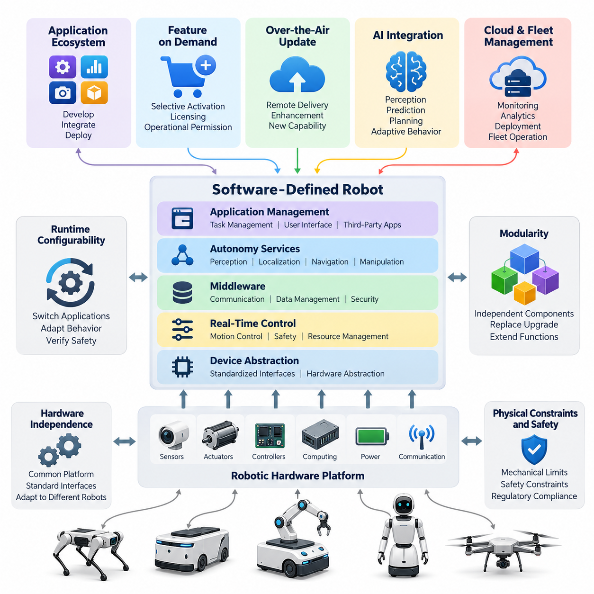
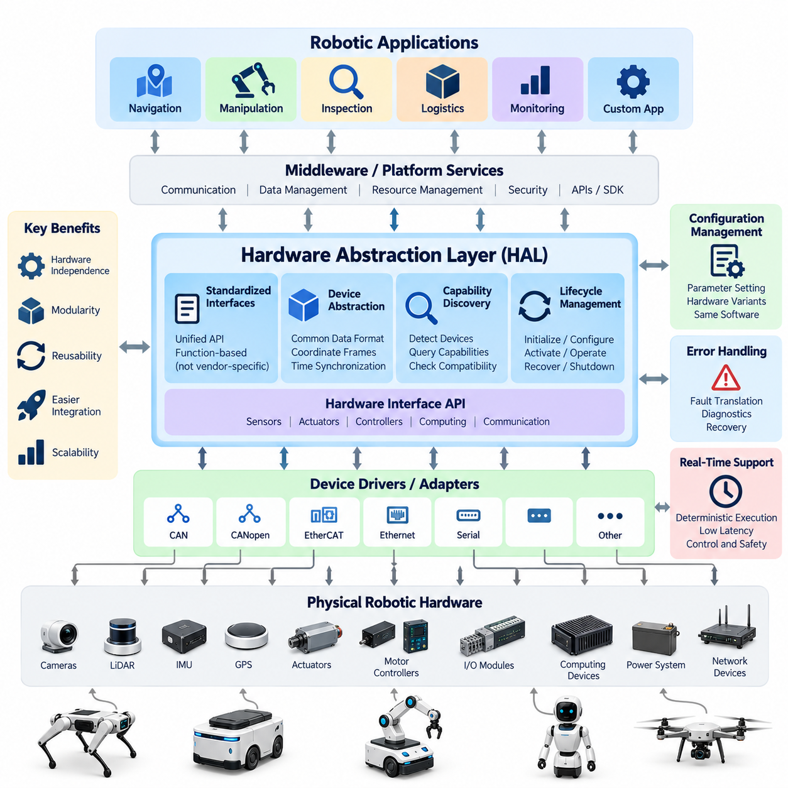
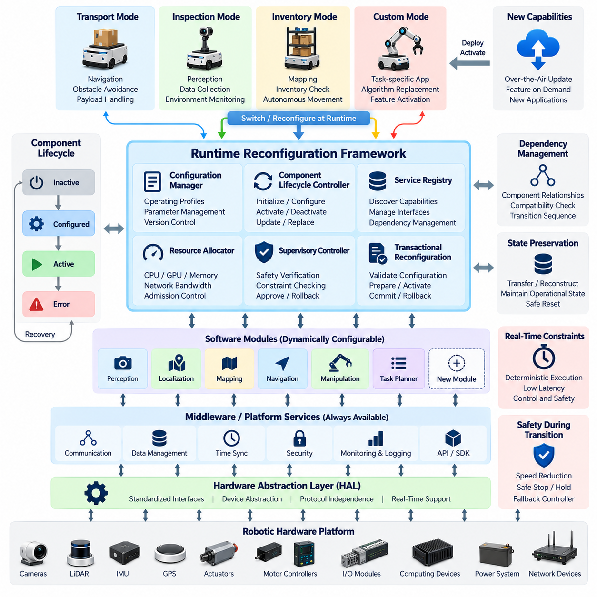
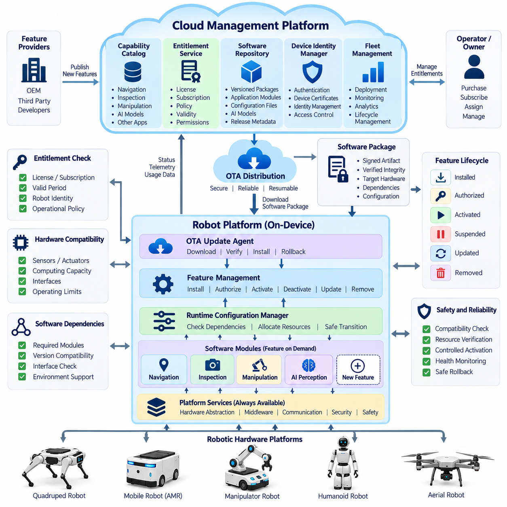
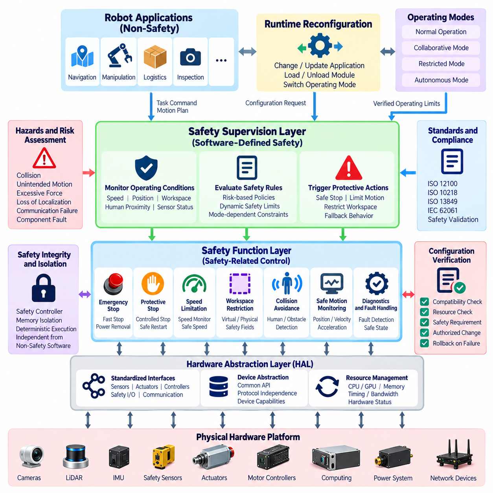
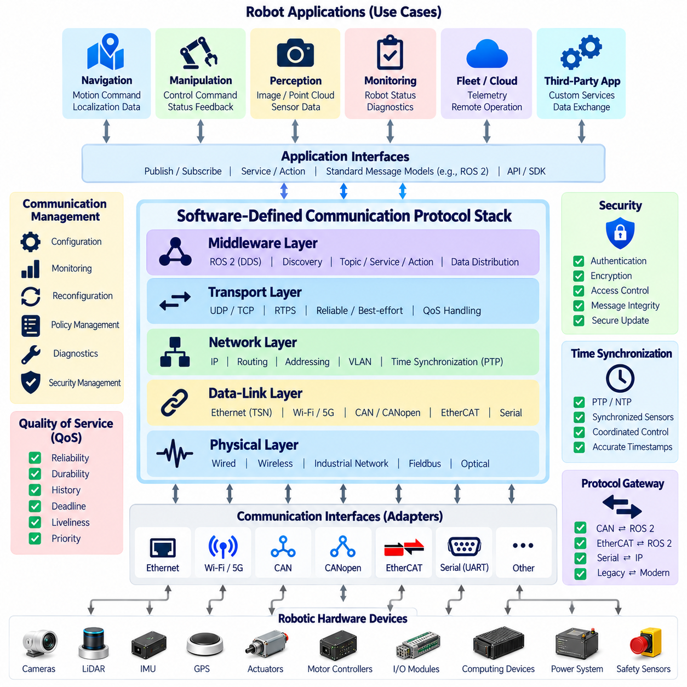
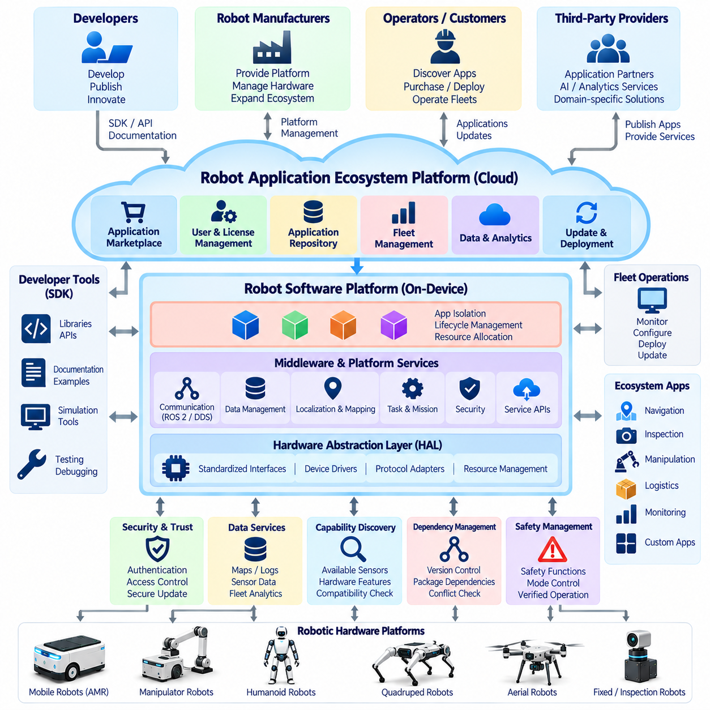
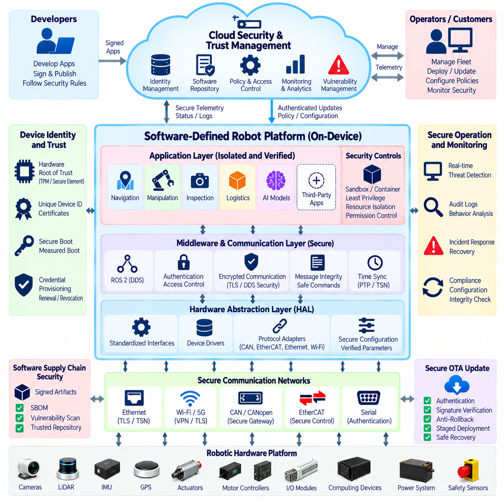
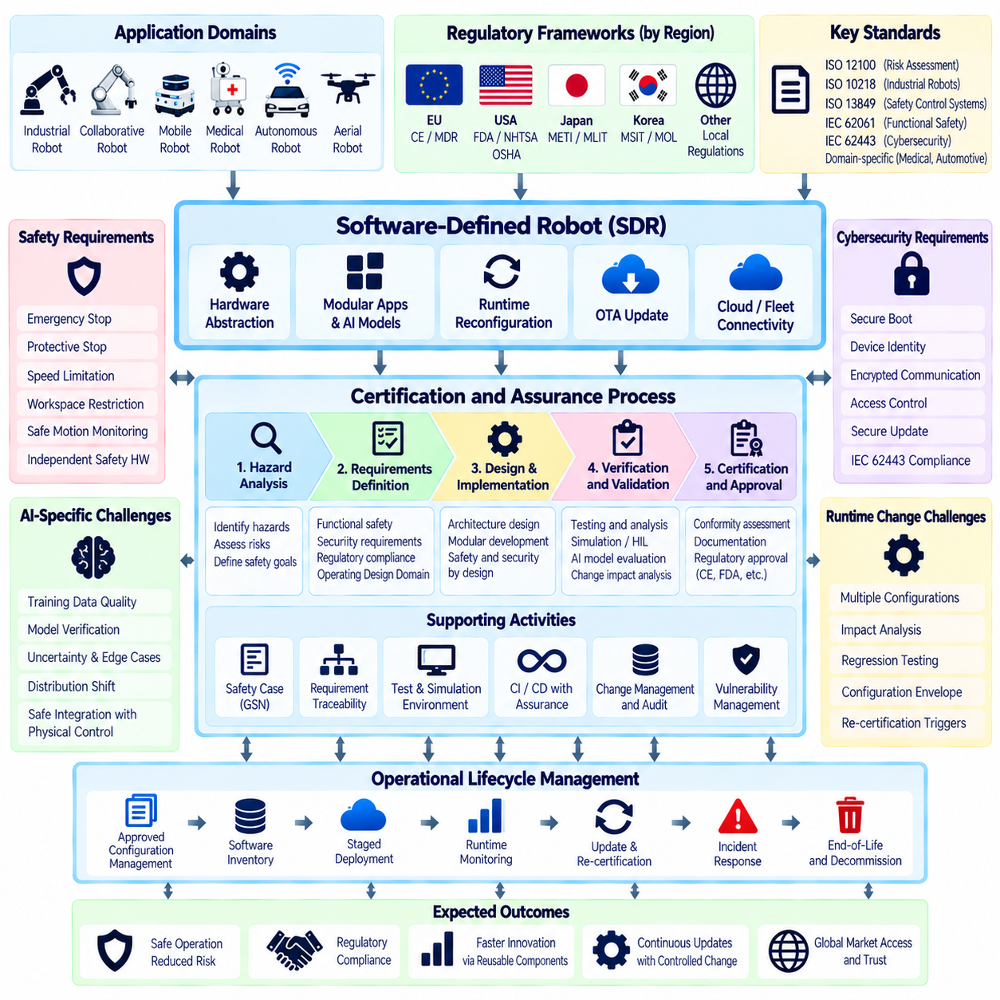
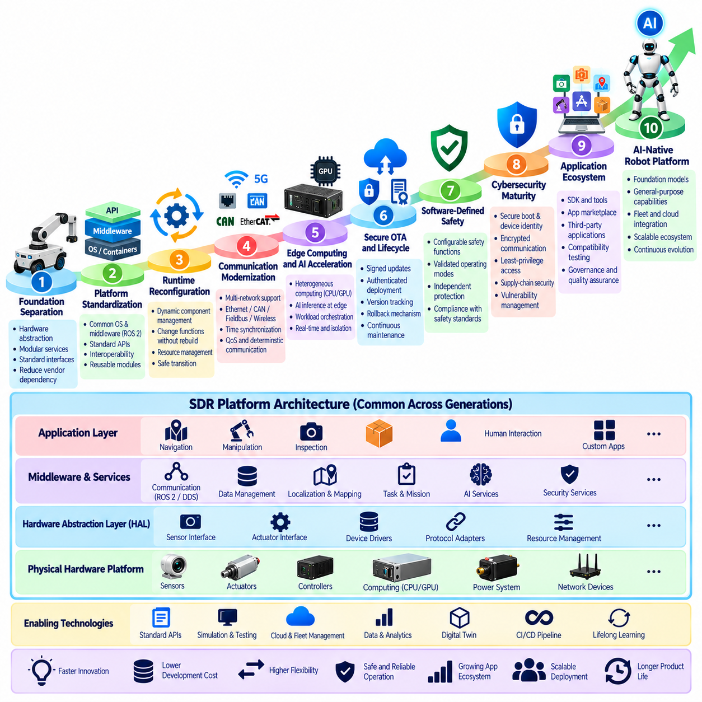

**Volume 27. Future AI Native Robotics**


# Chapter 02. Software Defined Robot Platforms

##  

## 02.01. Software Defined Robot SDR Concept and Benefits

{width="7.268055555555556in" height="7.268055555555556in"}

A Software-Defined Robot (SDR) is a robotic system in which operational capabilities, behaviors, and system configurations are primarily controlled and evolved through software rather than fixed hardware implementations. This architectural approach separates physical mechanisms from functional intelligence, allowing a common robotic platform to support different applications through software configuration, updates, and modular capability deployment.

Traditional robotic systems frequently integrate hardware and software around a predefined operational purpose. Sensors, actuators, controllers, and application logic are optimized for specific tasks, making later modifications expensive and technically complex. Software-defined robotics introduces a more flexible architecture in which standardized hardware interfaces and reusable software services enable capabilities to evolve without requiring extensive physical redesign.

The fundamental principle of SDR is the separation of hardware resources, platform services, and application-level functionality. Hardware provides sensing, computation, communication, and actuation, while software determines how these resources are coordinated. Hardware abstraction layers expose standardized interfaces, allowing application developers to implement robotic behaviors without depending directly on specific motor drivers, sensor models, or computing devices.

An SDR architecture typically contains several interacting software layers, including device abstraction, real-time control, middleware, autonomy services, and application management. These layers establish clear interfaces between hardware-dependent operations and higher-level decision-making. Such separation improves maintainability, enables independent component development, and reduces the engineering effort required to introduce new robotic functions.

Software-defined functionality does not eliminate the importance of physical hardware limitations. Motor torque, sensor accuracy, computational throughput, battery capacity, and communication latency continue to constrain achievable performance. Instead, SDR provides mechanisms for managing these resources dynamically. Software can select operating modes, allocate computing resources, and adjust control parameters while remaining within verified mechanical and electrical boundaries.

One major benefit of SDR is hardware independence. A navigation application developed for one mobile robot may be adapted to another platform when both expose compatible localization, motion control, and sensor interfaces. Platform-specific adaptation remains necessary where physical characteristics differ, but standardized abstractions reduce duplicated development. This capability supports product families built around shared software foundations.

Modularity represents another important architectural advantage. Perception, localization, navigation, manipulation, and task management can be implemented as independently maintained software components. Each component communicates through defined interfaces and data contracts. Engineers can replace a perception algorithm, upgrade a planner, or introduce a new application without redesigning the complete robotic software system, provided compatibility requirements are satisfied.

Runtime configurability allows SDR platforms to modify selected operational behaviors according to mission requirements and environmental conditions. A warehouse robot might switch between transport, inspection, and inventory-monitoring applications using different combinations of available sensors and software modules. These transitions require controlled state management, resource verification, and safety checks to prevent incompatible configurations or unsafe behavior.

Over-the-air (OTA) software delivery extends the useful life of robotic products by enabling remote deployment of corrections, enhancements, and new capabilities. Updates may improve navigation efficiency, add perception functions, or support additional operational workflows. Reliable OTA architectures require authenticated packages, integrity verification, compatibility testing, staged deployment, and rollback mechanisms to recover from unsuccessful updates.

Feature-on-demand functionality introduces a software-centered model for robotic capability management. Manufacturers may provide a common hardware platform while enabling selected applications according to customer requirements, licensing arrangements, or operational permissions. However, capability activation must verify hardware readiness, available computational resources, safety constraints, and regulatory conditions before allowing a newly enabled function to operate.

SDR also supports the development of robotic application ecosystems. A standardized platform can expose documented interfaces, software development kits, and controlled execution environments for internal teams or third-party developers. Applications may provide inspection, logistics, monitoring, or specialized automation services. Platform governance must establish interface stability, application permissions, compatibility requirements, and validation procedures to maintain dependable operation.

Artificial intelligence significantly expands the potential of software-defined robotic platforms. Machine learning models can provide perception, prediction, planning, and adaptive decision-making capabilities through replaceable software components. Foundation models and vision-language-action architectures may support increasingly general robotic behaviors. Nevertheless, AI-generated decisions must remain constrained by physical feasibility, operational permissions, and independent safety mechanisms.

The relationship between SDR and AI-native robotics is particularly important. SDR supplies the programmable infrastructure through which AI capabilities can be deployed, updated, monitored, and integrated with physical hardware. AI-native architectures use this infrastructure to implement data-driven behaviors and increasingly adaptable policies. The combination enables robotic products to evolve through improvements in both platform software and learned intelligence.

Cloud and edge computing provide complementary execution environments for SDR. Time-critical sensing, control, and safety functions generally require local processing, while computationally intensive analytics, fleet optimization, and model training may benefit from centralized infrastructure. A well-designed platform assigns functions according to latency, bandwidth, reliability, privacy, and computational requirements rather than assuming continuous cloud connectivity.

Data-driven improvement is another fundamental advantage of software-defined robotics. Robots can collect operational telemetry, diagnostic events, performance measurements, and selected sensor observations during deployment. These records support failure analysis, software optimization, and AI model development. Controlled data pipelines transform operational experience into validated improvements that can subsequently be distributed across compatible robotic platforms.

Software-defined platforms also improve fleet-level consistency. Organizations operating hundreds of robots can manage software versions, configuration profiles, application permissions, and operational policies through centralized management services. Consistent deployment reduces configuration drift and simplifies maintenance. Fleet operators can introduce improvements progressively, monitor operational effects, and suspend deployment when unexpected performance degradation or safety concerns appear.

Cybersecurity becomes a foundational requirement because software-defined capabilities increase the number of configurable interfaces and remotely managed components. Secure boot, signed software packages, identity management, encrypted communications, and access control protect platform integrity. Runtime isolation helps prevent compromised applications from accessing critical control functions. Security monitoring and vulnerability management must remain active throughout the robotic product lifecycle.

Functional safety requires equally careful architectural separation. Although software can implement many protective functions, safety-related behavior must satisfy appropriate integrity, independence, timing, and verification requirements. Emergency stopping, protective motion limitation, and fault handling cannot depend solely on an unverified application or AI model. Safety functions must remain effective during software updates, communication failures, resource exhaustion, and unexpected application behavior.

Certification presents additional challenges when robotic functionality changes after initial deployment. A modification to navigation, motion planning, or perception may alter the assumptions supporting an existing safety assessment. Consequently, SDR platforms require traceable software configurations, controlled change management, impact analysis, and repeatable validation. Update approval should depend on the consequences of each change rather than treating all software modifications as equivalent.

The economic benefits of SDR arise from software reuse, reduced integration effort, simplified product variation, and improved lifecycle management. A manufacturer can maintain shared platform components across several robotic products while developing application-specific capabilities independently. Customers may gain longer product lifetimes and greater operational flexibility. Actual savings depend on platform standardization, engineering discipline, hardware compatibility, and the cost of maintaining software infrastructure.

Software-defined architectures can also support more sustainable robotic product development. When existing hardware remains capable of executing new applications, software improvements may delay unnecessary equipment replacement. Remote diagnostics and predictive maintenance can improve resource utilization and reduce service interventions. However, additional computing requirements, cybersecurity maintenance, and long-term software support must be considered when evaluating environmental and economic benefits.

For industrial deployment, SDR success should be evaluated through measurable engineering and operational outcomes. Relevant indicators include software reuse, deployment time, update success rate, application portability, system availability, recovery time, and lifecycle maintenance cost. Safety performance and cybersecurity resilience must be assessed independently. These measurements establish whether architectural flexibility produces practical improvements rather than merely increasing software complexity.

The long-term significance of SDR is its transformation of the robot from a fixed-function machine into an extensible computational and physical platform. Standardized hardware interfaces, modular software services, controlled updates, and AI integration allow capabilities to evolve throughout the product lifecycle. This foundation supports the progression toward AI-native robotic systems capable of operating across increasingly diverse tasks and environments.

Ultimately, software-defined robotics provides an architectural bridge between conventional automation and future general-purpose physical intelligence. Its value lies not simply in replacing hardware functions with software, but in establishing controlled mechanisms for adaptability, interoperability, maintainability, and continuous improvement. As robotic intelligence advances, dependable SDR platforms will remain essential for converting evolving software capabilities into safe, reliable physical operations.

소프트웨어 정의 로봇(Software-Defined Robot, SDR)은 로봇의 운영 기능, 동작 및 시스템 구성이 고정된 하드웨어(Hardware) 구현보다 소프트웨어(Software)를 통해 주로 제어되고 발전하는 로봇 시스템이다. 이러한 아키텍처(Architecture)는 물리적 메커니즘과 기능적 지능을 분리하여, 공통 로봇 플랫폼(Platform)이 소프트웨어 구성, 업데이트(Update), 모듈형 기능 배포를 통해 다양한 응용 분야를 지원하도록 한다.

전통적인 로봇 시스템은 사전에 정의된 운영 목적에 맞추어 하드웨어와 소프트웨어를 긴밀하게 통합하는 경우가 많다. 센서(Sensor), 액추에이터(Actuator), 제어기(Controller), 응용 로직(Application Logic)이 특정 작업에 최적화되어 있어 이후 기능 변경에는 상당한 비용과 기술적 복잡성이 발생한다. 소프트웨어 정의 로봇은 표준화된 하드웨어 인터페이스(Interface)와 재사용 가능한 소프트웨어 서비스를 통해 물리적 재설계 없이 기능을 발전시킬 수 있는 유연한 구조를 제공한다.

소프트웨어 정의 로봇(SDR)의 기본 원리는 하드웨어 자원, 플랫폼 서비스 및 응용 계층 기능을 분리하는 것이다. 하드웨어는 감지(Sensing), 연산(Computing), 통신(Communication), 구동(Actuation)을 제공하며, 소프트웨어는 이러한 자원을 어떻게 조정할지 결정한다. 하드웨어 추상화 계층(Hardware Abstraction Layer, HAL)은 표준화된 인터페이스를 제공하여 응용 개발자가 특정 모터 드라이버, 센서 모델 또는 컴퓨팅 장치에 직접 종속되지 않고 로봇 동작을 구현하도록 한다.

소프트웨어 정의 로봇 아키텍처는 일반적으로 장치 추상화(Device Abstraction), 실시간 제어(Real-Time Control), 미들웨어(Middleware), 자율 기능 서비스(Autonomy Services), 응용 관리(Application Management) 등 상호작용하는 여러 소프트웨어 계층으로 구성된다. 이러한 계층은 하드웨어 종속적인 동작과 상위 의사결정 기능 사이에 명확한 인터페이스를 설정한다. 이와 같은 분리는 유지보수성(Maintainability)을 높이고 독립적인 구성요소 개발을 가능하게 하며 새로운 로봇 기능을 도입하는 데 필요한 엔지니어링 부담을 줄인다.

소프트웨어 정의 기능이 물리적 하드웨어의 제약을 제거하는 것은 아니다. 모터 토크(Motor Torque), 센서 정확도(Sensor Accuracy), 연산 처리량(Computational Throughput), 배터리 용량(Battery Capacity), 통신 지연(Communication Latency)은 여전히 달성 가능한 성능을 제한한다. 대신 SDR은 이러한 자원을 동적으로 관리하는 메커니즘을 제공한다. 소프트웨어는 검증된 기계적·전기적 한계 내에서 운영 모드를 선택하고 연산 자원을 할당하며 제어 매개변수를 조정할 수 있다.

SDR의 주요 이점 중 하나는 하드웨어 독립성(Hardware Independence)이다. 하나의 이동 로봇을 위해 개발된 내비게이션 응용 프로그램(Navigation Application)은 다른 플랫폼이 호환 가능한 위치 추정, 운동 제어 및 센서 인터페이스를 제공한다면 해당 플랫폼에도 적용될 수 있다. 물리적 특성이 다른 경우에는 플랫폼별 조정이 여전히 필요하지만, 표준화된 추상화는 중복 개발을 줄인다. 이러한 특성은 공통 소프트웨어 기반을 활용하는 로봇 제품군 개발을 지원한다.

모듈성(Modularity)은 또 다른 중요한 아키텍처상의 장점이다. 인식(Perception), 위치 추정(Localization), 내비게이션(Navigation), 조작(Manipulation), 작업 관리(Task Management)는 독립적으로 유지보수되는 소프트웨어 구성요소로 구현할 수 있다. 각 구성요소는 정의된 인터페이스와 데이터 계약(Data Contract)을 통해 통신한다. 호환성 요구사항이 충족된다면 엔지니어는 전체 로봇 소프트웨어 시스템을 재설계하지 않고도 인식 알고리즘을 교체하거나 경로 계획기를 개선하고 새로운 응용 기능을 도입할 수 있다.

실행 중 구성 변경 기능(Runtime Configurability)은 SDR 플랫폼이 임무 요구사항과 환경 조건에 따라 선택된 운영 동작을 변경하도록 한다. 창고 로봇은 사용 가능한 센서와 소프트웨어 모듈을 서로 다르게 조합하여 운송, 검사 및 재고 모니터링 응용 프로그램 사이를 전환할 수 있다. 이러한 전환에는 호환되지 않는 구성이나 위험한 동작을 방지하기 위한 제어된 상태 관리(State Management), 자원 검증(Resource Verification), 안전 점검(Safety Check)이 필요하다.

무선 소프트웨어 업데이트(Over-the-Air Update, OTA)는 수정 사항, 기능 개선 및 새로운 기능을 원격으로 배포하여 로봇 제품의 사용 수명을 연장한다. 업데이트를 통해 내비게이션 효율을 개선하거나 인식 기능을 추가하고 새로운 운영 절차를 지원할 수 있다. 신뢰할 수 있는 OTA 아키텍처에는 인증된 패키지(Authenticated Package), 무결성 검증(Integrity Verification), 호환성 시험(Compatibility Testing), 단계적 배포(Staged Deployment), 실패한 업데이트에서 복구하기 위한 롤백(Rollback) 메커니즘이 필요하다.

주문형 기능(Feature-on-Demand)은 로봇 기능 관리에 소프트웨어 중심 모델을 도입한다. 제조업체는 공통 하드웨어 플랫폼을 제공하면서 고객 요구사항, 라이선스 계약(Licensing Arrangement), 운영 권한(Operational Permission)에 따라 선택된 응용 기능을 활성화할 수 있다. 그러나 새로운 기능을 활성화하기 전에 하드웨어 준비 상태, 사용 가능한 연산 자원, 안전 제약조건 및 규제 요건을 검증해야 한다.

SDR은 로봇 응용 생태계(Application Ecosystem)의 개발도 지원한다. 표준화된 플랫폼은 내부 개발팀이나 외부 개발자를 위해 문서화된 인터페이스, 소프트웨어 개발 키트(Software Development Kit, SDK), 통제된 실행 환경(Execution Environment)을 제공할 수 있다. 응용 프로그램은 검사, 물류, 모니터링 또는 특수 자동화 서비스를 제공할 수 있다. 플랫폼 거버넌스(Platform Governance)는 안정적인 운영을 유지하기 위해 인터페이스 안정성, 응용 권한, 호환성 요구사항 및 검증 절차를 확립해야 한다.

인공지능(Artificial Intelligence, AI)은 소프트웨어 정의 로봇 플랫폼의 잠재력을 크게 확장한다. 기계학습 모델(Machine Learning Model)은 교체 가능한 소프트웨어 구성요소를 통해 인식, 예측, 계획 및 적응형 의사결정 기능을 제공할 수 있다. 파운데이션 모델(Foundation Model)과 시각-언어-행동 아키텍처(Vision-Language-Action Architecture, VLA)는 점차 범용적인 로봇 동작을 지원할 수 있다. 그러나 AI가 생성한 의사결정은 물리적 실행 가능성, 운영 권한 및 독립적인 안전 메커니즘에 의해 제한되어야 한다.

SDR과 AI 네이티브 로봇(AI-Native Robotics)의 관계는 특히 중요하다. SDR은 AI 기능을 배포, 업데이트, 모니터링하고 물리적 하드웨어와 통합할 수 있는 프로그래밍 가능한 인프라(Programmable Infrastructure)를 제공한다. AI 네이티브 아키텍처는 이러한 인프라를 활용하여 데이터 기반 동작(Data-Driven Behavior)과 점차 적응성이 높아지는 정책(Adaptive Policy)을 구현한다. 두 기술의 결합은 플랫폼 소프트웨어와 학습된 지능의 개선을 통해 로봇 제품이 지속적으로 발전하도록 한다.

클라우드 컴퓨팅(Cloud Computing)과 엣지 컴퓨팅(Edge Computing)은 SDR을 위한 상호 보완적인 실행 환경을 제공한다. 시간 제약이 엄격한 감지, 제어 및 안전 기능은 일반적으로 로컬 처리(Local Processing)가 필요하지만, 연산 집약적인 분석, 로봇 군집 최적화(Fleet Optimization), 모델 학습(Model Training)은 중앙 집중형 인프라의 이점을 활용할 수 있다. 잘 설계된 플랫폼은 지속적인 클라우드 연결을 가정하지 않고 지연시간, 대역폭, 신뢰성, 개인정보 보호 및 연산 요구사항에 따라 기능을 배치한다.

데이터 기반 개선(Data-Driven Improvement)은 소프트웨어 정의 로봇의 또 다른 핵심 이점이다. 로봇은 배포 후 운영 과정에서 운영 텔레메트리(Operational Telemetry), 진단 이벤트(Diagnostic Event), 성능 측정값 및 선택된 센서 관측 데이터를 수집할 수 있다. 이러한 기록은 고장 분석(Failure Analysis), 소프트웨어 최적화 및 AI 모델 개발을 지원한다. 통제된 데이터 파이프라인(Data Pipeline)은 운영 경험을 검증된 개선 사항으로 전환하고, 이후 호환 가능한 로봇 플랫폼 전체에 배포할 수 있도록 한다.

소프트웨어 정의 플랫폼은 로봇 군집 수준의 일관성(Fleet-Level Consistency)도 향상시킨다. 수백 대의 로봇을 운영하는 조직은 중앙 집중형 관리 서비스를 통해 소프트웨어 버전, 구성 프로파일(Configuration Profile), 응용 권한 및 운영 정책을 관리할 수 있다. 일관된 배포는 구성 편차(Configuration Drift)를 줄이고 유지보수를 단순화한다. 운영자는 개선 사항을 단계적으로 도입하고 운영 영향을 모니터링하며 예상하지 못한 성능 저하나 안전 문제가 발생하면 배포를 중단할 수 있다.

사이버보안(Cybersecurity)은 소프트웨어 정의 기능이 구성 가능한 인터페이스와 원격 관리 구성요소를 증가시키기 때문에 필수적인 기반 요구사항이 된다. 보안 부팅(Secure Boot), 서명된 소프트웨어 패키지(Signed Software Package), 신원 관리(Identity Management), 암호화 통신(Encrypted Communication), 접근 제어(Access Control)는 플랫폼 무결성을 보호한다. 실행 중 격리(Runtime Isolation)는 침해된 응용 프로그램이 핵심 제어 기능에 접근하는 것을 방지한다. 보안 모니터링과 취약점 관리는 로봇 제품의 전체 수명주기 동안 지속되어야 한다.

기능 안전(Functional Safety) 역시 신중한 아키텍처 분리를 요구한다. 소프트웨어가 다양한 보호 기능을 구현할 수 있지만, 안전 관련 동작은 적절한 무결성, 독립성, 시간 제약 및 검증 요구사항을 충족해야 한다. 비상 정지(Emergency Stop), 보호 운동 제한(Protective Motion Limitation), 고장 처리(Fault Handling)는 검증되지 않은 응용 프로그램이나 AI 모델에만 의존해서는 안 된다. 안전 기능은 소프트웨어 업데이트, 통신 장애, 자원 고갈 및 예상하지 못한 응용 동작 중에도 유효하게 유지되어야 한다.

인증(Certification)은 초기 배포 이후 로봇 기능이 변경될 때 추가적인 과제를 제기한다. 내비게이션, 운동 계획 또는 인식 기능의 수정은 기존 안전성 평가(Safety Assessment)를 뒷받침하는 가정을 변경할 수 있다. 따라서 SDR 플랫폼에는 추적 가능한 소프트웨어 구성, 통제된 변경 관리(Change Management), 영향 분석(Impact Analysis), 반복 가능한 검증(Repeatable Validation)이 필요하다. 업데이트 승인은 모든 소프트웨어 변경을 동일하게 취급하기보다 각 변경이 미치는 영향에 따라 결정되어야 한다.

SDR의 경제적 이점은 소프트웨어 재사용(Software Reuse), 통합 작업 감소, 제품 변형의 단순화 및 수명주기 관리 개선에서 발생한다. 제조업체는 여러 로봇 제품에 걸쳐 공통 플랫폼 구성요소를 유지하면서 응용 분야별 기능을 독립적으로 개발할 수 있다. 고객은 제품 수명 연장과 운영 유연성 향상의 이점을 얻을 수 있다. 실제 비용 절감 효과는 플랫폼 표준화, 엔지니어링 체계, 하드웨어 호환성 및 소프트웨어 인프라 유지 비용에 따라 달라진다.

소프트웨어 정의 아키텍처는 더욱 지속 가능한 로봇 제품 개발도 지원할 수 있다. 기존 하드웨어가 새로운 응용 프로그램을 실행할 수 있는 능력을 유지한다면 소프트웨어 개선을 통해 불필요한 장비 교체를 늦출 수 있다. 원격 진단(Remote Diagnostics)과 예지 정비(Predictive Maintenance)는 자원 활용도를 개선하고 현장 서비스 작업을 줄일 수 있다. 그러나 환경적·경제적 이점을 평가할 때는 추가 연산 요구사항, 사이버보안 유지관리 및 장기 소프트웨어 지원도 고려해야 한다.

산업 현장에서 SDR의 성공 여부는 측정 가능한 엔지니어링 및 운영 성과를 통해 평가해야 한다. 주요 지표에는 소프트웨어 재사용률, 배포 시간, 업데이트 성공률, 응용 프로그램 이식성(Application Portability), 시스템 가용성(System Availability), 복구 시간 및 수명주기 유지보수 비용이 포함된다. 안전 성능과 사이버보안 복원력(Cybersecurity Resilience)은 독립적으로 평가해야 한다. 이러한 측정은 아키텍처의 유연성이 단순히 소프트웨어 복잡성을 증가시키는 것이 아니라 실질적인 개선을 제공하는지 판단하는 기준이 된다.

SDR의 장기적 의미는 로봇을 고정 기능 기계(Fixed-Function Machine)에서 확장 가능한 컴퓨팅 및 물리적 플랫폼(Extensible Computational and Physical Platform)으로 전환한다는 데 있다. 표준화된 하드웨어 인터페이스, 모듈형 소프트웨어 서비스, 통제된 업데이트 및 AI 통합을 통해 제품 수명주기 전반에서 기능이 발전할 수 있다. 이러한 기반은 점점 더 다양한 작업과 환경에서 운영할 수 있는 AI 네이티브 로봇 시스템으로의 발전을 지원한다.

궁극적으로 소프트웨어 정의 로봇은 기존 자동화(Conventional Automation)와 미래의 범용 물리 지능(General-Purpose Physical Intelligence)을 연결하는 아키텍처적 가교를 제공한다. 그 가치는 단순히 하드웨어 기능을 소프트웨어로 대체하는 것이 아니라 적응성(Adaptability), 상호운용성(Interoperability), 유지보수성(Maintainability), 지속적 개선(Continuous Improvement)을 위한 통제된 메커니즘을 확립하는 데 있다. 로봇 지능이 발전함에 따라 신뢰할 수 있는 SDR 플랫폼은 진화하는 소프트웨어 기능을 안전하고 신뢰성 있는 물리적 동작으로 전환하는 데 필수적인 기반으로 남을 것이다.

##  

## 02.02. Hardware Abstraction for SW Defined Robots [w/Code]

{width="7.268055555555556in" height="7.268055555555556in"}

Hardware abstraction is a foundational architectural principle of Software-Defined Robots (SDR), enabling robotic applications to operate independently of specific physical components. A Hardware Abstraction Layer (HAL) provides standardized interfaces between software services and underlying sensors, actuators, controllers, and computing devices. This separation allows robot functionality to evolve without requiring extensive modification of application software whenever hardware configurations change.

Traditional robotic software often communicates directly with device drivers, vendor-specific libraries, and proprietary communication protocols. Such dependencies create tight coupling between software functionality and hardware implementation. Replacing a motor controller or sensor may require modifications across multiple software modules. Hardware abstraction reduces this coupling by presenting consistent device capabilities through well-defined interfaces.

An SDR hardware abstraction architecture typically separates physical devices, device drivers, abstraction services, middleware, and application-level functions. Physical devices execute sensing and actuation, while drivers handle device-specific communication and control. The abstraction layer translates hardware capabilities into standardized software operations, allowing higher-level components to access devices without understanding their internal implementation details.

A fundamental design requirement is the definition of hardware-independent interfaces based on functional capabilities rather than manufacturer-specific commands. For example, a mobile robot motion interface may expose velocity commands, position feedback, and operational status. Different motor controllers can implement these functions through separate adapters, allowing navigation software to remain unchanged when compatible drive hardware is introduced.

Sensor abstraction follows similar principles by standardizing measurement formats, coordinate frames, timestamps, and quality indicators. Cameras, LiDAR sensors, inertial measurement units, and positioning devices produce different forms of data, but common interface contracts allow perception and localization modules to consume compatible measurements. Device-specific calibration, resolution, measurement uncertainty, and synchronization requirements must remain accessible when necessary.

Actuator abstraction translates high-level motion requests into device-specific control commands while preserving operational constraints. A robotic joint interface may support position, velocity, torque, and status reporting, depending on actuator capabilities. The abstraction layer must explicitly declare supported control modes, command limits, feedback availability, and fault conditions rather than assuming every actuator provides identical functionality.

Capability discovery is essential for supporting heterogeneous robotic hardware. During initialization, the platform can identify connected devices and retrieve information about supported functions, communication characteristics, operating limits, and firmware versions. This information enables applications to determine whether required capabilities are available before execution. Unsupported operations should generate explicit compatibility errors rather than silently producing incorrect behavior.

Hardware abstraction must preserve the timing requirements of robotic control systems. High-frequency motor control, synchronized sensor acquisition, and safety monitoring often require deterministic execution. Introducing additional software layers can increase latency and scheduling uncertainty. Therefore, real-time abstraction interfaces should minimize unnecessary data copying, blocking operations, dynamic memory allocation, and unpredictable communication overhead.

The separation between real-time control and higher-level software services is particularly important. Low-level controllers may execute on microcontrollers or real-time operating systems, while perception and planning applications run on embedded Linux or accelerated computing platforms. Hardware abstraction provides a controlled communication boundary between these environments without transferring time-critical control responsibilities to nondeterministic application processes.

Communication protocol independence extends hardware abstraction across multiple industrial interfaces. Robotic devices may communicate through CAN, CANopen, EtherCAT, Ethernet, serial connections, or other transport mechanisms. Protocol adapters translate device-specific messages into common software interfaces. However, abstraction must preserve relevant timing guarantees, error semantics, bandwidth constraints, and synchronization capabilities associated with each transport.

A robust HAL architecture also defines consistent lifecycle management for hardware components. Devices progress through initialization, configuration, activation, operation, deactivation, and shutdown states. Standardized lifecycle interfaces allow platform services to coordinate startup sequences, recover from recoverable faults, and prevent applications from accessing unavailable devices. State transitions should be validated against hardware readiness and operational safety requirements.

Error handling requires careful translation between device-specific failures and platform-level diagnostic information. A motor driver may report overcurrent, encoder loss, overheating, or communication timeout conditions. The abstraction layer should preserve the underlying fault identity while exposing standardized severity, operational impact, and recovery information. Excessive simplification of diagnostic data can conceal important hardware failure characteristics.

Configuration management enables the same software architecture to support different robot models and hardware revisions. Device mappings, calibration parameters, communication settings, and operational limits can be represented through version-controlled configuration profiles. At deployment, the platform selects an appropriate configuration based on verified hardware identity. Configuration validation prevents incompatible parameters from being applied to physical devices.

Hardware abstraction is especially valuable for software portability across robot families. A warehouse mobile robot, outdoor inspection platform, and service robot may share navigation and mission-management components despite using different sensors and drive mechanisms. Common interfaces reduce software duplication, while platform-specific adapters account for differences in kinematics, environmental protection, payload capacity, and available sensing capabilities.

Robot Operating System 2 (ROS 2) provides useful mechanisms for implementing hardware-independent robotic software. Standardized message types, lifecycle nodes, and communication interfaces support modular integration. The ros2_control framework offers hardware interfaces for actuators and sensors through configurable system components. Nevertheless, application portability still depends on compatible semantics, supported capabilities, timing behavior, and correct device-specific implementations.

Hardware abstraction also supports simulation and digital twin integration. Simulated devices can implement the same interfaces used by physical hardware, allowing applications to operate in virtual environments with limited software modification. This enables software-in-the-loop testing, algorithm development, and integration validation before physical deployment. Differences in sensor noise, actuator dynamics, timing, and failure behavior must still be evaluated during real-world testing.

Hardware-in-the-loop testing further strengthens the abstraction architecture by combining actual controllers or devices with simulated system components. Engineers can evaluate command handling, communication timing, fault responses, and interface compatibility under controlled conditions. The same application-level software can be tested against simulated and physical implementations, improving regression coverage and identifying integration defects earlier.

Security boundaries must be incorporated into hardware abstraction because standardized interfaces can expose powerful physical capabilities. Unauthorized software must not be allowed to command actuators, modify calibration parameters, or disable protective functions. Authentication, authorization, interface isolation, and command validation help restrict hardware access. Safety-critical operations require additional independent enforcement beyond ordinary application permissions.

Functional safety imposes specific requirements on hardware abstraction design. Emergency stopping, protective limits, and safety-related monitoring must remain effective even when abstraction services fail or become unavailable. Safety-rated controllers and independent protective mechanisms may be required depending on the application. The HAL should expose relevant safety states without allowing non-safety software to bypass certified protective functions.

Performance evaluation should measure the overhead introduced by abstraction under realistic operating conditions. Relevant indicators include command latency, timing jitter, sensor throughput, CPU utilization, memory consumption, and recovery time following device faults. Testing should compare abstraction implementations across supported hardware platforms and operating loads. Interface consistency alone is insufficient if real-time performance or reliability deteriorates.

The economic benefits of hardware abstraction arise from reduced integration effort, reusable application software, simplified hardware replacement, and improved lifecycle maintenance. Manufacturers can introduce alternative components without redesigning entire software stacks, provided interface compatibility is maintained. However, developing and maintaining abstraction adapters introduces additional engineering responsibilities, including compatibility testing and version management.

Future SDR platforms may extend hardware abstraction through machine-readable capability descriptions, automatic device discovery, and policy-based resource allocation. AI-native applications could use these descriptions to select appropriate sensors, actuators, and computing resources for specific tasks. Such adaptability requires trustworthy capability metadata, verified compatibility constraints, and deterministic enforcement of physical operating limits.

Ultimately, hardware abstraction transforms heterogeneous robotic components into a manageable software-defined platform while preserving the physical constraints that determine safe operation. Its effectiveness depends on clear interface contracts, real-time compatibility, accurate capability representation, robust fault handling, and disciplined validation. These principles establish the technical foundation for portable, reconfigurable, and continuously evolving AI-native robotic systems.

하드웨어 추상화(Hardware Abstraction)는 소프트웨어 정의 로봇(Software-Defined Robot, SDR)의 핵심 아키텍처 원리로, 로봇 응용 프로그램이 특정 물리적 구성요소에 종속되지 않고 동작할 수 있도록 한다. 하드웨어 추상화 계층(Hardware Abstraction Layer, HAL)은 소프트웨어 서비스와 하위 센서(Sensor), 액추에이터(Actuator), 제어기(Controller), 컴퓨팅 장치(Computing Device) 사이에 표준화된 인터페이스(Interface)를 제공한다. 이러한 분리를 통해 하드웨어 구성이 변경되더라도 응용 소프트웨어를 광범위하게 수정하지 않고 로봇 기능을 발전시킬 수 있다.

전통적인 로봇 소프트웨어는 장치 드라이버(Device Driver), 제조업체별 라이브러리(Vendor-Specific Library), 독점 통신 프로토콜(Proprietary Communication Protocol)과 직접 통신하는 경우가 많다. 이러한 의존성은 소프트웨어 기능과 하드웨어 구현 사이에 강한 결합(Tight Coupling)을 형성한다. 모터 제어기나 센서를 교체하면 여러 소프트웨어 모듈을 수정해야 할 수 있다. 하드웨어 추상화는 명확하게 정의된 인터페이스를 통해 일관된 장치 기능을 제공함으로써 이러한 결합을 줄인다.

SDR 하드웨어 추상화 아키텍처는 일반적으로 물리적 장치(Physical Device), 장치 드라이버(Device Driver), 추상화 서비스(Abstraction Service), 미들웨어(Middleware), 응용 계층 기능(Application-Level Function)을 분리한다. 물리적 장치는 감지(Sensing)와 구동(Actuation)을 수행하며, 드라이버는 장치별 통신과 제어를 처리한다. 추상화 계층은 하드웨어 기능을 표준화된 소프트웨어 동작으로 변환하여 상위 구성요소가 장치의 내부 구현 세부사항을 이해하지 않고도 접근할 수 있도록 한다.

핵심 설계 요구사항은 제조업체별 명령이 아니라 기능적 역량(Functional Capability)을 기반으로 하드웨어 독립적인 인터페이스(Hardware-Independent Interface)를 정의하는 것이다. 예를 들어 이동 로봇의 운동 인터페이스(Motion Interface)는 속도 명령(Velocity Command), 위치 피드백(Position Feedback), 운영 상태(Operational Status)를 제공할 수 있다. 서로 다른 모터 제어기는 별도의 어댑터(Adapter)를 통해 이러한 기능을 구현할 수 있으며, 호환 가능한 구동 하드웨어가 도입되어도 내비게이션 소프트웨어는 변경 없이 유지될 수 있다.

센서 추상화(Sensor Abstraction)는 측정 데이터 형식(Measurement Format), 좌표계(Coordinate Frame), 타임스탬프(Timestamp), 품질 지표(Quality Indicator)를 표준화하는 유사한 원리를 따른다. 카메라(Camera), 라이다(LiDAR), 관성 측정 장치(Inertial Measurement Unit, IMU), 위치 측정 장치(Positioning Device)는 서로 다른 형태의 데이터를 생성하지만, 공통 인터페이스 계약(Interface Contract)을 통해 인식 및 위치 추정 모듈이 호환 가능한 측정값을 사용할 수 있다. 필요한 경우 장치별 보정, 해상도, 측정 불확실성 및 동기화 요구사항에도 접근할 수 있어야 한다.

액추에이터 추상화(Actuator Abstraction)는 운영 제약조건을 유지하면서 상위 수준의 운동 요청을 장치별 제어 명령으로 변환한다. 로봇 관절 인터페이스(Robot Joint Interface)는 액추에이터의 기능에 따라 위치(Position), 속도(Velocity), 토크(Torque), 상태 보고(Status Reporting)를 지원할 수 있다. 추상화 계층은 모든 액추에이터가 동일한 기능을 제공한다고 가정하지 않고 지원되는 제어 모드(Control Mode), 명령 제한(Command Limit), 피드백 가용성(Feedback Availability), 고장 상태(Fault Condition)를 명시적으로 선언해야 한다.

기능 탐색(Capability Discovery)은 이기종 로봇 하드웨어(Heterogeneous Robotic Hardware)를 지원하는 데 필수적이다. 초기화 과정에서 플랫폼은 연결된 장치를 식별하고 지원 기능, 통신 특성, 운영 한계 및 펌웨어 버전(Firmware Version)에 관한 정보를 가져올 수 있다. 이러한 정보는 응용 프로그램이 실행 전에 필요한 기능의 사용 가능 여부를 판단하도록 한다. 지원되지 않는 동작은 잘못된 동작을 조용히 발생시키는 대신 명시적인 호환성 오류(Compatibility Error)를 생성해야 한다.

하드웨어 추상화는 로봇 제어 시스템의 시간 요구사항(Timing Requirement)을 유지해야 한다. 고주파 모터 제어(High-Frequency Motor Control), 동기화된 센서 데이터 수집(Synchronized Sensor Acquisition), 안전 모니터링(Safety Monitoring)은 결정론적 실행(Deterministic Execution)을 요구하는 경우가 많다. 추가적인 소프트웨어 계층은 지연시간(Latency)과 스케줄링 불확실성(Scheduling Uncertainty)을 증가시킬 수 있다. 따라서 실시간 추상화 인터페이스는 불필요한 데이터 복사, 블로킹 연산(Blocking Operation), 동적 메모리 할당(Dynamic Memory Allocation), 예측하기 어려운 통신 오버헤드(Communication Overhead)를 최소화해야 한다.

실시간 제어(Real-Time Control)와 상위 소프트웨어 서비스(Higher-Level Software Service)의 분리는 특히 중요하다. 하위 제어기는 마이크로컨트롤러(Microcontroller)나 실시간 운영체제(Real-Time Operating System, RTOS)에서 실행될 수 있으며, 인식 및 계획 응용 프로그램은 임베디드 리눅스(Embedded Linux)나 가속 컴퓨팅 플랫폼(Accelerated Computing Platform)에서 실행될 수 있다. 하드웨어 추상화는 시간 제약이 엄격한 제어 책임을 비결정론적 응용 프로세스로 이전하지 않으면서 이러한 환경 사이에 통제된 통신 경계를 제공한다.

통신 프로토콜 독립성(Communication Protocol Independence)은 하드웨어 추상화를 여러 산업용 인터페이스로 확장한다. 로봇 장치는 CAN, CANopen, EtherCAT, Ethernet, 직렬 통신(Serial Communication) 또는 기타 전송 메커니즘을 통해 통신할 수 있다. 프로토콜 어댑터(Protocol Adapter)는 장치별 메시지를 공통 소프트웨어 인터페이스로 변환한다. 그러나 추상화는 각 전송 방식과 관련된 시간 보장(Timing Guarantee), 오류 의미 체계(Error Semantics), 대역폭 제약조건(Bandwidth Constraint), 동기화 기능(Synchronization Capability)을 유지해야 한다.

견고한 HAL 아키텍처는 하드웨어 구성요소에 대한 일관된 수명주기 관리(Lifecycle Management)도 정의한다. 장치는 초기화(Initialization), 구성(Configuration), 활성화(Activation), 운영(Operation), 비활성화(Deactivation), 종료(Shutdown) 상태를 거친다. 표준화된 수명주기 인터페이스는 플랫폼 서비스가 시작 순서를 조정하고 복구 가능한 고장에서 회복하며 사용 불가능한 장치에 응용 프로그램이 접근하는 것을 방지하도록 한다. 상태 전환(State Transition)은 하드웨어 준비 상태와 운영 안전 요구사항을 기준으로 검증되어야 한다.

오류 처리(Error Handling)는 장치별 고장과 플랫폼 수준의 진단 정보(Diagnostic Information) 사이에서 신중한 변환을 요구한다. 모터 드라이버는 과전류(Overcurrent), 엔코더 신호 손실(Encoder Loss), 과열(Overheating), 통신 시간 초과(Communication Timeout) 상태를 보고할 수 있다. 추상화 계층은 기본 고장 식별 정보를 유지하면서 표준화된 심각도(Severity), 운영 영향(Operational Impact), 복구 정보(Recovery Information)를 제공해야 한다. 진단 데이터를 지나치게 단순화하면 중요한 하드웨어 고장 특성이 감춰질 수 있다.

구성 관리(Configuration Management)는 동일한 소프트웨어 아키텍처가 서로 다른 로봇 모델과 하드웨어 개정 버전(Hardware Revision)을 지원하도록 한다. 장치 매핑(Device Mapping), 보정 매개변수(Calibration Parameter), 통신 설정(Communication Setting), 운영 한계(Operational Limit)는 버전 관리되는 구성 프로파일(Version-Controlled Configuration Profile)로 표현할 수 있다. 배포 시 플랫폼은 검증된 하드웨어 식별 정보를 기반으로 적절한 구성을 선택한다. 구성 검증(Configuration Validation)은 호환되지 않는 매개변수가 물리적 장치에 적용되는 것을 방지한다.

하드웨어 추상화는 로봇 제품군 사이의 소프트웨어 이식성(Software Portability)에 특히 유용하다. 창고 이동 로봇, 실외 검사 플랫폼, 서비스 로봇은 서로 다른 센서와 구동 메커니즘을 사용하더라도 내비게이션 및 임무 관리 구성요소를 공유할 수 있다. 공통 인터페이스는 소프트웨어 중복을 줄이며, 플랫폼별 어댑터는 운동학(Kinematics), 환경 보호(Environmental Protection), 적재 용량(Payload Capacity), 사용 가능한 감지 기능의 차이를 반영한다.

로봇 운영체제 2(Robot Operating System 2, ROS 2)는 하드웨어 독립적인 로봇 소프트웨어 구현에 유용한 메커니즘을 제공한다. 표준화된 메시지 형식(Standardized Message Type), 수명주기 노드(Lifecycle Node), 통신 인터페이스(Communication Interface)는 모듈형 통합(Modular Integration)을 지원한다. ros2_control 프레임워크(Framework)는 구성 가능한 시스템 구성요소를 통해 액추에이터와 센서용 하드웨어 인터페이스를 제공한다. 그러나 응용 프로그램의 이식성은 여전히 호환 가능한 의미 체계, 지원 기능, 시간 동작 및 올바른 장치별 구현에 달려 있다.

하드웨어 추상화는 시뮬레이션(Simulation)과 디지털 트윈(Digital Twin)의 통합도 지원한다. 시뮬레이션 장치(Simulated Device)는 물리적 하드웨어와 동일한 인터페이스를 구현할 수 있으므로 응용 프로그램은 소프트웨어 수정이 거의 없이 가상 환경에서 동작할 수 있다. 이를 통해 실제 배포 전에 소프트웨어 인 더 루프 시험(Software-in-the-Loop Testing, SIL), 알고리즘 개발 및 통합 검증을 수행할 수 있다. 그러나 센서 잡음, 액추에이터 동역학, 시간 특성 및 고장 동작의 차이는 실제 환경 시험에서 여전히 평가해야 한다.

하드웨어 인 더 루프 시험(Hardware-in-the-Loop Testing, HIL)은 실제 제어기나 장치를 시뮬레이션된 시스템 구성요소와 결합하여 추상화 아키텍처를 더욱 강화한다. 엔지니어는 통제된 조건에서 명령 처리(Command Handling), 통신 타이밍(Communication Timing), 고장 응답(Fault Response), 인터페이스 호환성(Interface Compatibility)을 평가할 수 있다. 동일한 응용 계층 소프트웨어를 시뮬레이션 구현과 물리적 구현에 대해 시험함으로써 회귀 시험 범위(Regression Coverage)를 확대하고 통합 결함을 조기에 식별할 수 있다.

표준화된 인터페이스가 강력한 물리적 기능을 노출할 수 있으므로 보안 경계(Security Boundary)를 하드웨어 추상화에 포함해야 한다. 권한이 없는 소프트웨어가 액추에이터에 명령을 내리거나 보정 매개변수를 수정하거나 보호 기능을 비활성화하도록 허용해서는 안 된다. 인증(Authentication), 인가(Authorization), 인터페이스 격리(Interface Isolation), 명령 검증(Command Validation)은 하드웨어 접근을 제한하는 데 도움이 된다. 안전 필수 동작(Safety-Critical Operation)에는 일반적인 응용 프로그램 권한을 넘어서는 추가적인 독립적 강제 적용 메커니즘이 필요하다.

기능 안전(Functional Safety)은 하드웨어 추상화 설계에 구체적인 요구사항을 부과한다. 비상 정지(Emergency Stop), 보호 제한(Protective Limit), 안전 관련 모니터링(Safety-Related Monitoring)은 추상화 서비스가 고장 나거나 사용 불가능한 경우에도 유효하게 유지되어야 한다. 응용 분야에 따라 안전 등급 제어기(Safety-Rated Controller)와 독립적인 보호 메커니즘(Independent Protective Mechanism)이 필요할 수 있다. HAL은 안전 관련 상태를 제공하되 비안전 소프트웨어(Non-Safety Software)가 인증된 보호 기능을 우회하지 못하도록 해야 한다.

성능 평가(Performance Evaluation)는 실제 운영 조건에서 추상화로 인해 발생하는 오버헤드를 측정해야 한다. 주요 지표에는 명령 지연시간(Command Latency), 타이밍 지터(Timing Jitter), 센서 처리량(Sensor Throughput), CPU 사용률(CPU Utilization), 메모리 사용량(Memory Consumption), 장치 고장 이후 복구 시간(Recovery Time)이 포함된다. 시험은 지원되는 하드웨어 플랫폼과 운영 부하 전반에서 추상화 구현을 비교해야 한다. 실시간 성능이나 신뢰성이 저하된다면 인터페이스 일관성만으로는 충분하지 않다.

하드웨어 추상화의 경제적 이점은 통합 작업 감소, 응용 소프트웨어 재사용, 하드웨어 교체의 단순화 및 수명주기 유지보수(Lifecycle Maintenance) 개선에서 발생한다. 제조업체는 인터페이스 호환성이 유지되는 경우 전체 소프트웨어 스택(Software Stack)을 재설계하지 않고 대체 구성요소를 도입할 수 있다. 그러나 추상화 어댑터의 개발과 유지보수에는 호환성 시험(Compatibility Testing)과 버전 관리(Version Management)를 포함한 추가적인 엔지니어링 책임이 따른다.

미래의 SDR 플랫폼은 기계 판독 가능한 기능 설명(Machine-Readable Capability Description), 자동 장치 탐색(Automatic Device Discovery), 정책 기반 자원 할당(Policy-Based Resource Allocation)을 통해 하드웨어 추상화를 확장할 수 있다. AI 네이티브 응용 프로그램(AI-Native Application)은 이러한 설명을 활용하여 특정 작업에 적합한 센서, 액추에이터 및 컴퓨팅 자원을 선택할 수 있다. 이러한 적응성에는 신뢰할 수 있는 기능 메타데이터(Capability Metadata), 검증된 호환성 제약조건(Compatibility Constraint), 물리적 운영 한계에 대한 결정론적 강제 적용(Deterministic Enforcement)이 필요하다.

궁극적으로 하드웨어 추상화는 안전한 운영을 결정하는 물리적 제약조건을 유지하면서 이기종 로봇 구성요소를 관리 가능한 소프트웨어 정의 플랫폼(Software-Defined Platform)으로 전환한다. 그 효과는 명확한 인터페이스 계약(Interface Contract), 실시간 호환성(Real-Time Compatibility), 정확한 기능 표현(Capability Representation), 견고한 고장 처리(Fault Handling), 체계적인 검증(Disciplined Validation)에 달려 있다. 이러한 원리는 이식 가능하고 재구성 가능하며 지속적으로 발전하는 AI 네이티브 로봇 시스템의 기술적 기반을 확립한다.

##  

## 02.03. Runtime Reconfigurable Robot SW Architecture [w/Code]

{width="7.268055555555556in" height="7.268055555555556in"}

Runtime reconfigurable robot software architecture enables a robotic system to modify selected functions, operating modes, and software configurations while remaining operational. Unlike conventional architectures that require shutdown or complete redeployment for significant changes, runtime reconfiguration supports controlled adaptation to evolving tasks and environmental conditions. This capability is fundamental to Software-Defined Robots (SDR) and flexible AI-native robotic platforms.

The primary objective of runtime reconfiguration is to separate stable platform infrastructure from dynamically adjustable software functionality. Core services such as hardware abstraction, communication, resource management, and safety supervision remain continuously available. Application modules, behavioral policies, and selected processing pipelines can be activated, replaced, or reconfigured through controlled mechanisms without disrupting essential robot operations.

A reconfigurable architecture typically includes a configuration manager, component lifecycle controller, service registry, resource allocator, and supervisory controller. The configuration manager maintains approved operating profiles, while the lifecycle controller coordinates component transitions. The service registry identifies available capabilities, and the supervisor verifies that requested changes satisfy operational constraints before execution.

Dynamic component management allows software modules to transition between defined states such as inactive, configured, active, and error. These states provide predictable boundaries for initialization, parameter updates, and shutdown. A component should not begin processing commands until its dependencies, configuration, and hardware interfaces have been validated. Failed transitions must generate explicit diagnostic information and trigger appropriate recovery procedures.

Runtime reconfiguration may involve changing parameters, replacing algorithms, activating optional services, or modifying communication connections. Parameter adjustments can alter navigation speed limits or perception thresholds, while algorithm replacement may introduce an improved localization method. More extensive changes can reorganize processing pipelines, provided interface compatibility, resource availability, and safety requirements remain satisfied.

Configuration profiles provide a structured mechanism for representing different robot operating modes. A mobile robot may maintain separate profiles for warehouse transport, inventory inspection, and restricted-area operation. Each profile specifies required software components, sensor configurations, resource allocations, and operational limits. Profile transitions must verify that the target configuration is supported by the installed hardware and approved software versions.

Dependency management is essential because robotic components rarely operate independently. A navigation service may depend on localization, obstacle perception, motion control, and map availability. Reconfiguring one component can affect several downstream functions. Dependency graphs and compatibility contracts allow the platform to determine the correct transition sequence and prevent incomplete configurations from becoming operational.

State preservation becomes particularly important when components are replaced during execution. Localization modules may contain estimated robot poses, covariance matrices, and historical observations that cannot be discarded without operational consequences. Reconfiguration mechanisms should define whether state can be transferred, reconstructed, or safely reset. Incompatible state representations require controlled recovery rather than assuming uninterrupted operation.

Resource management ensures that dynamically activated components do not exceed available computing or communication capacity. CPU utilization, GPU memory, system memory, network bandwidth, and power consumption must be considered before a configuration change. Admission control mechanisms can reject requests that would compromise critical workloads. Resource reservations help maintain predictable performance for essential control and perception functions.

Real-time requirements impose strict boundaries on dynamic software changes. Motion controllers and safety-related monitoring functions often operate under deterministic scheduling constraints. Reconfiguration activities must not introduce unbounded blocking, excessive memory allocation, or unpredictable scheduling interference. Noncritical software can be updated more flexibly, while timing-critical components may require controlled pauses or redundant execution paths.

Transactional reconfiguration provides a useful model for coordinating complex changes. A transition begins by validating the target configuration, preparing required components, and checking resource availability. The system then activates the new configuration and verifies operational readiness before committing the change. If validation fails, rollback procedures restore a previously verified configuration or place the robot in a defined safe state.

The concept of safe transition states is central to runtime reconfiguration. A robot changing its navigation algorithm should not continue executing uncontrolled motion while localization or planning services are temporarily unavailable. Depending on the application, the system may reduce speed, stop movement, maintain a safe holding position, or transfer control to a verified fallback controller. Transition behavior must be explicitly designed and tested.

ROS 2 lifecycle nodes provide mechanisms for implementing controlled component transitions through standardized states and transition callbacks. Managed nodes can be configured, activated, deactivated, and cleaned up under supervisory control. Component composition and configurable communication interfaces further support modular deployment. However, ROS 2 lifecycle management alone does not guarantee atomic transitions, real-time behavior, or functional safety.

Service discovery and communication management are necessary when software components are dynamically introduced or removed. Applications must identify available publishers, subscribers, services, and action interfaces without relying on permanently fixed connections. Interface versioning and compatibility checks prevent mismatched components from exchanging invalid information. Communication changes should preserve message integrity and relevant quality-of-service requirements.

AI-native robotics introduces additional reconfiguration requirements because learned models may be updated independently of conventional software components. A perception model, manipulation policy, or task planner may be replaced with a validated alternative. Model deployment must consider input-output compatibility, inference latency, memory requirements, and behavior changes. Newly activated models should remain subject to independent operational and safety constraints.

Runtime model switching can support adaptation to different operating environments. For example, an inspection robot may use one perception configuration in a brightly illuminated warehouse and another in a low-light environment. A supervisory system can select an appropriate model based on verified environmental conditions and performance indicators. Such switching requires confidence monitoring and fallback behavior when the selected model becomes unreliable.

Security controls must protect runtime reconfiguration interfaces from unauthorized modification. Configuration requests should be authenticated, authorized, logged, and checked against approved policies. Software modules and model artifacts require integrity verification before activation. Privilege separation prevents ordinary applications from changing safety limits or critical hardware configurations. Audit records should preserve the identity, timing, and outcome of each configuration change.

Functional safety requires a clear distinction between reconfigurable application functions and independently enforced protective functions. Emergency stopping, protective speed limits, and safety-related fault handling must remain effective throughout configuration transitions. Changes affecting safety assumptions require appropriate impact analysis and verification. A runtime reconfiguration mechanism must never bypass established safety boundaries merely to maintain service continuity.

Observability is necessary for determining whether a reconfiguration has achieved its intended operational outcome. The platform should monitor component states, configuration versions, transition duration, resource consumption, communication health, and application performance. Diagnostic events help identify unsuccessful transitions and emerging incompatibilities. Continuous monitoring also provides evidence for maintenance decisions and future architecture improvements.

Simulation and digital twin environments provide controlled settings for evaluating reconfiguration behavior before physical deployment. Engineers can introduce component failures, communication delays, resource shortages, and incompatible configurations to assess recovery mechanisms. Software-in-the-loop and hardware-in-the-loop testing help verify transition sequences and timing behavior. Physical testing remains necessary to establish confidence in actual robot operation.

Validation should include both successful transitions and deliberately induced failures. Relevant scenarios include interrupted component activation, unavailable sensors, inconsistent configuration versions, insufficient computing resources, and failed rollback operations. Evaluation metrics may include transition completion time, service interruption duration, recovery success rate, and operational stability. Safety-related outcomes must be assessed separately from ordinary performance measurements.

Runtime reconfiguration also supports efficient fleet operations by allowing different robots to adopt approved configurations according to assigned missions. Centralized management systems can distribute configuration policies, while local supervisors determine whether changes are currently safe and feasible. Fleet-wide deployment should use staged activation and monitoring to limit the impact of unexpected failures or configuration incompatibilities.

The long-term value of runtime reconfigurable architecture lies in separating robot capabilities from permanently fixed software arrangements. Modular components, verified configuration profiles, lifecycle management, and controlled transitions allow robotic systems to evolve during their operational lifetime. When combined with hardware abstraction and AI-native intelligence, these mechanisms establish a foundation for adaptable, maintainable, and dependable software-defined robotic platforms.

실행 중 재구성 가능한 로봇 소프트웨어 아키텍처(Runtime Reconfigurable Robot Software Architecture)는 로봇 시스템이 운영을 유지하면서 선택된 기능, 운영 모드 및 소프트웨어 구성을 변경할 수 있도록 한다. 중요한 변경을 위해 시스템 종료나 전체 재배포가 필요한 기존 아키텍처와 달리, 실행 중 재구성(Runtime Reconfiguration)은 변화하는 작업과 환경 조건에 대한 통제된 적응을 지원한다. 이러한 기능은 소프트웨어 정의 로봇(Software-Defined Robot, SDR)과 유연한 AI 네이티브 로봇 플랫폼(AI-Native Robotic Platform)의 핵심 기반이다.

실행 중 재구성의 주요 목적은 안정적인 플랫폼 인프라(Platform Infrastructure)와 동적으로 조정 가능한 소프트웨어 기능을 분리하는 것이다. 하드웨어 추상화(Hardware Abstraction), 통신(Communication), 자원 관리(Resource Management), 안전 감독(Safety Supervision)과 같은 핵심 서비스는 지속적으로 사용 가능한 상태를 유지한다. 응용 모듈(Application Module), 행동 정책(Behavioral Policy), 선택된 처리 파이프라인(Processing Pipeline)은 필수 로봇 운영을 방해하지 않는 통제된 메커니즘을 통해 활성화, 교체 또는 재구성할 수 있다.

재구성 가능한 아키텍처는 일반적으로 구성 관리자(Configuration Manager), 구성요소 수명주기 제어기(Component Lifecycle Controller), 서비스 레지스트리(Service Registry), 자원 할당기(Resource Allocator), 감독 제어기(Supervisory Controller)를 포함한다. 구성 관리자는 승인된 운영 프로파일(Operating Profile)을 유지하며, 수명주기 제어기는 구성요소의 상태 전환을 조정한다. 서비스 레지스트리는 사용 가능한 기능을 식별하고, 감독 제어기는 요청된 변경이 실행 전에 운영 제약조건을 충족하는지 검증한다.

동적 구성요소 관리(Dynamic Component Management)는 소프트웨어 모듈이 비활성(Inactive), 구성 완료(Configured), 활성(Active), 오류(Error)와 같은 정의된 상태 사이를 전환하도록 한다. 이러한 상태는 초기화, 매개변수 업데이트 및 종료를 위한 예측 가능한 경계를 제공한다. 구성요소는 종속성, 구성 및 하드웨어 인터페이스가 검증되기 전까지 명령 처리를 시작해서는 안 된다. 실패한 상태 전환은 명시적인 진단 정보를 생성하고 적절한 복구 절차를 실행해야 한다.

실행 중 재구성은 매개변수 변경(Parameter Modification), 알고리즘 교체(Algorithm Replacement), 선택적 서비스 활성화(Optional Service Activation), 통신 연결 변경(Communication Connection Modification)을 포함할 수 있다. 매개변수 조정은 내비게이션 속도 제한이나 인식 임계값을 변경할 수 있으며, 알고리즘 교체는 개선된 위치 추정 방법을 도입할 수 있다. 보다 광범위한 변경은 인터페이스 호환성, 자원 가용성 및 안전 요구사항이 충족되는 경우 처리 파이프라인을 재구성할 수 있다.

구성 프로파일(Configuration Profile)은 서로 다른 로봇 운영 모드를 표현하기 위한 구조화된 메커니즘을 제공한다. 이동 로봇은 창고 운송, 재고 검사 및 제한 구역 운영을 위한 별도의 프로파일을 유지할 수 있다. 각 프로파일은 필요한 소프트웨어 구성요소, 센서 구성, 자원 할당 및 운영 한계를 지정한다. 프로파일 전환(Profile Transition)은 대상 구성이 설치된 하드웨어와 승인된 소프트웨어 버전에서 지원되는지 검증해야 한다.

종속성 관리(Dependency Management)는 로봇 구성요소가 독립적으로 동작하는 경우가 드물기 때문에 필수적이다. 내비게이션 서비스는 위치 추정(Localization), 장애물 인식(Obstacle Perception), 운동 제어(Motion Control), 지도 가용성(Map Availability)에 의존할 수 있다. 하나의 구성요소를 재구성하면 여러 하위 기능에 영향을 줄 수 있다. 종속성 그래프(Dependency Graph)와 호환성 계약(Compatibility Contract)은 플랫폼이 올바른 전환 순서를 결정하고 불완전한 구성이 운영 상태로 진입하는 것을 방지하도록 한다.

상태 보존(State Preservation)은 실행 중 구성요소를 교체할 때 특히 중요하다. 위치 추정 모듈은 로봇의 추정 위치와 자세(Pose), 공분산 행렬(Covariance Matrix), 과거 관측값(Historical Observation)을 포함할 수 있으며, 이러한 정보는 운영상 영향을 고려하지 않고 폐기할 수 없다. 재구성 메커니즘은 상태를 이전, 재구성 또는 안전하게 초기화할 수 있는지 정의해야 한다. 호환되지 않는 상태 표현(State Representation)은 중단 없는 운영을 가정하는 대신 통제된 복구 절차를 요구한다.

자원 관리(Resource Management)는 동적으로 활성화되는 구성요소가 사용 가능한 연산 또는 통신 용량을 초과하지 않도록 한다. 구성 변경 전에 CPU 사용률(CPU Utilization), GPU 메모리(GPU Memory), 시스템 메모리(System Memory), 네트워크 대역폭(Network Bandwidth), 전력 소비(Power Consumption)를 고려해야 한다. 수용 제어 메커니즘(Admission Control Mechanism)은 핵심 작업의 성능을 저하시킬 수 있는 요청을 거부할 수 있다. 자원 예약(Resource Reservation)은 필수 제어 및 인식 기능의 예측 가능한 성능을 유지하는 데 도움이 된다.

실시간 요구사항(Real-Time Requirements)은 동적 소프트웨어 변경에 엄격한 경계를 부과한다. 운동 제어기(Motion Controller)와 안전 관련 모니터링 기능은 결정론적 스케줄링(Deterministic Scheduling) 제약조건 아래에서 동작하는 경우가 많다. 재구성 작업은 제한되지 않은 블로킹(Unbounded Blocking), 과도한 메모리 할당(Excessive Memory Allocation), 예측하기 어려운 스케줄링 간섭(Scheduling Interference)을 발생시켜서는 안 된다. 비핵심 소프트웨어는 상대적으로 유연하게 업데이트할 수 있지만, 시간 제약이 엄격한 구성요소는 통제된 일시 정지나 이중화된 실행 경로(Redundant Execution Path)가 필요할 수 있다.

트랜잭션 기반 재구성(Transactional Reconfiguration)은 복잡한 변경을 조정하기 위한 유용한 모델을 제공한다. 전환은 대상 구성 검증(Target Configuration Validation), 필요한 구성요소 준비(Component Preparation), 자원 가용성 확인(Resource Availability Check)으로 시작된다. 이후 시스템은 새로운 구성을 활성화하고 운영 준비 상태를 검증한 다음 변경을 확정한다. 검증에 실패하면 롤백 절차(Rollback Procedure)를 통해 이전에 검증된 구성을 복원하거나 로봇을 정의된 안전 상태(Safe State)로 전환한다.

안전 전환 상태(Safe Transition State)의 개념은 실행 중 재구성의 핵심이다. 내비게이션 알고리즘을 변경하는 로봇은 위치 추정이나 경로 계획 서비스가 일시적으로 사용 불가능한 동안 제어되지 않는 운동을 계속해서는 안 된다. 응용 분야에 따라 시스템은 속도를 줄이거나 이동을 정지하고 안전한 유지 위치(Safe Holding Position)를 확보하거나 검증된 대체 제어기(Fallback Controller)로 제어권을 이전할 수 있다. 전환 동작(Transition Behavior)은 명시적으로 설계하고 시험해야 한다.

ROS 2 수명주기 노드(ROS 2 Lifecycle Node)는 표준화된 상태와 전환 콜백(Transition Callback)을 통해 통제된 구성요소 전환을 구현하는 메커니즘을 제공한다. 관리형 노드(Managed Node)는 감독 제어 아래에서 구성, 활성화, 비활성화 및 정리 작업을 수행할 수 있다. 구성요소 합성(Component Composition)과 설정 가능한 통신 인터페이스도 모듈형 배포(Modular Deployment)를 지원한다. 그러나 ROS 2 수명주기 관리만으로 원자적 전환(Atomic Transition), 실시간 동작 또는 기능 안전(Functional Safety)이 보장되는 것은 아니다.

서비스 탐색(Service Discovery)과 통신 관리(Communication Management)는 소프트웨어 구성요소가 동적으로 추가되거나 제거될 때 필요하다. 응용 프로그램은 영구적으로 고정된 연결에 의존하지 않고 사용 가능한 발행자(Publisher), 구독자(Subscriber), 서비스(Service), 액션 인터페이스(Action Interface)를 식별해야 한다. 인터페이스 버전 관리(Interface Versioning)와 호환성 검사는 서로 일치하지 않는 구성요소가 잘못된 정보를 교환하는 것을 방지한다. 통신 변경은 메시지 무결성(Message Integrity)과 관련 서비스 품질(Quality of Service, QoS) 요구사항을 유지해야 한다.

AI 네이티브 로봇(AI-Native Robotics)은 학습된 모델이 기존 소프트웨어 구성요소와 독립적으로 업데이트될 수 있기 때문에 추가적인 재구성 요구사항을 도입한다. 인식 모델(Perception Model), 조작 정책(Manipulation Policy), 작업 계획기(Task Planner)는 검증된 대체 모델로 교체할 수 있다. 모델 배포(Model Deployment)는 입출력 호환성(Input-Output Compatibility), 추론 지연시간(Inference Latency), 메모리 요구사항(Memory Requirements), 동작 변화를 고려해야 한다. 새롭게 활성화된 모델도 독립적인 운영 및 안전 제약조건의 적용을 받아야 한다.

실행 중 모델 전환(Runtime Model Switching)은 서로 다른 운영 환경에 대한 적응을 지원할 수 있다. 예를 들어 검사 로봇은 조명이 밝은 창고에서는 하나의 인식 구성을 사용하고 저조도 환경에서는 다른 구성을 사용할 수 있다. 감독 시스템(Supervisory System)은 검증된 환경 조건과 성능 지표(Performance Indicator)를 기반으로 적절한 모델을 선택할 수 있다. 이러한 전환에는 신뢰도 모니터링(Confidence Monitoring)과 선택된 모델의 신뢰성이 저하될 때 적용할 대체 동작(Fallback Behavior)이 필요하다.

보안 제어(Security Control)는 실행 중 재구성 인터페이스를 무단 변경으로부터 보호해야 한다. 구성 요청(Configuration Request)은 인증(Authentication), 인가(Authorization), 기록(Logging), 승인된 정책에 대한 검사를 거쳐야 한다. 소프트웨어 모듈과 모델 산출물(Model Artifact)은 활성화 전에 무결성 검증(Integrity Verification)이 필요하다. 권한 분리(Privilege Separation)는 일반 응용 프로그램이 안전 한계나 핵심 하드웨어 구성을 변경하지 못하도록 한다. 감사 기록(Audit Record)은 각 구성 변경의 요청 주체, 시점 및 결과를 보존해야 한다.

기능 안전(Functional Safety)은 재구성 가능한 응용 기능과 독립적으로 강제되는 보호 기능 사이의 명확한 구분을 요구한다. 비상 정지(Emergency Stop), 보호 속도 제한(Protective Speed Limit), 안전 관련 고장 처리(Safety-Related Fault Handling)는 구성 전환 과정 전체에서 유효하게 유지되어야 한다. 안전성 가정(Safety Assumption)에 영향을 미치는 변경에는 적절한 영향 분석(Impact Analysis)과 검증(Verification)이 필요하다. 실행 중 재구성 메커니즘은 서비스 연속성을 유지하기 위해 기존 안전 경계(Safety Boundary)를 우회해서는 안 된다.

관측 가능성(Observability)은 재구성이 의도한 운영 결과를 달성했는지 판단하는 데 필요하다. 플랫폼은 구성요소 상태(Component State), 구성 버전(Configuration Version), 전환 소요 시간(Transition Duration), 자원 소비(Resource Consumption), 통신 상태(Communication Health), 응용 성능(Application Performance)을 모니터링해야 한다. 진단 이벤트(Diagnostic Event)는 실패한 전환과 새롭게 발생하는 비호환성을 식별하는 데 도움이 된다. 지속적인 모니터링은 유지보수 의사결정과 향후 아키텍처 개선을 위한 근거도 제공한다.

시뮬레이션(Simulation)과 디지털 트윈(Digital Twin) 환경은 물리적 배포 전에 재구성 동작을 평가하기 위한 통제된 시험 환경을 제공한다. 엔지니어는 구성요소 고장, 통신 지연, 자원 부족 및 호환되지 않는 구성을 인위적으로 발생시켜 복구 메커니즘을 평가할 수 있다. 소프트웨어 인 더 루프 시험(Software-in-the-Loop Testing, SIL)과 하드웨어 인 더 루프 시험(Hardware-in-the-Loop Testing, HIL)은 전환 순서와 시간 동작을 검증하는 데 도움이 된다. 실제 로봇 운영에 대한 신뢰성을 확보하려면 물리적 시험도 필요하다.

검증(Validation)은 성공적인 전환뿐 아니라 의도적으로 발생시킨 실패 상황도 포함해야 한다. 관련 시험 시나리오에는 구성요소 활성화 중단, 센서 사용 불가, 일치하지 않는 구성 버전, 연산 자원 부족 및 롤백 작업 실패가 포함된다. 평가 지표(Evaluation Metric)에는 전환 완료 시간(Transition Completion Time), 서비스 중단 시간(Service Interruption Duration), 복구 성공률(Recovery Success Rate), 운영 안정성(Operational Stability)이 포함될 수 있다. 안전 관련 결과는 일반적인 성능 측정과 별도로 평가해야 한다.

실행 중 재구성은 서로 다른 로봇이 할당된 임무에 따라 승인된 구성을 적용하도록 하여 효율적인 로봇 군집 운영(Fleet Operation)도 지원한다. 중앙 집중형 관리 시스템(Centralized Management System)은 구성 정책(Configuration Policy)을 배포할 수 있으며, 로컬 감독 제어기(Local Supervisor)는 현재 변경이 안전하고 실행 가능한지 판단한다. 군집 전체 배포(Fleet-Wide Deployment)는 예상하지 못한 고장이나 구성 비호환성의 영향을 제한하기 위해 단계적 활성화(Staged Activation)와 모니터링을 사용해야 한다.

실행 중 재구성 가능한 아키텍처의 장기적 가치는 로봇 기능을 영구적으로 고정된 소프트웨어 구성으로부터 분리하는 데 있다. 모듈형 구성요소(Modular Component), 검증된 구성 프로파일(Verified Configuration Profile), 수명주기 관리(Lifecycle Management), 통제된 전환(Controlled Transition)은 로봇 시스템이 운영 수명 동안 지속적으로 발전하도록 한다. 이러한 메커니즘은 하드웨어 추상화(Hardware Abstraction) 및 AI 네이티브 지능(AI-Native Intelligence)과 결합하여 적응성(Adaptability), 유지보수성(Maintainability), 신뢰성(Dependability)을 갖춘 소프트웨어 정의 로봇 플랫폼의 기반을 확립한다.

##  

## 02.04. Feature on Demand OTA Based Capability Unlock [w/Code]

{width="7.268055555555556in" height="7.268055555555556in"}

Feature-on-Demand (FoD) is a software-defined robotics capability that allows selected robot functions to be activated, upgraded, or disabled according to operational requirements without replacing the underlying hardware. When combined with Over-the-Air (OTA) technology, FoD enables manufacturers and operators to distribute new capabilities remotely. This approach transforms robotic products from fixed-function machines into extensible platforms whose functionality can evolve throughout their operational lifetime.

Traditional robots are generally delivered with predefined functionality determined during manufacturing and system integration. Introducing new capabilities may require hardware modification, onsite software installation, or complete system replacement. Feature-on-Demand separates installed hardware capacity from activated software functionality, allowing compatible capabilities to be introduced through controlled software deployment and authorization mechanisms.

An OTA-based capability activation architecture typically includes a cloud management platform, feature entitlement service, software artifact repository, device identity manager, and robot-side update agent. The cloud platform manages available capabilities and deployment policies, while the entitlement service determines which features each robot may use. The update agent verifies software packages, manages installation, and coordinates activation with local platform services.

Feature entitlement represents the authorization relationship between a robotic device, its owner, and the capabilities permitted for operation. Entitlements may depend on purchased licenses, subscription agreements, deployment regions, or organizational policies. Each entitlement should identify the authorized feature, applicable robot identity, validity period, and operational restrictions. Authorization must remain distinguishable from technical compatibility and safety approval.

A fundamental requirement is the separation between feature installation and feature activation. Software components may already exist on the robot but remain disabled until authorization is granted. Alternatively, an OTA deployment may deliver additional modules before activation. In either case, the platform must verify software integrity, hardware compatibility, resource availability, and operational readiness before permitting the capability to execute.

Hardware compatibility determines whether a requested feature can operate on a particular robot configuration. An advanced navigation function may require specific LiDAR coverage, processing capacity, or localization sensors. A manipulation capability may depend on compatible actuators and force sensing. Capability metadata should describe these requirements explicitly, preventing commercially authorized features from being activated on technically unsuitable hardware.

Software dependencies introduce another important activation constraint. A new autonomous inspection application may require particular versions of perception, localization, middleware, and mission-management services. The platform must evaluate dependency compatibility before installation and activation. Version conflicts, missing interfaces, or unsupported operating environments should prevent deployment until a validated software configuration becomes available.

OTA delivery begins with the preparation of a versioned and authenticated software artifact. The package may contain executable modules, configuration profiles, AI models, or supporting resources. Release metadata identifies target hardware, software dependencies, security requirements, and installation conditions. Cryptographic signatures and integrity checks help ensure that packages originate from trusted publishers and have not been modified during distribution.

Reliable OTA systems must accommodate intermittent connectivity and limited communication bandwidth. Robots operating in warehouses, industrial facilities, or remote environments may experience temporary network interruptions. Update agents should support resumable downloads, transfer verification, and controlled storage allocation. Installation must not begin until required artifacts have been received and validated, preventing incomplete packages from affecting operational software.

Capability activation requires coordination with the robot\'s runtime configuration manager. The manager identifies affected components, checks available resources, and determines whether the requested transition can occur safely. Certain features may activate while the robot remains stationary, whereas others require controlled shutdown of dependent services. Safety-critical functions must never be interrupted merely to satisfy a commercial feature activation request.

Transactional activation provides a structured mechanism for handling deployment failures. The platform prepares the target configuration, verifies dependencies, and activates the new functionality under supervision. Operational health checks determine whether the capability performs within acceptable limits. If activation fails, rollback mechanisms restore a previously validated configuration or transition the robot into a defined safe operating state.

Feature lifecycle management extends beyond initial activation. Capabilities may be suspended, renewed, upgraded, transferred where permitted, or permanently retired. The platform should maintain explicit states describing installation, authorization, activation, expiration, and removal. These states prevent inconsistencies between commercial entitlements and actual robot functionality while supporting traceable administrative decisions.

Offline operation requires special consideration because robotic systems cannot always depend on continuous cloud connectivity. A robot may cache signed entitlement information with defined validity and renewal policies. Temporary network loss should not unexpectedly interrupt safety-related operations or create uncontrolled behavior. Expired authorization must be handled through predetermined transitions that preserve physical safety and operational predictability.

Security is essential because OTA-based feature activation creates remote pathways for modifying robot behavior. Device authentication, encrypted communication, signed artifacts, secure boot, and access control protect the deployment process. Entitlement services must resist unauthorized modification and replay attacks. Sensitive activation credentials should be protected using appropriate hardware-backed security mechanisms where available.

Commercial authorization must never override engineering safety constraints. A purchased capability does not automatically establish that the robot can execute it safely. Features affecting speed, payload handling, autonomous navigation, or human interaction require appropriate hazard analysis and validation. Independent safety controllers and protective mechanisms must remain effective regardless of subscription status or remotely activated application functionality.

AI-native robots introduce additional opportunities for Feature-on-Demand. Specialized perception models, manipulation policies, language interfaces, and task-planning capabilities can be distributed as optional software packages. Model activation requires verification of inference performance, input-output compatibility, computational requirements, and behavioral limitations. Learned capabilities should be evaluated against operational scenarios before becoming available for autonomous execution.

Fleet-level feature management allows organizations to assign different capabilities to robots according to mission requirements. A common mobile robot platform may support transport, inventory monitoring, and inspection through distinct software configurations. Centralized orchestration can distribute approved feature profiles, while local controllers verify activation readiness. This separation supports operational flexibility without requiring every robot to execute every available application.

Staged deployment reduces the risks associated with fleet-wide OTA capability releases. Manufacturers may first activate a feature on selected test robots, evaluate operational telemetry, and progressively expand deployment. Monitoring should identify abnormal resource consumption, communication failures, degraded performance, or unexpected behavior. Automated suspension policies can prevent further activation when predefined acceptance criteria are violated.

Observability provides evidence that activated capabilities deliver their intended operational benefits. Relevant metrics include activation success rate, deployment duration, rollback frequency, resource utilization, feature availability, and task performance. Diagnostic logs should associate each operational configuration with its software versions and entitlement state. These records support troubleshooting, lifecycle management, and continuous product improvement.

Certification and regulatory compliance become more complex when robot capabilities change after initial deployment. A new function may alter operating conditions, safety assumptions, or the intended use of the robotic system. Manufacturers must determine whether additional verification, documentation, or regulatory assessment is required. Configuration traceability and controlled release management help preserve evidence supporting approved operational configurations.

Feature-on-Demand also enables alternative robotic business models, including subscription-based functionality, usage-based services, and capability-specific licensing. Customers may activate specialized functions only when required, while manufacturers can maintain common hardware platforms across multiple product configurations. Economic benefits depend on transparent licensing, reliable service availability, long-term support commitments, and predictable operational costs.

The long-term architectural value of OTA-based capability activation lies in separating physical platform ownership from the controlled evolution of software functionality. Standardized interfaces, secure delivery mechanisms, entitlement management, runtime reconfiguration, and independent safety enforcement collectively support extensible robotic products. These principles establish a foundation for adaptable, commercially sustainable, and continuously improving software-defined robot ecosystems.

주문형 기능(Feature-on-Demand, FoD)은 기본 하드웨어를 교체하지 않고 운영 요구사항에 따라 선택된 로봇 기능을 활성화, 업그레이드 또는 비활성화할 수 있도록 하는 소프트웨어 정의 로봇(Software-Defined Robot, SDR)의 기능이다. 무선 업데이트(Over-the-Air, OTA) 기술과 결합하면 FoD는 제조업체와 운영자가 새로운 기능을 원격으로 배포할 수 있도록 한다. 이러한 접근 방식은 로봇 제품을 고정 기능 기계(Fixed-Function Machine)에서 운영 수명주기 전반에 걸쳐 기능이 발전할 수 있는 확장형 플랫폼(Extensible Platform)으로 전환한다.

전통적인 로봇은 일반적으로 제조 및 시스템 통합(System Integration) 과정에서 결정된 사전 정의 기능(Predefined Functionality)을 탑재하여 공급된다. 새로운 기능을 도입하려면 하드웨어 수정, 현장 소프트웨어 설치 또는 전체 시스템 교체가 필요할 수 있다. 주문형 기능은 설치된 하드웨어의 역량과 활성화된 소프트웨어 기능을 분리하여, 통제된 소프트웨어 배포(Software Deployment) 및 권한 부여 메커니즘(Authorization Mechanism)을 통해 호환 가능한 기능을 도입할 수 있도록 한다.

OTA 기반 기능 활성화 아키텍처(OTA-Based Capability Activation Architecture)는 일반적으로 클라우드 관리 플랫폼(Cloud Management Platform), 기능 사용 권한 서비스(Feature Entitlement Service), 소프트웨어 산출물 저장소(Software Artifact Repository), 장치 신원 관리자(Device Identity Manager), 로봇 측 업데이트 에이전트(Robot-Side Update Agent)를 포함한다. 클라우드 플랫폼은 사용 가능한 기능과 배포 정책을 관리하고, 사용 권한 서비스는 각 로봇이 사용할 수 있는 기능을 결정한다. 업데이트 에이전트는 소프트웨어 패키지를 검증하고 설치를 관리하며 로컬 플랫폼 서비스와 기능 활성화를 조정한다.

기능 사용 권한(Feature Entitlement)은 로봇 장치, 소유자 및 운영이 허용된 기능 사이의 권한 관계를 나타낸다. 사용 권한은 구매한 라이선스(License), 구독 계약(Subscription Agreement), 배포 지역(Deployment Region) 또는 조직 정책(Organizational Policy)에 따라 결정될 수 있다. 각 사용 권한에는 승인된 기능, 적용 대상 로봇의 신원, 유효 기간 및 운영 제한사항이 명시되어야 한다. 권한 부여(Authorization)는 기술적 호환성(Technical Compatibility) 및 안전 승인(Safety Approval)과 명확하게 구분되어야 한다.

핵심 요구사항은 기능 설치(Feature Installation)와 기능 활성화(Feature Activation)를 분리하는 것이다. 소프트웨어 구성요소가 이미 로봇에 설치되어 있더라도 권한이 부여되기 전까지 비활성 상태로 유지될 수 있다. 또는 OTA 배포를 통해 활성화 전에 추가 모듈을 전달할 수도 있다. 어느 경우든 플랫폼은 해당 기능의 실행을 허용하기 전에 소프트웨어 무결성(Software Integrity), 하드웨어 호환성(Hardware Compatibility), 자원 가용성(Resource Availability) 및 운영 준비 상태(Operational Readiness)를 검증해야 한다.

하드웨어 호환성은 요청된 기능이 특정 로봇 구성에서 동작할 수 있는지를 결정한다. 고급 내비게이션 기능(Advanced Navigation Function)은 특정 라이다(LiDAR) 감지 범위, 연산 용량 또는 위치 추정 센서(Localization Sensor)를 요구할 수 있다. 조작 기능(Manipulation Capability)은 호환 가능한 액추에이터(Actuator)와 힘 감지(Force Sensing)에 의존할 수 있다. 기능 메타데이터(Capability Metadata)는 이러한 요구사항을 명시적으로 설명하여 상업적으로 사용 권한이 승인된 기능이라도 기술적으로 부적합한 하드웨어에서는 활성화되지 않도록 해야 한다.

소프트웨어 종속성(Software Dependency)은 또 다른 중요한 활성화 제약조건을 형성한다. 새로운 자율 검사 응용 프로그램(Autonomous Inspection Application)은 특정 버전의 인식(Perception), 위치 추정(Localization), 미들웨어(Middleware) 및 임무 관리 서비스(Mission Management Service)를 요구할 수 있다. 플랫폼은 설치와 활성화 전에 종속성 호환성(Dependency Compatibility)을 평가해야 한다. 버전 충돌(Version Conflict), 누락된 인터페이스 또는 지원되지 않는 운영 환경은 검증된 소프트웨어 구성이 제공될 때까지 배포를 차단해야 한다.

OTA 배포는 버전이 지정되고 인증된 소프트웨어 산출물(Versioned and Authenticated Software Artifact)의 준비로 시작된다. 패키지에는 실행 모듈(Executable Module), 구성 프로파일(Configuration Profile), AI 모델(AI Model) 또는 지원 자원이 포함될 수 있다. 릴리스 메타데이터(Release Metadata)는 대상 하드웨어, 소프트웨어 종속성, 보안 요구사항 및 설치 조건을 식별한다. 암호화 서명(Cryptographic Signature)과 무결성 검사(Integrity Check)는 패키지가 신뢰할 수 있는 배포자로부터 제공되었으며 전송 중 변경되지 않았음을 확인하는 데 도움이 된다.

신뢰할 수 있는 OTA 시스템은 간헐적인 연결(Intermittent Connectivity)과 제한된 통신 대역폭(Communication Bandwidth)을 수용해야 한다. 창고, 산업 시설 또는 원격 환경에서 운영되는 로봇은 일시적인 네트워크 중단을 경험할 수 있다. 업데이트 에이전트(Update Agent)는 이어받기 다운로드(Resumable Download), 전송 검증(Transfer Verification), 통제된 저장 공간 할당(Controlled Storage Allocation)을 지원해야 한다. 불완전한 패키지가 운영 소프트웨어에 영향을 미치지 않도록 필요한 산출물을 모두 수신하고 검증하기 전에는 설치를 시작해서는 안 된다.

기능 활성화에는 로봇의 실행 중 구성 관리자(Runtime Configuration Manager)와의 조정이 필요하다. 구성 관리자는 영향을 받는 구성요소를 식별하고 사용 가능한 자원을 확인하며 요청된 전환이 안전하게 수행될 수 있는지 판단한다. 일부 기능은 로봇이 정지한 상태에서 활성화할 수 있지만, 다른 기능은 종속 서비스의 통제된 종료가 필요하다. 상업적 기능 활성화 요청을 충족하기 위해 안전 필수 기능(Safety-Critical Function)을 중단해서는 안 된다.

트랜잭션 기반 활성화(Transactional Activation)는 배포 실패를 처리하기 위한 구조화된 메커니즘을 제공한다. 플랫폼은 대상 구성을 준비하고 종속성을 검증한 다음 감독하에 새로운 기능을 활성화한다. 운영 상태 검사(Operational Health Check)는 해당 기능이 허용 가능한 한계 내에서 수행되는지 판단한다. 활성화에 실패하면 롤백 메커니즘(Rollback Mechanism)이 이전에 검증된 구성을 복원하거나 로봇을 정의된 안전 운영 상태(Safe Operating State)로 전환한다.

기능 수명주기 관리(Feature Lifecycle Management)는 최초 활성화 이후까지 확장된다. 기능은 허용된 조건에 따라 일시 중단, 갱신, 업그레이드, 이전 또는 영구 폐기될 수 있다. 플랫폼은 설치(Installation), 권한 부여(Authorization), 활성화(Activation), 만료(Expiration), 제거(Removal)를 나타내는 명시적인 상태를 유지해야 한다. 이러한 상태는 상업적 사용 권한과 실제 로봇 기능 사이의 불일치를 방지하면서 추적 가능한 관리 의사결정을 지원한다.

오프라인 운영(Offline Operation)은 로봇 시스템이 항상 지속적인 클라우드 연결에 의존할 수 없기 때문에 특별한 고려가 필요하다. 로봇은 정의된 유효 기간과 갱신 정책을 가진 서명된 사용 권한 정보(Signed Entitlement Information)를 캐시(Cache)에 저장할 수 있다. 일시적인 네트워크 손실이 안전 관련 운영을 예상하지 못하게 중단시키거나 제어되지 않는 동작을 발생시켜서는 안 된다. 만료된 권한은 물리적 안전과 운영 예측 가능성을 유지하는 사전 정의된 전환 절차를 통해 처리해야 한다.

OTA 기반 기능 활성화는 로봇 동작을 원격으로 변경할 수 있는 경로를 생성하므로 보안(Security)이 필수적이다. 장치 인증(Device Authentication), 암호화 통신(Encrypted Communication), 서명된 산출물(Signed Artifact), 보안 부팅(Secure Boot), 접근 제어(Access Control)는 배포 과정을 보호한다. 사용 권한 서비스는 무단 수정과 재전송 공격(Replay Attack)에 대응할 수 있어야 한다. 민감한 활성화 자격 증명(Activation Credential)은 가능한 경우 적절한 하드웨어 기반 보안 메커니즘(Hardware-Backed Security Mechanism)을 사용하여 보호해야 한다.

상업적 권한 부여(Commercial Authorization)가 엔지니어링 안전 제약조건(Engineering Safety Constraint)을 우회해서는 안 된다. 기능을 구매했다는 사실만으로 로봇이 해당 기능을 안전하게 실행할 수 있다는 것이 보장되지는 않는다. 속도, 적재물 처리(Payload Handling), 자율 내비게이션(Autonomous Navigation), 인간과의 상호작용(Human Interaction)에 영향을 미치는 기능은 적절한 위험 분석(Hazard Analysis)과 검증(Validation)이 필요하다. 독립적인 안전 제어기(Independent Safety Controller)와 보호 메커니즘은 구독 상태나 원격 활성화된 응용 기능과 관계없이 계속 유효해야 한다.

AI 네이티브 로봇(AI-Native Robot)은 주문형 기능을 위한 추가적인 기회를 제공한다. 특수 인식 모델(Specialized Perception Model), 조작 정책(Manipulation Policy), 언어 인터페이스(Language Interface), 작업 계획 기능(Task Planning Capability)을 선택적 소프트웨어 패키지로 배포할 수 있다. 모델 활성화(Model Activation)에는 추론 성능(Inference Performance), 입출력 호환성(Input-Output Compatibility), 연산 요구사항(Computational Requirement), 동작 한계(Behavioral Limitation)에 대한 검증이 필요하다. 학습된 기능은 자율 실행에 사용되기 전에 운영 시나리오를 기준으로 평가되어야 한다.

로봇 군집 수준의 기능 관리(Fleet-Level Feature Management)는 조직이 임무 요구사항에 따라 서로 다른 로봇에 기능을 할당할 수 있도록 한다. 공통 이동 로봇 플랫폼은 서로 다른 소프트웨어 구성을 통해 운송, 재고 모니터링 및 검사 기능을 지원할 수 있다. 중앙 집중형 오케스트레이션(Centralized Orchestration)은 승인된 기능 프로파일을 배포하고, 로컬 제어기(Local Controller)는 활성화 준비 상태를 검증한다. 이러한 분리는 모든 로봇이 사용 가능한 모든 응용 프로그램을 실행할 필요 없이 운영 유연성을 제공한다.

단계적 배포(Staged Deployment)는 로봇 군집 전체에 OTA 기능을 출시할 때 발생하는 위험을 줄인다. 제조업체는 먼저 선택된 시험 로봇에서 기능을 활성화하고 운영 텔레메트리(Operational Telemetry)를 평가한 다음 배포 범위를 점진적으로 확대할 수 있다. 모니터링은 비정상적인 자원 소비(Resource Consumption), 통신 장애(Communication Failure), 성능 저하(Performance Degradation), 예상하지 못한 동작을 식별해야 한다. 자동 중단 정책(Automated Suspension Policy)은 사전에 정의된 수용 기준(Acceptance Criteria)을 위반할 경우 추가 활성화를 방지할 수 있다.

관측 가능성(Observability)은 활성화된 기능이 의도한 운영상의 이점을 제공하는지 확인할 수 있는 근거를 제공한다. 관련 지표에는 활성화 성공률(Activation Success Rate), 배포 소요 시간(Deployment Duration), 롤백 빈도(Rollback Frequency), 자원 활용률(Resource Utilization), 기능 가용성(Feature Availability), 작업 성능(Task Performance)이 포함된다. 진단 로그(Diagnostic Log)는 각 운영 구성을 소프트웨어 버전 및 사용 권한 상태와 연결해야 한다. 이러한 기록은 문제 해결, 수명주기 관리 및 지속적인 제품 개선을 지원한다.

로봇 기능이 초기 배포 이후 변경되면 인증(Certification)과 규제 준수(Regulatory Compliance)는 더욱 복잡해진다. 새로운 기능은 운영 조건, 안전성 가정(Safety Assumption) 또는 로봇 시스템의 의도된 사용 목적(Intended Use)을 변경할 수 있다. 제조업체는 추가 검증, 문서화 또는 규제 평가(Regulatory Assessment)가 필요한지 판단해야 한다. 구성 추적성(Configuration Traceability)과 통제된 릴리스 관리(Controlled Release Management)는 승인된 운영 구성을 뒷받침하는 증거를 유지하는 데 도움이 된다.

주문형 기능은 구독 기반 기능(Subscription-Based Functionality), 사용량 기반 서비스(Usage-Based Service), 기능별 라이선싱(Capability-Specific Licensing)을 포함한 대안적인 로봇 비즈니스 모델(Robotic Business Model)도 가능하게 한다. 고객은 필요한 경우에만 특수 기능을 활성화할 수 있으며, 제조업체는 여러 제품 구성에 걸쳐 공통 하드웨어 플랫폼을 유지할 수 있다. 경제적 이점은 투명한 라이선싱(Transparent Licensing), 신뢰할 수 있는 서비스 가용성(Service Availability), 장기 지원 약속(Long-Term Support Commitment), 예측 가능한 운영 비용(Operational Cost)에 따라 달라진다.

OTA 기반 기능 활성화의 장기적인 아키텍처적 가치는 물리적 플랫폼의 소유권(Physical Platform Ownership)과 소프트웨어 기능의 통제된 발전(Controlled Evolution of Software Functionality)을 분리하는 데 있다. 표준화된 인터페이스(Standardized Interface), 안전한 배포 메커니즘(Secure Delivery Mechanism), 사용 권한 관리(Entitlement Management), 실행 중 재구성(Runtime Reconfiguration), 독립적인 안전 강제 적용(Independent Safety Enforcement)은 확장 가능한 로봇 제품을 공동으로 지원한다. 이러한 원리는 적응성이 높고 상업적으로 지속 가능하며 지속적으로 개선되는 소프트웨어 정의 로봇 생태계(Software-Defined Robot Ecosystem)의 기반을 확립한다.

##  

## 02.05. SW Defined Safety Functions Architecture [w/Code]

{width="7.268055555555556in" height="7.268055555555556in"}

Software-defined safety functions enable robotic platforms to implement selected protective behaviors through configurable and verifiable software while preserving the independence of essential safety mechanisms. In Software-Defined Robots (SDR), safety architecture must accommodate changing applications, operating environments, and robot capabilities. Flexibility is acceptable only when safety requirements remain satisfied throughout configuration changes and system operation.

Traditional robot safety architectures rely on dedicated safety controllers, protective sensors, emergency-stop circuits, and predefined operating limits. Software-defined architectures extend these mechanisms through configurable monitoring, safety-related communication, and validated control logic. However, ordinary application software cannot replace safety-rated hardware merely by implementing equivalent algorithms. Safety integrity depends on the complete system design and its verification evidence.

A software-defined safety architecture typically separates application intelligence, safety supervision, safety-related control, and physical protective mechanisms. Application intelligence generates motion plans and task commands, while safety supervision evaluates operating conditions. Safety-related controllers enforce verified protective actions, and independent hardware mechanisms provide necessary fault containment. Clearly defined interfaces prevent higher-level applications from bypassing protective boundaries.

Safety requirements must originate from systematic hazard identification and risk assessment rather than software implementation preferences. Engineers evaluate collision hazards, unintended motion, excessive force, loss of localization, communication failures, and actuator malfunctions. Each identified hazard is associated with protective functions, performance requirements, and validation criteria. Relevant standards may include ISO 12100, ISO 10218, ISO 13849, and IEC 62061, depending on the application.

Safety functions can include emergency stopping, protective stopping, speed limitation, workspace restriction, collision avoidance, and safe motion monitoring. Their implementations differ according to robot type and operational risk. A mobile robot may require protective field monitoring, while a manipulator may require safe joint-speed or position supervision. The architecture must distinguish certified safety functions from ordinary software behaviors that merely contribute to risk reduction.

Functional decomposition allows each safety function to have explicit inputs, processing logic, outputs, and fault responses. A protective stop function may receive signals from safety sensors, evaluate triggering conditions, and command a verified stopping mechanism. Its specification must define response time, diagnostic coverage, fault assumptions, and safe-state behavior. These requirements provide measurable criteria for implementation and independent verification.

Safety-related software should operate within a clearly established trust and execution boundary. Depending on the required integrity level, this boundary may include a safety controller, protected processor partition, or appropriately qualified execution environment. Memory isolation, controlled communication, and restricted configuration access reduce interference from non-safety applications. The architecture must account for shared-resource failures and common-cause faults.

Software-defined safety requires deterministic execution for functions whose effectiveness depends on timing. Sensor acquisition, hazard evaluation, communication, and actuator response collectively determine protective reaction time. Worst-case execution time, scheduling jitter, network delays, and stopping dynamics must be evaluated together. Average software performance is insufficient when safety depends on guaranteed behavior under defined operating conditions.

Dynamic safety configuration allows approved operating limits to vary with robot state or application requirements. For example, a mobile robot may use different protective fields at different verified speeds. A manipulator may apply restricted operating envelopes during human interaction. Such adaptations must remain within validated configurations and enforce conservative behavior whenever the necessary state information becomes unavailable or unreliable.

Runtime reconfiguration introduces additional hazards because software components and operating modes may change while a robot remains powered. Safety-related transitions must verify configuration compatibility, authorized operating limits, and required protective functions before activation. If verification fails, the system must reject the transition or enter a defined safe condition. Unverified application changes must never silently modify established safety assumptions.

Safe motion monitoring can supervise velocity, position, direction, acceleration, and workspace boundaries according to the applicable safety concept. Monitoring functions compare measured or estimated states against validated limits and initiate protective responses when necessary. Safety-related decisions require suitable sensor integrity and fault detection. Ordinary navigation estimates alone may be insufficient to establish a safety-rated motion-monitoring function.

Emergency-stop and protective-stop mechanisms serve different operational purposes and must be specified accordingly. Emergency stopping provides a complementary protective measure for responding to emergencies, while protective stopping addresses defined hazardous conditions during operation. Stop categories, braking behavior, restart conditions, and power removal must be selected through risk assessment. Software commands must not undermine the required stopping performance.

Safety-related communication connects sensors, controllers, drives, and distributed protective devices. Protocols such as PROFIsafe, FSoE, or CIP Safety may support safety communication when implemented and validated within their applicable requirements. Sequence monitoring, timing supervision, integrity checks, and fault detection help identify communication failures. Standard Ethernet or ROS 2 messaging does not automatically provide equivalent functional safety guarantees.

Fault detection and diagnostic management are essential to maintaining safety integrity during operation. Controllers should identify relevant sensor faults, communication timeouts, inconsistent measurements, watchdog failures, and actuator abnormalities. Diagnostic mechanisms must initiate specified responses within required fault reaction times. Fault recovery and restart should follow controlled procedures rather than automatically restoring motion after every detected failure.

AI-native robotics introduces a distinction between intelligent risk prediction and safety-related protective enforcement. Learned perception models may estimate human presence, obstacle trajectories, or hazardous interactions, but their predictions can be uncertain. Unless specifically justified and validated for the safety role, AI outputs should support rather than replace independent protective mechanisms. Uncertainty, distribution shifts, and model failures must be considered.

Human-robot collaboration requires coordinated application behavior and validated protective functions. Collaborative operation may involve safety-rated monitored stops, hand guiding, speed and separation monitoring, or power and force limiting where applicable. The selected method depends on task hazards, robot characteristics, and environmental conditions. Software-defined configuration can improve flexibility but cannot eliminate the need for application-specific risk assessment.

Safety configuration management must maintain traceability between hazards, requirements, software versions, parameter sets, and verification results. Every approved configuration should have an identifiable baseline and documented operating conditions. Unauthorized changes must be prevented, while authorized modifications require impact assessment. Configuration records enable engineers to determine whether a deployed robot remains within its validated safety envelope.

Secure software updates are particularly important when safety-related logic or parameters can change through OTA mechanisms. Update packages require authenticity and integrity verification, compatibility checks, and controlled installation procedures. Safety-impacting updates may require renewed verification or certification assessment. Failed installations must not leave protective functions in an undefined state, and rollback must respect configuration compatibility.

Verification combines requirements review, static analysis, unit testing, integration testing, fault injection, and system-level validation. Hardware-in-the-loop testing can examine communication faults, timing violations, sensor failures, and protective response sequences. Physical testing evaluates stopping distances, protective field behavior, and realistic interaction hazards. Test coverage must reflect identified risks rather than relying solely on nominal operating scenarios.

Safety assurance requires evidence that implemented functions satisfy their allocated safety requirements under defined conditions. Depending on the application, this may involve Performance Level assessments, Safety Integrity Level considerations, software development controls, and independent evaluation. Compliance cannot be inferred from the presence of particular software libraries or hardware components. Claims must be supported by system-level analysis, validation, and documentation.

Operational monitoring supports continued safety management after deployment. Safety event logs, diagnostic trends, configuration histories, and maintenance records can reveal recurring failures or changing operational conditions. Such information supports corrective action and reassessment when applications evolve. Monitoring must not be treated as a substitute for preventive protection, because hazardous events require timely responses independent of cloud connectivity.

The long-term value of software-defined safety architecture is the ability to manage evolving robotic capabilities without weakening established protective guarantees. Modular safety interfaces, verified configurations, deterministic execution, secure updates, and independent enforcement enable controlled flexibility. A dependable SDR platform treats safety as a continuously maintained system property, not as an optional software feature that can be enabled or disabled for convenience.

소프트웨어 정의 안전 기능(Software-Defined Safety Functions)은 필수 안전 메커니즘(Essential Safety Mechanism)의 독립성을 유지하면서 구성 및 검증이 가능한 소프트웨어를 통해 선택된 보호 동작(Protective Behavior)을 구현할 수 있도록 한다. 소프트웨어 정의 로봇(Software-Defined Robot, SDR)에서 안전 아키텍처(Safety Architecture)는 변화하는 응용 프로그램, 운영 환경 및 로봇 기능을 수용해야 한다. 이러한 유연성은 구성 변경과 시스템 운영 전반에 걸쳐 안전 요구사항(Safety Requirements)이 지속적으로 충족되는 경우에만 허용될 수 있다.

전통적인 로봇 안전 아키텍처는 전용 안전 제어기(Dedicated Safety Controller), 보호 센서(Protective Sensor), 비상 정지 회로(Emergency-Stop Circuit), 사전 정의된 운영 한계(Predefined Operating Limit)에 의존한다. 소프트웨어 정의 아키텍처는 구성 가능한 모니터링(Configurable Monitoring), 안전 관련 통신(Safety-Related Communication), 검증된 제어 로직(Validated Control Logic)을 통해 이러한 메커니즘을 확장한다. 그러나 일반 응용 소프트웨어가 동일한 알고리즘을 구현했다는 이유만으로 안전 등급 하드웨어(Safety-Rated Hardware)를 대체할 수는 없다. 안전 무결성(Safety Integrity)은 전체 시스템 설계와 검증 증거(Verification Evidence)에 따라 결정된다.

소프트웨어 정의 안전 아키텍처는 일반적으로 응용 지능(Application Intelligence), 안전 감독(Safety Supervision), 안전 관련 제어(Safety-Related Control), 물리적 보호 메커니즘(Physical Protective Mechanism)을 분리한다. 응용 지능은 운동 계획(Motion Plan)과 작업 명령(Task Command)을 생성하며, 안전 감독은 운영 조건을 평가한다. 안전 관련 제어기는 검증된 보호 동작을 강제하고, 독립적인 하드웨어 메커니즘은 필요한 고장 격리(Fault Containment)를 제공한다. 명확하게 정의된 인터페이스는 상위 응용 프로그램이 보호 경계(Protective Boundary)를 우회하지 못하도록 한다.

안전 요구사항은 소프트웨어 구현상의 선호가 아니라 체계적인 위험원 식별(Hazard Identification)과 위험성 평가(Risk Assessment)에서 도출되어야 한다. 엔지니어는 충돌 위험(Collision Hazard), 의도하지 않은 운동(Unintended Motion), 과도한 힘(Excessive Force), 위치 추정 상실(Loss of Localization), 통신 장애(Communication Failure), 액추에이터 오작동(Actuator Malfunction)을 평가한다. 식별된 각 위험원은 보호 기능, 성능 요구사항 및 검증 기준과 연결된다. 적용 분야에 따라 ISO 12100, ISO 10218, ISO 13849 및 IEC 62061과 같은 표준을 고려할 수 있다.

안전 기능(Safety Function)에는 비상 정지(Emergency Stopping), 보호 정지(Protective Stopping), 속도 제한(Speed Limitation), 작업 공간 제한(Workspace Restriction), 충돌 회피(Collision Avoidance), 안전 운동 모니터링(Safe Motion Monitoring)이 포함될 수 있다. 구현 방식은 로봇 유형과 운영 위험에 따라 달라진다. 이동 로봇은 보호 영역 모니터링(Protective Field Monitoring)이 필요할 수 있으며, 매니퓰레이터(Manipulator)는 안전 관절 속도 또는 위치 감독(Safe Joint-Speed or Position Supervision)이 필요할 수 있다. 아키텍처는 인증된 안전 기능과 단순히 위험 감소에 기여하는 일반 소프트웨어 동작을 구분해야 한다.

기능 분해(Functional Decomposition)를 통해 각 안전 기능의 입력(Input), 처리 로직(Processing Logic), 출력(Output), 고장 대응(Fault Response)을 명시적으로 정의할 수 있다. 보호 정지 기능은 안전 센서의 신호를 수신하고 작동 조건을 평가한 다음 검증된 정지 메커니즘에 명령을 전달할 수 있다. 해당 기능의 명세에는 응답 시간(Response Time), 진단 범위(Diagnostic Coverage), 고장 가정(Fault Assumption), 안전 상태 동작(Safe-State Behavior)을 정의해야 한다. 이러한 요구사항은 구현과 독립적인 검증을 위한 측정 가능한 기준을 제공한다.

안전 관련 소프트웨어(Safety-Related Software)는 명확하게 설정된 신뢰 및 실행 경계(Trust and Execution Boundary) 내에서 동작해야 한다. 요구되는 무결성 수준(Integrity Level)에 따라 이 경계에는 안전 제어기, 보호된 프로세서 파티션(Protected Processor Partition), 적절하게 적격성이 확인된 실행 환경(Qualified Execution Environment)이 포함될 수 있다. 메모리 격리(Memory Isolation), 통제된 통신(Controlled Communication), 제한된 구성 접근(Restricted Configuration Access)은 비안전 응용 프로그램의 간섭을 줄인다. 아키텍처는 공유 자원 고장(Shared-Resource Failure)과 공통 원인 고장(Common-Cause Fault)을 고려해야 한다.

소프트웨어 정의 안전은 효과가 시간 특성에 의존하는 기능에 대해 결정론적 실행(Deterministic Execution)을 요구한다. 센서 데이터 수집(Sensor Acquisition), 위험원 평가(Hazard Evaluation), 통신 및 액추에이터 응답은 전체 보호 반응 시간(Protective Reaction Time)을 결정한다. 최악 실행 시간(Worst-Case Execution Time), 스케줄링 지터(Scheduling Jitter), 네트워크 지연(Network Delay), 정지 동역학(Stopping Dynamics)을 함께 평가해야 한다. 정의된 운영 조건에서 보장된 동작이 안전을 결정하는 경우 평균적인 소프트웨어 성능만으로는 충분하지 않다.

동적 안전 구성(Dynamic Safety Configuration)은 승인된 운영 한계가 로봇 상태 또는 응용 요구사항에 따라 달라질 수 있도록 한다. 예를 들어 이동 로봇은 검증된 속도에 따라 서로 다른 보호 영역(Protective Field)을 사용할 수 있다. 매니퓰레이터는 인간과 상호작용하는 동안 제한된 운영 영역(Restricted Operating Envelope)을 적용할 수 있다. 이러한 적응은 검증된 구성 범위 내에서 유지되어야 하며, 필요한 상태 정보를 사용할 수 없거나 신뢰할 수 없게 되면 보수적인 보호 동작(Conservative Protective Behavior)을 강제해야 한다.

실행 중 재구성(Runtime Reconfiguration)은 로봇의 전원이 켜진 상태에서 소프트웨어 구성요소와 운영 모드가 변경될 수 있기 때문에 추가적인 위험원을 도입한다. 안전 관련 전환(Safety-Related Transition)은 활성화 전에 구성 호환성(Configuration Compatibility), 승인된 운영 한계(Authorized Operating Limit), 필수 보호 기능(Required Protective Function)을 검증해야 한다. 검증에 실패하면 시스템은 전환을 거부하거나 정의된 안전 조건(Safe Condition)으로 진입해야 한다. 검증되지 않은 응용 프로그램 변경이 기존 안전성 가정(Safety Assumption)을 암묵적으로 수정하도록 허용해서는 안 된다.

안전 운동 모니터링(Safe Motion Monitoring)은 적용되는 안전 개념에 따라 속도(Velocity), 위치(Position), 방향(Direction), 가속도(Acceleration), 작업 공간 경계(Workspace Boundary)를 감독할 수 있다. 모니터링 기능은 측정되거나 추정된 상태를 검증된 한계와 비교하고 필요한 경우 보호 대응(Protective Response)을 시작한다. 안전 관련 판단에는 적절한 센서 무결성(Sensor Integrity)과 고장 검출(Fault Detection)이 필요하다. 일반적인 내비게이션 추정값만으로는 안전 등급 운동 모니터링 기능(Safety-Rated Motion-Monitoring Function)을 확립하기에 충분하지 않을 수 있다.

비상 정지(Emergency Stop)와 보호 정지(Protective Stop) 메커니즘은 서로 다른 운영 목적을 수행하므로 그에 맞게 명세를 정의해야 한다. 비상 정지는 비상 상황에 대응하기 위한 보완적 보호 수단(Complementary Protective Measure)을 제공하며, 보호 정지는 운영 중 정의된 위험 조건을 처리한다. 정지 범주(Stop Category), 제동 동작(Braking Behavior), 재시작 조건(Restart Condition), 전원 차단(Power Removal)은 위험성 평가를 통해 선정해야 한다. 소프트웨어 명령이 요구되는 정지 성능(Stopping Performance)을 저해해서는 안 된다.

안전 관련 통신(Safety-Related Communication)은 센서, 제어기, 드라이브(Drive), 분산형 보호 장치(Distributed Protective Device)를 연결한다. PROFIsafe, FSoE 또는 CIP Safety와 같은 프로토콜은 해당 요구사항에 따라 구현되고 검증된 경우 안전 통신(Safety Communication)을 지원할 수 있다. 순서 모니터링(Sequence Monitoring), 시간 감독(Timing Supervision), 무결성 검사(Integrity Check), 고장 검출은 통신 장애를 식별하는 데 도움이 된다. 일반 이더넷(Standard Ethernet)이나 ROS 2 메시징(ROS 2 Messaging)이 자동으로 동등한 기능 안전 보장(Functional Safety Guarantee)을 제공하는 것은 아니다.

고장 검출(Fault Detection)과 진단 관리(Diagnostic Management)는 운영 중 안전 무결성을 유지하는 데 필수적이다. 제어기는 관련 센서 고장(Sensor Fault), 통신 시간 초과(Communication Timeout), 일관되지 않은 측정값(Inconsistent Measurement), 감시 타이머 고장(Watchdog Failure), 액추에이터 이상(Actuator Abnormality)을 식별해야 한다. 진단 메커니즘은 요구되는 고장 반응 시간(Fault Reaction Time) 내에 지정된 대응을 시작해야 한다. 고장 복구(Fault Recovery)와 재시작(Restart)은 감지된 모든 고장 이후 자동으로 운동을 복원하는 대신 통제된 절차를 따라야 한다.

AI 네이티브 로봇(AI-Native Robotics)은 지능형 위험 예측(Intelligent Risk Prediction)과 안전 관련 보호 기능의 강제 적용(Safety-Related Protective Enforcement) 사이의 구분을 도입한다. 학습 기반 인식 모델(Learned Perception Model)은 사람의 존재, 장애물 궤적 또는 위험한 상호작용을 추정할 수 있지만 예측에는 불확실성이 존재할 수 있다. 안전 기능으로서 특별히 정당화되고 검증되지 않는 한 AI 출력은 독립적인 보호 메커니즘을 대체하기보다 지원해야 한다. 불확실성(Uncertainty), 분포 변화(Distribution Shift), 모델 고장(Model Failure)을 고려해야 한다.

인간-로봇 협업(Human-Robot Collaboration)은 조정된 응용 동작과 검증된 보호 기능을 요구한다. 협업 운영(Collaborative Operation)에는 적용 가능한 경우 안전 등급 감시 정지(Safety-Rated Monitored Stop), 수동 안내(Hand Guiding), 속도 및 이격 거리 모니터링(Speed and Separation Monitoring), 동력 및 힘 제한(Power and Force Limiting)이 포함될 수 있다. 선택되는 방법은 작업 위험(Task Hazard), 로봇 특성(Robot Characteristic), 환경 조건(Environmental Condition)에 따라 달라진다. 소프트웨어 정의 구성은 유연성을 향상시킬 수 있지만 응용 분야별 위험성 평가(Application-Specific Risk Assessment)의 필요성을 제거할 수는 없다.

안전 구성 관리(Safety Configuration Management)는 위험원, 요구사항, 소프트웨어 버전, 매개변수 집합(Parameter Set), 검증 결과(Verification Result) 사이의 추적성(Traceability)을 유지해야 한다. 승인된 모든 구성에는 식별 가능한 기준 구성(Baseline)과 문서화된 운영 조건이 있어야 한다. 무단 변경(Unauthorized Change)을 방지해야 하며, 승인된 수정에도 영향 분석(Impact Assessment)이 필요하다. 구성 기록(Configuration Record)을 통해 엔지니어는 배포된 로봇이 검증된 안전 운영 범위(Validated Safety Envelope) 내에 유지되는지 판단할 수 있다.

안전 관련 로직이나 매개변수가 무선 업데이트(Over-the-Air, OTA) 메커니즘을 통해 변경될 수 있는 경우 보안 소프트웨어 업데이트(Secure Software Update)가 특히 중요하다. 업데이트 패키지(Update Package)는 진위성 검증(Authenticity Verification), 무결성 검증(Integrity Verification), 호환성 검사(Compatibility Check), 통제된 설치 절차(Controlled Installation Procedure)를 필요로 한다. 안전에 영향을 미치는 업데이트는 재검증(Reverification) 또는 인증 영향 평가(Certification Assessment)가 필요할 수 있다. 설치 실패로 인해 보호 기능이 정의되지 않은 상태로 남아서는 안 되며, 롤백(Rollback)은 구성 호환성을 준수해야 한다.

검증(Verification)은 요구사항 검토(Requirements Review), 정적 분석(Static Analysis), 단위 시험(Unit Testing), 통합 시험(Integration Testing), 고장 주입(Fault Injection), 시스템 수준 검증(System-Level Validation)을 결합한다. 하드웨어 인 더 루프 시험(Hardware-in-the-Loop Testing, HIL)은 통신 장애, 시간 제약 위반(Timing Violation), 센서 고장, 보호 대응 순서(Protective Response Sequence)를 평가할 수 있다. 물리적 시험(Physical Testing)은 정지 거리(Stopping Distance), 보호 영역 동작(Protective Field Behavior), 실제 상호작용 위험(Interaction Hazard)을 평가한다. 시험 범위(Test Coverage)는 정상 운영 시나리오에만 의존하지 않고 식별된 위험을 반영해야 한다.

안전 보증(Safety Assurance)은 구현된 기능이 정의된 조건에서 할당된 안전 요구사항을 충족한다는 증거를 요구한다. 응용 분야에 따라 성능 수준(Performance Level, PL) 평가, 안전 무결성 수준(Safety Integrity Level, SIL) 고려, 소프트웨어 개발 통제(Software Development Control), 독립 평가(Independent Evaluation)가 포함될 수 있다. 특정 소프트웨어 라이브러리나 하드웨어 구성요소가 존재한다는 사실만으로 규정 준수를 추론할 수는 없다. 안전성 주장은 시스템 수준 분석(System-Level Analysis), 검증 및 문서화로 뒷받침되어야 한다.

운영 모니터링(Operational Monitoring)은 배포 이후에도 지속적인 안전 관리(Safety Management)를 지원한다. 안전 이벤트 로그(Safety Event Log), 진단 추세(Diagnostic Trend), 구성 이력(Configuration History), 유지보수 기록(Maintenance Record)은 반복되는 고장이나 변화하는 운영 조건을 드러낼 수 있다. 이러한 정보는 시정 조치(Corrective Action)와 응용 프로그램 발전에 따른 재평가(Reassessment)를 지원한다. 위험한 사건에는 클라우드 연결(Cloud Connectivity)과 독립적인 신속한 대응이 필요하므로 모니터링을 예방적 보호(Preventive Protection)의 대체 수단으로 취급해서는 안 된다.

소프트웨어 정의 안전 아키텍처의 장기적인 가치는 기존 보호 보장(Protective Guarantee)을 약화시키지 않으면서 발전하는 로봇 기능을 관리할 수 있다는 데 있다. 모듈형 안전 인터페이스(Modular Safety Interface), 검증된 구성(Verified Configuration), 결정론적 실행(Deterministic Execution), 보안 업데이트(Secure Update), 독립적인 보호 기능 강제 적용(Independent Enforcement)은 통제된 유연성(Controlled Flexibility)을 가능하게 한다. 신뢰할 수 있는 SDR 플랫폼은 안전을 편의에 따라 활성화하거나 비활성화할 수 있는 선택적 소프트웨어 기능이 아니라 지속적으로 유지되어야 하는 시스템 속성(System Property)으로 취급한다.

##  

## 02.06. SW Defined Communication Protocol Stack [w/Code]

{width="7.268055555555556in" height="7.268055555555556in"}

A software-defined communication protocol stack enables robotic platforms to manage heterogeneous networks through configurable software interfaces rather than fixed communication implementations. In Software-Defined Robots (SDR), communication must support sensors, actuators, controllers, AI processors, and cloud services with different timing and reliability requirements. A modular protocol architecture allows communication capabilities to evolve without redesigning the entire robotic system.

Traditional robotic communication architectures are often tightly coupled to specific buses, middleware implementations, and vendor protocols. Replacing a controller or introducing a new network technology may require extensive software modifications. Software-defined communication separates application-level information exchange from transport-specific mechanisms, enabling protocol adapters and standardized interfaces to support multiple communication technologies.

A software-defined protocol stack typically includes physical connectivity, data-link services, network transport, middleware, application messaging, and communication management. Physical interfaces provide connectivity through Ethernet, CAN, wireless networks, or serial links. Higher layers handle addressing, message delivery, discovery, and data interpretation. A management layer coordinates configuration, security, performance monitoring, and operational policies.

Hardware-independent communication interfaces allow applications to exchange information without directly controlling individual network devices. A navigation module may publish motion requests or receive localization updates through standardized messaging interfaces. Protocol adapters translate these exchanges into the required transport format. This separation improves portability while preserving access to transport-specific diagnostics and timing characteristics.

Robotic systems commonly combine communication technologies because individual subsystems have different operational requirements. EtherCAT may support synchronized industrial motion control, while CAN or CANopen connects embedded controllers and actuators. Ethernet provides general high-bandwidth connectivity, and wireless networks support mobile robots and fleet coordination. Protocol selection must reflect timing guarantees, bandwidth, reliability, and environmental constraints.

Middleware provides the logical communication foundation for distributed robotic software. ROS 2 commonly uses Data Distribution Service (DDS) implementations for discovery and message exchange, although alternative middleware configurations are possible. Publishers, subscribers, services, and actions provide application-level communication patterns. Middleware abstraction reduces direct dependence on network transport details but does not eliminate their operational limitations.

Quality of Service (QoS) policies allow communication behavior to be adapted to application requirements. Reliability, durability, history depth, deadline, and liveliness settings influence message delivery and fault detection. High-rate sensor streams may prioritize freshness over retransmission, while important status messages may require reliable delivery. QoS compatibility must be verified because mismatched policies can prevent communication between components.

Real-time communication requires predictable message delivery rather than merely high average throughput. Control systems must consider end-to-end latency, jitter, scheduling interference, and packet loss. Time-Sensitive Networking (TSN) can provide mechanisms for traffic scheduling and synchronization on appropriately configured Ethernet networks. Deterministic behavior requires coordinated hardware, operating-system, middleware, and network configurations.

Time synchronization is essential when robotic subsystems combine measurements from multiple sensors and controllers. Precision Time Protocol (PTP) can establish synchronized clocks across compatible network devices. Accurate timestamps improve sensor fusion, localization, coordinated actuation, and event reconstruction. Synchronization accuracy must be measured under actual network conditions because clock alignment errors can propagate into control and perception results.

Dynamic protocol configuration allows communication services to adapt to changing robot missions and operating environments. A mobile robot may switch between approved wireless networks or activate additional telemetry channels during inspection tasks. Configuration managers must verify endpoint compatibility, bandwidth availability, and security policies before applying changes. Reconfiguration should preserve essential communication paths and avoid interrupting safety-related functions.

Protocol gateways provide interoperability between otherwise incompatible communication systems. A gateway may translate CANopen device information into ROS 2 messages or connect industrial controllers to fleet-management interfaces. Translation must preserve message meaning, units, timestamps, and relevant error states. Gateways should explicitly document unsupported features because superficial message compatibility does not guarantee equivalent operational behavior.

Data modeling is fundamental to communication interoperability. Standardized message schemas define field meanings, units, coordinate frames, timestamps, and version information. Consistent semantic definitions prevent applications from interpreting identical data structures differently. Schema evolution requires backward-compatibility policies and controlled migration procedures, particularly when robots operate with mixed software versions.

Communication security must protect commands, telemetry, configuration messages, and software updates against unauthorized access or manipulation. Authentication, encryption, authorization, and integrity verification establish trusted communication relationships. Security mechanisms such as DDS Security and transport-layer encryption can support protected exchanges when correctly configured. Network segmentation helps isolate critical control traffic from less trusted services.

Zero-trust communication principles require each connection and operation to be evaluated according to identity and authorization policies. A cloud application should not obtain unrestricted access to actuator commands merely because it can communicate with the robot. Service identities, least-privilege permissions, and policy enforcement limit lateral movement after compromise. Security controls must account for credential rotation and temporary network disconnection.

Safety-related communication requires additional guarantees beyond ordinary message delivery. Safety protocols may use sequence counters, time supervision, integrity checks, and defined fault reactions to detect communication errors. Technologies such as PROFIsafe, FSoE, and CIP Safety address specific industrial safety communication requirements. General-purpose ROS 2 or Ethernet messaging must not be treated as safety-rated without appropriate system-level justification.

Network resilience becomes important when robots depend on wireless or distributed communication. Link degradation, interference, congestion, and access-point transitions can disrupt command and telemetry exchange. Communication managers should detect degraded connections and activate predetermined fallback behavior. Essential local control and protective functions should remain effective during cloud or fleet-network outages whenever required by the safety concept.

Bandwidth management prevents noncritical data transfers from interfering with time-sensitive operations. Video streams, AI telemetry, diagnostic logs, and OTA updates may compete for shared network capacity. Traffic classification, prioritization, rate limiting, and admission control can protect critical communication flows. Network policies should be validated under peak operating loads rather than relying solely on average utilization.

Observability enables engineers to evaluate communication performance across distributed robotic components. Relevant metrics include message latency, jitter, packet loss, retransmission rates, bandwidth utilization, connection availability, and clock synchronization error. Distributed tracing and timestamped diagnostic logs help identify failures across middleware and network boundaries. Monitoring results can guide configuration adjustments and preventive maintenance.

Protocol stack updates introduce compatibility and operational risks similar to other runtime software changes. A new middleware version or transport adapter may alter message timing, discovery behavior, or security settings. Deployment should include dependency validation, staged rollout, operational health checks, and rollback mechanisms. Updates affecting control communication require appropriate testing before activation on operating robots.

Simulation and hardware-in-the-loop testing provide controlled environments for evaluating communication architecture. Engineers can introduce packet loss, variable latency, clock drift, network partitions, and protocol incompatibilities. These tests reveal how communication faults propagate into perception, planning, and control. Physical network testing remains necessary because wireless interference and hardware scheduling effects may differ from simulated conditions.

Fleet-level communication architecture extends beyond individual robots to include edge computing, orchestration services, and enterprise systems. Fleet managers may exchange missions, status information, and operational events through standardized APIs or messaging brokers. Local robot controllers should retain responsibility for immediate motion execution and protective behavior. Communication boundaries must distinguish supervisory coordination from real-time control authority.

Future software-defined communication platforms may incorporate policy-driven routing, adaptive transport selection, and automated network resource allocation. AI-based monitoring could help predict congestion or identify abnormal communication patterns, while deterministic policies retain control over critical traffic. Such capabilities require trustworthy telemetry, validated decision boundaries, and explicit fallback mechanisms rather than unrestricted autonomous network modification.

The long-term value of a software-defined communication protocol stack lies in decoupling robotic applications from specific networking technologies while preserving performance, security, and safety constraints. Standardized interfaces, modular adapters, configurable middleware, deterministic communication, and continuous monitoring support adaptable robot platforms. Together, these mechanisms establish a communication foundation for scalable, interoperable, and dependable AI-native robotics.

소프트웨어 정의 통신 프로토콜 스택(Software-Defined Communication Protocol Stack)은 로봇 플랫폼이 고정된 통신 구현 방식 대신 구성 가능한 소프트웨어 인터페이스(Configurable Software Interface)를 통해 이기종 네트워크(Heterogeneous Network)를 관리할 수 있도록 한다. 소프트웨어 정의 로봇(Software-Defined Robot, SDR)에서 통신은 서로 다른 시간 및 신뢰성 요구사항을 가진 센서(Sensor), 액추에이터(Actuator), 제어기(Controller), AI 프로세서(AI Processor), 클라우드 서비스(Cloud Service)를 지원해야 한다. 모듈형 프로토콜 아키텍처(Modular Protocol Architecture)는 전체 로봇 시스템을 재설계하지 않고도 통신 기능을 발전시킬 수 있도록 한다.

전통적인 로봇 통신 아키텍처는 특정 버스(Bus), 미들웨어 구현(Middleware Implementation), 제조업체별 프로토콜(Vendor-Specific Protocol)에 강하게 결합되어 있는 경우가 많다. 제어기를 교체하거나 새로운 네트워크 기술을 도입하려면 광범위한 소프트웨어 수정이 필요할 수 있다. 소프트웨어 정의 통신은 응용 계층의 정보 교환(Application-Level Information Exchange)을 전송 방식별 메커니즘(Transport-Specific Mechanism)과 분리하여, 프로토콜 어댑터(Protocol Adapter)와 표준화된 인터페이스(Standardized Interface)가 여러 통신 기술을 지원하도록 한다.

소프트웨어 정의 프로토콜 스택은 일반적으로 물리적 연결(Physical Connectivity), 데이터 링크 서비스(Data-Link Service), 네트워크 전송(Network Transport), 미들웨어(Middleware), 응용 메시징(Application Messaging), 통신 관리(Communication Management)를 포함한다. 물리적 인터페이스(Physical Interface)는 이더넷(Ethernet), CAN, 무선 네트워크(Wireless Network), 직렬 연결(Serial Link)을 통해 연결을 제공한다. 상위 계층은 주소 지정(Addressing), 메시지 전달(Message Delivery), 서비스 탐색(Discovery), 데이터 해석(Data Interpretation)을 처리한다. 관리 계층은 구성, 보안, 성능 모니터링 및 운영 정책을 조정한다.

하드웨어 독립적 통신 인터페이스(Hardware-Independent Communication Interface)는 응용 프로그램이 개별 네트워크 장치를 직접 제어하지 않고 정보를 교환할 수 있도록 한다. 내비게이션 모듈(Navigation Module)은 표준화된 메시징 인터페이스(Messaging Interface)를 통해 운동 요청(Motion Request)을 발행하거나 위치 추정 업데이트(Localization Update)를 수신할 수 있다. 프로토콜 어댑터는 이러한 정보 교환을 필요한 전송 형식으로 변환한다. 이러한 분리는 전송 방식별 진단 정보와 시간 특성에 대한 접근을 유지하면서 이식성(Portability)을 향상시킨다.

로봇 시스템은 개별 하위 시스템의 운영 요구사항이 서로 다르기 때문에 여러 통신 기술을 결합하는 경우가 많다. EtherCAT은 동기화된 산업용 운동 제어(Synchronized Industrial Motion Control)를 지원할 수 있으며, CAN 또는 CANopen은 임베디드 제어기(Embedded Controller)와 액추에이터를 연결한다. 이더넷은 일반적인 고대역폭 연결(High-Bandwidth Connectivity)을 제공하고, 무선 네트워크는 이동 로봇(Mobile Robot)과 로봇 군집 조정(Fleet Coordination)을 지원한다. 프로토콜 선정은 시간 보장(Timing Guarantee), 대역폭(Bandwidth), 신뢰성(Reliability), 환경 제약조건(Environmental Constraint)을 반영해야 한다.

미들웨어(Middleware)는 분산 로봇 소프트웨어(Distributed Robotic Software)를 위한 논리적 통신 기반을 제공한다. ROS 2는 일반적으로 서비스 탐색과 메시지 교환을 위해 데이터 분산 서비스(Data Distribution Service, DDS) 구현을 사용하지만, 대체 미들웨어 구성도 가능하다. 발행자(Publisher), 구독자(Subscriber), 서비스(Service), 액션(Action)은 응용 계층 통신 패턴(Application-Level Communication Pattern)을 제공한다. 미들웨어 추상화(Middleware Abstraction)는 네트워크 전송 세부사항에 대한 직접적인 의존성을 줄이지만, 해당 전송 방식의 운영상 한계까지 제거하지는 않는다.

서비스 품질(Quality of Service, QoS) 정책은 응용 요구사항에 따라 통신 동작을 조정할 수 있도록 한다. 신뢰성(Reliability), 지속성(Durability), 이력 깊이(History Depth), 마감시간(Deadline), 활성 상태 유지(Liveliness) 설정은 메시지 전달과 고장 검출에 영향을 미친다. 고속 센서 데이터 스트림(High-Rate Sensor Stream)은 재전송보다 최신성(Freshness)을 우선할 수 있으며, 중요한 상태 메시지는 신뢰성 있는 전달(Reliable Delivery)을 요구할 수 있다. QoS 정책이 서로 일치하지 않으면 구성요소 사이의 통신이 불가능해질 수 있으므로 호환성을 검증해야 한다.

실시간 통신(Real-Time Communication)은 단순히 높은 평균 처리량(Average Throughput)이 아니라 예측 가능한 메시지 전달(Predictable Message Delivery)을 요구한다. 제어 시스템은 종단 간 지연시간(End-to-End Latency), 지터(Jitter), 스케줄링 간섭(Scheduling Interference), 패킷 손실(Packet Loss)을 고려해야 한다. 시간 민감형 네트워킹(Time-Sensitive Networking, TSN)은 적절하게 구성된 이더넷 네트워크에서 트래픽 스케줄링(Traffic Scheduling)과 동기화(Synchronization)를 위한 메커니즘을 제공할 수 있다. 결정론적 동작(Deterministic Behavior)을 위해서는 하드웨어, 운영체제, 미들웨어 및 네트워크 구성의 조정이 필요하다.

시간 동기화(Time Synchronization)는 로봇 하위 시스템이 여러 센서와 제어기의 측정값을 결합할 때 필수적이다. 정밀 시간 프로토콜(Precision Time Protocol, PTP)은 호환 가능한 네트워크 장치 사이에서 동기화된 시계(Synchronized Clock)를 설정할 수 있다. 정확한 타임스탬프(Timestamp)는 센서 융합(Sensor Fusion), 위치 추정(Localization), 협조 구동(Coordinated Actuation), 이벤트 재구성(Event Reconstruction)을 향상시킨다. 시계 정렬 오차(Clock Alignment Error)가 제어 및 인식 결과로 전파될 수 있으므로 실제 네트워크 조건에서 동기화 정확도를 측정해야 한다.

동적 프로토콜 구성(Dynamic Protocol Configuration)은 변화하는 로봇 임무와 운영 환경에 맞춰 통신 서비스를 조정할 수 있도록 한다. 이동 로봇은 승인된 무선 네트워크 사이를 전환하거나 검사 작업 중 추가 텔레메트리 채널(Telemetry Channel)을 활성화할 수 있다. 구성 관리자(Configuration Manager)는 변경을 적용하기 전에 종단점 호환성(Endpoint Compatibility), 대역폭 가용성(Bandwidth Availability), 보안 정책(Security Policy)을 검증해야 한다. 재구성(Reconfiguration)은 필수 통신 경로를 유지하고 안전 관련 기능(Safety-Related Function)의 중단을 방지해야 한다.

프로토콜 게이트웨이(Protocol Gateway)는 서로 호환되지 않는 통신 시스템 사이의 상호운용성(Interoperability)을 제공한다. 게이트웨이는 CANopen 장치 정보를 ROS 2 메시지로 변환하거나 산업용 제어기(Industrial Controller)를 로봇 군집 관리 인터페이스(Fleet-Management Interface)에 연결할 수 있다. 변환 과정에서는 메시지 의미(Message Semantics), 단위(Unit), 타임스탬프 및 관련 오류 상태(Error State)를 유지해야 한다. 표면적인 메시지 호환성이 동등한 운영 동작을 보장하지는 않으므로 게이트웨이는 지원되지 않는 기능을 명시적으로 문서화해야 한다.

데이터 모델링(Data Modeling)은 통신 상호운용성의 핵심이다. 표준화된 메시지 스키마(Standardized Message Schema)는 필드 의미(Field Meaning), 단위, 좌표계(Coordinate Frame), 타임스탬프, 버전 정보(Version Information)를 정의한다. 일관된 의미 정의(Semantic Definition)는 응용 프로그램이 동일한 데이터 구조를 서로 다르게 해석하는 것을 방지한다. 스키마 발전(Schema Evolution)에는 하위 호환성 정책(Backward-Compatibility Policy)과 통제된 마이그레이션 절차(Controlled Migration Procedure)가 필요하며, 특히 서로 다른 소프트웨어 버전이 혼재된 로봇 환경에서 중요하다.

통신 보안(Communication Security)은 명령(Command), 텔레메트리(Telemetry), 구성 메시지(Configuration Message), 소프트웨어 업데이트(Software Update)를 무단 접근이나 조작으로부터 보호해야 한다. 인증(Authentication), 암호화(Encryption), 인가(Authorization), 무결성 검증(Integrity Verification)은 신뢰할 수 있는 통신 관계를 형성한다. DDS 보안(DDS Security)과 전송 계층 암호화(Transport-Layer Encryption) 같은 보안 메커니즘은 올바르게 구성된 경우 보호된 정보 교환을 지원할 수 있다. 네트워크 분할(Network Segmentation)은 핵심 제어 트래픽을 신뢰 수준이 낮은 서비스로부터 격리하는 데 도움이 된다.

제로 트러스트 통신(Zero-Trust Communication) 원칙은 모든 연결과 동작을 신원(Identity) 및 권한 부여 정책(Authorization Policy)에 따라 평가하도록 요구한다. 클라우드 응용 프로그램이 로봇과 통신할 수 있다는 이유만으로 액추에이터 명령에 대한 무제한 접근 권한을 획득해서는 안 된다. 서비스 신원(Service Identity), 최소 권한(Least Privilege), 정책 강제 적용(Policy Enforcement)은 시스템 침해 이후의 횡적 이동(Lateral Movement)을 제한한다. 보안 제어는 자격 증명 교체(Credential Rotation)와 일시적인 네트워크 연결 해제도 고려해야 한다.

안전 관련 통신(Safety-Related Communication)은 일반적인 메시지 전달 이상의 추가적인 보장을 요구한다. 안전 프로토콜(Safety Protocol)은 통신 오류를 검출하기 위해 순서 카운터(Sequence Counter), 시간 감독(Timing Supervision), 무결성 검사(Integrity Check), 정의된 고장 대응(Defined Fault Reaction)을 사용할 수 있다. PROFIsafe, FSoE, CIP Safety와 같은 기술은 특정 산업용 안전 통신 요구사항을 다룬다. 범용 ROS 2 또는 이더넷 메시징은 적절한 시스템 수준의 정당화(System-Level Justification) 없이 안전 등급 통신(Safety-Rated Communication)으로 취급해서는 안 된다.

네트워크 복원력(Network Resilience)은 로봇이 무선 또는 분산 통신(Distributed Communication)에 의존할 때 중요해진다. 링크 품질 저하(Link Degradation), 간섭(Interference), 혼잡(Congestion), 액세스 포인트 전환(Access-Point Transition)은 명령과 텔레메트리 교환을 방해할 수 있다. 통신 관리자(Communication Manager)는 연결 품질 저하를 감지하고 사전에 정의된 대체 동작(Fallback Behavior)을 활성화해야 한다. 안전 개념(Safety Concept)에서 요구하는 경우 필수 로컬 제어(Local Control)와 보호 기능(Protective Function)은 클라우드 또는 로봇 군집 네트워크 장애 중에도 유효하게 유지되어야 한다.

대역폭 관리(Bandwidth Management)는 비핵심 데이터 전송이 시간 민감형 작업(Time-Sensitive Operation)을 방해하지 않도록 한다. 비디오 스트림(Video Stream), AI 텔레메트리(AI Telemetry), 진단 로그(Diagnostic Log), 무선 업데이트(Over-the-Air, OTA)는 공유 네트워크 용량을 두고 경쟁할 수 있다. 트래픽 분류(Traffic Classification), 우선순위 지정(Prioritization), 전송률 제한(Rate Limiting), 수용 제어(Admission Control)는 핵심 통신 흐름(Critical Communication Flow)을 보호할 수 있다. 네트워크 정책은 평균 사용률에만 의존하지 않고 최대 운영 부하(Peak Operating Load)에서 검증해야 한다.

관측 가능성(Observability)은 엔지니어가 분산 로봇 구성요소 전반의 통신 성능을 평가할 수 있도록 한다. 관련 지표에는 메시지 지연시간(Message Latency), 지터, 패킷 손실, 재전송률(Retransmission Rate), 대역폭 활용률(Bandwidth Utilization), 연결 가용성(Connection Availability), 시계 동기화 오차(Clock Synchronization Error)가 포함된다. 분산 추적(Distributed Tracing)과 타임스탬프가 포함된 진단 로그(Timestamped Diagnostic Log)는 미들웨어와 네트워크 경계를 가로지르는 고장을 식별하는 데 도움이 된다. 모니터링 결과는 구성 조정과 예방적 유지보수(Preventive Maintenance)를 위한 근거가 될 수 있다.

프로토콜 스택 업데이트(Protocol Stack Update)는 다른 실행 중 소프트웨어 변경과 유사한 호환성 및 운영 위험을 도입한다. 새로운 미들웨어 버전이나 전송 어댑터(Transport Adapter)는 메시지 타이밍, 서비스 탐색 동작(Discovery Behavior), 보안 설정을 변경할 수 있다. 배포에는 종속성 검증(Dependency Validation), 단계적 출시(Staged Rollout), 운영 상태 검사(Operational Health Check), 롤백 메커니즘(Rollback Mechanism)이 포함되어야 한다. 제어 통신에 영향을 미치는 업데이트는 운영 중인 로봇에서 활성화하기 전에 적절한 시험을 거쳐야 한다.

시뮬레이션(Simulation)과 하드웨어 인 더 루프 시험(Hardware-in-the-Loop Testing, HIL)은 통신 아키텍처를 평가하기 위한 통제된 환경을 제공한다. 엔지니어는 패킷 손실, 가변 지연시간(Variable Latency), 시계 드리프트(Clock Drift), 네트워크 분할(Network Partition), 프로토콜 비호환성(Protocol Incompatibility)을 인위적으로 발생시킬 수 있다. 이러한 시험은 통신 고장이 인식(Perception), 계획(Planning), 제어(Control)에 어떻게 전파되는지 보여준다. 무선 간섭과 하드웨어 스케줄링 효과(Hardware Scheduling Effect)는 시뮬레이션 조건과 다를 수 있으므로 실제 네트워크 시험도 필요하다.

로봇 군집 수준의 통신 아키텍처(Fleet-Level Communication Architecture)는 개별 로봇을 넘어 엣지 컴퓨팅(Edge Computing), 오케스트레이션 서비스(Orchestration Service), 기업 시스템(Enterprise System)까지 확장된다. 로봇 군집 관리자(Fleet Manager)는 표준화된 응용 프로그래밍 인터페이스(Application Programming Interface, API) 또는 메시지 브로커(Messaging Broker)를 통해 임무, 상태 정보 및 운영 이벤트를 교환할 수 있다. 로컬 로봇 제어기는 즉각적인 운동 실행과 보호 동작에 대한 책임을 유지해야 한다. 통신 경계는 감독 수준의 조정(Supervisory Coordination)과 실시간 제어 권한(Real-Time Control Authority)을 구분해야 한다.

미래의 소프트웨어 정의 통신 플랫폼은 정책 기반 라우팅(Policy-Driven Routing), 적응형 전송 방식 선택(Adaptive Transport Selection), 자동 네트워크 자원 할당(Automated Network Resource Allocation)을 통합할 수 있다. AI 기반 모니터링(AI-Based Monitoring)은 혼잡을 예측하거나 비정상적인 통신 패턴(Abnormal Communication Pattern)을 식별하는 데 도움이 될 수 있으며, 결정론적 정책(Deterministic Policy)은 핵심 트래픽에 대한 제어를 유지한다. 이러한 기능에는 제한 없는 자율 네트워크 변경이 아니라 신뢰할 수 있는 텔레메트리, 검증된 의사결정 경계(Validated Decision Boundary), 명시적인 대체 메커니즘(Explicit Fallback Mechanism)이 필요하다.

소프트웨어 정의 통신 프로토콜 스택의 장기적인 가치는 성능(Performance), 보안(Security), 안전(Safety) 제약조건을 유지하면서 로봇 응용 프로그램을 특정 네트워킹 기술로부터 분리하는 데 있다. 표준화된 인터페이스, 모듈형 어댑터(Modular Adapter), 구성 가능한 미들웨어(Configurable Middleware), 결정론적 통신(Deterministic Communication), 지속적인 모니터링(Continuous Monitoring)은 적응 가능한 로봇 플랫폼을 지원한다. 이러한 메커니즘은 확장성(Scalability), 상호운용성(Interoperability), 신뢰성(Dependability)을 갖춘 AI 네이티브 로봇(AI-Native Robotics)의 통신 기반을 확립한다.

##  

## 02.07. Digital Platform for Robot App Ecosystem [w/Code]

{width="7.268055555555556in" height="7.268055555555556in"}

A digital platform for a robot application ecosystem provides the software infrastructure through which developers, manufacturers, operators, and service providers can create and distribute robotic capabilities. In Software-Defined Robots (SDR), the platform separates reusable hardware services from application-specific functions. This architecture enables robotic products to evolve through software applications rather than requiring dedicated hardware redesign for every operational requirement.

Traditional robotic systems are often developed as vertically integrated products with tightly coupled hardware, control software, and application logic. Such designs can restrict third-party innovation and complicate integration across different robot models. A digital platform introduces standardized interfaces, shared services, and controlled deployment mechanisms, allowing independent applications to operate within a common robotic software environment.

The architecture typically includes a hardware abstraction layer, operating system, middleware, application runtime, developer interfaces, and cloud management services. Hardware abstraction provides standardized access to sensors and actuators, while middleware supports communication between distributed components. The application runtime manages execution and resources, and cloud services coordinate software distribution, monitoring, licensing, and lifecycle management.

An application programming interface (API) defines how robotic applications access platform capabilities without depending on internal implementation details. APIs may expose navigation, manipulation, perception, mapping, localization, and mission execution services. Stable interface contracts allow developers to reuse applications across compatible robotic platforms. Version management and capability discovery are necessary to prevent applications from invoking unsupported or incompatible functions.

A software development kit (SDK) provides developers with libraries, documentation, testing tools, and reference implementations for building robot applications. The SDK should include interface definitions, configuration templates, simulation environments, and diagnostic utilities. Consistent development workflows reduce integration complexity and encourage third-party participation. Compatibility testing helps ensure applications behave predictably across supported robot configurations.

The robot application runtime provides controlled execution environments for independently developed software modules. Applications may execute as isolated processes, containers, or managed components depending on platform requirements. Runtime services supervise startup, shutdown, resource allocation, and fault recovery. Isolation boundaries prevent malfunctioning applications from directly disrupting critical control services or accessing unauthorized hardware functions.

An application marketplace can provide a structured distribution channel for robotic software capabilities. Developers submit applications with metadata describing functionality, dependencies, hardware requirements, and supported robot models. Platform operators review submitted packages before publication. Operators can discover compatible applications, evaluate licensing conditions, and deploy approved software through managed installation and activation procedures.

Application certification within the platform ecosystem should distinguish software quality assessment from formal functional safety certification. Marketplace review may examine interface compliance, cybersecurity, resource consumption, and application behavior. Functions affecting physical safety require additional risk assessment and appropriate verification. Publication approval alone must never imply that an application is safe for every robot configuration or operating environment.

Capability discovery enables applications to adapt to different robotic hardware and software environments. A robot may advertise available sensors, manipulators, mobility functions, computing resources, and supported operating modes. Applications can evaluate these descriptions before installation or execution. Machine-readable capability models improve compatibility decisions and reduce the need for platform-specific configuration logic.

Application dependency management ensures that software modules operate with compatible middleware, runtime libraries, device interfaces, and AI models. Package metadata should identify required versions and supported execution environments. Dependency resolution mechanisms can detect conflicts before deployment. Where multiple applications share common services, the platform must prevent incompatible updates from disrupting existing operational capabilities.

Cloud-based lifecycle management supports application deployment, configuration, monitoring, updates, and retirement across distributed robot fleets. Centralized management services maintain software inventories and deployment policies, while robot-side agents execute approved changes. Staged rollout and rollback mechanisms reduce the consequences of unsuccessful updates. Local controllers must retain authority over immediate safety and operational constraints.

Multi-tenant platform architecture becomes important when manufacturers, application developers, service providers, and customers share digital infrastructure. Each organization requires clearly defined ownership, permissions, and access boundaries. Tenant isolation protects application data, operational records, and deployment credentials. Identity management and role-based authorization determine who can publish, install, configure, or remove robotic applications.

Data services provide a common foundation for applications that depend on maps, sensor recordings, task histories, and operational telemetry. Standardized data schemas improve interoperability and reduce duplicated integration work. Data governance policies should define ownership, retention, access permissions, and permitted secondary uses. Sensitive operational information must remain protected when applications exchange data with external services.

AI-native robotic applications extend the ecosystem beyond conventional software modules. Developers may distribute perception models, manipulation policies, language-guided agents, and task-planning services through standardized deployment interfaces. Model packages require metadata describing input formats, computational requirements, training limitations, and validated operating conditions. Model evaluation must address behavior as well as installation compatibility.

Edge-cloud coordination allows applications to distribute processing according to latency, connectivity, and computational requirements. Time-sensitive perception and control functions generally remain close to the robot, while large-scale analytics and model training may use cloud infrastructure. Application interfaces should define communication dependencies and offline behavior. Cloud disconnection must not create uncontrolled physical actions or disable required protective mechanisms.

Security architecture protects the application ecosystem against malicious packages, unauthorized access, and compromised dependencies. Application signing, secure distribution, permission enforcement, and vulnerability management establish a trusted software supply chain. Runtime isolation limits the consequences of application compromise. Security policies must prevent third-party software from bypassing hardware access restrictions or modifying safety-related configurations.

Observability provides platform operators and developers with information about application reliability and performance. Metrics may include execution latency, CPU and GPU utilization, memory consumption, communication health, task completion rates, and failure frequency. Distributed logs and traces help identify interactions between applications and shared services. Monitoring results support troubleshooting, optimization, and decisions about application updates.

A developer ecosystem requires more than technical interfaces because long-term participation depends on governance and predictable operating rules. Platform providers should establish application submission policies, compatibility requirements, support responsibilities, and deprecation procedures. Clear documentation and transparent review criteria encourage independent development. Governance must balance openness with the need to preserve platform stability, cybersecurity, and operational safety.

Commercial mechanisms can support application licensing, subscriptions, usage-based billing, and revenue sharing between platform providers and developers. Feature-on-Demand activation allows customers to obtain specialized robotic functions when required. Entitlement services connect commercial authorization with software deployment policies. Licensing decisions must remain separate from technical compatibility checks and independent safety enforcement.

Interoperability across robot manufacturers is a major challenge for application ecosystems. Common middleware and messaging formats provide useful foundations, but differences in kinematics, sensing, actuator capabilities, and safety constraints remain significant. Standardized capability descriptions and adapter interfaces can reduce these differences. True portability requires verified behavioral compatibility rather than merely matching API names.

Simulation and digital twin services can accelerate application development by providing reusable virtual robot models and operational scenarios. Developers can evaluate navigation, manipulation, perception, and task execution before physical deployment. Automated testing can identify dependency conflicts, resource shortages, and interface violations. Real-world validation remains necessary because simulated performance cannot establish complete operational reliability.

The long-term value of a robot application ecosystem lies in transforming robotic platforms into extensible digital infrastructure. Standardized APIs, secure runtimes, developer tools, application distribution, and lifecycle management enable continuous software innovation. When combined with hardware abstraction, runtime reconfiguration, and AI-native intelligence, the ecosystem supports scalable robotic capabilities while preserving compatibility, security, and safety boundaries.

로봇 응용 프로그램 생태계를 위한 디지털 플랫폼(Digital Platform for Robot Application Ecosystem)은 개발자, 제조업체, 운영자 및 서비스 제공자가 로봇 기능을 개발하고 배포할 수 있도록 하는 소프트웨어 인프라(Software Infrastructure)를 제공한다. 소프트웨어 정의 로봇(Software-Defined Robot, SDR)에서 플랫폼은 재사용 가능한 하드웨어 서비스(Reusable Hardware Service)와 응용 프로그램별 기능(Application-Specific Function)을 분리한다. 이러한 아키텍처는 모든 운영 요구사항에 대해 전용 하드웨어를 재설계하지 않고 소프트웨어 응용 프로그램을 통해 로봇 제품이 발전할 수 있도록 한다.

전통적인 로봇 시스템은 하드웨어, 제어 소프트웨어(Control Software), 응용 로직(Application Logic)이 강하게 결합된 수직 통합형 제품(Vertically Integrated Product)으로 개발되는 경우가 많다. 이러한 설계는 제3자 혁신(Third-Party Innovation)을 제한하고 서로 다른 로봇 모델 간의 통합을 복잡하게 만들 수 있다. 디지털 플랫폼은 표준화된 인터페이스(Standardized Interface), 공유 서비스(Shared Service), 통제된 배포 메커니즘(Controlled Deployment Mechanism)을 도입하여 독립적인 응용 프로그램이 공통 로봇 소프트웨어 환경에서 동작하도록 한다.

아키텍처는 일반적으로 하드웨어 추상화 계층(Hardware Abstraction Layer), 운영체제(Operating System), 미들웨어(Middleware), 응용 프로그램 실행 환경(Application Runtime), 개발자 인터페이스(Developer Interface), 클라우드 관리 서비스(Cloud Management Service)를 포함한다. 하드웨어 추상화는 센서와 액추에이터에 대한 표준화된 접근을 제공하고, 미들웨어는 분산 구성요소 간의 통신을 지원한다. 응용 프로그램 실행 환경은 실행과 자원을 관리하며, 클라우드 서비스는 소프트웨어 배포, 모니터링, 라이선싱(Licensing), 수명주기 관리(Lifecycle Management)를 조정한다.

응용 프로그래밍 인터페이스(Application Programming Interface, API)는 로봇 응용 프로그램이 내부 구현 세부사항에 의존하지 않고 플랫폼 기능에 접근하는 방법을 정의한다. API는 내비게이션(Navigation), 조작(Manipulation), 인식(Perception), 지도 작성(Mapping), 위치 추정(Localization), 임무 실행(Mission Execution) 서비스를 제공할 수 있다. 안정적인 인터페이스 계약(Interface Contract)은 개발자가 호환 가능한 로봇 플랫폼 전반에서 응용 프로그램을 재사용하도록 한다. 지원되지 않거나 호환되지 않는 기능의 호출을 방지하려면 버전 관리(Version Management)와 기능 탐색(Capability Discovery)이 필요하다.

소프트웨어 개발 키트(Software Development Kit, SDK)는 개발자가 로봇 응용 프로그램을 구축할 수 있도록 라이브러리(Library), 문서(Documentation), 시험 도구(Testing Tool), 참조 구현(Reference Implementation)을 제공한다. SDK에는 인터페이스 정의(Interface Definition), 구성 템플릿(Configuration Template), 시뮬레이션 환경(Simulation Environment), 진단 유틸리티(Diagnostic Utility)가 포함되어야 한다. 일관된 개발 작업 흐름(Development Workflow)은 통합 복잡성을 줄이고 제3자의 참여를 촉진한다. 호환성 시험(Compatibility Testing)은 지원되는 로봇 구성 전반에서 응용 프로그램이 예측 가능하게 동작하도록 돕는다.

로봇 응용 프로그램 실행 환경(Robot Application Runtime)은 독립적으로 개발된 소프트웨어 모듈에 통제된 실행 환경을 제공한다. 응용 프로그램은 플랫폼 요구사항에 따라 격리된 프로세스(Isolated Process), 컨테이너(Container) 또는 관리형 구성요소(Managed Component)로 실행될 수 있다. 실행 환경 서비스는 시작(Startup), 종료(Shutdown), 자원 할당(Resource Allocation), 고장 복구(Fault Recovery)를 감독한다. 격리 경계(Isolation Boundary)는 오작동하는 응용 프로그램이 핵심 제어 서비스를 직접 방해하거나 승인되지 않은 하드웨어 기능에 접근하는 것을 방지한다.

응용 프로그램 마켓플레이스(Application Marketplace)는 로봇 소프트웨어 기능을 위한 구조화된 배포 채널(Distribution Channel)을 제공할 수 있다. 개발자는 기능, 종속성(Dependency), 하드웨어 요구사항(Hardware Requirement), 지원되는 로봇 모델을 설명하는 메타데이터(Metadata)와 함께 응용 프로그램을 제출한다. 플랫폼 운영자는 게시 전에 제출된 패키지를 검토한다. 운영자는 호환 가능한 응용 프로그램을 탐색하고 라이선스 조건을 평가하며 관리형 설치 및 활성화 절차(Managed Installation and Activation Procedure)를 통해 승인된 소프트웨어를 배포할 수 있다.

플랫폼 생태계 내의 응용 프로그램 인증(Application Certification)은 소프트웨어 품질 평가(Software Quality Assessment)와 공식적인 기능 안전 인증(Functional Safety Certification)을 구분해야 한다. 마켓플레이스 심사(Marketplace Review)는 인터페이스 준수(Interface Compliance), 사이버보안(Cybersecurity), 자원 소비(Resource Consumption), 응용 프로그램 동작(Application Behavior)을 평가할 수 있다. 물리적 안전에 영향을 미치는 기능에는 추가적인 위험성 평가(Risk Assessment)와 적절한 검증(Verification)이 필요하다. 게시 승인(Publication Approval)만으로 모든 로봇 구성이나 운영 환경에서 응용 프로그램의 안전성이 보장된다고 간주해서는 안 된다.

기능 탐색(Capability Discovery)은 응용 프로그램이 서로 다른 로봇 하드웨어 및 소프트웨어 환경에 적응할 수 있도록 한다. 로봇은 사용 가능한 센서(Sensor), 매니퓰레이터(Manipulator), 이동 기능(Mobility Function), 컴퓨팅 자원(Computing Resource), 지원되는 운영 모드(Operating Mode)를 공개할 수 있다. 응용 프로그램은 설치 또는 실행 전에 이러한 설명을 평가할 수 있다. 기계 판독 가능한 기능 모델(Machine-Readable Capability Model)은 호환성 판단을 개선하고 플랫폼별 구성 로직(Platform-Specific Configuration Logic)의 필요성을 줄인다.

응용 프로그램 종속성 관리(Application Dependency Management)는 소프트웨어 모듈이 호환 가능한 미들웨어, 실행 환경 라이브러리(Runtime Library), 장치 인터페이스(Device Interface), AI 모델(AI Model)과 함께 동작하도록 한다. 패키지 메타데이터(Package Metadata)는 필요한 버전과 지원되는 실행 환경을 식별해야 한다. 종속성 해결 메커니즘(Dependency Resolution Mechanism)은 배포 전에 충돌을 감지할 수 있다. 여러 응용 프로그램이 공통 서비스를 공유하는 경우 플랫폼은 호환되지 않는 업데이트가 기존 운영 기능을 방해하지 않도록 해야 한다.

클라우드 기반 수명주기 관리(Cloud-Based Lifecycle Management)는 분산된 로봇 군집(Robot Fleet) 전반에서 응용 프로그램 배포, 구성, 모니터링, 업데이트 및 폐기를 지원한다. 중앙 집중형 관리 서비스(Centralized Management Service)는 소프트웨어 목록(Software Inventory)과 배포 정책(Deployment Policy)을 유지하고, 로봇 측 에이전트(Robot-Side Agent)는 승인된 변경을 실행한다. 단계적 배포(Staged Rollout)와 롤백 메커니즘(Rollback Mechanism)은 실패한 업데이트의 영향을 줄인다. 로컬 제어기(Local Controller)는 즉각적인 안전 및 운영 제약조건에 대한 제어 권한을 유지해야 한다.

다중 테넌트 플랫폼 아키텍처(Multi-Tenant Platform Architecture)는 제조업체, 응용 프로그램 개발자, 서비스 제공자 및 고객이 디지털 인프라를 공유할 때 중요해진다. 각 조직에는 명확하게 정의된 소유권(Ownership), 권한(Permission), 접근 경계(Access Boundary)가 필요하다. 테넌트 격리(Tenant Isolation)는 응용 프로그램 데이터, 운영 기록(Operational Record), 배포 자격 증명(Deployment Credential)을 보호한다. 신원 관리(Identity Management)와 역할 기반 권한 부여(Role-Based Authorization)는 로봇 응용 프로그램을 게시, 설치, 구성 또는 제거할 수 있는 주체를 결정한다.

데이터 서비스(Data Service)는 지도(Map), 센서 기록(Sensor Recording), 작업 이력(Task History), 운영 텔레메트리(Operational Telemetry)에 의존하는 응용 프로그램을 위한 공통 기반을 제공한다. 표준화된 데이터 스키마(Standardized Data Schema)는 상호운용성(Interoperability)을 개선하고 중복된 통합 작업을 줄인다. 데이터 거버넌스 정책(Data Governance Policy)은 소유권, 보존 기간(Retention), 접근 권한(Access Permission), 허용되는 2차 활용(Permitted Secondary Use)을 정의해야 한다. 응용 프로그램이 외부 서비스와 데이터를 교환할 때 민감한 운영 정보(Sensitive Operational Information)는 보호되어야 한다.

AI 네이티브 로봇 응용 프로그램(AI-Native Robotic Application)은 기존 소프트웨어 모듈을 넘어 생태계를 확장한다. 개발자는 표준화된 배포 인터페이스(Standardized Deployment Interface)를 통해 인식 모델(Perception Model), 조작 정책(Manipulation Policy), 언어 기반 에이전트(Language-Guided Agent), 작업 계획 서비스(Task-Planning Service)를 배포할 수 있다. 모델 패키지(Model Package)에는 입력 형식(Input Format), 연산 요구사항(Computational Requirement), 학습 한계(Training Limitation), 검증된 운영 조건(Validated Operating Condition)을 설명하는 메타데이터가 필요하다. 모델 평가는 설치 호환성뿐 아니라 동작 특성도 다루어야 한다.

엣지-클라우드 협조(Edge-Cloud Coordination)는 응용 프로그램이 지연시간(Latency), 연결성(Connectivity), 연산 요구사항에 따라 처리를 분산하도록 한다. 시간에 민감한 인식 및 제어 기능(Time-Sensitive Perception and Control Function)은 일반적으로 로봇 가까이에서 실행되며, 대규모 분석(Large-Scale Analytics)과 모델 학습(Model Training)은 클라우드 인프라(Cloud Infrastructure)를 활용할 수 있다. 응용 프로그램 인터페이스는 통신 종속성과 오프라인 동작(Offline Behavior)을 정의해야 한다. 클라우드 연결 해제(Cloud Disconnection)가 제어되지 않는 물리적 동작을 발생시키거나 필수 보호 메커니즘을 비활성화해서는 안 된다.

보안 아키텍처(Security Architecture)는 악성 패키지(Malicious Package), 무단 접근(Unauthorized Access), 손상된 종속성(Compromised Dependency)으로부터 응용 프로그램 생태계를 보호한다. 응용 프로그램 서명(Application Signing), 보안 배포(Secure Distribution), 권한 강제 적용(Permission Enforcement), 취약점 관리(Vulnerability Management)는 신뢰할 수 있는 소프트웨어 공급망(Trusted Software Supply Chain)을 형성한다. 실행 환경 격리(Runtime Isolation)는 응용 프로그램 침해의 영향을 제한한다. 보안 정책은 제3자 소프트웨어가 하드웨어 접근 제한을 우회하거나 안전 관련 구성을 변경하지 못하도록 해야 한다.

관측 가능성(Observability)은 플랫폼 운영자와 개발자에게 응용 프로그램의 신뢰성(Reliability)과 성능(Performance)에 관한 정보를 제공한다. 측정 지표에는 실행 지연시간(Execution Latency), CPU 및 GPU 활용률(Utilization), 메모리 소비(Memory Consumption), 통신 상태(Communication Health), 작업 완료율(Task Completion Rate), 고장 빈도(Failure Frequency)가 포함될 수 있다. 분산 로그(Distributed Log)와 추적 정보(Trace)는 응용 프로그램과 공유 서비스 사이의 상호작용을 식별하는 데 도움이 된다. 모니터링 결과는 문제 해결(Troubleshooting), 최적화(Optimization), 응용 프로그램 업데이트 의사결정을 지원한다.

개발자 생태계(Developer Ecosystem)는 기술적 인터페이스 이상의 요소를 요구한다. 장기적인 참여는 거버넌스(Governance)와 예측 가능한 운영 규칙에 달려 있기 때문이다. 플랫폼 제공자는 응용 프로그램 제출 정책(Application Submission Policy), 호환성 요구사항(Compatibility Requirement), 지원 책임(Support Responsibility), 지원 종료 절차(Deprecation Procedure)를 수립해야 한다. 명확한 문서와 투명한 심사 기준(Transparent Review Criteria)은 독립적인 개발을 촉진한다. 거버넌스는 개방성(Openness)과 플랫폼 안정성(Platform Stability), 사이버보안 및 운영 안전(Operational Safety) 유지 사이의 균형을 확보해야 한다.

상업적 메커니즘(Commercial Mechanism)은 응용 프로그램 라이선싱(Application Licensing), 구독(Subscription), 사용량 기반 과금(Usage-Based Billing), 플랫폼 제공자와 개발자 간 수익 공유(Revenue Sharing)를 지원할 수 있다. 주문형 기능(Feature-on-Demand, FoD) 활성화는 고객이 필요할 때 특수 로봇 기능을 확보할 수 있도록 한다. 사용 권한 서비스(Entitlement Service)는 상업적 권한 부여(Commercial Authorization)를 소프트웨어 배포 정책과 연결한다. 라이선스 결정은 기술적 호환성 검사(Technical Compatibility Check) 및 독립적인 안전 강제 적용(Independent Safety Enforcement)과 분리되어야 한다.

로봇 제조업체 간 상호운용성(Interoperability)은 응용 프로그램 생태계의 주요 과제이다. 공통 미들웨어와 메시징 형식(Messaging Format)은 유용한 기반을 제공하지만, 운동학(Kinematics), 감지(Sensing), 액추에이터 기능(Actuator Capability), 안전 제약조건(Safety Constraint)의 차이는 여전히 중요하다. 표준화된 기능 설명(Standardized Capability Description)과 어댑터 인터페이스(Adapter Interface)는 이러한 차이를 줄일 수 있다. 진정한 이식성(Portability)은 단순히 API 이름이 일치하는 것이 아니라 검증된 동작 호환성(Verified Behavioral Compatibility)을 요구한다.

시뮬레이션(Simulation)과 디지털 트윈 서비스(Digital Twin Service)는 재사용 가능한 가상 로봇 모델(Virtual Robot Model)과 운영 시나리오(Operational Scenario)를 제공하여 응용 프로그램 개발을 가속화할 수 있다. 개발자는 물리적 배포 전에 내비게이션, 조작, 인식 및 작업 실행을 평가할 수 있다. 자동화 시험(Automated Testing)은 종속성 충돌(Dependency Conflict), 자원 부족(Resource Shortage), 인터페이스 위반(Interface Violation)을 식별할 수 있다. 시뮬레이션 성능만으로 완전한 운영 신뢰성을 입증할 수는 없으므로 실제 환경 검증(Real-World Validation)이 여전히 필요하다.

로봇 응용 프로그램 생태계의 장기적인 가치는 로봇 플랫폼을 확장 가능한 디지털 인프라(Extensible Digital Infrastructure)로 전환하는 데 있다. 표준화된 API, 보안 실행 환경(Secure Runtime), 개발자 도구(Developer Tool), 응용 프로그램 배포(Application Distribution), 수명주기 관리(Lifecycle Management)는 지속적인 소프트웨어 혁신(Continuous Software Innovation)을 가능하게 한다. 하드웨어 추상화(Hardware Abstraction), 실행 중 재구성(Runtime Reconfiguration), AI 네이티브 지능(AI-Native Intelligence)과 결합된 생태계는 호환성(Compatibility), 보안(Security), 안전 경계(Safety Boundary)를 유지하면서 확장 가능한 로봇 기능을 지원한다.

##  

## 02.08. SDR Security and Trust Architecture [w/Code]

{width="7.268055555555556in" height="7.268055555555556in"}

Security and trust architecture is a foundational requirement for Software-Defined Robots (SDR), where hardware capabilities, software services, AI models, and remote management systems interact continuously. Unlike isolated robotic machines, SDR platforms expose configurable interfaces and update mechanisms that expand their attack surface. A trustworthy architecture must protect device identity, software integrity, operational commands, sensitive data, and physical safety throughout the robot lifecycle.

Traditional robotic security often emphasizes network isolation and restricted physical access. Software-defined platforms require additional protection because applications, configurations, and control policies can change after deployment. Security must therefore be integrated into hardware abstraction, middleware, runtime services, cloud connectivity, and application distribution. Protection cannot depend solely on perimeter defenses or assumptions that internal components are inherently trustworthy.

A comprehensive SDR security architecture typically includes hardware roots of trust, secure boot, device identity management, access control, communication protection, software integrity verification, and continuous monitoring. These mechanisms establish trust from physical computing hardware through operating systems and applications. Security management services coordinate authentication, authorization, credential renewal, vulnerability response, and incident recovery across distributed robotic platforms.

A hardware root of trust provides a protected foundation for cryptographic operations and device identity. Trusted Platform Modules, secure elements, or processor-based security features can protect cryptographic keys and support platform measurements. Secure boot verifies approved software components before execution. Measured boot records evidence about loaded components, enabling authorized services to evaluate whether a robot is operating with an expected software configuration.

Device identity is essential when robots communicate with fleet managers, cloud services, and other machines. Each robot should possess a unique, verifiable identity associated with approved credentials and ownership records. Mutual authentication prevents unauthorized devices or servers from impersonating trusted participants. Credential provisioning, renewal, revocation, and recovery must be managed throughout manufacturing, deployment, maintenance, and retirement.

Zero Trust Architecture assumes that network location alone does not establish trustworthiness. Every application, service, and device connection must be evaluated according to identity, authorization, and relevant security context. Least-privilege access limits components to the operations required for their assigned responsibilities. A diagnostic application, for example, should not automatically receive permission to modify actuator commands or disable protective functions.

Runtime isolation protects critical robot services from malfunctioning or compromised applications. Process separation, container isolation, memory protection, and restricted hardware access reduce opportunities for unauthorized interference. Safety-related controllers and time-critical control functions may require stronger isolation boundaries. Shared processors, communication buses, and storage resources must be assessed because logical separation does not automatically eliminate resource interference or common-cause failures.

Secure communication protects command messages, telemetry, configuration updates, and software distribution against interception or manipulation. Transport encryption, mutual authentication, and message integrity mechanisms establish protected communication channels. DDS Security can support authentication and access control in appropriately configured ROS 2 environments. Security policies must distinguish routine monitoring traffic from privileged commands that can alter physical robot behavior.

Software supply-chain security is particularly important for platforms supporting third-party applications and reusable components. Dependencies, container images, firmware, and AI model packages may introduce vulnerabilities or malicious functionality. Signed artifacts, software bills of materials, vulnerability scanning, and controlled repositories improve traceability. Package approval should include provenance verification and compatibility checks before installation or execution.

Over-the-Air updates create a mechanism for maintaining robot security but also introduce a sensitive remote modification pathway. Update agents must authenticate release sources, verify signatures, and enforce approved deployment policies. Anti-rollback protection may be required for security-critical components. Recovery mechanisms should restore validated configurations without reintroducing vulnerable software or leaving the robot in an uncontrolled operational state.

Configuration integrity ensures that authorized software operates within approved system parameters. Changes to actuator limits, network policies, application permissions, and safety-related settings must be controlled and recorded. Configuration baselines allow operators to identify unauthorized modifications and deployment inconsistencies. Runtime reconfiguration should include policy validation before activation, particularly when changes affect motion authority or external connectivity.

Trust management must distinguish application authorization from functional safety approval. A digitally signed application may originate from a legitimate publisher while still containing design defects or unsafe behavior. Similarly, a commercially licensed capability is not necessarily suitable for every robot configuration. Security verification establishes authenticity and controlled access, while safety engineering determines whether physical operations satisfy applicable risk requirements.

AI-native robotic systems introduce additional trust challenges because learned models influence perception, planning, and decision-making. Adversarial inputs, corrupted training data, model substitution, and unexpected distribution shifts may degrade behavior. Model provenance, integrity verification, controlled deployment, and runtime monitoring help manage these risks. AI outputs should remain subject to validated control constraints and independent protective mechanisms where required.

Data security and privacy are important when robots collect images, location information, operational records, and human interaction data. Access controls should restrict sensitive information according to legitimate operational needs. Encryption at rest and in transit protects stored and transmitted data. Retention policies, data minimization, and audit mechanisms support accountable processing while reducing unnecessary exposure of operational or personal information.

Security monitoring provides visibility into abnormal activity across robotic devices and supporting infrastructure. Relevant events include failed authentication attempts, unexpected software changes, unusual network connections, privilege escalation, and unauthorized command requests. Logs should preserve timestamps, device identities, and configuration context. Centralized analysis can identify fleet-wide patterns, while local detection remains important when cloud connectivity is unavailable.

Incident response must account for the physical consequences of cybersecurity failures. A compromised robot may require network isolation, credential revocation, application suspension, or controlled transition to a safe operating state. Response procedures should distinguish recoverable software faults from conditions requiring human intervention. Security containment actions must not unexpectedly disable essential protective functions or create hazardous motion.

Fleet-scale security management requires consistent policies across robots with different hardware revisions and software versions. Centralized services can distribute credentials, security updates, and approved configurations, while local enforcement protects individual devices. Staged deployment reduces the impact of defective security changes. Asset inventories and vulnerability tracking help operators identify which robots are affected by newly discovered weaknesses.

Threat modeling provides a systematic method for identifying attacks against SDR components and trust boundaries. Engineers should examine physical interfaces, middleware communications, cloud APIs, update services, developer tools, and application permissions. Attack scenarios may include command injection, credential theft, malicious package installation, and unauthorized configuration changes. Each threat should be associated with preventive controls, detection mechanisms, and recovery requirements.

Security verification combines architecture review, code analysis, dependency assessment, penetration testing, and controlled fault injection. Tests should evaluate authentication failures, privilege boundaries, update rejection, communication disruption, and recovery behavior. Hardware-in-the-loop environments can reveal interactions between security controls and physical operations. Verification evidence must reflect the deployed configuration rather than relying exclusively on laboratory software tests.

Standards and regulatory frameworks provide guidance for establishing systematic cybersecurity processes. IEC 62443 addresses industrial automation security, while ISO/SAE 21434 provides a cybersecurity engineering framework for road vehicles within its defined scope. Their applicability depends on the robotic product and operating environment. Compliance requires documented risk management, implementation evidence, lifecycle processes, and verification rather than merely adopting individual security technologies.

Long-term security depends on maintaining trust after the initial product release. Manufacturers and operators must manage vulnerability disclosures, software maintenance, credential expiration, component obsolescence, and secure decommissioning. End-of-life procedures should revoke device credentials and protect retained information. Security support commitments must align with the expected operational lifetime of robotic equipment.

The architectural goal of SDR security is to establish verifiable trust without sacrificing modularity and operational adaptability. Hardware-backed identity, secure execution, least-privilege access, authenticated communication, controlled updates, and continuous monitoring provide complementary defenses. When combined with independent safety enforcement and disciplined lifecycle governance, these mechanisms support dependable and resilient AI-native robotic platforms.

보안 및 신뢰 아키텍처(Security and Trust Architecture)는 하드웨어 기능(Hardware Capability), 소프트웨어 서비스(Software Service), AI 모델(AI Model), 원격 관리 시스템(Remote Management System)이 지속적으로 상호작용하는 소프트웨어 정의 로봇(Software-Defined Robot, SDR)의 핵심 요구사항이다. 독립적으로 운영되는 기존 로봇 기계와 달리 SDR 플랫폼은 구성 가능한 인터페이스(Configurable Interface)와 업데이트 메커니즘(Update Mechanism)을 제공하므로 공격 표면(Attack Surface)이 확대된다. 신뢰할 수 있는 아키텍처는 로봇 수명주기(Robot Lifecycle) 전반에서 장치 신원(Device Identity), 소프트웨어 무결성(Software Integrity), 운영 명령(Operational Command), 민감한 데이터(Sensitive Data), 물리적 안전(Physical Safety)을 보호해야 한다.

전통적인 로봇 보안(Robotic Security)은 네트워크 격리(Network Isolation)와 제한된 물리적 접근(Restricted Physical Access)을 강조하는 경우가 많다. 소프트웨어 정의 플랫폼은 배포 이후에도 응용 프로그램(Application), 구성(Configuration), 제어 정책(Control Policy)이 변경될 수 있으므로 추가적인 보호가 필요하다. 따라서 보안은 하드웨어 추상화(Hardware Abstraction), 미들웨어(Middleware), 실행 환경 서비스(Runtime Service), 클라우드 연결(Cloud Connectivity), 응용 프로그램 배포(Application Distribution)에 통합되어야 한다. 보호 체계는 경계 방어(Perimeter Defense)나 내부 구성요소가 본질적으로 신뢰할 수 있다는 가정에만 의존해서는 안 된다.

포괄적인 SDR 보안 아키텍처는 일반적으로 하드웨어 신뢰 기반(Hardware Root of Trust), 보안 부팅(Secure Boot), 장치 신원 관리(Device Identity Management), 접근 제어(Access Control), 통신 보호(Communication Protection), 소프트웨어 무결성 검증(Software Integrity Verification), 지속적인 모니터링(Continuous Monitoring)을 포함한다. 이러한 메커니즘은 물리적 컴퓨팅 하드웨어에서 운영체제와 응용 프로그램에 이르기까지 신뢰를 확립한다. 보안 관리 서비스(Security Management Service)는 분산 로봇 플랫폼 전반에서 인증(Authentication), 인가(Authorization), 자격 증명 갱신(Credential Renewal), 취약점 대응(Vulnerability Response), 사고 복구(Incident Recovery)를 조정한다.

하드웨어 신뢰 기반(Hardware Root of Trust)은 암호화 연산(Cryptographic Operation)과 장치 신원을 위한 보호된 기반을 제공한다. 신뢰 플랫폼 모듈(Trusted Platform Module, TPM), 보안 요소(Secure Element), 프로세서 기반 보안 기능(Processor-Based Security Feature)은 암호화 키(Cryptographic Key)를 보호하고 플랫폼 측정(Platform Measurement)을 지원할 수 있다. 보안 부팅(Secure Boot)은 실행 전에 승인된 소프트웨어 구성요소를 검증한다. 측정 부팅(Measured Boot)은 로드된 구성요소에 대한 증거를 기록하여 승인된 서비스가 로봇이 예상된 소프트웨어 구성으로 동작하는지 평가할 수 있도록 한다.

장치 신원(Device Identity)은 로봇이 군집 관리자(Fleet Manager), 클라우드 서비스(Cloud Service), 다른 기계와 통신할 때 필수적이다. 각 로봇은 승인된 자격 증명(Approved Credential)과 소유권 기록(Ownership Record)에 연결된 고유하고 검증 가능한 신원을 보유해야 한다. 상호 인증(Mutual Authentication)은 승인되지 않은 장치나 서버가 신뢰할 수 있는 참여자를 사칭하는 것을 방지한다. 자격 증명 발급(Credential Provisioning), 갱신(Renewal), 폐기(Revocation), 복구(Recovery)는 제조, 배포, 유지보수 및 폐기 단계 전반에서 관리되어야 한다.

제로 트러스트 아키텍처(Zero Trust Architecture)는 네트워크 위치(Network Location)만으로 신뢰성이 확립되지 않는다고 가정한다. 모든 응용 프로그램, 서비스 및 장치 연결은 신원(Identity), 권한 부여(Authorization), 관련 보안 맥락(Security Context)에 따라 평가되어야 한다. 최소 권한 접근(Least-Privilege Access)은 구성요소가 할당된 책임을 수행하는 데 필요한 작업만 실행하도록 제한한다. 예를 들어 진단 응용 프로그램(Diagnostic Application)에 액추에이터 명령(Actuator Command)을 수정하거나 보호 기능(Protective Function)을 비활성화할 권한이 자동으로 부여되어서는 안 된다.

실행 중 격리(Runtime Isolation)는 오작동하거나 침해된 응용 프로그램으로부터 핵심 로봇 서비스를 보호한다. 프로세스 분리(Process Separation), 컨테이너 격리(Container Isolation), 메모리 보호(Memory Protection), 제한된 하드웨어 접근(Restricted Hardware Access)은 승인되지 않은 간섭 가능성을 줄인다. 안전 관련 제어기(Safety-Related Controller)와 시간 임계 제어 기능(Time-Critical Control Function)에는 더욱 강력한 격리 경계(Isolation Boundary)가 필요할 수 있다. 논리적 분리(Logical Separation)만으로 자원 간섭(Resource Interference)이나 공통 원인 고장(Common-Cause Failure)이 자동으로 제거되는 것은 아니므로 공유 프로세서, 통신 버스 및 저장 자원을 평가해야 한다.

보안 통신(Secure Communication)은 명령 메시지(Command Message), 텔레메트리(Telemetry), 구성 업데이트(Configuration Update), 소프트웨어 배포(Software Distribution)를 가로채기(Interception)나 조작(Manipulation)으로부터 보호한다. 전송 암호화(Transport Encryption), 상호 인증(Mutual Authentication), 메시지 무결성 메커니즘(Message Integrity Mechanism)은 보호된 통신 채널(Protected Communication Channel)을 형성한다. DDS 보안(DDS Security)은 적절하게 구성된 ROS 2 환경에서 인증과 접근 제어를 지원할 수 있다. 보안 정책(Security Policy)은 일반적인 모니터링 트래픽과 로봇의 물리적 동작을 변경할 수 있는 특권 명령(Privileged Command)을 구분해야 한다.

소프트웨어 공급망 보안(Software Supply-Chain Security)은 제3자 응용 프로그램(Third-Party Application)과 재사용 가능한 구성요소(Reusable Component)를 지원하는 플랫폼에서 특히 중요하다. 종속성(Dependency), 컨테이너 이미지(Container Image), 펌웨어(Firmware), AI 모델 패키지(AI Model Package)는 취약점(Vulnerability)이나 악성 기능(Malicious Functionality)을 유입시킬 수 있다. 서명된 산출물(Signed Artifact), 소프트웨어 자재 명세서(Software Bill of Materials, SBOM), 취약점 스캐닝(Vulnerability Scanning), 통제된 저장소(Controlled Repository)는 추적성(Traceability)을 향상시킨다. 패키지 승인에는 설치 또는 실행 전에 출처 검증(Provenance Verification)과 호환성 검사(Compatibility Check)가 포함되어야 한다.

무선 업데이트(Over-the-Air Update, OTA)는 로봇 보안을 유지하기 위한 메커니즘을 제공하지만, 동시에 민감한 원격 수정 경로(Remote Modification Pathway)를 도입한다. 업데이트 에이전트(Update Agent)는 배포 출처(Release Source)를 인증하고 디지털 서명(Digital Signature)을 검증하며 승인된 배포 정책(Approved Deployment Policy)을 강제해야 한다. 보안에 중요한 구성요소에는 롤백 방지 보호(Anti-Rollback Protection)가 필요할 수 있다. 복구 메커니즘(Recovery Mechanism)은 취약한 소프트웨어를 다시 도입하거나 로봇을 제어되지 않는 운영 상태로 방치하지 않으면서 검증된 구성을 복원해야 한다.

구성 무결성(Configuration Integrity)은 승인된 소프트웨어가 허용된 시스템 매개변수(System Parameter) 내에서 동작하도록 보장한다. 액추에이터 제한(Actuator Limit), 네트워크 정책(Network Policy), 응용 프로그램 권한(Application Permission), 안전 관련 설정(Safety-Related Setting)에 대한 변경은 통제되고 기록되어야 한다. 구성 기준선(Configuration Baseline)은 운영자가 승인되지 않은 수정과 배포 불일치(Deployment Inconsistency)를 식별할 수 있도록 한다. 실행 중 재구성(Runtime Reconfiguration)에는 활성화 전에 정책 검증(Policy Validation)이 포함되어야 하며, 특히 변경이 운동 제어 권한(Motion Authority)이나 외부 연결(External Connectivity)에 영향을 미치는 경우 중요하다.

신뢰 관리(Trust Management)는 응용 프로그램 권한 부여(Application Authorization)와 기능 안전 승인(Functional Safety Approval)을 구분해야 한다. 디지털 서명된 응용 프로그램(Digitally Signed Application)은 합법적인 게시자(Legitimate Publisher)로부터 제공되었더라도 설계 결함(Design Defect)이나 안전하지 않은 동작(Unsafe Behavior)을 포함할 수 있다. 마찬가지로 상업적으로 라이선스가 부여된 기능(Commercially Licensed Capability)이 모든 로봇 구성에 적합한 것은 아니다. 보안 검증(Security Verification)은 진위성(Authenticity)과 통제된 접근을 확립하는 반면, 안전 공학(Safety Engineering)은 물리적 동작이 적용 가능한 위험 요구사항(Risk Requirement)을 충족하는지 판단한다.

AI 네이티브 로봇 시스템(AI-Native Robotic System)은 학습된 모델(Learned Model)이 인식(Perception), 계획(Planning), 의사결정(Decision-Making)에 영향을 미치므로 추가적인 신뢰 문제를 도입한다. 적대적 입력(Adversarial Input), 손상된 학습 데이터(Corrupted Training Data), 모델 대체(Model Substitution), 예상하지 못한 분포 변화(Distribution Shift)는 동작 성능을 저하시킬 수 있다. 모델 출처(Model Provenance), 무결성 검증(Integrity Verification), 통제된 배포(Controlled Deployment), 실행 중 모니터링(Runtime Monitoring)은 이러한 위험을 관리하는 데 도움이 된다. 필요한 경우 AI 출력(AI Output)은 검증된 제어 제약조건(Validated Control Constraint)과 독립적인 보호 메커니즘(Independent Protective Mechanism)의 적용을 받아야 한다.

데이터 보안(Data Security)과 개인정보 보호(Privacy)는 로봇이 이미지(Image), 위치 정보(Location Information), 운영 기록(Operational Record), 인간 상호작용 데이터(Human Interaction Data)를 수집할 때 중요하다. 접근 제어(Access Control)는 정당한 운영 필요성(Legitimate Operational Need)에 따라 민감한 정보에 대한 접근을 제한해야 한다. 저장 데이터 암호화(Encryption at Rest)와 전송 데이터 암호화(Encryption in Transit)는 저장되거나 전송되는 데이터를 보호한다. 보존 정책(Retention Policy), 데이터 최소화(Data Minimization), 감사 메커니즘(Audit Mechanism)은 책임 있는 데이터 처리(Accountable Processing)를 지원하면서 운영 정보나 개인정보의 불필요한 노출을 줄인다.

보안 모니터링(Security Monitoring)은 로봇 장치와 지원 인프라 전반의 비정상적인 활동(Abnormal Activity)에 대한 가시성(Visibility)을 제공한다. 관련 이벤트에는 인증 실패(Failed Authentication Attempt), 예상하지 못한 소프트웨어 변경(Unexpected Software Change), 비정상적인 네트워크 연결(Unusual Network Connection), 권한 상승(Privilege Escalation), 승인되지 않은 명령 요청(Unauthorized Command Request)이 포함된다. 로그(Log)는 타임스탬프(Timestamp), 장치 신원(Device Identity), 구성 맥락(Configuration Context)을 보존해야 한다. 중앙 집중형 분석(Centralized Analysis)은 로봇 군집 전체의 패턴을 식별할 수 있으며, 클라우드 연결을 사용할 수 없는 상황에서는 로컬 탐지(Local Detection)가 중요하다.

사고 대응(Incident Response)은 사이버보안 장애(Cybersecurity Failure)의 물리적 결과(Physical Consequence)를 고려해야 한다. 침해된 로봇(Compromised Robot)은 네트워크 격리(Network Isolation), 자격 증명 폐기(Credential Revocation), 응용 프로그램 중지(Application Suspension), 안전 운영 상태(Safe Operating State)로의 통제된 전환이 필요할 수 있다. 대응 절차(Response Procedure)는 복구 가능한 소프트웨어 고장(Recoverable Software Fault)과 인간의 개입(Human Intervention)이 필요한 상황을 구분해야 한다. 보안 격리 조치(Security Containment Action)가 필수 보호 기능을 예기치 않게 비활성화하거나 위험한 운동(Hazardous Motion)을 발생시켜서는 안 된다.

로봇 군집 규모의 보안 관리(Fleet-Scale Security Management)는 서로 다른 하드웨어 개정판(Hardware Revision)과 소프트웨어 버전(Software Version)을 가진 로봇 전반에서 일관된 정책을 요구한다. 중앙 집중형 서비스(Centralized Service)는 자격 증명, 보안 업데이트(Security Update), 승인된 구성(Approved Configuration)을 배포할 수 있으며, 로컬 정책 강제 적용(Local Enforcement)은 개별 장치를 보호한다. 단계적 배포(Staged Deployment)는 결함이 있는 보안 변경의 영향을 줄인다. 자산 목록(Asset Inventory)과 취약점 추적(Vulnerability Tracking)은 운영자가 새롭게 발견된 취약점의 영향을 받는 로봇을 식별하도록 돕는다.

위협 모델링(Threat Modeling)은 SDR 구성요소와 신뢰 경계(Trust Boundary)에 대한 공격을 체계적으로 식별하는 방법을 제공한다. 엔지니어는 물리적 인터페이스(Physical Interface), 미들웨어 통신(Middleware Communication), 클라우드 API(Cloud API), 업데이트 서비스(Update Service), 개발자 도구(Developer Tool), 응용 프로그램 권한(Application Permission)을 검토해야 한다. 공격 시나리오(Attack Scenario)에는 명령 주입(Command Injection), 자격 증명 탈취(Credential Theft), 악성 패키지 설치(Malicious Package Installation), 승인되지 않은 구성 변경(Unauthorized Configuration Change)이 포함될 수 있다. 각 위협에는 예방 통제(Preventive Control), 탐지 메커니즘(Detection Mechanism), 복구 요구사항(Recovery Requirement)이 연결되어야 한다.

보안 검증(Security Verification)은 아키텍처 검토(Architecture Review), 코드 분석(Code Analysis), 종속성 평가(Dependency Assessment), 침투 시험(Penetration Testing), 통제된 고장 주입(Controlled Fault Injection)을 결합한다. 시험에서는 인증 실패, 권한 경계(Privilege Boundary), 업데이트 거부(Update Rejection), 통신 장애(Communication Disruption), 복구 동작(Recovery Behavior)을 평가해야 한다. 하드웨어 인 더 루프 환경(Hardware-in-the-Loop Environment, HIL)은 보안 통제와 물리적 동작 사이의 상호작용을 드러낼 수 있다. 검증 증거(Verification Evidence)는 실험실 소프트웨어 시험에만 의존하지 않고 실제 배포 구성(Deployed Configuration)을 반영해야 한다.

표준 및 규제 프레임워크(Standards and Regulatory Framework)는 체계적인 사이버보안 프로세스(Cybersecurity Process)를 수립하기 위한 지침을 제공한다. IEC 62443은 산업 자동화 보안(Industrial Automation Security)을 다루며, ISO/SAE 21434는 정의된 적용 범위 내에서 도로 차량(Road Vehicle)을 위한 사이버보안 엔지니어링 프레임워크(Cybersecurity Engineering Framework)를 제공한다. 이러한 표준의 적용 가능성(Applicability)은 로봇 제품과 운영 환경에 따라 달라진다. 규정 준수(Compliance)는 개별 보안 기술을 도입하는 것만으로 달성되지 않으며, 문서화된 위험 관리(Risk Management), 구현 증거(Implementation Evidence), 수명주기 프로세스(Lifecycle Process), 검증(Verification)이 필요하다.

장기적인 보안(Long-Term Security)은 최초 제품 출시 이후에도 신뢰를 유지하는 데 달려 있다. 제조업체와 운영자는 취약점 공개(Vulnerability Disclosure), 소프트웨어 유지보수(Software Maintenance), 자격 증명 만료(Credential Expiration), 구성요소 노후화(Component Obsolescence), 안전한 폐기(Secure Decommissioning)를 관리해야 한다. 수명 종료 절차(End-of-Life Procedure)는 장치 자격 증명을 폐기하고 보존된 정보를 보호해야 한다. 보안 지원 약속(Security Support Commitment)은 로봇 장비의 예상 운영 수명(Expected Operational Lifetime)과 일치해야 한다.

SDR 보안의 아키텍처 목표(Architectural Goal)는 모듈성(Modularity)과 운영 적응성(Operational Adaptability)을 희생하지 않으면서 검증 가능한 신뢰(Verifiable Trust)를 확립하는 것이다. 하드웨어 기반 신원(Hardware-Backed Identity), 보안 실행(Secure Execution), 최소 권한 접근(Least-Privilege Access), 인증된 통신(Authenticated Communication), 통제된 업데이트(Controlled Update), 지속적인 모니터링(Continuous Monitoring)은 상호 보완적인 방어 체계(Complementary Defense)를 제공한다. 이러한 메커니즘이 독립적인 안전 강제 적용(Independent Safety Enforcement)과 체계적인 수명주기 거버넌스(Disciplined Lifecycle Governance)와 결합되면 신뢰할 수 있고 회복탄력성을 갖춘(Dependable and Resilient) AI 네이티브 로봇 플랫폼(AI-Native Robotic Platform)을 지원할 수 있다.

##  

## 02.09. SDR Certification and Regulatory Challenges

{width="7.268055555555556in" height="7.268055555555556in"}

Certification and regulatory compliance present major challenges for Software-Defined Robots (SDR) because their capabilities, configurations, and operational behaviors can change after deployment. Traditional certification approaches often assume relatively stable hardware and software baselines. SDR platforms introduce continuous updates, modular applications, and adaptive intelligence, requiring assurance processes that address both the initial system configuration and subsequent changes throughout its operational lifecycle.

The regulatory landscape for software-defined robotics depends on application domain, operating environment, jurisdiction, and intended use. Industrial robots, collaborative systems, mobile robots, medical robots, and autonomous vehicles may fall under different regulatory frameworks. Manufacturers must identify applicable legislation, standards, and conformity assessment obligations before development. A single universal certification framework does not currently cover every SDR architecture and deployment scenario.

Functional safety remains a central certification concern because software-controlled decisions can directly influence physical motion and human exposure to hazards. ISO 12100 provides principles for machinery risk assessment and risk reduction, while ISO 10218 addresses industrial robot safety. ISO 13849 and IEC 62061 support safety-related control system engineering. Applicable requirements must be selected according to the machine, safety functions, and regulatory context.

The certification boundary defines which hardware, software, communication interfaces, and operational assumptions belong to the assessed system. In modular SDR architectures, this boundary may include robot controllers, application runtimes, safety supervisors, and external services. Clear boundary definitions prevent unverified dependencies from undermining assurance claims. External AI services and cloud platforms require particular attention when their outputs influence robot behavior.

A software-defined safety architecture must distinguish safety-related functions from ordinary application services. Emergency stopping, protective stopping, speed limitation, and safety-rated monitoring require appropriate integrity and verification measures. General-purpose AI models or application software should not automatically receive safety authority. Independent protective mechanisms and controlled interfaces can reduce the certification impact of changes to non-safety applications.

Runtime reconfiguration creates difficulties because a robot may operate under multiple approved software and hardware configurations. Each configuration can introduce different hazards, timing characteristics, or operational limitations. Certification strategies should define permissible configuration envelopes and associated safety assumptions. Changes outside validated boundaries require renewed engineering assessment and potentially additional conformity evaluation.

Over-the-Air updates complicate certification because software modifications may affect previously verified behavior. Updates to motion controllers, communication middleware, perception algorithms, or safety parameters can alter system performance. A controlled update process must include change classification, impact analysis, regression testing, and configuration traceability. Security patches also require assessment when they modify timing, interfaces, or safety-related dependencies.

Continuous integration and continuous delivery can accelerate SDR development, but automated deployment cannot replace required safety assurance activities. Development pipelines should maintain requirements traceability, test records, version identification, and approval evidence. Automated static analysis, unit testing, integration testing, and simulation provide repeatable verification. Safety-critical releases may require independent review and additional validation before operational activation.

AI-based perception and decision-making introduce certification challenges because learned models do not behave like conventional deterministic software. Model outputs depend on training data, environmental conditions, and statistical generalization. Verification must consider dataset coverage, uncertainty, distribution shifts, and foreseeable failure modes. Performance metrics alone cannot establish safety without connecting model behavior to operational hazards and protective controls.

Operational Design Domain (ODD) definitions help establish the conditions under which autonomous robotic functions are intended to operate. An ODD may specify terrain, lighting, weather, workspace geometry, human proximity, and communication availability. Certification evidence should demonstrate acceptable behavior within these conditions and appropriate responses outside them. ODD monitoring and controlled fallback behavior are especially important for adaptive robotic platforms.

Safety cases provide structured arguments connecting safety objectives, engineering evidence, and operational assumptions. A safety case may reference hazard analysis, architectural design, verification results, fault analysis, and operational procedures. Goal Structuring Notation (GSN) can organize these relationships. Modular assurance arguments may support component reuse, but integration-level evidence remains necessary because independently verified components can interact unpredictably.

Cybersecurity and functional safety increasingly intersect in software-defined robotics. Unauthorized software updates, compromised credentials, or manipulated sensor data can create physical hazards. IEC 62443 provides relevant industrial cybersecurity guidance, while sector-specific regulations may impose additional requirements. Security assurance and safety assurance should share threat scenarios, configuration records, and incident-response assumptions without treating their objectives as identical.

Communication architecture introduces regulatory challenges when safety functions depend on distributed controllers or networked sensors. Packet loss, latency variation, synchronization errors, and network partitions may affect protective responses. Safety-related communication requires validated fault detection and reaction mechanisms. Ordinary network reliability measures are insufficient substitutes for safety integrity requirements, particularly when wireless or cloud connections are involved.

Third-party applications create additional certification uncertainty because platform providers may not control every software component installed after deployment. Application marketplaces should enforce compatibility policies, permission restrictions, and software integrity checks. Applications influencing motion or hazardous operations require risk-based evaluation. Marketplace approval must remain distinct from formal safety certification, and installation should not invalidate established safety assumptions.

Hardware abstraction can improve portability but may conceal differences affecting certified behavior. Two actuator interfaces may expose identical commands while exhibiting different stopping distances, response delays, or diagnostic capabilities. Certification must therefore consider physical implementation characteristics rather than relying only on API compatibility. Hardware substitutions require impact analysis against verified performance limits and safety requirements.

Verification of SDR platforms should combine software testing, simulation, hardware-in-the-loop testing, and physical validation. Fault injection can evaluate communication failures, sensor degradation, processor overload, and configuration errors. Testing should cover normal operation, foreseeable misuse, and relevant fault conditions. Evidence must represent the actual deployed hardware, software versions, operational parameters, and environmental assumptions.

Human-robot collaboration introduces requirements concerning separation distances, contact forces, workspace monitoring, and operator interaction. ISO/TS 15066 provides guidance relevant to collaborative industrial robot applications alongside applicable industrial robot safety standards. Changes to robot speed, payload, tooling, or collaborative behavior may alter risk assessments. Software-enabled capabilities must remain within validated human-interaction limits.

Regulatory responsibilities must be clearly allocated among robot manufacturers, platform providers, application developers, system integrators, and operators. Responsibilities may include hazard assessment, technical documentation, software maintenance, configuration approval, and incident reporting. Contractual arrangements can clarify operational duties but do not automatically transfer statutory obligations. Deployment-specific integration may introduce requirements beyond those assessed for the original robot product.

Regional regulations can impose different conformity assessment and documentation obligations. In the European Union, machinery legislation establishes requirements for relevant machinery products, while additional rules may apply to certain AI-enabled systems. Other jurisdictions use different combinations of mandatory regulations and voluntary standards. Manufacturers must evaluate current applicability, effective dates, product classification, and market-specific obligations rather than assuming worldwide equivalence.

A certification-oriented digital thread connects requirements, architecture, source code, software versions, test results, risk assessments, and deployment records. This traceability supports impact analysis whenever an SDR component changes. Configuration management should identify exactly which software and hardware combinations have been evaluated. Digital evidence repositories can improve audit readiness, but evidence completeness, integrity, and reviewer independence remain essential.

Post-deployment assurance is necessary because SDR platforms continue evolving after initial conformity assessment. Operational monitoring can reveal emerging hazards, unexpected application interactions, and degradation under changing environments. Field incidents should feed back into risk assessment, corrective actions, and validation planning. Continuous assurance does not eliminate formal reassessment obligations when modifications materially affect compliance or safety.

The long-term certification challenge is to enable software-defined innovation without weakening accountability for physical safety. Modular assurance, controlled configuration envelopes, automated evidence generation, and disciplined change management can reduce repeated verification effort. However, certification remains tied to demonstrated system behavior, defined operating conditions, and applicable legal requirements. Trustworthy SDR platforms must make continuous software evolution compatible with verifiable safety and regulatory compliance.

인증 및 규제 준수(Certification and Regulatory Compliance)는 소프트웨어 정의 로봇(Software-Defined Robot, SDR)의 기능, 구성 및 운영 동작이 배포 이후에도 변경될 수 있기 때문에 중요한 과제를 제기한다. 전통적인 인증 접근법(Traditional Certification Approach)은 상대적으로 안정적인 하드웨어 및 소프트웨어 기준선(Hardware and Software Baseline)을 가정하는 경우가 많다. SDR 플랫폼은 지속적인 업데이트(Continuous Update), 모듈형 응용 프로그램(Modular Application), 적응형 지능(Adaptive Intelligence)을 도입하므로 초기 시스템 구성뿐 아니라 운영 수명주기(Operational Lifecycle) 전반의 후속 변경까지 다루는 보증 프로세스(Assurance Process)가 필요하다.

소프트웨어 정의 로봇의 규제 환경(Regulatory Landscape)은 응용 분야(Application Domain), 운영 환경(Operating Environment), 관할권(Jurisdiction), 의도된 사용 목적(Intended Use)에 따라 달라진다. 산업용 로봇(Industrial Robot), 협동 로봇 시스템(Collaborative Robot System), 이동 로봇(Mobile Robot), 의료 로봇(Medical Robot), 자율주행 차량(Autonomous Vehicle)은 서로 다른 규제 프레임워크(Regulatory Framework)의 적용을 받을 수 있다. 제조업체는 개발 전에 적용 가능한 법률(Legislation), 표준(Standard), 적합성 평가 의무(Conformity Assessment Obligation)를 식별해야 한다. 현재 모든 SDR 아키텍처와 배포 시나리오를 포괄하는 단일 범용 인증 프레임워크(Universal Certification Framework)는 존재하지 않는다.

기능 안전(Functional Safety)은 소프트웨어가 제어하는 의사결정이 물리적 운동(Physical Motion)과 인간의 위험 노출(Human Exposure to Hazards)에 직접 영향을 미칠 수 있기 때문에 핵심적인 인증 고려사항이다. ISO 12100은 기계류 위험성 평가(Machinery Risk Assessment)와 위험 감소(Risk Reduction)의 원칙을 제공하며, ISO 10218은 산업용 로봇 안전(Industrial Robot Safety)을 다룬다. ISO 13849와 IEC 62061은 안전 관련 제어 시스템 엔지니어링(Safety-Related Control System Engineering)을 지원한다. 적용 요구사항은 기계의 특성, 안전 기능(Safety Function), 규제 환경에 따라 선정해야 한다.

인증 경계(Certification Boundary)는 평가 대상 시스템에 포함되는 하드웨어, 소프트웨어, 통신 인터페이스(Communication Interface), 운영 가정(Operational Assumption)을 정의한다. 모듈형 SDR 아키텍처(Modular SDR Architecture)에서 이러한 경계에는 로봇 제어기(Robot Controller), 응용 프로그램 실행 환경(Application Runtime), 안전 감독기(Safety Supervisor), 외부 서비스(External Service)가 포함될 수 있다. 명확한 경계 정의는 검증되지 않은 종속성(Unverified Dependency)이 보증 주장(Assurance Claim)을 약화시키는 것을 방지한다. 외부 AI 서비스와 클라우드 플랫폼(Cloud Platform)의 출력이 로봇 동작에 영향을 미치는 경우에는 특별한 주의가 필요하다.

소프트웨어 정의 안전 아키텍처(Software-Defined Safety Architecture)는 안전 관련 기능(Safety-Related Function)과 일반 응용 서비스(Ordinary Application Service)를 구분해야 한다. 비상 정지(Emergency Stopping), 보호 정지(Protective Stopping), 속도 제한(Speed Limitation), 안전 등급 모니터링(Safety-Rated Monitoring)에는 적절한 무결성(Integrity) 및 검증 조치(Verification Measure)가 필요하다. 범용 AI 모델이나 응용 소프트웨어에 안전 제어 권한(Safety Authority)을 자동으로 부여해서는 안 된다. 독립적인 보호 메커니즘(Independent Protective Mechanism)과 통제된 인터페이스(Controlled Interface)는 비안전 응용 프로그램 변경이 인증에 미치는 영향을 줄일 수 있다.

실행 중 재구성(Runtime Reconfiguration)은 로봇이 승인된 여러 소프트웨어 및 하드웨어 구성으로 동작할 수 있기 때문에 어려움을 발생시킨다. 각 구성은 서로 다른 위험요인(Hazard), 시간 특성(Timing Characteristic), 운영 제한(Operational Limitation)을 도입할 수 있다. 인증 전략(Certification Strategy)은 허용 가능한 구성 범위(Permissible Configuration Envelope)와 관련 안전 가정(Safety Assumption)을 정의해야 한다. 검증된 경계(Validated Boundary)를 벗어나는 변경에는 새로운 엔지니어링 평가(Engineering Assessment)와 잠재적으로 추가적인 적합성 평가(Conformity Evaluation)가 필요하다.

무선 업데이트(Over-the-Air Update, OTA)는 소프트웨어 수정이 이전에 검증된 동작에 영향을 미칠 수 있기 때문에 인증을 복잡하게 만든다. 운동 제어기(Motion Controller), 통신 미들웨어(Communication Middleware), 인식 알고리즘(Perception Algorithm), 안전 매개변수(Safety Parameter)의 업데이트는 시스템 성능을 변경할 수 있다. 통제된 업데이트 프로세스(Controlled Update Process)에는 변경 분류(Change Classification), 영향 분석(Impact Analysis), 회귀 시험(Regression Testing), 구성 추적성(Configuration Traceability)이 포함되어야 한다. 보안 패치(Security Patch)도 시간 특성, 인터페이스 또는 안전 관련 종속성을 변경하는 경우 평가가 필요하다.

지속적 통합 및 지속적 배포(Continuous Integration and Continuous Delivery, CI/CD)는 SDR 개발을 가속화할 수 있지만, 자동화된 배포가 필수 안전 보증 활동(Safety Assurance Activity)을 대체할 수는 없다. 개발 파이프라인(Development Pipeline)은 요구사항 추적성(Requirements Traceability), 시험 기록(Test Record), 버전 식별(Version Identification), 승인 증거(Approval Evidence)를 유지해야 한다. 자동화된 정적 분석(Automated Static Analysis), 단위 시험(Unit Testing), 통합 시험(Integration Testing), 시뮬레이션(Simulation)은 반복 가능한 검증을 제공한다. 안전 필수 릴리스(Safety-Critical Release)는 운영 활성화 전에 독립적인 검토(Independent Review)와 추가 검증(Additional Validation)이 필요할 수 있다.

AI 기반 인식 및 의사결정(AI-Based Perception and Decision-Making)은 학습된 모델(Learned Model)이 기존의 결정론적 소프트웨어(Deterministic Software)와 다르게 동작하기 때문에 인증 과제를 도입한다. 모델 출력(Model Output)은 학습 데이터(Training Data), 환경 조건(Environmental Condition), 통계적 일반화(Statistical Generalization)에 의존한다. 검증에서는 데이터셋 포괄 범위(Dataset Coverage), 불확실성(Uncertainty), 분포 변화(Distribution Shift), 예측 가능한 고장 형태(Foreseeable Failure Mode)를 고려해야 한다. 성능 지표(Performance Metric)만으로는 모델 동작을 운영 위험요인 및 보호 제어(Protective Control)와 연결하지 않고 안전성을 입증할 수 없다.

운영 설계 영역(Operational Design Domain, ODD)의 정의는 자율 로봇 기능(Autonomous Robotic Function)이 의도된 운영 조건을 확립하는 데 도움이 된다. ODD는 지형(Terrain), 조명(Lighting), 날씨(Weather), 작업공간 형상(Workspace Geometry), 인간과의 근접성(Human Proximity), 통신 가용성(Communication Availability)을 지정할 수 있다. 인증 증거(Certification Evidence)는 이러한 조건 내에서 허용 가능한 동작과 조건을 벗어났을 때의 적절한 대응을 입증해야 한다. ODD 모니터링(ODD Monitoring)과 통제된 대체 동작(Controlled Fallback Behavior)은 적응형 로봇 플랫폼에서 특히 중요하다.

안전 사례(Safety Case)는 안전 목표(Safety Objective), 엔지니어링 증거(Engineering Evidence), 운영 가정(Operational Assumption)을 연결하는 구조화된 논증(Structured Argument)을 제공한다. 안전 사례는 위험요인 분석(Hazard Analysis), 아키텍처 설계(Architectural Design), 검증 결과(Verification Result), 고장 분석(Fault Analysis), 운영 절차(Operational Procedure)를 참조할 수 있다. 목표 구조화 표기법(Goal Structuring Notation, GSN)은 이러한 관계를 체계화할 수 있다. 모듈형 보증 논증(Modular Assurance Argument)은 구성요소 재사용을 지원할 수 있지만, 독립적으로 검증된 구성요소도 예측하지 못한 방식으로 상호작용할 수 있으므로 통합 수준의 증거(Integration-Level Evidence)가 여전히 필요하다.

사이버보안(Cybersecurity)과 기능 안전(Functional Safety)은 소프트웨어 정의 로봇에서 점차 밀접하게 연결되고 있다. 승인되지 않은 소프트웨어 업데이트, 침해된 자격 증명(Compromised Credential), 조작된 센서 데이터(Manipulated Sensor Data)는 물리적 위험을 발생시킬 수 있다. IEC 62443은 관련 산업 사이버보안 지침(Industrial Cybersecurity Guidance)을 제공하며, 산업 분야별 규제(Sector-Specific Regulation)는 추가 요구사항을 부과할 수 있다. 보안 보증(Security Assurance)과 안전 보증(Safety Assurance)은 목표를 동일하게 취급하지 않으면서 위협 시나리오(Threat Scenario), 구성 기록(Configuration Record), 사고 대응 가정(Incident-Response Assumption)을 공유해야 한다.

통신 아키텍처(Communication Architecture)는 안전 기능이 분산 제어기(Distributed Controller)나 네트워크 연결 센서(Networked Sensor)에 의존할 때 규제상 과제를 도입한다. 패킷 손실(Packet Loss), 지연시간 변동(Latency Variation), 동기화 오류(Synchronization Error), 네트워크 분할(Network Partition)은 보호 대응(Protective Response)에 영향을 미칠 수 있다. 안전 관련 통신(Safety-Related Communication)에는 검증된 고장 검출(Fault Detection) 및 대응 메커니즘(Reaction Mechanism)이 필요하다. 일반적인 네트워크 신뢰성 조치(Network Reliability Measure)는 안전 무결성 요구사항(Safety Integrity Requirement)을 대신하기에 충분하지 않으며, 특히 무선 또는 클라우드 연결이 포함되는 경우 더욱 그렇다.

제3자 응용 프로그램(Third-Party Application)은 플랫폼 제공자가 배포 이후 설치되는 모든 소프트웨어 구성요소를 통제하지 못할 수 있기 때문에 추가적인 인증 불확실성(Certification Uncertainty)을 발생시킨다. 응용 프로그램 마켓플레이스(Application Marketplace)는 호환성 정책(Compatibility Policy), 권한 제한(Permission Restriction), 소프트웨어 무결성 검사(Software Integrity Check)를 강제해야 한다. 운동이나 위험한 작업에 영향을 미치는 응용 프로그램에는 위험 기반 평가(Risk-Based Evaluation)가 필요하다. 마켓플레이스 승인(Marketplace Approval)은 공식적인 안전 인증(Formal Safety Certification)과 구분되어야 하며, 설치로 인해 기존의 안전 가정이 무효화되어서는 안 된다.

하드웨어 추상화(Hardware Abstraction)는 이식성(Portability)을 향상시킬 수 있지만, 인증된 동작에 영향을 미치는 차이를 숨길 수도 있다. 두 액추에이터 인터페이스(Actuator Interface)가 동일한 명령을 제공하더라도 정지 거리(Stopping Distance), 응답 지연(Response Delay), 진단 기능(Diagnostic Capability)은 서로 다를 수 있다. 따라서 인증은 API 호환성(API Compatibility)에만 의존하지 않고 물리적 구현 특성(Physical Implementation Characteristic)을 고려해야 한다. 하드웨어 대체(Hardware Substitution)에는 검증된 성능 한계(Verified Performance Limit)와 안전 요구사항에 대한 영향 분석이 필요하다.

SDR 플랫폼 검증(Verification)은 소프트웨어 시험(Software Testing), 시뮬레이션(Simulation), 하드웨어 인 더 루프 시험(Hardware-in-the-Loop Testing, HIL), 물리적 검증(Physical Validation)을 결합해야 한다. 고장 주입(Fault Injection)은 통신 장애(Communication Failure), 센서 성능 저하(Sensor Degradation), 프로세서 과부하(Processor Overload), 구성 오류(Configuration Error)를 평가할 수 있다. 시험은 정상 운영(Normal Operation), 예측 가능한 오용(Foreseeable Misuse), 관련 고장 조건(Fault Condition)을 포함해야 한다. 증거는 실제 배포된 하드웨어, 소프트웨어 버전, 운영 매개변수(Operational Parameter), 환경 가정(Environmental Assumption)을 반영해야 한다.

인간-로봇 협업(Human-Robot Collaboration)은 이격 거리(Separation Distance), 접촉력(Contact Force), 작업공간 모니터링(Workspace Monitoring), 작업자 상호작용(Operator Interaction)에 관한 요구사항을 도입한다. ISO/TS 15066은 적용 가능한 산업용 로봇 안전 표준과 함께 협동 산업용 로봇 응용(Collaborative Industrial Robot Application)에 관련된 지침을 제공한다. 로봇 속도(Robot Speed), 탑재하중(Payload), 도구(Tooling), 협동 동작(Collaborative Behavior)의 변경은 위험성 평가에 영향을 미칠 수 있다. 소프트웨어로 활성화되는 기능(Software-Enabled Capability)은 검증된 인간 상호작용 한계(Validated Human-Interaction Limit) 내에서 유지되어야 한다.

규제 책임(Regulatory Responsibility)은 로봇 제조업체(Robot Manufacturer), 플랫폼 제공자(Platform Provider), 응용 프로그램 개발자(Application Developer), 시스템 통합업체(System Integrator), 운영자(Operator) 사이에 명확하게 배분되어야 한다. 책임에는 위험요인 평가(Hazard Assessment), 기술 문서(Technical Documentation), 소프트웨어 유지보수(Software Maintenance), 구성 승인(Configuration Approval), 사고 보고(Incident Reporting)가 포함될 수 있다. 계약상 합의(Contractual Arrangement)는 운영 책임을 명확히 할 수 있지만 법적 의무(Statutory Obligation)를 자동으로 이전하지는 않는다. 배포 환경별 통합(Deployment-Specific Integration)은 최초 로봇 제품에 대해 평가된 범위를 넘어서는 요구사항을 도입할 수 있다.

지역별 규제(Regional Regulation)는 서로 다른 적합성 평가(Conformity Assessment) 및 문서화 의무(Documentation Obligation)를 부과할 수 있다. 유럽연합(European Union, EU)에서는 기계류 법규(Machinery Legislation)가 관련 기계류 제품에 대한 요구사항을 수립하며, 특정 AI 기반 시스템(AI-Enabled System)에는 추가 규칙이 적용될 수 있다. 다른 관할권에서는 의무 규제(Mandatory Regulation)와 자발적 표준(Voluntary Standard)의 조합이 서로 다르게 적용된다. 제조업체는 전 세계적으로 동일한 규제가 적용된다고 가정하지 않고 현재의 적용 가능성(Applicability), 시행일(Effective Date), 제품 분류(Product Classification), 시장별 의무(Market-Specific Obligation)를 평가해야 한다.

인증 지향 디지털 스레드(Certification-Oriented Digital Thread)는 요구사항(Requirement), 아키텍처(Architecture), 소스 코드(Source Code), 소프트웨어 버전(Software Version), 시험 결과(Test Result), 위험성 평가(Risk Assessment), 배포 기록(Deployment Record)을 연결한다. 이러한 추적성(Traceability)은 SDR 구성요소가 변경될 때마다 영향 분석(Impact Analysis)을 지원한다. 구성 관리(Configuration Management)는 어떤 소프트웨어 및 하드웨어 조합이 평가되었는지 정확하게 식별해야 한다. 디지털 증거 저장소(Digital Evidence Repository)는 감사 준비성(Audit Readiness)을 향상시킬 수 있지만, 증거의 완전성(Evidence Completeness), 무결성(Integrity), 검토자 독립성(Reviewer Independence)은 여전히 필수적이다.

배포 이후 보증(Post-Deployment Assurance)은 SDR 플랫폼이 최초 적합성 평가 이후에도 지속적으로 발전하기 때문에 필요하다. 운영 모니터링(Operational Monitoring)은 새롭게 나타나는 위험요인(Emerging Hazard), 예상하지 못한 응용 프로그램 상호작용(Unexpected Application Interaction), 변화하는 환경에서의 성능 저하(Degradation)를 발견할 수 있다. 현장 사고(Field Incident)는 위험성 평가, 시정 조치(Corrective Action), 검증 계획(Validation Planning)에 다시 반영되어야 한다. 지속적 보증(Continuous Assurance)은 변경이 규제 준수나 안전에 중대한 영향을 미치는 경우 요구되는 공식적인 재평가(Formal Reassessment) 의무를 제거하지 않는다.

장기적인 인증 과제(Long-Term Certification Challenge)는 물리적 안전(Physical Safety)에 대한 책임성(Accountability)을 약화시키지 않으면서 소프트웨어 정의 혁신(Software-Defined Innovation)을 가능하게 하는 것이다. 모듈형 보증(Modular Assurance), 통제된 구성 범위(Controlled Configuration Envelope), 자동화된 증거 생성(Automated Evidence Generation), 체계적인 변경 관리(Disciplined Change Management)는 반복적인 검증 작업을 줄일 수 있다. 그러나 인증은 입증된 시스템 동작(Demonstrated System Behavior), 정의된 운영 조건(Defined Operating Condition), 적용 가능한 법적 요구사항(Applicable Legal Requirement)에 계속 연결된다. 신뢰할 수 있는 SDR 플랫폼은 지속적인 소프트웨어 발전(Continuous Software Evolution)이 검증 가능한 안전(Verifiable Safety) 및 규제 준수(Regulatory Compliance)와 양립할 수 있도록 해야 한다.

##  

## 02.10. SW Defined Robot Platform Roadmap Hills

{width="7.268055555555556in" height="7.268055555555556in"}

The roadmap for Software-Defined Robot (SDR) platforms describes the transition from hardware-dependent robotic systems toward modular, continuously evolving software ecosystems. This transformation requires coordinated progress in computing architecture, middleware, communication, safety, cybersecurity, and lifecycle management. Rather than replacing hardware engineering, SDR development establishes software-defined interfaces that make physical robotic capabilities more adaptable and reusable.

The initial stage focuses on separating application logic from hardware-specific implementations. Hardware abstraction layers provide standardized access to sensors, actuators, motion controllers, and computing resources. Existing robotic functions are reorganized into modular services with documented interfaces. This foundation reduces vendor dependency and allows applications to operate across compatible hardware configurations without extensive redevelopment.

Platform standardization becomes the next priority as manufacturers introduce common operating environments and middleware services. ROS 2, DDS, container technologies, and standardized APIs can support reusable software components and distributed execution. Interface specifications must define message semantics, timing constraints, error handling, and compatibility requirements. Standardization should preserve access to specialized hardware capabilities when performance demands direct control.

Runtime reconfiguration represents a major architectural milestone. Robots gradually gain the ability to activate, replace, or update selected software components without rebuilding the complete system. Configuration managers coordinate dependencies, resource availability, and operational permissions. Reconfiguration boundaries must be explicitly defined so that changes to noncritical applications cannot unexpectedly affect safety-related control functions or deterministic execution.

Communication modernization enables SDR platforms to operate across heterogeneous networks and distributed computing environments. Ethernet, CAN, industrial fieldbuses, wireless connectivity, and middleware messaging are integrated through configurable protocol interfaces. Time synchronization, traffic prioritization, and network monitoring improve predictability. Critical control communication must retain verified timing behavior despite changes in higher-level applications.

Edge computing becomes increasingly important as perception, planning, and AI inference workloads expand. SDR platforms require heterogeneous processors combining CPUs, GPUs, neural accelerators, and dedicated real-time controllers. Workload orchestration assigns computation according to latency, energy, and safety requirements. Hardware resource isolation prevents intensive AI processing from interfering with time-critical motion control and protective functions.

The introduction of secure Over-the-Air updates establishes continuous software maintenance as a normal operational capability. Signed software packages, authenticated deployment services, version tracking, and rollback mechanisms support controlled evolution. Fleet operators can distribute improvements without physically servicing every robot. Updates affecting safety, timing, or hardware behavior must undergo impact assessment and appropriate verification before activation.

Software-defined safety evolves through configurable supervision, validated operating modes, and independent protective mechanisms. Safety functions remain subject to risk assessment and applicable functional safety requirements. Approved configuration envelopes allow certain operational adjustments without redesigning the entire safety architecture. However, software flexibility must never permit unverified applications to bypass emergency stopping, motion limits, or protective monitoring.

Cybersecurity maturity becomes a prerequisite for increasingly connected SDR platforms. Hardware roots of trust, secure boot, device identities, encrypted communication, and least-privilege access establish layered protection. Software supply-chain controls verify application packages and dependencies. Continuous vulnerability management and incident response must extend across manufacturing, deployment, maintenance, and eventual decommissioning.

Application ecosystems emerge when platform interfaces become sufficiently stable for independent developers. Software development kits, simulation environments, application marketplaces, and compatibility testing services enable reusable robotic applications. Developers can distribute navigation, inspection, manipulation, and AI capabilities through controlled channels. Marketplace governance must distinguish commercial approval from verified safety and operational compatibility.

Feature-on-Demand services introduce flexible commercial and operational models. Customers may activate approved functions according to mission requirements, licensing conditions, or subscription agreements. Entitlement management connects commercial authorization with secure deployment mechanisms. Capability activation must remain constrained by available hardware, validated operating conditions, and established safety boundaries rather than licensing status alone.

Cloud and fleet integration extend software-defined capabilities beyond individual robots. Centralized services coordinate software inventories, mission assignments, analytics, and deployment policies across heterogeneous fleets. Edge systems retain responsibility for immediate operational decisions when connectivity is unreliable. Standardized fleet interfaces improve interoperability, while local autonomy and independent safety enforcement preserve resilience during network disruptions.

AI-native integration represents a further stage in the SDR roadmap. Foundation models, multimodal perception, language-guided planning, and learned manipulation policies become deployable platform services. Standardized model interfaces simplify integration across compatible robots. Model governance must address provenance, computational requirements, validation datasets, uncertainty, and operational restrictions before learned capabilities receive physical execution authority.

Digital twins and simulation infrastructure support increasingly automated platform development. Virtual robot models reproduce hardware interfaces, communication behavior, and representative operating conditions. Continuous testing pipelines evaluate software updates, application compatibility, and fault recovery before physical deployment. Simulation evidence must be supplemented by hardware-in-the-loop testing and real-world validation to address modeling limitations.

Certification processes must evolve alongside continuous software delivery. Modular assurance cases, configuration traceability, change impact analysis, and automated evidence collection can reduce repeated assessment effort. Manufacturers should maintain verified hardware-software baselines and identify modifications requiring renewed evaluation. Regulatory compliance remains dependent on product classification, intended use, jurisdiction, and demonstrated system-level safety.

Interoperability is a long-term strategic objective because robotic platforms differ in kinematics, sensing, manipulation, and operating environments. Common APIs and capability descriptions can reduce integration barriers, but identical interfaces do not guarantee equivalent physical behavior. Cross-platform applications require compatibility validation against actual hardware limits. Open standards and carefully managed adapters can support broader ecosystems without eliminating necessary specialization.

Operational data becomes an important resource for improving platform performance and reliability. Robots generate telemetry describing task execution, component health, communication quality, energy consumption, and environmental interactions. Data pipelines support predictive maintenance, application optimization, and AI model improvement. Governance mechanisms must control data ownership, privacy, access permissions, and the transfer of operational information between organizations.

Platform maturity can be evaluated through measurable engineering indicators rather than software feature counts alone. Relevant measures include application portability, update success rates, recovery time, integration effort, deployment consistency, and security vulnerability response. Safety performance, timing predictability, and operational availability remain essential. Roadmap milestones should require demonstrated improvements under representative operating conditions.

Adoption strategies should prioritize incremental modernization instead of immediate replacement of established robotic infrastructure. Manufacturers can begin with hardware abstraction and standardized interfaces, then introduce modular runtimes, secure updates, and application services. Pilot deployments reveal integration limitations before fleet-wide expansion. Each development stage should preserve compatibility with existing equipment while establishing clear migration paths toward more flexible architectures.

Long-term SDR platforms may incorporate adaptive resource allocation, automated configuration verification, and policy-driven orchestration. AI-assisted engineering tools could recommend deployment configurations or identify emerging software compatibility risks. Such automation must operate within explicit authorization and safety constraints. Human oversight, independent validation, and auditable decisions remain necessary wherever platform changes can influence hazardous physical operations.

The future SDR ecosystem is likely to combine reusable software platforms with specialized robotic hardware and domain-specific safety requirements. Manufacturers may differentiate products through physical performance, intelligent applications, lifecycle services, and ecosystem quality. Sustainable progress depends on shared interfaces, secure infrastructure, dependable execution, and economically viable development models. Platform openness must be balanced against accountability for operational outcomes.

The ultimate roadmap objective is a robotic platform that can continuously acquire new capabilities while maintaining predictable behavior and verifiable trust. Hardware abstraction, modular applications, runtime reconfiguration, secure communication, AI integration, and lifecycle assurance form the technical foundation. Their coordinated evolution enables scalable, interoperable, and resilient software-defined robotics without compromising the physical safety obligations of autonomous machines.

소프트웨어 정의 로봇(Software-Defined Robot, SDR) 플랫폼의 로드맵(Roadmap)은 하드웨어 의존형 로봇 시스템(Hardware-Dependent Robotic System)에서 모듈화되고 지속적으로 발전하는 소프트웨어 생태계(Modular and Continuously Evolving Software Ecosystem)로의 전환을 설명한다. 이러한 전환에는 컴퓨팅 아키텍처(Computing Architecture), 미들웨어(Middleware), 통신(Communication), 안전(Safety), 사이버보안(Cybersecurity), 수명주기 관리(Lifecycle Management)의 조화로운 발전이 필요하다. SDR 개발은 하드웨어 엔지니어링(Hardware Engineering)을 대체하는 것이 아니라 물리적 로봇 기능을 더욱 유연하고 재사용 가능하게 만드는 소프트웨어 정의 인터페이스(Software-Defined Interface)를 확립한다.

초기 단계(Initial Stage)는 응용 로직(Application Logic)을 하드웨어별 구현(Hardware-Specific Implementation)으로부터 분리하는 데 중점을 둔다. 하드웨어 추상화 계층(Hardware Abstraction Layer)은 센서(Sensor), 액추에이터(Actuator), 운동 제어기(Motion Controller), 컴퓨팅 자원(Computing Resource)에 대한 표준화된 접근을 제공한다. 기존 로봇 기능은 문서화된 인터페이스를 갖춘 모듈형 서비스(Modular Service)로 재구성된다. 이러한 기반은 특정 공급업체에 대한 의존성(Vendor Dependency)을 줄이고, 광범위한 재개발 없이 호환 가능한 하드웨어 구성 전반에서 응용 프로그램이 동작할 수 있도록 한다.

플랫폼 표준화(Platform Standardization)는 제조업체가 공통 운영 환경(Common Operating Environment)과 미들웨어 서비스(Middleware Service)를 도입하면서 다음 단계의 우선 과제가 된다. ROS 2, DDS, 컨테이너 기술(Container Technology), 표준화된 응용 프로그래밍 인터페이스(Application Programming Interface, API)는 재사용 가능한 소프트웨어 구성요소(Reusable Software Component)와 분산 실행(Distributed Execution)을 지원할 수 있다. 인터페이스 명세(Interface Specification)는 메시지 의미(Message Semantics), 시간 제약조건(Timing Constraint), 오류 처리(Error Handling), 호환성 요구사항(Compatibility Requirement)을 정의해야 한다. 표준화는 성능 요구로 인해 직접 제어가 필요한 경우 특수 하드웨어 기능에 대한 접근을 유지해야 한다.

실행 중 재구성(Runtime Reconfiguration)은 중요한 아키텍처 발전 단계(Architectural Milestone)를 나타낸다. 로봇은 전체 시스템을 재구축하지 않고 선택된 소프트웨어 구성요소를 활성화, 교체 또는 업데이트하는 기능을 점진적으로 확보한다. 구성 관리자(Configuration Manager)는 종속성(Dependency), 자원 가용성(Resource Availability), 운영 권한(Operational Permission)을 조정한다. 재구성 경계(Reconfiguration Boundary)는 비핵심 응용 프로그램의 변경이 안전 관련 제어 기능(Safety-Related Control Function)이나 결정론적 실행(Deterministic Execution)에 예기치 않은 영향을 미치지 않도록 명확하게 정의되어야 한다.

통신 현대화(Communication Modernization)는 SDR 플랫폼이 이기종 네트워크(Heterogeneous Network)와 분산 컴퓨팅 환경(Distributed Computing Environment)에서 동작할 수 있도록 한다. 이더넷(Ethernet), CAN, 산업용 필드버스(Industrial Fieldbus), 무선 연결(Wireless Connectivity), 미들웨어 메시징(Middleware Messaging)은 구성 가능한 프로토콜 인터페이스(Configurable Protocol Interface)를 통해 통합된다. 시간 동기화(Time Synchronization), 트래픽 우선순위 지정(Traffic Prioritization), 네트워크 모니터링(Network Monitoring)은 예측 가능성(Predictability)을 향상시킨다. 핵심 제어 통신(Critical Control Communication)은 상위 응용 프로그램이 변경되더라도 검증된 시간 동작(Verified Timing Behavior)을 유지해야 한다.

엣지 컴퓨팅(Edge Computing)은 인식(Perception), 계획(Planning), AI 추론(AI Inference) 작업 부하가 증가함에 따라 점점 중요해진다. SDR 플랫폼에는 CPU, GPU, 신경망 가속기(Neural Accelerator), 전용 실시간 제어기(Dedicated Real-Time Controller)를 결합한 이기종 프로세서(Heterogeneous Processor)가 필요하다. 작업 부하 오케스트레이션(Workload Orchestration)은 지연시간(Latency), 에너지(Energy), 안전 요구사항(Safety Requirement)에 따라 연산을 할당한다. 하드웨어 자원 격리(Hardware Resource Isolation)는 연산 집약적인 AI 처리가 시간 임계 운동 제어(Time-Critical Motion Control)와 보호 기능(Protective Function)을 방해하지 않도록 한다.

보안 무선 업데이트(Secure Over-the-Air Update, OTA)의 도입은 지속적인 소프트웨어 유지보수(Continuous Software Maintenance)를 일반적인 운영 기능으로 확립한다. 서명된 소프트웨어 패키지(Signed Software Package), 인증된 배포 서비스(Authenticated Deployment Service), 버전 추적(Version Tracking), 롤백 메커니즘(Rollback Mechanism)은 통제된 발전을 지원한다. 로봇 군집 운영자(Fleet Operator)는 모든 로봇을 물리적으로 정비하지 않고도 개선 사항을 배포할 수 있다. 안전, 시간 특성 또는 하드웨어 동작에 영향을 미치는 업데이트는 활성화 전에 영향 평가(Impact Assessment)와 적절한 검증(Verification)을 거쳐야 한다.

소프트웨어 정의 안전(Software-Defined Safety)은 구성 가능한 감독 기능(Configurable Supervision), 검증된 운영 모드(Validated Operating Mode), 독립적인 보호 메커니즘(Independent Protective Mechanism)을 통해 발전한다. 안전 기능(Safety Function)은 위험성 평가(Risk Assessment)와 적용 가능한 기능 안전 요구사항(Functional Safety Requirement)을 계속 충족해야 한다. 승인된 구성 범위(Approved Configuration Envelope)는 전체 안전 아키텍처를 재설계하지 않고 특정 운영 조정을 허용한다. 그러나 소프트웨어 유연성(Software Flexibility)이 검증되지 않은 응용 프로그램에 비상 정지(Emergency Stopping), 운동 제한(Motion Limit), 보호 모니터링(Protective Monitoring)을 우회할 권한을 부여해서는 안 된다.

사이버보안 성숙도(Cybersecurity Maturity)는 연결성이 점점 높아지는 SDR 플랫폼의 필수 전제조건이 된다. 하드웨어 신뢰 기반(Hardware Root of Trust), 보안 부팅(Secure Boot), 장치 신원(Device Identity), 암호화 통신(Encrypted Communication), 최소 권한 접근(Least-Privilege Access)은 계층적 보호(Layered Protection)를 확립한다. 소프트웨어 공급망 통제(Software Supply-Chain Control)는 응용 프로그램 패키지와 종속성을 검증한다. 지속적인 취약점 관리(Continuous Vulnerability Management)와 사고 대응(Incident Response)은 제조, 배포, 유지보수, 최종 폐기(Decommissioning)까지 확장되어야 한다.

응용 프로그램 생태계(Application Ecosystem)는 플랫폼 인터페이스가 독립 개발자를 지원할 만큼 충분히 안정화되었을 때 형성된다. 소프트웨어 개발 키트(Software Development Kit, SDK), 시뮬레이션 환경(Simulation Environment), 응용 프로그램 마켓플레이스(Application Marketplace), 호환성 시험 서비스(Compatibility Testing Service)는 재사용 가능한 로봇 응용 프로그램을 가능하게 한다. 개발자는 통제된 채널을 통해 내비게이션(Navigation), 검사(Inspection), 조작(Manipulation), AI 기능을 배포할 수 있다. 마켓플레이스 거버넌스(Marketplace Governance)는 상업적 승인(Commercial Approval)과 검증된 안전 및 운영 호환성(Verified Safety and Operational Compatibility)을 구분해야 한다.

주문형 기능(Feature-on-Demand, FoD) 서비스는 유연한 상업 및 운영 모델(Commercial and Operational Model)을 도입한다. 고객은 임무 요구사항(Mission Requirement), 라이선스 조건(Licensing Condition), 구독 계약(Subscription Agreement)에 따라 승인된 기능을 활성화할 수 있다. 사용 권한 관리(Entitlement Management)는 상업적 권한 부여(Commercial Authorization)를 보안 배포 메커니즘(Secure Deployment Mechanism)과 연결한다. 기능 활성화(Capability Activation)는 라이선스 상태(Licensing Status)만이 아니라 사용 가능한 하드웨어, 검증된 운영 조건(Validated Operating Condition), 확립된 안전 경계(Safety Boundary)에 의해 제한되어야 한다.

클라우드 및 로봇 군집 통합(Cloud and Fleet Integration)은 소프트웨어 정의 기능을 개별 로봇의 범위 밖으로 확장한다. 중앙 집중형 서비스(Centralized Service)는 이기종 로봇 군집(Heterogeneous Fleet) 전반에서 소프트웨어 목록(Software Inventory), 임무 할당(Mission Assignment), 분석(Analytics), 배포 정책(Deployment Policy)을 조정한다. 엣지 시스템(Edge System)은 연결성이 불안정할 때 즉각적인 운영 의사결정(Immediate Operational Decision)에 대한 책임을 유지한다. 표준화된 로봇 군집 인터페이스(Standardized Fleet Interface)는 상호운용성(Interoperability)을 향상시키며, 로컬 자율성(Local Autonomy)과 독립적인 안전 강제 적용(Independent Safety Enforcement)은 네트워크 장애 중에도 복원력(Resilience)을 유지한다.

AI 네이티브 통합(AI-Native Integration)은 SDR 로드맵의 추가적인 발전 단계를 나타낸다. 파운데이션 모델(Foundation Model), 다중모달 인식(Multimodal Perception), 언어 기반 계획(Language-Guided Planning), 학습 기반 조작 정책(Learned Manipulation Policy)은 배포 가능한 플랫폼 서비스(Deployable Platform Service)가 된다. 표준화된 모델 인터페이스(Standardized Model Interface)는 호환 가능한 로봇 간 통합을 단순화한다. 모델 거버넌스(Model Governance)는 학습된 기능에 물리적 실행 권한(Physical Execution Authority)을 부여하기 전에 출처(Provenance), 연산 요구사항(Computational Requirement), 검증 데이터셋(Validation Dataset), 불확실성(Uncertainty), 운영 제한(Operational Restriction)을 다루어야 한다.

디지털 트윈(Digital Twin)과 시뮬레이션 인프라(Simulation Infrastructure)는 점점 자동화되는 플랫폼 개발을 지원한다. 가상 로봇 모델(Virtual Robot Model)은 하드웨어 인터페이스(Hardware Interface), 통신 동작(Communication Behavior), 대표적인 운영 조건(Representative Operating Condition)을 재현한다. 지속적 시험 파이프라인(Continuous Testing Pipeline)은 물리적 배포 전에 소프트웨어 업데이트, 응용 프로그램 호환성, 고장 복구(Fault Recovery)를 평가한다. 시뮬레이션 증거(Simulation Evidence)는 모델링 한계(Modeling Limitation)를 다루기 위해 하드웨어 인 더 루프 시험(Hardware-in-the-Loop Testing, HIL)과 실제 환경 검증(Real-World Validation)으로 보완되어야 한다.

인증 프로세스(Certification Process)는 지속적인 소프트웨어 배포(Continuous Software Delivery)와 함께 발전해야 한다. 모듈형 보증 사례(Modular Assurance Case), 구성 추적성(Configuration Traceability), 변경 영향 분석(Change Impact Analysis), 자동화된 증거 수집(Automated Evidence Collection)은 반복적인 평가 작업을 줄일 수 있다. 제조업체는 검증된 하드웨어-소프트웨어 기준선(Verified Hardware-Software Baseline)을 유지하고 재평가(Renewed Evaluation)가 필요한 변경 사항을 식별해야 한다. 규제 준수(Regulatory Compliance)는 제품 분류(Product Classification), 의도된 사용 목적(Intended Use), 관할권(Jurisdiction), 입증된 시스템 수준 안전(Demonstrated System-Level Safety)에 계속 의존한다.

상호운용성(Interoperability)은 로봇 플랫폼이 운동학(Kinematics), 감지(Sensing), 조작(Manipulation), 운영 환경(Operating Environment)에서 서로 다르기 때문에 장기적인 전략 목표(Long-Term Strategic Objective)가 된다. 공통 API(Common API)와 기능 설명(Capability Description)은 통합 장벽(Integration Barrier)을 줄일 수 있지만, 동일한 인터페이스가 동등한 물리적 동작(Equivalent Physical Behavior)을 보장하지는 않는다. 플랫폼 간 응용 프로그램(Cross-Platform Application)은 실제 하드웨어 한계(Actual Hardware Limit)에 대한 호환성 검증(Compatibility Validation)이 필요하다. 개방형 표준(Open Standard)과 체계적으로 관리되는 어댑터(Managed Adapter)는 필요한 전문화(Specialization)를 제거하지 않으면서 더 넓은 생태계를 지원할 수 있다.

운영 데이터(Operational Data)는 플랫폼 성능과 신뢰성(Reliability)을 향상시키는 중요한 자원이 된다. 로봇은 작업 실행(Task Execution), 구성요소 상태(Component Health), 통신 품질(Communication Quality), 에너지 소비(Energy Consumption), 환경 상호작용(Environmental Interaction)을 설명하는 텔레메트리(Telemetry)를 생성한다. 데이터 파이프라인(Data Pipeline)은 예측 유지보수(Predictive Maintenance), 응용 프로그램 최적화(Application Optimization), AI 모델 개선(AI Model Improvement)을 지원한다. 거버넌스 메커니즘(Governance Mechanism)은 데이터 소유권(Data Ownership), 개인정보 보호(Privacy), 접근 권한(Access Permission), 조직 간 운영 정보 전송(Operational Information Transfer)을 통제해야 한다.

플랫폼 성숙도(Platform Maturity)는 단순한 소프트웨어 기능 수(Software Feature Count)가 아니라 측정 가능한 엔지니어링 지표(Measurable Engineering Indicator)를 통해 평가할 수 있다. 관련 지표에는 응용 프로그램 이식성(Application Portability), 업데이트 성공률(Update Success Rate), 복구 시간(Recovery Time), 통합 작업량(Integration Effort), 배포 일관성(Deployment Consistency), 보안 취약점 대응(Security Vulnerability Response)이 포함된다. 안전 성능(Safety Performance), 시간 예측 가능성(Timing Predictability), 운영 가용성(Operational Availability)은 여전히 필수적이다. 로드맵 이정표(Roadmap Milestone)는 대표적인 운영 조건에서 입증된 개선을 요구해야 한다.

도입 전략(Adoption Strategy)은 기존 로봇 인프라(Established Robotic Infrastructure)를 즉시 교체하기보다 점진적인 현대화(Incremental Modernization)를 우선해야 한다. 제조업체는 하드웨어 추상화와 표준화된 인터페이스에서 시작하여 모듈형 실행 환경(Modular Runtime), 보안 업데이트(Secure Update), 응용 프로그램 서비스(Application Service)를 차례로 도입할 수 있다. 시범 배포(Pilot Deployment)는 로봇 군집 전체로 확장하기 전에 통합상의 한계(Integration Limitation)를 드러낸다. 각 개발 단계는 기존 장비와의 호환성을 유지하면서 더욱 유연한 아키텍처로 전환하기 위한 명확한 마이그레이션 경로(Migration Path)를 확립해야 한다.

장기적으로 SDR 플랫폼은 적응형 자원 할당(Adaptive Resource Allocation), 자동화된 구성 검증(Automated Configuration Verification), 정책 기반 오케스트레이션(Policy-Driven Orchestration)을 통합할 수 있다. AI 지원 엔지니어링 도구(AI-Assisted Engineering Tool)는 배포 구성을 추천하거나 새롭게 나타나는 소프트웨어 호환성 위험(Software Compatibility Risk)을 식별할 수 있다. 이러한 자동화는 명시적인 권한 부여(Explicit Authorization)와 안전 제약조건(Safety Constraint) 내에서 동작해야 한다. 플랫폼 변경이 위험한 물리적 동작(Hazardous Physical Operation)에 영향을 미칠 수 있는 경우 인간 감독(Human Oversight), 독립적인 검증(Independent Validation), 감사 가능한 의사결정(Auditable Decision)이 여전히 필요하다.

미래의 SDR 생태계는 재사용 가능한 소프트웨어 플랫폼(Reusable Software Platform)과 특수 로봇 하드웨어(Specialized Robotic Hardware), 분야별 안전 요구사항(Domain-Specific Safety Requirement)을 결합할 가능성이 높다. 제조업체는 물리적 성능(Physical Performance), 지능형 응용 프로그램(Intelligent Application), 수명주기 서비스(Lifecycle Service), 생태계 품질(Ecosystem Quality)을 통해 제품을 차별화할 수 있다. 지속 가능한 발전(Sustainable Progress)은 공유 인터페이스(Shared Interface), 보안 인프라(Secure Infrastructure), 신뢰할 수 있는 실행(Dependable Execution), 경제적으로 실현 가능한 개발 모델(Economically Viable Development Model)에 달려 있다. 플랫폼 개방성(Platform Openness)은 운영 결과(Operational Outcome)에 대한 책임성(Accountability)과 균형을 이루어야 한다.

로드맵의 궁극적인 목표(Ultimate Roadmap Objective)는 예측 가능한 동작(Predictable Behavior)과 검증 가능한 신뢰(Verifiable Trust)를 유지하면서 새로운 기능을 지속적으로 획득할 수 있는 로봇 플랫폼을 구현하는 것이다. 하드웨어 추상화(Hardware Abstraction), 모듈형 응용 프로그램(Modular Application), 실행 중 재구성(Runtime Reconfiguration), 보안 통신(Secure Communication), AI 통합(AI Integration), 수명주기 보증(Lifecycle Assurance)은 기술적 기반을 형성한다. 이러한 요소의 조화로운 발전은 자율 기계(Autonomous Machine)의 물리적 안전 의무(Physical Safety Obligation)를 훼손하지 않으면서 확장성(Scalability), 상호운용성(Interoperability), 복원력(Resilience)을 갖춘 소프트웨어 정의 로봇(Software-Defined Robotics)을 가능하게 한다.
