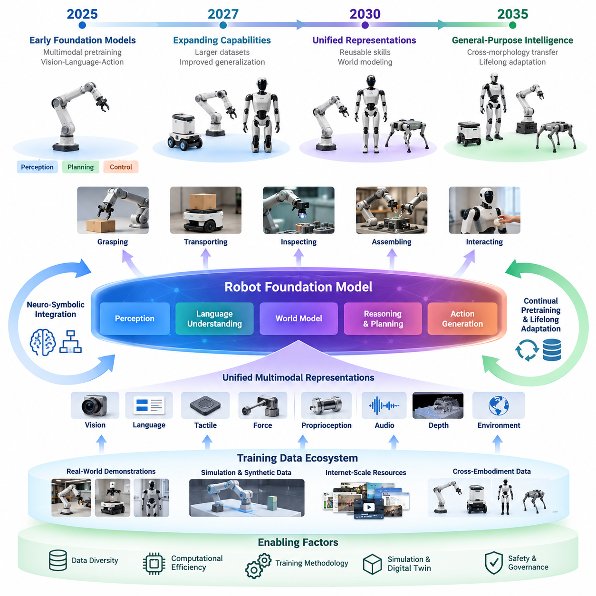
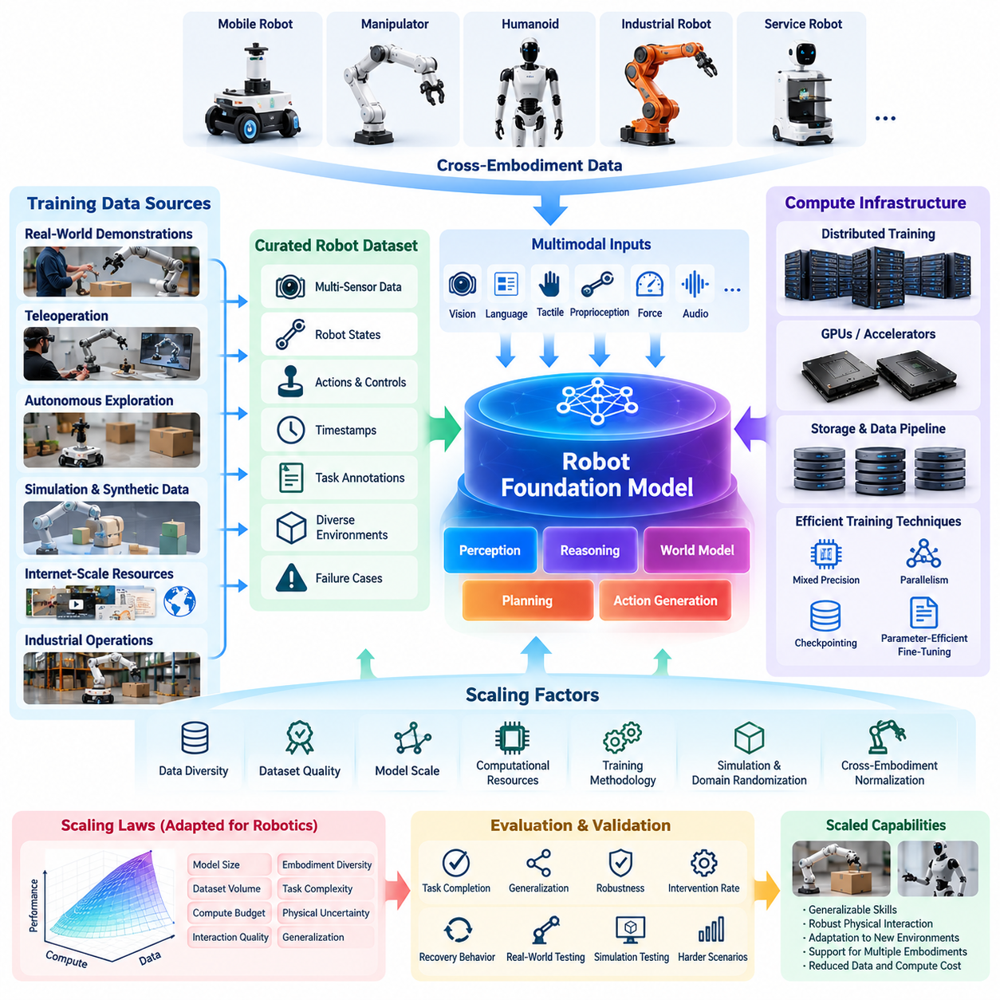
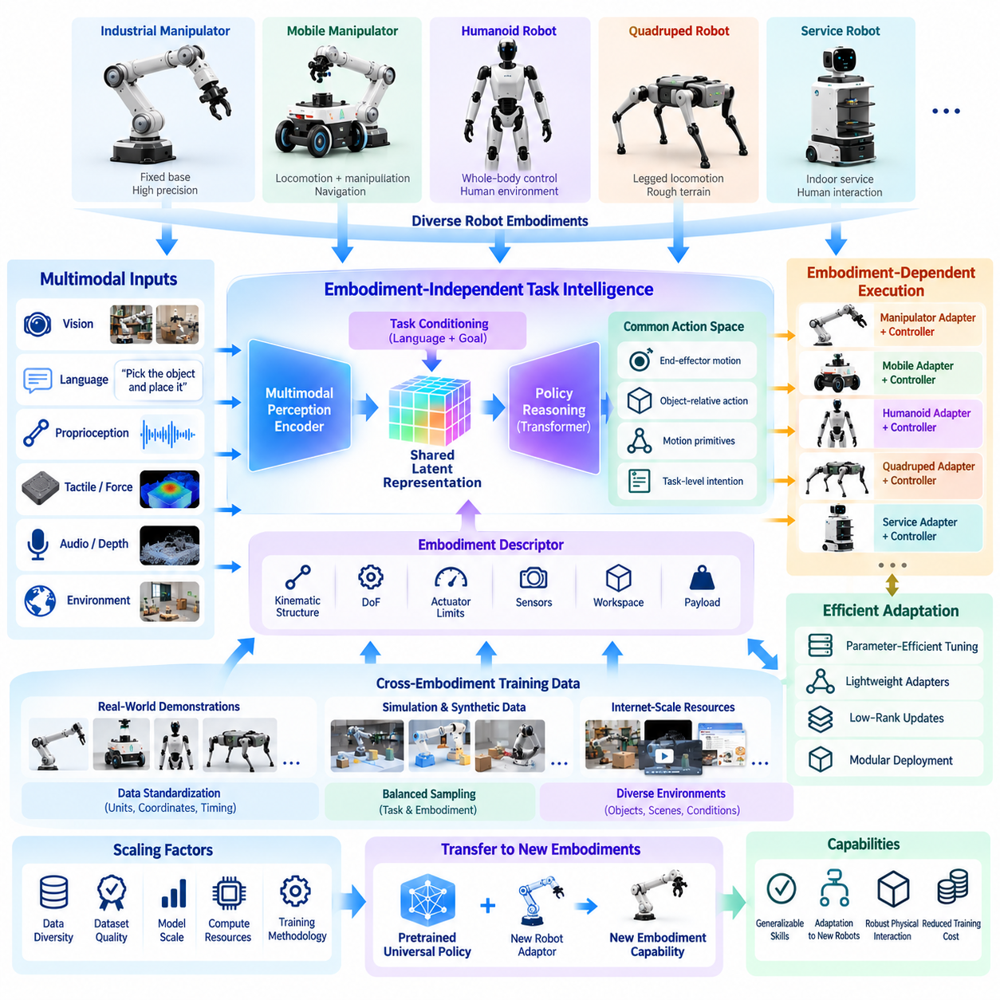
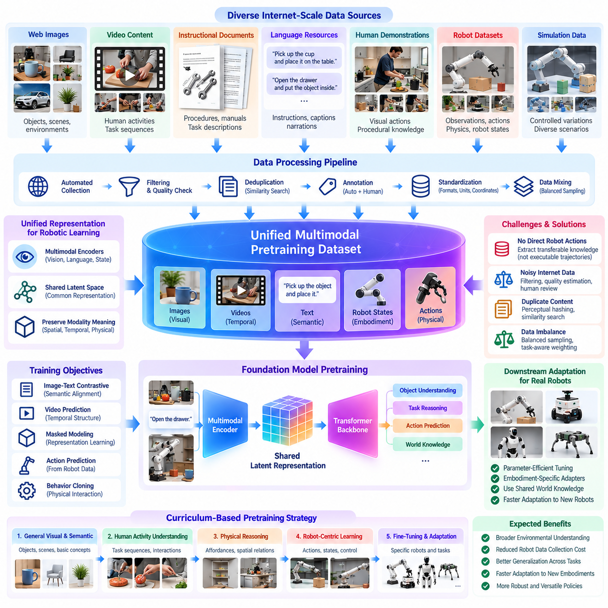
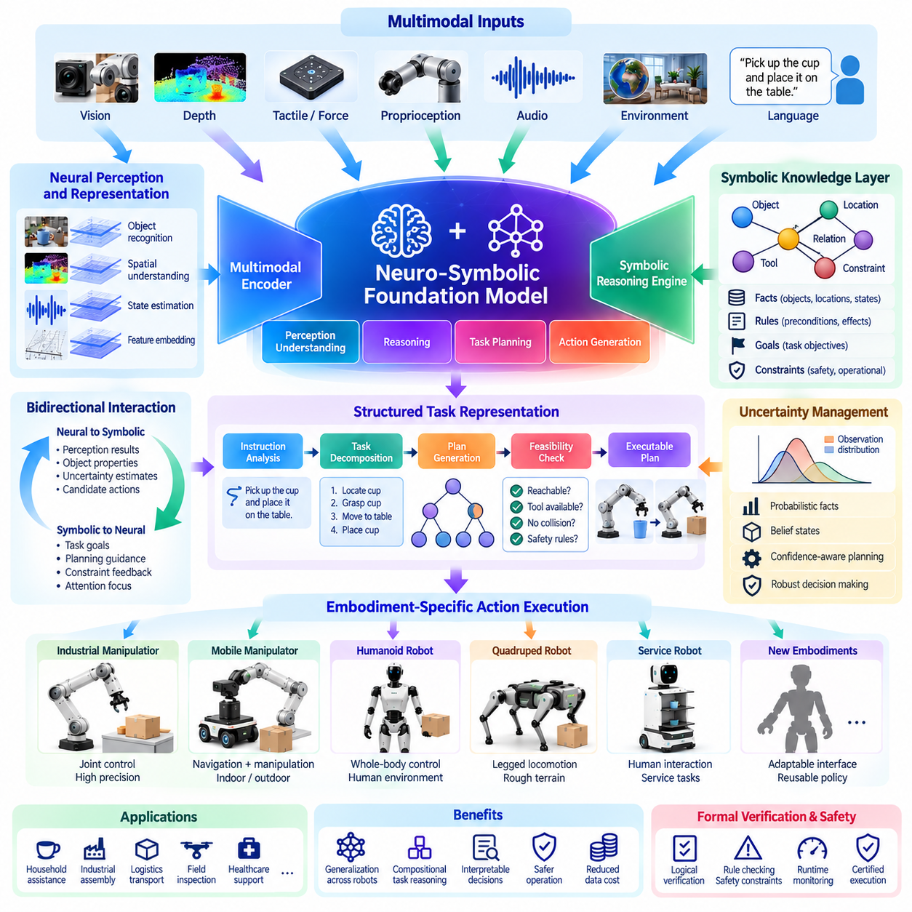
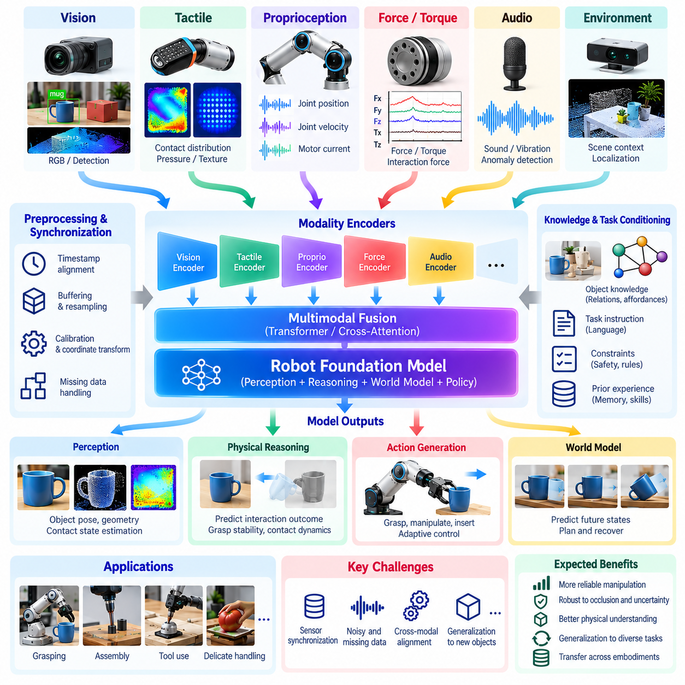
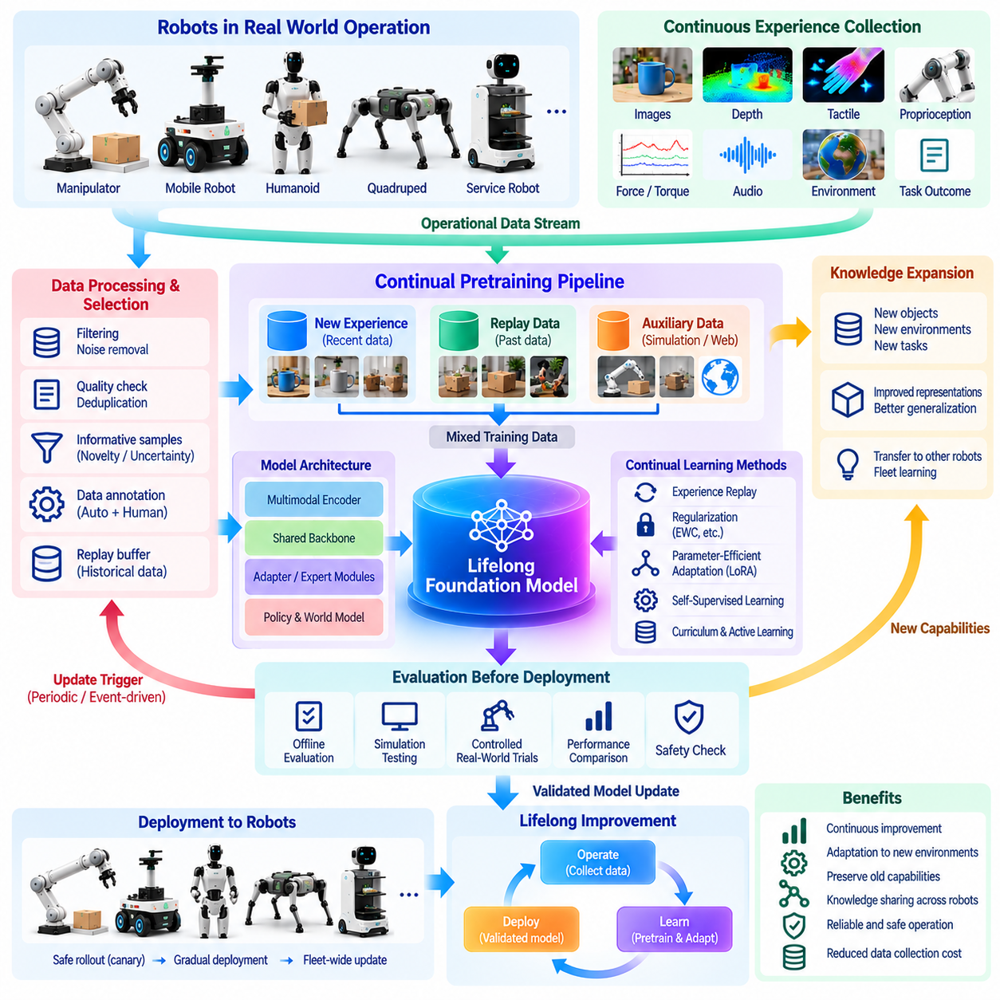
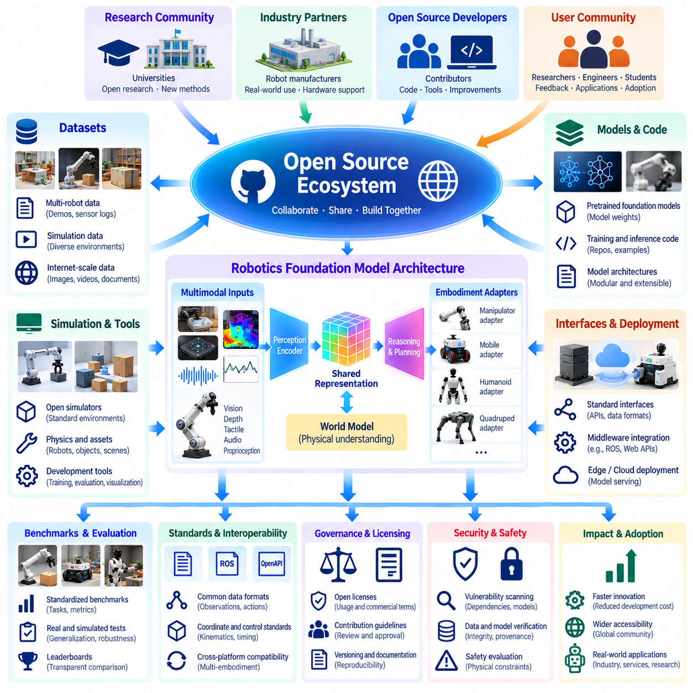
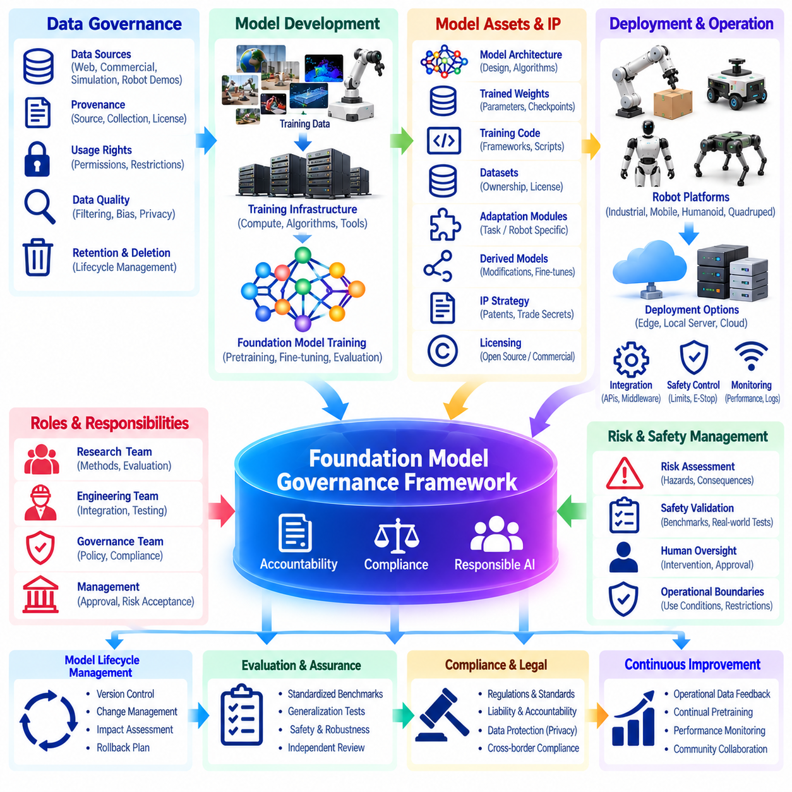
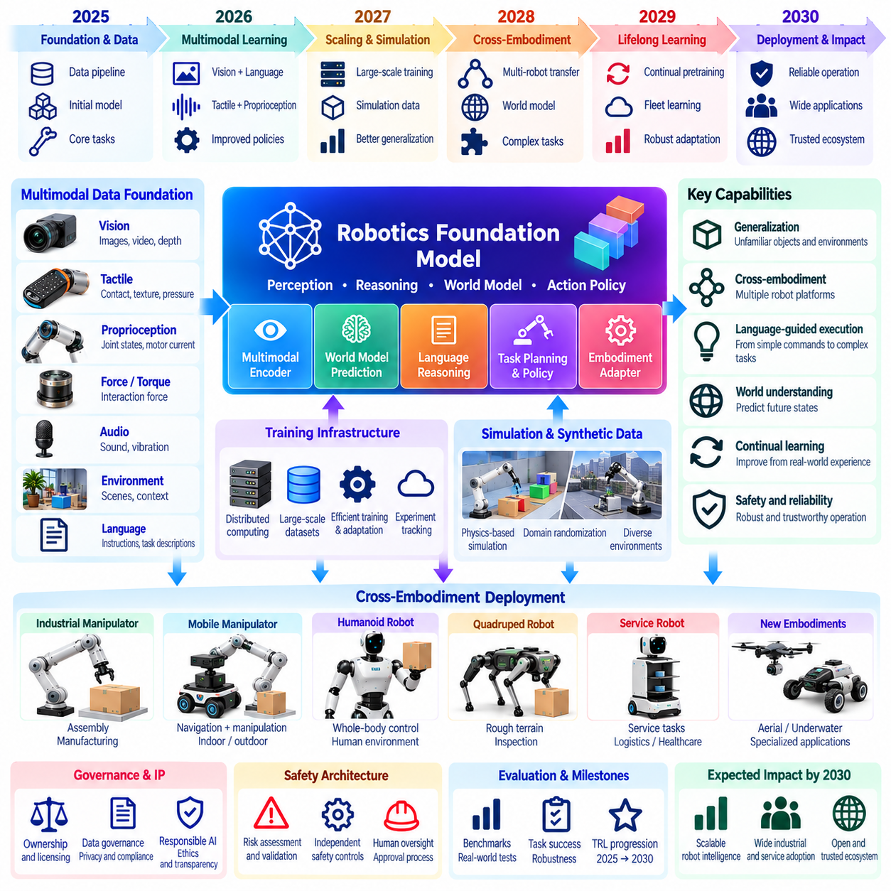

**Volume 27. Future AI Native Robotics**

# Chapter 03. Robot Foundation Model Evolution

## 03.01. Foundation Model Evolution Trajectory 2025--2035

{width="7.268055555555556in" height="7.268055555555556in"}

The evolution of robot foundation models between 2025 and 2035 represents a transition from specialized machine learning systems toward increasingly general-purpose physical intelligence. Traditional robots depend on separately engineered perception, planning, and control modules. Foundation models introduce shared representations that connect sensory observations, language instructions, environmental context, and physical actions within adaptable learning architectures.

During the 2025--2027 period, robot foundation models are expected to advance primarily through multimodal pretraining and vision-language-action architectures. These models combine visual encoders, language representations, and action-generation networks to interpret instructions and produce robot behaviors. Transformer architectures, diffusion policies, and imitation learning provide complementary mechanisms for learning manipulation and navigation skills from heterogeneous demonstrations.

Early robot foundation models remain constrained by limited physical interaction datasets, inconsistent hardware interfaces, and insufficient generalization across environments. Unlike internet language models, robotic systems require observations connected to measurable physical consequences. Contact forces, actuator dynamics, object properties, and environmental uncertainty must therefore become integral elements of training rather than secondary information introduced during deployment.

A major evolutionary direction involves expanding training datasets beyond individual robot platforms. Demonstrations collected from manipulators, mobile robots, humanoids, and industrial automation systems can contribute to shared learning when their observations and actions are represented consistently. Cross-embodiment learning aims to transfer reusable behavioral knowledge while preserving the mechanical constraints and control characteristics of each robot configuration.

Between 2027 and 2030, foundation model development may increasingly emphasize unified representations of physical tasks and robot capabilities. Instead of learning isolated behaviors for every application, models could represent grasping, transporting, inspecting, assembling, and interacting as combinations of reusable skills. Such representations would support adaptation to unfamiliar objects and workflows without requiring complete retraining for each operational scenario.

Scaling robot foundation models requires simultaneous improvements in data diversity, computational efficiency, and training methodology. Increasing parameter counts alone cannot guarantee physical competence because robotic learning depends on interaction quality and environmental coverage. Training strategies must balance large-scale offline datasets, simulation-generated experiences, human demonstrations, and carefully controlled real-world experimentation.

Internet-scale pretraining offers another important development pathway. Images, videos, instructional documents, and human activity recordings contain substantial information about object relationships, task sequences, and environmental structure. Although these resources cannot directly replace robot interaction data, they can establish semantic and visual knowledge that reduces the amount of expensive physical demonstration required for downstream training.

Synthetic data generation and digital twin environments are expected to become increasingly important throughout this evolution. Physics-based simulation enables repeated experimentation with object geometry, friction, lighting, disturbances, and robot configurations. However, simulation accuracy remains limited by contact modeling, material uncertainty, and incomplete environmental descriptions, requiring systematic calibration and real-world validation.

The integration of predictive world models could significantly improve foundation model capabilities during the early 2030s. By estimating how environments change in response to actions, robots may evaluate alternative behaviors before physical execution. Learned world representations can support long-horizon planning, uncertainty estimation, and recovery from unexpected events, although prediction errors must be controlled to prevent unsafe decisions.

Neuro-symbolic integration represents a complementary evolutionary direction. Neural foundation models provide flexible perception and pattern recognition, while symbolic representations support explicit constraints, task relationships, and logical verification. Combining these approaches could enable robots to interpret abstract instructions while respecting operational rules, physical limitations, and structured industrial procedures.

Multimodal sensory integration will also expand beyond conventional cameras and language interfaces. Future foundation models may incorporate tactile measurements, force feedback, proprioception, audio, depth sensing, and environmental telemetry within shared representations. Such integration is especially important for contact-rich manipulation, where visually similar situations can require substantially different actions depending on friction, compliance, and applied forces.

Continual pretraining and lifelong adaptation could gradually transform foundation models from static software releases into evolving intelligence platforms. Operational experiences would generate new training examples, allowing models to improve their understanding of objects, tasks, and environmental conditions. Nevertheless, uncontrolled online updates could introduce catastrophic forgetting, behavioral instability, and safety regressions, making governed learning pipelines essential.

From approximately 2030 onward, cross-morphology transfer may become a central research objective. A shared foundation model could provide semantic reasoning and task-level planning for wheeled robots, articulated manipulators, and humanoid platforms. Hardware-specific adapters and control policies would translate generalized intentions into feasible movements while accounting for differences in kinematics, actuator limits, sensing configurations, and stability requirements.

Computational architecture will strongly influence the practical adoption of increasingly capable foundation models. Large models may require centralized training infrastructure, while deployed robots must satisfy strict constraints on latency, power consumption, thermal management, and communication reliability. Model distillation, quantization, sparse computation, and hierarchical inference offer potential mechanisms for distributing intelligence between cloud resources and embedded processors.

Open-source ecosystems could accelerate foundation model evolution by establishing shared datasets, pretrained representations, evaluation tools, and standardized robot interfaces. Reproducible training pipelines would allow research organizations and industrial developers to compare model behavior under consistent conditions. However, dataset licensing, intellectual property ownership, security vulnerabilities, and incompatible hardware assumptions remain significant governance challenges.

Foundation model evaluation must evolve alongside model capabilities. Conventional metrics such as prediction accuracy and training loss provide insufficient evidence of reliable physical intelligence. More meaningful benchmarks measure task completion, recovery performance, generalization to unseen environments, energy efficiency, intervention frequency, and safety constraint violations across statistically representative operating conditions.

Safety assurance becomes increasingly complex as foundation models acquire broader behavioral capabilities. Probabilistic action generation can produce outputs that are difficult to predict using conventional software verification alone. Practical architectures therefore require independent safety supervision, constrained action execution, runtime monitoring, emergency intervention mechanisms, and traceable model deployment procedures that remain effective even when learned policies fail.

The period from 2032 to 2035 may introduce more capable generalist robot foundation models that combine perception, reasoning, memory, prediction, and skill execution. These systems could adapt to new tasks through demonstrations, contextual instructions, and accumulated experience. Such capabilities remain research objectives rather than guaranteed milestones, and their realization depends on breakthroughs in data efficiency, physical reasoning, reliability, and scalable validation.

Industrial adoption will likely proceed through progressively broader operational domains rather than an immediate transition to unrestricted autonomy. Warehouses, manufacturing facilities, hospitals, and inspection environments provide opportunities to deploy foundation models under defined operating conditions. Each expansion of capability must demonstrate measurable improvements in productivity, adaptability, maintenance efficiency, and operational safety before wider deployment.

By 2035, the most consequential change may be the emergence of foundation models as reusable intelligence infrastructure for software-defined robots. Hardware platforms could share pretrained knowledge while retaining specialized perception, control, and safety components. The long-term trajectory is therefore not simply toward larger neural networks, but toward validated, adaptable, and continuously improving physical intelligence systems capable of operating across diverse robotic applications.

2025년부터 2035년까지 로봇 파운데이션 모델(Robot Foundation Model)의 진화는 특수 목적의 기계학습 시스템(Specialized Machine Learning System)에서 점차 범용적인 물리 지능(General-Purpose Physical Intelligence)으로 전환되는 과정을 의미한다. 기존 로봇은 개별적으로 설계된 인식(Perception), 계획(Planning), 제어(Control) 모듈에 의존한다. 파운데이션 모델(Foundation Model)은 감각 관측, 언어 명령, 환경 맥락, 물리적 행동을 적응형 학습 구조(Adaptive Learning Architecture) 내에서 연결하는 공유 표현(Shared Representation)을 도입한다.

2025\\\~2027년에는 로봇 파운데이션 모델이 주로 멀티모달 사전학습(Multimodal Pretraining)과 시각-언어-행동 아키텍처(Vision-Language-Action Architecture)를 중심으로 발전할 것으로 예상된다. 이러한 모델은 시각 인코더(Vision Encoder), 언어 표현(Language Representation), 행동 생성 네트워크(Action Generation Network)를 결합하여 명령을 해석하고 로봇 행동을 생성한다. 트랜스포머(Transformer), 확산 정책(Diffusion Policy), 모방학습(Imitation Learning)은 다양한 시연 데이터로부터 조작 및 이동 기술을 학습하는 상호 보완적인 메커니즘을 제공한다.

초기 로봇 파운데이션 모델은 제한적인 물리적 상호작용 데이터셋(Physical Interaction Dataset), 일관되지 않은 하드웨어 인터페이스(Hardware Interface), 환경 간 일반화(Generalization) 능력 부족이라는 제약을 가진다. 인터넷 기반 언어 모델과 달리 로봇 시스템은 측정 가능한 물리적 결과와 연결된 관측 데이터가 필요하다. 따라서 접촉력(Contact Force), 액추에이터 동역학(Actuator Dynamics), 객체 특성(Object Properties), 환경 불확실성(Environmental Uncertainty)은 배포 단계에서 추가되는 보조 정보가 아니라 학습의 핵심 요소가 되어야 한다.

주요 진화 방향 중 하나는 개별 로봇 플랫폼을 넘어 학습 데이터셋을 확장하는 것이다. 매니퓰레이터(Manipulator), 이동 로봇(Mobile Robot), 휴머노이드(Humanoid), 산업 자동화 시스템(Industrial Automation System)에서 수집한 시연 데이터는 관측과 행동을 일관된 방식으로 표현할 경우 공유 학습에 활용될 수 있다. 서로 다른 로봇 형태 간 학습(Cross-Embodiment Learning)은 각 로봇 구성의 기계적 제약과 제어 특성을 유지하면서 재사용 가능한 행동 지식을 전달하는 것을 목표로 한다.

2027\\\~2030년에는 파운데이션 모델 개발이 물리적 작업과 로봇 능력에 대한 통합 표현(Unified Representation)을 더욱 강조할 가능성이 있다. 모든 응용 분야에 대해 독립적인 행동을 학습하는 대신, 모델은 파지(Grasping), 운반(Transporting), 검사(Inspection), 조립(Assembly), 상호작용(Interaction)을 재사용 가능한 기술(Skill)의 조합으로 표현할 수 있다. 이러한 표현은 각 운영 시나리오에 대해 모델 전체를 재학습하지 않고도 새로운 객체와 작업 절차에 적응하도록 지원한다.

로봇 파운데이션 모델의 규모 확장(Scaling)에는 데이터 다양성(Data Diversity), 계산 효율성(Computational Efficiency), 학습 방법론(Training Methodology)의 동시 개선이 필요하다. 로봇 학습은 상호작용 품질과 환경 적용 범위에 의존하므로 매개변수(Parameter) 수를 늘리는 것만으로 물리적 수행 능력을 보장할 수 없다. 학습 전략은 대규모 오프라인 데이터셋(Offline Dataset), 시뮬레이션 생성 경험(Simulation-Generated Experience), 인간 시연(Human Demonstration), 통제된 실제 환경 실험(Real-World Experimentation) 사이의 균형을 유지해야 한다.

인터넷 규모의 사전학습(Internet-Scale Pretraining)은 또 다른 중요한 발전 경로를 제공한다. 이미지, 동영상, 교육 문서, 인간 활동 기록에는 객체 관계(Object Relationship), 작업 순서(Task Sequence), 환경 구조(Environmental Structure)에 관한 상당한 정보가 포함되어 있다. 이러한 자료가 로봇 상호작용 데이터를 직접 대체할 수는 없지만, 의미적·시각적 지식을 형성하여 후속 학습(Downstream Training)에 필요한 비용이 높은 물리적 시연 데이터의 양을 줄일 수 있다.

합성 데이터 생성(Synthetic Data Generation)과 디지털 트윈 환경(Digital Twin Environment)은 이러한 진화 과정 전반에서 중요성이 증가할 것으로 예상된다. 물리 기반 시뮬레이션(Physics-Based Simulation)은 객체 형상, 마찰, 조명, 외란(Disturbance), 로봇 구성에 대한 반복 실험을 가능하게 한다. 그러나 시뮬레이션 정확도는 접촉 모델링(Contact Modeling), 재료 불확실성(Material Uncertainty), 불완전한 환경 표현에 의해 제한되므로 체계적인 보정(Calibration)과 실제 환경 검증(Real-World Validation)이 필요하다.

예측형 월드 모델(Predictive World Model)의 통합은 2030년대 초반 파운데이션 모델의 능력을 크게 향상시킬 수 있다. 로봇은 행동에 따른 환경 변화를 예측함으로써 실제 동작을 실행하기 전에 대안 행동을 평가할 수 있다. 학습된 월드 표현(World Representation)은 장기 계획(Long-Horizon Planning), 불확실성 추정(Uncertainty Estimation), 예상하지 못한 상황에서의 복구(Recovery)를 지원하지만, 위험한 결정을 방지하려면 예측 오차(Prediction Error)를 통제해야 한다.

신경-기호 통합(Neuro-Symbolic Integration)은 상호 보완적인 진화 방향을 나타낸다. 신경망 기반 파운데이션 모델은 유연한 인식과 패턴 인식(Pattern Recognition)을 제공하고, 기호 표현(Symbolic Representation)은 명시적 제약 조건, 작업 관계, 논리적 검증(Logical Verification)을 지원한다. 두 접근법을 결합하면 로봇이 추상적인 명령을 해석하면서 운영 규칙, 물리적 한계, 구조화된 산업 절차를 준수할 수 있는 기반을 마련할 수 있다.

멀티모달 감각 통합(Multimodal Sensory Integration)은 기존 카메라와 언어 인터페이스를 넘어 확장될 것이다. 미래의 파운데이션 모델은 촉각 측정(Tactile Measurement), 힘 피드백(Force Feedback), 고유수용감각(Proprioception), 오디오(Audio), 깊이 감지(Depth Sensing), 환경 원격측정(Environmental Telemetry)을 공유 표현에 통합할 수 있다. 이러한 통합은 시각적으로 유사한 상황에서도 마찰, 유연성(Compliance), 작용력에 따라 서로 다른 행동이 요구되는 접촉 중심 조작(Contact-Rich Manipulation)에서 특히 중요하다.

지속적 사전학습(Continual Pretraining)과 평생 적응(Lifelong Adaptation)은 파운데이션 모델을 정적인 소프트웨어 배포 형태에서 지속적으로 진화하는 지능 플랫폼(Intelligence Platform)으로 전환할 수 있다. 운영 경험은 새로운 학습 사례를 생성하여 객체, 작업, 환경 조건에 대한 모델의 이해를 개선한다. 그러나 통제되지 않은 온라인 업데이트(Online Update)는 치명적 망각(Catastrophic Forgetting), 행동 불안정성(Behavioral Instability), 안전성 회귀(Safety Regression)를 유발할 수 있으므로 관리되는 학습 파이프라인(Governed Learning Pipeline)이 필수적이다.

2030년경부터는 서로 다른 로봇 형태 간 전이(Cross-Morphology Transfer)가 핵심 연구 목표로 부상할 수 있다. 공유 파운데이션 모델은 바퀴형 로봇(Wheeled Robot), 관절형 매니퓰레이터(Articulated Manipulator), 휴머노이드 플랫폼에 의미적 추론(Semantic Reasoning)과 작업 수준 계획(Task-Level Planning)을 제공할 수 있다. 하드웨어별 어댑터(Hardware-Specific Adapter)와 제어 정책(Control Policy)은 운동학(Kinematics), 액추에이터 한계, 센서 구성, 안정성 요구사항의 차이를 고려하여 일반화된 의도를 실행 가능한 움직임으로 변환한다.

컴퓨팅 아키텍처(Computing Architecture)는 고도화된 파운데이션 모델의 실질적인 도입에 큰 영향을 미친다. 대규모 모델은 중앙집중형 학습 인프라(Centralized Training Infrastructure)를 필요로 할 수 있지만, 실제 로봇은 지연시간(Latency), 전력 소비(Power Consumption), 열 관리(Thermal Management), 통신 신뢰성(Communication Reliability)에 관한 엄격한 제약을 충족해야 한다. 모델 증류(Model Distillation), 양자화(Quantization), 희소 연산(Sparse Computation), 계층적 추론(Hierarchical Inference)은 클라우드 자원과 임베디드 프로세서 사이에 지능을 분산하는 방법을 제공한다.

오픈소스 생태계(Open-Source Ecosystem)는 공유 데이터셋, 사전학습 표현(Pretrained Representation), 평가 도구(Evaluation Tool), 표준화된 로봇 인터페이스를 구축하여 파운데이션 모델의 진화를 가속할 수 있다. 재현 가능한 학습 파이프라인(Reproducible Training Pipeline)은 연구기관과 산업 개발자가 일관된 조건에서 모델 행동을 비교하도록 지원한다. 그러나 데이터셋 라이선스(Dataset Licensing), 지식재산권(Intellectual Property) 소유권, 보안 취약점(Security Vulnerability), 호환되지 않는 하드웨어 가정은 여전히 중요한 거버넌스(Governance) 과제로 남는다.

파운데이션 모델 평가(Foundation Model Evaluation)는 모델 능력의 발전과 함께 진화해야 한다. 예측 정확도(Prediction Accuracy)와 학습 손실(Training Loss) 같은 기존 지표만으로는 신뢰할 수 있는 물리 지능을 충분히 입증할 수 없다. 보다 의미 있는 벤치마크(Benchmark)는 통계적으로 대표성 있는 운영 조건에서 작업 완료율(Task Completion Rate), 복구 성능(Recovery Performance), 미지 환경 일반화(Unseen Environment Generalization), 에너지 효율(Energy Efficiency), 개입 빈도(Intervention Frequency), 안전 제약 위반(Safety Constraint Violation)을 측정해야 한다.

파운데이션 모델이 더 광범위한 행동 능력을 획득할수록 안전성 보증(Safety Assurance)은 더욱 복잡해진다. 확률적 행동 생성(Probabilistic Action Generation)은 기존 소프트웨어 검증만으로 예측하기 어려운 출력을 생성할 수 있다. 따라서 실용적인 아키텍처에는 독립적인 안전 감독(Independent Safety Supervision), 제약 기반 행동 실행(Constrained Action Execution), 실행시간 모니터링(Runtime Monitoring), 비상 개입(Emergency Intervention), 추적 가능한 모델 배포(Traceable Model Deployment)가 필요하며, 이러한 기능은 학습된 정책이 실패하더라도 유효해야 한다.

2032\\\~2035년에는 인식, 추론, 기억, 예측, 기술 실행을 결합한 더욱 발전된 범용 로봇 파운데이션 모델(Generalist Robot Foundation Model)이 등장할 가능성이 있다. 이러한 시스템은 시연, 상황별 명령(Contextual Instruction), 축적된 경험을 통해 새로운 작업에 적응할 수 있다. 그러나 이러한 능력은 보장된 기술적 이정표가 아니라 연구 목표이며, 실현 여부는 데이터 효율성(Data Efficiency), 물리적 추론(Physical Reasoning), 신뢰성(Reliability), 확장 가능한 검증(Scalable Validation)의 획기적인 발전에 달려 있다.

산업적 도입(Industrial Adoption)은 제한 없는 자율성(Unrestricted Autonomy)으로 즉시 전환되기보다 운영 영역을 점진적으로 확대하는 방식으로 진행될 가능성이 높다. 창고, 제조시설, 병원, 검사 환경은 정의된 운영 조건(Defined Operating Conditions)에서 파운데이션 모델을 배포할 기회를 제공한다. 능력의 확장 단계마다 더 넓은 현장에 배포하기 전에 생산성(Productivity), 적응성(Adaptability), 유지보수 효율성(Maintenance Efficiency), 운영 안전성(Operational Safety)의 측정 가능한 개선을 입증해야 한다.

2035년까지 가장 중요한 변화는 파운데이션 모델이 소프트웨어 정의 로봇(Software-Defined Robot)을 위한 재사용 가능한 지능 인프라(Reusable Intelligence Infrastructure)로 자리 잡는 것일 수 있다. 하드웨어 플랫폼은 특화된 인식, 제어, 안전 구성요소를 유지하면서 사전학습된 지식(Pretrained Knowledge)을 공유할 수 있다. 따라서 장기적인 진화 방향은 단순히 더 큰 신경망(Neural Network)을 개발하는 것이 아니라, 다양한 로봇 응용 분야에서 작동할 수 있는 검증되고 적응 가능하며 지속적으로 개선되는 물리 지능 시스템(Physical Intelligence System)을 구축하는 데 있다.

## 03.02. Scaling Robot Foundation Models Data Compute [w/Code]

{width="7.268055555555556in" height="7.268055555555556in"}

Scaling robot foundation models requires a coordinated expansion of training data, computational resources, model capacity, and learning efficiency. Unlike language models trained primarily on digital information, robotic foundation models must learn relationships between observations, physical actions, and environmental consequences. Their scalability therefore depends not only on parameter growth but also on the diversity and quality of embodied experiences.

Robot learning datasets contain heterogeneous information collected from cameras, depth sensors, joint encoders, force sensors, and control interfaces. Each observation must be associated with robot states, executed actions, timestamps, and task outcomes. Effective scaling requires standardized data representations that preserve physical meaning while accommodating differences in robot morphology, sensor configurations, and operating environments.

A fundamental challenge is the high cost of collecting physical interaction data. Robot demonstrations require hardware operation, supervision, maintenance, and controlled environments. Unlike internet text, manipulation trajectories cannot be collected at negligible marginal cost. Scalable data strategies therefore combine teleoperation, autonomous exploration, simulation, human demonstrations, and previously recorded industrial operations.

Dataset diversity is often more important than simply increasing the number of repeated demonstrations. A million trajectories collected under nearly identical conditions may provide less generalization than a smaller dataset covering varied objects, surfaces, lighting conditions, and task configurations. Data selection mechanisms should measure behavioral coverage, environmental diversity, failure representation, and the information value of additional samples.

Cross-embodiment data aggregation provides an important mechanism for expanding training resources. Demonstrations from mobile manipulators, humanoids, industrial arms, and service robots can contribute to a shared learning corpus. However, differences in joint structures, action dimensions, coordinate systems, and control frequencies require embodiment-aware normalization and adaptable action representations before meaningful joint training becomes possible.

The computational requirements of robot foundation models increase with model parameters, training tokens, sensory resolution, and temporal sequence length. Video observations and high-frequency proprioceptive signals generate substantially larger training workloads than text-only sequences. Efficient architectures must balance spatial detail, temporal context, and action prediction accuracy without allowing memory consumption or training latency to grow uncontrollably.

Transformer-based architectures provide flexible mechanisms for integrating multimodal robotic information. Visual observations can be encoded into spatial tokens, language instructions into semantic tokens, and robot states into structured numerical embeddings. Attention mechanisms then learn relationships across these modalities. However, quadratic attention complexity motivates token compression, sparse attention, hierarchical processing, and alternative sequence architectures.

Scaling laws offer a framework for understanding relationships among model size, dataset volume, and computational expenditure. In conventional machine learning, increasing these resources can produce predictable reductions in training loss under suitable conditions. Robotic systems introduce additional variables, including embodiment diversity, interaction quality, physical uncertainty, and task complexity, making direct transfer of language-model scaling laws insufficient.

A practical scaling strategy must distinguish between computational scaling and capability scaling. Lower prediction loss does not necessarily imply improved manipulation success, navigation reliability, or physical robustness. Model development should therefore connect training metrics with downstream evaluations that measure task completion, generalization, intervention frequency, and recovery behavior across increasingly difficult operational conditions.

Distributed training infrastructure enables large-scale optimization across multiple accelerators and computing nodes. Data parallelism distributes training samples, tensor parallelism partitions large matrix operations, and pipeline parallelism separates model layers across devices. These methods improve resource utilization but introduce communication overhead, synchronization complexity, checkpoint management requirements, and sensitivity to hardware failures.

High-performance storage and data pipelines are equally important for efficient scaling. Large robotic datasets contain synchronized video streams, sensor measurements, action trajectories, and metadata that must be retrieved without interrupting accelerator execution. Sharded storage formats, asynchronous preprocessing, caching, and distributed data loading can reduce input bottlenecks while maintaining reproducible sample ordering and dataset provenance.

Training efficiency can be improved through mixed-precision arithmetic, gradient accumulation, activation checkpointing, and optimized attention kernels. Parameter-efficient fine-tuning techniques allow pretrained models to adapt to specific robots without updating every parameter. These approaches reduce memory requirements and computational costs, although their effects on convergence stability, precision-sensitive control, and downstream reliability require systematic evaluation.

Synthetic data generation offers a scalable complement to physical demonstrations. Parallel simulation environments can generate diverse manipulation trajectories, navigation experiences, and controlled failure scenarios. Domain randomization varies geometry, lighting, friction, mass, and sensor noise to encourage robust representations. Nevertheless, simulation-generated behaviors must be validated against real hardware because inaccurate physical assumptions can introduce systematic errors.

Self-supervised learning can exploit large quantities of robot observations without requiring complete manual annotation. Models may learn by predicting future sensory states, reconstructing masked observations, or identifying relationships between actions and environmental changes. Such objectives encourage transferable representations, but successful prediction alone does not guarantee physically feasible actions or safe execution.

Curriculum learning provides another mechanism for improving computational efficiency. Training begins with relatively simple interactions and gradually introduces more complex tasks, disturbances, and environmental variations. Automated curriculum generation can prioritize examples where the model demonstrates uncertainty or repeated failure. This approach may improve sample efficiency while reducing unnecessary computation on already mastered behaviors.

Data quality governance becomes increasingly important as training corpora expand. Duplicate trajectories, inconsistent timestamps, incorrect coordinate transformations, and corrupted sensor measurements can undermine model performance. Automated validation should verify synchronization, physical plausibility, action continuity, annotation consistency, and dataset integrity before information enters the training pipeline.

Scaling also introduces significant energy and infrastructure considerations. Large training clusters consume substantial electrical power and require cooling, networking, storage, and accelerator maintenance. Efficient development therefore requires evaluating model improvement relative to computational expenditure, energy consumption, and total infrastructure cost rather than maximizing training scale without regard to operational sustainability.

The deployment environment imposes constraints that differ from those encountered during centralized training. Industrial robots and autonomous mobile platforms often operate with limited onboard computing capacity and strict response-time requirements. Knowledge distillation, quantization, model partitioning, and adaptive inference can transfer capabilities from large foundation models into smaller execution systems while preserving critical task performance.

Safety evaluation must scale alongside training capability. Larger models may demonstrate improved task generalization while retaining unpredictable failure modes under unfamiliar physical conditions. Validation should incorporate adversarial scenarios, out-of-distribution observations, actuator limitations, collision constraints, and emergency recovery procedures. Independent safety controllers remain necessary because statistical learning performance cannot substitute for deterministic protection mechanisms.

Between 2025 and 2035, successful scaling strategies will likely combine increasingly diverse embodied datasets, efficient distributed computation, reusable pretrained representations, and continuous evaluation. The central engineering objective is not unlimited parameter expansion but measurable improvements in physical competence per unit of data, computation, and energy. Sustainable robot foundation models will emerge from balanced optimization of learning capacity, deployment efficiency, and verified operational reliability.

로봇 파운데이션 모델(Robot Foundation Model)의 규모 확장(Scaling)에는 학습 데이터(Training Data), 컴퓨팅 자원(Computational Resources), 모델 용량(Model Capacity), 학습 효율성(Learning Efficiency)의 조화로운 확대가 필요하다. 주로 디지털 정보로 학습하는 언어 모델과 달리 로봇 파운데이션 모델은 관측(Observation), 물리적 행동(Physical Action), 환경적 결과(Environmental Consequence) 사이의 관계를 학습해야 한다. 따라서 확장성(Scalability)은 매개변수 증가뿐 아니라 체화된 경험(Embodied Experience)의 다양성과 품질에도 의존한다.

로봇 학습 데이터셋(Robot Learning Dataset)은 카메라, 깊이 센서(Depth Sensor), 관절 인코더(Joint Encoder), 힘 센서(Force Sensor), 제어 인터페이스(Control Interface)에서 수집한 이종 정보(Heterogeneous Information)를 포함한다. 각 관측 데이터는 로봇 상태(Robot State), 실행된 행동(Executed Action), 타임스탬프(Timestamp), 작업 결과(Task Outcome)와 연결되어야 한다. 효과적인 규모 확장을 위해서는 로봇 형태(Morphology), 센서 구성, 운영 환경의 차이를 수용하면서 물리적 의미를 보존하는 표준화된 데이터 표현(Standardized Data Representation)이 필요하다.

근본적인 과제 중 하나는 물리적 상호작용 데이터(Physical Interaction Data)를 수집하는 데 드는 높은 비용이다. 로봇 시연(Robot Demonstration)에는 하드웨어 운영, 감독, 유지보수, 통제된 환경이 필요하다. 인터넷 텍스트와 달리 조작 궤적(Manipulation Trajectory)은 매우 낮은 한계비용(Marginal Cost)으로 수집하기 어렵다. 따라서 확장 가능한 데이터 전략(Scalable Data Strategy)은 원격조작(Teleoperation), 자율 탐색(Autonomous Exploration), 시뮬레이션(Simulation), 인간 시연(Human Demonstration), 기존 산업 운영 기록을 결합한다.

데이터셋 다양성(Dataset Diversity)은 단순히 반복 시연의 수를 늘리는 것보다 중요한 경우가 많다. 거의 동일한 조건에서 수집한 백만 개의 궤적보다 다양한 객체, 표면, 조명 조건, 작업 구성을 포함하는 작은 데이터셋이 더 높은 일반화(Generalization) 성능을 제공할 수 있다. 데이터 선택 메커니즘(Data Selection Mechanism)은 행동 범위(Behavioral Coverage), 환경 다양성(Environmental Diversity), 실패 사례 표현(Failure Representation), 추가 샘플의 정보 가치(Information Value)를 측정해야 한다.

서로 다른 로봇 형태 간 데이터 통합(Cross-Embodiment Data Aggregation)은 학습 자원을 확대하는 중요한 메커니즘이다. 이동형 매니퓰레이터(Mobile Manipulator), 휴머노이드(Humanoid), 산업용 로봇 팔(Industrial Robot Arm), 서비스 로봇(Service Robot)의 시연 데이터는 공유 학습 데이터 집합(Shared Learning Corpus)에 기여할 수 있다. 그러나 관절 구조, 행동 차원(Action Dimension), 좌표계(Coordinate System), 제어 주파수(Control Frequency)의 차이로 인해 의미 있는 공동 학습(Joint Training)을 수행하려면 로봇 형태를 고려한 정규화(Embodiment-Aware Normalization)와 적응형 행동 표현(Adaptable Action Representation)이 필요하다.

로봇 파운데이션 모델의 컴퓨팅 요구사항(Computational Requirements)은 모델 매개변수, 학습 토큰(Training Token), 감각 데이터 해상도(Sensory Resolution), 시간 시퀀스 길이(Temporal Sequence Length)에 따라 증가한다. 영상 관측(Video Observation)과 고주파 고유수용감각 신호(High-Frequency Proprioceptive Signal)는 텍스트 전용 시퀀스보다 훨씬 큰 학습 부하를 발생시킨다. 효율적인 아키텍처는 메모리 소비나 학습 지연시간이 통제할 수 없을 정도로 증가하지 않도록 공간적 세부정보, 시간적 맥락, 행동 예측 정확도 사이의 균형을 유지해야 한다.

트랜스포머 기반 아키텍처(Transformer-Based Architecture)는 멀티모달 로봇 정보(Multimodal Robotic Information)를 통합하는 유연한 메커니즘을 제공한다. 시각 관측은 공간 토큰(Spatial Token), 언어 명령은 의미 토큰(Semantic Token), 로봇 상태는 구조화된 수치 임베딩(Structured Numerical Embedding)으로 인코딩할 수 있다. 어텐션 메커니즘(Attention Mechanism)은 이러한 모달리티 사이의 관계를 학습한다. 그러나 어텐션의 이차 계산 복잡도(Quadratic Attention Complexity)로 인해 토큰 압축(Token Compression), 희소 어텐션(Sparse Attention), 계층적 처리(Hierarchical Processing), 대체 시퀀스 아키텍처(Alternative Sequence Architecture)가 요구된다.

스케일링 법칙(Scaling Law)은 모델 크기(Model Size), 데이터셋 규모(Dataset Volume), 계산 비용(Computational Expenditure) 사이의 관계를 이해하기 위한 프레임워크를 제공한다. 기존 기계학습에서는 적절한 조건에서 이러한 자원을 증가시키면 학습 손실(Training Loss)이 예측 가능한 방식으로 감소할 수 있다. 그러나 로봇 시스템에는 로봇 형태의 다양성, 상호작용 품질, 물리적 불확실성(Physical Uncertainty), 작업 복잡도(Task Complexity) 등의 추가 변수가 존재하므로 언어 모델의 스케일링 법칙을 직접 적용하는 것만으로는 충분하지 않다.

실용적인 규모 확장 전략은 계산 규모 확장(Computational Scaling)과 능력 확장(Capability Scaling)을 구분해야 한다. 예측 손실(Prediction Loss)이 감소한다고 해서 반드시 조작 성공률(Manipulation Success Rate), 내비게이션 신뢰성(Navigation Reliability), 물리적 강건성(Physical Robustness)이 향상되는 것은 아니다. 따라서 모델 개발은 학습 지표(Training Metric)를 점차 어려워지는 운영 조건에서 작업 완료율, 일반화 성능, 개입 빈도(Intervention Frequency), 복구 행동(Recovery Behavior)을 측정하는 후속 평가(Downstream Evaluation)와 연결해야 한다.

분산 학습 인프라(Distributed Training Infrastructure)는 여러 가속기(Accelerator)와 컴퓨팅 노드(Computing Node)에 걸친 대규모 최적화(Large-Scale Optimization)를 가능하게 한다. 데이터 병렬화(Data Parallelism)는 학습 샘플을 분산하고, 텐서 병렬화(Tensor Parallelism)는 대규모 행렬 연산을 분할하며, 파이프라인 병렬화(Pipeline Parallelism)는 모델 계층을 여러 장치에 분산한다. 이러한 방법은 자원 활용률(Resource Utilization)을 높이지만 통신 오버헤드(Communication Overhead), 동기화 복잡성(Synchronization Complexity), 체크포인트 관리(Checkpoint Management), 하드웨어 장애에 대한 민감성을 증가시킨다.

고성능 저장장치(High-Performance Storage)와 데이터 파이프라인(Data Pipeline) 역시 효율적인 규모 확장에 중요하다. 대규모 로봇 데이터셋에는 동기화된 영상 스트림(Video Stream), 센서 측정값(Sensor Measurement), 행동 궤적(Action Trajectory), 메타데이터(Metadata)가 포함되며, 가속기 실행을 중단하지 않고 이를 검색하고 공급해야 한다. 샤딩 저장 형식(Sharded Storage Format), 비동기 전처리(Asynchronous Preprocessing), 캐싱(Caching), 분산 데이터 로딩(Distributed Data Loading)은 재현 가능한 샘플 순서와 데이터 출처 추적성(Dataset Provenance)을 유지하면서 입력 병목현상(Input Bottleneck)을 줄일 수 있다.

학습 효율성은 혼합 정밀도 연산(Mixed-Precision Arithmetic), 그래디언트 누적(Gradient Accumulation), 활성화 체크포인팅(Activation Checkpointing), 최적화된 어텐션 커널(Optimized Attention Kernel)을 통해 개선할 수 있다. 매개변수 효율적 미세조정(Parameter-Efficient Fine-Tuning)은 모든 매개변수를 업데이트하지 않고도 사전학습 모델을 특정 로봇에 적응시킬 수 있다. 이러한 접근법은 메모리 요구량과 계산 비용을 줄이지만 수렴 안정성(Convergence Stability), 정밀도에 민감한 제어(Precision-Sensitive Control), 후속 작업의 신뢰성에 미치는 영향은 체계적으로 평가해야 한다.

합성 데이터 생성(Synthetic Data Generation)은 물리적 시연을 보완하는 확장 가능한 방법을 제공한다. 병렬 시뮬레이션 환경(Parallel Simulation Environment)은 다양한 조작 궤적, 내비게이션 경험, 통제된 실패 시나리오(Failure Scenario)를 생성할 수 있다. 도메인 무작위화(Domain Randomization)는 형상, 조명, 마찰, 질량, 센서 잡음(Sensor Noise)을 변화시켜 강건한 표현(Robust Representation)의 학습을 촉진한다. 그러나 부정확한 물리적 가정이 체계적 오차(Systematic Error)를 유발할 수 있으므로 시뮬레이션에서 생성된 행동은 실제 하드웨어에서 검증해야 한다.

자기지도학습(Self-Supervised Learning)은 완전한 수작업 주석(Manual Annotation) 없이도 대량의 로봇 관측 데이터를 활용할 수 있다. 모델은 미래 감각 상태(Future Sensory State)를 예측하거나, 마스킹된 관측(Masked Observation)을 복원하거나, 행동과 환경 변화 사이의 관계를 식별하는 방식으로 학습할 수 있다. 이러한 학습 목표는 전이 가능한 표현(Transferable Representation)의 형성을 촉진하지만 예측이 성공했다고 해서 물리적으로 실행 가능한 행동(Physically Feasible Action)이나 안전한 실행(Safe Execution)이 보장되는 것은 아니다.

커리큘럼 학습(Curriculum Learning)은 계산 효율성을 개선하는 또 다른 메커니즘이다. 학습은 비교적 단순한 상호작용에서 시작하여 점차 복잡한 작업, 외란(Disturbance), 환경 변화를 도입한다. 자동 커리큘럼 생성(Automated Curriculum Generation)은 모델이 불확실성(Uncertainty)이나 반복적인 실패를 보이는 사례에 우선순위를 부여할 수 있다. 이러한 접근법은 이미 숙달한 행동에 대한 불필요한 계산을 줄이면서 샘플 효율성(Sample Efficiency)을 향상시킬 수 있다.

학습 데이터 집합(Training Corpus)이 확대될수록 데이터 품질 거버넌스(Data Quality Governance)의 중요성도 증가한다. 중복 궤적(Duplicate Trajectory), 일관되지 않은 타임스탬프, 잘못된 좌표 변환(Coordinate Transformation), 손상된 센서 측정값은 모델 성능을 저하시킬 수 있다. 자동 검증(Automated Validation)은 데이터가 학습 파이프라인에 입력되기 전에 동기화(Synchronization), 물리적 타당성(Physical Plausibility), 행동 연속성(Action Continuity), 주석 일관성(Annotation Consistency), 데이터셋 무결성(Dataset Integrity)을 확인해야 한다.

규모 확장은 에너지와 인프라 측면에서도 중요한 고려사항을 발생시킨다. 대규모 학습 클러스터(Training Cluster)는 상당한 전력을 소비하며 냉각(Cooling), 네트워킹(Networking), 저장장치, 가속기 유지보수가 필요하다. 따라서 효율적인 개발을 위해서는 운영 지속가능성(Operational Sustainability)을 고려하지 않고 학습 규모만 극대화하기보다 계산 비용, 에너지 소비, 총 인프라 비용(Total Infrastructure Cost) 대비 모델 성능 개선 정도를 평가해야 한다.

배포 환경(Deployment Environment)은 중앙집중형 학습 환경과 다른 제약 조건을 부과한다. 산업용 로봇과 자율이동로봇(Autonomous Mobile Robot)은 제한된 온보드 컴퓨팅 용량(Onboard Computing Capacity)과 엄격한 응답시간 요구사항(Response-Time Requirement) 아래에서 작동하는 경우가 많다. 지식 증류(Knowledge Distillation), 양자화(Quantization), 모델 분할(Model Partitioning), 적응형 추론(Adaptive Inference)은 핵심 작업 성능을 유지하면서 대규모 파운데이션 모델의 능력을 더 작은 실행 시스템으로 이전할 수 있다.

안전성 평가(Safety Evaluation)는 학습 능력의 확장과 함께 확대되어야 한다. 대규모 모델은 작업 일반화(Task Generalization) 능력이 향상되더라도 익숙하지 않은 물리적 조건에서 예측하기 어려운 실패 형태(Failure Mode)를 유지할 수 있다. 검증에는 적대적 시나리오(Adversarial Scenario), 분포 외 관측(Out-of-Distribution Observation), 액추에이터 제한(Actuator Limitation), 충돌 제약(Collision Constraint), 비상 복구 절차(Emergency Recovery Procedure)가 포함되어야 한다. 통계적 학습 성능은 결정론적 보호 메커니즘(Deterministic Protection Mechanism)을 대체할 수 없으므로 독립적인 안전 제어기(Independent Safety Controller)가 계속 필요하다.

2025년부터 2035년까지 성공적인 규모 확장 전략은 더욱 다양해지는 체화된 데이터셋(Embodied Dataset), 효율적인 분산 컴퓨팅(Distributed Computing), 재사용 가능한 사전학습 표현(Reusable Pretrained Representation), 지속적 평가(Continuous Evaluation)를 결합할 가능성이 높다. 핵심 엔지니어링 목표는 매개변수를 무제한으로 확대하는 것이 아니라 데이터, 계산, 에너지 단위당 물리적 수행 능력(Physical Competence)을 측정 가능하게 개선하는 것이다. 지속가능한 로봇 파운데이션 모델은 학습 용량(Learning Capacity), 배포 효율성(Deployment Efficiency), 검증된 운영 신뢰성(Verified Operational Reliability)을 균형 있게 최적화함으로써 발전할 것이다.

## 03.03. Cross Embodiment Universal Robot Policy [w/Code]

{width="7.268055555555556in" height="7.268055555555556in"}

Cross-embodiment universal robot policies aim to establish shared intelligence across robots with different mechanical structures, sensors, actuators, and control systems. Traditional robot policies are typically trained for specific hardware configurations, limiting their transferability. A universal policy instead learns reusable task representations while adapting physical execution to the capabilities and constraints of each embodiment.

Robot embodiments vary significantly in their kinematic structures and operational characteristics. Industrial manipulators employ fixed bases and articulated joints, mobile robots combine locomotion with navigation, and humanoids require coordinated whole-body movements. These differences create incompatible action spaces, observation formats, and control frequencies, making direct transfer of learned policies a fundamental engineering challenge.

The central architectural principle is separating embodiment-independent task intelligence from embodiment-dependent motor execution. A shared foundation model interprets environmental observations, language instructions, and task objectives within a common representation space. Hardware-specific adapters then translate generalized action intentions into feasible commands that satisfy individual robot kinematics, dynamics, and actuator limitations.

Universal policy architectures typically combine multimodal perception encoders, shared latent representations, task-conditioning mechanisms, and embodiment-specific action decoders. Visual information describes environmental structure, proprioceptive inputs represent robot configuration, and language embeddings express operational objectives. The shared policy integrates these signals to generate actions conditioned on both task requirements and available hardware capabilities.

A common latent action space provides an important mechanism for transferring behavior across robot platforms. Instead of directly predicting joint torques or motor velocities, the model can represent actions as end-effector displacement, object-relative motion, or abstract manipulation primitives. These representations reduce dependence on individual joint configurations while preserving information required for downstream motion planning and control.

Embodiment descriptors allow a universal policy to distinguish between robots without learning completely independent behavioral models. Such descriptors may include joint topology, degrees of freedom, actuator limits, sensor availability, workspace geometry, and payload capacity. Conditioning the policy on these properties enables shared reasoning while preventing the assumption that every robot can perform identical movements or tasks.

Cross-embodiment training requires datasets that represent comparable tasks across different hardware platforms. Demonstrations from robotic arms, mobile manipulators, quadrupeds, and humanoids must be aligned through consistent task descriptions and physical reference frames. Data preprocessing should normalize units, coordinate transformations, temporal sampling, and action semantics while retaining information about embodiment-specific constraints.

Heterogeneous robotic datasets introduce substantial statistical imbalance. Some platforms may contribute millions of trajectories, while others provide only limited demonstrations. Without appropriate sampling, the universal model may favor frequently represented embodiments and perform poorly on underrepresented systems. Balanced sampling, task-aware weighting, and embodiment-specific evaluation help maintain transferable capabilities across the training distribution.

A shared policy can be expressed conceptually as an action-generation function conditioned on observations, task instructions, and embodiment characteristics. The resulting action may represent a target pose, motion primitive, or short trajectory rather than a direct actuator command. A robot-specific controller subsequently converts the output into executable movements, subject to feasibility checks and independent safety constraints.

Cross-embodiment transfer becomes particularly valuable when adapting pretrained knowledge to newly introduced robot platforms. A model trained on diverse manipulation systems may already understand object relationships, grasping objectives, and task sequences. Adaptation can then focus on learning the new platform\'s actuator interfaces, reachable workspace, and motion characteristics instead of rebuilding all task-level intelligence from the beginning.

Parameter-efficient adaptation provides a practical mechanism for supporting multiple embodiments within a common model ecosystem. Lightweight adapters, low-rank updates, and specialized action heads can customize pretrained representations without modifying the entire foundation model. This reduces training costs and supports modular deployment, although compatibility between shared representations and specialized controllers must be verified.

Simulation environments offer controlled opportunities to train universal policies across diverse robot morphologies. Virtual robots can share task objectives while operating with different joint structures, sensor configurations, and physical parameters. Randomized dynamics, object properties, and environmental conditions improve training diversity, but simulated transfer performance must be confirmed through experiments involving actual robot hardware.

One important limitation is that semantic task equivalence does not imply physical action equivalence. A wheeled robot, quadruped, and humanoid may all receive an instruction to transport an object, but their feasible strategies differ substantially. Universal intelligence must therefore reason about available capabilities and select embodiment-compatible behaviors rather than attempting to reproduce identical motion trajectories.

Hierarchical policy architectures help address these differences by separating high-level task planning from low-level execution. The shared model determines goals, action sequences, and environmental interactions, while specialized controllers handle locomotion, manipulation, balance, and contact regulation. This separation supports knowledge transfer without requiring a single neural network to replace every real-time control function.

Universal policies must also account for temporal differences among robotic platforms. High-level planning may operate at relatively low frequencies, while motor stabilization and force control require rapid feedback. Multi-rate architectures allow foundation models to generate action goals or bounded trajectory segments while deterministic controllers maintain stable execution between model updates.

Generalization should be evaluated across both familiar and previously unseen embodiments. Testing only robots represented during training measures multi-platform competence but does not establish transfer to new morphologies. Stronger evaluation protocols withhold selected robot configurations, task combinations, and environmental conditions, then measure adaptation requirements and execution performance on these unfamiliar systems.

Relevant performance metrics include task success rate, transfer efficiency, adaptation data requirements, trajectory feasibility, collision frequency, and execution latency. Additional measurements should assess how performance changes when sensors are missing, actuator limits differ, or environmental conditions shift. Comparisons against independently trained specialist policies reveal whether shared learning produces meaningful benefits.

Safety remains a critical constraint because universal models may generate actions that are semantically reasonable but physically infeasible. An instruction to reach an object could produce unstable postures, excessive joint motion, or unsafe contact forces on an unfamiliar robot. Runtime safety filters, collision checking, workspace constraints, and independent protective controllers must therefore validate proposed actions before execution.

From 2025 to 2035, cross-embodiment learning may evolve from transferring selected manipulation skills toward increasingly general task-level intelligence shared across multiple robot categories. Progress will depend on standardized datasets, adaptable action representations, scalable training, and reliable hardware interfaces. Fully universal physical control remains an open research challenge rather than an established capability.

The long-term objective is a reusable robot intelligence layer that can be deployed across heterogeneous platforms without requiring complete retraining for every hardware variation. Shared foundation models would provide perception, task understanding, and behavioral planning, while embodiment-aware modules ensure physically appropriate execution. Successful universal policies will be defined by measurable transfer performance, operational reliability, and safe adaptation to new robotic systems.

서로 다른 로봇 형태 간 범용 로봇 정책(Cross-Embodiment Universal Robot Policy)은 기계적 구조, 센서, 액추에이터, 제어 시스템이 서로 다른 로봇 사이에서 공유 지능(Shared Intelligence)을 구축하는 것을 목표로 한다. 기존 로봇 정책(Robot Policy)은 일반적으로 특정 하드웨어 구성에 맞추어 학습되므로 전이 가능성(Transferability)이 제한된다. 반면 범용 정책(Universal Policy)은 재사용 가능한 작업 표현(Task Representation)을 학습하면서 각 로봇 형태(Embodiment)의 능력과 제약 조건에 맞게 물리적 실행을 조정한다.

로봇 형태(Robot Embodiment)는 운동학적 구조(Kinematic Structure)와 운영 특성(Operational Characteristics)에서 상당한 차이를 보인다. 산업용 매니퓰레이터(Industrial Manipulator)는 고정된 베이스와 관절 구조를 사용하고, 이동 로봇(Mobile Robot)은 이동 기능과 내비게이션(Navigation)을 결합하며, 휴머노이드(Humanoid)는 전신 움직임(Whole-Body Movement)의 조정이 필요하다. 이러한 차이는 서로 호환되지 않는 행동 공간(Action Space), 관측 형식(Observation Format), 제어 주파수(Control Frequency)를 발생시켜 학습된 정책의 직접적인 전이를 근본적인 엔지니어링 과제로 만든다.

핵심 아키텍처 원칙(Architectural Principle)은 로봇 형태에 독립적인 작업 지능(Embodiment-Independent Task Intelligence)과 로봇 형태에 종속적인 운동 실행(Embodiment-Dependent Motor Execution)을 분리하는 것이다. 공유 파운데이션 모델(Shared Foundation Model)은 환경 관측, 언어 명령, 작업 목표를 공통 표현 공간(Common Representation Space)에서 해석한다. 이후 하드웨어별 어댑터(Hardware-Specific Adapter)는 일반화된 행동 의도(Action Intention)를 각 로봇의 운동학(Kinematics), 동역학(Dynamics), 액추에이터 제한(Actuator Limitation)을 충족하는 실행 가능한 명령으로 변환한다.

범용 정책 아키텍처(Universal Policy Architecture)는 일반적으로 멀티모달 인식 인코더(Multimodal Perception Encoder), 공유 잠재 표현(Shared Latent Representation), 작업 조건화 메커니즘(Task-Conditioning Mechanism), 로봇 형태별 행동 디코더(Embodiment-Specific Action Decoder)를 결합한다. 시각 정보는 환경 구조를 설명하고, 고유수용감각 입력(Proprioceptive Input)은 로봇 구성을 나타내며, 언어 임베딩(Language Embedding)은 운영 목표를 표현한다. 공유 정책은 이러한 신호를 통합하여 작업 요구사항과 사용 가능한 하드웨어 능력을 모두 고려한 행동을 생성한다.

공통 잠재 행동 공간(Common Latent Action Space)은 로봇 플랫폼 간 행동 전이를 가능하게 하는 중요한 메커니즘이다. 모델은 관절 토크(Joint Torque)나 모터 속도(Motor Velocity)를 직접 예측하는 대신 말단효과기 변위(End-Effector Displacement), 객체 상대 운동(Object-Relative Motion), 추상적 조작 기본 동작(Abstract Manipulation Primitive)으로 행동을 표현할 수 있다. 이러한 표현은 개별 관절 구성에 대한 의존성을 줄이면서 후속 운동 계획(Motion Planning)과 제어에 필요한 정보를 유지한다.

로봇 형태 기술자(Embodiment Descriptor)는 완전히 독립적인 행동 모델을 학습하지 않고도 범용 정책이 서로 다른 로봇을 구별할 수 있도록 한다. 이러한 기술자에는 관절 토폴로지(Joint Topology), 자유도(Degrees of Freedom), 액추에이터 한계, 센서 가용성(Sensor Availability), 작업 공간 형상(Workspace Geometry), 적재 능력(Payload Capacity)이 포함될 수 있다. 이러한 특성을 조건으로 정책을 구성하면 모든 로봇이 동일한 움직임이나 작업을 수행할 수 있다고 가정하지 않으면서 공유 추론(Shared Reasoning)을 구현할 수 있다.

서로 다른 로봇 형태 간 학습(Cross-Embodiment Training)에는 다양한 하드웨어 플랫폼에서 비교 가능한 작업을 표현하는 데이터셋이 필요하다. 로봇 팔(Robotic Arm), 이동형 매니퓰레이터(Mobile Manipulator), 사족보행 로봇(Quadruped), 휴머노이드의 시연 데이터(Demonstration Data)는 일관된 작업 설명(Task Description)과 물리적 기준 좌표계(Physical Reference Frame)를 통해 정렬되어야 한다. 데이터 전처리(Data Preprocessing)는 로봇 형태별 제약 정보를 유지하면서 단위, 좌표 변환(Coordinate Transformation), 시간 샘플링(Temporal Sampling), 행동 의미(Action Semantics)를 정규화해야 한다.

이종 로봇 데이터셋(Heterogeneous Robotic Dataset)은 상당한 통계적 불균형(Statistical Imbalance)을 발생시킨다. 일부 플랫폼은 수백만 개의 궤적(Trajectory)을 제공하는 반면 다른 플랫폼은 제한된 시연 데이터만 제공할 수 있다. 적절한 샘플링(Sampling)이 없으면 범용 모델은 데이터가 풍부한 로봇 형태에 편향되어 데이터가 부족한 시스템에서 낮은 성능을 보일 수 있다. 균형 샘플링(Balanced Sampling), 작업 인식 가중치(Task-Aware Weighting), 로봇 형태별 평가(Embodiment-Specific Evaluation)는 학습 분포 전반에서 전이 가능한 능력을 유지하는 데 도움이 된다.

공유 정책(Shared Policy)은 개념적으로 관측, 작업 명령, 로봇 형태 특성을 조건으로 하는 행동 생성 함수(Action-Generation Function)로 표현할 수 있다. 생성된 행동은 직접적인 액추에이터 명령이 아니라 목표 자세(Target Pose), 운동 기본 동작(Motion Primitive), 짧은 궤적(Short Trajectory)을 나타낼 수 있다. 이후 로봇별 제어기(Robot-Specific Controller)는 실행 가능성 검사(Feasibility Check)와 독립적인 안전 제약(Independent Safety Constraint)을 적용하여 해당 출력을 실행 가능한 움직임으로 변환한다.

서로 다른 로봇 형태 간 전이(Cross-Embodiment Transfer)는 사전학습된 지식(Pretrained Knowledge)을 새롭게 도입된 로봇 플랫폼에 적용할 때 특히 유용하다. 다양한 조작 시스템에서 학습한 모델은 이미 객체 관계(Object Relationship), 파지 목표(Grasping Objective), 작업 순서(Task Sequence)를 이해하고 있을 수 있다. 따라서 적응 과정(Adaptation Process)은 모든 작업 수준 지능을 처음부터 다시 구축하는 대신 새로운 플랫폼의 액추에이터 인터페이스, 도달 가능한 작업 공간(Reachable Workspace), 운동 특성(Motion Characteristics)을 학습하는 데 집중할 수 있다.

매개변수 효율적 적응(Parameter-Efficient Adaptation)은 공통 모델 생태계(Common Model Ecosystem) 내에서 여러 로봇 형태를 지원하는 실용적인 메커니즘을 제공한다. 경량 어댑터(Lightweight Adapter), 저랭크 업데이트(Low-Rank Update), 특화된 행동 헤드(Specialized Action Head)는 전체 파운데이션 모델을 수정하지 않고도 사전학습 표현을 개별 로봇에 맞게 조정할 수 있다. 이러한 접근법은 학습 비용을 줄이고 모듈식 배포(Modular Deployment)를 지원하지만 공유 표현과 특화된 제어기 사이의 호환성은 반드시 검증해야 한다.

시뮬레이션 환경(Simulation Environment)은 다양한 로봇 형태에 걸쳐 범용 정책을 학습할 수 있는 통제된 기회를 제공한다. 가상 로봇(Virtual Robot)은 서로 다른 관절 구조, 센서 구성, 물리적 매개변수(Physical Parameter)를 사용하면서도 동일한 작업 목표를 공유할 수 있다. 무작위화된 동역학(Randomized Dynamics), 객체 특성(Object Properties), 환경 조건(Environmental Conditions)은 학습 다양성을 높이지만 시뮬레이션에서 확인된 전이 성능(Transfer Performance)은 실제 로봇 하드웨어 실험을 통해 검증되어야 한다.

중요한 한계 중 하나는 의미적으로 동일한 작업(Semantic Task Equivalence)이 물리적으로 동일한 행동(Physical Action Equivalence)을 의미하지 않는다는 점이다. 바퀴형 로봇(Wheeled Robot), 사족보행 로봇, 휴머노이드가 모두 객체를 운반하라는 명령을 받을 수 있지만 실행 가능한 전략은 상당히 다르다. 따라서 범용 지능(Universal Intelligence)은 동일한 운동 궤적을 재현하려 하기보다 사용 가능한 능력을 추론하고 로봇 형태에 적합한 행동(Embodiment-Compatible Behavior)을 선택해야 한다.

계층적 정책 아키텍처(Hierarchical Policy Architecture)는 상위 수준 작업 계획(High-Level Task Planning)과 하위 수준 실행(Low-Level Execution)을 분리하여 이러한 차이를 해결하는 데 도움이 된다. 공유 모델은 목표, 행동 순서, 환경 상호작용을 결정하고 특화된 제어기(Specialized Controller)는 이동, 조작, 균형, 접촉 조절(Contact Regulation)을 처리한다. 이러한 분리는 단일 신경망(Neural Network)이 모든 실시간 제어 기능(Real-Time Control Function)을 대체하지 않고도 지식 전이(Knowledge Transfer)를 지원한다.

범용 정책은 로봇 플랫폼 간 시간적 차이(Temporal Difference)도 고려해야 한다. 상위 수준 계획은 상대적으로 낮은 주파수에서 작동할 수 있지만 모터 안정화(Motor Stabilization)와 힘 제어(Force Control)는 빠른 피드백(Feedback)이 필요하다. 다중 속도 아키텍처(Multi-Rate Architecture)는 파운데이션 모델이 행동 목표나 제한된 궤적 구간(Bounded Trajectory Segment)을 생성하도록 하고, 결정론적 제어기(Deterministic Controller)가 모델 업데이트 사이에 안정적인 실행을 유지하도록 한다.

일반화(Generalization)는 학습에 사용된 로봇 형태와 이전에 경험하지 못한 로봇 형태 모두에서 평가해야 한다. 학습에 포함된 로봇만 시험하는 것은 다중 플랫폼 수행 능력(Multi-Platform Competence)을 측정할 뿐 새로운 형태로의 전이 능력을 입증하지 못한다. 보다 엄격한 평가 프로토콜(Evaluation Protocol)은 일부 로봇 구성, 작업 조합, 환경 조건을 학습에서 제외한 후 이러한 미지의 시스템에서 적응 요구사항(Adaptation Requirement)과 실행 성능(Execution Performance)을 측정한다.

관련 성능 지표(Performance Metric)에는 작업 성공률(Task Success Rate), 전이 효율성(Transfer Efficiency), 적응 데이터 요구량(Adaptation Data Requirement), 궤적 실행 가능성(Trajectory Feasibility), 충돌 빈도(Collision Frequency), 실행 지연시간(Execution Latency)이 포함된다. 추가 측정에서는 센서가 누락되거나 액추에이터 한계가 다르거나 환경 조건이 변화할 때 성능이 어떻게 달라지는지 평가해야 한다. 독립적으로 학습된 특화 정책(Specialist Policy)과의 비교는 공유 학습이 실질적인 이점을 제공하는지 판단하는 데 도움이 된다.

안전성(Safety)은 범용 모델이 의미적으로 타당하지만 물리적으로 실행 불가능한 행동을 생성할 수 있기 때문에 핵심 제약 조건으로 남는다. 객체에 도달하라는 명령은 익숙하지 않은 로봇에서 불안정한 자세(Unstable Posture), 과도한 관절 움직임(Excessive Joint Motion), 위험한 접촉력(Unsafe Contact Force)을 유발할 수 있다. 따라서 실행시간 안전 필터(Runtime Safety Filter), 충돌 검사(Collision Checking), 작업 공간 제약(Workspace Constraint), 독립적인 보호 제어기(Independent Protective Controller)는 제안된 행동을 실행하기 전에 검증해야 한다.

2025년부터 2035년까지 서로 다른 로봇 형태 간 학습은 일부 조작 기술의 전이에서 여러 로봇 범주가 공유하는 더욱 범용적인 작업 수준 지능(Task-Level Intelligence)으로 발전할 가능성이 있다. 이러한 발전은 표준화된 데이터셋(Standardized Dataset), 적응형 행동 표현(Adaptable Action Representation), 확장 가능한 학습(Scalable Training), 신뢰할 수 있는 하드웨어 인터페이스(Reliable Hardware Interface)에 달려 있다. 완전한 범용 물리 제어(Fully Universal Physical Control)는 이미 확립된 능력이 아니라 여전히 해결해야 할 연구 과제(Open Research Challenge)이다.

장기적인 목표는 모든 하드웨어 변형에 대해 완전한 재학습(Complete Retraining)을 수행하지 않고도 이종 로봇 플랫폼(Heterogeneous Robot Platform)에 배포할 수 있는 재사용 가능한 로봇 지능 계층(Reusable Robot Intelligence Layer)을 구축하는 것이다. 공유 파운데이션 모델은 인식, 작업 이해(Task Understanding), 행동 계획(Behavioral Planning)을 제공하고, 로봇 형태 인식 모듈(Embodiment-Aware Module)은 물리적으로 적절한 실행을 보장한다. 성공적인 범용 정책은 측정 가능한 전이 성능, 운영 신뢰성(Operational Reliability), 새로운 로봇 시스템에 대한 안전한 적응(Safe Adaptation)을 통해 평가될 것이다.

## 03.04. Internet Scale Robot Pretraining Data Strategy

{width="7.268055555555556in" height="7.268055555555556in"}

Internet-scale robot pretraining represents a fundamental strategy for developing foundation models capable of understanding diverse physical environments and performing increasingly general tasks. Unlike conventional robot learning, which depends on limited demonstrations collected from specific platforms, internet-scale approaches combine visual, linguistic, and behavioral information from distributed sources. Their objective is to establish transferable knowledge before expensive robot-specific training begins.

The central motivation is the substantial difference between the availability of digital information and physical robot interaction data. Internet resources contain billions of images, videos, instructional documents, and descriptions of human activities, while robot demonstrations remain comparatively scarce. Effective pretraining strategies exploit this imbalance by extracting environmental knowledge, object relationships, and task semantics from readily available digital resources.

Internet-scale pretraining datasets may combine web images, instructional videos, technical manuals, narrated demonstrations, and structured task descriptions. Each source contributes different information about physical activities. Images provide visual object representations, videos reveal temporal relationships, language explains intentions, and technical documents describe operational constraints. Their integration supports broader semantic understanding than any individual modality.

However, internet data does not directly provide the actuator commands, contact forces, or precise state transitions required for robot control. Human actions observed in videos differ from robot movements because of morphology, sensing, and dynamics. Pretraining systems must therefore distinguish transferable task knowledge from embodiment-specific motor behavior and avoid treating visual demonstrations as executable robot trajectories.

A scalable data architecture should organize information into multiple complementary layers. General internet data supports semantic and visual representation learning, human activity recordings provide procedural knowledge, and robot interaction datasets connect observations with executable actions. Simulation-generated experiences can supplement these sources with controlled physical outcomes. Each layer requires distinct quality controls and training objectives.

Video-based pretraining is particularly valuable because physical tasks involve temporal relationships and changing environmental states. Models can learn that grasping precedes lifting, containers must be opened before inserting objects, and obstacles influence movement. Temporal prediction and video representation learning help establish these relationships, although observing an action sequence does not necessarily reveal the forces or control policies responsible for it.

Language supervision provides a mechanism for connecting visual experiences with abstract task objectives. Captions, instructions, procedural descriptions, and narrated demonstrations can associate observed activities with semantic concepts. Vision-language alignment enables models to recognize objects, interpret operational requests, and identify task dependencies. These capabilities form an important foundation for subsequent vision-language-action training.

Large-scale data acquisition requires automated discovery, filtering, and classification pipelines. Raw internet content contains duplicates, irrelevant material, inconsistent descriptions, and potentially misleading demonstrations. Data processing systems should identify source categories, estimate visual quality, detect duplicated sequences, and evaluate whether samples contribute useful information about physical environments or human-object interactions.

Dataset deduplication is essential because repeated internet content can distort the effective training distribution. Near-identical images, reuploaded videos, and overlapping instructional material may cause models to overrepresent frequently published activities. Perceptual hashing, embedding similarity, and temporal sequence comparison can identify redundant examples while preserving meaningful variations in viewpoints, objects, and environmental conditions.

Data annotation strategies must balance descriptive accuracy with scalable processing costs. Automated vision-language models can generate captions, object labels, action descriptions, and temporal segment boundaries. However, generated annotations may contain incorrect object identities or unsupported causal interpretations. Confidence estimation, consistency checking, and selective human review are necessary to prevent annotation errors from propagating through large training datasets.

A unified representation framework should connect visual observations, language instructions, robot states, and action trajectories without erasing their distinct meanings. Multimodal encoders can project heterogeneous inputs into shared latent spaces, while modality-specific components preserve spatial, temporal, and physical information. This architecture enables knowledge transfer from internet pretraining to robot-specific policy learning.

Training objectives should reflect the different information available from each source. Image-text contrastive learning can establish semantic alignment, masked modeling can improve representation robustness, and video prediction can capture temporal structure. Robot interaction datasets additionally support action prediction and behavior cloning. Combining these objectives requires careful weighting to prevent abundant internet samples from overwhelming scarce physical supervision.

Curriculum-based pretraining can progressively introduce greater physical specificity. Initial training may emphasize object recognition, scene understanding, and language grounding, followed by temporal activity modeling and interaction prediction. Later stages incorporate robot demonstrations, action-conditioned prediction, and hardware-specific adaptation. This progression allows broad digital knowledge to support increasingly precise physical decision-making.

Data mixture design is a major determinant of model performance. Excessive reliance on internet images may produce strong visual recognition without reliable manipulation competence, while narrow robot datasets may limit environmental generalization. Training mixtures should therefore be evaluated according to downstream task performance rather than dataset size alone. Adaptive sampling can prioritize underrepresented tasks, environments, and interaction patterns.

Synthetic data and simulation provide an intermediate bridge between internet observations and physical robot execution. Objects and activities identified in digital resources can inspire simulated tasks with measurable states and actions. Physics engines generate controlled trajectories under varied conditions, allowing models to connect semantic objectives with physical consequences. Nevertheless, inaccurate simulations can introduce systematic biases requiring real-world correction.

Internet-scale data strategies must incorporate explicit governance mechanisms for licensing, privacy, intellectual property, and dataset provenance. Public accessibility does not automatically establish permission for model training or redistribution. Collection pipelines should maintain source records, usage restrictions, consent information where applicable, and removal procedures. Sensitive personal information and unauthorized proprietary material require appropriate exclusion or handling.

Dataset security is another important consideration because externally collected material may contain malicious instructions, manipulated annotations, or deliberately misleading demonstrations. Training pipelines should treat source content as untrusted data and separate it from operational instructions. Integrity verification, access controls, anomaly detection, and documented dataset versions reduce the risk of data poisoning and improve reproducibility.

Evaluation must determine whether internet-scale pretraining produces measurable improvements in physical robot capabilities. Useful metrics include sample efficiency during adaptation, task success on unseen objects, language instruction generalization, and robustness under environmental changes. Controlled comparisons between pretrained and non-pretrained policies can reveal which benefits arise from internet knowledge rather than additional robot demonstrations.

Computational efficiency also influences the feasibility of internet-scale pretraining. High-resolution videos and multimodal sequences impose substantial storage, memory, and processing demands. Distributed preprocessing, selective frame sampling, token compression, mixed-precision training, and efficient data loading can reduce infrastructure requirements. Resource allocation should prioritize information-rich samples rather than indiscriminate expansion of training volume.

Between 2025 and 2035, internet-scale robot pretraining may evolve into a foundational component of general-purpose physical intelligence. Its long-term value depends on connecting broad semantic knowledge with validated physical interaction data, reliable action representations, and safe deployment mechanisms. Successful strategies will transform abundant digital observations into reusable robotic knowledge while recognizing that physical competence ultimately requires grounded interaction and verification.

인터넷 규모 로봇 사전학습(Internet-Scale Robot Pretraining)은 다양한 물리적 환경을 이해하고 점차 범용적인 작업을 수행할 수 있는 파운데이션 모델(Foundation Model)을 개발하기 위한 핵심 전략이다. 특정 플랫폼에서 수집한 제한적인 시연 데이터에 의존하는 기존 로봇 학습(Conventional Robot Learning)과 달리, 인터넷 규모 접근법은 분산된 정보원에서 시각, 언어, 행동 정보를 결합한다. 그 목적은 비용이 많이 드는 로봇별 학습(Robot-Specific Training)을 시작하기 전에 전이 가능한 지식(Transferable Knowledge)을 구축하는 것이다.

핵심적인 추진 배경은 디지털 정보(Digital Information)와 물리적 로봇 상호작용 데이터(Physical Robot Interaction Data)의 가용성 사이에 존재하는 상당한 차이이다. 인터넷 자원에는 수십억 개의 이미지, 동영상, 교육 문서, 인간 활동 설명이 포함되어 있지만 로봇 시연 데이터(Robot Demonstration Data)는 상대적으로 부족하다. 효과적인 사전학습 전략(Pretraining Strategy)은 이러한 불균형을 활용하여 쉽게 확보할 수 있는 디지털 자원에서 환경 지식(Environmental Knowledge), 객체 관계(Object Relationship), 작업 의미(Task Semantics)를 추출한다.

인터넷 규모 사전학습 데이터셋(Internet-Scale Pretraining Dataset)은 웹 이미지(Web Image), 교육용 동영상(Instructional Video), 기술 매뉴얼(Technical Manual), 설명이 포함된 시연(Narrated Demonstration), 구조화된 작업 설명(Structured Task Description)을 결합할 수 있다. 각 정보원은 물리적 활동에 관한 서로 다른 정보를 제공한다. 이미지는 시각적 객체 표현(Visual Object Representation)을 제공하고, 동영상은 시간적 관계(Temporal Relationship)를 보여주며, 언어는 의도(Intention)를 설명하고, 기술 문서는 운영 제약(Operational Constraint)을 정의한다. 이러한 통합은 개별 모달리티(Modality)보다 폭넓은 의미적 이해(Semantic Understanding)를 지원한다.

그러나 인터넷 데이터는 로봇 제어(Robot Control)에 필요한 액추에이터 명령(Actuator Command), 접촉력(Contact Force), 정밀한 상태 전이(Precise State Transition)를 직접 제공하지 않는다. 동영상에서 관찰되는 인간 행동은 신체 구조(Morphology), 감지 방식(Sensing), 동역학(Dynamics)의 차이로 인해 로봇 움직임과 다르다. 따라서 사전학습 시스템은 전이 가능한 작업 지식(Transferable Task Knowledge)과 로봇 형태별 운동 행동(Embodiment-Specific Motor Behavior)을 구분해야 하며, 시각적 시연을 실행 가능한 로봇 궤적(Executable Robot Trajectory)으로 간주해서는 안 된다.

확장 가능한 데이터 아키텍처(Scalable Data Architecture)는 정보를 상호 보완적인 여러 계층으로 구성해야 한다. 일반 인터넷 데이터(General Internet Data)는 의미 및 시각 표현 학습(Semantic and Visual Representation Learning)을 지원하고, 인간 활동 기록(Human Activity Recording)은 절차적 지식(Procedural Knowledge)을 제공하며, 로봇 상호작용 데이터셋(Robot Interaction Dataset)은 관측을 실행 가능한 행동과 연결한다. 시뮬레이션 생성 경험(Simulation-Generated Experience)은 통제된 물리적 결과를 통해 이러한 정보원을 보완할 수 있다. 각 계층에는 서로 다른 품질 관리(Quality Control)와 학습 목표(Training Objective)가 필요하다.

동영상 기반 사전학습(Video-Based Pretraining)은 물리적 작업이 시간적 관계와 변화하는 환경 상태를 포함하기 때문에 특히 중요하다. 모델은 물체를 들어 올리기 전에 파지(Grasping)가 이루어져야 하고, 객체를 넣기 전에 용기를 열어야 하며, 장애물이 이동에 영향을 미친다는 사실을 학습할 수 있다. 시간적 예측(Temporal Prediction)과 동영상 표현 학습(Video Representation Learning)은 이러한 관계를 형성하는 데 도움이 된다. 그러나 행동 순서를 관찰하는 것만으로 해당 행동을 발생시키는 힘이나 제어 정책(Control Policy)을 반드시 파악할 수 있는 것은 아니다.

언어 감독(Language Supervision)은 시각적 경험을 추상적인 작업 목표(Abstract Task Objective)와 연결하는 메커니즘을 제공한다. 캡션(Caption), 명령(Instruction), 절차 설명(Procedural Description), 해설이 포함된 시연(Narrated Demonstration)은 관찰된 활동을 의미적 개념(Semantic Concept)과 연관시킬 수 있다. 시각-언어 정렬(Vision-Language Alignment)은 모델이 객체를 인식하고, 운영 요청을 해석하며, 작업 의존성(Task Dependency)을 식별하도록 지원한다. 이러한 능력은 후속 시각-언어-행동 학습(Vision-Language-Action Training)의 중요한 기반이 된다.

대규모 데이터 수집(Large-Scale Data Acquisition)에는 자동화된 탐색(Automated Discovery), 필터링(Filtering), 분류 파이프라인(Classification Pipeline)이 필요하다. 원시 인터넷 콘텐츠(Raw Internet Content)에는 중복 자료, 관련성이 낮은 정보, 일관되지 않은 설명, 오해를 유발할 수 있는 시연이 포함되어 있다. 데이터 처리 시스템(Data Processing System)은 정보원 범주를 식별하고, 시각적 품질을 추정하며, 중복 시퀀스를 탐지하고, 각 샘플이 물리적 환경이나 인간-객체 상호작용(Human-Object Interaction)에 관한 유용한 정보를 제공하는지 평가해야 한다.

데이터셋 중복 제거(Dataset Deduplication)는 반복적으로 게시된 인터넷 콘텐츠가 실제 학습 분포(Training Distribution)를 왜곡할 수 있기 때문에 필수적이다. 거의 동일한 이미지, 재업로드된 동영상, 중복되는 교육 자료는 모델이 자주 게시되는 활동을 과도하게 학습하도록 만들 수 있다. 지각 해싱(Perceptual Hashing), 임베딩 유사도(Embedding Similarity), 시간 시퀀스 비교(Temporal Sequence Comparison)는 시점, 객체, 환경 조건의 의미 있는 차이를 보존하면서 중복 사례를 식별할 수 있다.

데이터 주석 전략(Data Annotation Strategy)은 설명의 정확성(Descriptive Accuracy)과 확장 가능한 처리 비용(Scalable Processing Cost) 사이의 균형을 유지해야 한다. 자동화된 시각-언어 모델(Vision-Language Model)은 캡션, 객체 레이블(Object Label), 행동 설명(Action Description), 시간 구간 경계(Temporal Segment Boundary)를 생성할 수 있다. 그러나 생성된 주석에는 잘못된 객체 식별이나 근거가 부족한 인과관계 해석(Causal Interpretation)이 포함될 수 있다. 이러한 오류가 대규모 학습 데이터셋으로 전파되지 않도록 신뢰도 추정(Confidence Estimation), 일관성 검사(Consistency Checking), 선택적 인간 검토(Selective Human Review)가 필요하다.

통합 표현 프레임워크(Unified Representation Framework)는 시각 관측(Visual Observation), 언어 명령(Language Instruction), 로봇 상태(Robot State), 행동 궤적(Action Trajectory)의 고유한 의미를 유지하면서 서로 연결해야 한다. 멀티모달 인코더(Multimodal Encoder)는 이종 입력(Heterogeneous Input)을 공유 잠재 공간(Shared Latent Space)에 투영할 수 있으며, 모달리티별 구성요소(Modality-Specific Component)는 공간적, 시간적, 물리적 정보를 보존한다. 이러한 아키텍처는 인터넷 사전학습에서 로봇별 정책 학습(Robot-Specific Policy Learning)으로의 지식 전이(Knowledge Transfer)를 가능하게 한다.

학습 목표(Training Objective)는 각 정보원에서 사용할 수 있는 서로 다른 정보를 반영해야 한다. 이미지-텍스트 대조학습(Image-Text Contrastive Learning)은 의미적 정렬(Semantic Alignment)을 형성하고, 마스킹 모델링(Masked Modeling)은 표현 강건성(Representation Robustness)을 향상시키며, 동영상 예측(Video Prediction)은 시간적 구조(Temporal Structure)를 학습할 수 있다. 로봇 상호작용 데이터셋은 추가로 행동 예측(Action Prediction)과 행동 복제(Behavior Cloning)를 지원한다. 이러한 목표를 결합할 때는 풍부한 인터넷 샘플이 부족한 물리적 감독 데이터(Physical Supervision)를 압도하지 않도록 가중치를 신중하게 조정해야 한다.

커리큘럼 기반 사전학습(Curriculum-Based Pretraining)은 물리적 특수성(Physical Specificity)을 점진적으로 높일 수 있다. 초기 학습은 객체 인식(Object Recognition), 장면 이해(Scene Understanding), 언어 기반 의미 연결(Language Grounding)에 집중하고, 이후 시간적 활동 모델링(Temporal Activity Modeling)과 상호작용 예측(Interaction Prediction)을 도입할 수 있다. 후속 단계에서는 로봇 시연, 행동 조건부 예측(Action-Conditioned Prediction), 하드웨어별 적응(Hardware-Specific Adaptation)을 통합한다. 이러한 진행 방식은 폭넓은 디지털 지식이 점차 정밀한 물리적 의사결정(Physical Decision-Making)을 지원하도록 한다.

데이터 혼합 설계(Data Mixture Design)는 모델 성능을 결정하는 주요 요소이다. 인터넷 이미지에 과도하게 의존하면 시각 인식 능력은 뛰어나지만 신뢰할 수 있는 조작 능력(Manipulation Competence)이 부족할 수 있으며, 범위가 좁은 로봇 데이터셋은 환경 일반화(Environmental Generalization)를 제한할 수 있다. 따라서 학습 데이터 혼합(Training Data Mixture)은 데이터셋 크기만이 아니라 후속 작업 성능(Downstream Task Performance)을 기준으로 평가해야 한다. 적응형 샘플링(Adaptive Sampling)은 데이터가 부족한 작업, 환경, 상호작용 패턴(Interaction Pattern)에 우선순위를 부여할 수 있다.

합성 데이터(Synthetic Data)와 시뮬레이션(Simulation)은 인터넷 관측과 물리적 로봇 실행 사이를 연결하는 중간 단계의 역할을 한다. 디지털 자원에서 식별한 객체와 활동은 측정 가능한 상태와 행동을 갖춘 시뮬레이션 작업(Simulated Task)을 설계하는 데 활용할 수 있다. 물리 엔진(Physics Engine)은 다양한 조건에서 통제된 궤적을 생성하여 모델이 의미적 목표(Semantic Objective)를 물리적 결과(Physical Consequence)와 연결하도록 한다. 그러나 부정확한 시뮬레이션은 체계적 편향(Systematic Bias)을 유발할 수 있으므로 실제 환경에서의 보정(Real-World Correction)이 필요하다.

인터넷 규모 데이터 전략(Internet-Scale Data Strategy)에는 라이선스(Licensing), 개인정보 보호(Privacy), 지식재산권(Intellectual Property), 데이터 출처 추적성(Dataset Provenance)에 대한 명시적인 거버넌스 메커니즘(Governance Mechanism)이 포함되어야 한다. 공개적으로 접근할 수 있다는 사실이 모델 학습이나 재배포에 대한 허가를 자동으로 의미하지는 않는다. 수집 파이프라인(Collection Pipeline)은 정보원 기록, 사용 제한(Usage Restriction), 해당되는 경우 동의 정보(Consent Information), 삭제 절차(Removal Procedure)를 유지해야 한다. 민감한 개인정보와 승인되지 않은 독점 자료(Proprietary Material)는 적절히 제외하거나 처리해야 한다.

데이터셋 보안(Dataset Security)도 중요한 고려사항이다. 외부에서 수집한 자료에는 악의적인 명령(Malicious Instruction), 조작된 주석(Manipulated Annotation), 의도적으로 잘못된 정보를 제공하는 시연이 포함될 수 있기 때문이다. 학습 파이프라인은 원본 콘텐츠를 신뢰할 수 없는 데이터(Untrusted Data)로 취급하고 운영 명령(Operational Instruction)과 분리해야 한다. 무결성 검증(Integrity Verification), 접근 제어(Access Control), 이상 탐지(Anomaly Detection), 문서화된 데이터셋 버전(Dataset Version)은 데이터 오염(Data Poisoning) 위험을 줄이고 재현성(Reproducibility)을 향상시킨다.

평가(Evaluation)는 인터넷 규모 사전학습이 물리적 로봇 능력(Physical Robot Capability)을 측정 가능하게 개선하는지 판단해야 한다. 유용한 지표에는 적응 과정의 샘플 효율성(Sample Efficiency), 미지 객체에 대한 작업 성공률(Task Success Rate), 언어 명령 일반화(Language Instruction Generalization), 환경 변화에 대한 강건성(Robustness)이 포함된다. 사전학습 정책(Pretrained Policy)과 사전학습하지 않은 정책(Non-Pretrained Policy)을 통제된 조건에서 비교하면 추가 로봇 시연이 아니라 인터넷 지식에서 발생한 이점을 식별할 수 있다.

계산 효율성(Computational Efficiency) 역시 인터넷 규모 사전학습의 실현 가능성에 영향을 미친다. 고해상도 동영상(High-Resolution Video)과 멀티모달 시퀀스(Multimodal Sequence)는 상당한 저장장치, 메모리, 처리 자원을 요구한다. 분산 전처리(Distributed Preprocessing), 선택적 프레임 샘플링(Selective Frame Sampling), 토큰 압축(Token Compression), 혼합 정밀도 학습(Mixed-Precision Training), 효율적인 데이터 로딩(Efficient Data Loading)은 인프라 요구사항을 줄일 수 있다. 자원 할당(Resource Allocation)은 학습 데이터 규모를 무분별하게 확대하기보다 정보 가치가 높은 샘플(Information-Rich Sample)에 우선순위를 두어야 한다.

2025년부터 2035년까지 인터넷 규모 로봇 사전학습은 범용 물리 지능(General-Purpose Physical Intelligence)의 핵심 구성요소로 발전할 가능성이 있다. 장기적인 가치는 폭넓은 의미적 지식(Semantic Knowledge)을 검증된 물리적 상호작용 데이터(Validated Physical Interaction Data), 신뢰할 수 있는 행동 표현(Reliable Action Representation), 안전한 배포 메커니즘(Safe Deployment Mechanism)과 연결하는 능력에 달려 있다. 성공적인 전략은 풍부한 디지털 관측(Digital Observation)을 재사용 가능한 로봇 지식(Reusable Robotic Knowledge)으로 전환하면서도 실제 물리적 수행 능력(Physical Competence)은 궁극적으로 물리적 상호작용과 검증에 기반해야 한다는 사실을 유지할 것이다.

## 03.05. Neuro Symbolic Integration in Foundation Models [w/Code]

{width="7.268055555555556in" height="7.268055555555556in"}

Neuro-symbolic integration in robot foundation models combines the adaptive learning capabilities of neural networks with the structured reasoning mechanisms of symbolic artificial intelligence. Neural models excel at recognizing patterns in complex sensory data, while symbolic systems represent explicit knowledge, logical relationships, and operational constraints. Their integration aims to create robotic intelligence that is both flexible and interpretable.

Conventional deep learning systems acquire behavioral representations from large datasets but often struggle with systematic reasoning, causal relationships, and strict rule enforcement. Symbolic artificial intelligence provides explicit representations of objects, actions, conditions, and logical dependencies. Combining these approaches allows foundation models to connect statistical perception with structured decision-making and verifiable execution requirements.

A neuro-symbolic robot architecture typically contains multimodal perception encoders, a shared foundation model, a symbolic knowledge layer, a reasoning engine, and an action execution interface. Sensory observations are transformed into semantic representations describing objects, spatial relationships, and environmental states. The symbolic layer organizes these representations into facts, rules, goals, and constraints that support task planning.

Knowledge graphs provide a practical mechanism for representing structured information within neuro-symbolic systems. Objects, locations, tools, and tasks can be represented as entities connected through typed relationships. For example, a robot may encode that a container holds components, a tool is required for assembly, and a workstation has restricted access. Such relationships support contextual reasoning beyond direct visual recognition.

Symbol grounding is a fundamental challenge because abstract logical representations must correspond to observable physical conditions. A symbolic statement indicating that an object is graspable must be connected to measurable geometry, reachable configurations, and contact properties. Neural perception estimates these attributes, while symbolic reasoning determines whether the corresponding conditions satisfy the requirements of a planned action.

Foundation models can translate natural-language instructions into structured task representations. An instruction to retrieve a component and install it may be decomposed into locating the component, navigating to its position, grasping it, transporting it, and performing assembly. Symbolic planners can organize these actions according to preconditions, dependencies, and expected effects, while learned policies execute the required physical movements.

Planning systems may employ symbolic representations similar to classical planning languages, including explicit action preconditions and state transitions. A grasp operation might require an available manipulator, a reachable object, and sufficient payload capacity. Its expected effects could include attaching the object to the gripper and updating the robot\'s inventory state. These rules make task dependencies inspectable and support systematic failure analysis.

Neural and symbolic components can interact through bidirectional information exchange. Neural networks estimate uncertain environmental properties and propose candidate actions, while symbolic reasoning evaluates logical consistency and operational feasibility. Planning results can subsequently guide neural attention, perception priorities, and action selection. This feedback structure allows learned representations and explicit knowledge to complement one another.

Uncertainty management is essential because symbolic reasoning often assumes discrete facts, whereas robot perception produces probabilistic estimates. An object detector may assign confidence to an object identity, while a depth sensor provides uncertain distance measurements. Probabilistic logic, belief-state representations, and confidence-aware planning can preserve uncertainty instead of prematurely converting uncertain observations into absolute statements.

Neuro-symbolic integration can improve generalization by separating reusable task rules from environment-specific observations. A robot that understands the logical sequence of opening a container before inserting an object may apply this relationship to unfamiliar containers. Neural components adapt perception and motor execution to new geometry, while symbolic structures preserve the underlying task dependencies and operational objectives.

Compositional reasoning enables complex tasks to be constructed from reusable behavioral primitives. A foundation model may recognize actions such as approaching, grasping, lifting, placing, and verifying. Symbolic planning combines these primitives according to task constraints and environmental conditions. This approach can reduce the need to learn every possible action sequence directly from demonstrations.

Industrial robotics provides important applications for explicit symbolic constraints. Manufacturing operations may require tool verification, process sequencing, access authorization, and equipment interlocks. A neuro-symbolic controller can interpret flexible task requests while checking whether required conditions are satisfied. However, symbolic checks must complement rather than replace certified safety controllers and deterministic protective mechanisms.

Formal verification offers another potential benefit of symbolic representations. Selected task properties can be expressed as logical invariants, temporal requirements, or prohibited state transitions. Verification tools may evaluate whether abstract plans satisfy these specifications before execution. Nevertheless, proving properties of symbolic plans does not establish the correctness of neural perception or guarantee physical safety under uncertain conditions.

A significant architectural challenge is maintaining consistency between the learned world representation and the symbolic knowledge base. Objects may move, sensors may fail, and previously valid assumptions may become outdated. Continuous state estimation, event-driven knowledge updates, and contradiction detection are therefore necessary to prevent reasoning systems from relying on obsolete or inaccurate environmental information.

Training neuro-symbolic foundation models requires datasets that connect sensory observations, semantic concepts, structured plans, and physical action outcomes. Demonstrations can be augmented with task graphs, object relationships, action preconditions, and execution traces. Joint training objectives may encourage consistency between neural predictions and symbolic constraints, although reliable supervision and computational efficiency remain significant challenges.

Differentiable reasoning mechanisms provide one approach to integrating symbolic structures with gradient-based learning. Logical relationships can be approximated through continuous representations, allowing selected reasoning components to participate in neural optimization. However, differentiable approximations do not automatically provide exact logical guarantees, and their numerical behavior must be evaluated separately from conventional symbolic inference.

Runtime integration requires careful coordination between foundation model inference, symbolic planning, and real-time robot control. High-level reasoning may operate asynchronously, while motion stabilization and collision prevention require deterministic response times. Hierarchical architectures can separate deliberative reasoning from time-critical control, ensuring that computationally expensive planning does not interfere with essential feedback loops.

Evaluation should measure both intelligent task performance and the correctness of structured reasoning. Relevant metrics include task completion, logical constraint satisfaction, plan feasibility, recovery effectiveness, and adaptation to unfamiliar situations. Additional testing should examine contradictory observations, incomplete knowledge, incorrect symbolic assumptions, and neural prediction errors to identify weaknesses in the integrated architecture.

Between 2025 and 2035, neuro-symbolic foundation models may evolve toward more reliable integration of multimodal perception, structured memory, causal reasoning, and long-horizon planning. Progress will depend on scalable knowledge acquisition, robust symbol grounding, uncertainty-aware inference, and efficient coordination with physical controllers. Fully reliable symbolic reasoning over open-world robotic environments remains an unresolved research challenge.

The long-term objective is to develop foundation models that combine the flexibility of learned intelligence with the transparency and discipline of explicit reasoning. Neural components would interpret complex environments and generate adaptable behaviors, while symbolic components would organize knowledge, enforce selected constraints, and support explainable decisions. Successful integration will be demonstrated through improved generalization, traceability, and verified operational reliability.

로봇 파운데이션 모델(Robot Foundation Model)에서 신경-기호 통합(Neuro-Symbolic Integration)은 신경망(Neural Network)의 적응형 학습 능력(Adaptive Learning Capability)과 기호 인공지능(Symbolic Artificial Intelligence)의 구조화된 추론 메커니즘(Structured Reasoning Mechanism)을 결합한다. 신경망 모델(Neural Model)은 복잡한 감각 데이터(Sensory Data)에서 패턴을 인식하는 데 뛰어나며, 기호 시스템(Symbolic System)은 명시적 지식(Explicit Knowledge), 논리적 관계(Logical Relationship), 운영 제약 조건(Operational Constraint)을 표현한다. 이러한 통합은 유연성과 해석 가능성(Interpretability)을 동시에 갖춘 로봇 지능(Robotic Intelligence)을 구축하는 것을 목표로 한다.

기존 딥러닝 시스템(Deep Learning System)은 대규모 데이터셋에서 행동 표현(Behavioral Representation)을 학습하지만, 체계적 추론(Systematic Reasoning), 인과관계(Causal Relationship), 엄격한 규칙 적용(Strict Rule Enforcement)에서는 어려움을 겪는 경우가 많다. 기호 인공지능은 객체, 행동, 조건, 논리적 의존성(Logical Dependency)을 명시적으로 표현한다. 이러한 접근법을 결합하면 파운데이션 모델은 통계적 인식(Statistical Perception)을 구조화된 의사결정(Structured Decision-Making) 및 검증 가능한 실행 요구사항(Verifiable Execution Requirement)과 연결할 수 있다.

신경-기호 로봇 아키텍처(Neuro-Symbolic Robot Architecture)는 일반적으로 멀티모달 인식 인코더(Multimodal Perception Encoder), 공유 파운데이션 모델(Shared Foundation Model), 기호 지식 계층(Symbolic Knowledge Layer), 추론 엔진(Reasoning Engine), 행동 실행 인터페이스(Action Execution Interface)로 구성된다. 감각 관측(Sensory Observation)은 객체, 공간적 관계(Spatial Relationship), 환경 상태(Environmental State)를 설명하는 의미적 표현(Semantic Representation)으로 변환된다. 기호 계층은 이러한 표현을 사실(Fact), 규칙(Rule), 목표(Goal), 제약 조건(Constraint)으로 구성하여 작업 계획(Task Planning)을 지원한다.

지식 그래프(Knowledge Graph)는 신경-기호 시스템에서 구조화된 정보(Structured Information)를 표현하는 실용적인 메커니즘을 제공한다. 객체, 위치, 도구, 작업은 유형이 지정된 관계(Typed Relationship)로 연결되는 개체(Entity)로 표현할 수 있다. 예를 들어 로봇은 용기에 부품이 들어 있고, 조립에는 특정 도구가 필요하며, 작업대에는 접근 제한(Access Restriction)이 있다는 사실을 표현할 수 있다. 이러한 관계는 직접적인 시각 인식(Visual Recognition)을 넘어서는 문맥적 추론(Contextual Reasoning)을 지원한다.

기호 접지(Symbol Grounding)는 추상적인 논리 표현(Abstract Logical Representation)을 관측 가능한 물리적 조건(Observable Physical Condition)과 연결해야 한다는 점에서 근본적인 과제이다. 객체를 파지할 수 있다는 기호적 명제(Symbolic Statement)는 측정 가능한 형상(Measurable Geometry), 도달 가능한 구성(Reachable Configuration), 접촉 특성(Contact Property)과 연결되어야 한다. 신경망 기반 인식(Neural Perception)은 이러한 속성을 추정하고, 기호 추론(Symbolic Reasoning)은 해당 조건이 계획된 행동의 요구사항을 충족하는지 판단한다.

파운데이션 모델은 자연어 명령(Natural-Language Instruction)을 구조화된 작업 표현(Structured Task Representation)으로 변환할 수 있다. 부품을 가져와 설치하라는 명령은 부품 위치 탐색, 해당 위치로의 이동, 파지, 운반, 조립 수행으로 분해될 수 있다. 기호 계획기(Symbolic Planner)는 사전조건(Precondition), 의존성(Dependency), 예상 효과(Expected Effect)에 따라 이러한 행동을 구성하고, 학습된 정책(Learned Policy)은 필요한 물리적 움직임을 실행한다.

계획 시스템(Planning System)은 명시적인 행동 사전조건(Action Precondition)과 상태 전이(State Transition)를 포함하는 고전적 계획 언어(Classical Planning Language)와 유사한 기호 표현을 사용할 수 있다. 파지 동작(Grasp Operation)에는 사용 가능한 매니퓰레이터(Manipulator), 도달 가능한 객체, 충분한 적재 능력(Payload Capacity)이 필요할 수 있다. 예상 효과에는 객체를 그리퍼(Gripper)에 부착하고 로봇의 재고 상태(Inventory State)를 갱신하는 과정이 포함될 수 있다. 이러한 규칙은 작업 의존성을 확인 가능하게 하고 체계적인 고장 분석(Failure Analysis)을 지원한다.

신경망 구성요소와 기호 구성요소는 양방향 정보 교환(Bidirectional Information Exchange)을 통해 상호작용할 수 있다. 신경망은 불확실한 환경 속성(Uncertain Environmental Property)을 추정하고 후보 행동(Candidate Action)을 제안하며, 기호 추론은 논리적 일관성(Logical Consistency)과 운영 실행 가능성(Operational Feasibility)을 평가한다. 이후 계획 결과는 신경망의 주의 집중(Neural Attention), 인식 우선순위(Perception Priority), 행동 선택(Action Selection)을 안내할 수 있다. 이러한 피드백 구조(Feedback Structure)는 학습된 표현과 명시적 지식이 서로 보완하도록 한다.

불확실성 관리(Uncertainty Management)는 기호 추론이 이산적인 사실(Discrete Fact)을 가정하는 경우가 많은 반면, 로봇 인식은 확률적 추정(Probabilistic Estimate)을 생성하기 때문에 필수적이다. 객체 검출기(Object Detector)는 객체 식별에 대한 신뢰도(Confidence)를 부여할 수 있으며, 깊이 센서(Depth Sensor)는 불확실성이 포함된 거리 측정값을 제공한다. 확률 논리(Probabilistic Logic), 신념 상태 표현(Belief-State Representation), 신뢰도 인식 계획(Confidence-Aware Planning)은 불확실한 관측을 성급하게 절대적인 사실로 변환하지 않고 유지할 수 있도록 한다.

신경-기호 통합은 재사용 가능한 작업 규칙(Reusable Task Rule)을 환경별 관측(Environment-Specific Observation)과 분리함으로써 일반화(Generalization)를 개선할 수 있다. 용기를 열고 나서 객체를 넣어야 한다는 논리적 순서를 이해하는 로봇은 이러한 관계를 처음 접하는 용기에도 적용할 수 있다. 신경망 구성요소는 새로운 형상에 맞게 인식과 운동 실행(Motor Execution)을 조정하고, 기호 구조(Symbolic Structure)는 기본적인 작업 의존성과 운영 목표(Operational Objective)를 유지한다.

조합적 추론(Compositional Reasoning)은 재사용 가능한 행동 기본 단위(Reusable Behavioral Primitive)를 조합하여 복잡한 작업을 구성할 수 있도록 한다. 파운데이션 모델은 접근(Approaching), 파지(Grasping), 들어 올리기(Lifting), 배치(Placing), 검증(Verifying)과 같은 행동을 인식할 수 있다. 기호 계획(Symbolic Planning)은 작업 제약 조건과 환경 상태에 따라 이러한 기본 동작을 결합한다. 이 접근법은 가능한 모든 행동 순서를 시연 데이터(Demonstration Data)에서 직접 학습해야 하는 필요성을 줄일 수 있다.

산업용 로봇(Industrial Robotics)은 명시적 기호 제약 조건(Explicit Symbolic Constraint)을 적용하기에 중요한 분야이다. 제조 작업(Manufacturing Operation)에는 도구 검증(Tool Verification), 공정 순서(Process Sequencing), 접근 권한 확인(Access Authorization), 장비 인터록(Equipment Interlock)이 필요할 수 있다. 신경-기호 제어기(Neuro-Symbolic Controller)는 유연한 작업 요청을 해석하면서 필요한 조건의 충족 여부를 검사할 수 있다. 그러나 기호 검사는 인증된 안전 제어기(Certified Safety Controller)와 결정론적 보호 메커니즘(Deterministic Protective Mechanism)을 대체하는 것이 아니라 보완해야 한다.

형식 검증(Formal Verification)은 기호 표현이 제공할 수 있는 또 다른 잠재적 이점이다. 일부 작업 속성(Task Property)은 논리적 불변조건(Logical Invariant), 시간적 요구사항(Temporal Requirement), 금지된 상태 전이(Prohibited State Transition)로 표현할 수 있다. 검증 도구(Verification Tool)는 실행 전에 추상적 계획(Abstract Plan)이 이러한 명세(Specification)를 충족하는지 평가할 수 있다. 그러나 기호 계획의 속성을 증명했다고 해서 신경망 인식의 정확성이 입증되거나 불확실한 조건에서 물리적 안전성(Physical Safety)이 보장되는 것은 아니다.

중요한 아키텍처 과제(Architectural Challenge)는 학습된 세계 표현(Learned World Representation)과 기호 지식 베이스(Symbolic Knowledge Base) 사이의 일관성을 유지하는 것이다. 객체가 이동하거나 센서에 장애가 발생하거나 이전에 유효했던 가정이 더 이상 성립하지 않을 수 있다. 따라서 추론 시스템이 오래되거나 부정확한 환경 정보에 의존하지 않도록 연속 상태 추정(Continuous State Estimation), 이벤트 기반 지식 갱신(Event-Driven Knowledge Update), 모순 탐지(Contradiction Detection)가 필요하다.

신경-기호 파운데이션 모델(Neuro-Symbolic Foundation Model)을 학습하려면 감각 관측, 의미적 개념(Semantic Concept), 구조화된 계획(Structured Plan), 물리적 행동 결과(Physical Action Outcome)를 연결하는 데이터셋이 필요하다. 시연 데이터는 작업 그래프(Task Graph), 객체 관계(Object Relationship), 행동 사전조건(Action Precondition), 실행 추적(Execution Trace)으로 보강할 수 있다. 공동 학습 목표(Joint Training Objective)는 신경망 예측과 기호 제약 조건 사이의 일관성을 높일 수 있지만, 신뢰할 수 있는 감독 데이터(Reliable Supervision)와 계산 효율성(Computational Efficiency)은 여전히 중요한 과제이다.

미분 가능한 추론 메커니즘(Differentiable Reasoning Mechanism)은 기호 구조를 경사도 기반 학습(Gradient-Based Learning)과 통합하는 하나의 접근법을 제공한다. 논리적 관계는 연속 표현(Continuous Representation)을 통해 근사할 수 있으며, 이를 통해 일부 추론 구성요소가 신경망 최적화(Neural Optimization)에 참여할 수 있다. 그러나 미분 가능한 근사(Differentiable Approximation)가 자동으로 정확한 논리적 보장(Exact Logical Guarantee)을 제공하는 것은 아니며, 수치적 동작(Numerical Behavior)은 기존 기호 추론(Conventional Symbolic Inference)과 별도로 평가해야 한다.

실행시간 통합(Runtime Integration)에는 파운데이션 모델 추론(Foundation Model Inference), 기호 계획(Symbolic Planning), 실시간 로봇 제어(Real-Time Robot Control) 사이의 신중한 조정이 필요하다. 상위 수준 추론(High-Level Reasoning)은 비동기적(Asynchronous)으로 작동할 수 있지만 운동 안정화(Motion Stabilization)와 충돌 방지(Collision Prevention)에는 결정론적 응답시간(Deterministic Response Time)이 필요하다. 계층적 아키텍처(Hierarchical Architecture)는 숙고형 추론(Deliberative Reasoning)과 시간 임계 제어(Time-Critical Control)를 분리하여 계산 비용이 높은 계획 작업이 필수적인 피드백 루프(Feedback Loop)를 방해하지 않도록 할 수 있다.

평가(Evaluation)는 지능적 작업 수행 성능(Intelligent Task Performance)과 구조화된 추론의 정확성(Structured Reasoning Correctness)을 모두 측정해야 한다. 관련 지표에는 작업 완료(Task Completion), 논리적 제약 충족(Logical Constraint Satisfaction), 계획 실행 가능성(Plan Feasibility), 복구 효과(Recovery Effectiveness), 미지 상황에 대한 적응(Adaptation to Unfamiliar Situations)이 포함된다. 추가 시험에서는 모순된 관측(Contradictory Observation), 불완전한 지식(Incomplete Knowledge), 잘못된 기호적 가정(Incorrect Symbolic Assumption), 신경망 예측 오류(Neural Prediction Error)를 검토하여 통합 아키텍처의 취약점을 식별해야 한다.

2025년부터 2035년까지 신경-기호 파운데이션 모델은 멀티모달 인식(Multimodal Perception), 구조화된 기억(Structured Memory), 인과 추론(Causal Reasoning), 장기 구간 계획(Long-Horizon Planning)을 더욱 신뢰성 있게 통합하는 방향으로 발전할 가능성이 있다. 이러한 발전은 확장 가능한 지식 획득(Scalable Knowledge Acquisition), 강건한 기호 접지(Robust Symbol Grounding), 불확실성 인식 추론(Uncertainty-Aware Inference), 물리적 제어기(Physical Controller)와의 효율적인 협력에 달려 있다. 개방형 실제 환경(Open-World Robotic Environment)에서 완전히 신뢰할 수 있는 기호 추론은 여전히 해결되지 않은 연구 과제(Unresolved Research Challenge)이다.

장기적인 목표는 학습된 지능(Learned Intelligence)의 유연성과 명시적 추론(Explicit Reasoning)의 투명성(Transparency) 및 체계성(Discipline)을 결합한 파운데이션 모델을 개발하는 것이다. 신경망 구성요소는 복잡한 환경을 해석하고 적응 가능한 행동(Adaptable Behavior)을 생성하며, 기호 구성요소는 지식을 체계화하고 일부 제약 조건을 적용하며 설명 가능한 의사결정(Explainable Decision-Making)을 지원한다. 성공적인 통합은 향상된 일반화 성능(Generalization Performance), 추적 가능성(Traceability), 검증된 운영 신뢰성(Verified Operational Reliability)을 통해 입증될 것이다.

## 03.06. Multimodal Sensory Integration Vision Tactile [w/Code]

{width="7.268055555555556in" height="7.268055555555556in"}

Multimodal sensory integration enables robot foundation models to combine vision, tactile feedback, proprioception, and force measurements into a coherent representation of physical interaction. Vision provides broad environmental awareness, while tactile sensors reveal local contact conditions that cameras cannot directly observe. Integrating these complementary signals supports more reliable manipulation, adaptive control, and physical reasoning.

Vision-based robot perception identifies objects, estimates their poses, and interprets surrounding geometry before physical interaction begins. However, visual information becomes incomplete when objects are occluded, surfaces are reflective, or contact occurs inside a gripper. Tactile sensing addresses these limitations by measuring pressure distributions, deformation, vibration, and contact changes during manipulation.

Tactile sensors employ different physical principles depending on their intended applications. Capacitive, resistive, piezoelectric, and optical tactile devices can measure contact-related signals with different spatial resolutions and response characteristics. High-resolution tactile arrays provide detailed contact patterns, while compact force sensors offer lower-dimensional measurements suitable for grasp stabilization and interaction monitoring.

Proprioceptive information provides another essential component of multimodal perception. Joint positions, velocities, actuator currents, and estimated torques describe the robot\'s internal configuration and mechanical response. When combined with vision and tactile feedback, these measurements help distinguish external contact events from movements caused by the robot itself, improving state estimation and interaction interpretation.

A multimodal foundation model typically includes modality-specific encoders connected through a shared representation architecture. Vision encoders extract object features and spatial relationships, tactile encoders process contact patterns, and proprioceptive encoders represent robot configurations. Cross-modal fusion mechanisms integrate these features into task-conditioned representations suitable for planning and action generation.

Sensor synchronization is a fundamental engineering requirement because visual, tactile, and proprioceptive signals operate at different sampling frequencies. Cameras may provide observations at tens of frames per second, while tactile and motor feedback can operate at substantially higher rates. Timestamp alignment, buffering, interpolation, and event-based processing are needed to preserve the temporal relationships among sensory measurements.

Early fusion combines sensor features before higher-level reasoning, allowing neural networks to learn interactions between modalities directly. Late fusion processes each modality independently before integrating decisions or latent representations. Hybrid architectures combine these approaches through cross-attention or hierarchical feature aggregation. The appropriate design depends on computational constraints, sensor reliability, and task complexity.

Vision-tactile fusion becomes especially valuable during grasping operations. Vision estimates object geometry and candidate grasp locations, while tactile measurements reveal actual contact distribution and incipient slip. A controller can adjust gripping force, finger placement, or wrist orientation using both information sources. This feedback reduces dependence on uncertain visual estimates and improves manipulation of unfamiliar objects.

Contact-rich manipulation requires understanding how forces and surface interactions evolve during task execution. Insertion, assembly, surface following, and tool use involve physical constraints that cannot be inferred reliably from images alone. Tactile and force measurements provide evidence about alignment, friction, compliance, and mechanical resistance, enabling policies to adjust movements before excessive forces develop.

Multimodal pretraining requires datasets containing synchronized sensory observations and corresponding robot actions. A representative trajectory may include RGB images, depth maps, tactile frames, joint states, force measurements, language instructions, and execution outcomes. Accurate calibration and consistent coordinate conventions are necessary to connect these signals, while missing sensor channels must be explicitly represented.

Self-supervised learning offers a practical strategy for exploiting large quantities of unlabeled multimodal interaction data. Models can predict tactile responses from visual observations, reconstruct missing sensor features, or estimate future contact states from action sequences. These objectives encourage shared representations of physical events without requiring detailed manual annotations for every interaction.

Cross-modal contrastive learning can align visual and tactile representations associated with the same physical interaction. For example, observations of a deformable object can be associated with tactile patterns generated during compression. However, visual appearance does not uniquely determine stiffness, friction, or internal structure. Training objectives must preserve uncertainty and avoid assuming deterministic relationships between modalities.

World-model integration extends multimodal perception beyond immediate sensor interpretation. A learned dynamics model can predict how objects and contact states may change following candidate actions. Visual information supports geometric predictions, while tactile and proprioceptive feedback constrain estimates of contact dynamics. Such models can improve short-horizon planning, although prediction errors require continuous correction.

Sensor reliability varies with environmental and operational conditions. Cameras may degrade under poor illumination, while tactile sensors can experience saturation, temperature drift, mechanical wear, or damaged sensing elements. Reliability-aware fusion mechanisms should estimate the quality of each input and adjust its contribution accordingly. Fault detection and graceful degradation are essential when individual modalities become unavailable.

Real-time deployment imposes substantial computational constraints on multimodal foundation models. High-resolution images and dense tactile arrays can produce large data streams, increasing memory requirements and inference latency. Efficient encoders, feature compression, selective attention, and asynchronous processing help manage these demands. Time-critical contact control should remain operational even when high-level model inference is delayed.

Multimodal policies can support active perception by selecting actions that reduce uncertainty about physical conditions. A robot may rotate an object for better visual inspection, gently probe a surface to estimate compliance, or adjust contact to determine whether an object is securely grasped. Such exploratory actions connect perception and control, allowing the robot to acquire information required for reliable task execution.

Safety constraints are particularly important because tactile interaction involves direct physical contact with objects, equipment, and potentially humans. Learned policies may misinterpret contact forces or respond incorrectly to unfamiliar material properties. Independent force limits, collision monitoring, compliant control, and emergency protective functions must constrain execution regardless of foundation model predictions.

Evaluation should measure the contribution of each sensory modality to task performance. Relevant metrics include grasp success, slip detection accuracy, insertion completion, contact force regulation, adaptation to unfamiliar materials, and recovery from sensor failures. Ablation studies can compare vision-only, tactile-only, and fused policies, while physical experiments reveal whether multimodal learning improves robustness under realistic conditions.

Between 2025 and 2035, multimodal sensory integration may progress toward richer representations of contact, material properties, object dynamics, and whole-body physical interaction. Improvements in tactile hardware, synchronized datasets, foundation model architectures, and edge computing could enable more dexterous robotic behavior. Nevertheless, scalable tactile data collection and reliable generalization remain substantial research challenges.

The long-term objective is to establish a unified sensory intelligence layer that connects environmental observation with physical interaction and adaptive action. Vision would provide global context, tactile sensing would reveal local contact conditions, and proprioception would describe the robot\'s mechanical state. Successful integration will be demonstrated through measurable improvements in manipulation reliability, physical adaptability, and safe operation across diverse robotic embodiments.

멀티모달 감각 통합(Multimodal Sensory Integration)은 로봇 파운데이션 모델(Robot Foundation Model)이 시각(Vision), 촉각 피드백(Tactile Feedback), 고유수용감각(Proprioception), 힘 측정(Force Measurement)을 결합하여 물리적 상호작용(Physical Interaction)에 대한 일관된 표현(Coherent Representation)을 형성하도록 한다. 시각은 광범위한 환경 인식(Environmental Awareness)을 제공하는 반면, 촉각 센서(Tactile Sensor)는 카메라가 직접 관측할 수 없는 국소 접촉 조건(Local Contact Condition)을 파악한다. 이러한 상호 보완적 신호를 통합하면 더욱 신뢰할 수 있는 조작(Manipulation), 적응형 제어(Adaptive Control), 물리적 추론(Physical Reasoning)을 지원할 수 있다.

시각 기반 로봇 인식(Vision-Based Robot Perception)은 물리적 상호작용이 시작되기 전에 객체를 식별하고, 자세(Pose)를 추정하며, 주변 기하학적 구조(Geometry)를 해석한다. 그러나 객체가 가려지거나(Occlusion), 표면에서 빛이 반사되거나, 그리퍼(Gripper) 내부에서 접촉이 발생하면 시각 정보가 불완전해진다. 촉각 감지(Tactile Sensing)는 조작 과정에서 압력 분포(Pressure Distribution), 변형(Deformation), 진동(Vibration), 접촉 변화(Contact Change)를 측정하여 이러한 한계를 보완한다.

촉각 센서는 적용 목적에 따라 서로 다른 물리적 원리(Physical Principle)를 사용한다. 정전용량식(Capacitive), 저항식(Resistive), 압전식(Piezoelectric), 광학식(Optical) 촉각 장치는 서로 다른 공간 해상도(Spatial Resolution)와 응답 특성(Response Characteristic)으로 접촉 관련 신호를 측정할 수 있다. 고해상도 촉각 배열(High-Resolution Tactile Array)은 상세한 접촉 패턴(Contact Pattern)을 제공하는 반면, 소형 힘 센서(Compact Force Sensor)는 파지 안정화(Grasp Stabilization)와 상호작용 감시(Interaction Monitoring)에 적합한 저차원 측정값(Lower-Dimensional Measurement)을 제공한다.

고유수용감각 정보(Proprioceptive Information)는 멀티모달 인식(Multimodal Perception)의 또 다른 필수 구성요소이다. 관절 위치(Joint Position), 속도(Velocity), 액추에이터 전류(Actuator Current), 추정 토크(Estimated Torque)는 로봇의 내부 구성(Internal Configuration)과 기계적 응답(Mechanical Response)을 설명한다. 이러한 측정값을 시각 및 촉각 피드백과 결합하면 외부 접촉 사건(External Contact Event)과 로봇 자체의 움직임으로 발생한 변화를 구별할 수 있어 상태 추정(State Estimation)과 상호작용 해석(Interaction Interpretation)이 향상된다.

멀티모달 파운데이션 모델(Multimodal Foundation Model)은 일반적으로 공유 표현 아키텍처(Shared Representation Architecture)에 연결된 모달리티별 인코더(Modality-Specific Encoder)를 포함한다. 시각 인코더(Vision Encoder)는 객체 특징(Object Feature)과 공간적 관계(Spatial Relationship)를 추출하고, 촉각 인코더(Tactile Encoder)는 접촉 패턴을 처리하며, 고유수용감각 인코더(Proprioceptive Encoder)는 로봇 구성(Robot Configuration)을 표현한다. 교차 모달 융합 메커니즘(Cross-Modal Fusion Mechanism)은 이러한 특징을 계획(Planning)과 행동 생성(Action Generation)에 적합한 작업 조건부 표현(Task-Conditioned Representation)으로 통합한다.

센서 동기화(Sensor Synchronization)는 시각, 촉각, 고유수용감각 신호가 서로 다른 샘플링 주파수(Sampling Frequency)로 작동하기 때문에 기본적인 엔지니어링 요구사항이다. 카메라는 초당 수십 프레임의 관측값을 제공할 수 있지만, 촉각 및 모터 피드백(Motor Feedback)은 훨씬 높은 주파수에서 작동할 수 있다. 감각 측정값 사이의 시간적 관계(Temporal Relationship)를 유지하려면 타임스탬프 정렬(Timestamp Alignment), 버퍼링(Buffering), 보간(Interpolation), 이벤트 기반 처리(Event-Based Processing)가 필요하다.

초기 융합(Early Fusion)은 상위 수준 추론(Higher-Level Reasoning) 이전에 센서 특징을 결합하여 신경망(Neural Network)이 모달리티 간 상호작용(Inter-Modality Interaction)을 직접 학습하도록 한다. 후기 융합(Late Fusion)은 각 모달리티를 독립적으로 처리한 후 의사결정(Decision)이나 잠재 표현(Latent Representation)을 통합한다. 하이브리드 아키텍처(Hybrid Architecture)는 교차 주의집중(Cross-Attention) 또는 계층적 특징 집계(Hierarchical Feature Aggregation)를 통해 이러한 접근법을 결합한다. 적절한 설계는 계산 제약(Computational Constraint), 센서 신뢰성(Sensor Reliability), 작업 복잡도(Task Complexity)에 따라 달라진다.

시각-촉각 융합(Vision-Tactile Fusion)은 특히 파지 작업(Grasping Operation)에서 중요한 가치를 제공한다. 시각은 객체 형상(Object Geometry)과 후보 파지 위치(Candidate Grasp Location)를 추정하고, 촉각 측정값은 실제 접촉 분포(Actual Contact Distribution)와 미끄러짐 초기 징후(Incipient Slip)를 파악한다. 제어기(Controller)는 두 정보원을 활용하여 파지력(Gripping Force), 손가락 위치(Finger Placement), 손목 방향(Wrist Orientation)을 조정할 수 있다. 이러한 피드백은 불확실한 시각 추정에 대한 의존성을 줄이고 익숙하지 않은 객체의 조작 성능을 향상시킨다.

접촉이 많은 조작(Contact-Rich Manipulation)에서는 작업 실행 중 힘과 표면 상호작용(Surface Interaction)이 어떻게 변화하는지 이해해야 한다. 삽입(Insertion), 조립(Assembly), 표면 추종(Surface Following), 도구 사용(Tool Use)은 이미지만으로 신뢰성 있게 추론하기 어려운 물리적 제약(Physical Constraint)을 포함한다. 촉각 및 힘 측정값은 정렬 상태(Alignment), 마찰(Friction), 순응성(Compliance), 기계적 저항(Mechanical Resistance)에 관한 정보를 제공하여 과도한 힘이 발생하기 전에 정책(Policy)이 움직임을 조정하도록 한다.

멀티모달 사전학습(Multimodal Pretraining)에는 동기화된 감각 관측(Synchronized Sensory Observation)과 해당 로봇 행동(Robot Action)을 포함하는 데이터셋이 필요하다. 대표적인 궤적(Trajectory)에는 RGB 이미지(RGB Image), 깊이 맵(Depth Map), 촉각 프레임(Tactile Frame), 관절 상태(Joint State), 힘 측정값, 언어 명령(Language Instruction), 실행 결과(Execution Outcome)가 포함될 수 있다. 이러한 신호를 연결하려면 정확한 보정(Calibration)과 일관된 좌표계 규약(Coordinate Convention)이 필요하며, 누락된 센서 채널(Missing Sensor Channel)은 명시적으로 표현해야 한다.

자기지도학습(Self-Supervised Learning)은 레이블이 없는 대량의 멀티모달 상호작용 데이터(Unlabeled Multimodal Interaction Data)를 활용하기 위한 실용적인 전략이다. 모델은 시각 관측에서 촉각 응답(Tactile Response)을 예측하거나, 누락된 센서 특징(Missing Sensor Feature)을 복원하거나, 행동 시퀀스(Action Sequence)에서 미래 접촉 상태(Future Contact State)를 추정할 수 있다. 이러한 학습 목표는 모든 상호작용에 상세한 수동 주석(Manual Annotation)을 요구하지 않으면서 물리적 사건(Physical Event)에 대한 공유 표현(Shared Representation)을 학습하도록 유도한다.

교차 모달 대조학습(Cross-Modal Contrastive Learning)은 동일한 물리적 상호작용과 연관된 시각 및 촉각 표현을 정렬할 수 있다. 예를 들어 변형 가능한 객체(Deformable Object)의 시각 관측은 압축(Compression) 과정에서 생성되는 촉각 패턴과 연결될 수 있다. 그러나 시각적 외형(Visual Appearance)만으로 강성(Stiffness), 마찰, 내부 구조(Internal Structure)를 유일하게 결정할 수는 없다. 따라서 학습 목표는 불확실성(Uncertainty)을 유지해야 하며 모달리티 사이에 결정론적 관계(Deterministic Relationship)가 존재한다고 가정해서는 안 된다.

세계 모델 통합(World-Model Integration)은 멀티모달 인식을 즉각적인 센서 해석(Immediate Sensor Interpretation) 이상으로 확장한다. 학습된 동역학 모델(Learned Dynamics Model)은 후보 행동(Candidate Action)에 따라 객체와 접촉 상태(Contact State)가 어떻게 변화할지 예측할 수 있다. 시각 정보는 기하학적 예측(Geometric Prediction)을 지원하고, 촉각 및 고유수용감각 피드백은 접촉 동역학(Contact Dynamics)의 추정에 제약을 제공한다. 이러한 모델은 단기 구간 계획(Short-Horizon Planning)을 개선할 수 있지만 예측 오류(Prediction Error)는 지속적으로 보정해야 한다.

센서 신뢰성은 환경 및 운영 조건(Environmental and Operational Condition)에 따라 달라진다. 카메라는 조명이 부족한 환경(Poor Illumination)에서 성능이 저하될 수 있으며, 촉각 센서는 포화(Saturation), 온도 드리프트(Temperature Drift), 기계적 마모(Mechanical Wear), 감지 소자 손상(Damaged Sensing Element)의 영향을 받을 수 있다. 신뢰성 인식 융합 메커니즘(Reliability-Aware Fusion Mechanism)은 각 입력의 품질을 추정하고 그 기여도를 적절히 조정해야 한다. 개별 모달리티를 사용할 수 없게 되는 상황에서는 고장 탐지(Fault Detection)와 점진적 성능 저하 대응(Graceful Degradation)이 필수적이다.

실시간 배포(Real-Time Deployment)는 멀티모달 파운데이션 모델에 상당한 계산 제약(Computational Constraint)을 부과한다. 고해상도 이미지(High-Resolution Image)와 고밀도 촉각 배열(Dense Tactile Array)은 대용량 데이터 스트림(Data Stream)을 생성하여 메모리 요구량(Memory Requirement)과 추론 지연시간(Inference Latency)을 증가시킬 수 있다. 효율적인 인코더(Efficient Encoder), 특징 압축(Feature Compression), 선택적 주의집중(Selective Attention), 비동기 처리(Asynchronous Processing)는 이러한 부담을 관리하는 데 도움이 된다. 시간 임계 접촉 제어(Time-Critical Contact Control)는 상위 수준 모델 추론이 지연되더라도 정상적으로 작동해야 한다.

멀티모달 정책(Multimodal Policy)은 물리적 조건에 대한 불확실성을 줄이는 행동을 선택함으로써 능동 인식(Active Perception)을 지원할 수 있다. 로봇은 더 나은 시각 검사를 위해 객체를 회전시키거나, 순응성을 추정하기 위해 표면을 부드럽게 탐침(Probing)하거나, 객체가 안정적으로 파지되었는지 확인하기 위해 접촉 상태를 조정할 수 있다. 이러한 탐색 행동(Exploratory Action)은 인식과 제어를 연결하여 로봇이 신뢰할 수 있는 작업 실행에 필요한 정보를 획득하도록 한다.

촉각 상호작용(Tactile Interaction)은 객체, 장비, 잠재적으로 사람과 직접적인 물리적 접촉을 포함하므로 안전 제약(Safety Constraint)이 특히 중요하다. 학습된 정책은 접촉력을 잘못 해석하거나 익숙하지 않은 재료 특성(Material Property)에 부적절하게 반응할 수 있다. 독립적인 힘 제한(Independent Force Limit), 충돌 감시(Collision Monitoring), 순응 제어(Compliant Control), 비상 보호 기능(Emergency Protective Function)은 파운데이션 모델의 예측과 관계없이 실행을 제한해야 한다.

평가(Evaluation)는 각 감각 모달리티(Sensory Modality)가 작업 성능(Task Performance)에 기여하는 정도를 측정해야 한다. 관련 지표에는 파지 성공률(Grasp Success Rate), 미끄러짐 탐지 정확도(Slip Detection Accuracy), 삽입 완료율(Insertion Completion), 접촉력 조절(Contact Force Regulation), 미지 재료에 대한 적응(Adaptation to Unfamiliar Materials), 센서 고장 복구(Recovery from Sensor Failure)가 포함된다. 제거 실험(Ablation Study)은 시각 전용 정책(Vision-Only Policy), 촉각 전용 정책(Tactile-Only Policy), 융합 정책(Fused Policy)을 비교할 수 있으며, 실제 물리 실험(Physical Experiment)은 멀티모달 학습이 현실적인 조건에서 강건성(Robustness)을 향상시키는지 확인할 수 있다.

2025년부터 2035년까지 멀티모달 감각 통합은 접촉(Contact), 재료 특성(Material Property), 객체 동역학(Object Dynamics), 전신 물리적 상호작용(Whole-Body Physical Interaction)에 대한 더욱 풍부한 표현으로 발전할 가능성이 있다. 촉각 하드웨어(Tactile Hardware), 동기화 데이터셋(Synchronized Dataset), 파운데이션 모델 아키텍처(Foundation Model Architecture), 엣지 컴퓨팅(Edge Computing)의 발전은 더욱 정교한 로봇 조작 행동(Dexterous Robotic Behavior)을 가능하게 할 수 있다. 그러나 확장 가능한 촉각 데이터 수집(Scalable Tactile Data Collection)과 신뢰할 수 있는 일반화(Reliable Generalization)는 여전히 중요한 연구 과제이다.

장기적인 목표는 환경 관측(Environmental Observation)을 물리적 상호작용(Physical Interaction) 및 적응형 행동(Adaptive Action)과 연결하는 통합 감각 지능 계층(Unified Sensory Intelligence Layer)을 구축하는 것이다. 시각은 전역적 문맥(Global Context)을 제공하고, 촉각 감지는 국소 접촉 조건(Local Contact Condition)을 파악하며, 고유수용감각은 로봇의 기계적 상태(Mechanical State)를 설명한다. 성공적인 통합은 다양한 로봇 형태(Robotic Embodiment)에서 조작 신뢰성(Manipulation Reliability), 물리적 적응성(Physical Adaptability), 안전한 운영(Safe Operation)의 측정 가능한 개선을 통해 입증될 것이다.

## 03.07. Continual Pretraining and Lifelong Foundation Model [w/Code]

{width="7.268055555555556in" height="7.268055555555556in"}

Continual pretraining enables robot foundation models to acquire new knowledge after initial deployment without rebuilding their intelligence from the beginning. Unlike static models trained once on fixed datasets, lifelong foundation models incorporate new environments, tasks, and interaction experiences over time. Their objective is to improve adaptability while preserving previously acquired capabilities, operational reliability, and safety.

Robotic lifelong learning differs from conventional language model updating because physical interactions directly affect equipment, environments, and human safety. A newly learned manipulation strategy may improve task efficiency but introduce unexpected forces or unstable movements. Continual pretraining must therefore balance knowledge acquisition with controlled validation, ensuring that model updates do not compromise established operational behavior.

Catastrophic forgetting is a central challenge in continual learning. When neural networks are trained on new tasks, parameter updates may overwrite representations supporting earlier capabilities. A robot that improves its performance on unfamiliar objects could consequently lose proficiency in previously mastered operations. Lifelong foundation models require mechanisms that preserve important knowledge while accommodating new experiences.

Experience replay provides a practical method for reducing catastrophic forgetting. Selected historical observations, actions, and task outcomes are retained and mixed with newly collected training data. Replay buffers should represent diverse environments, embodiments, and failure conditions rather than only frequently encountered tasks. Privacy restrictions, storage limitations, and data retention policies must also govern historical experience management.

Regularization-based continual learning constrains changes to model parameters considered important for existing capabilities. Techniques such as elastic weight consolidation approximate parameter sensitivity and penalize disruptive updates. Although these methods can reduce forgetting, their effectiveness depends on task similarity, model scale, and parameter interactions. They cannot independently guarantee preservation of every previously learned behavior.

Parameter-efficient adaptation offers another approach to lifelong model evolution. Lightweight adapters, low-rank parameter updates, and modular expert networks can incorporate specialized knowledge while retaining a relatively stable shared backbone. This architecture allows individual robots or fleets to acquire new capabilities without repeatedly modifying all foundation model parameters, although interactions between modules require careful evaluation.

Continual pretraining depends on reliable collection of operational experience. Robot systems can record synchronized sensor observations, executed actions, task outcomes, environmental conditions, and operator interventions. These records form a growing learning dataset that reflects actual deployment conditions. Accurate timestamps, calibration metadata, software versions, and embodiment identifiers are necessary for interpreting experiences consistently.

Not every operational observation provides equal learning value. Repetitive successful trajectories may contribute limited additional information, while unusual failures and unfamiliar conditions can reveal important capability gaps. Data selection mechanisms should prioritize informative experiences through uncertainty estimation, novelty detection, and performance analysis. However, rare events must be assessed carefully to avoid overfitting to anomalous observations.

Active learning can reduce the cost of collecting new robot training data. A deployed system may identify situations where model uncertainty is high and request additional demonstrations or expert supervision. Human operators can provide corrective actions, task labels, or preferred execution strategies. Such feedback supports targeted improvement while reducing unnecessary data collection and limiting unsafe autonomous exploration.

Self-supervised objectives enable foundation models to learn from interaction data without requiring complete manual annotation. Predicting future observations, reconstructing missing sensor signals, and estimating action-conditioned state transitions can improve physical representations. These objectives are particularly valuable for continuous operation, where large quantities of sensory information accumulate but detailed task labels remain expensive.

Distribution shift creates persistent challenges because robot environments evolve after deployment. Lighting, object geometry, material properties, equipment configurations, and human activity patterns may change gradually or abruptly. Continual pretraining can incorporate representative observations from these conditions, but adaptation should distinguish genuine environmental changes from sensor faults, temporary disturbances, or corrupted data.

Lifelong learning architectures must separate knowledge acquisition from safety-critical execution. A candidate model can be trained using newly collected experience while the deployed controller continues operating with an approved model version. Offline evaluation, simulation testing, and controlled physical trials can then determine whether the candidate is suitable for deployment. This separation reduces the risks associated with unrestricted online parameter updates.

Fleet learning extends continual pretraining from individual robots to distributed populations. Robots operating in different locations can encounter diverse objects, workflows, and environmental conditions. Aggregated experiences may improve a shared foundation model, allowing useful knowledge from one platform to benefit others. Data normalization and embodiment-aware adaptation are necessary because identical observations may imply different actions across robot configurations.

Federated learning offers a possible mechanism for updating shared models without centralizing all raw operational data. Participating robots or facilities can compute local model updates and contribute selected parameters or gradients. However, heterogeneous datasets, communication limitations, privacy leakage, and malicious updates complicate aggregation. Federated learning therefore requires additional security, validation, and statistical controls.

Memory architecture is another important component of lifelong foundation models. Short-term memory supports immediate task context, episodic memory stores selected experiences, and semantic memory represents reusable knowledge. Retrieval mechanisms can provide relevant historical information during planning without modifying model parameters for every observation. This distinction helps manage computational cost and reduces unnecessary interference with established representations.

Knowledge consolidation determines when temporary experiences should become persistent model capabilities. Repeated successful adaptations may justify periodic pretraining updates, while isolated observations may remain in external memory until sufficient evidence accumulates. Consolidation schedules should consider task importance, data quality, model stability, and operational risk. Continuous data collection does not necessarily require continuous parameter modification.

Evaluation of lifelong models must examine both learning progress and capability retention. Relevant measurements include adaptation speed, task success on new conditions, forgetting rates, backward transfer, forward transfer, and computational cost. Regression testing should cover historical tasks, rare failures, and safety constraints. A model that improves average performance while losing critical established capabilities cannot be considered a successful update.

Model governance requires traceable versions, reproducible training records, and controlled deployment procedures. Each update should document its source datasets, training configuration, evaluation results, and compatibility with robot hardware. Rollback mechanisms must restore previously approved behavior when regressions appear. Operational monitoring should continue after deployment because laboratory evaluations cannot reproduce every physical condition.

Between 2025 and 2035, continual pretraining may evolve toward increasingly automated learning pipelines connecting robot fleets, simulation environments, human feedback, and foundation model development. Improvements in data efficiency, modular adaptation, and evaluation automation could accelerate capability updates. Nevertheless, catastrophic forgetting, distribution shift, and safety assurance remain unresolved barriers to unrestricted lifelong autonomy.

The long-term objective is a robot foundation model that accumulates useful experience throughout its operational lifetime while maintaining stable and verifiable capabilities. Continuous learning would expand environmental understanding, manipulation competence, and task adaptability through carefully governed updates. Successful lifelong intelligence will depend not only on acquiring new skills but also on preserving established knowledge, preventing unsafe regressions, and demonstrating measurable operational improvement.

지속적 사전학습(Continual Pretraining)은 로봇 파운데이션 모델(Robot Foundation Model)이 초기 배포(Initial Deployment) 이후에도 처음부터 지능을 다시 구축하지 않고 새로운 지식을 습득할 수 있도록 한다. 고정된 데이터셋(Fixed Dataset)으로 한 번만 학습하는 정적 모델(Static Model)과 달리, 평생학습 파운데이션 모델(Lifelong Foundation Model)은 시간이 지남에 따라 새로운 환경, 작업, 상호작용 경험(Interaction Experience)을 통합한다. 그 목적은 기존에 습득한 능력, 운영 신뢰성(Operational Reliability), 안전성(Safety)을 유지하면서 적응성(Adaptability)을 향상시키는 것이다.

로봇의 평생학습(Lifelong Learning)은 물리적 상호작용(Physical Interaction)이 장비, 환경, 인간의 안전에 직접적인 영향을 미친다는 점에서 기존 언어 모델 업데이트(Language Model Updating)와 다르다. 새롭게 학습된 조작 전략(Manipulation Strategy)은 작업 효율성(Task Efficiency)을 향상시킬 수 있지만 예상하지 못한 힘이나 불안정한 움직임을 발생시킬 수도 있다. 따라서 지속적 사전학습은 지식 습득(Knowledge Acquisition)과 통제된 검증(Controlled Validation) 사이의 균형을 유지하여 모델 업데이트(Model Update)가 기존 운영 동작(Operational Behavior)을 손상시키지 않도록 해야 한다.

파국적 망각(Catastrophic Forgetting)은 지속학습(Continual Learning)의 핵심 과제이다. 신경망(Neural Network)이 새로운 작업을 학습할 때 매개변수 업데이트(Parameter Update)가 이전 능력을 지원하던 표현(Representation)을 덮어쓸 수 있다. 익숙하지 않은 객체에 대한 성능을 향상시킨 로봇이 이전에 숙달한 작업에서는 오히려 능력을 잃을 수 있다. 평생학습 파운데이션 모델은 새로운 경험을 수용하면서 중요한 지식을 보존하는 메커니즘이 필요하다.

경험 재생(Experience Replay)은 파국적 망각을 줄이기 위한 실용적인 방법을 제공한다. 선택된 과거 관측(Historical Observation), 행동(Action), 작업 결과(Task Outcome)를 보존하고 새롭게 수집한 학습 데이터와 혼합한다. 재생 버퍼(Replay Buffer)는 자주 발생하는 작업뿐 아니라 다양한 환경, 로봇 형태(Embodiment), 실패 조건(Failure Condition)을 대표해야 한다. 또한 개인정보 보호 제한(Privacy Restriction), 저장 공간 제약(Storage Limitation), 데이터 보존 정책(Data Retention Policy)이 과거 경험 관리(Historical Experience Management)에 적용되어야 한다.

정규화 기반 지속학습(Regularization-Based Continual Learning)은 기존 능력에 중요하다고 판단되는 모델 매개변수(Model Parameter)의 변경을 제한한다. 탄성 가중치 통합(Elastic Weight Consolidation)과 같은 기법은 매개변수 민감도(Parameter Sensitivity)를 근사하고 기존 지식을 손상시키는 업데이트에 페널티(Penalty)를 부여한다. 이러한 방법은 망각을 줄일 수 있지만 효과는 작업 유사도(Task Similarity), 모델 규모(Model Scale), 매개변수 상호작용(Parameter Interaction)에 따라 달라진다. 또한 이전에 학습한 모든 행동의 보존을 독립적으로 보장하지는 못한다.

매개변수 효율적 적응(Parameter-Efficient Adaptation)은 평생 모델 진화(Lifelong Model Evolution)를 위한 또 다른 접근법이다. 경량 어댑터(Lightweight Adapter), 저랭크 매개변수 업데이트(Low-Rank Parameter Update), 모듈식 전문가 네트워크(Modular Expert Network)는 비교적 안정적인 공유 백본(Shared Backbone)을 유지하면서 특화된 지식을 통합할 수 있다. 이러한 아키텍처는 개별 로봇이나 로봇 군집(Robot Fleet)이 모든 파운데이션 모델 매개변수를 반복적으로 수정하지 않고 새로운 능력을 습득하도록 하지만, 모듈 간 상호작용은 신중하게 평가해야 한다.

지속적 사전학습은 신뢰할 수 있는 운영 경험 수집(Operational Experience Collection)에 의존한다. 로봇 시스템은 동기화된 센서 관측(Synchronized Sensor Observation), 실행된 행동(Executed Action), 작업 결과, 환경 조건(Environmental Condition), 운영자 개입(Operator Intervention)을 기록할 수 있다. 이러한 기록은 실제 배포 조건(Deployment Condition)을 반영하는 지속적으로 증가하는 학습 데이터셋(Learning Dataset)을 형성한다. 경험을 일관되게 해석하려면 정확한 타임스탬프(Timestamp), 보정 메타데이터(Calibration Metadata), 소프트웨어 버전(Software Version), 로봇 형태 식별자(Embodiment Identifier)가 필요하다.

모든 운영 관측(Operational Observation)이 동일한 학습 가치를 제공하는 것은 아니다. 반복적으로 성공한 궤적(Successful Trajectory)은 추가적인 정보가 제한적일 수 있지만, 드문 실패(Unusual Failure)와 익숙하지 않은 조건(Unfamiliar Condition)은 중요한 능력 격차(Capability Gap)를 드러낼 수 있다. 데이터 선택 메커니즘(Data Selection Mechanism)은 불확실성 추정(Uncertainty Estimation), 신규성 탐지(Novelty Detection), 성능 분석(Performance Analysis)을 통해 정보 가치가 높은 경험에 우선순위를 부여해야 한다. 다만 이상 관측(Anomalous Observation)에 과적합(Overfitting)되지 않도록 드문 사건은 신중하게 평가해야 한다.

능동학습(Active Learning)은 새로운 로봇 학습 데이터 수집 비용을 줄일 수 있다. 배포된 시스템은 모델 불확실성(Model Uncertainty)이 높은 상황을 식별하고 추가 시연(Additional Demonstration)이나 전문가 감독(Expert Supervision)을 요청할 수 있다. 인간 운영자(Human Operator)는 교정 행동(Corrective Action), 작업 레이블(Task Label), 선호 실행 전략(Preferred Execution Strategy)을 제공할 수 있다. 이러한 피드백은 불필요한 데이터 수집을 줄이고 안전하지 않은 자율 탐색(Unsafe Autonomous Exploration)을 제한하면서 목표 지향적 개선(Targeted Improvement)을 지원한다.

자기지도학습 목표(Self-Supervised Objective)는 완전한 수동 주석(Manual Annotation) 없이도 파운데이션 모델이 상호작용 데이터에서 학습하도록 한다. 미래 관측 예측(Future Observation Prediction), 누락된 센서 신호 복원(Missing Sensor Signal Reconstruction), 행동 조건부 상태 전이 추정(Action-Conditioned State Transition Estimation)은 물리적 표현(Physical Representation)을 개선할 수 있다. 이러한 목표는 지속적인 운영 과정에서 대량의 감각 정보(Sensory Information)가 축적되지만 상세한 작업 레이블은 비용이 많이 드는 상황에서 특히 유용하다.

분포 변화(Distribution Shift)는 로봇 환경이 배포 이후에도 계속 변화하기 때문에 지속적인 과제를 발생시킨다. 조명(Lighting), 객체 형상(Object Geometry), 재료 특성(Material Property), 장비 구성(Equipment Configuration), 인간 활동 패턴(Human Activity Pattern)은 점진적 또는 급격하게 변화할 수 있다. 지속적 사전학습은 이러한 조건에서 수집한 대표적인 관측을 통합할 수 있지만, 적응 과정(Adaptation Process)은 실제 환경 변화와 센서 고장(Sensor Fault), 일시적 교란(Temporary Disturbance), 손상된 데이터(Corrupted Data)를 구별해야 한다.

평생학습 아키텍처(Lifelong Learning Architecture)는 지식 습득(Knowledge Acquisition)과 안전 필수 실행(Safety-Critical Execution)을 분리해야 한다. 새롭게 수집한 경험을 이용해 후보 모델(Candidate Model)을 학습하는 동안 배포된 제어기(Deployed Controller)는 승인된 모델 버전(Approved Model Version)으로 계속 작동할 수 있다. 이후 오프라인 평가(Offline Evaluation), 시뮬레이션 시험(Simulation Testing), 통제된 물리적 시험(Controlled Physical Trial)을 통해 후보 모델의 배포 적합성을 판단할 수 있다. 이러한 분리는 제한 없는 온라인 매개변수 업데이트(Unrestricted Online Parameter Update)에 따른 위험을 줄인다.

로봇 군집 학습(Fleet Learning)은 지속적 사전학습을 개별 로봇에서 분산된 로봇 집단(Distributed Robot Population)으로 확장한다. 서로 다른 위치에서 작동하는 로봇은 다양한 객체, 작업 흐름(Workflow), 환경 조건을 경험할 수 있다. 집계된 경험(Aggregated Experience)은 공유 파운데이션 모델(Shared Foundation Model)을 개선하여 한 플랫폼에서 얻은 유용한 지식이 다른 플랫폼에도 도움이 되도록 할 수 있다. 로봇 구성에 따라 동일한 관측이 서로 다른 행동을 의미할 수 있으므로 데이터 정규화(Data Normalization)와 로봇 형태 인식 적응(Embodiment-Aware Adaptation)이 필요하다.

연합학습(Federated Learning)은 모든 원시 운영 데이터(Raw Operational Data)를 중앙에 집중시키지 않고 공유 모델을 업데이트할 수 있는 메커니즘을 제공한다. 참여 로봇이나 시설은 로컬 모델 업데이트(Local Model Update)를 계산하고 선택된 매개변수(Parameter) 또는 경사도(Gradient)를 제공할 수 있다. 그러나 이종 데이터셋(Heterogeneous Dataset), 통신 제약(Communication Limitation), 개인정보 유출(Privacy Leakage), 악의적인 업데이트(Malicious Update)는 집계(Aggregation)를 복잡하게 만든다. 따라서 연합학습에는 추가적인 보안(Security), 검증(Validation), 통계적 통제(Statistical Control)가 필요하다.

메모리 아키텍처(Memory Architecture)는 평생학습 파운데이션 모델의 또 다른 중요한 구성요소이다. 단기 기억(Short-Term Memory)은 즉각적인 작업 문맥(Task Context)을 지원하고, 일화 기억(Episodic Memory)은 선택된 경험을 저장하며, 의미 기억(Semantic Memory)은 재사용 가능한 지식을 표현한다. 검색 메커니즘(Retrieval Mechanism)은 모든 관측에 대해 모델 매개변수를 수정하지 않고도 계획 과정에서 관련된 과거 정보를 제공할 수 있다. 이러한 구분은 계산 비용(Computational Cost)을 관리하고 기존 표현과의 불필요한 간섭(Interference)을 줄이는 데 도움이 된다.

지식 통합(Knowledge Consolidation)은 일시적인 경험이 언제 지속적인 모델 능력(Persistent Model Capability)으로 전환되어야 하는지를 결정한다. 반복적으로 성공한 적응은 주기적인 사전학습 업데이트(Periodic Pretraining Update)의 근거가 될 수 있지만, 개별 관측은 충분한 증거가 축적될 때까지 외부 메모리(External Memory)에 유지될 수 있다. 지식 통합 일정(Consolidation Schedule)은 작업 중요도(Task Importance), 데이터 품질(Data Quality), 모델 안정성(Model Stability), 운영 위험(Operational Risk)을 고려해야 한다. 지속적인 데이터 수집이 반드시 지속적인 매개변수 수정(Parameter Modification)을 의미하는 것은 아니다.

평생학습 모델의 평가(Evaluation)는 학습 진전(Learning Progress)과 능력 유지(Capability Retention)를 모두 검토해야 한다. 관련 측정 지표에는 적응 속도(Adaptation Speed), 새로운 조건에서의 작업 성공률(Task Success Rate), 망각률(Forgetting Rate), 역방향 전이(Backward Transfer), 순방향 전이(Forward Transfer), 계산 비용이 포함된다. 회귀 시험(Regression Testing)은 과거 작업, 드문 실패, 안전 제약(Safety Constraint)을 포함해야 한다. 평균 성능을 개선하면서 중요한 기존 능력을 상실하는 모델은 성공적인 업데이트로 간주할 수 없다.

모델 거버넌스(Model Governance)에는 추적 가능한 버전(Traceable Version), 재현 가능한 학습 기록(Reproducible Training Record), 통제된 배포 절차(Controlled Deployment Procedure)가 필요하다. 각 업데이트는 원본 데이터셋(Source Dataset), 학습 구성(Training Configuration), 평가 결과(Evaluation Result), 로봇 하드웨어와의 호환성(Hardware Compatibility)을 문서화해야 한다. 성능 회귀(Performance Regression)가 발생하면 롤백 메커니즘(Rollback Mechanism)을 통해 이전에 승인된 동작을 복원할 수 있어야 한다. 실험실 평가로 모든 물리적 조건을 재현할 수 없으므로 배포 이후에도 운영 감시(Operational Monitoring)를 지속해야 한다.

2025년부터 2035년까지 지속적 사전학습은 로봇 군집, 시뮬레이션 환경(Simulation Environment), 인간 피드백(Human Feedback), 파운데이션 모델 개발(Foundation Model Development)을 연결하는 점차 자동화된 학습 파이프라인(Automated Learning Pipeline)으로 발전할 가능성이 있다. 데이터 효율성(Data Efficiency), 모듈식 적응(Modular Adaptation), 평가 자동화(Evaluation Automation)의 개선은 능력 업데이트(Capability Update)를 가속할 수 있다. 그러나 파국적 망각, 분포 변화, 안전성 보증(Safety Assurance)은 제한 없는 평생 자율성(Unrestricted Lifelong Autonomy)을 실현하는 데 여전히 해결되지 않은 장애물로 남아 있다.

장기적인 목표는 운영 수명(Operational Lifetime) 전체에 걸쳐 유용한 경험을 축적하면서 안정적이고 검증 가능한 능력(Stable and Verifiable Capability)을 유지하는 로봇 파운데이션 모델을 구축하는 것이다. 지속학습(Continuous Learning)은 신중하게 관리되는 업데이트를 통해 환경 이해(Environmental Understanding), 조작 능력(Manipulation Competence), 작업 적응성(Task Adaptability)을 확장할 것이다. 성공적인 평생 지능(Lifelong Intelligence)은 새로운 기술을 습득하는 것뿐 아니라 기존 지식을 보존하고, 안전하지 않은 성능 회귀(Unsafe Regression)를 방지하며, 측정 가능한 운영 개선(Measurable Operational Improvement)을 입증하는 능력에 달려 있다.

## 03.08. Open Source Foundation Model Ecosystem Strategy

{width="7.268055555555556in" height="7.268055555555556in"}

An open-source foundation model ecosystem provides a collaborative framework for developing reusable robot intelligence across research institutions, manufacturers, and software communities. Rather than depending entirely on proprietary models, organizations can share architectures, training methods, evaluation tools, and selected model weights. This approach can accelerate innovation while reducing duplicated development effort and improving technical transparency.

The strategic value of open-source robotics extends beyond access to neural network parameters. A functional ecosystem requires compatible datasets, simulation environments, robot interfaces, deployment tools, and reproducible training pipelines. Without these supporting components, an openly released model may remain difficult to reproduce or deploy. Ecosystem development must therefore address the complete foundation model lifecycle.

Open-source robot foundation models differ from conventional language models because their outputs influence physical machines. Model performance depends on sensor configurations, actuator capabilities, control frequencies, and environmental conditions. A policy trained on one robot may not operate correctly on another without adaptation. Open ecosystems must consequently document hardware assumptions, supported embodiments, and operational limitations.

A layered ecosystem architecture can separate shared intelligence components from hardware-specific implementation. Common perception encoders, language interfaces, task planners, and world representations form reusable foundations. Embodiment adapters, motion controllers, and safety interfaces provide platform-specific execution. Standardized interfaces allow organizations to replace individual components without redesigning the entire robotic software stack.

Open model licensing is a fundamental strategic consideration. Different licenses establish distinct requirements for redistribution, modification, commercial use, attribution, and derivative works. Model weights, source code, training datasets, and documentation may require separate licensing arrangements. Organizations must evaluate these terms carefully because publicly accessible resources are not necessarily available for unrestricted commercial deployment.

Dataset governance plays a central role in sustaining an open foundation model ecosystem. Contributors should document data provenance, collection conditions, sensor calibration, task definitions, and applicable usage permissions. Dataset descriptions must identify known biases, missing modalities, and restricted content. Transparent documentation supports reproducibility while reducing legal, ethical, and technical uncertainty for downstream developers.

Interoperability standards enable models and tools developed by different organizations to function together. Common formats for observations, robot states, action representations, and task descriptions reduce integration costs. Interfaces should also describe coordinate systems, timing assumptions, and actuator constraints. Compatibility with established robotics middleware can simplify deployment, although standardization must accommodate diverse robot morphologies.

Open training frameworks should provide reproducible configurations for preprocessing, pretraining, fine-tuning, and evaluation. Versioned dependencies, documented hyperparameters, and checkpoint management allow researchers to compare results under controlled conditions. Distributed training support improves accessibility to larger models, while parameter-efficient adaptation enables organizations with limited computing resources to participate.

Community-driven benchmarks provide a shared basis for evaluating foundation model progress. Relevant tests should measure task success, cross-embodiment transfer, robustness, adaptation efficiency, and execution latency. Evaluations must include unfamiliar objects and environments rather than relying exclusively on training-related demonstrations. Physical robot testing remains necessary because simulation results alone cannot establish operational reliability.

Simulation platforms can serve as accessible entry points for ecosystem participation. Developers without expensive hardware can investigate perception, planning, and manipulation using standardized virtual environments. Shared simulation tasks improve experimental comparability and facilitate regression testing. However, differences between simulated and real-world dynamics must be documented, and physical validation should remain part of deployment qualification.

Open-source governance determines how technical contributions become reliable ecosystem components. Maintainers need transparent procedures for reviewing changes, resolving compatibility issues, documenting releases, and managing security reports. Clear ownership of critical interfaces reduces fragmentation. Long-term sustainability depends on predictable maintenance processes rather than model releases that receive little support after publication.

Security risks increase when widely distributed models and software components are integrated into operational robots. Malicious dependencies, compromised checkpoints, poisoned datasets, and unsafe configuration changes can affect physical behavior. Secure development practices should include artifact verification, dependency scanning, access controls, and vulnerability disclosure procedures. Open availability supports inspection but does not automatically guarantee security.

A practical ecosystem strategy must distinguish research prototypes from deployment-qualified components. Experimental foundation models may demonstrate impressive capabilities without meeting industrial reliability requirements. Organizations should define maturity levels based on testing evidence, supported hardware, operational monitoring, and recovery mechanisms. Safety-critical functions must remain independently protected rather than relying solely on community-trained policies.

Commercial organizations can participate through hybrid open and proprietary development models. Shared foundation components may support broad compatibility, while specialized datasets, hardware optimization, application workflows, and customer services provide differentiation. This arrangement can reduce duplicated infrastructure investment without requiring companies to disclose every competitive asset. Sustainable participation depends on clear boundaries for intellectual property.

Community contribution mechanisms should support universities, independent developers, manufacturers, and system integrators. Accessible documentation, reference implementations, issue tracking, and structured contribution guidelines lower participation barriers. Educational resources can help new contributors understand robotics-specific constraints. Diverse participation improves ecosystem coverage, provided contributions undergo consistent technical review and validation.

Model distribution infrastructure must support efficient access to weights, configurations, adapters, and evaluation records. Version compatibility is particularly important because changes in observation encoders or action representations can invalidate existing robot integrations. Release manifests should identify dependencies, supported interfaces, and known limitations. Reproducible packaging simplifies testing and controlled deployment across heterogeneous hardware.

Strategic ecosystem development should prioritize foundational capabilities that benefit many robot categories. Shared perception models, task representations, data conversion tools, and evaluation frameworks often provide broader value than narrowly optimized demonstrations. Investments should target integration bottlenecks and missing standards. Success depends on the practical reuse of components rather than the number of repositories or downloaded checkpoints.

Organizations adopting open foundation models require a disciplined technology selection process. Candidate projects should be assessed for licensing compatibility, maintenance activity, documentation quality, hardware support, reproducibility, and security practices. Benchmark results must be verified against intended operating conditions. Long-term support and integration costs can outweigh the initial advantage of freely available software.

Between 2025 and 2035, open-source foundation model ecosystems may develop into increasingly interconnected infrastructures for shared robotic intelligence. Progress could involve common multimodal representations, cross-embodiment policies, distributed training resources, and standardized evaluation protocols. However, fragmentation, licensing conflicts, unequal computing access, and insufficient maintenance may limit the benefits of openness.

The long-term objective is a sustainable robotics ecosystem in which shared foundation models accelerate innovation without compromising safety, accountability, or commercial viability. Open collaboration would provide reusable intelligence, interoperable tools, and transparent evaluation, while specialized organizations deliver reliable physical implementations. Its success will be measured by reproducible progress, broad adoption, and verified performance across real robotic systems.

오픈소스 파운데이션 모델 생태계(Open-Source Foundation Model Ecosystem)는 연구기관, 제조업체, 소프트웨어 커뮤니티가 재사용 가능한 로봇 지능(Reusable Robot Intelligence)을 공동으로 개발하기 위한 협력 프레임워크(Collaborative Framework)를 제공한다. 조직은 독점 모델(Proprietary Model)에 전적으로 의존하는 대신 아키텍처(Architecture), 학습 방법(Training Method), 평가 도구(Evaluation Tool), 일부 모델 가중치(Model Weight)를 공유할 수 있다. 이러한 접근법은 중복 개발 노력(Duplicated Development Effort)을 줄이고 기술적 투명성(Technical Transparency)을 높이면서 혁신을 가속할 수 있다.

오픈소스 로보틱스(Open-Source Robotics)의 전략적 가치(Strategic Value)는 신경망 매개변수(Neural Network Parameter)에 접근할 수 있다는 사실을 넘어선다. 실질적으로 작동하는 생태계에는 호환 가능한 데이터셋(Dataset), 시뮬레이션 환경(Simulation Environment), 로봇 인터페이스(Robot Interface), 배포 도구(Deployment Tool), 재현 가능한 학습 파이프라인(Reproducible Training Pipeline)이 필요하다. 이러한 지원 구성요소가 없으면 공개된 모델도 재현하거나 배포하기 어려울 수 있다. 따라서 생태계 개발은 파운데이션 모델의 전체 생명주기(Foundation Model Lifecycle)를 다루어야 한다.

오픈소스 로봇 파운데이션 모델(Open-Source Robot Foundation Model)은 출력이 물리적 기계(Physical Machine)에 영향을 미친다는 점에서 기존 언어 모델(Language Model)과 다르다. 모델 성능(Model Performance)은 센서 구성(Sensor Configuration), 액추에이터 능력(Actuator Capability), 제어 주파수(Control Frequency), 환경 조건(Environmental Condition)에 따라 달라진다. 특정 로봇에서 학습한 정책(Policy)은 적응 과정(Adaptation) 없이 다른 로봇에서 올바르게 작동하지 않을 수 있다. 따라서 개방형 생태계(Open Ecosystem)는 하드웨어 가정(Hardware Assumption), 지원되는 로봇 형태(Supported Embodiment), 운영상 한계(Operational Limitation)를 문서화해야 한다.

계층형 생태계 아키텍처(Layered Ecosystem Architecture)는 공유 지능 구성요소(Shared Intelligence Component)와 하드웨어별 구현(Hardware-Specific Implementation)을 분리할 수 있다. 공통 인식 인코더(Common Perception Encoder), 언어 인터페이스(Language Interface), 작업 계획기(Task Planner), 세계 표현(World Representation)은 재사용 가능한 기반을 형성한다. 로봇 형태별 어댑터(Embodiment Adapter), 운동 제어기(Motion Controller), 안전 인터페이스(Safety Interface)는 플랫폼별 실행(Platform-Specific Execution)을 제공한다. 표준화된 인터페이스(Standardized Interface)를 사용하면 전체 로봇 소프트웨어 스택(Robotic Software Stack)을 재설계하지 않고도 개별 구성요소를 교체할 수 있다.

개방형 모델 라이선스(Open Model Licensing)는 기본적인 전략적 고려사항(Strategic Consideration)이다. 서로 다른 라이선스(License)는 재배포(Redistribution), 수정(Modification), 상업적 사용(Commercial Use), 저작자 표시(Attribution), 파생 저작물(Derivative Work)에 대해 서로 다른 요구사항을 규정한다. 모델 가중치, 소스 코드(Source Code), 학습 데이터셋(Training Dataset), 문서(Documentation)에는 각각 별도의 라이선스 체계(Licensing Arrangement)가 필요할 수 있다. 공개적으로 접근할 수 있는 자원이 반드시 제한 없는 상업적 배포에 사용 가능한 것은 아니므로 조직은 이러한 조건을 신중하게 평가해야 한다.

데이터셋 거버넌스(Dataset Governance)는 개방형 파운데이션 모델 생태계를 지속적으로 유지하는 데 핵심적인 역할을 한다. 기여자(Contributor)는 데이터 출처(Data Provenance), 수집 조건(Collection Condition), 센서 보정(Sensor Calibration), 작업 정의(Task Definition), 적용 가능한 사용 권한(Usage Permission)을 문서화해야 한다. 데이터셋 설명(Dataset Description)에는 알려진 편향(Known Bias), 누락된 모달리티(Missing Modality), 제한된 콘텐츠(Restricted Content)를 명시해야 한다. 투명한 문서화(Transparent Documentation)는 재현성(Reproducibility)을 지원하면서 후속 개발자(Downstream Developer)의 법적, 윤리적, 기술적 불확실성을 줄인다.

상호운용성 표준(Interoperability Standard)은 서로 다른 조직에서 개발한 모델과 도구가 함께 작동하도록 한다. 관측(Observation), 로봇 상태(Robot State), 행동 표현(Action Representation), 작업 설명(Task Description)에 대한 공통 형식(Common Format)은 통합 비용(Integration Cost)을 줄인다. 인터페이스에는 좌표계(Coordinate System), 시간적 가정(Timing Assumption), 액추에이터 제약(Actuator Constraint)도 명시해야 한다. 기존 로봇 미들웨어(Robotics Middleware)와의 호환성(Compatibility)은 배포를 단순화할 수 있지만, 표준화(Standardization)는 다양한 로봇 형태(Robot Morphology)를 수용해야 한다.

개방형 학습 프레임워크(Open Training Framework)는 전처리(Preprocessing), 사전학습(Pretraining), 미세조정(Fine-Tuning), 평가(Evaluation)를 위한 재현 가능한 구성(Reproducible Configuration)을 제공해야 한다. 버전이 관리되는 의존성(Versioned Dependency), 문서화된 하이퍼파라미터(Hyperparameter), 체크포인트 관리(Checkpoint Management)는 연구자가 통제된 조건에서 결과를 비교할 수 있도록 한다. 분산 학습(Distributed Training) 지원은 대규모 모델에 대한 접근성을 높이고, 매개변수 효율적 적응(Parameter-Efficient Adaptation)은 컴퓨팅 자원(Computing Resource)이 제한된 조직도 참여할 수 있도록 한다.

커뮤니티 주도 벤치마크(Community-Driven Benchmark)는 파운데이션 모델의 발전을 평가하기 위한 공통 기준을 제공한다. 관련 시험은 작업 성공률(Task Success Rate), 로봇 형태 간 전이(Cross-Embodiment Transfer), 강건성(Robustness), 적응 효율성(Adaptation Efficiency), 실행 지연시간(Execution Latency)을 측정해야 한다. 평가는 학습과 관련된 시연에만 의존하지 않고 익숙하지 않은 객체와 환경을 포함해야 한다. 시뮬레이션 결과만으로 운영 신뢰성(Operational Reliability)을 입증할 수 없으므로 실제 로봇 시험(Physical Robot Testing)은 여전히 필요하다.

시뮬레이션 플랫폼(Simulation Platform)은 생태계 참여를 위한 접근성 높은 진입점(Accessible Entry Point)이 될 수 있다. 고가의 하드웨어가 없는 개발자도 표준화된 가상 환경(Standardized Virtual Environment)을 사용하여 인식(Perception), 계획(Planning), 조작(Manipulation)을 연구할 수 있다. 공유 시뮬레이션 작업(Shared Simulation Task)은 실험 비교 가능성(Experimental Comparability)을 높이고 회귀 시험(Regression Testing)을 지원한다. 그러나 시뮬레이션과 실제 환경의 동역학 차이(Dynamics Difference)를 문서화해야 하며, 물리적 검증(Physical Validation)은 배포 적격성 평가(Deployment Qualification)의 일부로 유지되어야 한다.

오픈소스 거버넌스(Open-Source Governance)는 기술적 기여(Technical Contribution)가 신뢰할 수 있는 생태계 구성요소(Ecosystem Component)로 발전하는 방식을 결정한다. 유지관리자(Maintainer)는 변경사항 검토(Change Review), 호환성 문제 해결(Compatibility Issue Resolution), 릴리스 문서화(Release Documentation), 보안 보고(Security Report) 관리를 위한 투명한 절차를 마련해야 한다. 핵심 인터페이스(Critical Interface)에 대한 명확한 책임 소재(Ownership)는 생태계 분열(Fragmentation)을 줄인다. 장기적인 지속 가능성(Long-Term Sustainability)은 공개 이후 지원이 거의 없는 모델보다 예측 가능한 유지관리 절차(Predictable Maintenance Process)에 달려 있다.

널리 배포된 모델과 소프트웨어 구성요소가 실제 운영 로봇(Operational Robot)에 통합되면 보안 위험(Security Risk)이 증가한다. 악의적인 의존성(Malicious Dependency), 손상된 체크포인트(Compromised Checkpoint), 오염된 데이터셋(Poisoned Dataset), 안전하지 않은 구성 변경(Unsafe Configuration Change)은 물리적 동작에 영향을 미칠 수 있다. 안전한 개발 관행(Secure Development Practice)에는 아티팩트 검증(Artifact Verification), 의존성 검사(Dependency Scanning), 접근 제어(Access Control), 취약점 공개 절차(Vulnerability Disclosure Procedure)가 포함되어야 한다. 개방성(Openness)은 검토 가능성을 높이지만 보안성을 자동으로 보장하지는 않는다.

실용적인 생태계 전략(Ecosystem Strategy)은 연구용 프로토타입(Research Prototype)과 배포 적격성이 검증된 구성요소(Deployment-Qualified Component)를 구별해야 한다. 실험적인 파운데이션 모델은 인상적인 능력을 보여주더라도 산업적 신뢰성 요구사항(Industrial Reliability Requirement)을 충족하지 못할 수 있다. 조직은 시험 증거(Testing Evidence), 지원 하드웨어(Supported Hardware), 운영 감시(Operational Monitoring), 복구 메커니즘(Recovery Mechanism)을 기준으로 성숙도 수준(Maturity Level)을 정의해야 한다. 안전 필수 기능(Safety-Critical Function)은 커뮤니티에서 학습한 정책에만 의존하지 않고 독립적으로 보호되어야 한다.

상업 조직(Commercial Organization)은 개방형 개발과 독점 개발을 결합한 하이브리드 모델(Hybrid Open and Proprietary Development Model)을 통해 참여할 수 있다. 공유 파운데이션 구성요소(Shared Foundation Component)는 폭넓은 호환성을 지원하고, 특화 데이터셋(Specialized Dataset), 하드웨어 최적화(Hardware Optimization), 응용 작업 흐름(Application Workflow), 고객 서비스(Customer Service)는 차별화 요소(Differentiation)를 제공한다. 이러한 구조는 기업이 모든 경쟁 자산(Competitive Asset)을 공개하지 않고도 중복 인프라 투자(Duplicated Infrastructure Investment)를 줄일 수 있도록 한다. 지속 가능한 참여(Sustainable Participation)는 지식재산권(Intellectual Property)의 명확한 경계에 달려 있다.

커뮤니티 기여 메커니즘(Community Contribution Mechanism)은 대학, 독립 개발자(Independent Developer), 제조업체(Manufacturer), 시스템 통합업체(System Integrator)의 참여를 지원해야 한다. 접근하기 쉬운 문서(Accessible Documentation), 참조 구현(Reference Implementation), 이슈 추적(Issue Tracking), 구조화된 기여 지침(Structured Contribution Guideline)은 참여 장벽(Participation Barrier)을 낮춘다. 교육 자료(Educational Resource)는 새로운 기여자가 로보틱스 고유의 제약(Robotics-Specific Constraint)을 이해하도록 도울 수 있다. 다양한 참여는 생태계의 적용 범위(Ecosystem Coverage)를 넓히지만, 모든 기여에는 일관된 기술 검토(Technical Review)와 검증(Validation)이 적용되어야 한다.

모델 배포 인프라(Model Distribution Infrastructure)는 가중치(Weight), 구성(Configuration), 어댑터(Adapter), 평가 기록(Evaluation Record)에 대한 효율적인 접근을 지원해야 한다. 관측 인코더(Observation Encoder)나 행동 표현(Action Representation)의 변경은 기존 로봇 통합(Robot Integration)을 무효화할 수 있으므로 버전 호환성(Version Compatibility)이 특히 중요하다. 릴리스 명세서(Release Manifest)에는 의존성, 지원 인터페이스(Supported Interface), 알려진 한계(Known Limitation)를 명시해야 한다. 재현 가능한 패키징(Reproducible Packaging)은 이종 하드웨어(Heterogeneous Hardware) 전반에서 시험과 통제된 배포를 단순화한다.

전략적 생태계 개발(Strategic Ecosystem Development)은 다양한 로봇 범주에 도움이 되는 기반 능력(Foundational Capability)에 우선순위를 두어야 한다. 공유 인식 모델(Shared Perception Model), 작업 표현(Task Representation), 데이터 변환 도구(Data Conversion Tool), 평가 프레임워크(Evaluation Framework)는 좁은 범위에 최적화된 시연보다 더 폭넓은 가치를 제공하는 경우가 많다. 투자는 통합 병목현상(Integration Bottleneck)과 부족한 표준(Missing Standard)을 해결하는 데 집중해야 한다. 성공은 저장소(Repository)나 다운로드된 체크포인트(Downloaded Checkpoint)의 수가 아니라 구성요소의 실질적인 재사용(Practical Reuse)에 달려 있다.

개방형 파운데이션 모델을 도입하는 조직에는 체계적인 기술 선정 절차(Technology Selection Process)가 필요하다. 후보 프로젝트(Candidate Project)는 라이선스 호환성(Licensing Compatibility), 유지관리 활동(Maintenance Activity), 문서 품질(Documentation Quality), 하드웨어 지원(Hardware Support), 재현성, 보안 관행(Security Practice)을 기준으로 평가해야 한다. 벤치마크 결과(Benchmark Result)는 실제 운영 예정 조건(Intended Operating Condition)에 맞추어 검증해야 한다. 장기 지원(Long-Term Support)과 통합 비용은 무료 소프트웨어(Free Software)가 제공하는 초기 이점보다 더 큰 영향을 미칠 수 있다.

2025년부터 2035년까지 오픈소스 파운데이션 모델 생태계는 공유 로봇 지능(Shared Robotic Intelligence)을 위한 상호 연결된 인프라(Interconnected Infrastructure)로 발전할 가능성이 있다. 이러한 발전에는 공통 멀티모달 표현(Common Multimodal Representation), 로봇 형태 간 범용 정책(Cross-Embodiment Policy), 분산 학습 자원(Distributed Training Resource), 표준화된 평가 프로토콜(Standardized Evaluation Protocol)이 포함될 수 있다. 그러나 생태계 분열, 라이선스 충돌(Licensing Conflict), 불균등한 컴퓨팅 접근성(Unequal Computing Access), 불충분한 유지관리(Insufficient Maintenance)는 개방성의 이점을 제한할 수 있다.

장기적인 목표는 안전성(Safety), 책임성(Accountability), 상업적 실현 가능성(Commercial Viability)을 손상시키지 않으면서 공유 파운데이션 모델이 혁신을 가속하는 지속 가능한 로보틱스 생태계(Sustainable Robotics Ecosystem)를 구축하는 것이다. 개방형 협력(Open Collaboration)은 재사용 가능한 지능, 상호운용 가능한 도구(Interoperable Tool), 투명한 평가(Transparent Evaluation)를 제공하고, 전문 조직(Specialized Organization)은 신뢰할 수 있는 물리적 구현(Physical Implementation)을 담당할 것이다. 이러한 생태계의 성공은 재현 가능한 발전(Reproducible Progress), 폭넓은 도입(Broad Adoption), 실제 로봇 시스템 전반에서 검증된 성능(Verified Performance)을 통해 평가될 것이다.

## 03.09. Foundation Model Governance and IP Framework

{width="7.268055555555556in" height="7.268055555555556in"}

Foundation model governance establishes the organizational, technical, and legal controls required to develop and operate robotic artificial intelligence responsibly. Unlike conventional software, robot foundation models learn from extensive datasets and generate actions that may influence physical environments. Governance frameworks must therefore address model accountability, intellectual property ownership, operational safety, and lifecycle traceability.

A comprehensive governance architecture defines responsibilities across data acquisition, model training, evaluation, deployment, and maintenance. Research teams manage learning methods, engineering teams verify integration, and operational authorities approve deployment conditions. Clear decision rights prevent uncertainty about who may modify models, accept residual risks, or authorize deployment to physical robotic platforms.

Intellectual property frameworks must distinguish ownership of model architectures, training algorithms, datasets, learned parameters, and application-specific adaptations. These assets may originate from different organizations under separate contractual arrangements. A foundation model trained using licensed datasets and third-party software does not automatically confer unrestricted rights over every component involved in its development.

Training data governance begins with documented provenance, collection authorization, licensing conditions, and permitted uses. Internet resources, commercial datasets, simulation records, and robot demonstrations may impose different restrictions. Data management systems should maintain traceable source identifiers, usage permissions, retention periods, and removal procedures to support legal compliance and responsible model development.

Model ownership becomes particularly complex when several organizations contribute computing resources, datasets, engineering expertise, or pretrained checkpoints. Collaborative development agreements should specify rights to resulting weights, derivative models, evaluation artifacts, and commercial applications. Contractual terms must also address confidentiality, redistribution, sublicensing, and responsibilities when collaboration ends.

Open-source and proprietary licensing strategies require careful coordination. Source code, model weights, documentation, and training data may be distributed under different legal terms. A permissive software license does not necessarily authorize unrestricted use of associated datasets or pretrained parameters. Organizations should maintain component-level license inventories and review compatibility before combining external resources.

Patent strategy represents another dimension of foundation model intellectual property management. Potential inventions may involve model architectures, training processes, sensor fusion methods, adaptation mechanisms, or robot control integration. Patent eligibility and enforceability vary across jurisdictions. Organizations must evaluate whether patent protection, trade secret management, or controlled publication best supports their long-term objectives.

Trade secrets can protect valuable training procedures, curated datasets, specialized evaluation methods, and hardware optimization techniques. However, protection depends on appropriate confidentiality measures rather than merely declaring information proprietary. Access restrictions, contractual obligations, secure development environments, and controlled disclosure procedures help preserve sensitive technical knowledge throughout collaborative development.

Model provenance extends beyond tracking datasets to documenting the complete training and adaptation history. Each model release should identify its parent checkpoints, training configuration, software dependencies, evaluation results, and approved modifications. Versioned records enable organizations to reconstruct development decisions and investigate unexpected behavior. Provenance also supports contractual compliance and technical reproducibility.

Robotic foundation models require governance mechanisms that explicitly address physical safety. A model may generate plausible instructions that exceed actuator limits, violate workspace restrictions, or create hazardous interactions. Governance should establish approved operating boundaries, independent protective controls, and evidence requirements for deployment. Model-level intelligence must not be treated as a substitute for engineered safety functions.

Risk assessment should consider intended tasks, deployment environments, human proximity, model uncertainty, and possible consequences of incorrect actions. A warehouse manipulation model and a collaborative humanoid assistant may require different validation procedures. Risk classification should determine testing depth, operational restrictions, monitoring requirements, and the authority responsible for accepting residual risk.

Evaluation governance ensures that performance claims are supported by reproducible evidence rather than selective demonstrations. Benchmark protocols should define datasets, test conditions, performance metrics, and acceptance thresholds. Assessments must include unfamiliar situations, distribution shifts, sensor failures, and unsafe action proposals. Independent review can reduce conflicts between development incentives and operational assurance.

Change management is essential because foundation models may undergo continual pretraining, fine-tuning, quantization, or hardware-specific adaptation. Even limited parameter updates can alter previously reliable behavior. Each modification should trigger an impact assessment and proportionate regression testing. Deployment approval must be linked to an identified model version, operating configuration, and documented validation evidence.

Data privacy and cybersecurity form interconnected governance responsibilities. Robot fleets may collect images, speech, location information, and operational records containing sensitive information. Access controls, encryption, data minimization, and retention policies reduce exposure. Model checkpoints, training pipelines, and update channels also require protection against unauthorized modification, data poisoning, and supply-chain compromise.

Transparency mechanisms should communicate model capabilities, limitations, training assumptions, and known failure conditions to relevant stakeholders. Model cards, dataset documentation, safety reports, and deployment records can support informed engineering decisions. However, transparency must be balanced against privacy obligations, security risks, and legitimate intellectual property restrictions. Disclosure should be appropriate to stakeholder responsibilities.

Accountability requires procedures for investigating incidents and assigning responsibility across model developers, system integrators, operators, and equipment manufacturers. Incident records should preserve relevant model versions, sensor observations, control decisions, and environmental conditions. Clear escalation and corrective-action processes help distinguish failures originating in learned policies from integration defects or operational misuse.

International deployment introduces additional complexity because intellectual property, privacy, product safety, and artificial intelligence regulations differ across jurisdictions. Governance frameworks should identify applicable obligations for each target market and deployment context. Compliance cannot be established through a single universal checklist. Organizations need periodic legal review as regulations, technical standards, and business arrangements evolve.

Commercial governance must define how foundation model value is shared among contributors and deployment partners. Licensing fees, usage-based services, joint development agreements, and specialized integration contracts offer different revenue structures. Commercial terms should clarify model update rights, support obligations, liability allocation, and access to improvements. Sustainable partnerships depend on predictable rights and responsibilities.

Between 2025 and 2035, foundation model governance may develop toward more standardized documentation, automated compliance evidence, and lifecycle-wide accountability. Emerging practices could connect dataset provenance, model registries, safety evaluations, and deployment authorization systems. Nevertheless, unresolved questions concerning generated behavior, derivative ownership, cross-border licensing, and responsibility for autonomous actions will require continuing legal and technical attention.

The long-term objective is a governance and intellectual property framework that supports innovation while maintaining safety, trust, and commercial sustainability. Effective governance connects legal rights with technical evidence, organizational accountability, and operational controls. Its success will depend on clear ownership, traceable development, defensible deployment decisions, and reliable oversight throughout the foundation model lifecycle.

파운데이션 모델 거버넌스(Foundation Model Governance)는 로봇 인공지능(Robotic Artificial Intelligence)을 책임 있게 개발하고 운영하는 데 필요한 조직적, 기술적, 법적 통제 체계(Organizational, Technical, and Legal Controls)를 수립한다. 기존 소프트웨어(Conventional Software)와 달리 로봇 파운데이션 모델(Robot Foundation Model)은 방대한 데이터셋(Dataset)에서 학습하고 물리적 환경(Physical Environment)에 영향을 미칠 수 있는 행동을 생성한다. 따라서 거버넌스 프레임워크(Governance Framework)는 모델 책임성(Model Accountability), 지식재산권 소유권(Intellectual Property Ownership), 운영 안전성(Operational Safety), 생명주기 추적성(Lifecycle Traceability)을 다루어야 한다.

포괄적인 거버넌스 아키텍처(Comprehensive Governance Architecture)는 데이터 수집(Data Acquisition), 모델 학습(Model Training), 평가(Evaluation), 배포(Deployment), 유지관리(Maintenance) 전반에 걸친 책임을 정의한다. 연구팀(Research Team)은 학습 방법을 관리하고, 엔지니어링팀(Engineering Team)은 시스템 통합(System Integration)을 검증하며, 운영 승인 기관(Operational Authority)은 배포 조건을 승인한다. 명확한 의사결정 권한(Decision Rights)은 모델 수정, 잔여 위험 수용(Residual Risk Acceptance), 물리적 로봇 플랫폼(Physical Robotic Platform)에 대한 배포 승인 권한이 누구에게 있는지에 관한 불확실성을 방지한다.

지식재산권 프레임워크(Intellectual Property Framework)는 모델 아키텍처(Model Architecture), 학습 알고리즘(Training Algorithm), 데이터셋, 학습된 매개변수(Learned Parameter), 응용 분야별 적응(Application-Specific Adaptation)에 대한 소유권을 구분해야 한다. 이러한 자산은 서로 다른 계약 조건(Contractual Arrangement)에 따라 여러 조직에서 생성될 수 있다. 라이선스가 부여된 데이터셋(Licensed Dataset)과 제3자 소프트웨어(Third-Party Software)를 사용하여 학습한 파운데이션 모델이 개발 과정에 포함된 모든 구성요소에 대한 무제한의 권리를 자동으로 부여하는 것은 아니다.

학습 데이터 거버넌스(Training Data Governance)는 문서화된 데이터 출처(Data Provenance), 수집 승인(Collection Authorization), 라이선스 조건(Licensing Condition), 허용된 사용 범위(Permitted Use)에서 시작한다. 인터넷 자원(Internet Resource), 상업용 데이터셋(Commercial Dataset), 시뮬레이션 기록(Simulation Record), 로봇 시연 데이터(Robot Demonstration Data)에는 서로 다른 제한사항이 적용될 수 있다. 데이터 관리 시스템(Data Management System)은 법적 준수(Legal Compliance)와 책임 있는 모델 개발을 지원하기 위해 추적 가능한 출처 식별자(Source Identifier), 사용 권한(Usage Permission), 보존 기간(Retention Period), 삭제 절차(Removal Procedure)를 유지해야 한다.

여러 조직이 컴퓨팅 자원(Computing Resource), 데이터셋, 엔지니어링 전문지식(Engineering Expertise), 사전학습 체크포인트(Pretrained Checkpoint)를 제공하는 경우 모델 소유권(Model Ownership)은 특히 복잡해진다. 공동 개발 계약(Collaborative Development Agreement)은 결과 모델 가중치(Resulting Model Weight), 파생 모델(Derivative Model), 평가 산출물(Evaluation Artifact), 상업적 응용(Commercial Application)에 대한 권리를 명시해야 한다. 계약 조건(Contractual Terms)은 기밀 유지(Confidentiality), 재배포(Redistribution), 재라이선스(Sublicensing), 협력 종료 시 책임도 다루어야 한다.

오픈소스 및 독점 라이선스 전략(Open-Source and Proprietary Licensing Strategy)은 신중한 조정이 필요하다. 소스 코드(Source Code), 모델 가중치(Model Weight), 문서(Documentation), 학습 데이터(Training Data)는 서로 다른 법적 조건(Legal Terms)에 따라 배포될 수 있다. 허용적 소프트웨어 라이선스(Permissive Software License)가 관련 데이터셋이나 사전학습 매개변수(Pretrained Parameter)의 무제한 사용까지 반드시 허용하는 것은 아니다. 조직은 외부 자원을 결합하기 전에 구성요소별 라이선스 목록(Component-Level License Inventory)을 유지하고 호환성(Compatibility)을 검토해야 한다.

특허 전략(Patent Strategy)은 파운데이션 모델 지식재산권 관리(Foundation Model Intellectual Property Management)의 또 다른 영역이다. 잠재적인 발명(Potential Invention)에는 모델 아키텍처, 학습 프로세스(Training Process), 센서 융합 방법(Sensor Fusion Method), 적응 메커니즘(Adaptation Mechanism), 로봇 제어 통합(Robot Control Integration)이 포함될 수 있다. 특허 적격성(Patent Eligibility)과 집행 가능성(Enforceability)은 관할권(Jurisdiction)에 따라 달라진다. 조직은 특허 보호(Patent Protection), 영업비밀 관리(Trade Secret Management), 통제된 공개(Controlled Publication) 중 어떤 방식이 장기적인 목표를 가장 잘 지원하는지 평가해야 한다.

영업비밀(Trade Secret)은 가치 있는 학습 절차(Training Procedure), 선별된 데이터셋(Curated Dataset), 특화된 평가 방법(Specialized Evaluation Method), 하드웨어 최적화 기술(Hardware Optimization Technique)을 보호할 수 있다. 그러나 이러한 보호는 단순히 정보를 독점적이라고 선언하는 것이 아니라 적절한 기밀 유지 조치(Confidentiality Measure)에 달려 있다. 접근 제한(Access Restriction), 계약상 의무(Contractual Obligation), 보안 개발 환경(Secure Development Environment), 통제된 정보 공개 절차(Controlled Disclosure Procedure)는 공동 개발 전반에서 민감한 기술 지식(Sensitive Technical Knowledge)을 보호하는 데 도움이 된다.

모델 출처 추적(Model Provenance)은 데이터셋 추적을 넘어 전체 학습 및 적응 이력(Training and Adaptation History)을 문서화하는 것으로 확장된다. 각 모델 릴리스(Model Release)는 상위 체크포인트(Parent Checkpoint), 학습 구성(Training Configuration), 소프트웨어 의존성(Software Dependency), 평가 결과(Evaluation Result), 승인된 수정사항(Approved Modification)을 식별해야 한다. 버전 관리 기록(Versioned Record)을 통해 조직은 개발 결정(Development Decision)을 재구성하고 예상하지 못한 동작을 조사할 수 있다. 출처 추적은 계약 준수(Contractual Compliance)와 기술적 재현성(Technical Reproducibility)도 지원한다.

로봇 파운데이션 모델에는 물리적 안전성(Physical Safety)을 명시적으로 다루는 거버넌스 메커니즘(Governance Mechanism)이 필요하다. 모델은 그럴듯한 명령을 생성하더라도 액추에이터 한계(Actuator Limit)를 초과하거나 작업 공간 제한(Workspace Restriction)을 위반하거나 위험한 상호작용(Hazardous Interaction)을 일으킬 수 있다. 거버넌스는 승인된 운영 경계(Approved Operating Boundary), 독립적인 보호 제어(Independent Protective Control), 배포 증거 요구사항(Deployment Evidence Requirement)을 수립해야 한다. 모델 수준 지능(Model-Level Intelligence)을 공학적으로 설계된 안전 기능(Engineered Safety Function)의 대체물로 취급해서는 안 된다.

위험 평가(Risk Assessment)는 의도된 작업(Intended Task), 배포 환경(Deployment Environment), 인간과의 근접성(Human Proximity), 모델 불확실성(Model Uncertainty), 잘못된 행동의 잠재적 결과(Potential Consequence)를 고려해야 한다. 창고 조작 모델(Warehouse Manipulation Model)과 협업형 휴머노이드 보조 로봇(Collaborative Humanoid Assistant)은 서로 다른 검증 절차(Validation Procedure)가 필요할 수 있다. 위험 분류(Risk Classification)는 시험 수준(Testing Depth), 운영 제한(Operational Restriction), 감시 요구사항(Monitoring Requirement), 잔여 위험 수용 책임 기관(Residual Risk Acceptance Authority)을 결정해야 한다.

평가 거버넌스(Evaluation Governance)는 성능 주장(Performance Claim)이 선택적인 시연(Selective Demonstration)이 아니라 재현 가능한 증거(Reproducible Evidence)에 의해 뒷받침되도록 한다. 벤치마크 프로토콜(Benchmark Protocol)은 데이터셋, 시험 조건(Test Condition), 성능 지표(Performance Metric), 수용 기준(Acceptance Threshold)을 정의해야 한다. 평가에는 익숙하지 않은 상황(Unfamiliar Situation), 분포 변화(Distribution Shift), 센서 고장(Sensor Failure), 안전하지 않은 행동 제안(Unsafe Action Proposal)이 포함되어야 한다. 독립적인 검토(Independent Review)는 개발 성과에 대한 동기와 운영 보증(Operational Assurance) 사이의 이해충돌을 줄일 수 있다.

변경 관리(Change Management)는 파운데이션 모델이 지속적 사전학습(Continual Pretraining), 미세조정(Fine-Tuning), 양자화(Quantization), 하드웨어별 적응(Hardware-Specific Adaptation)을 거칠 수 있기 때문에 필수적이다. 제한적인 매개변수 업데이트(Parameter Update)조차 이전에 신뢰할 수 있었던 동작을 변경할 수 있다. 모든 수정사항은 영향 평가(Impact Assessment)와 변경 규모에 비례하는 회귀 시험(Regression Testing)을 수행해야 한다. 배포 승인(Deployment Approval)은 식별된 모델 버전(Model Version), 운영 구성(Operating Configuration), 문서화된 검증 증거(Validation Evidence)와 연결되어야 한다.

데이터 개인정보 보호(Data Privacy)와 사이버보안(Cybersecurity)은 서로 연결된 거버넌스 책임(Governance Responsibility)을 형성한다. 로봇 군집(Robot Fleet)은 민감한 정보(Sensitive Information)를 포함하는 이미지(Image), 음성(Speech), 위치 정보(Location Information), 운영 기록(Operational Record)을 수집할 수 있다. 접근 제어(Access Control), 암호화(Encryption), 데이터 최소화(Data Minimization), 보존 정책(Retention Policy)은 정보 노출을 줄인다. 모델 체크포인트(Model Checkpoint), 학습 파이프라인(Training Pipeline), 업데이트 채널(Update Channel) 역시 무단 수정(Unauthorized Modification), 데이터 오염(Data Poisoning), 공급망 침해(Supply-Chain Compromise)로부터 보호되어야 한다.

투명성 메커니즘(Transparency Mechanism)은 모델 능력(Model Capability), 한계(Limitation), 학습 가정(Training Assumption), 알려진 실패 조건(Known Failure Condition)을 관련 이해관계자(Stakeholder)에게 전달해야 한다. 모델 카드(Model Card), 데이터셋 문서(Dataset Documentation), 안전 보고서(Safety Report), 배포 기록(Deployment Record)은 충분한 정보를 바탕으로 한 엔지니어링 의사결정(Informed Engineering Decision)을 지원할 수 있다. 그러나 투명성은 개인정보 보호 의무(Privacy Obligation), 보안 위험(Security Risk), 정당한 지식재산권 제한(Intellectual Property Restriction)과 균형을 이루어야 한다. 정보 공개(Disclosure)는 이해관계자의 책임에 적합한 수준으로 이루어져야 한다.

책임성(Accountability)을 확보하려면 사고 조사(Incident Investigation)와 모델 개발자(Model Developer), 시스템 통합업체(System Integrator), 운영자(Operator), 장비 제조업체(Equipment Manufacturer) 사이의 책임 배분(Responsibility Allocation)을 위한 절차가 필요하다. 사고 기록(Incident Record)은 관련 모델 버전, 센서 관측(Sensor Observation), 제어 결정(Control Decision), 환경 조건(Environmental Condition)을 보존해야 한다. 명확한 보고 및 상향 전달 절차(Escalation Procedure)와 시정 조치 절차(Corrective-Action Process)는 학습된 정책(Learned Policy)에서 발생한 실패를 시스템 통합 결함(Integration Defect)이나 운영상 오용(Operational Misuse)과 구별하는 데 도움이 된다.

국제적 배포(International Deployment)는 지식재산권(Intellectual Property), 개인정보 보호(Privacy), 제품 안전(Product Safety), 인공지능 규제(Artificial Intelligence Regulation)가 관할권마다 다르기 때문에 추가적인 복잡성을 초래한다. 거버넌스 프레임워크는 각 목표 시장(Target Market)과 배포 상황(Deployment Context)에 적용되는 의무(Applicable Obligation)를 식별해야 한다. 단일한 범용 점검표(Universal Checklist)만으로 규제 준수(Compliance)를 확립할 수는 없다. 조직은 규제, 기술 표준(Technical Standard), 사업 계약(Business Arrangement)이 변화함에 따라 정기적인 법률 검토(Periodic Legal Review)를 수행해야 한다.

상업적 거버넌스(Commercial Governance)는 파운데이션 모델의 가치(Foundation Model Value)를 기여자(Contributor)와 배포 협력사(Deployment Partner) 사이에서 어떻게 배분할지 정의해야 한다. 라이선스 수수료(Licensing Fee), 사용량 기반 서비스(Usage-Based Service), 공동 개발 계약(Joint Development Agreement), 특화 통합 계약(Specialized Integration Contract)은 서로 다른 수익 구조(Revenue Structure)를 제공한다. 상업적 조건(Commercial Terms)은 모델 업데이트 권한(Model Update Right), 지원 의무(Support Obligation), 책임 배분(Liability Allocation), 개선 결과에 대한 접근 권한(Access to Improvements)을 명확히 해야 한다. 지속 가능한 협력 관계(Sustainable Partnership)는 예측 가능한 권리와 책임에 달려 있다.

2025년부터 2035년까지 파운데이션 모델 거버넌스는 더욱 표준화된 문서화(Standardized Documentation), 자동화된 규제 준수 증거(Automated Compliance Evidence), 생명주기 전반의 책임성(Lifecycle-Wide Accountability)을 중심으로 발전할 가능성이 있다. 새롭게 등장하는 관행(Emerging Practice)은 데이터셋 출처 추적, 모델 레지스트리(Model Registry), 안전성 평가(Safety Evaluation), 배포 승인 시스템(Deployment Authorization System)을 연결할 수 있다. 그러나 생성된 행동(Generated Behavior), 파생 모델 소유권(Derivative Ownership), 국경 간 라이선스(Cross-Border Licensing), 자율 행동에 대한 책임(Responsibility for Autonomous Actions)과 관련된 미해결 문제는 지속적인 법적·기술적 검토를 요구할 것이다.

장기적인 목표는 안전성(Safety), 신뢰(Trust), 상업적 지속 가능성(Commercial Sustainability)을 유지하면서 혁신을 지원하는 거버넌스 및 지식재산권 프레임워크(Governance and Intellectual Property Framework)를 구축하는 것이다. 효과적인 거버넌스(Effective Governance)는 법적 권리(Legal Right)를 기술적 증거(Technical Evidence), 조직적 책임성(Organizational Accountability), 운영 통제(Operational Control)와 연결한다. 그 성공은 명확한 소유권(Clear Ownership), 추적 가능한 개발(Traceable Development), 정당화 가능한 배포 결정(Defensible Deployment Decision), 파운데이션 모델 생명주기 전반에 걸친 신뢰할 수 있는 감독(Reliable Oversight)에 달려 있다.

## 03.10. Hills Robotics Foundation Model 2030 Roadmap

{width="7.268055555555556in" height="7.268055555555556in"}

The Robotics Foundation Model 2030 Roadmap establishes a strategic pathway toward scalable, adaptable, and trustworthy intelligence for diverse robotic platforms. Its objective is to transform isolated task-specific models into reusable foundations capable of perception, reasoning, planning, and physical interaction. Achieving this vision requires coordinated advances in datasets, computing infrastructure, model architectures, hardware integration, and operational governance.

The roadmap begins with an assessment of current robotic intelligence capabilities and limitations. Existing foundation models demonstrate promising language-guided manipulation and multimodal understanding, but reliability often decreases in unfamiliar environments. Limited physical interaction data, inconsistent hardware interfaces, and expensive validation constrain deployment. A realistic strategy must prioritize measurable improvements rather than assuming that model scaling alone will solve these problems.

The initial development phase focuses on establishing a unified data foundation. Robot demonstrations, simulation trajectories, sensor recordings, and task annotations should be organized into consistent schemas. Data pipelines must preserve timestamps, coordinate frames, calibration parameters, and embodiment metadata. High-quality datasets provide the basis for reproducible training, cross-platform adaptation, and systematic evaluation of foundation model performance.

Multimodal representation learning forms the technical foundation of the proposed architecture. Vision, language, tactile sensing, proprioception, and force measurements should contribute to a shared understanding of robot interactions. Specialized encoders can transform heterogeneous signals into compatible latent representations. Temporal alignment and sensor reliability estimation are essential because physical actions depend on synchronized observations rather than isolated images.

A scalable model architecture should combine general-purpose perception and reasoning with embodiment-specific execution modules. Shared representations support transfer across different robot configurations, while adaptation layers translate abstract actions into platform-compatible commands. This separation reduces duplicated training effort and simplifies hardware integration. However, each supported embodiment still requires independent performance and safety validation.

During the early implementation stage, development should prioritize a limited collection of representative tasks. Object recognition, grasping, placement, navigation assistance, and language-guided manipulation provide practical evaluation scenarios. Carefully selected tasks reveal weaknesses in perception, planning, and motor coordination. Expanding task coverage should follow demonstrated reliability rather than relying on increasingly complex demonstrations alone.

Training infrastructure must support both large-scale pretraining and efficient adaptation. Distributed computing resources can process multimodal datasets, while modular checkpoints and parameter-efficient fine-tuning reduce the cost of specialization. Experiment tracking should record training configurations, dataset versions, and evaluation outcomes. Reproducibility becomes especially important when multiple research teams contribute to the same foundation model.

Simulation and synthetic data generation can accelerate the development process by exposing models to diverse physical conditions. Virtual environments support controlled variations in object properties, lighting, geometry, and robot dynamics. Domain randomization and physics-based interaction modeling improve training diversity. Nevertheless, synthetic experience must be complemented by real-world measurements to address discrepancies between simulated and physical behavior.

The intermediate development phase should emphasize cross-embodiment transfer and generalization. Policies trained on selected robot platforms can be adapted to manipulators, mobile robots, and humanoid configurations through standardized interfaces. Shared task representations may reduce the amount of platform-specific training data required. Transfer performance must be measured against differences in kinematics, actuator dynamics, sensing, and workspace constraints.

World models provide a pathway toward more capable physical reasoning. By learning relationships among observations, actions, and future states, foundation models can anticipate object movement and potential task outcomes. Action-conditioned prediction may support planning and recovery from unexpected events. These capabilities should be evaluated for predictive accuracy and decision usefulness, particularly when uncertainty increases outside familiar conditions.

Language-guided task execution should evolve from simple command interpretation toward structured planning and verification. A foundation model can translate natural-language instructions into task objectives, intermediate actions, and completion conditions. Symbolic constraints and explicit task representations can improve consistency. Execution monitoring must detect when the physical environment differs from assumptions made during planning.

Continual pretraining becomes increasingly important as operational experience accumulates. Deployed robots can contribute selected observations, failures, and corrective demonstrations to controlled learning pipelines. Experience replay, modular adaptation, and regression testing help preserve established capabilities. Model updates should remain subject to offline validation and staged deployment rather than unrestricted modification during safety-critical operations.

Safety architecture must develop alongside model capability. Independent motion limits, collision prevention, emergency stopping, and runtime monitoring should constrain learned policies. Uncertainty estimation can identify situations requiring conservative behavior or human intervention. Safety assurance must address both predictable control failures and unexpected actions generated by complex models. No foundation model should be assumed safe solely because its training performance is high.

Evaluation infrastructure should establish measurable milestones for each development phase. Task completion, generalization, robustness, inference latency, energy consumption, and recovery performance provide complementary indicators. Testing should include unfamiliar objects, sensor degradation, and environmental disturbances. Historical benchmark suites and physical trials are necessary to detect regressions as models gain additional capabilities.

The deployment architecture should support efficient inference across edge, local server, and cloud computing resources. Time-critical control functions must remain close to robot hardware, while computationally intensive reasoning can use external infrastructure when communication conditions permit. Model compression, quantization, and hardware acceleration reduce operational costs. Network interruptions must not compromise essential protective functions.

An open ecosystem strategy can accelerate roadmap execution through shared tools, interoperable interfaces, and reusable pretrained components. Research institutions, manufacturers, and software developers may contribute datasets, benchmarks, simulation assets, and specialized adapters. Licensing and intellectual property arrangements should define permissible reuse and commercial rights. Community participation must be balanced with disciplined integration and maintenance.

Governance and operational accountability should be established before broad deployment. Model registries, dataset provenance records, version control, and documented validation results support traceability. Approval procedures must identify responsible authorities and supported operating conditions. Cybersecurity, privacy protection, and incident investigation mechanisms are necessary because foundation model decisions increasingly affect physical equipment and human environments.

By 2030, a successful roadmap could deliver a modular robotic intelligence platform supporting multiple embodiments and progressively expanding task families. Such a platform would combine shared multimodal understanding, adaptable action policies, structured planning, and monitored execution. Practical success should be demonstrated through repeatable operations across representative environments rather than through isolated laboratory demonstrations.

Strategic investment decisions should balance research ambition with engineering readiness. Data quality, evaluation infrastructure, hardware compatibility, and safety mechanisms may provide greater immediate value than increasing parameter counts. Development milestones should include explicit acceptance criteria, resource requirements, and fallback options. Periodic roadmap reviews can redirect investment when technical assumptions or operational requirements change.

The ultimate objective of the Robotics Foundation Model 2030 Roadmap is to establish a sustainable foundation for general-purpose physical intelligence. By connecting multimodal learning, cross-embodiment adaptation, world modeling, continual improvement, and responsible governance, robotics organizations can progressively reduce dependence on isolated task-specific systems. The defining achievement will be verified adaptability, reliable operation, and economically practical deployment across diverse real-world robots.

로보틱스 파운데이션 모델 2030 로드맵(Robotics Foundation Model 2030 Roadmap)은 다양한 로봇 플랫폼(Robotic Platform)을 위한 확장 가능하고(Scalable), 적응력이 높으며(Adaptable), 신뢰할 수 있는(Trustworthy) 지능을 구현하기 위한 전략적 발전 경로(Strategic Pathway)를 수립한다. 그 목표는 개별 작업에 특화된 모델(Task-Specific Model)을 인식(Perception), 추론(Reasoning), 계획(Planning), 물리적 상호작용(Physical Interaction)이 가능한 재사용 가능한 기반 모델(Reusable Foundation Model)로 전환하는 것이다. 이러한 비전을 실현하려면 데이터셋(Dataset), 컴퓨팅 인프라(Computing Infrastructure), 모델 아키텍처(Model Architecture), 하드웨어 통합(Hardware Integration), 운영 거버넌스(Operational Governance) 전반에 걸친 협력적인 발전이 필요하다.

로드맵은 현재 로봇 지능(Robotic Intelligence)의 능력과 한계를 평가하는 것에서 시작한다. 기존 파운데이션 모델(Foundation Model)은 언어 기반 조작(Language-Guided Manipulation)과 멀티모달 이해(Multimodal Understanding)에서 유망한 성능을 보여주지만, 익숙하지 않은 환경에서는 신뢰성(Reliability)이 저하되는 경우가 많다. 제한된 물리적 상호작용 데이터(Physical Interaction Data), 일관되지 않은 하드웨어 인터페이스(Hardware Interface), 높은 검증 비용(Validation Cost)은 실제 배포를 제약한다. 현실적인 전략은 모델 규모 확장(Model Scaling)만으로 이러한 문제가 해결될 것이라고 가정하기보다 측정 가능한 개선(Measurable Improvement)에 우선순위를 두어야 한다.

초기 개발 단계(Initial Development Phase)는 통합 데이터 기반(Unified Data Foundation)을 구축하는 데 집중한다. 로봇 시연 데이터(Robot Demonstration Data), 시뮬레이션 궤적(Simulation Trajectory), 센서 기록(Sensor Recording), 작업 주석(Task Annotation)을 일관된 스키마(Consistent Schema)로 구성해야 한다. 데이터 파이프라인(Data Pipeline)은 타임스탬프(Timestamp), 좌표 프레임(Coordinate Frame), 보정 매개변수(Calibration Parameter), 로봇 형태 메타데이터(Embodiment Metadata)를 보존해야 한다. 고품질 데이터셋(High-Quality Dataset)은 재현 가능한 학습(Reproducible Training), 플랫폼 간 적응(Cross-Platform Adaptation), 파운데이션 모델 성능의 체계적인 평가(Systematic Evaluation)를 위한 기반을 제공한다.

멀티모달 표현 학습(Multimodal Representation Learning)은 제안된 아키텍처의 기술적 기반(Technical Foundation)을 형성한다. 시각(Vision), 언어(Language), 촉각 감지(Tactile Sensing), 고유수용감각(Proprioception), 힘 측정(Force Measurement)은 로봇 상호작용(Robot Interaction)에 대한 공유된 이해(Shared Understanding)에 기여해야 한다. 특화된 인코더(Specialized Encoder)는 이종 신호(Heterogeneous Signal)를 호환 가능한 잠재 표현(Compatible Latent Representation)으로 변환할 수 있다. 물리적 행동(Physical Action)은 개별 이미지가 아니라 동기화된 관측(Synchronized Observation)에 의존하므로 시간적 정렬(Temporal Alignment)과 센서 신뢰성 추정(Sensor Reliability Estimation)이 필수적이다.

확장 가능한 모델 아키텍처(Scalable Model Architecture)는 범용 인식 및 추론(General-Purpose Perception and Reasoning)과 로봇 형태별 실행 모듈(Embodiment-Specific Execution Module)을 결합해야 한다. 공유 표현(Shared Representation)은 서로 다른 로봇 구성(Robot Configuration) 사이의 전이(Transfer)를 지원하고, 적응 계층(Adaptation Layer)은 추상적 행동(Abstract Action)을 플랫폼과 호환되는 명령(Platform-Compatible Command)으로 변환한다. 이러한 분리는 중복 학습 노력(Duplicated Training Effort)을 줄이고 하드웨어 통합을 단순화한다. 그러나 지원되는 각 로봇 형태(Embodiment)에 대해서는 여전히 독립적인 성능 및 안전성 검증(Performance and Safety Validation)이 필요하다.

초기 구현 단계(Early Implementation Stage)에서는 제한된 수의 대표 작업(Representative Task)에 우선순위를 두어야 한다. 객체 인식(Object Recognition), 파지(Grasping), 배치(Placement), 내비게이션 지원(Navigation Assistance), 언어 기반 조작(Language-Guided Manipulation)은 실용적인 평가 시나리오(Evaluation Scenario)를 제공한다. 신중하게 선정된 작업은 인식, 계획, 운동 협응(Motor Coordination)의 약점을 드러낸다. 작업 범위(Task Coverage)의 확장은 점점 복잡해지는 시연에만 의존하기보다 입증된 신뢰성(Demonstrated Reliability)을 기반으로 진행해야 한다.

학습 인프라(Training Infrastructure)는 대규모 사전학습(Large-Scale Pretraining)과 효율적인 적응(Efficient Adaptation)을 모두 지원해야 한다. 분산 컴퓨팅 자원(Distributed Computing Resource)은 멀티모달 데이터셋(Multimodal Dataset)을 처리할 수 있으며, 모듈식 체크포인트(Modular Checkpoint)와 매개변수 효율적 미세조정(Parameter-Efficient Fine-Tuning)은 특화 비용(Specialization Cost)을 줄인다. 실험 추적(Experiment Tracking)은 학습 구성(Training Configuration), 데이터셋 버전(Dataset Version), 평가 결과(Evaluation Outcome)를 기록해야 한다. 여러 연구팀이 동일한 파운데이션 모델에 기여할 때 재현성(Reproducibility)은 특히 중요해진다.

시뮬레이션(Simulation)과 합성 데이터 생성(Synthetic Data Generation)은 다양한 물리적 조건(Physical Condition)에 모델을 노출함으로써 개발 과정을 가속할 수 있다. 가상 환경(Virtual Environment)은 객체 특성(Object Property), 조명(Lighting), 형상(Geometry), 로봇 동역학(Robot Dynamics)의 통제된 변화를 지원한다. 도메인 무작위화(Domain Randomization)와 물리 기반 상호작용 모델링(Physics-Based Interaction Modeling)은 학습 다양성(Training Diversity)을 높인다. 그러나 시뮬레이션과 실제 물리적 동작 사이의 차이(Discrepancy)를 해결하려면 합성 경험(Synthetic Experience)을 실제 환경 측정(Real-World Measurement)으로 보완해야 한다.

중간 개발 단계(Intermediate Development Phase)는 로봇 형태 간 전이(Cross-Embodiment Transfer)와 일반화(Generalization)를 강조해야 한다. 선정된 로봇 플랫폼에서 학습한 정책(Policy)은 표준화된 인터페이스(Standardized Interface)를 통해 매니퓰레이터(Manipulator), 이동 로봇(Mobile Robot), 휴머노이드 구성(Humanoid Configuration)에 적응될 수 있다. 공유 작업 표현(Shared Task Representation)은 플랫폼별 학습 데이터(Platform-Specific Training Data)의 필요량을 줄일 수 있다. 전이 성능(Transfer Performance)은 운동학(Kinematics), 액추에이터 동역학(Actuator Dynamics), 감지(Sensing), 작업 공간 제약(Workspace Constraint)의 차이를 고려하여 측정해야 한다.

세계 모델(World Model)은 더욱 발전된 물리적 추론(Physical Reasoning)을 구현하기 위한 경로를 제공한다. 파운데이션 모델은 관측(Observation), 행동(Action), 미래 상태(Future State) 사이의 관계를 학습함으로써 객체 움직임(Object Movement)과 잠재적인 작업 결과(Potential Task Outcome)를 예측할 수 있다. 행동 조건부 예측(Action-Conditioned Prediction)은 계획(Planning)과 예상하지 못한 사건으로부터의 복구(Recovery)를 지원할 수 있다. 이러한 능력은 특히 익숙하지 않은 조건에서 불확실성(Uncertainty)이 증가할 때 예측 정확도(Predictive Accuracy)와 의사결정 유용성(Decision Usefulness)을 기준으로 평가해야 한다.

언어 기반 작업 실행(Language-Guided Task Execution)은 단순한 명령 해석(Command Interpretation)에서 구조화된 계획 및 검증(Structured Planning and Verification)으로 발전해야 한다. 파운데이션 모델은 자연어 명령(Natural-Language Instruction)을 작업 목표(Task Objective), 중간 행동(Intermediate Action), 완료 조건(Completion Condition)으로 변환할 수 있다. 기호적 제약(Symbolic Constraint)과 명시적 작업 표현(Explicit Task Representation)은 일관성(Consistency)을 높일 수 있다. 실행 감시(Execution Monitoring)는 물리적 환경이 계획 과정에서 설정한 가정과 달라지는 상황을 탐지해야 한다.

운영 경험(Operational Experience)이 축적됨에 따라 지속적 사전학습(Continual Pretraining)의 중요성이 더욱 커진다. 배포된 로봇(Deployed Robot)은 선택된 관측, 실패 사례(Failure Case), 교정 시연(Corrective Demonstration)을 통제된 학습 파이프라인(Controlled Learning Pipeline)에 제공할 수 있다. 경험 재생(Experience Replay), 모듈식 적응(Modular Adaptation), 회귀 시험(Regression Testing)은 기존 능력(Established Capability)을 보존하는 데 도움이 된다. 모델 업데이트(Model Update)는 안전 필수 운영(Safety-Critical Operation) 중 제한 없이 수정하는 방식이 아니라 오프라인 검증(Offline Validation)과 단계적 배포(Staged Deployment)를 거쳐야 한다.

안전 아키텍처(Safety Architecture)는 모델 능력(Model Capability)의 발전과 함께 개발되어야 한다. 독립적인 운동 제한(Motion Limit), 충돌 방지(Collision Prevention), 비상 정지(Emergency Stopping), 실행시간 감시(Runtime Monitoring)는 학습된 정책(Learned Policy)을 제한해야 한다. 불확실성 추정(Uncertainty Estimation)은 보수적인 행동(Conservative Behavior)이나 인간 개입(Human Intervention)이 필요한 상황을 식별할 수 있다. 안전성 보증(Safety Assurance)은 예측 가능한 제어 실패(Control Failure)와 복잡한 모델이 생성하는 예상하지 못한 행동(Unexpected Action)을 모두 다루어야 한다. 학습 성능이 높다는 이유만으로 파운데이션 모델이 안전하다고 가정해서는 안 된다.

평가 인프라(Evaluation Infrastructure)는 각 개발 단계에 대한 측정 가능한 이정표(Measurable Milestone)를 수립해야 한다. 작업 완료(Task Completion), 일반화(Generalization), 강건성(Robustness), 추론 지연시간(Inference Latency), 에너지 소비(Energy Consumption), 복구 성능(Recovery Performance)은 상호 보완적인 지표(Complementary Indicator)를 제공한다. 시험에는 익숙하지 않은 객체(Unfamiliar Object), 센서 성능 저하(Sensor Degradation), 환경 교란(Environmental Disturbance)이 포함되어야 한다. 모델이 추가적인 능력을 습득할 때 성능 회귀(Regression)를 탐지하려면 기존 벤치마크 시험군(Historical Benchmark Suite)과 실제 물리적 시험(Physical Trial)이 필요하다.

배포 아키텍처(Deployment Architecture)는 엣지 컴퓨팅(Edge Computing), 로컬 서버(Local Server), 클라우드 컴퓨팅(Cloud Computing) 자원 전반에서 효율적인 추론(Efficient Inference)을 지원해야 한다. 시간 민감형 제어 기능(Time-Critical Control Function)은 로봇 하드웨어 가까이에 유지되어야 하며, 계산 집약적인 추론(Computationally Intensive Reasoning)은 통신 조건이 허용할 때 외부 인프라(External Infrastructure)를 활용할 수 있다. 모델 압축(Model Compression), 양자화(Quantization), 하드웨어 가속(Hardware Acceleration)은 운영 비용(Operational Cost)을 줄인다. 네트워크 중단(Network Interruption)이 필수 보호 기능(Essential Protective Function)을 손상시켜서는 안 된다.

개방형 생태계 전략(Open Ecosystem Strategy)은 공유 도구(Shared Tool), 상호운용 가능한 인터페이스(Interoperable Interface), 재사용 가능한 사전학습 구성요소(Reusable Pretrained Component)를 통해 로드맵 실행을 가속할 수 있다. 연구기관(Research Institution), 제조업체(Manufacturer), 소프트웨어 개발자(Software Developer)는 데이터셋, 벤치마크(Benchmark), 시뮬레이션 자산(Simulation Asset), 특화 어댑터(Specialized Adapter)를 제공할 수 있다. 라이선스(Licensing)와 지식재산권 계약(Intellectual Property Arrangement)은 허용되는 재사용(Permissible Reuse)과 상업적 권리(Commercial Right)를 정의해야 한다. 커뮤니티 참여(Community Participation)는 체계적인 통합(Disciplined Integration) 및 유지관리(Maintenance)와 균형을 이루어야 한다.

거버넌스(Governance)와 운영 책임성(Operational Accountability)은 광범위한 배포(Broad Deployment)에 앞서 수립되어야 한다. 모델 레지스트리(Model Registry), 데이터셋 출처 기록(Dataset Provenance Record), 버전 관리(Version Control), 문서화된 검증 결과(Documented Validation Result)는 추적성(Traceability)을 지원한다. 승인 절차(Approval Procedure)는 책임 기관(Responsible Authority)과 지원되는 운영 조건(Supported Operating Condition)을 식별해야 한다. 파운데이션 모델의 의사결정이 물리적 장비와 인간 환경에 점점 더 큰 영향을 미치므로 사이버보안(Cybersecurity), 개인정보 보호(Privacy Protection), 사고 조사 메커니즘(Incident Investigation Mechanism)이 필요하다.

2030년까지 성공적인 로드맵은 여러 로봇 형태(Multiple Embodiments)와 점진적으로 확장되는 작업군(Task Family)을 지원하는 모듈식 로봇 지능 플랫폼(Modular Robotic Intelligence Platform)을 제공할 수 있다. 이러한 플랫폼은 공유 멀티모달 이해(Shared Multimodal Understanding), 적응 가능한 행동 정책(Adaptable Action Policy), 구조화된 계획(Structured Planning), 감시 기반 실행(Monitored Execution)을 결합할 것이다. 실질적인 성공(Practical Success)은 개별적인 실험실 시연(Isolated Laboratory Demonstration)이 아니라 대표적인 환경(Representative Environment) 전반에서 반복 가능한 운영(Repeatable Operation)을 통해 입증되어야 한다.

전략적 투자 결정(Strategic Investment Decision)은 연구 목표(Research Ambition)와 엔지니어링 준비도(Engineering Readiness) 사이의 균형을 유지해야 한다. 데이터 품질(Data Quality), 평가 인프라, 하드웨어 호환성(Hardware Compatibility), 안전 메커니즘(Safety Mechanism)은 매개변수 수(Parameter Count)를 늘리는 것보다 더 큰 단기적 가치(Immediate Value)를 제공할 수 있다. 개발 이정표(Development Milestone)에는 명시적인 수용 기준(Acceptance Criteria), 자원 요구사항(Resource Requirement), 대체 방안(Fallback Option)이 포함되어야 한다. 정기적인 로드맵 검토(Periodic Roadmap Review)는 기술적 가정(Technical Assumption)이나 운영 요구사항(Operational Requirement)이 변경될 때 투자 방향을 조정할 수 있도록 한다.

로보틱스 파운데이션 모델 2030 로드맵의 궁극적인 목표는 범용 물리 지능(General-Purpose Physical Intelligence)을 위한 지속 가능한 기반(Sustainable Foundation)을 구축하는 것이다. 멀티모달 학습(Multimodal Learning), 로봇 형태 간 적응(Cross-Embodiment Adaptation), 세계 모델링(World Modeling), 지속적 개선(Continual Improvement), 책임 있는 거버넌스(Responsible Governance)를 연결함으로써 로보틱스 조직은 개별 작업 특화 시스템(Isolated Task-Specific System)에 대한 의존도를 점진적으로 줄일 수 있다. 이를 정의하는 핵심 성과(Defining Achievement)는 다양한 실제 로봇(Real-World Robot) 전반에서 검증된 적응성(Verified Adaptability), 신뢰할 수 있는 운영(Reliable Operation), 경제적으로 실용적인 배포(Economically Practical Deployment)가 될 것이다.
