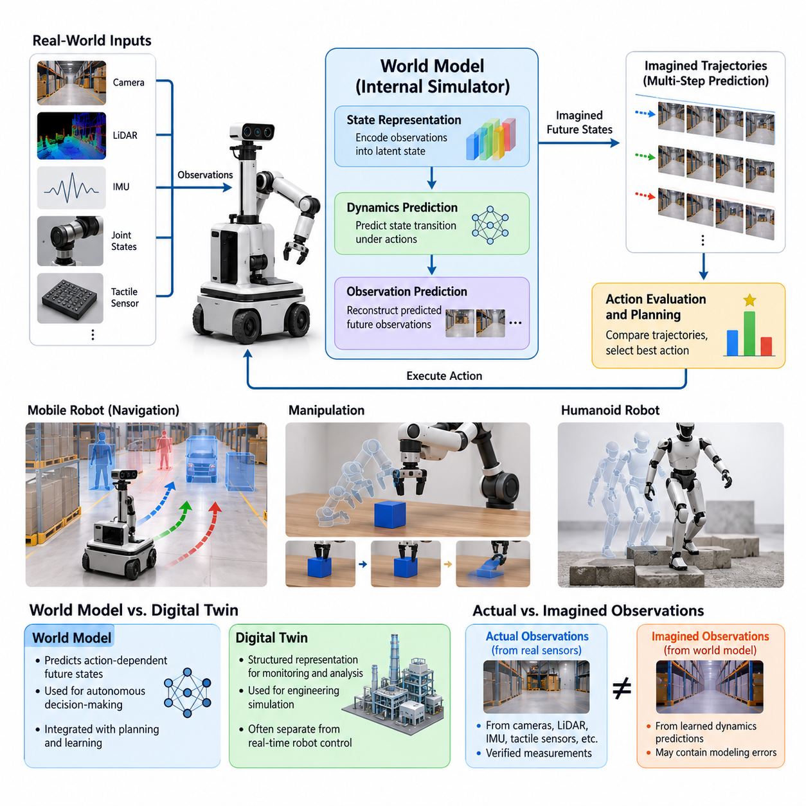
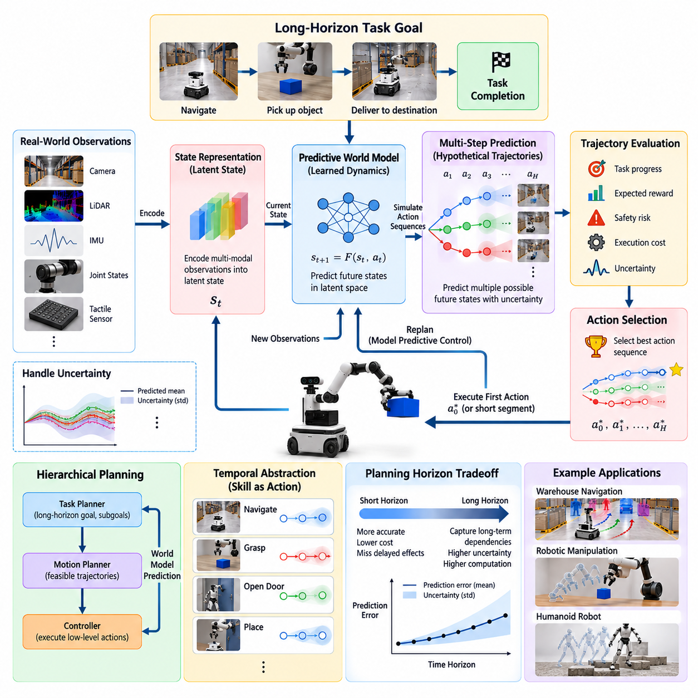
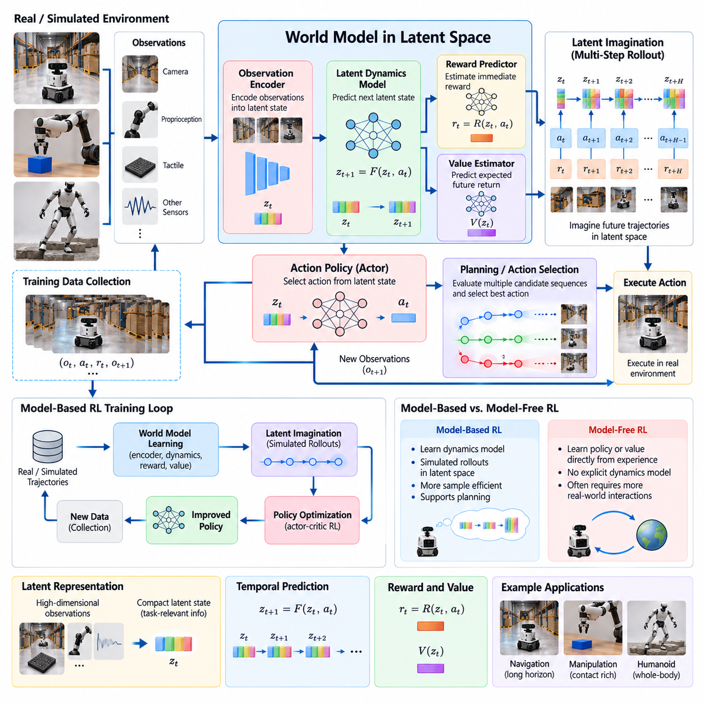
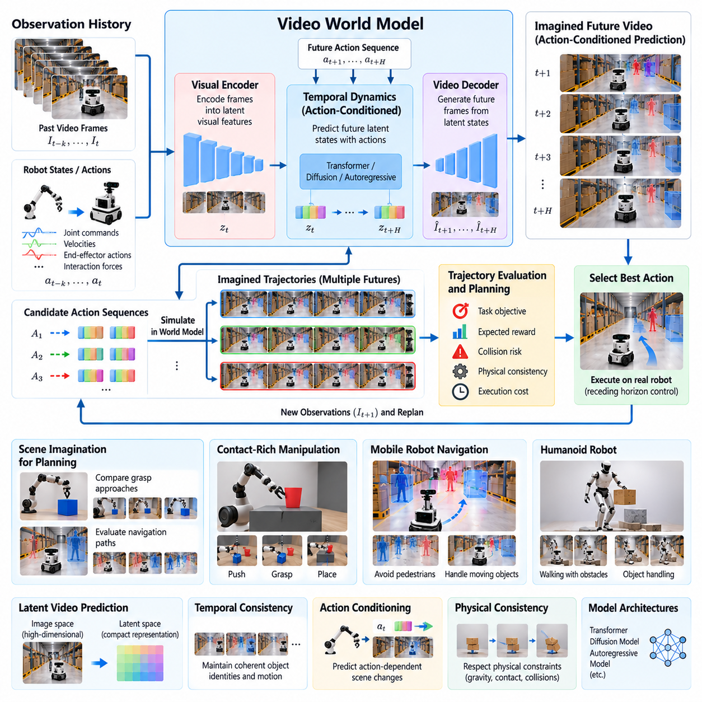
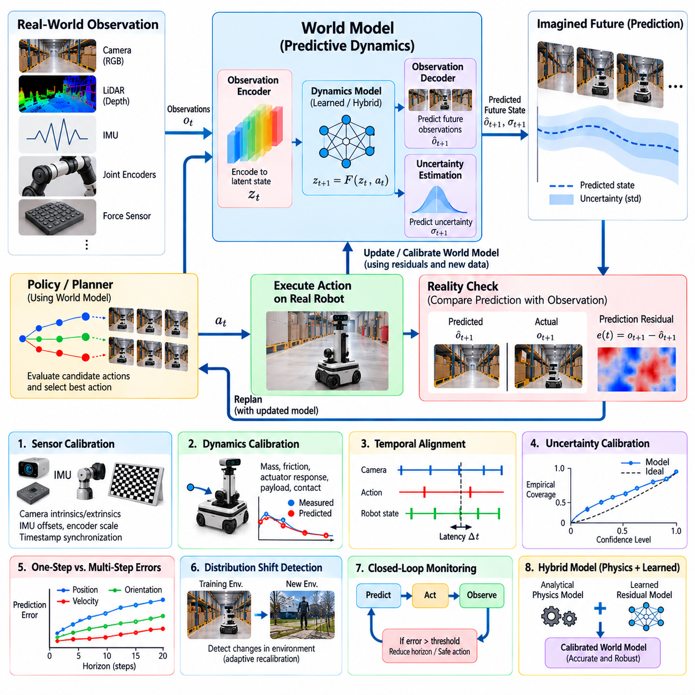
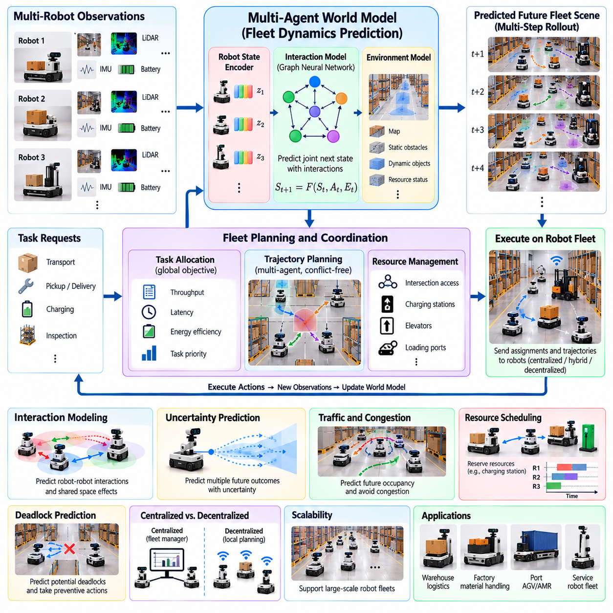
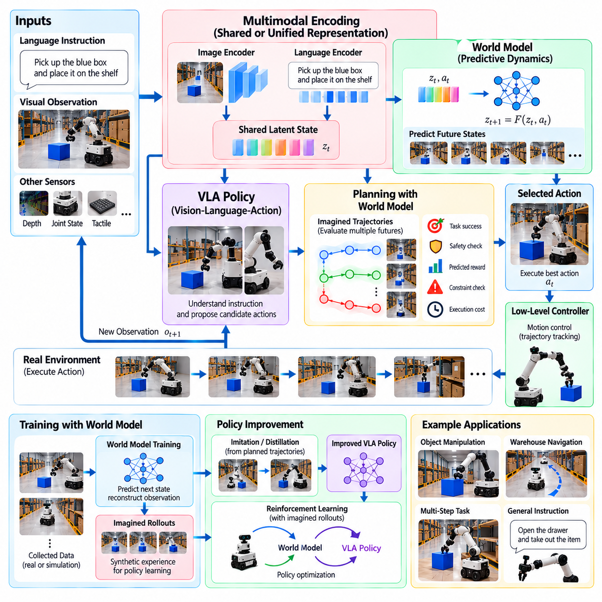
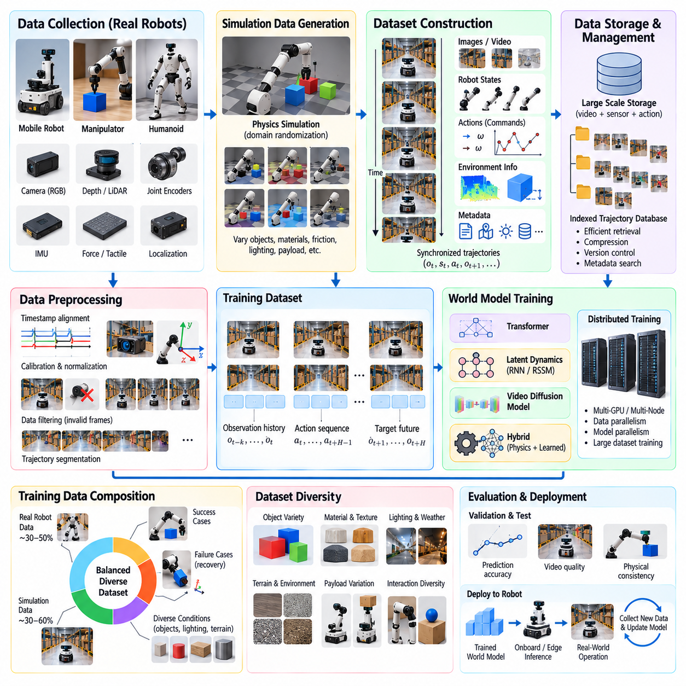
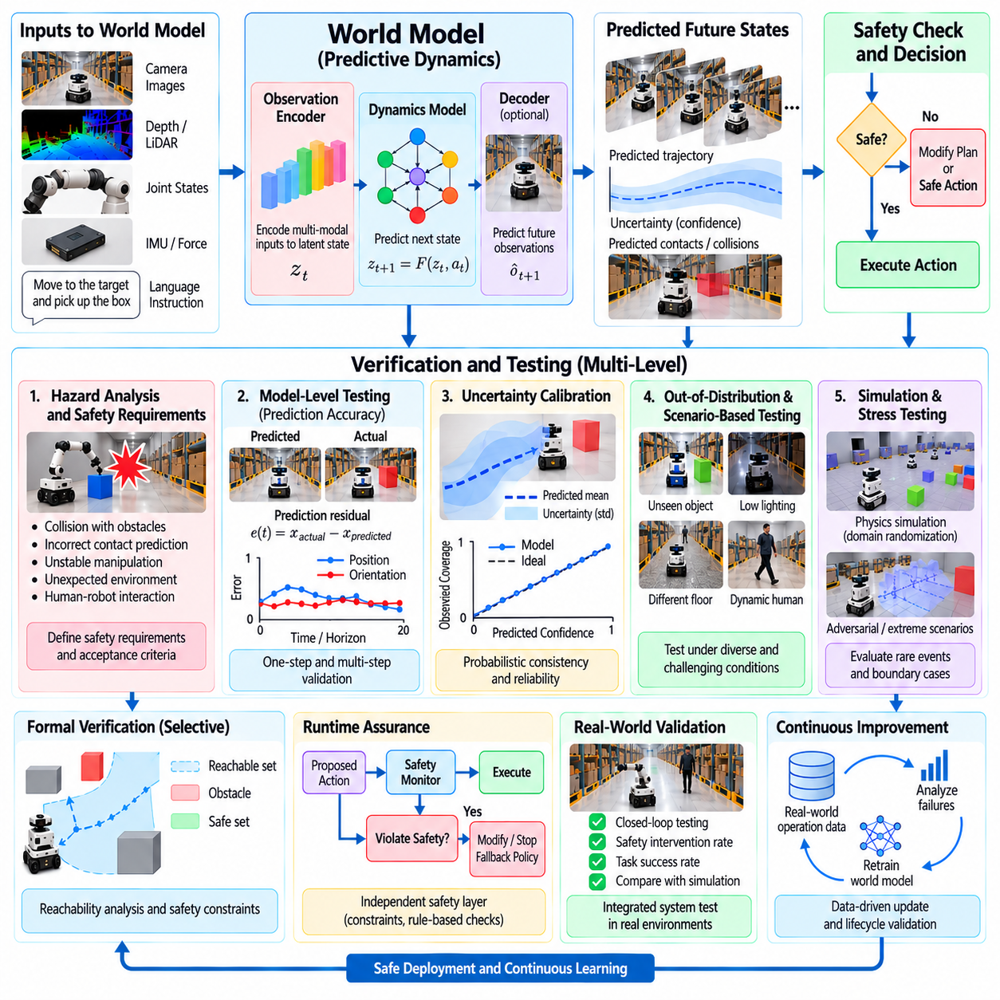
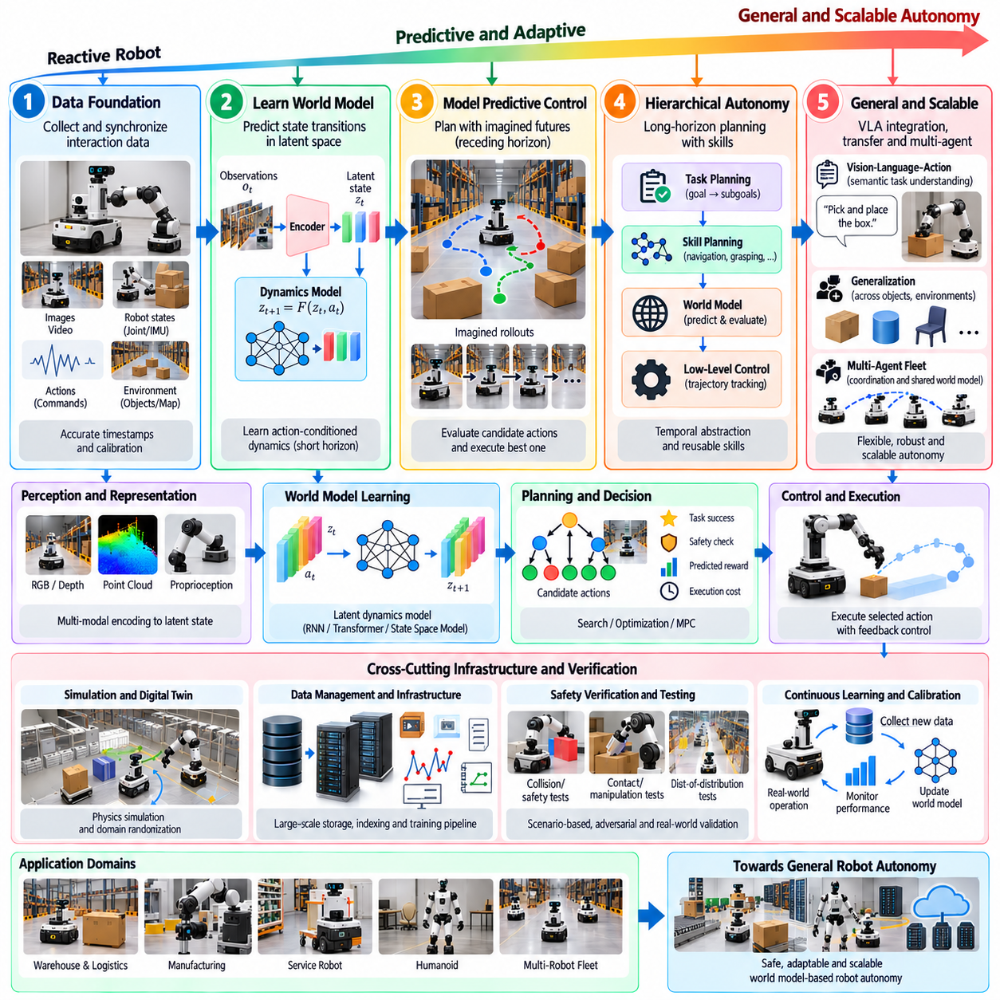

**Volume 27. Future AI Native Robotics**

# Chapter 04. World Model Based Robotics

## 04.01. World Model as Robot Internal Simulator

{width="7.268055555555556in" height="7.268055555555556in"}

A world model serves as an internal simulator that enables a robot to predict how its environment will evolve before executing physical actions. Unlike conventional robotic systems that primarily react to current sensor measurements, world model-based robots maintain an internal representation of objects, spatial relationships, physical dynamics, and possible future states. This predictive capability allows robots to evaluate alternative actions without immediately interacting with the real environment.

The fundamental purpose of a robotic world model is to approximate the transition between environmental states under specific actions. Given the current state, an action, and relevant contextual information, the model estimates the resulting future state. This process resembles physical simulation but may operate through learned neural representations rather than explicit mechanical equations. The robot can therefore imagine possible consequences while reducing dependence on computationally expensive external simulation.

A typical world model architecture contains three closely connected components: a state representation mechanism, a dynamics prediction mechanism, and an observation reconstruction or prediction mechanism. The representation mechanism transforms sensor measurements into a compact internal state. The dynamics mechanism predicts how this state changes under candidate actions. The observation mechanism estimates what the robot would perceive after those predicted changes occur.

The internal state may incorporate visual observations, depth information, joint positions, velocities, tactile measurements, and environmental context. Rather than storing every raw sensor value, neural encoders can compress relevant information into a latent representation. This latent space captures features useful for predicting future behavior, including object motion, contact relationships, obstacle positions, and robot configuration. Its quality directly influences prediction accuracy.

World models differ from traditional digital twins in their primary operational purpose. A digital twin often maintains a structured representation of a physical asset or environment for monitoring, analysis, and engineering simulation. A robotic world model emphasizes predicting action-dependent future states for autonomous decision-making. Both approaches can share physical models and sensor information, but world models are typically integrated more directly into the robot\'s planning and learning processes.

An internal simulator must represent the relationship between robot actions and environmental consequences. When a mobile robot accelerates, the model should estimate its future position, velocity, and interaction with surrounding obstacles. When a manipulator pushes an object, the model should predict possible displacement, rotation, and contact changes. These predictions allow the robot to reason about physical outcomes before committing to potentially irreversible actions.

The predictive process can be expressed conceptually as a transition function that maps the current internal state and selected action into a predicted next state. Repeated application of this function generates hypothetical trajectories extending several steps into the future. Each trajectory represents one possible evolution of the robot and its environment. A planning system can compare these trajectories according to task objectives, physical constraints, and estimated risk.

World model-based reasoning introduces a distinction between actual observations and imagined future states. Actual observations originate from cameras, LiDAR, inertial sensors, and other physical measurement devices. Imagined states originate from learned dynamics predictions and may contain modeling errors. A reliable architecture must preserve this distinction so that predicted information is not mistaken for verified environmental measurements during safety-critical operations.

The ability to simulate future states supports model-based decision-making. Instead of selecting an action solely from current perception, the robot can evaluate several candidate actions through internal rollouts. Each rollout estimates the consequences of a possible control sequence. The planner then selects an action that satisfies operational objectives while respecting constraints. This approach is particularly valuable when mistakes are expensive or difficult to reverse.

For an autonomous mobile robot operating in a warehouse, an internal simulator can estimate how surrounding vehicles and pedestrians may move during the next few seconds. The robot evaluates alternative paths, predicts possible intersections, and identifies trajectories with lower collision risk. Unlike a static occupancy map, the world model represents changing conditions and action-dependent consequences, allowing navigation decisions to account for environmental dynamics.

In robotic manipulation, world models support reasoning about contact-rich interactions. A robot attempting to grasp an unfamiliar object can predict how different gripper positions and closing motions might affect object stability. The internal simulator may estimate slipping, rotation, or displacement during contact. Although learned contact dynamics remain difficult to model accurately, predictive reasoning can reduce unnecessary physical trials and improve manipulation planning.

Humanoid robots require world models capable of representing coupled body dynamics and environmental interactions. Walking, reaching, balancing, and object handling involve multiple coordinated joints and changing contact conditions. An internal simulator can estimate how planned movements influence body posture, center-of-mass motion, and external forces. These predictions provide useful information for selecting movements that preserve stability while accomplishing higher-level tasks.

A significant advantage of learned world models is their ability to capture relationships that are difficult to describe using manually constructed equations. Complex friction behavior, deformable materials, uncertain object interactions, and partially observable environments can challenge conventional physics simulation. Neural models trained on representative interaction data may approximate these behaviors, although successful prediction depends strongly on data coverage and generalization.

Training an effective world model requires sequences of observations and corresponding robot actions. During learning, the model receives information about an initial state, an executed action, and the resulting observation. Its parameters are adjusted to reduce differences between predicted and observed outcomes. Repeated exposure to diverse operating conditions helps the model learn temporal relationships, physical regularities, and action-dependent environmental changes.

Self-supervised learning is particularly relevant because robots continuously generate observation sequences during normal operation. Consecutive camera frames, proprioceptive measurements, and action histories provide training signals without requiring extensive manual annotation. The model can learn to predict future observations or compact latent states from preceding information. However, passive observation alone may not identify all action-dependent dynamics, making interactive experience valuable.

Prediction uncertainty is an essential characteristic of a practical robotic world model. Environmental measurements may be incomplete, objects may behave unpredictably, and learned dynamics may become unreliable outside the training distribution. Instead of producing only one deterministic future, a probabilistic model can represent multiple plausible outcomes. This enables planning systems to consider uncertainty and avoid actions whose consequences cannot be estimated with sufficient confidence.

Prediction errors generally increase as the simulation horizon becomes longer. Small inaccuracies in position, velocity, contact forces, or object behavior can accumulate through repeated state transitions. Consequently, a model that predicts the next few control steps accurately may still generate unrealistic trajectories over extended periods. Practical architectures must balance prediction horizon, computational cost, uncertainty growth, and the frequency of real-world observation updates.

An important architectural principle is to continuously correct internal predictions using new sensor observations. After executing an action, the robot compares the observed environmental state with the state predicted by its internal simulator. Differences reveal model inaccuracies, unexpected disturbances, or changes in operating conditions. The robot then updates its state estimate and generates new predictions, creating a closed-loop relationship between imagination and physical experience.

World models also provide a foundation for learning from simulated experience. A robot can generate hypothetical trajectories internally and use their estimated outcomes to improve decision policies. This reduces the need to perform every exploratory action in the physical environment. Nevertheless, simulated experience must remain constrained by model reliability because repeatedly training on inaccurate predictions can reinforce incorrect assumptions and degrade real-world performance.

The computational architecture of an internal simulator must accommodate the limited resources available on robotic platforms. Large neural world models may require substantial GPU memory and inference capacity, while real-time control systems demand predictable response times. A practical design may combine compact onboard prediction models with more detailed simulation performed on edge servers or cloud infrastructure. Critical control functions must remain operational when external computation is unavailable.

Integration with conventional robot software requires well-defined interfaces between perception, state estimation, world modeling, planning, and control. Sensor processing modules supply observations, while the world model generates predicted state transitions. Planning modules evaluate candidate actions, and low-level controllers execute validated commands. Separating these responsibilities allows predictive intelligence to improve autonomous behavior without replacing established safety mechanisms or deterministic control functions.

Safety remains a fundamental limitation of internal simulation. A world model may predict that a trajectory is collision-free even when an unseen obstacle or inaccurate dynamics estimate makes it dangerous. Therefore, predicted safety cannot replace independent obstacle detection, emergency stopping, actuator limits, or verified protective functions. The internal simulator should support risk-aware planning while operating within externally enforced physical and operational safety boundaries.

Evaluating a world model requires more than measuring visual similarity between predicted and observed images. Important criteria include state prediction accuracy, physical consistency, uncertainty calibration, computational latency, and downstream task performance. A model may generate visually convincing future scenes while incorrectly estimating collision geometry or contact dynamics. Validation must therefore determine whether its predictions support reliable robotic decisions under representative operating conditions.

The broader significance of world models lies in transforming robots from systems that primarily recognize and react into systems capable of anticipating physical consequences. By maintaining an internal simulator, a robot can compare possible futures, recognize uncertainty, and choose actions with greater awareness of their effects. This predictive foundation supports the evolution toward more adaptive, general-purpose, and autonomous physical AI systems.

세계 모델(World Model)은 로봇이 실제 물리적 동작을 실행하기 전에 주변 환경의 변화를 예측할 수 있도록 하는 내부 시뮬레이터(Internal Simulator) 역할을 수행한다. 현재 센서 측정값에 주로 반응하는 기존 로봇 시스템과 달리, 세계 모델 기반 로봇(World Model-Based Robot)은 객체, 공간적 관계, 물리적 동역학(Physical Dynamics), 가능한 미래 상태에 대한 내부 표현(Internal Representation)을 유지한다. 이러한 예측 능력을 통해 로봇은 실제 환경과 즉시 상호작용하지 않고도 여러 동작 대안을 평가할 수 있다.

로봇 세계 모델의 근본적인 목적은 특정 동작에 따라 환경 상태가 어떻게 전이되는지를 근사적으로 표현하는 것이다. 현재 상태(Current State), 동작(Action), 관련 상황 정보(Contextual Information)가 주어지면 모델은 그 결과로 발생할 미래 상태(Future State)를 추정한다. 이 과정은 물리 시뮬레이션(Physical Simulation)과 유사하지만, 명시적인 역학 방정식 대신 학습된 신경망 표현(Neural Representation)을 활용할 수 있다. 따라서 로봇은 계산 비용이 높은 외부 시뮬레이션에 대한 의존도를 줄이면서 가능한 결과를 내부적으로 예측할 수 있다.

일반적인 세계 모델 아키텍처(World Model Architecture)는 상태 표현 메커니즘(State Representation Mechanism), 동역학 예측 메커니즘(Dynamics Prediction Mechanism), 관측 재구성 또는 예측 메커니즘(Observation Reconstruction or Prediction Mechanism)이라는 세 가지 밀접하게 연결된 구성 요소를 포함한다. 상태 표현 메커니즘은 센서 측정값을 압축된 내부 상태로 변환한다. 동역학 메커니즘은 후보 동작에 따라 상태가 어떻게 변화하는지 예측하며, 관측 메커니즘은 예측된 변화 이후 로봇이 무엇을 감지하게 될지 추정한다.

내부 상태(Internal State)에는 시각 관측(Visual Observation), 깊이 정보(Depth Information), 관절 위치(Joint Position), 속도(Velocity), 촉각 측정값(Tactile Measurement), 환경 상황 정보(Environmental Context)가 포함될 수 있다. 신경망 인코더(Neural Encoder)는 모든 원시 센서 값을 저장하는 대신 관련 정보를 잠재 표현(Latent Representation)으로 압축한다. 이러한 잠재 공간(Latent Space)은 객체 움직임, 접촉 관계, 장애물 위치, 로봇 구성과 같이 미래 동작 예측에 유용한 특징을 포착하며, 그 품질은 예측 정확도에 직접적인 영향을 미친다.

세계 모델(World Model)은 주요 운용 목적에서 기존 디지털 트윈(Digital Twin)과 차이가 있다. 디지털 트윈은 일반적으로 물리적 자산이나 환경의 구조화된 표현을 유지하면서 모니터링, 분석, 공학적 시뮬레이션에 활용된다. 반면 로봇 세계 모델은 자율적 의사결정(Autonomous Decision-Making)을 위해 동작에 따른 미래 상태를 예측하는 데 중점을 둔다. 두 접근 방식은 물리 모델과 센서 정보를 공유할 수 있지만, 세계 모델은 일반적으로 로봇의 계획 및 학습 과정에 더욱 직접적으로 통합된다.

내부 시뮬레이터(Internal Simulator)는 로봇 동작과 환경 변화 사이의 관계를 표현해야 한다. 이동 로봇(Mobile Robot)이 가속할 때 모델은 미래 위치, 속도, 주변 장애물과의 상호작용을 추정해야 한다. 로봇 매니퓰레이터(Manipulator)가 객체를 밀 때는 발생 가능한 변위(Displacement), 회전(Rotation), 접촉 상태 변화를 예측해야 한다. 이러한 예측을 통해 로봇은 되돌리기 어려운 동작을 실행하기 전에 물리적 결과를 추론할 수 있다.

예측 과정(Predictive Process)은 현재 내부 상태와 선택된 동작을 예측된 다음 상태로 변환하는 상태 전이 함수(State Transition Function)로 개념화할 수 있다. 이 함수를 반복적으로 적용하면 여러 단계의 미래까지 확장되는 가상 궤적(Hypothetical Trajectory)이 생성된다. 각 궤적은 로봇과 환경이 변화할 수 있는 하나의 가능한 경로를 나타낸다. 계획 시스템(Planning System)은 작업 목표, 물리적 제약 조건, 예상 위험을 기준으로 이러한 궤적들을 비교할 수 있다.

세계 모델 기반 추론(World Model-Based Reasoning)은 실제 관측(Actual Observation)과 상상된 미래 상태(Imagined Future State)를 구분한다. 실제 관측은 카메라(Camera), 라이다(LiDAR), 관성 센서(Inertial Sensor) 및 기타 물리적 측정 장치에서 획득된다. 반면 상상된 상태는 학습된 동역학 예측에서 생성되며 모델링 오차(Modeling Error)를 포함할 수 있다. 신뢰성 있는 아키텍처는 이러한 차이를 유지하여 안전 필수 운용(Safety-Critical Operation)에서 예측 정보가 검증된 환경 측정값으로 잘못 취급되지 않도록 해야 한다.

미래 상태를 시뮬레이션하는 능력은 모델 기반 의사결정(Model-Based Decision-Making)을 지원한다. 로봇은 현재 인식 결과만으로 동작을 선택하는 대신 내부 전개 시뮬레이션(Internal Rollout)을 통해 여러 후보 동작을 평가할 수 있다. 각 전개 과정은 가능한 제어 시퀀스(Control Sequence)의 결과를 추정한다. 이후 계획기는 운용 목표를 충족하면서 제약 조건을 준수하는 동작을 선택한다. 이러한 접근 방식은 실수로 인한 비용이 높거나 결과를 되돌리기 어려운 상황에서 특히 중요하다.

창고에서 운용되는 자율 이동 로봇(Autonomous Mobile Robot)은 내부 시뮬레이터를 활용하여 주변 차량과 보행자가 향후 몇 초 동안 어떻게 이동할지 추정할 수 있다. 로봇은 대체 경로(Alternative Path)를 평가하고 가능한 교차 상황을 예측하며 충돌 위험이 낮은 궤적을 식별한다. 정적 점유 지도(Static Occupancy Map)와 달리 세계 모델은 변화하는 환경 조건과 동작에 따른 결과를 표현하므로, 환경의 동적 특성을 고려한 내비게이션 의사결정(Navigation Decision-Making)이 가능하다.

로봇 조작(Robotic Manipulation)에서 세계 모델은 접촉이 많은 상호작용(Contact-Rich Interaction)에 대한 추론을 지원한다. 익숙하지 않은 객체를 파지하려는 로봇은 다양한 그리퍼 위치(Gripper Position)와 닫힘 동작(Closing Motion)이 객체 안정성에 어떤 영향을 미칠지 예측할 수 있다. 내부 시뮬레이터는 접촉 과정에서 발생할 수 있는 미끄러짐(Slipping), 회전, 변위를 추정한다. 학습 기반 접촉 동역학(Learned Contact Dynamics)을 정확하게 모델링하는 것은 여전히 어렵지만, 예측 기반 추론은 불필요한 물리적 시행을 줄이고 조작 계획을 개선할 수 있다.

휴머노이드 로봇(Humanoid Robot)은 신체의 결합 동역학(Coupled Body Dynamics)과 환경 상호작용을 표현할 수 있는 세계 모델이 필요하다. 보행(Walking), 도달 동작(Reaching), 균형 유지(Balancing), 객체 취급(Object Handling)은 여러 관절의 협조 동작과 변화하는 접촉 조건을 수반한다. 내부 시뮬레이터는 계획된 움직임이 신체 자세(Body Posture), 질량 중심 운동(Center-of-Mass Motion), 외력(External Force)에 미치는 영향을 추정하여, 상위 작업 목표를 달성하면서 안정성을 유지하는 동작을 선택하도록 지원한다.

학습 기반 세계 모델(Learned World Model)의 중요한 장점은 수작업으로 구성한 방정식으로 설명하기 어려운 관계를 포착할 수 있다는 점이다. 복잡한 마찰 거동(Friction Behavior), 변형 가능한 재료(Deformable Material), 불확실한 객체 상호작용, 부분 관측 환경(Partially Observable Environment)은 기존 물리 시뮬레이션에 어려움을 초래할 수 있다. 대표적인 상호작용 데이터로 학습된 신경망 모델은 이러한 거동을 근사할 수 있지만, 예측 성능은 학습 데이터의 포괄성과 일반화 능력(Generalization)에 크게 의존한다.

효과적인 세계 모델을 학습하려면 관측 시퀀스(Observation Sequence)와 이에 대응하는 로봇 동작 데이터가 필요하다. 학습 과정에서 모델은 초기 상태(Initial State), 실행된 동작(Executed Action), 그 결과로 얻어진 관측값을 입력받는다. 이후 예측 결과와 실제 관측 결과 사이의 차이를 줄이도록 모델 매개변수(Model Parameter)를 조정한다. 다양한 운용 조건에 반복적으로 노출되면 모델은 시간적 관계(Temporal Relationship), 물리적 규칙성(Physical Regularity), 동작에 따른 환경 변화를 학습할 수 있다.

자기지도학습(Self-Supervised Learning)은 로봇이 정상 운용 과정에서 지속적으로 관측 시퀀스를 생성한다는 점에서 특히 중요하다. 연속된 카메라 영상, 고유수용감각 측정값(Proprioceptive Measurement), 동작 이력(Action History)은 광범위한 수동 주석(Manual Annotation) 없이 학습 신호를 제공한다. 모델은 이전 정보를 이용하여 미래 관측값이나 압축된 잠재 상태를 예측하도록 학습할 수 있다. 다만 수동적 관측만으로 모든 동작 의존적 동역학을 식별하기 어려우므로 상호작용 경험(Interactive Experience)이 중요하다.

예측 불확실성(Prediction Uncertainty)은 실용적인 로봇 세계 모델의 필수 특성이다. 환경 측정값이 불완전하거나 객체가 예측하기 어렵게 움직일 수 있으며, 학습된 동역학이 학습 분포(Training Distribution)를 벗어난 조건에서 신뢰성을 잃을 수도 있다. 확률적 모델(Probabilistic Model)은 하나의 결정론적 미래(Deterministic Future)만 생성하는 대신 여러 가능한 결과를 표현할 수 있다. 이를 통해 계획 시스템은 불확실성을 고려하고 결과를 충분한 신뢰도로 예측하기 어려운 동작을 회피할 수 있다.

예측 오차(Prediction Error)는 일반적으로 시뮬레이션 예측 구간(Simulation Horizon)이 길어질수록 증가한다. 위치, 속도, 접촉력(Contact Force), 객체 거동에서 발생하는 작은 부정확성은 반복적인 상태 전이를 통해 누적될 수 있다. 따라서 몇 단계의 제어 동작을 정확하게 예측하는 모델이라도 장기간의 궤적에서는 비현실적인 결과를 생성할 수 있다. 실용적인 아키텍처는 예측 구간, 계산 비용(Computational Cost), 불확실성 증가, 실제 관측값의 갱신 빈도 사이에서 균형을 유지해야 한다.

중요한 아키텍처 원칙은 새로운 센서 관측값을 이용하여 내부 예측을 지속적으로 보정하는 것이다. 로봇은 동작을 실행한 후 실제로 관측된 환경 상태와 내부 시뮬레이터가 예측한 상태를 비교한다. 두 상태의 차이는 모델 부정확성(Model Inaccuracy), 예상하지 못한 외란(Unexpected Disturbance), 운용 조건의 변화를 나타낼 수 있다. 이후 로봇은 상태 추정값(State Estimate)을 갱신하고 새로운 예측을 생성하여, 내부 상상과 실제 물리적 경험 사이의 폐루프 관계(Closed-Loop Relationship)를 형성한다.

세계 모델은 시뮬레이션 경험(Simulated Experience)을 통한 학습의 기반도 제공한다. 로봇은 내부적으로 가상 궤적을 생성하고 그 결과를 추정하여 의사결정 정책(Decision Policy)을 개선할 수 있다. 이러한 방식은 모든 탐색 동작(Exploratory Action)을 실제 물리적 환경에서 수행해야 하는 필요성을 줄인다. 그러나 부정확한 예측에 반복적으로 의존한 학습은 잘못된 가정을 강화하고 실제 환경에서의 성능을 저하시킬 수 있으므로, 시뮬레이션 경험은 모델 신뢰성 범위 내에서 활용되어야 한다.

내부 시뮬레이터의 계산 아키텍처(Computational Architecture)는 로봇 플랫폼에서 사용할 수 있는 제한된 자원을 고려해야 한다. 대규모 신경망 세계 모델은 상당한 GPU 메모리와 추론 연산 능력(Inference Computing Capacity)을 요구할 수 있지만, 실시간 제어 시스템(Real-Time Control System)은 예측 가능한 응답 시간을 필요로 한다. 실용적인 설계에서는 경량 온보드 예측 모델(Compact Onboard Prediction Model)과 엣지 서버(Edge Server) 또는 클라우드 인프라(Cloud Infrastructure)에서 수행되는 정밀 시뮬레이션을 결합할 수 있다. 외부 연산 자원을 사용할 수 없는 상황에서도 필수 제어 기능은 유지되어야 한다.

기존 로봇 소프트웨어와의 통합에는 인식(Perception), 상태 추정(State Estimation), 세계 모델링(World Modeling), 계획(Planning), 제어(Control) 사이에 명확하게 정의된 인터페이스(Interface)가 필요하다. 센서 처리 모듈(Sensor Processing Module)은 관측 정보를 제공하고, 세계 모델은 예측된 상태 전이를 생성한다. 계획 모듈은 후보 동작을 평가하며, 저수준 제어기(Low-Level Controller)는 검증된 명령을 실행한다. 이러한 책임 분리는 기존 안전 메커니즘과 결정론적 제어 기능을 대체하지 않으면서 예측 지능을 통해 자율 동작을 개선하도록 한다.

안전성(Safety)은 내부 시뮬레이션의 근본적인 한계와 관련된다. 세계 모델은 실제로 보이지 않는 장애물이나 부정확한 동역학 추정 때문에 위험한 궤적을 충돌이 없는 경로로 예측할 수 있다. 따라서 예측된 안전성은 독립적인 장애물 감지(Obstacle Detection), 비상 정지(Emergency Stop), 액추에이터 제한(Actuator Limit), 검증된 보호 기능(Verified Protective Function)을 대체할 수 없다. 내부 시뮬레이터는 위험 인지 계획(Risk-Aware Planning)을 지원하되, 외부에서 강제되는 물리적 및 운용적 안전 경계(Safety Boundary) 내에서 작동해야 한다.

세계 모델을 평가할 때는 예측 영상과 실제 관측 영상 사이의 시각적 유사성(Visual Similarity)만 측정해서는 충분하지 않다. 중요한 평가 기준에는 상태 예측 정확도(State Prediction Accuracy), 물리적 일관성(Physical Consistency), 불확실성 보정(Uncertainty Calibration), 계산 지연 시간(Computational Latency), 후속 작업 성능(Downstream Task Performance)이 포함된다. 모델이 시각적으로 그럴듯한 미래 장면을 생성하더라도 충돌 기하 구조(Collision Geometry)나 접촉 동역학을 잘못 추정할 수 있다. 따라서 검증 과정에서는 대표적인 운용 조건에서 모델 예측이 신뢰성 있는 로봇 의사결정을 지원하는지 확인해야 한다.

세계 모델의 더 넓은 의미는 로봇을 주로 환경을 인식하고 반응하는 시스템에서 물리적 결과를 예상할 수 있는 시스템으로 전환한다는 데 있다. 내부 시뮬레이터를 유지함으로써 로봇은 가능한 미래를 비교하고 불확실성을 인식하며 동작의 결과를 더욱 깊이 고려하여 행동을 선택할 수 있다. 이러한 예측 기반 구조(Predictive Foundation)는 적응성이 높고 범용적인 자율 물리 인공지능(Autonomous Physical AI) 시스템으로 발전하기 위한 핵심 기반을 제공한다.

## 04.02. Predictive World Model for Long Horizon Planning [w/Code]

{width="7.268055555555556in" height="7.268055555555556in"}

Long-horizon planning enables robots to reason about action sequences extending beyond immediate control decisions. A predictive world model supports this capability by estimating how the robot and its environment may evolve over multiple future steps. Rather than reacting only to current observations, the robot evaluates anticipated consequences, intermediate objectives, and environmental changes before selecting actions that contribute to a distant task goal.

Conventional reactive policies often perform effectively in familiar situations but may struggle when successful execution requires several dependent actions. A warehouse robot must navigate toward a loading station, wait for access, collect a container, and deliver it to another location. Each decision influences subsequent possibilities. Predictive world models provide a mechanism for representing these dependencies and evaluating whether current actions support eventual task completion.

The mathematical foundation of predictive planning is a learned state transition model that estimates future states from current states and candidate actions. A transition can be expressed as s(t+1) = F(s(t), a(t)), where F represents the learned dynamics function. Repeated application generates predicted trajectories across a planning horizon. In uncertain environments, probabilistic transitions represent multiple possible outcomes rather than assuming one deterministic future.

A long-horizon planner must distinguish between immediate action quality and cumulative task performance. An action that produces rapid short-term progress may create obstacles later, while a temporary detour may improve eventual completion probability. The planning objective therefore considers accumulated rewards, execution costs, safety constraints, and terminal conditions. This allows the robot to compare action sequences according to their expected overall consequences.

Predictive world models commonly operate within a latent state space rather than directly generating complete sensor observations at every future step. Visual encoders transform camera images and other measurements into compact representations containing task-relevant information. Learned dynamics then propagate these representations forward under candidate actions. This approach can reduce computational requirements, although the latent state must preserve information essential for reliable planning.

Long-horizon prediction introduces substantial challenges because small modeling errors accumulate across repeated transitions. An inaccurate estimate of object motion, friction, or actuator response can progressively distort simulated outcomes. Predictions that appear reliable over a few steps may become unrealistic after extended rollouts. Practical systems must therefore consider prediction uncertainty and avoid treating distant simulated states as guaranteed physical outcomes.

Hierarchical planning addresses long-horizon complexity by separating high-level objectives from lower-level control actions. A task planner determines meaningful subgoals such as approaching an object, establishing a grasp, and placing it at a destination. A motion planner translates each subgoal into feasible trajectories, while controllers execute immediate commands. The world model connects these levels by predicting whether intermediate states remain compatible with the overall objective.

Temporal abstraction further reduces the number of decisions required during extended planning. Instead of predicting every motor command individually, the system may represent reusable skills as temporally extended actions. Navigation, grasping, door opening, and object placement can become planning primitives with predicted outcomes and durations. This abstraction allows the planner to evaluate longer task sequences while retaining detailed control within individual skills.

Model predictive control provides a practical mechanism for integrating predictive world models into robot operation. The planner simulates candidate action sequences over a finite horizon, evaluates their predicted outcomes, and executes only the initial action or short segment. After receiving new observations, it updates the state estimate and replans. This repeated process limits dependence on outdated predictions while preserving the benefits of future-oriented reasoning.

Planning horizon selection represents an important engineering tradeoff. Short horizons generally provide more accurate predictions and lower computational costs but may overlook delayed consequences. Longer horizons reveal broader task dependencies while increasing uncertainty and processing requirements. Adaptive horizon strategies can allocate longer prediction windows to strategic decisions and shorter windows to dynamic interactions requiring precise control.

Uncertainty-aware planning evaluates not only the expected future state but also the reliability of each prediction. Probabilistic world models may estimate distributions over object positions, environmental changes, and action outcomes. Candidate trajectories can then be assessed according to expected performance and risk. When uncertainty exceeds acceptable limits, the planner may select conservative actions, gather additional observations, or request supervisory intervention.

A useful predictive architecture combines a learned dynamics model with a task objective evaluator and a trajectory selection mechanism. The dynamics model estimates state transitions, the evaluator assigns costs or rewards to predicted outcomes, and the selection mechanism identifies promising action sequences. These components operate iteratively as environmental observations change. Their effectiveness depends on consistent state representations and accurate action-conditioned predictions.

Candidate action sequences can be generated through random shooting, cross-entropy optimization, tree search, or gradient-based methods when the model supports differentiation. Each method explores possible futures with different computational characteristics. Sampling approaches accommodate complex action spaces, while tree-based approaches can represent branching decisions. The selection of an optimizer depends on available computation, planning depth, and environmental uncertainty.

Long-horizon planning also requires reasoning about delayed and irreversible consequences. A manipulator may need to move an obstructing object before reaching a target, while a mobile robot may need to choose a corridor that preserves access to later destinations. Predictive simulation helps identify such dependencies. However, the model must represent task-relevant constraints accurately, particularly when actions alter the environment in ways that cannot easily be reversed.

Partial observability complicates extended planning because robots cannot directly measure every relevant environmental variable. Hidden obstacles, uncertain object properties, and unpredictable human behavior create ambiguity about the true state. A belief-state representation can maintain estimates of possible environmental conditions. The planner then reasons over predicted belief evolution, allowing information-gathering actions to contribute to successful task execution.

Memory mechanisms improve long-horizon reasoning by preserving information that may disappear from immediate sensor observations. A robot navigating through multiple rooms must remember previously observed passages, object locations, and task progress. Recurrent neural networks, attention-based architectures, or structured memory systems can maintain this context. Combining memory with predictive dynamics enables decisions based on both historical evidence and anticipated future conditions.

World model-based planning can support multimodal robot intelligence by integrating visual, spatial, proprioceptive, and language information. Language instructions specify task goals, while visual observations describe environmental conditions. The predictive model estimates the consequences of physical actions, and the planner determines whether those consequences satisfy the instruction. This connection enables robots to transform abstract objectives into physically grounded sequences of behavior.

In industrial logistics, predictive planning can coordinate navigation, payload handling, charging requirements, and delivery deadlines. A robot may anticipate congestion, estimate energy consumption, and choose task sequences that reduce operational delays. The world model represents expected changes in robot and environmental states, while scheduling constraints influence trajectory evaluation. Such integration extends predictive reasoning beyond motion control into operational decision-making.

For humanoid robots, long-horizon planning must coordinate locomotion, manipulation, balance, and contact transitions. A humanoid carrying an object through a doorway may need to adjust its grasp, approach angle, posture, and walking trajectory. Predictive simulation can evaluate whether these actions remain physically compatible. Hierarchical decomposition is particularly valuable because directly optimizing every joint command across an extended task would be computationally demanding.

Training predictive models for extended planning requires temporally diverse interaction data. Short observation sequences help identify local dynamics, while longer trajectories reveal delayed effects and task dependencies. Training objectives may combine one-step prediction accuracy with multi-step consistency and task-relevant representation learning. Evaluation should emphasize whether predictions improve actual planning performance rather than relying exclusively on reconstruction quality.

Simulation-generated experience can supplement physical robot data when collecting long interaction sequences is expensive. A physics simulator can provide diverse trajectories, while a learned world model approximates recurring environmental dynamics. Combining simulated and real observations may improve coverage of possible situations. Nevertheless, differences between simulation and reality must be measured because inaccurate dynamics can produce misleading long-term predictions.

Safety constraints must remain active throughout predictive planning. Candidate trajectories should be rejected when they violate collision boundaries, actuator limitations, stability requirements, or operational restrictions. Because learned predictions may be inaccurate, independent safety monitoring and verified low-level protection remain necessary. Long-horizon optimization should improve task performance without allowing uncertain future predictions to override immediate physical safety requirements.

The effectiveness of predictive world models can be assessed through task completion rate, planning latency, prediction error, computational efficiency, and robustness under environmental changes. Additional measurements include recovery from unexpected events, sensitivity to horizon length, and performance under uncertainty. Comparing model-based planning with reactive baselines helps determine whether predictive simulation provides measurable benefits in realistic robotic operating conditions.

Predictive world models establish a foundation for robots capable of reasoning across extended sequences of physical interaction. By combining learned dynamics, hierarchical objectives, uncertainty estimation, and continuous replanning, robots can anticipate consequences beyond immediate actions. The long-term objective is not perfect prediction of every future event, but sufficiently reliable anticipation to support adaptive, efficient, and safe autonomous behavior.

장기 구간 계획(Long-Horizon Planning)은 로봇이 즉각적인 제어 결정을 넘어 확장된 동작 시퀀스(Action Sequence)를 추론할 수 있도록 한다. 예측 세계 모델(Predictive World Model)은 여러 미래 단계에 걸쳐 로봇과 주변 환경이 어떻게 변화할 수 있는지 추정함으로써 이러한 능력을 지원한다. 로봇은 현재 관측값에만 반응하는 대신 예상되는 결과, 중간 목표(Intermediate Objective), 환경 변화를 평가한 후 장기적인 작업 목표(Task Goal) 달성에 기여하는 동작을 선택한다.

기존 반응형 정책(Reactive Policy)은 익숙한 상황에서 효과적으로 작동하는 경우가 많지만, 성공적인 작업 수행에 여러 개의 상호 의존적인 동작이 필요한 경우 어려움을 겪을 수 있다. 창고 로봇은 적재 스테이션(Loading Station)으로 이동하고, 접근 가능 상태를 기다리고, 컨테이너를 수거한 후 다른 위치로 운반해야 한다. 각각의 결정은 이후에 가능한 행동에 영향을 미친다. 예측 세계 모델은 이러한 의존 관계(Dependency)를 표현하고 현재 동작이 최종 작업 완료에 기여하는지 평가하는 메커니즘을 제공한다.

예측 계획(Predictive Planning)의 수학적 기반은 현재 상태와 후보 동작으로부터 미래 상태를 추정하는 학습 기반 상태 전이 모델(Learned State Transition Model)이다. 상태 전이는 s(t+1) = F(s(t), a(t))로 표현할 수 있으며, 여기서 F는 학습된 동역학 함수(Learned Dynamics Function)를 의미한다. 이 함수를 반복적으로 적용하면 계획 구간(Planning Horizon)에 걸친 예측 궤적(Predicted Trajectory)이 생성된다. 불확실한 환경에서는 하나의 결정론적 미래(Deterministic Future)를 가정하는 대신 확률적 상태 전이(Probabilistic Transition)를 통해 여러 가능한 결과를 표현한다.

장기 구간 계획기(Long-Horizon Planner)는 즉각적인 동작 품질(Immediate Action Quality)과 누적 작업 성능(Cumulative Task Performance)을 구분해야 한다. 단기적으로 빠른 진행을 제공하는 동작이 이후에 장애물을 발생시킬 수 있는 반면, 일시적인 우회는 최종 작업 완료 확률을 높일 수 있다. 따라서 계획 목적 함수(Planning Objective)는 누적 보상(Accumulated Reward), 실행 비용(Execution Cost), 안전 제약 조건(Safety Constraint), 종료 조건(Terminal Condition)을 고려한다. 이를 통해 로봇은 예상되는 전체 결과를 기준으로 동작 시퀀스를 비교할 수 있다.

예측 세계 모델은 일반적으로 미래의 모든 단계에서 완전한 센서 관측값을 직접 생성하는 대신 잠재 상태 공간(Latent State Space)에서 작동한다. 시각 인코더(Visual Encoder)는 카메라 영상과 기타 측정값을 작업 관련 정보를 포함하는 압축 표현(Compact Representation)으로 변환한다. 이후 학습된 동역학(Learned Dynamics)은 후보 동작에 따라 이러한 표현을 미래로 전개한다. 이 접근 방식은 계산 요구량을 줄일 수 있지만, 잠재 상태는 신뢰성 있는 계획에 필요한 핵심 정보를 보존해야 한다.

장기 구간 예측(Long-Horizon Prediction)은 반복적인 상태 전이 과정에서 작은 모델링 오차(Modeling Error)가 누적되기 때문에 상당한 어려움을 수반한다. 객체 움직임, 마찰(Friction), 액추에이터 응답(Actuator Response)에 대한 부정확한 추정은 시뮬레이션 결과를 점진적으로 왜곡할 수 있다. 몇 단계에서는 신뢰할 수 있는 예측이라도 긴 전개 구간(Rollout Horizon) 이후에는 비현실적인 결과가 될 수 있다. 따라서 실용적인 시스템은 예측 불확실성(Prediction Uncertainty)을 고려하고 먼 미래의 시뮬레이션 상태를 보장된 물리적 결과로 취급하지 않아야 한다.

계층적 계획(Hierarchical Planning)은 상위 수준 목표(High-Level Objective)와 하위 수준 제어 동작(Low-Level Control Action)을 분리하여 장기 구간의 복잡성을 해결한다. 작업 계획기(Task Planner)는 객체 접근, 파지 형성(Grasp Establishment), 목표 위치 배치와 같은 의미 있는 하위 목표(Subgoal)를 결정한다. 동작 계획기(Motion Planner)는 각 하위 목표를 실행 가능한 궤적으로 변환하며, 제어기(Controller)는 즉각적인 명령을 실행한다. 세계 모델은 중간 상태가 전체 목표와 양립할 수 있는지 예측하여 이러한 계층을 연결한다.

시간적 추상화(Temporal Abstraction)는 장기간 계획에서 필요한 의사결정 횟수를 추가로 줄인다. 시스템은 모든 모터 명령을 개별적으로 예측하는 대신 재사용 가능한 기술(Skill)을 시간적으로 확장된 동작(Temporally Extended Action)으로 표현할 수 있다. 내비게이션(Navigation), 파지(Grasping), 문 열기(Door Opening), 객체 배치(Object Placement)는 예측 결과와 수행 시간을 포함하는 계획 기본 요소(Planning Primitive)가 될 수 있다. 이러한 추상화를 통해 계획기는 개별 기술 내부의 정밀 제어를 유지하면서 더 긴 작업 시퀀스를 평가할 수 있다.

모델 예측 제어(Model Predictive Control, MPC)는 예측 세계 모델을 로봇 운용에 통합하는 실용적인 메커니즘을 제공한다. 계획기는 유한 예측 구간(Finite Horizon)에 걸쳐 후보 동작 시퀀스를 시뮬레이션하고 예상 결과를 평가한 다음, 초기 동작 또는 짧은 구간만 실행한다. 새로운 관측값을 수신하면 상태 추정값(State Estimate)을 갱신하고 다시 계획한다. 이러한 반복 과정은 오래된 예측에 대한 의존도를 제한하면서 미래 지향적 추론(Future-Oriented Reasoning)의 장점을 유지한다.

계획 구간 선택(Planning Horizon Selection)은 중요한 공학적 절충 관계(Engineering Tradeoff)를 나타낸다. 짧은 계획 구간은 일반적으로 더 정확한 예측과 낮은 계산 비용(Computational Cost)을 제공하지만 지연된 결과(Delayed Consequence)를 놓칠 수 있다. 긴 계획 구간은 더 넓은 작업 의존 관계를 파악할 수 있지만 불확실성과 처리 요구량을 증가시킨다. 적응형 계획 구간 전략(Adaptive Horizon Strategy)은 전략적 의사결정에는 긴 예측 구간을 할당하고 정밀 제어가 필요한 동적 상호작용에는 짧은 구간을 할당할 수 있다.

불확실성 인지 계획(Uncertainty-Aware Planning)은 예상되는 미래 상태뿐 아니라 각 예측의 신뢰성도 평가한다. 확률적 세계 모델(Probabilistic World Model)은 객체 위치, 환경 변화, 동작 결과에 대한 확률 분포(Probability Distribution)를 추정할 수 있다. 이후 후보 궤적은 기대 성능(Expected Performance)과 위험(Risk)을 기준으로 평가된다. 불확실성이 허용 가능한 한계를 초과하면 계획기는 보수적인 동작(Conservative Action)을 선택하거나 추가 관측 정보를 수집하거나 감독자의 개입(Supervisory Intervention)을 요청할 수 있다.

유용한 예측 아키텍처(Predictive Architecture)는 학습된 동역학 모델(Learned Dynamics Model), 작업 목표 평가기(Task Objective Evaluator), 궤적 선택 메커니즘(Trajectory Selection Mechanism)을 결합한다. 동역학 모델은 상태 전이를 추정하고, 평가기는 예측 결과에 비용 또는 보상을 부여하며, 선택 메커니즘은 유망한 동작 시퀀스를 식별한다. 이러한 구성 요소는 환경 관측값이 변화함에 따라 반복적으로 작동한다. 그 효과는 일관된 상태 표현(State Representation)과 정확한 동작 조건부 예측(Action-Conditioned Prediction)에 의존한다.

후보 동작 시퀀스는 무작위 슈팅(Random Shooting), 교차 엔트로피 최적화(Cross-Entropy Optimization), 트리 탐색(Tree Search), 모델이 미분을 지원하는 경우 경사 기반 방법(Gradient-Based Method)을 통해 생성할 수 있다. 각 방법은 서로 다른 계산 특성을 바탕으로 가능한 미래를 탐색한다. 샘플링 접근 방식(Sampling Approach)은 복잡한 동작 공간을 처리할 수 있으며, 트리 기반 접근 방식(Tree-Based Approach)은 분기되는 의사결정을 표현할 수 있다. 최적화기(Optimizer)의 선택은 사용 가능한 연산 자원, 계획 깊이(Planning Depth), 환경 불확실성에 따라 결정된다.

장기 구간 계획은 지연되거나 되돌릴 수 없는 결과(Delayed and Irreversible Consequence)에 대한 추론도 필요로 한다. 매니퓰레이터(Manipulator)는 목표 객체에 도달하기 전에 방해하는 객체를 이동해야 할 수 있으며, 이동 로봇은 이후 목적지에 접근할 수 있는 통로를 선택해야 할 수 있다. 예측 시뮬레이션(Predictive Simulation)은 이러한 의존 관계를 식별하는 데 도움을 준다. 그러나 특히 동작이 쉽게 되돌릴 수 없는 방식으로 환경을 변경하는 경우 모델은 작업 관련 제약 조건을 정확하게 표현해야 한다.

부분 관측성(Partial Observability)은 로봇이 모든 관련 환경 변수를 직접 측정할 수 없기 때문에 장기 계획을 복잡하게 만든다. 숨겨진 장애물(Hidden Obstacle), 불확실한 객체 특성(Uncertain Object Property), 예측하기 어려운 인간 행동은 실제 상태에 대한 모호성을 발생시킨다. 신념 상태 표현(Belief-State Representation)은 가능한 환경 조건에 대한 추정값을 유지할 수 있다. 이후 계획기는 예측된 신념 상태 변화(Belief Evolution)를 기반으로 추론하여 정보 수집 동작(Information-Gathering Action)이 성공적인 작업 수행에 기여하도록 한다.

메모리 메커니즘(Memory Mechanism)은 즉각적인 센서 관측에서 사라질 수 있는 정보를 보존하여 장기 구간 추론을 개선한다. 여러 방을 이동하는 로봇은 이전에 관측한 통로, 객체 위치, 작업 진행 상황을 기억해야 한다. 순환 신경망(Recurrent Neural Network), 어텐션 기반 아키텍처(Attention-Based Architecture), 구조화된 메모리 시스템(Structured Memory System)은 이러한 상황 정보를 유지할 수 있다. 메모리와 예측 동역학(Predictive Dynamics)을 결합하면 과거 증거와 예상되는 미래 조건을 함께 고려한 의사결정이 가능해진다.

세계 모델 기반 계획(World Model-Based Planning)은 시각, 공간, 고유수용감각(Proprioception), 언어 정보를 통합하여 다중모달 로봇 지능(Multimodal Robot Intelligence)을 지원할 수 있다. 언어 명령(Language Instruction)은 작업 목표를 지정하고 시각 관측은 환경 조건을 설명한다. 예측 모델은 물리적 동작의 결과를 추정하며, 계획기는 이러한 결과가 명령을 충족하는지 판단한다. 이러한 연결을 통해 로봇은 추상적인 목표(Abstract Objective)를 물리적으로 실현 가능한 행동 시퀀스로 변환할 수 있다.

산업 물류(Industrial Logistics)에서 예측 계획은 내비게이션, 적재물 취급(Payload Handling), 충전 요구사항(Charging Requirement), 배송 마감 시간(Delivery Deadline)을 조정할 수 있다. 로봇은 혼잡을 예상하고 에너지 소비량(Energy Consumption)을 추정하며 운용 지연을 줄이는 작업 시퀀스를 선택할 수 있다. 세계 모델은 로봇과 환경 상태의 예상 변화를 표현하고, 일정 제약 조건(Scheduling Constraint)은 궤적 평가에 영향을 미친다. 이러한 통합은 예측 추론을 동작 제어를 넘어 운용 의사결정(Operational Decision-Making)으로 확장한다.

휴머노이드 로봇(Humanoid Robot)의 장기 구간 계획은 보행(Locomotion), 조작(Manipulation), 균형(Balance), 접촉 전이(Contact Transition)를 조정해야 한다. 물체를 들고 출입문을 통과하는 휴머노이드는 파지 상태(Grasp State), 접근 각도(Approach Angle), 자세(Posture), 보행 궤적(Walking Trajectory)을 조정해야 할 수 있다. 예측 시뮬레이션은 이러한 동작들이 물리적으로 양립 가능한지 평가할 수 있다. 장기간의 작업에 걸쳐 모든 관절 명령을 직접 최적화하는 것은 계산 부담이 크기 때문에 계층적 분해(Hierarchical Decomposition)가 특히 중요하다.

장기 계획을 위한 예측 모델 학습(Training Predictive Models)에는 시간적으로 다양한 상호작용 데이터(Temporally Diverse Interaction Data)가 필요하다. 짧은 관측 시퀀스는 국소 동역학(Local Dynamics)을 식별하는 데 도움이 되며, 긴 궤적은 지연 효과(Delayed Effect)와 작업 의존 관계를 드러낸다. 학습 목적 함수(Training Objective)는 단일 단계 예측 정확도(One-Step Prediction Accuracy), 다단계 일관성(Multi-Step Consistency), 작업 관련 표현 학습(Task-Relevant Representation Learning)을 결합할 수 있다. 평가는 재구성 품질(Reconstruction Quality)에만 의존하기보다 예측이 실제 계획 성능을 개선하는지에 중점을 두어야 한다.

시뮬레이션 생성 경험(Simulation-Generated Experience)은 장기간의 물리적 로봇 상호작용 데이터를 수집하는 비용이 높은 경우 이를 보완할 수 있다. 물리 시뮬레이터(Physics Simulator)는 다양한 궤적을 제공하고, 학습된 세계 모델은 반복적으로 나타나는 환경 동역학을 근사한다. 시뮬레이션 관측값과 실제 관측값을 결합하면 가능한 상황에 대한 데이터 포괄성(Data Coverage)을 개선할 수 있다. 그러나 부정확한 동역학은 잘못된 장기 예측을 생성할 수 있으므로 시뮬레이션과 현실 사이의 차이(Simulation-to-Reality Gap)를 측정해야 한다.

안전 제약 조건(Safety Constraint)은 예측 계획의 전체 과정에서 지속적으로 적용되어야 한다. 충돌 경계(Collision Boundary), 액추에이터 제한(Actuator Limitation), 안정성 요구사항(Stability Requirement), 운용 제한(Operational Restriction)을 위반하는 후보 궤적은 제외해야 한다. 학습된 예측이 부정확할 수 있으므로 독립적인 안전 모니터링(Independent Safety Monitoring)과 검증된 저수준 보호 기능(Verified Low-Level Protection)은 계속 필요하다. 장기 구간 최적화는 불확실한 미래 예측이 즉각적인 물리적 안전 요구사항보다 우선하지 않도록 하면서 작업 성능을 개선해야 한다.

예측 세계 모델의 효과는 작업 완료율(Task Completion Rate), 계획 지연 시간(Planning Latency), 예측 오차(Prediction Error), 계산 효율성(Computational Efficiency), 환경 변화에 대한 강건성(Robustness)을 통해 평가할 수 있다. 추가 측정 항목에는 예상하지 못한 사건으로부터의 복구 능력(Recovery Capability), 계획 구간 길이에 대한 민감도(Horizon Sensitivity), 불확실성 조건에서의 성능이 포함된다. 모델 기반 계획(Model-Based Planning)을 반응형 기준 모델(Reactive Baseline)과 비교하면 예측 시뮬레이션이 실제 로봇 운용 조건에서 측정 가능한 이점을 제공하는지 판단할 수 있다.

예측 세계 모델(Predictive World Model)은 로봇이 장기간에 걸친 물리적 상호작용 시퀀스를 추론할 수 있도록 하는 기반을 구축한다. 학습된 동역학(Learned Dynamics), 계층적 목표(Hierarchical Objective), 불확실성 추정(Uncertainty Estimation), 지속적인 재계획(Continuous Replanning)을 결합함으로써 로봇은 즉각적인 동작을 넘어서는 결과를 예상할 수 있다. 궁극적인 목표는 모든 미래 사건을 완벽하게 예측하는 것이 아니라, 적응적이고 효율적이며 안전한 자율 행동(Autonomous Behavior)을 지원할 만큼 충분히 신뢰성 있는 예측 능력을 확보하는 것이다.

## 04.03. World Model Based RL Planning in Latent Space [w/Code]

{width="7.268055555555556in" height="7.268055555555556in"}

World model-based reinforcement learning enables robots to improve decision-making by predicting the consequences of actions within a learned internal representation. Instead of repeatedly interacting with the physical environment to evaluate every possible behavior, the robot performs simulated experience generation in latent space. This approach combines predictive dynamics, reward estimation, and policy optimization to support efficient learning and autonomous planning.

Latent space represents high-dimensional sensory information through compact numerical features that preserve task-relevant characteristics. Camera images, joint measurements, tactile signals, and environmental observations are transformed into latent states using neural encoders. These representations reduce the computational burden of prediction while retaining information about object relationships, robot configuration, motion dynamics, and environmental conditions.

A typical architecture contains an observation encoder, latent dynamics model, reward predictor, value estimator, and action policy. The encoder converts observations into internal states, while the dynamics model predicts future latent states under candidate actions. The reward predictor estimates immediate task outcomes, and the value estimator approximates longer-term benefits. The policy selects actions according to these predictions and learned objectives.

The latent transition process can be expressed as z(t+1) = F(z(t), a(t)), where z represents the compressed state, a represents an action, and F denotes learned dynamics. A reward model estimates r(t) = R(z(t), a(t)), while a value function predicts expected future returns. Together, these components allow reinforcement learning algorithms to evaluate action sequences without reconstructing complete sensor observations at every simulated step.

Learning begins with collecting trajectories from physical robots, simulation environments, or previously recorded demonstrations. Each trajectory contains observations, executed actions, rewards, and subsequent observations. The world model learns temporal relationships by predicting how latent states evolve after actions. Diverse training experiences are important because prediction accuracy depends on the model encountering representative operating conditions and physical interactions.

Model-based reinforcement learning differs from model-free reinforcement learning in how experience supports policy improvement. Model-free methods learn action values or policies directly from collected transitions, whereas model-based methods additionally learn environmental dynamics. The learned model enables simulated rollouts, hypothetical action evaluation, and planning. However, inaccurate dynamics may introduce systematic errors that reduce the advantages of model-based learning.

Latent imagination is a central mechanism in world model-based reinforcement learning. Starting from an encoded observation, the robot predicts successive latent states under a proposed sequence of actions. Reward and value models evaluate the imagined trajectory, allowing the policy to improve without physically executing every candidate behavior. This process can reduce real-world interaction requirements when the learned dynamics remain sufficiently accurate.

An imagined rollout consists of repeated latent transitions and reward predictions over a selected planning horizon. The algorithm accumulates predicted rewards and estimates the remaining value at the terminal latent state. Discount factors determine the relative importance of immediate and distant rewards. By comparing imagined trajectories, the robot can identify actions that maximize expected cumulative return while accounting for task-specific constraints.

Actor-critic learning provides a common framework for optimizing policies through latent imagination. The actor generates candidate actions, while the critic estimates the expected return from predicted states. The world model supplies simulated transitions for policy evaluation and improvement. Repeated optimization can produce increasingly effective behavior, although the critic and actor may exploit prediction errors if imagined trajectories depart from realistic environmental dynamics.

Planning and policy learning can operate together within a hybrid architecture. A learned policy provides rapid action proposals, while a latent-space planner evaluates alternative sequences when additional reasoning is beneficial. The planner may use trajectory sampling, optimization, or search to identify promising actions. Selected trajectories can also provide training targets for the policy, gradually transferring computationally expensive planning behavior into faster inference.

Dreamer-style architectures demonstrate how reinforcement learning can be performed through imagined trajectories generated by learned world models. Such systems typically use recurrent latent dynamics, reward prediction, and actor-critic optimization. The agent learns from real observations while improving its policy through simulated latent experience. Their effectiveness depends on representation quality, model accuracy, and the relationship between imagined and actual task outcomes.

Latent representation learning must preserve information necessary for control rather than merely reconstructing visually detailed observations. A representation that accurately reproduces image appearance may still omit friction, contact state, or object stability. Task-aware objectives can encourage the encoder to retain features relevant to reward prediction and action consequences. Balancing predictive consistency with control relevance is essential for effective robotic learning.

Partially observable environments require the world model to maintain information about hidden states. A recurrent state-space model can combine current observations with historical information to estimate a belief about environmental conditions. Deterministic memory components preserve temporal context, while stochastic latent variables represent uncertainty. This combination supports planning when sensor measurements are incomplete, noisy, or temporarily unavailable.

Uncertainty estimation becomes particularly important when policies are trained using imagined experience. A world model may generate unrealistic but highly rewarding trajectories that encourage unsafe or ineffective behavior. Ensemble models, probabilistic transitions, and prediction disagreement can help identify unreliable regions. Restricting imagination to sufficiently supported states reduces the risk of exploiting inaccuracies in learned dynamics.

The length of imagined trajectories introduces a tradeoff between planning depth and prediction reliability. Short rollouts generally remain closer to observed dynamics but may miss delayed consequences. Longer rollouts expose extended task dependencies while accumulating model errors. Adaptive horizon selection can shorten predictions in uncertain situations and extend them when the model demonstrates sufficient confidence and consistency.

Reward design strongly influences the behavior learned through latent-space reinforcement learning. Rewards may represent task completion, progress, energy efficiency, collision avoidance, or manipulation quality. Poorly specified rewards can encourage undesirable strategies, especially when the policy discovers weaknesses in the predictive model. Reward evaluation should therefore be supported by physical constraints and independently verified operational objectives.

In mobile robotics, latent-space planning can support navigation through dynamic environments. The robot encodes sensor observations into a compact state and predicts how candidate steering and velocity commands affect future movement. Imagined trajectories are evaluated according to destination progress, obstacle proximity, and motion efficiency. The resulting policy can learn navigation behavior while reducing the number of physical trials required during development.

For robotic manipulation, latent world models can predict object displacement, grasp stability, and contact-dependent motion. A manipulator may imagine different approach trajectories and gripping strategies before executing a selected action. Reinforcement learning uses predicted rewards to improve the manipulation policy. Accurate representation of contact transitions remains challenging because small geometric or force errors can significantly alter physical outcomes.

Humanoid robots introduce additional complexity because locomotion and manipulation involve coupled dynamics across many degrees of freedom. A latent model may represent body posture, joint motion, balance conditions, and environmental contacts. Imagined experience can support learning of coordinated actions such as reaching while maintaining stability. However, high-dimensional contact dynamics require extensive validation before learned policies can be trusted in physical operation.

Training infrastructure often combines simulated environments, recorded robot trajectories, and online interaction data. Experience replay buffers store transitions for repeated world model and policy updates. GPU acceleration supports batched latent rollouts, while distributed training can process diverse robotic experiences. Maintaining synchronized model versions and traceable datasets is important for reproducibility and controlled deployment.

The distinction between offline learning and online adaptation affects system architecture. Offline training uses previously collected experience to construct world models and policies before deployment. Online adaptation incorporates new observations to address changing conditions. Updating a model during operation can improve responsiveness, but uncontrolled learning may introduce unexpected behavior. Production systems therefore require validation gates, rollback mechanisms, and controlled model deployment.

Safety constraints must remain independent of imagined reward maximization. A latent planner may incorrectly predict that a risky trajectory is feasible because its dynamics model underestimates collisions or instability. Verified safety monitors, actuator limits, emergency stopping, and conservative action filtering should constrain policy execution. Learned world models can assist risk assessment but cannot independently guarantee safe physical behavior.

Evaluation should examine both predictive model quality and actual policy performance. Relevant measurements include latent prediction consistency, reward prediction error, task success rate, sample efficiency, planning latency, and robustness under distribution shifts. Comparing imagined returns with real-world outcomes reveals model exploitation and prediction bias. Physical validation remains necessary because successful latent simulation does not establish reliable deployment performance.

World model-based reinforcement learning provides a pathway toward robots that learn through both physical experience and internal imagination. By combining compact representations, predictive dynamics, actor-critic optimization, and uncertainty-aware planning, robotic systems can improve decision-making with fewer physical interactions. Its long-term value lies in enabling adaptive autonomy while maintaining reliable connections between learned predictions and real-world consequences.

세계 모델 기반 강화학습(World Model-Based Reinforcement Learning)은 학습된 내부 표현(Internal Representation)에서 동작의 결과를 예측함으로써 로봇의 의사결정 능력을 향상시킨다. 가능한 모든 행동을 평가하기 위해 물리적 환경과 반복적으로 상호작용하는 대신, 로봇은 잠재 공간(Latent Space)에서 시뮬레이션 경험 생성(Simulated Experience Generation)을 수행한다. 이러한 접근 방식은 예측 동역학(Predictive Dynamics), 보상 추정(Reward Estimation), 정책 최적화(Policy Optimization)를 결합하여 효율적인 학습과 자율 계획(Autonomous Planning)을 지원한다.

잠재 공간(Latent Space)은 작업과 관련된 특성을 보존하는 압축된 수치 특징(Compact Numerical Feature)을 통해 고차원 감각 정보(High-Dimensional Sensory Information)를 표현한다. 카메라 영상, 관절 측정값, 촉각 신호(Tactile Signal), 환경 관측값은 신경망 인코더(Neural Encoder)를 통해 잠재 상태(Latent State)로 변환된다. 이러한 표현은 객체 관계, 로봇 구성, 운동 동역학(Motion Dynamics), 환경 조건에 관한 정보를 유지하면서 예측에 필요한 계산 부담을 줄인다.

일반적인 아키텍처(Architecture)는 관측 인코더(Observation Encoder), 잠재 동역학 모델(Latent Dynamics Model), 보상 예측기(Reward Predictor), 가치 추정기(Value Estimator), 동작 정책(Action Policy)으로 구성된다. 인코더는 관측값을 내부 상태로 변환하고, 동역학 모델은 후보 동작에 따른 미래 잠재 상태를 예측한다. 보상 예측기는 즉각적인 작업 결과를 추정하며, 가치 추정기는 장기적인 이익을 근사한다. 정책은 이러한 예측과 학습된 목표에 따라 동작을 선택한다.

잠재 상태 전이 과정(Latent Transition Process)은 z(t+1) = F(z(t), a(t))로 표현할 수 있으며, 여기서 z는 압축된 상태, a는 동작, F는 학습된 동역학(Learned Dynamics)을 의미한다. 보상 모델(Reward Model)은 r(t) = R(z(t), a(t))를 추정하고, 가치 함수(Value Function)는 예상되는 미래 누적 보상(Expected Future Return)을 예측한다. 이러한 구성 요소를 결합하면 강화학습 알고리즘은 시뮬레이션의 모든 단계에서 완전한 센서 관측값을 재구성하지 않고도 동작 시퀀스를 평가할 수 있다.

학습은 물리적 로봇, 시뮬레이션 환경(Simulation Environment), 이전에 기록된 시연 데이터(Demonstration Data)에서 궤적(Trajectory)을 수집하는 것으로 시작된다. 각 궤적에는 관측값, 실행된 동작, 보상, 후속 관측값이 포함된다. 세계 모델(World Model)은 동작 이후 잠재 상태가 어떻게 변화하는지 예측하면서 시간적 관계(Temporal Relationship)를 학습한다. 예측 정확도는 대표적인 운용 조건과 물리적 상호작용을 학습 과정에서 충분히 경험했는지에 따라 달라지므로 다양한 학습 경험이 중요하다.

모델 기반 강화학습(Model-Based Reinforcement Learning)은 경험을 정책 개선에 활용하는 방식에서 모델 프리 강화학습(Model-Free Reinforcement Learning)과 차이가 있다. 모델 프리 방식은 수집된 상태 전이로부터 동작 가치(Action Value)나 정책을 직접 학습하지만, 모델 기반 방식은 환경 동역학(Environmental Dynamics)을 추가로 학습한다. 학습된 모델은 시뮬레이션 전개(Simulated Rollout), 가상 동작 평가(Hypothetical Action Evaluation), 계획을 가능하게 한다. 그러나 부정확한 동역학은 체계적인 오차(Systematic Error)를 발생시켜 모델 기반 학습의 장점을 감소시킬 수 있다.

잠재 공간 상상(Latent Imagination)은 세계 모델 기반 강화학습의 핵심 메커니즘이다. 로봇은 인코딩된 관측값(Encoded Observation)에서 시작하여 제안된 동작 시퀀스에 따라 연속적인 잠재 상태를 예측한다. 보상 모델과 가치 모델(Value Model)은 상상된 궤적(Imagined Trajectory)을 평가하므로, 정책은 모든 후보 행동을 물리적으로 실행하지 않고도 개선될 수 있다. 학습된 동역학이 충분히 정확하게 유지된다면 이러한 과정은 실제 환경과의 상호작용 요구량을 줄일 수 있다.

상상 전개(Imagined Rollout)는 선택된 계획 구간(Planning Horizon)에 걸쳐 반복되는 잠재 상태 전이와 보상 예측으로 구성된다. 알고리즘은 예측된 보상을 누적하고 마지막 잠재 상태(Terminal Latent State)에서 남아 있는 가치를 추정한다. 할인 계수(Discount Factor)는 즉각적인 보상과 먼 미래 보상의 상대적 중요도를 결정한다. 로봇은 상상된 궤적을 비교함으로써 작업별 제약 조건을 고려하면서 예상 누적 수익(Expected Cumulative Return)을 최대화하는 동작을 식별할 수 있다.

액터-크리틱 학습(Actor-Critic Learning)은 잠재 공간 상상을 통해 정책을 최적화하는 일반적인 프레임워크(Framework)를 제공한다. 액터(Actor)는 후보 동작을 생성하고, 크리틱(Critic)은 예측된 상태에서 기대되는 누적 수익을 추정한다. 세계 모델은 정책 평가와 개선을 위한 시뮬레이션 상태 전이를 제공한다. 반복적인 최적화는 점점 더 효과적인 행동을 생성할 수 있지만, 상상된 궤적이 실제 환경 동역학에서 벗어나면 액터와 크리틱이 예측 오차를 악용할 수 있다.

계획(Planning)과 정책 학습(Policy Learning)은 하이브리드 아키텍처(Hybrid Architecture) 내에서 함께 작동할 수 있다. 학습된 정책은 빠르게 동작 후보를 제안하고, 잠재 공간 계획기(Latent-Space Planner)는 추가적인 추론이 필요한 경우 대체 시퀀스를 평가한다. 계획기는 궤적 샘플링(Trajectory Sampling), 최적화(Optimization), 탐색(Search)을 활용하여 유망한 동작을 식별할 수 있다. 선택된 궤적은 정책의 학습 목표로도 활용되어 계산 비용이 높은 계획 행동을 점진적으로 더 빠른 추론(Inference) 과정으로 이전할 수 있다.

드리머 계열 아키텍처(Dreamer-Style Architecture)는 학습된 세계 모델이 생성한 상상 궤적을 통해 강화학습을 수행할 수 있음을 보여준다. 이러한 시스템은 일반적으로 순환 잠재 동역학(Recurrent Latent Dynamics), 보상 예측(Reward Prediction), 액터-크리틱 최적화(Actor-Critic Optimization)를 사용한다. 에이전트(Agent)는 실제 관측값으로부터 학습하면서 시뮬레이션된 잠재 경험을 통해 정책을 개선한다. 그 효과는 표현 품질(Representation Quality), 모델 정확도(Model Accuracy), 상상된 작업 결과와 실제 결과 사이의 관계에 따라 달라진다.

잠재 표현 학습(Latent Representation Learning)은 시각적으로 상세한 관측값을 단순히 재구성하는 것보다 제어에 필요한 정보를 보존해야 한다. 영상의 외형을 정확하게 재현하는 표현이라도 마찰(Friction), 접촉 상태(Contact State), 객체 안정성(Object Stability)을 누락할 수 있다. 작업 인지 목적 함수(Task-Aware Objective)는 인코더가 보상 예측과 동작 결과에 관련된 특징을 유지하도록 유도할 수 있다. 예측 일관성(Predictive Consistency)과 제어 관련성(Control Relevance) 사이의 균형은 효과적인 로봇 학습에 필수적이다.

부분 관측 환경(Partially Observable Environment)에서는 세계 모델이 숨겨진 상태(Hidden State)에 대한 정보를 유지해야 한다. 순환 상태 공간 모델(Recurrent State-Space Model)은 현재 관측값과 과거 정보를 결합하여 환경 조건에 대한 신념 상태(Belief State)를 추정할 수 있다. 결정론적 메모리 구성 요소(Deterministic Memory Component)는 시간적 맥락을 보존하고, 확률적 잠재 변수(Stochastic Latent Variable)는 불확실성을 표현한다. 이러한 결합은 센서 측정값이 불완전하거나 잡음이 포함되거나 일시적으로 사용할 수 없는 상황에서도 계획을 지원한다.

상상된 경험을 이용하여 정책을 학습할 때는 불확실성 추정(Uncertainty Estimation)이 특히 중요하다. 세계 모델은 비현실적이지만 높은 보상을 제공하는 궤적을 생성하여 안전하지 않거나 비효율적인 행동을 유도할 수 있다. 앙상블 모델(Ensemble Model), 확률적 상태 전이(Probabilistic Transition), 예측 불일치(Prediction Disagreement)는 신뢰할 수 없는 영역을 식별하는 데 도움을 준다. 상상 과정을 충분한 학습 근거가 있는 상태로 제한하면 학습된 동역학의 부정확성을 악용하는 위험을 줄일 수 있다.

상상 궤적의 길이(Imagined Trajectory Length)는 계획 깊이(Planning Depth)와 예측 신뢰성(Prediction Reliability) 사이의 절충 관계를 발생시킨다. 짧은 전개 구간(Short Rollout)은 일반적으로 관측된 동역학에 더 가깝지만 지연된 결과를 놓칠 수 있다. 긴 전개 구간(Long Rollout)은 확장된 작업 의존 관계를 드러내지만 모델 오차를 누적시킨다. 적응형 계획 구간 선택(Adaptive Horizon Selection)은 불확실한 상황에서 예측 구간을 단축하고 모델이 충분한 신뢰도와 일관성을 보일 때 이를 확장할 수 있다.

보상 설계(Reward Design)는 잠재 공간 강화학습을 통해 학습되는 행동에 큰 영향을 미친다. 보상은 작업 완료(Task Completion), 진행 정도(Progress), 에너지 효율성(Energy Efficiency), 충돌 회피(Collision Avoidance), 조작 품질(Manipulation Quality)을 나타낼 수 있다. 잘못 정의된 보상(Poorly Specified Reward)은 특히 정책이 예측 모델의 약점을 발견할 때 바람직하지 않은 전략을 유도할 수 있다. 따라서 보상 평가는 물리적 제약 조건(Physical Constraint)과 독립적으로 검증된 운용 목표(Operational Objective)에 의해 뒷받침되어야 한다.

이동 로봇(Mobile Robot)에서 잠재 공간 계획(Latent-Space Planning)은 동적 환경(Dynamic Environment)을 통한 내비게이션(Navigation)을 지원할 수 있다. 로봇은 센서 관측값을 압축된 상태로 인코딩하고 후보 조향 명령(Steering Command)과 속도 명령(Velocity Command)이 미래 움직임에 미치는 영향을 예측한다. 상상된 궤적은 목적지 접근 정도(Destination Progress), 장애물 근접도(Obstacle Proximity), 이동 효율성(Motion Efficiency)을 기준으로 평가된다. 결과적으로 생성된 정책은 개발 과정에서 필요한 물리적 시행 횟수를 줄이면서 내비게이션 행동을 학습할 수 있다.

로봇 조작(Robotic Manipulation)에서 잠재 세계 모델(Latent World Model)은 객체 변위(Object Displacement), 파지 안정성(Grasp Stability), 접촉 의존적 움직임(Contact-Dependent Motion)을 예측할 수 있다. 매니퓰레이터(Manipulator)는 선택된 동작을 실행하기 전에 다양한 접근 궤적(Approach Trajectory)과 파지 전략(Gripping Strategy)을 상상할 수 있다. 강화학습은 예측 보상을 이용하여 조작 정책(Manipulation Policy)을 개선한다. 작은 기하학적 오차(Geometric Error)나 힘 오차(Force Error)가 물리적 결과를 크게 변화시킬 수 있으므로 접촉 전이(Contact Transition)를 정확하게 표현하는 것은 여전히 어려운 과제이다.

휴머노이드 로봇(Humanoid Robot)은 보행과 조작이 다수의 자유도(Degrees of Freedom)에 걸친 결합 동역학(Coupled Dynamics)을 포함하기 때문에 추가적인 복잡성을 가진다. 잠재 모델은 신체 자세(Body Posture), 관절 움직임(Joint Motion), 균형 조건(Balance Condition), 환경 접촉(Environmental Contact)을 표현할 수 있다. 상상된 경험은 안정성을 유지하면서 팔을 뻗는 동작과 같은 협조 행동(Coordinated Action)의 학습을 지원할 수 있다. 그러나 고차원 접촉 동역학(High-Dimensional Contact Dynamics)은 학습된 정책을 실제 물리적 운용에서 신뢰하기 전에 광범위한 검증이 필요하다.

학습 인프라(Training Infrastructure)는 일반적으로 시뮬레이션 환경, 기록된 로봇 궤적, 온라인 상호작용 데이터(Online Interaction Data)를 결합한다. 경험 재생 버퍼(Experience Replay Buffer)는 세계 모델과 정책을 반복적으로 갱신하기 위한 상태 전이 데이터를 저장한다. GPU 가속(GPU Acceleration)은 배치 잠재 전개(Batched Latent Rollout)를 지원하며, 분산 학습(Distributed Training)은 다양한 로봇 경험을 처리할 수 있다. 동기화된 모델 버전(Synchronized Model Version)과 추적 가능한 데이터셋(Traceable Dataset)을 유지하는 것은 재현성(Reproducibility)과 통제된 배포(Controlled Deployment)를 위해 중요하다.

오프라인 학습(Offline Learning)과 온라인 적응(Online Adaptation)의 차이는 시스템 아키텍처에 영향을 미친다. 오프라인 학습은 배포 전에 수집된 경험을 이용하여 세계 모델과 정책을 구성한다. 온라인 적응은 변화하는 조건에 대응하기 위해 새로운 관측값을 반영한다. 운용 중 모델을 갱신하면 대응 능력이 향상될 수 있지만 통제되지 않은 학습은 예상하지 못한 행동을 발생시킬 수 있다. 따라서 실제 운용 시스템(Production System)에는 검증 게이트(Validation Gate), 롤백 메커니즘(Rollback Mechanism), 통제된 모델 배포가 필요하다.

안전 제약 조건(Safety Constraint)은 상상된 보상 최대화(Imagined Reward Maximization)와 독립적으로 유지되어야 한다. 잠재 공간 계획기는 동역학 모델이 충돌이나 불안정성을 과소평가하기 때문에 위험한 궤적을 실행 가능한 것으로 잘못 예측할 수 있다. 검증된 안전 모니터(Verified Safety Monitor), 액추에이터 제한(Actuator Limit), 비상 정지(Emergency Stop), 보수적인 동작 필터링(Conservative Action Filtering)은 정책 실행을 제한해야 한다. 학습된 세계 모델은 위험 평가(Risk Assessment)를 지원할 수 있지만 독립적으로 안전한 물리적 행동을 보장할 수는 없다.

평가(Evaluation)는 예측 모델 품질(Predictive Model Quality)과 실제 정책 성능(Actual Policy Performance)을 모두 검토해야 한다. 관련 측정 항목에는 잠재 상태 예측 일관성(Latent Prediction Consistency), 보상 예측 오차(Reward Prediction Error), 작업 성공률(Task Success Rate), 샘플 효율성(Sample Efficiency), 계획 지연 시간(Planning Latency), 분포 변화(Distribution Shift)에 대한 강건성(Robustness)이 포함된다. 상상된 누적 수익(Imagined Return)과 실제 결과를 비교하면 모델 악용(Model Exploitation)과 예측 편향(Prediction Bias)을 식별할 수 있다. 잠재 시뮬레이션에서의 성공만으로 신뢰성 있는 배포 성능이 입증되는 것은 아니므로 물리적 검증(Physical Validation)은 계속 필요하다.

세계 모델 기반 강화학습(World Model-Based Reinforcement Learning)은 로봇이 물리적 경험(Physical Experience)과 내부 상상(Internal Imagination)을 모두 활용하여 학습할 수 있는 발전 경로를 제공한다. 압축 표현(Compact Representation), 예측 동역학(Predictive Dynamics), 액터-크리틱 최적화(Actor-Critic Optimization), 불확실성 인지 계획(Uncertainty-Aware Planning)을 결합하면 로봇 시스템은 더 적은 물리적 상호작용으로 의사결정 능력을 향상시킬 수 있다. 장기적인 가치는 학습된 예측과 실제 세계의 결과 사이에 신뢰성 있는 연결을 유지하면서 적응형 자율성(Adaptive Autonomy)을 구현하는 데 있다.

## 04.04. Video World Model for Scene Imagination [w/Code]

{width="7.268055555555556in" height="7.268055555555556in"}

Video world models enable robots to imagine how visual scenes may evolve as actions are executed over time. By learning temporal relationships from video observations, these models generate plausible future frames or compact visual representations conditioned on current observations and robot actions. This capability extends robotic perception beyond recognizing the present environment toward anticipating movement, object interactions, and potential consequences of physical behavior.

Traditional robot perception systems primarily extract information from individual images or short sensor sequences. Video world models instead learn the evolution of visual scenes across time, including object trajectories, spatial relationships, and environmental transformations. Their objective is not simply to produce visually convincing videos but to represent action-dependent changes that support planning, manipulation, navigation, and autonomous decision-making.

A typical video world model combines a visual encoder, temporal dynamics network, action-conditioning mechanism, and generative decoder. The encoder transforms incoming camera frames into compact visual features. The dynamics network predicts how these features change over time, while action conditioning incorporates intended robot movements. The decoder reconstructs predicted images or video sequences that illustrate possible future environmental states.

The prediction process begins with an observation history containing recent camera frames and corresponding robot actions. These inputs establish the current scene configuration and recent motion patterns. Given a proposed future action sequence, the model predicts subsequent visual states. Repeated prediction produces an imagined video trajectory that allows the robot to evaluate possible outcomes before performing physical movements.

Action conditioning distinguishes robotic video world models from general-purpose video generation systems. A model trained only to predict natural video may generate plausible motion without accurately representing the consequences of robot commands. Robotic applications require explicit relationships between actions and resulting observations. Joint commands, end-effector movements, navigation velocities, and interaction forces may therefore serve as conditioning signals.

Modern video prediction architectures may use transformers, diffusion models, autoregressive networks, or combinations of these approaches. Transformers capture temporal dependencies across visual tokens, while diffusion models can generate detailed future observations through iterative denoising. Autoregressive models predict successive representations based on preceding states. Each architecture presents different tradeoffs involving temporal consistency, computational requirements, and controllability.

Latent video prediction reduces the computational cost of generating high-resolution future scenes. Instead of predicting every pixel directly, the model compresses visual observations into a lower-dimensional latent representation. Future dynamics are estimated within this space, and selected states can be decoded into images when necessary. This separation allows planning algorithms to reason about possible futures without reconstructing complete video sequences at every decision step.

Temporal consistency is essential because imagined scenes must preserve coherent relationships across consecutive frames. Objects should maintain recognizable identities, motion should follow plausible trajectories, and environmental structures should remain stable unless affected by actions. Inconsistent predictions may produce disappearing objects, unrealistic deformation, or sudden changes in geometry. Such errors can undermine planning even when individual frames appear visually convincing.

Physical consistency introduces additional requirements beyond visual realism. A predicted scene should respect relevant constraints involving gravity, collisions, object permanence, contact, and mechanical motion. For example, an object pushed by a manipulator should move according to plausible contact interactions rather than arbitrary visual transformations. However, learned video models do not automatically enforce physical laws, making explicit constraints or physics-informed training valuable.

Scene imagination enables a robot to compare alternative action sequences through predicted visual outcomes. A manipulator may simulate several approaches to an object and examine whether each produces a stable grasp. A mobile robot may imagine the consequences of turning into a crowded corridor. By evaluating multiple hypothetical futures, the planning system can select actions that better satisfy task objectives while avoiding undesirable environmental interactions.

Video world models are particularly useful for contact-rich manipulation because many task outcomes are directly observable through visual changes. During pushing, stacking, or object placement, the model can estimate displacement, rotation, and relative object configuration. Predicted video sequences may reveal whether an object is likely to fall or become obstructed. Nevertheless, visual observations alone may not capture friction, hidden contact forces, or material properties accurately.

In mobile robotics, scene imagination supports anticipation of moving obstacles and changing navigation conditions. A robot can predict how pedestrians, vehicles, or movable equipment may appear in future camera observations. Action-conditioned predictions account for the robot\'s own motion and resulting viewpoint changes. This distinction is important because apparent visual movement can originate from environmental motion, camera motion, or both simultaneously.

Humanoid robots benefit from video world models when performing tasks that involve coordinated locomotion and manipulation. A humanoid opening a door must anticipate changes in door orientation, hand position, body posture, and surrounding clearance. Imagined visual trajectories can help evaluate whether planned movements remain compatible with environmental geometry. Integration with proprioceptive and force information improves reasoning beyond visual appearance alone.

Multiview video world models extend prediction across observations from multiple cameras. Different viewpoints provide complementary information about object geometry, occlusion, and spatial relationships. A model may combine wrist-mounted cameras, head-mounted cameras, and external observations into a shared scene representation. Maintaining geometric consistency between predicted views is important for manipulation and navigation tasks that depend on accurate three-dimensional understanding.

Three-dimensional scene representations can improve video prediction by explicitly modeling spatial structure. Depth maps, point clouds, occupancy fields, and neural scene representations provide information about geometry that may be difficult to infer from individual images. Combining these representations with temporal prediction helps distinguish object motion from viewpoint changes. Such integration supports more physically grounded imagination and reduces ambiguity in complex environments.

Training video world models requires temporally ordered visual data accompanied by relevant action information. Robot demonstrations, teleoperation recordings, autonomous operation logs, and simulated trajectories provide useful training sources. The dataset should cover different environments, viewpoints, lighting conditions, and interaction outcomes. Diverse action sequences are especially important for learning how robot commands influence subsequent visual observations.

Self-supervised objectives allow models to learn from large video collections without requiring detailed frame-by-frame annotations. Training may involve predicting future visual tokens, reconstructing masked observations, or estimating latent state transitions. Action-conditioned objectives encourage the model to connect robot behavior with environmental changes. Additional geometric or physical consistency losses can improve the usefulness of generated predictions for downstream robotic planning.

Uncertainty becomes increasingly important when video predictions extend into the distant future. A scene may evolve differently depending on hidden object properties, human decisions, or small variations in contact conditions. Probabilistic generative models can represent multiple plausible futures rather than committing to a single trajectory. Planning systems should consider this diversity and avoid treating visually detailed predictions as certain descriptions of future events.

Long video generation introduces challenges involving accumulated errors, object identity preservation, and computational latency. Small inaccuracies in early predicted frames may propagate into unrealistic later scenes. Hierarchical prediction can address this problem by estimating coarse future states before generating detailed intermediate observations. Periodic correction using real sensor measurements further limits divergence between imagined scenes and actual environmental conditions.

Real-time robotic deployment requires balancing prediction quality against available processing resources. High-resolution generative models can be computationally expensive, particularly when evaluating many candidate action sequences. Edge accelerators, compressed latent representations, and selective decoding can reduce inference requirements. Time-critical control should rely on validated local sensing and control mechanisms rather than waiting for computationally intensive video generation.

Safety evaluation must distinguish visual plausibility from operational correctness. A generated video may look realistic while omitting an obstacle, misrepresenting contact forces, or predicting an impossible trajectory. Validation should therefore examine collision consistency, geometric accuracy, action-response fidelity, and uncertainty calibration. Independent safety monitors remain necessary because generated visual predictions cannot guarantee that planned actions are physically safe.

Performance evaluation should measure both generative quality and downstream decision effectiveness. Relevant criteria include temporal coherence, object tracking consistency, geometric prediction accuracy, action controllability, inference latency, and task success rate. Comparing predicted frames with actual observations reveals modeling errors, while closed-loop robotic experiments determine whether scene imagination improves planning. Visual quality alone is insufficient evidence of reliable autonomy.

Video world models provide an important bridge between visual perception, physical prediction, and autonomous planning. By generating action-conditioned representations of possible future scenes, robots can explore hypothetical outcomes before interacting with their surroundings. Continued advances in temporal modeling, geometric consistency, multimodal sensing, and efficient inference may transform scene imagination into a practical component of general-purpose physical AI.

비디오 세계 모델(Video World Model)은 로봇이 시간에 따라 동작을 실행할 때 시각적 장면(Visual Scene)이 어떻게 변화할 수 있는지 상상하도록 지원한다. 이러한 모델은 비디오 관측값(Video Observation)에서 시간적 관계(Temporal Relationship)를 학습하여 현재 관측값과 로봇 동작을 조건으로 가능한 미래 프레임(Future Frame) 또는 압축된 시각적 표현(Compact Visual Representation)을 생성한다. 이 능력은 현재 환경을 인식하는 수준을 넘어 움직임, 객체 상호작용(Object Interaction), 물리적 행동의 잠재적 결과를 예측하는 방향으로 로봇 인식(Robotic Perception)을 확장한다.

기존 로봇 인식 시스템(Robot Perception System)은 주로 개별 영상이나 짧은 센서 시퀀스(Sensor Sequence)에서 정보를 추출한다. 반면 비디오 세계 모델은 객체 궤적(Object Trajectory), 공간적 관계(Spatial Relationship), 환경 변화(Environmental Transformation)를 포함하여 시간에 따른 시각적 장면의 변화를 학습한다. 이러한 모델의 목적은 단순히 시각적으로 그럴듯한 비디오를 생성하는 것이 아니라 계획(Planning), 조작(Manipulation), 내비게이션(Navigation), 자율 의사결정(Autonomous Decision-Making)을 지원하는 동작 의존적 변화(Action-Dependent Change)를 표현하는 것이다.

일반적인 비디오 세계 모델은 시각 인코더(Visual Encoder), 시간 동역학 네트워크(Temporal Dynamics Network), 동작 조건화 메커니즘(Action-Conditioning Mechanism), 생성형 디코더(Generative Decoder)를 결합한다. 인코더는 입력 카메라 프레임을 압축된 시각 특징(Compact Visual Feature)으로 변환한다. 동역학 네트워크는 이러한 특징이 시간에 따라 어떻게 변화하는지 예측하고, 동작 조건화는 로봇의 의도된 움직임을 반영한다. 디코더는 가능한 미래 환경 상태를 나타내는 예측 영상이나 비디오 시퀀스를 재구성한다.

예측 과정(Prediction Process)은 최근 카메라 프레임과 해당 로봇 동작을 포함하는 관측 이력(Observation History)에서 시작된다. 이러한 입력은 현재 장면 구성(Scene Configuration)과 최근 움직임 패턴(Motion Pattern)을 설정한다. 제안된 미래 동작 시퀀스(Future Action Sequence)가 주어지면 모델은 후속 시각 상태(Subsequent Visual State)를 예측한다. 반복적인 예측은 상상된 비디오 궤적(Imagined Video Trajectory)을 생성하여 로봇이 물리적 움직임을 실행하기 전에 가능한 결과를 평가할 수 있도록 한다.

동작 조건화(Action Conditioning)는 로봇용 비디오 세계 모델을 범용 비디오 생성 시스템(General-Purpose Video Generation System)과 구별하는 핵심 요소이다. 자연 비디오만 예측하도록 학습된 모델은 로봇 명령의 결과를 정확하게 표현하지 못하면서도 그럴듯한 움직임을 생성할 수 있다. 로봇 응용 분야에서는 동작과 그에 따른 관측 결과 사이의 명시적인 관계가 필요하다. 따라서 관절 명령(Joint Command), 말단 효과기 움직임(End-Effector Movement), 내비게이션 속도(Navigation Velocity), 상호작용 힘(Interaction Force)이 조건화 신호(Conditioning Signal)로 사용될 수 있다.

현대적인 비디오 예측 아키텍처(Video Prediction Architecture)는 트랜스포머(Transformer), 확산 모델(Diffusion Model), 자기회귀 네트워크(Autoregressive Network) 또는 이들의 조합을 사용할 수 있다. 트랜스포머는 시각 토큰(Visual Token) 사이의 시간적 의존성(Temporal Dependency)을 포착하고, 확산 모델은 반복적인 잡음 제거(Iterative Denoising)를 통해 상세한 미래 관측값을 생성할 수 있다. 자기회귀 모델은 이전 상태를 기반으로 연속적인 표현을 예측한다. 각 아키텍처는 시간적 일관성(Temporal Consistency), 계산 요구사항(Computational Requirement), 제어 가능성(Controllability) 측면에서 서로 다른 절충 관계를 가진다.

잠재 비디오 예측(Latent Video Prediction)은 고해상도 미래 장면(High-Resolution Future Scene)을 생성하는 데 필요한 계산 비용을 줄인다. 모든 픽셀을 직접 예측하는 대신 모델은 시각 관측값을 저차원 잠재 표현(Lower-Dimensional Latent Representation)으로 압축한다. 미래 동역학(Future Dynamics)은 이 공간에서 추정되며, 필요한 경우 선택된 상태를 영상으로 디코딩(Decoding)할 수 있다. 이러한 분리는 계획 알고리즘이 모든 의사결정 단계에서 완전한 비디오 시퀀스를 재구성하지 않고도 가능한 미래를 추론하도록 지원한다.

시간적 일관성(Temporal Consistency)은 상상된 장면이 연속 프레임 사이에서 일관된 관계를 유지해야 하므로 필수적이다. 객체는 식별 가능한 동일성(Object Identity)을 유지해야 하고, 움직임은 물리적으로 그럴듯한 궤적을 따라야 하며, 환경 구조는 동작의 영향을 받지 않는 한 안정적으로 유지되어야 한다. 일관성이 없는 예측은 객체 소실(Disappearing Object), 비현실적인 변형(Unrealistic Deformation), 갑작스러운 기하학적 변화(Geometric Change)를 발생시킬 수 있다. 이러한 오류는 개별 프레임이 시각적으로 그럴듯하더라도 계획의 신뢰성을 저하시킬 수 있다.

물리적 일관성(Physical Consistency)은 시각적 사실성(Visual Realism)을 넘어서는 추가적인 요구사항을 도입한다. 예측된 장면은 중력(Gravity), 충돌(Collision), 객체 영속성(Object Permanence), 접촉(Contact), 기계적 운동(Mechanical Motion)에 관한 관련 제약 조건을 준수해야 한다. 예를 들어 매니퓰레이터(Manipulator)가 밀어낸 객체는 임의의 시각적 변형이 아니라 물리적으로 타당한 접촉 상호작용(Contact Interaction)에 따라 움직여야 한다. 그러나 학습된 비디오 모델은 물리 법칙을 자동으로 강제하지 않으므로 명시적 제약 조건(Explicit Constraint)이나 물리 정보 기반 학습(Physics-Informed Training)이 유용하다.

장면 상상(Scene Imagination)은 로봇이 예측된 시각적 결과를 통해 대체 동작 시퀀스(Alternative Action Sequence)를 비교할 수 있도록 한다. 매니퓰레이터는 객체에 접근하는 여러 방법을 시뮬레이션하고 각각이 안정적인 파지(Stable Grasp)를 생성하는지 검토할 수 있다. 이동 로봇(Mobile Robot)은 혼잡한 통로로 회전하여 진입했을 때의 결과를 상상할 수 있다. 여러 가상 미래(Hypothetical Future)를 평가함으로써 계획 시스템은 바람직하지 않은 환경 상호작용을 피하면서 작업 목표를 더 효과적으로 충족하는 동작을 선택할 수 있다.

비디오 세계 모델은 많은 작업 결과가 시각적 변화를 통해 직접 관측되기 때문에 접촉이 많은 조작(Contact-Rich Manipulation)에 특히 유용하다. 밀기(Pushing), 쌓기(Stacking), 객체 배치(Object Placement) 과정에서 모델은 변위(Displacement), 회전(Rotation), 상대적 객체 구성(Relative Object Configuration)을 추정할 수 있다. 예측 비디오 시퀀스는 객체가 넘어지거나 가려질 가능성을 나타낼 수 있다. 그러나 시각 관측만으로는 마찰(Friction), 숨겨진 접촉력(Hidden Contact Force), 재료 특성(Material Property)을 정확하게 파악하지 못할 수 있다.

이동 로봇 분야에서 장면 상상은 이동 장애물(Moving Obstacle)과 변화하는 내비게이션 조건(Navigation Condition)을 예측하도록 지원한다. 로봇은 보행자(Pedestrian), 차량(Vehicle), 이동 가능한 장비(Movable Equipment)가 미래 카메라 관측값에 어떻게 나타날지 예측할 수 있다. 동작 조건부 예측(Action-Conditioned Prediction)은 로봇 자체의 움직임과 그에 따른 시점 변화(Viewpoint Change)를 고려한다. 이러한 구분은 겉으로 보이는 시각적 움직임이 환경의 움직임, 카메라 움직임 또는 두 가지가 동시에 작용한 결과일 수 있기 때문에 중요하다.

휴머노이드 로봇(Humanoid Robot)은 보행(Locomotion)과 조작(Manipulation)의 협조가 필요한 작업을 수행할 때 비디오 세계 모델의 이점을 활용할 수 있다. 문을 여는 휴머노이드는 문의 방향(Door Orientation), 손 위치(Hand Position), 신체 자세(Body Posture), 주변 여유 공간(Surrounding Clearance)의 변화를 예측해야 한다. 상상된 시각 궤적(Imagined Visual Trajectory)은 계획된 움직임이 환경 기하학(Environmental Geometry)과 양립 가능한지 평가하는 데 도움을 준다. 고유수용감각 정보(Proprioceptive Information)와 힘 정보(Force Information)를 통합하면 시각적 외형을 넘어서는 추론 능력이 향상된다.

다중 시점 비디오 세계 모델(Multiview Video World Model)은 여러 카메라의 관측값에 걸쳐 예측을 확장한다. 서로 다른 시점(Viewpoint)은 객체 기하학(Object Geometry), 가림(Occlusion), 공간적 관계(Spatial Relationship)에 관한 상호 보완적인 정보를 제공한다. 모델은 손목 장착 카메라(Wrist-Mounted Camera), 머리 장착 카메라(Head-Mounted Camera), 외부 관측값(External Observation)을 공유 장면 표현(Shared Scene Representation)으로 결합할 수 있다. 예측된 시점 사이의 기하학적 일관성(Geometric Consistency)을 유지하는 것은 정확한 3차원 이해(Three-Dimensional Understanding)가 필요한 조작 및 내비게이션 작업에서 중요하다.

3차원 장면 표현(Three-Dimensional Scene Representation)은 공간 구조(Spatial Structure)를 명시적으로 모델링함으로써 비디오 예측을 개선할 수 있다. 깊이 맵(Depth Map), 포인트 클라우드(Point Cloud), 점유 필드(Occupancy Field), 신경망 장면 표현(Neural Scene Representation)은 개별 영상에서 추론하기 어려운 기하학적 정보를 제공한다. 이러한 표현을 시간적 예측(Temporal Prediction)과 결합하면 객체 움직임과 시점 변화를 구분하는 데 도움이 된다. 이러한 통합은 물리적 근거가 강화된 장면 상상(Physically Grounded Scene Imagination)을 지원하고 복잡한 환경에서 발생하는 모호성을 줄인다.

비디오 세계 모델의 학습에는 관련 동작 정보가 함께 기록된 시간 순서의 시각 데이터(Temporally Ordered Visual Data)가 필요하다. 로봇 시연(Robot Demonstration), 원격 조작 기록(Teleoperation Recording), 자율 운용 로그(Autonomous Operation Log), 시뮬레이션 궤적(Simulated Trajectory)은 유용한 학습 데이터 소스를 제공한다. 데이터셋은 다양한 환경, 시점, 조명 조건(Lighting Condition), 상호작용 결과(Interaction Outcome)를 포함해야 한다. 특히 다양한 동작 시퀀스는 로봇 명령이 후속 시각 관측값에 어떤 영향을 미치는지 학습하는 데 중요하다.

자기지도 학습 목적 함수(Self-Supervised Objective)는 상세한 프레임별 주석(Frame-by-Frame Annotation) 없이도 대규모 비디오 데이터에서 모델을 학습할 수 있도록 한다. 학습에는 미래 시각 토큰 예측(Future Visual Token Prediction), 마스킹된 관측값 재구성(Masked Observation Reconstruction), 잠재 상태 전이 추정(Latent State Transition Estimation)이 포함될 수 있다. 동작 조건부 목적 함수(Action-Conditioned Objective)는 모델이 로봇 행동과 환경 변화를 연결하도록 유도한다. 추가적인 기하학적 또는 물리적 일관성 손실(Consistency Loss)은 후속 로봇 계획(Downstream Robotic Planning)에 활용되는 생성 예측의 유용성을 개선할 수 있다.

비디오 예측이 먼 미래로 확장될수록 불확실성(Uncertainty)은 더욱 중요해진다. 장면은 숨겨진 객체 특성(Hidden Object Property), 인간의 의사결정(Human Decision), 접촉 조건(Contact Condition)의 작은 차이에 따라 서로 다르게 변화할 수 있다. 확률적 생성 모델(Probabilistic Generative Model)은 하나의 궤적만 확정하는 대신 여러 개의 가능한 미래를 표현할 수 있다. 계획 시스템은 이러한 다양성을 고려해야 하며, 시각적으로 상세한 예측을 미래 사건에 대한 확정적인 설명으로 취급하지 않아야 한다.

장시간 비디오 생성(Long Video Generation)은 누적 오차(Accumulated Error), 객체 동일성 유지(Object Identity Preservation), 계산 지연 시간(Computational Latency)과 관련된 문제를 발생시킨다. 초기 예측 프레임의 작은 부정확성은 이후 장면에서 비현실적인 결과로 전파될 수 있다. 계층적 예측(Hierarchical Prediction)은 상세한 중간 관측값을 생성하기 전에 거친 미래 상태(Coarse Future State)를 추정함으로써 이러한 문제를 완화할 수 있다. 실제 센서 측정값을 이용한 주기적 보정(Periodic Correction)은 상상된 장면과 실제 환경 조건 사이의 발산(Divergence)을 추가로 제한한다.

실시간 로봇 배포(Real-Time Robotic Deployment)에서는 예측 품질(Prediction Quality)과 사용 가능한 처리 자원(Processing Resource) 사이의 균형이 필요하다. 고해상도 생성 모델(High-Resolution Generative Model)은 특히 다수의 후보 동작 시퀀스를 평가할 때 계산 비용이 높을 수 있다. 엣지 가속기(Edge Accelerator), 압축된 잠재 표현(Compressed Latent Representation), 선택적 디코딩(Selective Decoding)은 추론 요구량(Inference Requirement)을 줄일 수 있다. 시간에 민감한 제어(Time-Critical Control)는 계산 집약적인 비디오 생성을 기다리기보다 검증된 국소 센싱(Local Sensing)과 제어 메커니즘(Control Mechanism)에 의존해야 한다.

안전 평가(Safety Evaluation)는 시각적 개연성(Visual Plausibility)과 운용 정확성(Operational Correctness)을 구분해야 한다. 생성된 비디오는 현실적으로 보이면서도 장애물을 누락하거나 접촉력을 잘못 표현하거나 불가능한 궤적을 예측할 수 있다. 따라서 검증(Validation)은 충돌 일관성(Collision Consistency), 기하학적 정확도(Geometric Accuracy), 동작 응답 충실도(Action-Response Fidelity), 불확실성 보정(Uncertainty Calibration)을 검토해야 한다. 생성된 시각 예측만으로 계획된 동작의 물리적 안전을 보장할 수 없으므로 독립적인 안전 모니터(Independent Safety Monitor)는 계속 필요하다.

성능 평가(Performance Evaluation)는 생성 품질(Generative Quality)과 후속 의사결정 효과(Downstream Decision Effectiveness)를 모두 측정해야 한다. 관련 평가 기준에는 시간적 응집성(Temporal Coherence), 객체 추적 일관성(Object Tracking Consistency), 기하학적 예측 정확도(Geometric Prediction Accuracy), 동작 제어 가능성(Action Controllability), 추론 지연 시간(Inference Latency), 작업 성공률(Task Success Rate)이 포함된다. 예측 프레임과 실제 관측값을 비교하면 모델링 오류를 확인할 수 있으며, 폐루프 로봇 실험(Closed-Loop Robotic Experiment)은 장면 상상이 계획 성능을 개선하는지 판단한다. 시각적 품질만으로는 신뢰할 수 있는 자율성(Reliable Autonomy)을 입증하기에 충분하지 않다.

비디오 세계 모델(Video World Model)은 시각 인식(Visual Perception), 물리적 예측(Physical Prediction), 자율 계획(Autonomous Planning)을 연결하는 중요한 가교 역할을 한다. 가능한 미래 장면에 대한 동작 조건부 표현(Action-Conditioned Representation)을 생성함으로써 로봇은 주변 환경과 상호작용하기 전에 가상의 결과를 탐색할 수 있다. 시간적 모델링(Temporal Modeling), 기하학적 일관성(Geometric Consistency), 다중모달 센싱(Multimodal Sensing), 효율적인 추론(Efficient Inference)의 지속적인 발전은 장면 상상을 범용 물리 인공지능(General-Purpose Physical AI)의 실용적인 구성 요소로 발전시킬 수 있다.

## 04.05. World Model Calibration and Reality Check [w/Code]

{width="7.268055555555556in" height="7.268055555555556in"}

World model calibration ensures that a robot\'s internal predictions remain consistent with the physical environment in which it operates. A learned model may generate plausible future states while gradually deviating from actual system behavior. Calibration establishes measurable relationships between predicted and observed outcomes, allowing the robot to identify modeling errors, estimate uncertainty, and maintain reliable decision-making during autonomous operation.

Reality checking compares imagined trajectories with observations collected after real actions are executed. The robot predicts a future state, performs a controlled action, and measures the resulting environmental response. Differences between predicted and measured states reveal limitations in the learned dynamics. Repeated comparisons create a feedback mechanism that supports model correction, operational monitoring, and evidence-based confidence assessment.

Calibration begins with defining the physical quantities that the world model must predict accurately. These may include robot position, velocity, joint configuration, object displacement, contact forces, and environmental changes. Each quantity requires an appropriate reference measurement and acceptable error range. Prediction accuracy must be evaluated according to operational relevance because small numerical errors can have different consequences across robotic tasks.

A basic prediction residual can be expressed as e(t) = x_observed(t) - x_predicted(t), where the two states are represented in a common coordinate system. Residual magnitude indicates prediction disagreement, while residual patterns reveal systematic modeling problems. Persistent directional errors may indicate incorrect dynamics parameters, sensor bias, or coordinate misalignment. Random variations may instead reflect measurement noise or environmental uncertainty.

Sensor calibration forms an essential foundation for world model validation. Camera intrinsic parameters, extrinsic transformations, inertial sensor offsets, encoder scaling, and timestamp synchronization influence the accuracy of observed states. If these measurements are inconsistent, a correct predictive model may appear inaccurate. Calibration procedures must therefore distinguish errors originating in the observation system from errors produced by learned environmental dynamics.

Temporal alignment is particularly important when evaluating action-conditioned predictions. Robot commands, sensor measurements, and predicted state transitions must refer to consistent time intervals. Communication delays, actuator response latency, and asynchronous sensor sampling can create apparent prediction errors. Accurate timestamping and delay compensation help ensure that predicted outcomes are compared with the physical events they were intended to represent.

Dynamics calibration examines whether the world model correctly represents the relationship between actions and physical responses. For mobile robots, important parameters include wheel-ground interaction, acceleration limits, and steering response. Manipulators require accurate representations of joint dynamics, payload effects, and contact behavior. Calibration experiments should excite relevant operating conditions without exceeding the mechanical or safety limits of the robot.

Parameter identification can improve predictive accuracy by estimating physical properties from measured trajectories. Mass, inertia, friction coefficients, actuator gains, and damping parameters may be inferred through controlled experiments. Hybrid world models can combine these identified quantities with learned neural dynamics. This approach provides interpretable physical structure while retaining the flexibility needed to represent complex environmental interactions.

Calibration must address both one-step prediction accuracy and multi-step trajectory consistency. A model may predict the next state accurately while accumulating substantial errors over extended rollouts. Multi-step validation evaluates how prediction disagreement changes with horizon length. This information helps determine when simulated trajectories become unreliable and how frequently the planning system should incorporate fresh observations.

Probabilistic calibration evaluates whether predicted uncertainty corresponds to actual prediction errors. A model reporting narrow confidence intervals should rarely experience outcomes outside those intervals under its stated assumptions. Reliability analysis compares expected coverage with observed coverage across operating conditions. Overconfident predictions are particularly dangerous because a planner may select aggressive actions based on unjustified certainty.

Calibration metrics should reflect the structure of the predicted variables. Position and orientation errors require different geometric treatments, while categorical contact states require classification-oriented measures. Probabilistic predictions can be assessed using likelihood-based scores and coverage statistics. A single aggregate accuracy value may conceal important failures, so evaluation should preserve task-specific and safety-critical error categories.

Reality checking becomes more effective when performed through closed-loop operation. The robot repeatedly predicts future states, executes limited actions, measures actual outcomes, and updates its internal state estimate. When disagreement exceeds an established threshold, the planner can shorten its prediction horizon or select a safer behavior. This mechanism prevents long imagined trajectories from remaining disconnected from current physical evidence.

Distribution shift presents a major challenge because the world model may encounter conditions that differ from its training experience. Changes in floor friction, lighting, payload mass, object geometry, or human activity can alter observed dynamics. Monitoring prediction residuals and model disagreement helps identify unfamiliar conditions. However, novelty detection cannot guarantee that every hazardous situation will be recognized before failure occurs.

Online adaptation allows selected model parameters to respond to changing operating conditions. A mobile robot may estimate altered traction characteristics, while a manipulator may adjust predictions for a new payload. Such updates should be constrained by validated parameter ranges and monitored for unintended effects. Safety-critical deployments may require shadow evaluation and approval before updated predictions influence physical control decisions.

Active calibration deliberately selects informative actions that reveal uncertain dynamics. A robot might perform a small steering maneuver to estimate traction or apply a controlled force to identify object compliance. The objective is to improve model knowledge while limiting physical risk and operational disruption. Information-gathering actions should be evaluated according to expected uncertainty reduction, execution cost, and safety constraints.

Digital twins and physics simulators can provide reference environments for investigating prediction discrepancies. Comparing learned world model outputs with simulated and measured trajectories helps isolate possible sources of error. Nevertheless, simulation agreement alone does not establish physical correctness because the simulator may share incorrect assumptions. Real-world measurements remain essential for validating predictions intended to guide physical robot behavior.

Visual world models require calibration of geometric and temporal consistency in addition to image appearance. Predicted object positions, depth relationships, occlusions, and motion trajectories should be compared with observed scene evolution. A visually realistic generated frame may still contain physically incorrect object movement. Validation should therefore prioritize measurable scene properties and action-response relationships over perceptual similarity alone.

Latent-space world models introduce a further challenge because internal states may not correspond directly to measurable physical quantities. Calibration can compare decoded observations, predicted rewards, task outcomes, and consistency between latent transitions and real measurements. Auxiliary prediction heads may expose interpretable state variables. These interfaces help engineers determine whether latent representations preserve information required for reliable planning.

Robot fleets provide opportunities for population-level calibration through shared operational evidence. Prediction residuals collected across different robots can reveal common model weaknesses and unit-specific deviations. Fleet analysis may identify systematic problems involving sensors, mechanical wear, or environmental conditions. Model updates should account for hardware differences and avoid assuming that calibration parameters transfer unchanged between individual platforms.

A practical calibration infrastructure records observations, actions, predictions, timestamps, model versions, and operating conditions. Traceable datasets allow engineers to reproduce discrepancies and compare performance before and after model updates. Automated evaluation pipelines can monitor residual distributions, uncertainty coverage, and task outcomes. Version control and reproducible experiments are essential for distinguishing genuine improvements from changes in evaluation conditions.

Calibration thresholds must be linked to operational consequences rather than selected solely from statistical averages. A small position error near a human or machine boundary may be unacceptable, while a larger error in an open area may have limited impact. Risk-sensitive thresholds can vary according to speed, proximity, payload, and task phase. Independent safety mechanisms must remain active even when the predictive model satisfies its calibration targets.

Verification should include nominal operation, environmental disturbances, sensor degradation, actuator variation, and previously unseen conditions. Controlled tests can measure prediction accuracy under repeatable circumstances, while field trials reveal interactions that laboratory experiments may miss. Evaluation should report failure cases and uncertainty limitations alongside average performance. Passing a calibration test does not imply correctness across all possible future operating states.

The effectiveness of calibration can be measured through prediction residual reduction, uncertainty reliability, planning success, recovery performance, and stability across changing conditions. Improvements should be demonstrated on independent validation data and confirmed through physical operation. A model that achieves lower prediction error but causes poorer planning decisions may not provide practical value. Calibration must ultimately support reliable autonomous behavior.

World model calibration and reality checking establish a continuous connection between imagined futures and measured physical outcomes. By combining sensor verification, dynamics identification, probabilistic calibration, residual monitoring, and controlled adaptation, robots can recognize when internal predictions become unreliable. This disciplined feedback process is essential for transforming predictive world models into dependable components of real-world autonomous robotic systems.

세계 모델 보정(World Model Calibration)은 로봇의 내부 예측(Internal Prediction)이 실제 운용되는 물리적 환경(Physical Environment)과 일관성을 유지하도록 보장하는 과정이다. 학습된 모델(Learned Model)은 그럴듯한 미래 상태를 생성하면서도 실제 시스템 동작(Actual System Behavior)으로부터 점진적으로 벗어날 수 있다. 보정은 예측 결과와 관측 결과 사이에 측정 가능한 관계를 설정하여 로봇이 모델링 오차(Modeling Error)를 식별하고, 불확실성(Uncertainty)을 추정하며, 자율 운용(Autonomous Operation) 중 신뢰성 있는 의사결정(Reliable Decision-Making)을 유지하도록 한다.

현실 검증(Reality Checking)은 실제 동작이 실행된 후 수집된 관측값과 상상된 궤적(Imagined Trajectory)을 비교한다. 로봇은 미래 상태(Future State)를 예측하고, 통제된 동작(Controlled Action)을 수행한 다음, 그에 따른 환경 반응(Environmental Response)을 측정한다. 예측 상태와 측정 상태 사이의 차이는 학습된 동역학(Learned Dynamics)의 한계를 드러낸다. 반복적인 비교는 모델 수정(Model Correction), 운용 모니터링(Operational Monitoring), 증거 기반 신뢰도 평가(Evidence-Based Confidence Assessment)를 지원하는 피드백 메커니즘(Feedback Mechanism)을 형성한다.

보정은 세계 모델이 정확하게 예측해야 하는 물리량(Physical Quantity)을 정의하는 것에서 시작된다. 여기에는 로봇 위치(Position), 속도(Velocity), 관절 구성(Joint Configuration), 객체 변위(Object Displacement), 접촉력(Contact Force), 환경 변화(Environmental Change)가 포함될 수 있다. 각 물리량에는 적절한 기준 측정값(Reference Measurement)과 허용 오차 범위(Acceptable Error Range)가 필요하다. 작은 수치 오차라도 로봇 작업에 따라 서로 다른 결과를 초래할 수 있으므로 예측 정확도(Prediction Accuracy)는 운용 관련성(Operational Relevance)을 기준으로 평가해야 한다.

기본적인 예측 잔차(Prediction Residual)는 e(t) = x_observed(t) - x_predicted(t)로 표현할 수 있으며, 여기서 두 상태는 공통 좌표계(Common Coordinate System)로 표현된다. 잔차의 크기(Residual Magnitude)는 예측 불일치(Prediction Disagreement)를 나타내고, 잔차 패턴(Residual Pattern)은 체계적인 모델링 문제를 드러낸다. 지속적인 방향성 오차(Directional Error)는 잘못된 동역학 매개변수(Dynamics Parameter), 센서 편향(Sensor Bias), 좌표 정렬 오류(Coordinate Misalignment)를 나타낼 수 있다. 반면 무작위 변동(Random Variation)은 측정 잡음(Measurement Noise)이나 환경 불확실성(Environmental Uncertainty)을 반영할 수 있다.

센서 보정(Sensor Calibration)은 세계 모델 검증(World Model Validation)의 필수적인 기반을 형성한다. 카메라 내부 매개변수(Camera Intrinsic Parameter), 외부 좌표 변환(Extrinsic Transformation), 관성 센서 오프셋(Inertial Sensor Offset), 엔코더 스케일링(Encoder Scaling), 타임스탬프 동기화(Timestamp Synchronization)는 관측 상태의 정확도에 영향을 미친다. 이러한 측정값이 일관되지 않으면 정확한 예측 모델도 부정확하게 보일 수 있다. 따라서 보정 절차는 관측 시스템(Observation System)에서 발생한 오차와 학습된 환경 동역학에서 발생한 오차를 구분해야 한다.

시간 정렬(Temporal Alignment)은 동작 조건부 예측(Action-Conditioned Prediction)을 평가할 때 특히 중요하다. 로봇 명령(Robot Command), 센서 측정값(Sensor Measurement), 예측 상태 전이(Predicted State Transition)는 일관된 시간 구간(Time Interval)을 기준으로 해야 한다. 통신 지연(Communication Delay), 액추에이터 응답 지연(Actuator Response Latency), 비동기 센서 샘플링(Asynchronous Sensor Sampling)은 실제로 존재하지 않는 예측 오차를 발생시킬 수 있다. 정확한 타임스탬프 기록(Accurate Timestamping)과 지연 보상(Delay Compensation)은 예측 결과를 해당 예측이 나타내도록 의도된 실제 물리적 사건과 비교할 수 있도록 한다.

동역학 보정(Dynamics Calibration)은 세계 모델이 동작과 물리적 반응 사이의 관계를 정확하게 표현하는지 검토한다. 이동 로봇(Mobile Robot)의 경우 중요한 매개변수에는 바퀴-지면 상호작용(Wheel-Ground Interaction), 가속도 제한(Acceleration Limit), 조향 응답(Steering Response)이 포함된다. 매니퓰레이터(Manipulator)는 관절 동역학(Joint Dynamics), 적재물 영향(Payload Effect), 접촉 거동(Contact Behavior)을 정확하게 표현해야 한다. 보정 실험(Calibration Experiment)은 로봇의 기계적 한계(Mechanical Limit)나 안전 한계(Safety Limit)를 초과하지 않으면서 관련 운용 조건을 충분히 변화시켜야 한다.

매개변수 식별(Parameter Identification)은 측정된 궤적(Measured Trajectory)으로부터 물리적 특성(Physical Property)을 추정하여 예측 정확도를 개선할 수 있다. 질량(Mass), 관성(Inertia), 마찰 계수(Friction Coefficient), 액추에이터 이득(Actuator Gain), 감쇠 매개변수(Damping Parameter)는 통제된 실험을 통해 추정할 수 있다. 하이브리드 세계 모델(Hybrid World Model)은 이렇게 식별된 물리량과 학습된 신경망 동역학(Learned Neural Dynamics)을 결합할 수 있다. 이러한 접근 방식은 해석 가능한 물리적 구조(Interpretable Physical Structure)를 제공하면서 복잡한 환경 상호작용을 표현하는 데 필요한 유연성을 유지한다.

보정은 단일 단계 예측 정확도(One-Step Prediction Accuracy)와 다단계 궤적 일관성(Multi-Step Trajectory Consistency)을 모두 다루어야 한다. 모델은 다음 상태를 정확하게 예측하면서도 긴 전개 구간(Extended Rollout)에 걸쳐 상당한 오차를 누적할 수 있다. 다단계 검증(Multi-Step Validation)은 예측 불일치가 예측 구간 길이(Horizon Length)에 따라 어떻게 변화하는지 평가한다. 이러한 정보는 시뮬레이션 궤적(Simulated Trajectory)이 언제 신뢰할 수 없게 되는지, 계획 시스템(Planning System)이 새로운 관측값을 얼마나 자주 반영해야 하는지 결정하는 데 도움이 된다.

확률적 보정(Probabilistic Calibration)은 예측된 불확실성이 실제 예측 오차와 일치하는지 평가한다. 좁은 신뢰 구간(Confidence Interval)을 제시하는 모델은 명시된 가정하에서 실제 결과가 해당 구간을 벗어나는 경우가 드물어야 한다. 신뢰도 분석(Reliability Analysis)은 운용 조건별 예상 포함률(Expected Coverage)과 관측 포함률(Observed Coverage)을 비교한다. 과도하게 확신하는 예측(Overconfident Prediction)은 계획기가 정당화되지 않은 확실성에 근거하여 공격적인 동작(Aggressive Action)을 선택할 수 있으므로 특히 위험하다.

보정 지표(Calibration Metric)는 예측 변수(Predicted Variable)의 구조를 반영해야 한다. 위치 오차(Position Error)와 방향 오차(Orientation Error)는 서로 다른 기하학적 처리(Geometric Treatment)가 필요하며, 범주형 접촉 상태(Categorical Contact State)에는 분류 중심 평가 척도(Classification-Oriented Measure)가 필요하다. 확률적 예측(Probabilistic Prediction)은 우도 기반 점수(Likelihood-Based Score)와 포함률 통계(Coverage Statistics)를 이용하여 평가할 수 있다. 하나의 통합 정확도 값(Aggregate Accuracy Value)은 중요한 실패를 감출 수 있으므로 평가는 작업별 오차 범주(Task-Specific Error Category)와 안전 필수 오차 범주(Safety-Critical Error Category)를 구분하여 유지해야 한다.

현실 검증은 폐루프 운용(Closed-Loop Operation)을 통해 더욱 효과적으로 수행된다. 로봇은 미래 상태를 반복적으로 예측하고, 제한된 동작(Limited Action)을 실행하며, 실제 결과를 측정하고, 내부 상태 추정값(Internal State Estimate)을 갱신한다. 불일치가 설정된 임계값(Established Threshold)을 초과하면 계획기는 예측 구간( Prediction Horizon)을 단축하거나 더 안전한 행동을 선택할 수 있다. 이러한 메커니즘은 긴 상상 궤적이 현재의 물리적 증거(Current Physical Evidence)와 분리된 상태로 유지되는 것을 방지한다.

분포 변화(Distribution Shift)는 세계 모델이 학습 경험(Training Experience)과 다른 조건을 만날 수 있기 때문에 중요한 과제가 된다. 바닥 마찰(Floor Friction), 조명(Lighting), 적재물 질량(Payload Mass), 객체 기하학(Object Geometry), 인간 활동(Human Activity)의 변화는 관측되는 동역학을 바꿀 수 있다. 예측 잔차와 모델 불일치(Model Disagreement)를 모니터링하면 익숙하지 않은 조건(Unfamiliar Condition)을 식별하는 데 도움이 된다. 그러나 신규성 탐지(Novelty Detection)가 모든 위험 상황을 실패 발생 전에 인식한다고 보장할 수는 없다.

온라인 적응(Online Adaptation)은 선택된 모델 매개변수가 변화하는 운용 조건에 대응하도록 한다. 이동 로봇은 변화된 견인 특성(Traction Characteristic)을 추정할 수 있고, 매니퓰레이터는 새로운 적재물에 대한 예측을 조정할 수 있다. 이러한 갱신은 검증된 매개변수 범위(Validated Parameter Range) 내에서 제한되어야 하며 의도하지 않은 영향(Unintended Effect)이 발생하는지 모니터링해야 한다. 안전 필수 배포(Safety-Critical Deployment)에서는 갱신된 예측이 물리적 제어 결정에 영향을 미치기 전에 섀도 평가(Shadow Evaluation)와 승인이 필요할 수 있다.

능동 보정(Active Calibration)은 불확실한 동역학을 파악할 수 있는 정보성 높은 동작(Informative Action)을 의도적으로 선택한다. 로봇은 견인력을 추정하기 위해 작은 조향 동작(Steering Maneuver)을 수행하거나 객체의 유연성(Compliance)을 식별하기 위해 통제된 힘(Controlled Force)을 가할 수 있다. 목표는 물리적 위험(Physical Risk)과 운용 중단(Operational Disruption)을 제한하면서 모델에 대한 지식을 개선하는 것이다. 정보 수집 동작(Information-Gathering Action)은 예상 불확실성 감소(Expected Uncertainty Reduction), 실행 비용(Execution Cost), 안전 제약 조건(Safety Constraint)을 기준으로 평가해야 한다.

디지털 트윈(Digital Twin)과 물리 시뮬레이터(Physics Simulator)는 예측 불일치(Prediction Discrepancy)를 조사하기 위한 기준 환경(Reference Environment)을 제공할 수 있다. 학습된 세계 모델의 출력과 시뮬레이션 궤적 및 측정 궤적을 비교하면 가능한 오차 원인(Error Source)을 분리하는 데 도움이 된다. 그러나 시뮬레이터도 잘못된 가정을 공유할 수 있으므로 시뮬레이션 결과와 일치한다는 사실만으로 물리적 정확성(Physical Correctness)이 입증되지는 않는다. 실제 세계 측정값(Real-World Measurement)은 물리적 로봇 행동을 안내하는 예측을 검증하는 데 필수적이다.

시각 세계 모델(Visual World Model)은 영상 외형(Image Appearance)뿐 아니라 기하학적 일관성(Geometric Consistency)과 시간적 일관성(Temporal Consistency)에 대한 보정도 필요하다. 예측된 객체 위치(Object Position), 깊이 관계(Depth Relationship), 가림(Occlusion), 운동 궤적(Motion Trajectory)은 실제로 관측된 장면 변화(Observed Scene Evolution)와 비교해야 한다. 시각적으로 사실적인 생성 프레임(Generated Frame)이라도 물리적으로 잘못된 객체 움직임을 포함할 수 있다. 따라서 검증은 단순한 지각적 유사성(Perceptual Similarity)보다 측정 가능한 장면 특성(Measurable Scene Property)과 동작-응답 관계(Action-Response Relationship)를 우선해야 한다.

잠재 공간 세계 모델(Latent-Space World Model)은 내부 상태(Internal State)가 측정 가능한 물리량과 직접 대응하지 않을 수 있기 때문에 추가적인 과제를 제기한다. 보정은 디코딩된 관측값(Decoded Observation), 예측 보상(Predicted Reward), 작업 결과(Task Outcome), 잠재 상태 전이(Latent Transition)와 실제 측정값 사이의 일관성을 비교할 수 있다. 보조 예측 헤드(Auxiliary Prediction Head)는 해석 가능한 상태 변수(Interpretable State Variable)를 제공할 수 있다. 이러한 인터페이스는 엔지니어가 잠재 표현(Latent Representation)이 신뢰성 있는 계획에 필요한 정보를 보존하는지 판단하는 데 도움을 준다.

로봇 군집(Robot Fleet)은 공유된 운용 증거(Shared Operational Evidence)를 통해 군집 수준 보정(Population-Level Calibration)을 수행할 기회를 제공한다. 서로 다른 로봇에서 수집된 예측 잔차는 공통적인 모델 약점(Common Model Weakness)과 개별 장비의 편차(Unit-Specific Deviation)를 드러낼 수 있다. 군집 분석(Fleet Analysis)은 센서, 기계적 마모(Mechanical Wear), 환경 조건과 관련된 체계적인 문제를 식별할 수 있다. 모델 갱신은 하드웨어 차이(Hardware Difference)를 고려해야 하며, 보정 매개변수가 개별 플랫폼 사이에서 변경 없이 전이된다고 가정해서는 안 된다.

실용적인 보정 인프라(Calibration Infrastructure)는 관측값, 동작, 예측값, 타임스탬프, 모델 버전(Model Version), 운용 조건을 기록한다. 추적 가능한 데이터셋(Traceable Dataset)은 엔지니어가 불일치를 재현하고 모델 갱신 전후의 성능을 비교할 수 있도록 한다. 자동화된 평가 파이프라인(Automated Evaluation Pipeline)은 잔차 분포(Residual Distribution), 불확실성 포함률(Uncertainty Coverage), 작업 결과를 모니터링할 수 있다. 버전 관리(Version Control)와 재현 가능한 실험(Reproducible Experiment)은 실제 개선과 평가 조건 변화에 따른 차이를 구분하는 데 필수적이다.

보정 임계값(Calibration Threshold)은 통계적 평균(Statistical Average)만으로 선택하기보다 운용 결과(Operational Consequence)와 연결되어야 한다. 사람이나 기계의 경계 근처에서는 작은 위치 오차도 허용되지 않을 수 있지만, 개방된 공간에서는 더 큰 오차가 제한적인 영향을 미칠 수 있다. 위험 민감형 임계값(Risk-Sensitive Threshold)은 속도(Speed), 근접도(Proximity), 적재물(Payload), 작업 단계(Task Phase)에 따라 달라질 수 있다. 예측 모델이 보정 목표(Calibration Target)를 충족하더라도 독립적인 안전 메커니즘(Independent Safety Mechanism)은 계속 작동해야 한다.

검증(Verification)에는 정상 운용(Nominal Operation), 환경 교란(Environmental Disturbance), 센서 성능 저하(Sensor Degradation), 액추에이터 변동(Actuator Variation), 이전에 경험하지 못한 조건(Unseen Condition)이 포함되어야 한다. 통제된 시험(Controlled Test)은 반복 가능한 조건에서 예측 정확도를 측정할 수 있으며, 현장 시험(Field Trial)은 실험실에서 놓칠 수 있는 상호작용을 드러낸다. 평가는 평균 성능(Average Performance)과 함께 실패 사례(Failure Case) 및 불확실성의 한계(Uncertainty Limitation)를 보고해야 한다. 보정 시험을 통과했다는 사실이 가능한 모든 미래 운용 상태에서의 정확성을 의미하지는 않는다.

보정의 효과(Effectiveness of Calibration)는 예측 잔차 감소(Prediction Residual Reduction), 불확실성 신뢰성(Uncertainty Reliability), 계획 성공률(Planning Success), 복구 성능(Recovery Performance), 변화하는 조건에서의 안정성(Stability)을 통해 측정할 수 있다. 개선 효과는 독립적인 검증 데이터(Independent Validation Data)에서 입증되고 실제 물리적 운용을 통해 확인되어야 한다. 예측 오차가 감소했더라도 계획 결정의 품질(Planning Decision Quality)이 저하된다면 해당 모델은 실질적인 가치를 제공하지 못할 수 있다. 보정은 궁극적으로 신뢰성 있는 자율 행동(Reliable Autonomous Behavior)을 지원해야 한다.

세계 모델 보정(World Model Calibration)과 현실 검증(Reality Checking)은 상상된 미래(Imagined Future)와 측정된 물리적 결과(Measured Physical Outcome) 사이에 지속적인 연결을 구축한다. 센서 검증(Sensor Verification), 동역학 식별(Dynamics Identification), 확률적 보정(Probabilistic Calibration), 잔차 모니터링(Residual Monitoring), 통제된 적응(Controlled Adaptation)을 결합하면 로봇은 내부 예측이 언제 신뢰할 수 없게 되는지 인식할 수 있다. 이러한 체계적인 피드백 과정(Disciplined Feedback Process)은 예측 세계 모델을 실제 환경에서 신뢰할 수 있는 자율 로봇 시스템(Autonomous Robotic System)의 구성 요소로 전환하는 데 필수적이다.

## 04.06. Multi Agent World Model for Fleet Planning [w/Code]

{width="7.268055555555556in" height="7.268055555555556in"}

Multi-agent world models enable robot fleets to predict how multiple autonomous systems and their shared environment may evolve over time. Unlike single-robot prediction, fleet planning must account for interactions among robots, shared resources, and coordinated task objectives. A multi-agent world model represents these dependencies, allowing fleet controllers to evaluate collective consequences before issuing assignments, routes, or movement commands.

Fleet environments introduce coupled dynamics because one robot\'s actions can alter the operating conditions of others. A mobile robot entering a narrow corridor may delay approaching vehicles, while a charging decision may affect resource availability across the fleet. Predictive coordination requires models that represent individual robot states and their interactions. The objective is to improve overall fleet performance rather than optimize each robot independently.

A multi-agent world model typically combines local robot state representations with a shared environmental model. Each robot contributes information about position, velocity, task status, battery condition, and nearby obstacles. A fleet-level representation integrates these observations with facility maps and operational constraints. Predictive dynamics estimate how individual actions influence shared traffic conditions, task progress, and future resource availability.

The joint fleet state can be represented as S(t) = , where each state describes an individual robot and N denotes fleet size. A joint transition model predicts S(t+1) = F(S(t), A(t), E(t)), where A represents coordinated actions and E describes environmental conditions. Direct prediction over all possible action combinations becomes expensive as fleet size increases, motivating structured interaction models and hierarchical planning.

Graph-based representations provide a scalable mechanism for modeling relationships among robots. Each robot becomes a node containing local state features, while edges describe relevant interactions such as proximity, shared routes, or resource competition. Graph neural networks can propagate information between connected robots to estimate future congestion and interference. Dynamic graphs update these relationships as robots move and operational conditions change.

Interaction modeling must distinguish between cooperative behavior and competing demands for limited resources. Robots may cooperate to transport materials while competing for corridor access, elevators, docking stations, or charging equipment. The world model predicts how these interactions influence task completion and waiting times. Coordination policies then allocate resources according to operational priorities, predicted demand, and established safety constraints.

Centralized fleet planning uses a shared model to evaluate coordinated actions across multiple robots. This approach can optimize system-wide objectives such as throughput, energy consumption, and delivery latency. However, centralized prediction requires communication bandwidth, computational resources, and timely state information. Large fleets may therefore employ regional coordination or hierarchical optimization to reduce complexity and dependence on a single controller.

Decentralized planning allows individual robots to make local decisions using partial information about neighboring agents. Each robot predicts nearby movements and adjusts its trajectory accordingly. Shared protocols and periodic communication improve consistency between local predictions. Decentralized systems can remain operational during communication disruptions, but conflicting local decisions may create congestion or deadlocks without suitable coordination mechanisms.

Hybrid architectures combine centralized task allocation with decentralized motion planning. A fleet manager assigns missions and reserves shared resources, while individual robots execute local trajectories using onboard perception and control. Predictive world models connect these layers by estimating future resource demand and robot interactions. This separation supports operational scalability while preserving rapid responses to unexpected obstacles.

Fleet planning must account for the uncertainty of other agents\' future behavior. Even when robots follow known policies, sensor errors, execution delays, and unexpected obstacles can change their trajectories. Probabilistic world models represent multiple possible movement outcomes. Coordination algorithms can then evaluate collision risk, resource conflicts, and task delays across alternative futures rather than relying on a single predicted fleet trajectory.

Multi-agent trajectory prediction supports proactive traffic management in warehouses and industrial facilities. The model estimates future robot occupancy along corridors, intersections, and loading areas. Fleet planners can adjust departure times, route assignments, or speed profiles before congestion develops. Such anticipation may reduce waiting time and improve throughput, provided predicted occupancy is updated using actual robot positions.

Reservation-based coordination provides a structured method for managing shared physical space. Robots request access to intersections, narrow passages, or work zones during specified time windows. The world model predicts arrival times and potential reservation conflicts. A scheduling mechanism assigns feasible access intervals while considering task priority and uncertainty. Reservation enforcement must remain consistent with local collision avoidance and emergency stopping.

Deadlock prediction is especially important when several robots require mutually dependent resources. A robot occupying a passage may wait for another robot that cannot move until the first releases a different resource. Predictive analysis can identify emerging circular dependencies before movement becomes blocked. Recovery strategies include rerouting, controlled yielding, resource release, or temporary task rescheduling under fleet coordination rules.

Task allocation benefits from predicting not only travel distance but also future operating conditions. A robot with a shorter route may encounter congestion or require charging before completing its assignment. Another robot may provide better overall performance despite a longer initial distance. World model-based allocation estimates expected completion time, energy demand, resource conflicts, and downstream task availability to improve fleet-level scheduling decisions.

Energy-aware fleet planning incorporates battery state, charging duration, payload effects, and expected travel conditions. The predictive model estimates energy consumption under candidate task sequences and identifies future charging demand. Fleet controllers can distribute charging sessions to reduce simultaneous resource competition. Reliable energy prediction requires calibration against actual battery performance and changing operational loads.

Heterogeneous fleets introduce additional challenges because robots may differ in payload capacity, speed, dimensions, sensing capabilities, and navigation constraints. A shared world model must preserve these platform-specific characteristics while representing common environmental interactions. Task assignment and route feasibility depend on individual capabilities. Capability-aware prediction prevents fleet planning from assuming that all robots can execute identical missions.

Communication architecture influences the reliability of multi-agent prediction. Robots may exchange state estimates, intended trajectories, task status, and local environmental observations through wireless networks. Delayed or missing messages can cause fleet models to operate on outdated information. Timestamp synchronization, message validity checks, and conservative handling of stale states help maintain coordination when network performance changes.

Cloud and edge computing can divide predictive workloads according to timing requirements. Cloud services may support long-horizon scheduling, fleet-wide learning, and historical traffic analysis. Edge controllers can manage regional coordination, while onboard processors handle immediate motion decisions. This hierarchy reduces unnecessary communication and keeps time-critical safety functions independent of remote world model inference.

Training multi-agent world models requires interaction data representing coordinated and conflicting robot behavior. Fleet logs can capture trajectories, assignments, traffic conditions, resource usage, and operational disturbances. Simulation can generate rare congestion scenarios and controlled coordination failures. Training datasets should include different fleet sizes and layouts to assess whether learned interaction patterns generalize beyond familiar configurations.

Scalability evaluation examines how prediction quality and planning latency change as additional robots enter the system. A model effective for ten robots may become computationally impractical for hundreds of interacting agents. Sparse interaction graphs, regional decomposition, and selective prediction can limit computational growth. Performance measurements should consider fleet density, communication load, planning horizon, and the frequency of replanning.

Safety assurance must remain separate from fleet-level performance optimization. Predicted trajectories may underestimate collision risk or fail to represent unexpected human movement. Each robot therefore requires validated local safety functions that can override coordinated plans. Fleet controllers should respect protected zones, speed limits, separation constraints, and emergency conditions without assuming that predictive coordination guarantees collision avoidance.

Verification should include normal traffic, peak congestion, communication loss, delayed execution, robot failures, and unexpected environmental changes. Simulation-based testing can explore combinations that are difficult to reproduce physically, while controlled fleet trials provide operational evidence. Relevant metrics include throughput, task completion time, congestion duration, deadlock frequency, energy efficiency, and safety intervention rates.

Continuous reality checking compares predicted fleet behavior with observed trajectories and resource utilization. Systematic differences may indicate inaccurate travel-time estimates, changing traffic patterns, or poorly modeled robot interactions. Updated observations support replanning and model calibration. Operational monitoring should also detect when coordination performance deteriorates despite apparently accurate individual robot predictions.

Multi-agent world models establish a predictive foundation for coordinated robot fleets operating in shared physical environments. By combining interaction modeling, probabilistic trajectory prediction, hierarchical scheduling, and distributed execution, fleet systems can anticipate collective consequences before acting. Their practical value depends on scalable computation, reliable communication, continuous calibration, and independently enforced safety boundaries.

다중 에이전트 세계 모델(Multi-Agent World Model)은 로봇 군집(Robot Fleet)을 구성하는 여러 자율 시스템(Autonomous System)과 공유 환경(Shared Environment)이 시간에 따라 어떻게 변화할 수 있는지 예측하도록 지원한다. 단일 로봇 예측(Single-Robot Prediction)과 달리 군집 계획(Fleet Planning)은 로봇 간 상호작용(Interaction), 공유 자원(Shared Resource), 협력 작업 목표(Coordinated Task Objective)를 고려해야 한다. 다중 에이전트 세계 모델은 이러한 의존 관계를 표현하여 군집 제어기(Fleet Controller)가 작업 할당, 경로, 이동 명령을 내리기 전에 전체적인 결과를 평가할 수 있도록 한다.

군집 환경(Fleet Environment)에서는 한 로봇의 동작이 다른 로봇의 운용 조건을 변화시킬 수 있으므로 결합 동역학(Coupled Dynamics)이 발생한다. 좁은 통로에 진입하는 이동 로봇은 접근 중인 다른 로봇의 이동을 지연시킬 수 있으며, 충전 결정(Charging Decision)은 군집 전체의 자원 가용성(Resource Availability)에 영향을 미칠 수 있다. 예측 기반 협조(Predictive Coordination)에는 개별 로봇 상태와 로봇 간 상호작용을 표현하는 모델이 필요하다. 목표는 각 로봇을 독립적으로 최적화하는 것이 아니라 군집 전체 성능(Overall Fleet Performance)을 향상시키는 것이다.

다중 에이전트 세계 모델은 일반적으로 개별 로봇의 국소 상태 표현(Local State Representation)과 공유 환경 모델(Shared Environmental Model)을 결합한다. 각 로봇은 위치(Position), 속도(Velocity), 작업 상태(Task Status), 배터리 상태(Battery Condition), 주변 장애물(Nearby Obstacle)에 관한 정보를 제공한다. 군집 수준 표현(Fleet-Level Representation)은 이러한 관측값을 시설 지도(Facility Map) 및 운용 제약 조건(Operational Constraint)과 통합한다. 예측 동역학(Predictive Dynamics)은 개별 동작이 공유 교통 조건, 작업 진행 상황, 미래 자원 가용성에 어떤 영향을 미치는지 추정한다.

군집의 결합 상태(Joint Fleet State)는 S(t) = 로 표현할 수 있으며, 각 상태는 개별 로봇을 설명하고 N은 군집 크기(Fleet Size)를 나타낸다. 결합 상태 전이 모델(Joint Transition Model)은 S(t+1) = F(S(t), A(t), E(t))를 예측하며, 여기서 A는 협조된 동작(Coordinated Action), E는 환경 조건(Environmental Condition)을 나타낸다. 가능한 모든 동작 조합을 직접 예측하는 방식은 군집 크기가 증가할수록 계산 비용이 커지므로 구조화된 상호작용 모델(Structured Interaction Model)과 계층적 계획(Hierarchical Planning)이 필요하다.

그래프 기반 표현(Graph-Based Representation)은 로봇 간 관계를 모델링하는 확장 가능한 메커니즘(Scalable Mechanism)을 제공한다. 각 로봇은 국소 상태 특징(Local State Feature)을 포함하는 노드(Node)가 되고, 엣지(Edge)는 근접성(Proximity), 공유 경로(Shared Route), 자원 경쟁(Resource Competition)과 같은 관련 상호작용을 나타낸다. 그래프 신경망(Graph Neural Network, GNN)은 연결된 로봇 사이에 정보를 전달하여 미래 혼잡(Congestion)과 간섭(Interference)을 추정할 수 있다. 동적 그래프(Dynamic Graph)는 로봇 이동과 운용 조건 변화에 따라 이러한 관계를 갱신한다.

상호작용 모델링(Interaction Modeling)은 협력 행동(Cooperative Behavior)과 제한된 자원에 대한 경쟁 수요(Competing Demand)를 구분해야 한다. 로봇은 자재 운송을 위해 협력하면서도 통로, 엘리베이터, 도킹 스테이션(Docking Station), 충전 장비(Charging Equipment)에 대한 접근을 놓고 경쟁할 수 있다. 세계 모델은 이러한 상호작용이 작업 완료와 대기 시간(Waiting Time)에 미치는 영향을 예측한다. 이후 협조 정책(Coordination Policy)은 운용 우선순위(Operational Priority), 예측 수요(Predicted Demand), 설정된 안전 제약 조건(Safety Constraint)에 따라 자원을 할당한다.

중앙집중형 군집 계획(Centralized Fleet Planning)은 공유 모델을 사용하여 여러 로봇의 협조된 동작을 평가한다. 이러한 접근 방식은 처리량(Throughput), 에너지 소비(Energy Consumption), 배송 지연 시간(Delivery Latency)과 같은 시스템 전체 목표(System-Wide Objective)를 최적화할 수 있다. 그러나 중앙집중형 예측에는 통신 대역폭(Communication Bandwidth), 계산 자원(Computational Resource), 적시의 상태 정보(Timely State Information)가 필요하다. 따라서 대규모 군집은 복잡성과 단일 제어기에 대한 의존도를 줄이기 위해 지역별 협조(Regional Coordination) 또는 계층적 최적화(Hierarchical Optimization)를 사용할 수 있다.

분산형 계획(Decentralized Planning)은 개별 로봇이 주변 에이전트(Neighboring Agent)에 대한 부분적인 정보를 사용하여 국소적인 결정을 내리도록 한다. 각 로봇은 주변 움직임을 예측하고 그에 따라 자신의 궤적(Trajectory)을 조정한다. 공유 프로토콜(Shared Protocol)과 주기적인 통신(Periodic Communication)은 국소 예측 사이의 일관성을 향상시킨다. 분산형 시스템은 통신 장애(Communication Disruption) 중에도 운용을 유지할 수 있지만, 적절한 협조 메커니즘이 없으면 상충하는 국소 결정으로 인해 혼잡이나 교착 상태(Deadlock)가 발생할 수 있다.

하이브리드 아키텍처(Hybrid Architecture)는 중앙집중형 작업 할당(Centralized Task Allocation)과 분산형 동작 계획(Decentralized Motion Planning)을 결합한다. 군집 관리자(Fleet Manager)는 임무(Mission)를 할당하고 공유 자원을 예약하며, 개별 로봇은 온보드 인식(Onboard Perception)과 제어(Control)를 이용하여 국소 궤적을 실행한다. 예측 세계 모델은 미래 자원 수요와 로봇 간 상호작용을 추정함으로써 이러한 계층을 연결한다. 이러한 분리는 예상하지 못한 장애물에 대한 신속한 대응 능력을 유지하면서 운용 확장성(Operational Scalability)을 지원한다.

군집 계획은 다른 에이전트의 미래 행동(Future Behavior)에 대한 불확실성(Uncertainty)을 고려해야 한다. 로봇이 알려진 정책(Known Policy)을 따르더라도 센서 오차(Sensor Error), 실행 지연(Execution Delay), 예상하지 못한 장애물은 궤적을 변화시킬 수 있다. 확률적 세계 모델(Probabilistic World Model)은 여러 가능한 이동 결과를 표현한다. 이후 협조 알고리즘(Coordination Algorithm)은 하나의 예측 군집 궤적에 의존하는 대신 다양한 미래 시나리오(Alternative Future)에 걸쳐 충돌 위험(Collision Risk), 자원 충돌(Resource Conflict), 작업 지연(Task Delay)을 평가할 수 있다.

다중 에이전트 궤적 예측(Multi-Agent Trajectory Prediction)은 창고와 산업 시설에서 선제적 교통 관리(Proactive Traffic Management)를 지원한다. 모델은 통로, 교차로(Intersection), 적재 구역(Loading Area)을 따라 미래 로봇 점유 상태(Future Robot Occupancy)를 추정한다. 군집 계획기는 혼잡이 발생하기 전에 출발 시간(Departure Time), 경로 할당(Route Assignment), 속도 프로파일(Speed Profile)을 조정할 수 있다. 이러한 사전 예측(Anticipation)은 실제 로봇 위치를 이용하여 예측 점유 상태가 지속적으로 갱신된다는 조건에서 대기 시간을 줄이고 처리량을 향상시킬 수 있다.

예약 기반 협조(Reservation-Based Coordination)는 공유 물리 공간(Shared Physical Space)을 관리하는 구조화된 방법을 제공한다. 로봇은 지정된 시간 구간(Time Window) 동안 교차로, 좁은 통로, 작업 구역(Work Zone)에 대한 접근을 요청한다. 세계 모델은 도착 시간(Arrival Time)과 잠재적인 예약 충돌(Reservation Conflict)을 예측한다. 스케줄링 메커니즘(Scheduling Mechanism)은 작업 우선순위와 불확실성을 고려하여 실행 가능한 접근 시간 구간(Feasible Access Interval)을 할당한다. 예약 집행(Reservation Enforcement)은 국소 충돌 회피(Local Collision Avoidance) 및 비상 정지(Emergency Stopping)와 일관성을 유지해야 한다.

교착 상태 예측(Deadlock Prediction)은 여러 로봇이 상호 의존적인 자원(Mutually Dependent Resource)을 필요로 할 때 특히 중요하다. 통로를 점유한 로봇이 다른 로봇을 기다리고 있지만, 해당 로봇은 첫 번째 로봇이 다른 자원을 해제해야만 이동할 수 있는 상황이 발생할 수 있다. 예측 분석(Predictive Analysis)은 이동이 차단되기 전에 이러한 순환 의존 관계(Circular Dependency)를 식별할 수 있다. 복구 전략(Recovery Strategy)에는 경로 재설정(Rerouting), 통제된 양보(Controlled Yielding), 자원 해제(Resource Release), 군집 협조 규칙에 따른 임시 작업 재스케줄링(Task Rescheduling)이 포함된다.

작업 할당(Task Allocation)은 이동 거리(Travel Distance)뿐 아니라 미래 운용 조건(Future Operating Condition)을 예측함으로써 개선될 수 있다. 더 짧은 경로를 가진 로봇이 혼잡을 만나거나 작업 완료 전에 충전이 필요할 수 있다. 반면 다른 로봇은 초기 이동 거리가 더 길더라도 전체적으로 더 나은 성능을 제공할 수 있다. 세계 모델 기반 할당(World Model-Based Allocation)은 예상 완료 시간(Expected Completion Time), 에너지 수요(Energy Demand), 자원 충돌, 후속 작업 가용성(Downstream Task Availability)을 추정하여 군집 수준 스케줄링(Fleet-Level Scheduling)을 개선한다.

에너지 인지 군집 계획(Energy-Aware Fleet Planning)은 배터리 상태(Battery State), 충전 시간(Charging Duration), 적재물 영향(Payload Effect), 예상 이동 조건(Expected Travel Condition)을 통합한다. 예측 모델은 후보 작업 시퀀스(Candidate Task Sequence)에 따른 에너지 소비를 추정하고 미래 충전 수요(Future Charging Demand)를 식별한다. 군집 제어기는 동시 충전에 따른 자원 경쟁을 줄이기 위해 충전 일정을 분산할 수 있다. 신뢰성 있는 에너지 예측(Reliable Energy Prediction)을 위해서는 실제 배터리 성능과 변화하는 운용 부하(Operational Load)를 기준으로 보정(Calibration)해야 한다.

이기종 로봇 군집(Heterogeneous Robot Fleet)은 로봇마다 적재 용량(Payload Capacity), 속도(Speed), 크기(Dimension), 센싱 능력(Sensing Capability), 내비게이션 제약 조건(Navigation Constraint)이 다를 수 있기 때문에 추가적인 과제를 발생시킨다. 공유 세계 모델은 공통적인 환경 상호작용을 표현하면서도 이러한 플랫폼별 특성(Platform-Specific Characteristic)을 보존해야 한다. 작업 할당과 경로 실행 가능성(Route Feasibility)은 개별 로봇의 능력에 따라 달라진다. 능력 인지 예측(Capability-Aware Prediction)은 모든 로봇이 동일한 임무를 수행할 수 있다고 가정하는 오류를 방지한다.

통신 아키텍처(Communication Architecture)는 다중 에이전트 예측의 신뢰성에 영향을 미친다. 로봇은 무선 네트워크(Wireless Network)를 통해 상태 추정값(State Estimate), 의도된 궤적(Intended Trajectory), 작업 상태(Task Status), 국소 환경 관측값(Local Environmental Observation)을 교환할 수 있다. 지연되거나 누락된 메시지(Delayed or Missing Message)는 군집 모델이 오래된 정보(Outdated Information)를 기반으로 작동하게 할 수 있다. 타임스탬프 동기화(Timestamp Synchronization), 메시지 유효성 검사(Message Validity Check), 오래된 상태 정보에 대한 보수적 처리(Conservative Handling of Stale States)는 네트워크 성능이 변화할 때 협조 상태를 유지하는 데 도움이 된다.

클라우드 컴퓨팅(Cloud Computing)과 엣지 컴퓨팅(Edge Computing)은 시간적 요구사항(Timing Requirement)에 따라 예측 작업 부하(Predictive Workload)를 분담할 수 있다. 클라우드 서비스(Cloud Service)는 장기 구간 스케줄링(Long-Horizon Scheduling), 군집 전체 학습(Fleet-Wide Learning), 과거 교통 패턴 분석(Historical Traffic Analysis)을 지원할 수 있다. 엣지 제어기(Edge Controller)는 지역별 협조를 관리하고, 온보드 프로세서(Onboard Processor)는 즉각적인 동작 결정을 처리한다. 이러한 계층 구조는 불필요한 통신을 줄이고 시간 필수 안전 기능(Time-Critical Safety Function)이 원격 세계 모델 추론(Remote World Model Inference)에 의존하지 않도록 한다.

다중 에이전트 세계 모델의 학습에는 협조적 행동(Coordinated Behavior)과 상충하는 로봇 행동(Conflicting Robot Behavior)을 표현하는 상호작용 데이터(Interaction Data)가 필요하다. 군집 로그(Fleet Log)는 궤적, 작업 할당, 교통 조건, 자원 사용량(Resource Usage), 운용 교란(Operational Disturbance)을 기록할 수 있다. 시뮬레이션(Simulation)은 드물게 발생하는 혼잡 시나리오(Rare Congestion Scenario)와 통제된 협조 실패(Control­led Coordination Failure)를 생성할 수 있다. 학습 데이터셋(Training Dataset)은 학습된 상호작용 패턴(Interaction Pattern)이 익숙한 구성 이외의 환경에서도 일반화(Generalization)되는지 평가할 수 있도록 다양한 군집 크기와 시설 배치(Layout)를 포함해야 한다.

확장성 평가(Scalability Evaluation)는 시스템에 추가 로봇이 투입될 때 예측 품질(Prediction Quality)과 계획 지연 시간(Planning Latency)이 어떻게 변화하는지 검토한다. 10대의 로봇에 효과적인 모델이라도 수백 대의 상호작용하는 에이전트에서는 계산적으로 실행하기 어려울 수 있다. 희소 상호작용 그래프(Sparse Interaction Graph), 지역 분해(Regional Decomposition), 선택적 예측(Selective Prediction)은 계산량 증가를 제한할 수 있다. 성능 측정(Performance Measurement)은 군집 밀도(Fleet Density), 통신 부하(Communication Load), 계획 구간(Planning Horizon), 재계획 빈도(Replanning Frequency)를 고려해야 한다.

안전 보증(Safety Assurance)은 군집 수준 성능 최적화(Fleet-Level Performance Optimization)와 독립적으로 유지되어야 한다. 예측 궤적(Predicted Trajectory)은 충돌 위험을 과소평가하거나 예상하지 못한 인간의 움직임을 표현하지 못할 수 있다. 따라서 각 로봇에는 협조 계획을 무시하고 우선적으로 작동할 수 있는 검증된 국소 안전 기능(Validated Local Safety Function)이 필요하다. 군집 제어기는 예측 기반 협조가 충돌 회피(Collision Avoidance)를 보장한다고 가정하지 않고 보호 구역(Protected Zone), 속도 제한(Speed Limit), 이격 제약 조건(Separation Constraint), 비상 조건(Emergency Condition)을 준수해야 한다.

검증(Verification)에는 정상 교통 상황(Normal Traffic), 최대 혼잡(Peak Congestion), 통신 손실(Communication Loss), 실행 지연(Delayed Execution), 로봇 고장(Robot Failure), 예상하지 못한 환경 변화(Unexpected Environmental Change)가 포함되어야 한다. 시뮬레이션 기반 시험(Simulation-Based Testing)은 물리적으로 재현하기 어려운 조합을 탐색할 수 있으며, 통제된 군집 시험(Controlled Fleet Trial)은 운용 증거(Operational Evidence)를 제공한다. 관련 지표에는 처리량(Throughput), 작업 완료 시간(Task Completion Time), 혼잡 지속 시간(Congestion Duration), 교착 상태 발생 빈도(Deadlock Frequency), 에너지 효율성(Energy Efficiency), 안전 개입률(Safety Intervention Rate)이 포함된다.

지속적인 현실 검증(Continuous Reality Checking)은 예측된 군집 행동(Predicted Fleet Behavior)을 실제 관측된 궤적(Observed Trajectory) 및 자원 활용도(Resource Utilization)와 비교한다. 체계적인 차이(Systematic Difference)는 부정확한 이동 시간 추정(Travel-Time Estimate), 변화하는 교통 패턴(Traffic Pattern), 불충분하게 모델링된 로봇 간 상호작용을 나타낼 수 있다. 갱신된 관측값은 재계획(Replanning)과 모델 보정(Model Calibration)을 지원한다. 운용 모니터링(Operational Monitoring)은 개별 로봇의 예측이 정확해 보이더라도 협조 성능(Coordination Performance)이 저하되는 상황을 감지해야 한다.

다중 에이전트 세계 모델(Multi-Agent World Model)은 공유 물리 환경에서 운용되는 로봇 군집의 협조를 위한 예측 기반(Predictive Foundation)을 구축한다. 상호작용 모델링(Interaction Modeling), 확률적 궤적 예측(Probabilistic Trajectory Prediction), 계층적 스케줄링(Hierarchical Scheduling), 분산 실행(Distributed Execution)을 결합하면 군집 시스템은 동작을 수행하기 전에 전체적인 결과(Collective Consequence)를 예상할 수 있다. 이러한 기술의 실용적 가치는 확장 가능한 계산(Scalable Computation), 신뢰성 있는 통신(Reliable Communication), 지속적인 보정(Continuous Calibration), 독립적으로 강제되는 안전 경계(Independently Enforced Safety Boundary)에 달려 있다.

## 04.07. World Model Integration with VLA Policy [w/Code]

{width="7.268055555555556in" height="7.268055555555556in"}

Integrating world models with vision-language-action policies enables robots to combine semantic task understanding with predictive reasoning about physical consequences. A VLA policy interprets visual observations and language instructions to generate robot actions, while a world model estimates how those actions may change the environment. Their integration allows robots to evaluate proposed behavior before execution and improve decisions through anticipated outcomes.

VLA policies commonly learn relationships among images, textual instructions, and action sequences from large multimodal datasets. These relationships support flexible task execution but do not necessarily provide explicit predictions of physical dynamics. World models complement VLA policies by representing action-conditioned state transitions. Together, they connect instruction interpretation, environmental prediction, and physically grounded action selection.

A practical integration architecture contains a multimodal perception encoder, language-conditioned policy, predictive world model, planning module, and low-level controller. The encoder constructs a representation of the current scene and task context. The VLA policy proposes candidate actions, while the world model predicts their consequences. The planner evaluates these predictions before the controller executes the selected commands.

The information flow begins when the robot receives a language instruction and observes its environment. The VLA policy identifies task-relevant objects, spatial relationships, and potential actions. Candidate actions are passed to the world model, which generates predicted future states. A decision mechanism compares these outcomes against task objectives, safety constraints, and execution costs before selecting an appropriate action.

The world model can operate in a latent state space shared with the VLA policy. Visual observations are encoded into compact representations, while language embeddings describe intended goals and task constraints. Action-conditioned dynamics predict how the latent state evolves under proposed commands. Shared representations can reduce redundant computation, but they must preserve information needed for both semantic interpretation and physical prediction.

An alternative architecture maintains separate representations for language reasoning and physical dynamics. The VLA model produces structured action proposals, while the world model evaluates them using its own state representation. Translation interfaces align objects, coordinates, actions, and task conditions between the modules. This modular approach supports independent development and validation but introduces interface consistency requirements.

Action proposals may consist of discrete skills, continuous control commands, or temporally extended action chunks. A VLA policy might propose approaching an object, grasping it, and placing it on a shelf. The world model evaluates whether these actions are feasible under current geometry and predicted dynamics. Candidate sequences can be rejected or modified when predicted outcomes indicate collisions, instability, or task failure.

Predictive planning improves VLA execution by introducing lookahead beyond immediate action generation. Instead of directly accepting the highest-scoring policy output, the system simulates several candidate futures. Predicted rewards, task progress, and constraint violations guide action selection. This process is particularly valuable when actions have delayed consequences or when a locally reasonable movement could obstruct later task completion.

Language instructions can also condition world model predictions by specifying relevant objectives and environmental assumptions. A command to place a fragile object gently emphasizes contact forces and placement stability. A request to clear a passage prioritizes obstacle removal and navigation accessibility. However, linguistic descriptions cannot replace measured physical properties, and uncertain assumptions must remain distinguishable from verified observations.

Hierarchical integration separates semantic planning from motion-level prediction. The VLA policy interprets instructions and identifies meaningful subgoals, while the world model evaluates physical transitions between them. Low-level controllers execute trajectories subject to actuator and safety limits. This hierarchy reduces planning complexity and allows different prediction horizons for strategic decisions and immediate physical interactions.

Closed-loop integration continuously updates decisions using real observations. After executing a short action segment, the robot compares the observed result with the world model prediction. Unexpected changes trigger state estimation updates and possible replanning. The VLA policy can then generate revised actions using the updated scene context. This feedback prevents execution from depending entirely on an initially imagined sequence.

World models can support VLA policy training through imagined interaction trajectories. Starting from recorded observations, the model predicts possible outcomes of alternative actions. Reward estimators or task evaluators identify promising behavior, providing additional training signals. Such synthetic experience may reduce physical data requirements, although inaccurate imagined trajectories can introduce misleading supervision and degrade policy reliability.

Policy improvement can also use planning-generated demonstrations. A world model-based planner searches candidate action sequences and identifies those expected to satisfy task constraints. Successful sequences become training targets for the VLA policy through imitation or distillation. This process transfers some predictive reasoning into faster policy inference, potentially reducing the amount of online planning needed during routine operation.

Uncertainty-aware integration is essential because both VLA policies and world models can produce incorrect outputs. A VLA policy may misunderstand an instruction, while the world model may mispredict contact dynamics or object movement. Confidence estimates, prediction disagreement, and task validation can help identify unreliable proposals. When uncertainty is excessive, the system should gather more information or choose a conservative alternative.

Object-centric representations improve communication between language reasoning and physical prediction. Objects can be described through identity, position, geometry, affordances, and interaction states. Language instructions refer to these entities, while the world model predicts how their properties change after actions. Consistent object tracking helps maintain task continuity when objects move, become occluded, or change relationships during manipulation.

Memory and temporal context support tasks extending across multiple actions and locations. A robot may need to remember where an object was placed, which cabinet was opened, or which subgoals have already been completed. The VLA policy maintains semantic task context, while the world model tracks predicted physical state evolution. Synchronizing these memories reduces contradictions between task reasoning and actual environmental conditions.

In warehouse manipulation, a robot may receive an instruction to transfer a container from a conveyor to a storage rack. The VLA policy identifies the container, destination, and required manipulation sequence. The world model predicts grasp stability, object motion, and placement feasibility. If the predicted trajectory conflicts with nearby obstacles, the planner can request an alternative grasp or approach before execution.

Humanoid robots benefit from integrated reasoning when instructions require coordinated locomotion and manipulation. A command to open a door and enter a room involves identifying the handle, predicting door motion, maintaining balance, and planning body clearance. The VLA policy provides semantic action structure, while the world model evaluates coupled physical consequences. Continuous sensing remains necessary because predicted contact and balance conditions may be inaccurate.

Real-time integration requires careful allocation of computational resources. Large VLA models may demand substantial inference time, while predictive rollouts multiply the cost of evaluating candidate actions. Edge processors can execute short-horizon predictions, and remote infrastructure may support slower strategic reasoning. Cached representations, selective candidate evaluation, and action chunking can reduce latency without eliminating feedback.

Training data must connect language instructions, visual observations, robot actions, and observed outcomes. Demonstration datasets provide examples of intended behavior, while interaction logs reveal actual physical consequences. Failed attempts are valuable because they expose limitations in both semantic action selection and predictive dynamics. Dataset alignment, action timing, and consistent coordinate conventions are necessary for reliable joint training.

Safety architecture must prevent either learned component from bypassing verified physical constraints. A linguistically appropriate action may still be unsafe, and a plausible predicted trajectory may conceal collision or contact errors. Independent monitoring should enforce workspace limits, speed restrictions, collision avoidance, and emergency stopping. World model evaluation improves anticipation but cannot substitute for validated safety mechanisms.

System verification should evaluate language understanding, action feasibility, prediction accuracy, and closed-loop task success separately and jointly. Tests should include ambiguous instructions, unfamiliar objects, unexpected disturbances, and distribution shifts. Relevant metrics include instruction completion rate, planning latency, recovery frequency, prediction error, and safety intervention rate. Physical trials are necessary to establish whether predictive integration improves operational reliability.

World model integration transforms VLA policies from primarily action-generating systems into architectures capable of evaluating anticipated physical outcomes. Language supplies task intent, visual perception establishes environmental context, and predictive dynamics supports action selection. The resulting system can combine semantic flexibility with physical foresight, provided its predictions remain calibrated, computationally practical, and constrained by independent safety controls.

세계 모델(World Model)과 시각-언어-행동 정책(Vision-Language-Action Policy, VLA Policy)의 통합은 로봇이 의미론적 작업 이해(Semantic Task Understanding)와 물리적 결과(Physical Consequence)에 대한 예측 추론(Predictive Reasoning)을 결합하도록 한다. VLA 정책은 시각적 관측값(Visual Observation)과 언어 명령(Language Instruction)을 해석하여 로봇 동작(Robot Action)을 생성하고, 세계 모델은 이러한 동작이 환경을 어떻게 변화시킬 수 있는지 추정한다. 두 기술의 통합은 로봇이 실행 전에 제안된 행동을 평가하고 예상 결과(Anticipated Outcome)를 통해 의사결정을 개선하도록 한다.

VLA 정책은 일반적으로 대규모 다중모달 데이터셋(Large Multimodal Dataset)으로부터 이미지(Image), 텍스트 명령(Textual Instruction), 동작 시퀀스(Action Sequence) 사이의 관계를 학습한다. 이러한 관계는 유연한 작업 실행(Flexible Task Execution)을 지원하지만 물리적 동역학(Physical Dynamics)에 대한 명시적인 예측을 반드시 제공하지는 않는다. 세계 모델은 동작 조건부 상태 전이(Action-Conditioned State Transition)를 표현함으로써 VLA 정책을 보완한다. 두 기술은 명령 해석(Instruction Interpretation), 환경 예측(Environmental Prediction), 물리적 근거에 기반한 동작 선택(Physically Grounded Action Selection)을 연결한다.

실용적인 통합 아키텍처(Integration Architecture)는 다중모달 인식 인코더(Multimodal Perception Encoder), 언어 조건부 정책(Language-Conditioned Policy), 예측 세계 모델(Predictive World Model), 계획 모듈(Planning Module), 저수준 제어기(Low-Level Controller)로 구성된다. 인코더는 현재 장면(Current Scene)과 작업 맥락(Task Context)의 표현을 구성한다. VLA 정책은 후보 동작(Candidate Action)을 제안하고, 세계 모델은 해당 동작의 결과를 예측한다. 계획기는 제어기가 선택된 명령을 실행하기 전에 이러한 예측을 평가한다.

정보 흐름(Information Flow)은 로봇이 언어 명령을 수신하고 주변 환경을 관측하는 순간부터 시작된다. VLA 정책은 작업 관련 객체(Task-Relevant Object), 공간 관계(Spatial Relationship), 가능한 동작(Potential Action)을 식별한다. 후보 동작은 세계 모델로 전달되고, 세계 모델은 예측된 미래 상태(Predicted Future State)를 생성한다. 의사결정 메커니즘(Decision Mechanism)은 적절한 동작을 선택하기 전에 이러한 결과를 작업 목표(Task Objective), 안전 제약 조건(Safety Constraint), 실행 비용(Execution Cost)과 비교한다.

세계 모델은 VLA 정책과 공유하는 잠재 상태 공간(Latent State Space)에서 작동할 수 있다. 시각적 관측값은 압축된 표현(Compact Representation)으로 인코딩되고, 언어 임베딩(Language Embedding)은 의도된 목표(Intended Goal)와 작업 제약 조건(Task Constraint)을 설명한다. 동작 조건부 동역학(Action-Conditioned Dynamics)은 제안된 명령에 따라 잠재 상태(Latent State)가 어떻게 변화하는지 예측한다. 공유 표현(Shared Representation)은 중복 계산(Redundant Computation)을 줄일 수 있지만 의미론적 해석(Semantic Interpretation)과 물리적 예측(Physical Prediction)에 필요한 정보를 모두 보존해야 한다.

대안적인 아키텍처(Alternative Architecture)는 언어 추론(Language Reasoning)과 물리적 동역학(Physical Dynamics)에 대해 별도의 표현을 유지한다. VLA 모델은 구조화된 동작 제안(Structured Action Proposal)을 생성하고, 세계 모델은 자체 상태 표현(State Representation)을 사용하여 이를 평가한다. 변환 인터페이스(Translation Interface)는 모듈 사이에서 객체, 좌표, 동작, 작업 조건을 정렬한다. 이러한 모듈형 접근 방식(Modular Approach)은 독립적인 개발과 검증을 지원하지만 인터페이스 일관성 요구사항(Interface Consistency Requirement)을 발생시킨다.

동작 제안(Action Proposal)은 이산 기술(Discrete Skill), 연속 제어 명령(Continuous Control Command), 시간적으로 확장된 동작 청크(Temporally Extended Action Chunk)로 구성될 수 있다. VLA 정책은 객체에 접근하고, 파지(Grasping)한 다음, 선반에 배치하는 동작을 제안할 수 있다. 세계 모델은 현재 기하학적 조건(Current Geometry)과 예측 동역학(Predicted Dynamics)을 기준으로 이러한 동작의 실행 가능성(Feasibility)을 평가한다. 예측 결과가 충돌(Collision), 불안정성(Instability), 작업 실패(Task Failure)를 나타내면 후보 시퀀스를 거부하거나 수정할 수 있다.

예측 계획(Predictive Planning)은 즉각적인 동작 생성(Immediate Action Generation)을 넘어 미래를 미리 검토하는 선행 예측(Lookahead)을 도입하여 VLA 실행을 개선한다. 시스템은 가장 높은 점수를 받은 정책 출력(Policy Output)을 직접 수용하는 대신 여러 후보 미래(Candidate Future)를 시뮬레이션한다. 예측 보상(Predicted Reward), 작업 진행도(Task Progress), 제약 조건 위반(Constraint Violation)은 동작 선택을 안내한다. 이러한 과정은 동작의 결과가 지연되어 나타나거나 국소적으로 합리적인 움직임이 후속 작업 완료를 방해할 수 있는 상황에서 특히 중요하다.

언어 명령(Language Instruction)은 관련 목표(Relevant Objective)와 환경 가정(Environmental Assumption)을 지정하여 세계 모델 예측을 조건화할 수도 있다. 깨지기 쉬운 객체(Fragile Object)를 조심스럽게 배치하라는 명령은 접촉력(Contact Force)과 배치 안정성(Placement Stability)을 강조한다. 통로를 확보하라는 요청은 장애물 제거(Obstacle Removal)와 내비게이션 접근성(Navigation Accessibility)을 우선시한다. 그러나 언어적 설명(Linguistic Description)이 측정된 물리적 특성(Measured Physical Property)을 대체할 수는 없으며, 불확실한 가정은 검증된 관측값(Verified Observation)과 구별되어야 한다.

계층적 통합(Hierarchical Integration)은 의미론적 계획(Semantic Planning)과 동작 수준 예측(Motion-Level Prediction)을 분리한다. VLA 정책은 명령을 해석하고 의미 있는 하위 목표(Subgoal)를 식별하며, 세계 모델은 하위 목표 사이의 물리적 상태 전이(Physical State Transition)를 평가한다. 저수준 제어기(Low-Level Controller)는 액추에이터 제한(Actuator Limit)과 안전 한계(Safety Limit)를 준수하면서 궤적을 실행한다. 이러한 계층 구조는 계획 복잡도(Planning Complexity)를 줄이고 전략적 의사결정(Strategic Decision)과 즉각적인 물리적 상호작용(Immediate Physical Interaction)에 서로 다른 예측 구간(Prediction Horizon)을 적용하도록 한다.

폐루프 통합(Closed-Loop Integration)은 실제 관측값(Real Observation)을 이용하여 의사결정을 지속적으로 갱신한다. 짧은 동작 구간(Action Segment)을 실행한 후 로봇은 관측 결과(Observed Result)를 세계 모델의 예측과 비교한다. 예상하지 못한 변화가 발생하면 상태 추정(State Estimation)을 갱신하고 필요한 경우 재계획(Replanning)을 수행한다. 이후 VLA 정책은 갱신된 장면 맥락(Updated Scene Context)을 이용하여 수정된 동작(Revised Action)을 생성할 수 있다. 이러한 피드백은 실행이 최초에 상상된 시퀀스(Initially Imagined Sequence)에만 의존하는 것을 방지한다.

세계 모델은 상상된 상호작용 궤적(Imagined Interaction Trajectory)을 통해 VLA 정책 학습(VLA Policy Training)을 지원할 수 있다. 기록된 관측값(Recorded Observation)에서 시작하여 모델은 대안적인 동작(Alternative Action)의 가능한 결과를 예측한다. 보상 추정기(Reward Estimator) 또는 작업 평가기(Task Evaluator)는 유망한 행동(Promising Behavior)을 식별하여 추가적인 학습 신호(Training Signal)를 제공한다. 이러한 합성 경험(Synthetic Experience)은 실제 물리적 데이터 요구량(Physical Data Requirement)을 줄일 수 있지만 부정확한 상상 궤적은 잘못된 지도 신호(Misleading Supervision)를 도입하여 정책 신뢰성(Policy Reliability)을 저하시킬 수 있다.

정책 개선(Policy Improvement)은 계획을 통해 생성된 시연(Planning-Generated Demonstration)을 활용할 수도 있다. 세계 모델 기반 계획기(World Model-Based Planner)는 후보 동작 시퀀스를 탐색하고 작업 제약 조건을 충족할 것으로 예상되는 시퀀스를 식별한다. 성공적인 시퀀스는 모방 학습(Imitation Learning) 또는 지식 증류(Distillation)를 통해 VLA 정책의 학습 목표(Training Target)가 된다. 이러한 과정은 예측 추론 능력(Predictive Reasoning Capability)의 일부를 더 빠른 정책 추론(Policy Inference)으로 이전하여 일상적인 운용 중 필요한 온라인 계획(Online Planning)의 양을 줄일 수 있다.

불확실성 인지 통합(Uncertainty-Aware Integration)은 VLA 정책과 세계 모델이 모두 잘못된 출력을 생성할 수 있으므로 필수적이다. VLA 정책은 명령을 잘못 이해할 수 있으며, 세계 모델은 접촉 동역학(Contact Dynamics)이나 객체 움직임(Object Movement)을 잘못 예측할 수 있다. 신뢰도 추정(Confidence Estimation), 예측 불일치(Prediction Disagreement), 작업 검증(Task Validation)은 신뢰할 수 없는 동작 제안(Unreliable Proposal)을 식별하는 데 도움이 된다. 불확실성이 과도한 경우 시스템은 추가 정보를 수집하거나 보수적인 대안(Conservative Alternative)을 선택해야 한다.

객체 중심 표현(Object-Centric Representation)은 언어 추론과 물리적 예측 사이의 정보 교환을 개선한다. 객체는 식별 정보(Identity), 위치(Position), 기하학적 형상(Geometry), 행동 유도성(Affordance), 상호작용 상태(Interaction State)를 통해 설명할 수 있다. 언어 명령은 이러한 객체를 참조하고, 세계 모델은 동작 이후 객체의 특성이 어떻게 변화하는지 예측한다. 일관된 객체 추적(Consistent Object Tracking)은 조작 과정에서 객체가 이동하거나 가려지거나 관계가 변화하더라도 작업 연속성(Task Continuity)을 유지하도록 돕는다.

메모리(Memory)와 시간적 맥락(Temporal Context)은 여러 동작과 장소에 걸쳐 수행되는 작업을 지원한다. 로봇은 객체를 어디에 배치했는지, 어떤 캐비닛을 열었는지, 어떤 하위 목표를 이미 완료했는지 기억해야 할 수 있다. VLA 정책은 의미론적 작업 맥락(Semantic Task Context)을 유지하고, 세계 모델은 예측된 물리적 상태 변화(Predicted Physical State Evolution)를 추적한다. 이러한 메모리의 동기화(Memory Synchronization)는 작업 추론(Task Reasoning)과 실제 환경 조건(Actual Environmental Condition) 사이의 모순을 줄인다.

창고 조작 작업(Warehouse Manipulation)에서 로봇은 컨베이어(Conveyor)의 컨테이너(Container)를 보관 랙(Storage Rack)으로 옮기라는 명령을 받을 수 있다. VLA 정책은 컨테이너, 목적지(Destination), 필요한 조작 시퀀스(Manipulation Sequence)를 식별한다. 세계 모델은 파지 안정성(Grasp Stability), 객체 운동(Object Motion), 배치 실행 가능성(Placement Feasibility)을 예측한다. 예측된 궤적이 주변 장애물과 충돌할 가능성이 있다면 계획기는 실행 전에 대안적인 파지 방식(Alternative Grasp)이나 접근 경로(Alternative Approach)를 요청할 수 있다.

휴머노이드 로봇(Humanoid Robot)은 명령 수행에 이동(Locomotion)과 조작(Manipulation)의 협조가 필요한 경우 통합 추론(Integrated Reasoning)의 이점을 얻는다. 문을 열고 방에 들어가라는 명령에는 손잡이 식별(Handle Identification), 문 움직임 예측(Door Motion Prediction), 균형 유지(Balance Maintenance), 신체 통과 공간 계획(Body Clearance Planning)이 포함된다. VLA 정책은 의미론적 동작 구조(Semantic Action Structure)를 제공하고, 세계 모델은 결합된 물리적 결과(Coupled Physical Consequence)를 평가한다. 예측된 접촉 조건(Contact Condition)과 균형 조건(Balance Condition)이 부정확할 수 있으므로 지속적인 센싱(Continuous Sensing)이 필요하다.

실시간 통합(Real-Time Integration)에는 계산 자원(Computational Resource)의 신중한 할당이 필요하다. 대규모 VLA 모델(Large VLA Model)은 상당한 추론 시간(Inference Time)을 요구할 수 있으며, 예측 전개(Predictive Rollout)는 후보 동작을 평가하는 계산 비용을 증가시킨다. 엣지 프로세서(Edge Processor)는 단기 구간 예측(Short-Horizon Prediction)을 실행하고, 원격 인프라(Remote Infrastructure)는 상대적으로 느린 전략적 추론(Strategic Reasoning)을 지원할 수 있다. 캐시된 표현(Cached Representation), 선택적 후보 평가(Selective Candidate Evaluation), 동작 청킹(Action Chunking)은 피드백을 제거하지 않으면서 지연 시간(Latency)을 줄일 수 있다.

학습 데이터(Training Data)는 언어 명령, 시각적 관측값, 로봇 동작, 관측 결과를 연결해야 한다. 시연 데이터셋(Demonstration Dataset)은 의도된 행동(Intended Behavior)의 사례를 제공하고, 상호작용 로그(Interaction Log)는 실제 물리적 결과(Actual Physical Consequence)를 보여준다. 실패한 시도(Failed Attempt)는 의미론적 동작 선택(Semantic Action Selection)과 예측 동역학(Predictive Dynamics)의 한계를 드러내므로 중요한 가치를 가진다. 데이터셋 정렬(Dataset Alignment), 동작 타이밍(Action Timing), 일관된 좌표 규약(Consistent Coordinate Convention)은 신뢰성 있는 공동 학습(Joint Training)에 필요하다.

안전 아키텍처(Safety Architecture)는 학습된 두 구성 요소 중 어느 것도 검증된 물리적 제약 조건(Verified Physical Constraint)을 우회하지 못하도록 해야 한다. 언어적으로 적절한 동작이라도 안전하지 않을 수 있으며, 그럴듯한 예측 궤적도 충돌이나 접촉 오차(Contact Error)를 숨길 수 있다. 독립적인 모니터링(Independent Monitoring)은 작업 공간 제한(Workspace Limit), 속도 제한(Speed Restriction), 충돌 회피(Collision Avoidance), 비상 정지(Emergency Stopping)를 강제해야 한다. 세계 모델 평가는 사전 예측 능력(Anticipation)을 향상시키지만 검증된 안전 메커니즘(Validated Safety Mechanism)을 대체할 수는 없다.

시스템 검증(System Verification)은 언어 이해(Language Understanding), 동작 실행 가능성(Action Feasibility), 예측 정확도(Prediction Accuracy), 폐루프 작업 성공(Closed-Loop Task Success)을 개별적으로 그리고 통합적으로 평가해야 한다. 시험에는 모호한 명령(Ambiguous Instruction), 익숙하지 않은 객체(Unfamiliar Object), 예상하지 못한 교란(Unexpected Disturbance), 분포 변화(Distribution Shift)가 포함되어야 한다. 관련 지표에는 명령 완료율(Instruction Completion Rate), 계획 지연 시간(Planning Latency), 복구 빈도(Recovery Frequency), 예측 오차(Prediction Error), 안전 개입률(Safety Intervention Rate)이 포함된다. 예측 기반 통합이 운용 신뢰성(Operational Reliability)을 실제로 개선하는지 확인하려면 물리적 시험(Physical Trial)이 필요하다.

세계 모델 통합(World Model Integration)은 VLA 정책을 주로 동작을 생성하는 시스템(Action-Generating System)에서 예상되는 물리적 결과를 평가할 수 있는 아키텍처로 발전시킨다. 언어(Language)는 작업 의도(Task Intent)를 제공하고, 시각 인식(Visual Perception)은 환경 맥락(Environmental Context)을 확립하며, 예측 동역학(Predictive Dynamics)은 동작 선택(Action Selection)을 지원한다. 이러한 통합 시스템은 예측이 지속적으로 보정되고(Calibrated), 계산 측면에서 실용적이며(Computationally Practical), 독립적인 안전 제어(Independent Safety Control)에 의해 제약된다는 조건에서 의미론적 유연성(Semantic Flexibility)과 물리적 예측 능력(Physical Foresight)을 결합할 수 있다.

## 04.08. World Model Training Data and Infrastructure

{width="7.268055555555556in" height="7.268055555555556in"}

Training data and computational infrastructure determine the predictive capability, generalization, and operational reliability of robotic world models. Unlike conventional perception datasets, world model training requires observations connected across time and conditioned on executed actions. These sequences allow models to learn how physical environments evolve. Effective infrastructure must support data acquisition, synchronization, storage, training, validation, and deployment.

World model datasets typically contain visual observations, robot states, control commands, and measured environmental responses. Cameras capture scene appearance, while joint encoders, inertial sensors, force sensors, and localization systems provide physical state information. Action records establish the causal context for observed transitions. Without accurate action histories, models may learn temporal correlations rather than controllable dynamics.

Temporal consistency is essential because world models predict transitions between successive states. Sensor streams must be aligned with actuator commands and robot state estimates using reliable timestamps. Communication latency, asynchronous sampling, and dropped frames can introduce incorrect action-outcome associations. Data pipelines should preserve original timestamps and record synchronization uncertainty to support later correction and validation.

Data collection should cover the operating conditions that influence robot behavior. Relevant variations include object geometry, material properties, lighting, surface friction, payload mass, and environmental disturbances. Repeated observations under nearly identical conditions may contribute less information than carefully selected diverse interactions. Dataset design should therefore prioritize meaningful state-action coverage rather than recording volume alone.

Interaction diversity is particularly important for manipulation and locomotion. Robots should encounter successful grasps, failed contacts, object slips, unstable placements, and changing terrain conditions within controlled safety limits. These experiences expose transition boundaries that ordinary demonstrations may omit. Training exclusively on successful behavior can leave world models unable to predict recovery requirements or consequences of incorrect actions.

Simulation provides a complementary source of training trajectories when physical experiments are expensive or hazardous. Physics engines can generate controlled variations in object mass, friction, actuator response, and environmental geometry. Domain randomization broadens the simulated conditions encountered during training. However, simulated dynamics may differ from physical reality, so synthetic data must be evaluated against measured robot interactions.

Real-world and simulated datasets can be combined through staged training strategies. Large simulated collections may establish initial dynamics representations, while physical trajectories refine contact behavior and sensor-specific effects. Dataset weighting and sampling schedules influence which dynamics dominate learning. Validation must determine whether simulation-derived improvements transfer to real robots rather than merely improving performance inside the simulator.

A structured data schema should connect observations, actions, timestamps, calibration parameters, and task metadata. Each trajectory requires identifiers for the robot platform, sensor configuration, environment, and software version. Coordinate frames and measurement units must remain consistent across recordings. Metadata enables engineers to reproduce training conditions and identify systematic differences between robot configurations.

Storage architecture must accommodate large sequential datasets without compromising temporal relationships. High-resolution video, depth images, point clouds, and proprioceptive measurements can produce substantial data volumes. Chunked storage and indexed trajectory records support efficient retrieval of selected time intervals. Compression should preserve the information required for physical prediction, particularly subtle motion and contact transitions.

Data preprocessing converts raw recordings into consistent training examples. Typical operations include sensor calibration, timestamp alignment, invalid-frame detection, trajectory segmentation, and coordinate normalization. Missing observations should be explicitly represented rather than silently replaced with misleading values. Quality checks must identify corrupted commands, inconsistent state estimates, and physically implausible transitions before model training.

Training examples commonly use an observation history, an action sequence, and corresponding future states. The model receives past context and proposed actions, then predicts future observations or latent representations. Sequence length determines the temporal dependencies available during learning. Short sequences emphasize immediate dynamics, while longer sequences support delayed consequences but increase memory requirements and optimization difficulty.

World model architectures impose different infrastructure demands. Transformer-based models benefit from large-scale sequence processing and attention optimization, while recurrent latent dynamics models can process trajectories incrementally. Video diffusion models require repeated denoising computations and substantial accelerator memory. Architecture selection should consider prediction fidelity, training cost, inference latency, and the intended robotic planning horizon.

Distributed training allows large world models to process extensive datasets across multiple accelerators. Data parallelism divides training examples among devices, while model parallelism partitions networks that exceed individual memory capacity. Mixed-precision computation can improve throughput and reduce memory consumption. Reliable distributed execution also requires synchronized optimization, checkpoint recovery, and monitoring of numerical stability.

Efficient data loading is often as important as accelerator performance. Training workers must retrieve synchronized trajectory segments without repeatedly decoding unnecessary recordings. Local caching, prefetching, and balanced sampling reduce idle computation. Data pipelines should avoid excessive duplication of nearly identical sequences. Monitoring input throughput helps distinguish storage bottlenecks from limitations in model computation.

Self-supervised learning provides a practical foundation because many robotic trajectories lack explicit labels. Models can learn by predicting future observations, reconstructing masked states, or estimating action-conditioned latent transitions. Additional objectives may enforce temporal consistency and physical structure. The training objective should preserve information relevant to control rather than reward visually plausible predictions that ignore important dynamics.

Multimodal training integrates camera images, depth measurements, tactile feedback, proprioception, and action signals. Each modality captures different aspects of physical interaction and may operate at a different sampling frequency. Fusion architectures must handle missing or delayed measurements without creating inconsistent state estimates. Modality-specific encoders and shared latent representations can combine complementary information for predictive learning.

Dataset partitioning must prevent information leakage between training and evaluation. Randomly separating adjacent frames from the same trajectory can exaggerate generalization performance. More meaningful splits isolate complete episodes, environments, object categories, or robot configurations. Evaluation should distinguish familiar operating conditions from distribution shifts and report prediction performance across multiple rollout horizons.

Training monitoring should measure more than optimization loss. Useful indicators include one-step prediction error, multi-step trajectory divergence, uncertainty calibration, and task-relevant physical consistency. Visual reconstruction quality alone cannot establish whether predicted dynamics support planning. Periodic closed-loop evaluation helps determine whether improvements in training metrics translate into better robotic decisions.

Active data collection can reduce the cost of expanding world model datasets. Prediction uncertainty and model disagreement identify interactions where additional measurements may be valuable. Robots can select safe exploratory actions that reveal uncertain physical properties. Human supervision and predefined operational boundaries remain necessary when exploration could cause collisions, equipment damage, or unsafe contact.

Continual learning supports adaptation as robots encounter new environments, payloads, and operating conditions. Newly collected trajectories can reveal systematic prediction failures and provide targeted training examples. However, unrestricted updates may cause catastrophic forgetting or introduce regressions in previously validated behavior. Replay datasets, controlled fine-tuning, and independent regression testing help manage these risks.

Fleet-scale infrastructure can aggregate experience from multiple robots while preserving platform-specific information. Shared datasets may reveal common dynamics patterns, rare failures, and environmental variations unavailable to individual machines. Data governance must address access permissions, privacy, provenance, and transmission security. Fleet learning should distinguish generalizable knowledge from calibration parameters unique to particular hardware.

Model versioning and reproducibility are fundamental infrastructure requirements. Each training run should record dataset versions, preprocessing configurations, model architecture, hyperparameters, software dependencies, and evaluation results. Checkpoints must be traceable to the evidence supporting their deployment. Reproducible experiments allow engineering teams to investigate regressions and compare candidate models under consistent conditions.

Deployment infrastructure must support efficient inference and continuous operational feedback. Model compression, quantization, and optimized execution can reduce memory usage and latency on embedded processors. Cloud systems may perform large-scale retraining, while edge devices execute time-sensitive predictions. Runtime monitoring should detect prediction drift and preserve independent safety controls when learned dynamics become unreliable.

A mature world model training ecosystem connects physical experimentation, simulation, scalable computation, and operational validation into a continuous engineering process. Its success depends on representative interaction data, trustworthy synchronization, reproducible training, and rigorous evaluation. Infrastructure quality directly influences whether learned predictions remain useful beyond training environments and support dependable autonomous robotic planning.

학습 데이터(Training Data)와 계산 인프라(Computational Infrastructure)는 로봇 세계 모델(Robotic World Model)의 예측 능력(Predictive Capability), 일반화 성능(Generalization), 운용 신뢰성(Operational Reliability)을 결정한다. 기존의 인식 데이터셋(Perception Dataset)과 달리 세계 모델 학습(World Model Training)에는 시간에 따라 연결되고 실행된 동작(Executed Action)을 조건으로 하는 관측값(Observation)이 필요하다. 이러한 시퀀스(Sequence)는 모델이 물리적 환경(Physical Environment)의 변화 과정을 학습하도록 한다. 효과적인 인프라는 데이터 수집(Data Acquisition), 동기화(Synchronization), 저장(Storage), 학습(Training), 검증(Validation), 배포(Deployment)를 지원해야 한다.

세계 모델 데이터셋(World Model Dataset)은 일반적으로 시각적 관측값(Visual Observation), 로봇 상태(Robot State), 제어 명령(Control Command), 측정된 환경 반응(Measured Environmental Response)을 포함한다. 카메라(Camera)는 장면의 외형(Scene Appearance)을 포착하고, 관절 엔코더(Joint Encoder), 관성 센서(Inertial Sensor), 힘 센서(Force Sensor), 위치 추정 시스템(Localization System)은 물리적 상태 정보(Physical State Information)를 제공한다. 동작 기록(Action Record)은 관측된 상태 전이(Observed Transition)의 인과적 맥락(Causal Context)을 확립한다. 정확한 동작 이력(Action History)이 없으면 모델은 제어 가능한 동역학(Controllable Dynamics) 대신 시간적 상관관계(Temporal Correlation)를 학습할 수 있다.

시간적 일관성(Temporal Consistency)은 세계 모델이 연속된 상태(Successive State) 사이의 전이를 예측하므로 필수적이다. 센서 데이터 스트림(Sensor Data Stream)은 신뢰성 있는 타임스탬프(Timestamp)를 이용하여 액추에이터 명령(Actuator Command) 및 로봇 상태 추정값(Robot State Estimate)과 정렬되어야 한다. 통신 지연(Communication Latency), 비동기 샘플링(Asynchronous Sampling), 프레임 손실(Dropped Frame)은 잘못된 동작-결과 연관성(Action-Outcome Association)을 발생시킬 수 있다. 데이터 파이프라인(Data Pipeline)은 이후 수정과 검증을 지원할 수 있도록 원본 타임스탬프(Original Timestamp)를 보존하고 동기화 불확실성(Synchronization Uncertainty)을 기록해야 한다.

데이터 수집(Data Collection)은 로봇 행동에 영향을 미치는 운용 조건(Operating Condition)을 포괄해야 한다. 관련 변동 요인에는 객체 형상(Object Geometry), 재료 특성(Material Property), 조명(Lighting), 표면 마찰(Surface Friction), 적재물 질량(Payload Mass), 환경 교란(Environmental Disturbance)이 포함된다. 거의 동일한 조건에서 반복적으로 수집한 관측값은 신중하게 선택된 다양한 상호작용(Diverse Interaction)보다 적은 정보를 제공할 수 있다. 따라서 데이터셋 설계(Dataset Design)는 단순한 기록량(Recording Volume)보다 의미 있는 상태-동작 공간 범위(State-Action Coverage)를 우선해야 한다.

상호작용 다양성(Interaction Diversity)은 조작(Manipulation)과 이동(Locomotion)에서 특히 중요하다. 로봇은 통제된 안전 한계(Controlled Safety Limit) 내에서 성공적인 파지(Successful Grasp), 실패한 접촉(Failed Contact), 객체 미끄러짐(Object Slip), 불안정한 배치(Unstable Placement), 변화하는 지형 조건(Changing Terrain Condition)을 경험해야 한다. 이러한 경험은 일반적인 시연(Demonstration)에서 누락될 수 있는 상태 전이 경계(Transition Boundary)를 드러낸다. 성공적인 행동만으로 학습하면 세계 모델이 복구 요구사항(Recovery Requirement)이나 잘못된 동작의 결과를 예측하지 못할 수 있다.

시뮬레이션(Simulation)은 물리적 실험(Physical Experiment)의 비용이 높거나 위험한 경우 학습 궤적(Training Trajectory)을 제공하는 보완적인 수단이다. 물리 엔진(Physics Engine)은 객체 질량(Object Mass), 마찰(Friction), 액추에이터 응답(Actuator Response), 환경 형상(Environmental Geometry)을 통제된 방식으로 변화시킬 수 있다. 도메인 무작위화(Domain Randomization)는 학습 중 경험하는 시뮬레이션 조건의 범위를 확장한다. 그러나 시뮬레이션 동역학(Simulated Dynamics)은 물리적 현실(Physical Reality)과 다를 수 있으므로 합성 데이터(Synthetic Data)는 측정된 로봇 상호작용(Measured Robot Interaction)을 기준으로 평가해야 한다.

실제 데이터셋(Real-World Dataset)과 시뮬레이션 데이터셋(Simulated Dataset)은 단계적 학습 전략(Staged Training Strategy)을 통해 결합할 수 있다. 대규모 시뮬레이션 데이터는 초기 동역학 표현(Initial Dynamics Representation)을 형성하고, 물리적 궤적(Physical Trajectory)은 접촉 거동(Contact Behavior)과 센서별 영향(Sensor-Specific Effect)을 정교화할 수 있다. 데이터셋 가중치(Dataset Weighting)와 샘플링 일정(Sampling Schedule)은 어떤 동역학이 학습을 지배하는지에 영향을 미친다. 검증은 시뮬레이션에서 얻은 개선 효과가 시뮬레이터 내부 성능 향상에 그치지 않고 실제 로봇으로 전이되는지 확인해야 한다.

구조화된 데이터 스키마(Structured Data Schema)는 관측값, 동작, 타임스탬프, 보정 매개변수(Calibration Parameter), 작업 메타데이터(Task Metadata)를 연결해야 한다. 각 궤적에는 로봇 플랫폼(Robot Platform), 센서 구성(Sensor Configuration), 환경(Environment), 소프트웨어 버전(Software Version)을 식별하는 정보가 필요하다. 좌표계(Coordinate Frame)와 측정 단위(Measurement Unit)는 기록 전반에 걸쳐 일관성을 유지해야 한다. 메타데이터는 엔지니어가 학습 조건(Training Condition)을 재현하고 로봇 구성 사이의 체계적인 차이(Systematic Difference)를 식별할 수 있도록 한다.

저장 아키텍처(Storage Architecture)는 시간적 관계(Temporal Relationship)를 훼손하지 않으면서 대규모 시퀀스 데이터셋(Large Sequential Dataset)을 처리할 수 있어야 한다. 고해상도 비디오(High-Resolution Video), 깊이 영상(Depth Image), 포인트 클라우드(Point Cloud), 고유수용감각 측정값(Proprioceptive Measurement)은 상당한 데이터 용량(Data Volume)을 발생시킬 수 있다. 청크 기반 저장(Chunked Storage)과 인덱싱된 궤적 기록(Indexed Trajectory Record)은 선택된 시간 구간(Time Interval)을 효율적으로 검색하도록 지원한다. 압축(Compression)은 물리적 예측에 필요한 정보, 특히 미세한 움직임(Subtle Motion)과 접촉 상태 전이(Contact Transition)를 보존해야 한다.

데이터 전처리(Data Preprocessing)는 원시 기록(Raw Recording)을 일관된 학습 예제(Training Example)로 변환한다. 일반적인 작업에는 센서 보정(Sensor Calibration), 타임스탬프 정렬(Timestamp Alignment), 유효하지 않은 프레임 탐지(Invalid-Frame Detection), 궤적 분할(Trajectory Segmentation), 좌표 정규화(Coordinate Normalization)가 포함된다. 누락된 관측값(Missing Observation)은 오해를 유발하는 값으로 조용히 대체하지 않고 명시적으로 표현해야 한다. 품질 검사(Quality Check)는 모델 학습 전에 손상된 명령(Corrupted Command), 일관되지 않은 상태 추정값(Inconsistent State Estimate), 물리적으로 타당하지 않은 상태 전이(Physically Implausible Transition)를 식별해야 한다.

학습 예제(Training Example)는 일반적으로 관측 이력(Observation History), 동작 시퀀스(Action Sequence), 이에 대응하는 미래 상태(Future State)를 사용한다. 모델은 과거 맥락(Past Context)과 제안된 동작(Proposed Action)을 입력받아 미래 관측값(Future Observation) 또는 잠재 표현(Latent Representation)을 예측한다. 시퀀스 길이(Sequence Length)는 학습 과정에서 활용할 수 있는 시간적 의존 관계(Temporal Dependency)를 결정한다. 짧은 시퀀스는 즉각적인 동역학(Immediate Dynamics)을 강조하고, 긴 시퀀스는 지연된 결과(Delayed Consequence)를 지원하지만 메모리 요구량(Memory Requirement)과 최적화 난이도(Optimization Difficulty)를 증가시킨다.

세계 모델 아키텍처(World Model Architecture)는 유형에 따라 서로 다른 인프라 요구사항(Infrastructure Requirement)을 가진다. 트랜스포머 기반 모델(Transformer-Based Model)은 대규모 시퀀스 처리(Large-Scale Sequence Processing)와 어텐션 최적화(Attention Optimization)의 이점을 얻으며, 순환 잠재 동역학 모델(Recurrent Latent Dynamics Model)은 궤적을 점진적으로 처리할 수 있다. 비디오 확산 모델(Video Diffusion Model)은 반복적인 잡음 제거 계산(Denoising Computation)과 상당한 가속기 메모리(Accelerator Memory)를 요구한다. 아키텍처 선택은 예측 충실도(Prediction Fidelity), 학습 비용(Training Cost), 추론 지연 시간(Inference Latency), 목표 로봇 계획 구간(Robotic Planning Horizon)을 고려해야 한다.

분산 학습(Distributed Training)은 대규모 세계 모델이 여러 가속기(Accelerator)를 통해 방대한 데이터셋을 처리하도록 한다. 데이터 병렬화(Data Parallelism)는 학습 예제를 여러 장치에 분배하고, 모델 병렬화(Model Parallelism)는 단일 장치의 메모리 용량을 초과하는 신경망을 분할한다. 혼합 정밀도 연산(Mixed-Precision Computation)은 처리량(Throughput)을 높이고 메모리 소비(Memory Consumption)를 줄일 수 있다. 신뢰성 있는 분산 실행(Distributed Execution)에는 동기화된 최적화(Synchronized Optimization), 체크포인트 복구(Checkpoint Recovery), 수치적 안정성(Numerical Stability) 모니터링도 필요하다.

효율적인 데이터 로딩(Efficient Data Loading)은 가속기 성능(Accelerator Performance)만큼 중요할 때가 많다. 학습 작업 프로세스(Training Worker)는 불필요한 기록을 반복적으로 디코딩하지 않고 동기화된 궤적 구간(Synchronized Trajectory Segment)을 검색할 수 있어야 한다. 로컬 캐싱(Local Caching), 사전 가져오기(Prefetching), 균형 잡힌 샘플링(Balanced Sampling)은 유휴 계산(Idle Computation)을 줄인다. 데이터 파이프라인은 거의 동일한 시퀀스의 과도한 중복(Excessive Duplication)을 방지해야 한다. 입력 처리량(Input Throughput)을 모니터링하면 저장 병목 현상(Storage Bottleneck)과 모델 계산의 한계(Model Computation Limitation)를 구분하는 데 도움이 된다.

자기지도학습(Self-Supervised Learning)은 많은 로봇 궤적에 명시적인 레이블(Explicit Label)이 없기 때문에 실용적인 기반을 제공한다. 모델은 미래 관측값 예측(Future Observation Prediction), 마스킹된 상태 복원(Masked State Reconstruction), 동작 조건부 잠재 상태 전이(Action-Conditioned Latent Transition) 추정을 통해 학습할 수 있다. 추가적인 학습 목표(Training Objective)는 시간적 일관성(Temporal Consistency)과 물리적 구조(Physical Structure)를 강제할 수 있다. 학습 목표는 중요한 동역학을 무시하는 시각적으로 그럴듯한 예측보다 제어(Control)에 관련된 정보를 보존하도록 설계되어야 한다.

다중모달 학습(Multimodal Training)은 카메라 영상(Camera Image), 깊이 측정값(Depth Measurement), 촉각 피드백(Tactile Feedback), 고유수용감각(Proprioception), 동작 신호(Action Signal)를 통합한다. 각 모달리티(Modality)는 물리적 상호작용의 서로 다른 측면을 포착하며 서로 다른 샘플링 주파수(Sampling Frequency)로 작동할 수 있다. 융합 아키텍처(Fusion Architecture)는 누락되거나 지연된 측정값을 처리하면서 일관되지 않은 상태 추정값이 생성되지 않도록 해야 한다. 모달리티별 인코더(Modality-Specific Encoder)와 공유 잠재 표현(Shared Latent Representation)은 상호 보완적인 정보를 결합하여 예측 학습(Predictive Learning)을 지원할 수 있다.

데이터셋 분할(Dataset Partitioning)은 학습과 평가 사이의 정보 누출(Information Leakage)을 방지해야 한다. 동일한 궤적의 인접 프레임(Adjacent Frame)을 무작위로 분리하면 일반화 성능(Generalization Performance)이 실제보다 높게 평가될 수 있다. 더 의미 있는 분할은 전체 에피소드(Complete Episode), 환경(Environment), 객체 범주(Object Category), 로봇 구성(Robot Configuration)을 독립적으로 구분한다. 평가는 익숙한 운용 조건(Familiar Operating Condition)과 분포 변화(Distribution Shift)를 구별하고 여러 예측 전개 구간(Rollout Horizon)에 걸친 예측 성능(Prediction Performance)을 보고해야 한다.

학습 모니터링(Training Monitoring)은 최적화 손실(Optimization Loss) 이상의 지표를 측정해야 한다. 유용한 지표에는 단일 단계 예측 오차(One-Step Prediction Error), 다단계 궤적 발산(Multi-Step Trajectory Divergence), 불확실성 보정(Uncertainty Calibration), 작업 관련 물리적 일관성(Task-Relevant Physical Consistency)이 포함된다. 시각적 복원 품질(Visual Reconstruction Quality)만으로는 예측 동역학이 계획(Planning)을 지원하는지 확인할 수 없다. 주기적인 폐루프 평가(Closed-Loop Evaluation)는 학습 지표의 개선이 실제 로봇 의사결정(Robotic Decision-Making)의 향상으로 이어지는지 판단하는 데 도움이 된다.

능동 데이터 수집(Active Data Collection)은 세계 모델 데이터셋을 확장하는 비용을 줄일 수 있다. 예측 불확실성(Prediction Uncertainty)과 모델 불일치(Model Disagreement)는 추가 측정이 유용할 수 있는 상호작용을 식별한다. 로봇은 불확실한 물리적 특성(Uncertain Physical Property)을 파악할 수 있는 안전한 탐색 동작(Safe Exploratory Action)을 선택할 수 있다. 탐색 과정에서 충돌(Collision), 장비 손상(Equipment Damage), 위험한 접촉(Unsafe Contact)이 발생할 가능성이 있다면 인간 감독(Human Supervision)과 사전에 정의된 운용 경계(Predefined Operational Boundary)가 계속 필요하다.

지속 학습(Continual Learning)은 로봇이 새로운 환경, 적재물, 운용 조건을 경험하면서 적응하도록 지원한다. 새롭게 수집된 궤적은 체계적인 예측 실패(Systematic Prediction Failure)를 드러내고 목표 지향적인 학습 예제(Targeted Training Example)를 제공할 수 있다. 그러나 제한 없는 갱신(Unrestricted Update)은 파국적 망각(Catastrophic Forgetting)을 일으키거나 이전에 검증된 행동에서 성능 회귀(Regression)를 발생시킬 수 있다. 재생 데이터셋(Replay Dataset), 통제된 미세조정(Controlled Fine-Tuning), 독립적인 회귀 시험(Independent Regression Testing)은 이러한 위험을 관리하는 데 도움이 된다.

군집 규모 인프라(Fleet-Scale Infrastructure)는 플랫폼별 정보(Platform-Specific Information)를 보존하면서 여러 로봇의 경험을 통합할 수 있다. 공유 데이터셋(Shared Dataset)은 개별 로봇에서는 얻기 어려운 공통 동역학 패턴(Common Dynamics Pattern), 드문 실패(Rare Failure), 환경 변화(Environmental Variation)를 드러낼 수 있다. 데이터 거버넌스(Data Governance)는 접근 권한(Access Permission), 개인정보 보호(Privacy), 데이터 출처(Provenance), 전송 보안(Transmission Security)을 다루어야 한다. 군집 학습(Fleet Learning)은 일반화 가능한 지식(Generalizable Knowledge)과 특정 하드웨어에 고유한 보정 매개변수(Calibration Parameter)를 구분해야 한다.

모델 버전 관리(Model Versioning)와 재현성(Reproducibility)은 인프라의 기본 요구사항이다. 각 학습 실행(Training Run)은 데이터셋 버전(Dataset Version), 전처리 구성(Preprocessing Configuration), 모델 아키텍처(Model Architecture), 하이퍼파라미터(Hyperparameter), 소프트웨어 의존성(Software Dependency), 평가 결과(Evaluation Result)를 기록해야 한다. 체크포인트(Checkpoint)는 배포를 뒷받침하는 검증 증거(Validation Evidence)까지 추적할 수 있어야 한다. 재현 가능한 실험(Reproducible Experiment)은 엔지니어링 팀이 성능 회귀를 조사하고 일관된 조건에서 후보 모델(Candidate Model)을 비교하도록 한다.

배포 인프라(Deployment Infrastructure)는 효율적인 추론(Efficient Inference)과 지속적인 운용 피드백(Continuous Operational Feedback)을 지원해야 한다. 모델 압축(Model Compression), 양자화(Quantization), 최적화된 실행(Optimized Execution)은 임베디드 프로세서(Embedded Processor)의 메모리 사용량(Memory Usage)과 지연 시간(Latency)을 줄일 수 있다. 클라우드 시스템(Cloud System)은 대규모 재학습(Large-Scale Retraining)을 수행하고, 엣지 장치(Edge Device)는 시간에 민감한 예측(Time-Sensitive Prediction)을 실행할 수 있다. 런타임 모니터링(Runtime Monitoring)은 예측 드리프트(Prediction Drift)를 감지하고 학습된 동역학의 신뢰성이 저하되더라도 독립적인 안전 제어(Independent Safety Control)를 유지해야 한다.

성숙한 세계 모델 학습 생태계(Mature World Model Training Ecosystem)는 물리적 실험(Physical Experimentation), 시뮬레이션(Simulation), 확장 가능한 계산(Scalable Computation), 운용 검증(Operational Validation)을 하나의 지속적인 엔지니어링 프로세스(Continuous Engineering Process)로 연결한다. 성공 여부는 대표성 있는 상호작용 데이터(Representative Interaction Data), 신뢰할 수 있는 동기화(Trustworthy Synchronization), 재현 가능한 학습(Reproducible Training), 엄격한 평가(Rigorous Evaluation)에 달려 있다. 인프라 품질(Infrastructure Quality)은 학습된 예측이 학습 환경(Training Environment)을 벗어나서도 유용성을 유지하고 신뢰할 수 있는 자율 로봇 계획(Dependable Autonomous Robotic Planning)을 지원할 수 있는지를 직접적으로 결정한다.

## 04.09. World Model Safety Verification and Testing [w/Code]

{width="7.268055555555556in" height="7.268055555555556in"}

Safety verification of robotic world models establishes whether predicted future states can support decisions without introducing unacceptable physical risks. Unlike conventional perception systems, world models influence actions through imagined trajectories and estimated consequences. Their failures may therefore propagate into planning and control. Verification must examine predictive accuracy, uncertainty, operational boundaries, and interactions with independent safety mechanisms.

A safety verification framework begins by identifying hazards associated with incorrect predictions. These include underestimated collision probability, inaccurate contact dynamics, unstable manipulation, and unexpected environmental changes. Hazard analysis connects each failure mode to potential physical consequences. The resulting safety requirements define what the world model must predict reliably and when its outputs must be rejected or restricted.

World model verification should distinguish functional correctness from statistical prediction performance. A model may achieve low average error while failing near obstacles or during rare contact events. Safety assessment must therefore evaluate errors according to their operational consequences. Critical scenarios require explicit acceptance criteria, including minimum separation distances, maximum allowable forces, and constraints on predicted robot motion.

A structured verification process separates model-level testing, planner integration testing, and complete robotic system validation. Model-level tests examine predicted state transitions under controlled conditions. Integration tests determine whether planning algorithms respond appropriately to uncertain predictions. System validation evaluates actual behavior with sensors, actuators, communication networks, and environmental disturbances operating together.

Prediction residuals provide a basic mechanism for detecting model discrepancies. A residual can be defined as e(t) = x_actual(t) - x_predicted(t), using states expressed in consistent coordinates. Residual distributions reveal systematic bias, random variation, and horizon-dependent errors. Safety evaluation should examine the maximum relevant deviations and their frequency rather than relying exclusively on average prediction accuracy.

Multi-step rollout testing evaluates whether prediction errors accumulate during extended planning horizons. Small inaccuracies in velocity, friction, or contact response may produce substantial trajectory deviations. Verification compares predicted and measured states over progressively longer intervals. The maximum acceptable prediction horizon should reflect uncertainty growth, environmental complexity, and the time available for corrective control.

Uncertainty calibration is essential because planners often depend on confidence estimates when selecting actions. A world model that systematically underestimates uncertainty may encourage unsafe behavior. Calibration tests compare predicted probability distributions with observed outcomes. Coverage analysis and probabilistic scoring help identify overconfidence, but safety decisions must also consider the consequences of rare events outside predicted confidence regions.

Out-of-distribution testing examines behavior under conditions that differ from the training dataset. Examples include unfamiliar objects, altered surface friction, unusual lighting, sensor degradation, and unexpected human motion. These conditions can expose failures hidden by conventional validation datasets. Novelty detection and model disagreement may provide warning signals, although neither can guarantee recognition of every hazardous situation.

Scenario-based testing provides a practical method for organizing safety evidence. Each scenario specifies initial conditions, environmental constraints, candidate actions, and expected safety properties. Tests may reproduce narrow passages, unstable loads, moving obstacles, or uncertain contact surfaces. Parameter variation creates families of related cases, allowing engineers to evaluate robustness rather than performance on isolated examples.

Adversarial and stress testing deliberately expose the world model to difficult conditions. Sensor noise, delayed observations, conflicting measurements, and unusual action sequences can challenge learned dynamics. Testing should also examine physically plausible combinations that are rare in normal operation. The objective is to identify prediction failures before deployment, not merely demonstrate successful performance under favorable conditions.

Formal verification techniques can support selected properties of world model-based planning. Reachability analysis estimates sets of possible future states, while temporal logic expresses requirements involving collision avoidance and operational constraints. Complete formal guarantees are generally difficult for large neural models. Practical systems may instead verify bounded components, conservative reachable sets, and safety monitors surrounding learned predictions.

Runtime assurance provides protection when predictive models behave unexpectedly. An independent monitor evaluates proposed actions against verified constraints before execution. If the world model becomes unreliable, the system may shorten its planning horizon, reduce speed, or transition to a predefined safe state. Safety intervention must not depend exclusively on the same learned representation that produced the questionable prediction.

Simulation-based testing enables repeated exploration of hazardous scenarios without exposing physical equipment to every failure condition. Digital twins can reproduce robot geometry, actuator limits, environmental obstacles, and contact interactions. Domain randomization expands the range of tested conditions. However, simulation evidence must be interpreted cautiously because inaccurate simulator assumptions can conceal real-world hazards.

Hardware-in-the-loop testing connects predictive software with physical controllers, sensors, or actuators under controlled conditions. This approach reveals timing problems, communication delays, numerical limitations, and interface inconsistencies that pure simulation may miss. Test configurations should preserve relevant real-time behavior. Hardware-in-the-loop evidence complements but does not replace controlled physical validation of complete robotic systems.

Fault injection evaluates how the integrated system responds when components degrade or fail. Tests may introduce missing camera frames, corrupted state estimates, delayed commands, or unavailable network connections. The world model and planner should detect invalid inputs where possible and avoid unsafe dependence on outdated predictions. Recovery behavior must be evaluated alongside initial fault detection to establish operational resilience.

Safety testing must include interactions between prediction and control. A trajectory considered safe by the world model may become hazardous because of actuator saturation, tracking error, or execution delay. Verification should compare planned motion with actual closed-loop behavior. Controller limits and emergency responses must remain effective even when the predictive model supplies incorrect state transitions or optimistic feasibility estimates.

Human-robot interaction introduces additional uncertainty because human behavior cannot be predicted deterministically. Testing should include unexpected approach movements, interrupted tasks, and changing proximity conditions. Predicted human trajectories may inform planning, but protective separation and emergency stopping require independently validated mechanisms. Conservative behavior is appropriate when prediction confidence is insufficient for safe collaboration.

Multi-agent world models require verification of collective hazards as well as individual robot behavior. Incorrect interaction predictions can produce congestion, resource conflicts, deadlocks, or coordinated movement into unsafe spaces. Fleet testing should include communication delays, inconsistent shared states, and simultaneous replanning. Local safety functions must remain capable of overriding fleet-level decisions when immediate hazards arise.

Evaluation metrics should connect prediction quality with physical risk. Relevant measures include collision frequency, minimum separation distance, contact force violations, unsafe action proposals, intervention rates, and recovery success. Prediction accuracy and uncertainty coverage remain important supporting metrics. Reporting should distinguish safety-critical failures from minor task inefficiencies and document the conditions under which each event occurred.

Regression testing ensures that model updates do not invalidate previously established safety evidence. Changes to training datasets, neural architectures, calibration parameters, or inference software can alter predicted dynamics. Automated test suites should replay representative and high-risk scenarios against each candidate release. Significant behavioral differences require investigation before deployment, even when aggregate benchmark performance improves.

Traceability connects safety requirements to hazards, test scenarios, evaluation results, and deployed model versions. Engineering records should identify the training data, model checkpoint, software configuration, and operational limits associated with each validation campaign. Reproducible evidence supports incident investigation and controlled model updates. Traceability is particularly important when world models are continuously improved through fleet data.

Field validation introduces the environmental complexity that laboratory tests cannot fully reproduce. Deployment should progress through controlled operating areas, limited task scopes, and monitored operational trials. Prediction discrepancies and safety interventions provide evidence for refining the model and its operating boundaries. Expansion into more demanding conditions should depend on demonstrated performance rather than assumptions about generalization.

A safety case combines hazard analysis, verification results, operational constraints, and evidence supporting acceptable system behavior. Its conclusions must remain limited to the configurations and conditions actually evaluated. World model verification does not establish universal prediction correctness. Instead, it demonstrates whether defined risks are adequately controlled within a specified operational design domain and under documented assumptions.

World model safety verification is therefore a continuous engineering discipline rather than a single benchmark exercise. It combines prediction testing, uncertainty assessment, fault injection, runtime monitoring, and physical validation. The central objective is to prevent unreliable imagined futures from producing unsafe real actions. Dependable autonomy requires predictive intelligence to operate within independently enforced and continuously verified safety boundaries.

로봇 세계 모델(Robotic World Model)의 안전 검증(Safety Verification)은 예측된 미래 상태(Predicted Future State)가 허용할 수 없는 물리적 위험(Unacceptable Physical Risk)을 발생시키지 않으면서 의사결정(Decision-Making)을 지원할 수 있는지 확인하는 과정이다. 기존 인식 시스템(Perception System)과 달리 세계 모델은 상상된 궤적(Imagined Trajectory)과 추정된 결과(Estimated Consequence)를 통해 동작에 영향을 미친다. 따라서 세계 모델의 실패는 계획(Planning)과 제어(Control)로 전파될 수 있다. 검증은 예측 정확도(Predictive Accuracy), 불확실성(Uncertainty), 운용 경계(Operational Boundary), 독립적인 안전 메커니즘(Independent Safety Mechanism)과의 상호작용을 평가해야 한다.

안전 검증 프레임워크(Safety Verification Framework)는 잘못된 예측과 관련된 위험요인(Hazard)을 식별하는 것에서 시작된다. 여기에는 과소평가된 충돌 확률(Underestimated Collision Probability), 부정확한 접촉 동역학(Inaccurate Contact Dynamics), 불안정한 조작(Unstable Manipulation), 예상하지 못한 환경 변화(Unexpected Environmental Change)가 포함된다. 위험요인 분석(Hazard Analysis)은 각 고장 모드(Failure Mode)를 잠재적인 물리적 결과(Physical Consequence)와 연결한다. 이를 통해 도출된 안전 요구사항(Safety Requirement)은 세계 모델이 무엇을 신뢰성 있게 예측해야 하는지, 언제 출력을 거부하거나 제한해야 하는지 정의한다.

세계 모델 검증(World Model Verification)은 기능적 정확성(Functional Correctness)과 통계적 예측 성능(Statistical Prediction Performance)을 구분해야 한다. 모델이 평균 오차(Average Error)는 낮더라도 장애물 근처나 드문 접촉 상황(Rare Contact Event)에서 실패할 수 있다. 따라서 안전 평가(Safety Assessment)는 운용 결과(Operational Consequence)에 따라 오차를 평가해야 한다. 안전 필수 시나리오(Safety-Critical Scenario)에는 최소 이격 거리(Minimum Separation Distance), 최대 허용 힘(Maximum Allowable Force), 예측된 로봇 움직임에 대한 제약 조건(Constraint)을 포함하는 명시적인 합격 기준(Acceptance Criteria)이 필요하다.

구조화된 검증 프로세스(Structured Verification Process)는 모델 수준 시험(Model-Level Testing), 계획기 통합 시험(Planner Integration Testing), 전체 로봇 시스템 유효성 확인(Complete Robotic System Validation)을 구분한다. 모델 수준 시험은 통제된 조건에서 예측 상태 전이(Predicted State Transition)를 검사한다. 통합 시험(Integration Test)은 계획 알고리즘(Planning Algorithm)이 불확실한 예측에 적절하게 대응하는지 확인한다. 시스템 유효성 확인(System Validation)은 센서(Sensor), 액추에이터(Actuator), 통신 네트워크(Communication Network), 환경 교란(Environmental Disturbance)이 함께 작동하는 상황에서 실제 행동을 평가한다.

예측 잔차(Prediction Residual)는 모델 불일치(Model Discrepancy)를 탐지하는 기본적인 메커니즘을 제공한다. 잔차는 일관된 좌표계(Coordinate System)로 표현된 상태를 사용하여 e(t) = x_actual(t) - x_predicted(t)로 정의할 수 있다. 잔차 분포(Residual Distribution)는 체계적인 편향(Systematic Bias), 무작위 변동(Random Variation), 예측 구간에 따른 오차(Horizon-Dependent Error)를 드러낸다. 안전 평가는 평균 예측 정확도에만 의존하지 않고 안전과 관련된 최대 편차(Maximum Relevant Deviation)와 그 발생 빈도를 검토해야 한다.

다단계 예측 전개 시험(Multi-Step Rollout Testing)은 확장된 계획 구간(Extended Planning Horizon)에서 예측 오차가 누적되는지 평가한다. 속도(Velocity), 마찰(Friction), 접촉 응답(Contact Response)의 작은 부정확성도 상당한 궤적 편차(Trajectory Deviation)를 발생시킬 수 있다. 검증은 점진적으로 길어지는 시간 구간에서 예측 상태와 측정 상태를 비교한다. 최대 허용 예측 구간(Maximum Acceptable Prediction Horizon)은 불확실성 증가(Uncertainty Growth), 환경 복잡도(Environmental Complexity), 보정 제어(Corrective Control)에 사용할 수 있는 시간을 반영해야 한다.

불확실성 보정(Uncertainty Calibration)은 계획기가 동작을 선택할 때 신뢰도 추정값(Confidence Estimate)에 의존하는 경우가 많으므로 필수적이다. 불확실성을 체계적으로 과소평가하는 세계 모델은 안전하지 않은 행동(Unsafe Behavior)을 유도할 수 있다. 보정 시험(Calibration Test)은 예측 확률 분포(Predicted Probability Distribution)를 실제 관측 결과(Observed Outcome)와 비교한다. 포함률 분석(Coverage Analysis)과 확률적 점수(Probabilistic Scoring)는 과도한 확신(Overconfidence)을 식별하는 데 도움이 되지만, 안전 의사결정(Safety Decision)은 예측 신뢰 영역(Predicted Confidence Region) 밖에서 발생하는 드문 사건(Rare Event)의 결과도 고려해야 한다.

분포 외 시험(Out-of-Distribution Testing)은 학습 데이터셋(Training Dataset)과 다른 조건에서의 동작을 검사한다. 예로는 익숙하지 않은 객체(Unfamiliar Object), 변화된 표면 마찰(Altered Surface Friction), 비정상적인 조명(Unusual Lighting), 센서 성능 저하(Sensor Degradation), 예상하지 못한 인간의 움직임(Unexpected Human Motion)이 있다. 이러한 조건은 기존 검증 데이터셋(Validation Dataset)에 숨겨진 실패를 드러낼 수 있다. 신규성 탐지(Novelty Detection)와 모델 불일치(Model Disagreement)는 경고 신호(Warning Signal)를 제공할 수 있지만 모든 위험 상황을 인식한다고 보장할 수는 없다.

시나리오 기반 시험(Scenario-Based Testing)은 안전 증거(Safety Evidence)를 체계적으로 구성하는 실용적인 방법을 제공한다. 각 시나리오는 초기 조건(Initial Condition), 환경 제약 조건(Environmental Constraint), 후보 동작(Candidate Action), 예상 안전 속성(Expected Safety Property)을 명시한다. 시험은 좁은 통로(Narrow Passage), 불안정한 적재물(Unstable Load), 이동 장애물(Moving Obstacle), 불확실한 접촉 표면(Uncertain Contact Surface)을 재현할 수 있다. 매개변수 변화(Parameter Variation)는 관련 시험 사례(Test Case)의 집합을 생성하여 엔지니어가 개별 사례의 성능이 아닌 강건성(Robustness)을 평가하도록 한다.

적대적 시험(Adversarial Testing)과 스트레스 시험(Stress Testing)은 의도적으로 세계 모델을 어려운 조건에 노출한다. 센서 잡음(Sensor Noise), 지연된 관측값(Delayed Observation), 상충하는 측정값(Conflicting Measurement), 비정상적인 동작 시퀀스(Unusual Action Sequence)는 학습된 동역학(Learned Dynamics)의 한계를 시험할 수 있다. 시험에는 정상 운용에서 드물게 발생하지만 물리적으로 가능한 조합(Physically Plausible Combination)도 포함되어야 한다. 목표는 유리한 조건에서 성공적인 성능을 입증하는 것에 그치지 않고 배포 전에 예측 실패(Prediction Failure)를 식별하는 것이다.

형식 검증 기법(Formal Verification Technique)은 세계 모델 기반 계획(World Model-Based Planning)의 일부 속성을 검증하는 데 활용될 수 있다. 도달 가능성 분석(Reachability Analysis)은 가능한 미래 상태의 집합을 추정하고, 시간 논리(Temporal Logic)는 충돌 회피(Collision Avoidance)와 운용 제약 조건(Operational Constraint)에 관한 요구사항을 표현한다. 대규모 신경망 모델(Large Neural Model)에 대한 완전한 형식적 보장(Formal Guarantee)은 일반적으로 어렵다. 따라서 실용적인 시스템은 범위가 제한된 구성 요소(Bounded Component), 보수적인 도달 가능 집합(Conservative Reachable Set), 학습된 예측을 감시하는 안전 모니터(Safety Monitor)를 검증할 수 있다.

런타임 보증(Runtime Assurance)은 예측 모델이 예상과 다르게 동작할 때 보호 기능을 제공한다. 독립적인 모니터(Independent Monitor)는 실행 전에 제안된 동작을 검증된 제약 조건(Verified Constraint)과 비교하여 평가한다. 세계 모델의 신뢰성이 저하되면 시스템은 계획 구간(Planning Horizon)을 단축하거나 속도를 줄이거나 사전에 정의된 안전 상태(Predefined Safe State)로 전환할 수 있다. 안전 개입(Safety Intervention)은 문제가 있는 예측을 생성한 동일한 학습 표현(Learned Representation)에만 의존해서는 안 된다.

시뮬레이션 기반 시험(Simulation-Based Testing)은 물리적 장비를 모든 고장 조건에 노출하지 않고도 위험 시나리오(Hazardous Scenario)를 반복적으로 탐색할 수 있도록 한다. 디지털 트윈(Digital Twin)은 로봇 형상(Robot Geometry), 액추에이터 한계(Actuator Limit), 환경 장애물(Environmental Obstacle), 접촉 상호작용(Contact Interaction)을 재현할 수 있다. 도메인 무작위화(Domain Randomization)는 시험 조건의 범위를 확장한다. 그러나 부정확한 시뮬레이터 가정(Inaccurate Simulator Assumption)이 실제 위험을 감출 수 있으므로 시뮬레이션 증거(Simulation Evidence)는 신중하게 해석해야 한다.

하드웨어 연동 시험(Hardware-in-the-Loop Testing, HIL Testing)은 통제된 조건에서 예측 소프트웨어(Predictive Software)를 실제 제어기(Physical Controller), 센서 또는 액추에이터와 연결한다. 이러한 접근 방식은 순수 시뮬레이션(Pure Simulation)에서 놓칠 수 있는 타이밍 문제(Timing Problem), 통신 지연(Communication Delay), 수치적 한계(Numerical Limitation), 인터페이스 불일치(Interface Inconsistency)를 드러낸다. 시험 구성(Test Configuration)은 관련 실시간 동작(Real-Time Behavior)을 보존해야 한다. 하드웨어 연동 시험의 증거는 전체 로봇 시스템에 대한 통제된 물리적 유효성 확인(Controlled Physical Validation)을 보완하지만 대체하지는 않는다.

고장 주입(Fault Injection)은 구성 요소의 성능이 저하되거나 고장 날 때 통합 시스템(Integrated System)이 어떻게 대응하는지 평가한다. 시험에서는 카메라 프레임 누락(Missing Camera Frame), 손상된 상태 추정값(Corrupted State Estimate), 지연된 명령(Delayed Command), 네트워크 연결 불가(Unavailable Network Connection)를 인위적으로 발생시킬 수 있다. 세계 모델과 계획기는 가능한 경우 유효하지 않은 입력(Invalid Input)을 탐지하고 오래된 예측(Outdated Prediction)에 위험하게 의존하지 않아야 한다. 운용 복원력(Operational Resilience)을 입증하려면 초기 고장 탐지(Initial Fault Detection)와 함께 복구 행동(Recovery Behavior)도 평가해야 한다.

안전 시험(Safety Testing)은 예측과 제어 사이의 상호작용(Interaction)을 포함해야 한다. 세계 모델이 안전하다고 판단한 궤적도 액추에이터 포화(Actuator Saturation), 추종 오차(Tracking Error), 실행 지연(Execution Delay)으로 인해 위험해질 수 있다. 검증은 계획된 움직임(Planned Motion)과 실제 폐루프 동작(Actual Closed-Loop Behavior)을 비교해야 한다. 예측 모델이 잘못된 상태 전이(State Transition)나 낙관적인 실행 가능성 추정(Optimistic Feasibility Estimate)을 제공하더라도 제어기 한계(Controller Limit)와 비상 대응(Emergency Response)은 효과적으로 유지되어야 한다.

인간-로봇 상호작용(Human-Robot Interaction)은 인간의 행동(Human Behavior)을 결정론적으로 예측할 수 없기 때문에 추가적인 불확실성을 발생시킨다. 시험에는 예상하지 못한 접근 움직임(Unexpected Approach Movement), 중단된 작업(Interrupted Task), 변화하는 근접 조건(Changing Proximity Condition)이 포함되어야 한다. 예측된 인간 궤적(Predicted Human Trajectory)은 계획에 활용될 수 있지만 보호 이격 거리(Protective Separation)와 비상 정지(Emergency Stopping)에는 독립적으로 검증된 메커니즘(Independently Validated Mechanism)이 필요하다. 안전한 협업(Safe Collaboration)에 필요한 예측 신뢰도가 충분하지 않을 때는 보수적인 행동(Conservative Behavior)이 적절하다.

다중 에이전트 세계 모델(Multi-Agent World Model)은 개별 로봇 행동뿐 아니라 집단적 위험(Collective Hazard)에 대한 검증도 필요하다. 잘못된 상호작용 예측(Incorrect Interaction Prediction)은 혼잡(Congestion), 자원 충돌(Resource Conflict), 교착 상태(Deadlock), 위험 공간으로의 협조된 이동(Coordinated Movement)을 초래할 수 있다. 군집 시험(Fleet Testing)에는 통신 지연(Communication Delay), 일관되지 않은 공유 상태(Inconsistent Shared State), 동시 재계획(Simultaneous Replanning)이 포함되어야 한다. 즉각적인 위험이 발생하면 국소 안전 기능(Local Safety Function)이 군집 수준 의사결정(Fleet-Level Decision)을 무시하고 우선적으로 작동할 수 있어야 한다.

평가 지표(Evaluation Metric)는 예측 품질(Prediction Quality)을 물리적 위험(Physical Risk)과 연결해야 한다. 관련 측정 항목에는 충돌 빈도(Collision Frequency), 최소 이격 거리(Minimum Separation Distance), 접촉력 위반(Contact Force Violation), 안전하지 않은 동작 제안(Unsafe Action Proposal), 안전 개입률(Intervention Rate), 복구 성공률(Recovery Success)이 포함된다. 예측 정확도(Prediction Accuracy)와 불확실성 포함률(Uncertainty Coverage)도 중요한 보조 지표(Supporting Metric)이다. 보고서에서는 안전 필수 실패(Safety-Critical Failure)와 경미한 작업 비효율(Minor Task Inefficiency)을 구분하고 각 사건이 발생한 조건을 문서화해야 한다.

회귀 시험(Regression Testing)은 모델 갱신(Model Update)이 이전에 확립된 안전 증거(Safety Evidence)를 무효화하지 않도록 보장한다. 학습 데이터셋(Training Dataset), 신경망 아키텍처(Neural Architecture), 보정 매개변수(Calibration Parameter), 추론 소프트웨어(Inference Software)의 변경은 예측 동역학(Predicted Dynamics)을 변화시킬 수 있다. 자동화된 시험 모음(Automated Test Suite)은 각 후보 릴리스(Candidate Release)에 대해 대표적인 시나리오(Representative Scenario)와 고위험 시나리오(High-Risk Scenario)를 재실행해야 한다. 종합 벤치마크 성능(Aggregate Benchmark Performance)이 개선되더라도 중요한 행동 차이(Significant Behavioral Difference)는 배포 전에 조사해야 한다.

추적성(Traceability)은 안전 요구사항(Safety Requirement)을 위험요인(Hazard), 시험 시나리오(Test Scenario), 평가 결과(Evaluation Result), 배포된 모델 버전(Deployed Model Version)과 연결한다. 엔지니어링 기록(Engineering Record)은 각 검증 활동(Validation Campaign)에 관련된 학습 데이터(Training Data), 모델 체크포인트(Model Checkpoint), 소프트웨어 구성(Software Configuration), 운용 한계(Operational Limit)를 식별해야 한다. 재현 가능한 증거(Reproducible Evidence)는 사고 조사(Incident Investigation)와 통제된 모델 갱신(Controlled Model Update)을 지원한다. 추적성은 세계 모델이 군집 데이터(Fleet Data)를 통해 지속적으로 개선되는 경우 특히 중요하다.

현장 유효성 확인(Field Validation)은 실험실 시험(Laboratory Test)으로 완전히 재현할 수 없는 환경 복잡성(Environmental Complexity)을 도입한다. 배포는 통제된 운용 구역(Controlled Operating Area), 제한된 작업 범위(Limited Task Scope), 모니터링되는 운용 시험(Monitored Operational Trial)을 거쳐 단계적으로 진행되어야 한다. 예측 불일치(Prediction Discrepancy)와 안전 개입(Safety Intervention)은 모델과 운용 경계(Operating Boundary)를 개선하기 위한 증거를 제공한다. 더 까다로운 조건으로 운용 범위를 확장하는 결정은 일반화 성능(Generalization Performance)에 대한 가정이 아니라 입증된 성능(Demonstrated Performance)에 근거해야 한다.

안전 논증(Safety Case)은 위험요인 분석(Hazard Analysis), 검증 결과(Verification Result), 운용 제약 조건(Operational Constraint), 허용 가능한 시스템 행동(Acceptable System Behavior)을 뒷받침하는 증거를 결합한다. 그 결론은 실제로 평가된 구성(Configuration)과 조건(Condition)으로 제한되어야 한다. 세계 모델 검증은 보편적인 예측 정확성(Universal Prediction Correctness)을 확립하지 않는다. 대신 지정된 운용 설계 영역(Operational Design Domain, ODD)과 문서화된 가정(Documented Assumption)하에서 정의된 위험이 적절하게 통제되는지 입증한다.

따라서 세계 모델 안전 검증(World Model Safety Verification)은 단일 벤치마크 시험(Benchmark Exercise)이 아니라 지속적인 엔지니어링 활동(Continuous Engineering Discipline)이다. 이는 예측 시험(Prediction Testing), 불확실성 평가(Uncertainty Assessment), 고장 주입(Fault Injection), 런타임 모니터링(Runtime Monitoring), 물리적 유효성 확인(Physical Validation)을 결합한다. 핵심 목표는 신뢰할 수 없는 상상된 미래(Unreliable Imagined Future)가 안전하지 않은 실제 동작(Unsafe Real Action)으로 이어지는 것을 방지하는 것이다. 신뢰할 수 있는 자율성(Dependable Autonomy)을 구현하려면 예측 지능(Predictive Intelligence)이 독립적으로 강제되고 지속적으로 검증되는 안전 경계(Safety Boundary) 내에서 작동해야 한다.

## 04.10. World Model Based Robot Autonomy Roadmap

{width="7.268055555555556in" height="7.268055555555556in"}

World model-based robot autonomy represents a transition from reactive control toward predictive decision-making grounded in learned physical dynamics. Instead of responding only to current sensor observations, robots can evaluate possible future states before executing actions. A practical development roadmap must integrate perception, predictive modeling, planning, control, and safety assurance while recognizing the limitations of learned environmental representations.

The initial development stage focuses on establishing reliable state estimation and synchronized interaction datasets. Robots must record visual observations, proprioceptive measurements, executed commands, and resulting physical responses. Accurate timestamps and coordinate transformations provide the foundation for learning action-conditioned dynamics. Without dependable observation and action histories, increasingly complex world models cannot produce trustworthy predictions.

Early world model implementations should target narrowly defined operating conditions and measurable physical variables. Examples include mobile robot motion on known surfaces, manipulator joint behavior, and simple object displacement. Predictive models can initially estimate short-horizon state transitions using supervised or self-supervised learning. Performance should be compared against conventional analytical dynamics models and measured trajectories.

The next stage introduces latent-space representations that compress high-dimensional sensory observations into predictive internal states. Recurrent dynamics networks, transformers, and structured state-space models can represent temporal relationships. Training objectives should preserve motion, contact, and task-relevant information. Latent prediction quality must be evaluated through physical outcomes rather than visual reconstruction accuracy alone.

Short-horizon model predictive control provides an early pathway from learned prediction to autonomous action. The controller generates candidate action sequences, evaluates their predicted consequences, and executes a limited portion of the selected plan. Fresh observations continuously update the internal state. This receding-horizon process reduces dependence on long predictions and provides opportunities to correct modeling errors during execution.

Long-horizon autonomy requires hierarchical planning that separates strategic objectives from immediate physical control. High-level planners determine task sequences and subgoals, while predictive dynamics models evaluate local transitions. Temporal abstraction can represent reusable skills such as navigation, grasping, placement, and recovery. Hierarchical architectures help manage computational complexity while maintaining responsiveness to changing environments.

Visual world models extend prediction beyond numerical robot states by generating future scene representations. Action-conditioned video prediction can support reasoning about object motion, occlusion, and spatial interactions. However, visually plausible outcomes may violate physical constraints. Development should progressively incorporate geometric consistency, contact reasoning, and uncertainty estimation before relying on generated scenes for consequential decisions.

Integration with vision-language-action policies introduces semantic flexibility into predictive autonomy. Language instructions define task intent, visual perception identifies relevant environmental entities, and world models estimate the consequences of proposed actions. Candidate actions can be evaluated before execution. This integration supports adaptable task behavior but requires explicit interfaces between semantic representations and physically measurable states.

A major roadmap milestone involves learning transferable dynamics across different objects, environments, and robot configurations. Training must include variations in geometry, materials, payloads, friction, and actuator characteristics. Shared representations may capture common physical principles, while platform-specific parameters preserve hardware differences. Generalization should be demonstrated through independent environments rather than assumed from dataset scale.

Simulation and digital twins will remain important tools for expanding training coverage and evaluating difficult scenarios. Physics-based environments can generate controlled disturbances, rare interactions, and alternative action outcomes. Sim-to-real transfer requires calibration against measured physical behavior. Simulation should complement real-world experimentation because inaccurate simulator assumptions can propagate into learned predictions and planning decisions.

Continuous calibration becomes increasingly important as robots operate for extended periods. Prediction residuals reveal changes in environmental conditions, mechanical behavior, and sensor performance. Online parameter estimation may compensate for altered payloads, friction, or actuator response. Model updates should remain bounded by validated conditions, with regression testing and independent safety monitoring protecting previously established capabilities.

Uncertainty-aware planning provides a critical transition from predictive performance toward dependable autonomy. World models should represent confidence in future states and identify conditions outside their reliable operating range. Planning algorithms can shorten prediction horizons, gather additional observations, or select conservative actions when uncertainty increases. Such mechanisms must complement rather than replace independent physical safety constraints.

Multi-agent world models extend predictive autonomy from individual robots to coordinated fleets. Shared representations can estimate traffic conditions, resource conflicts, and collective task progress. Hierarchical fleet planning combines centralized scheduling with decentralized execution. Development must address communication delays, inconsistent observations, and computational scaling while preserving local collision avoidance and emergency response capabilities.

Computational infrastructure will shape the practical deployment of increasingly capable world models. Large-scale training may rely on distributed accelerators and extensive interaction datasets, while onboard inference requires bounded latency and energy consumption. Model compression, efficient attention mechanisms, and selective predictive rollouts can reduce execution cost. Cloud, edge, and onboard resources should be allocated according to operational timing requirements.

Evaluation methodology must evolve alongside model capability. One-step prediction error is insufficient for determining whether a world model improves robotic autonomy. Multi-step trajectory accuracy, uncertainty calibration, closed-loop task completion, recovery behavior, and safety intervention rates provide complementary evidence. Benchmark datasets should include unfamiliar environments, rare failures, and changing operating conditions.

Safety verification must progress from isolated model testing to integrated system assurance. Hazard analysis identifies consequences of inaccurate predictions, while scenario-based testing evaluates critical operating conditions. Fault injection, hardware-in-the-loop experiments, and controlled field trials reveal interactions between prediction and physical execution. Independent safety controllers must retain authority to override learned planning decisions.

Operational design domains provide a disciplined framework for expanding autonomous capability. Early deployments may restrict robots to known facilities, limited speeds, and structured tasks. Broader autonomy should follow demonstrated reliability under increasingly varied conditions. Each expansion requires updated evidence concerning prediction accuracy, uncertainty, environmental coverage, and safety performance rather than relying solely on larger model capacity.

Data infrastructure should support a continuous learning cycle connecting deployment experience with model improvement. Robots collect trajectories, prediction discrepancies, task outcomes, and intervention records. Curated datasets enable targeted retraining and evaluation against previously observed failures. Model versioning, reproducible experiments, and traceable validation evidence help prevent uncontrolled changes from undermining operational reliability.

Human supervision will remain important as world model-based systems progress toward greater autonomy. Operators may provide task objectives, resolve ambiguous instructions, approve unusual actions, and intervene during unfamiliar situations. Predictive explanations can communicate expected outcomes and uncertainty, although generated explanations do not guarantee model correctness. Human oversight should be designed around clearly defined intervention authority and operational responsibility.

A long-term objective is the development of general-purpose predictive representations that support manipulation, navigation, locomotion, and coordinated interaction within a common architecture. Such models may combine visual, tactile, proprioceptive, and language information with learned dynamics. Achieving broad transfer will require robust representations of causality, physical constraints, and uncertainty across diverse environments and embodiments.

The progression toward generalist autonomy should be measured by demonstrated capability rather than predetermined calendar milestones. Early systems establish reliable prediction within constrained domains, intermediate systems integrate planning and adaptation, and advanced systems coordinate complex tasks across unfamiliar conditions. Each stage introduces new validation requirements. Increased model scale alone does not establish greater physical reliability or operational independence.

Future research must address long-horizon prediction drift, incomplete observability, rare-event modeling, and the computational cost of evaluating alternative futures. Causal representations and structured physical priors may improve transfer across tasks. Active exploration can reveal uncertain dynamics through controlled experiments. Nevertheless, no learned world model can be assumed to represent every possible physical interaction or environmental disturbance.

Economic and operational adoption will depend on measurable improvements in productivity, adaptability, and lifecycle cost. Predictive autonomy may reduce task failures, unnecessary movements, and recovery time when its computational and maintenance costs remain manageable. Deployment decisions should compare these benefits against integration complexity, validation effort, and safety obligations. Reliable operation matters more than impressive demonstrations under carefully selected conditions.

The ultimate roadmap connects predictive intelligence with verified physical execution through an iterative engineering process. Progress depends on representative data, calibrated dynamics, hierarchical planning, efficient computation, and rigorous safety assurance. World models can expand robotic autonomy by enabling systems to anticipate consequences before acting. Their long-term value will depend on how consistently imagined futures correspond to measurable reality.

세계 모델 기반 로봇 자율성(World Model-Based Robot Autonomy)은 반응형 제어(Reactive Control)에서 학습된 물리 동역학(Learned Physical Dynamics)에 기반한 예측적 의사결정(Predictive Decision-Making)으로의 전환을 의미한다. 로봇은 현재 센서 관측값(Current Sensor Observation)에만 반응하는 대신 동작을 실행하기 전에 가능한 미래 상태(Possible Future State)를 평가할 수 있다. 실용적인 개발 로드맵(Development Roadmap)은 학습된 환경 표현(Learned Environmental Representation)의 한계를 인식하면서 인식(Perception), 예측 모델링(Predictive Modeling), 계획(Planning), 제어(Control), 안전 보증(Safety Assurance)을 통합해야 한다.

초기 개발 단계(Initial Development Stage)는 신뢰할 수 있는 상태 추정(State Estimation)과 동기화된 상호작용 데이터셋(Synchronized Interaction Dataset)을 구축하는 데 중점을 둔다. 로봇은 시각적 관측값(Visual Observation), 고유수용감각 측정값(Proprioceptive Measurement), 실행된 명령(Executed Command), 그에 따른 물리적 반응(Physical Response)을 기록해야 한다. 정확한 타임스탬프(Timestamp)와 좌표 변환(Coordinate Transformation)은 동작 조건부 동역학(Action-Conditioned Dynamics)을 학습하기 위한 기반을 제공한다. 신뢰할 수 있는 관측 및 동작 이력(Observation and Action History)이 없으면 더욱 복잡한 세계 모델도 신뢰성 있는 예측을 생성할 수 없다.

초기 세계 모델 구현(Early World Model Implementation)은 명확하게 정의된 운용 조건(Operating Condition)과 측정 가능한 물리 변수(Physical Variable)를 대상으로 해야 한다. 대표적인 예로는 알려진 표면에서의 이동 로봇 운동(Mobile Robot Motion), 매니퓰레이터 관절 동작(Manipulator Joint Behavior), 단순한 객체 변위(Object Displacement)가 있다. 예측 모델(Predictive Model)은 초기 단계에서 지도학습(Supervised Learning) 또는 자기지도학습(Self-Supervised Learning)을 이용하여 단기 상태 전이(Short-Horizon State Transition)를 추정할 수 있다. 성능은 기존 해석적 동역학 모델(Analytical Dynamics Model) 및 측정된 궤적(Measured Trajectory)과 비교해야 한다.

다음 단계에서는 고차원 감각 관측값(High-Dimensional Sensory Observation)을 예측 가능한 내부 상태(Predictive Internal State)로 압축하는 잠재 공간 표현(Latent-Space Representation)을 도입한다. 순환 동역학 네트워크(Recurrent Dynamics Network), 트랜스포머(Transformer), 구조화된 상태 공간 모델(Structured State-Space Model)은 시간적 관계(Temporal Relationship)를 표현할 수 있다. 학습 목표(Training Objective)는 움직임(Motion), 접촉(Contact), 작업 관련 정보(Task-Relevant Information)를 보존해야 한다. 잠재 상태 예측 품질(Latent Prediction Quality)은 시각적 복원 정확도(Visual Reconstruction Accuracy)만이 아니라 물리적 결과(Physical Outcome)를 통해 평가해야 한다.

단기 모델 예측 제어(Short-Horizon Model Predictive Control)는 학습된 예측을 자율 동작(Autonomous Action)으로 연결하는 초기 경로를 제공한다. 제어기(Controller)는 후보 동작 시퀀스(Candidate Action Sequence)를 생성하고 예측된 결과(Predicted Consequence)를 평가한 후 선택된 계획의 일부를 실행한다. 새로운 관측값(Fresh Observation)은 내부 상태(Internal State)를 지속적으로 갱신한다. 이러한 이동 구간 방식(Receding-Horizon Process)은 장기 예측(Long Prediction)에 대한 의존도를 줄이고 실행 중 모델링 오차(Modeling Error)를 수정할 기회를 제공한다.

장기 자율성(Long-Horizon Autonomy)은 전략적 목표(Strategic Objective)와 즉각적인 물리적 제어(Immediate Physical Control)를 분리하는 계층적 계획(Hierarchical Planning)을 필요로 한다. 상위 수준 계획기(High-Level Planner)는 작업 시퀀스(Task Sequence)와 하위 목표(Subgoal)를 결정하고, 예측 동역학 모델(Predictive Dynamics Model)은 국소 상태 전이(Local Transition)를 평가한다. 시간적 추상화(Temporal Abstraction)는 탐색(Navigation), 파지(Grasping), 배치(Placement), 복구(Recovery)와 같은 재사용 가능한 기술(Reusable Skill)을 표현할 수 있다. 계층적 아키텍처(Hierarchical Architecture)는 변화하는 환경에 대한 대응성을 유지하면서 계산 복잡도(Computational Complexity)를 관리하도록 돕는다.

시각적 세계 모델(Visual World Model)은 미래 장면 표현(Future Scene Representation)을 생성함으로써 수치적 로봇 상태(Numerical Robot State)를 넘어 예측 범위를 확장한다. 동작 조건부 비디오 예측(Action-Conditioned Video Prediction)은 객체 움직임(Object Motion), 가려짐(Occlusion), 공간적 상호작용(Spatial Interaction)에 대한 추론을 지원할 수 있다. 그러나 시각적으로 그럴듯한 결과(Visually Plausible Outcome)가 물리적 제약 조건(Physical Constraint)을 위반할 수 있다. 개발 과정에서는 생성된 장면(Generated Scene)을 중요한 의사결정에 활용하기 전에 기하학적 일관성(Geometric Consistency), 접촉 추론(Contact Reasoning), 불확실성 추정(Uncertainty Estimation)을 점진적으로 통합해야 한다.

시각-언어-동작 정책(Vision-Language-Action Policy, VLA Policy)과의 통합은 예측 기반 자율성(Predictive Autonomy)에 의미적 유연성(Semantic Flexibility)을 도입한다. 언어 명령(Language Instruction)은 작업 의도(Task Intent)를 정의하고, 시각 인식(Visual Perception)은 관련 환경 객체(Environmental Entity)를 식별하며, 세계 모델(World Model)은 제안된 동작의 결과를 추정한다. 후보 동작(Candidate Action)은 실행 전에 평가될 수 있다. 이러한 통합은 적응형 작업 행동(Adaptable Task Behavior)을 지원하지만 의미적 표현(Semantic Representation)과 물리적으로 측정 가능한 상태(Physically Measurable State) 사이에 명시적인 인터페이스(Explicit Interface)가 필요하다.

로드맵의 주요 이정표(Major Roadmap Milestone) 중 하나는 서로 다른 객체, 환경, 로봇 구성 전반에서 전이 가능한 동역학(Transferable Dynamics)을 학습하는 것이다. 학습에는 형상(Geometry), 재료(Material), 적재물(Payload), 마찰(Friction), 액추에이터 특성(Actuator Characteristic)의 변화가 포함되어야 한다. 공유 표현(Shared Representation)은 공통적인 물리 원리(Common Physical Principle)를 포착할 수 있으며, 플랫폼별 매개변수(Platform-Specific Parameter)는 하드웨어 차이(Hardware Difference)를 보존한다. 일반화 성능(Generalization Performance)은 데이터셋 규모(Dataset Scale)만으로 가정하지 않고 독립적인 환경(Independent Environment)에서 입증해야 한다.

시뮬레이션(Simulation)과 디지털 트윈(Digital Twin)은 학습 범위(Training Coverage)를 확장하고 어려운 시나리오(Difficult Scenario)를 평가하는 중요한 도구로 남을 것이다. 물리 기반 환경(Physics-Based Environment)은 통제된 교란(Controlled Disturbance), 드문 상호작용(Rare Interaction), 대안적 동작 결과(Alternative Action Outcome)를 생성할 수 있다. 시뮬레이션-현실 전이(Sim-to-Real Transfer)는 측정된 물리적 행동(Measured Physical Behavior)을 기준으로 한 보정(Calibration)이 필요하다. 부정확한 시뮬레이터 가정(Inaccurate Simulator Assumption)이 학습된 예측과 계획 결정으로 전파될 수 있으므로 시뮬레이션은 실제 실험(Real-World Experimentation)을 보완해야 한다.

로봇이 장기간 운용됨에 따라 지속적인 보정(Continuous Calibration)의 중요성은 더욱 커진다. 예측 잔차(Prediction Residual)는 환경 조건(Environmental Condition), 기계적 거동(Mechanical Behavior), 센서 성능(Sensor Performance)의 변화를 드러낸다. 온라인 매개변수 추정(Online Parameter Estimation)은 변화된 적재물, 마찰, 액추에이터 응답(Actuator Response)을 보상할 수 있다. 모델 갱신(Model Update)은 검증된 조건(Validated Condition) 내에서 제한되어야 하며, 회귀 시험(Regression Testing)과 독립적인 안전 모니터링(Independent Safety Monitoring)을 통해 이전에 확립된 기능을 보호해야 한다.

불확실성 인식 계획(Uncertainty-Aware Planning)은 예측 성능(Predictive Performance)에서 신뢰할 수 있는 자율성(Dependable Autonomy)으로 발전하는 데 중요한 전환점이다. 세계 모델은 미래 상태(Future State)에 대한 신뢰도(Confidence)를 표현하고 신뢰할 수 있는 운용 범위(Reliable Operating Range)를 벗어나는 조건을 식별해야 한다. 계획 알고리즘(Planning Algorithm)은 불확실성이 증가하면 예측 구간(Prediction Horizon)을 단축하거나 추가 관측값(Additional Observation)을 수집하거나 보수적인 동작(Conservative Action)을 선택할 수 있다. 이러한 메커니즘은 독립적인 물리적 안전 제약 조건(Independent Physical Safety Constraint)을 대체하지 않고 보완해야 한다.

다중 에이전트 세계 모델(Multi-Agent World Model)은 예측 기반 자율성을 개별 로봇에서 협조적인 로봇 군집(Coordinated Fleet)으로 확장한다. 공유 표현(Shared Representation)은 교통 상황(Traffic Condition), 자원 충돌(Resource Conflict), 집단 작업 진행 상태(Collective Task Progress)를 추정할 수 있다. 계층적 군집 계획(Hierarchical Fleet Planning)은 중앙 집중식 스케줄링(Centralized Scheduling)과 분산 실행(Decentralized Execution)을 결합한다. 개발 과정에서는 국소 충돌 회피(Local Collision Avoidance)와 비상 대응(Emergency Response) 기능을 유지하면서 통신 지연(Communication Delay), 일관되지 않은 관측값(Inconsistent Observation), 계산 확장성(Computational Scaling)을 해결해야 한다.

계산 인프라(Computational Infrastructure)는 더욱 강력해지는 세계 모델의 실용적인 배포(Practical Deployment)를 결정한다. 대규모 학습(Large-Scale Training)은 분산 가속기(Distributed Accelerator)와 방대한 상호작용 데이터셋(Interaction Dataset)에 의존할 수 있지만, 온보드 추론(Onboard Inference)은 제한된 지연 시간(Bounded Latency)과 에너지 소비(Energy Consumption)를 충족해야 한다. 모델 압축(Model Compression), 효율적인 어텐션 메커니즘(Efficient Attention Mechanism), 선택적 예측 전개(Selective Predictive Rollout)는 실행 비용(Execution Cost)을 줄일 수 있다. 클라우드(Cloud), 엣지(Edge), 온보드(Onboard) 자원은 운용 시간 요구사항(Operational Timing Requirement)에 따라 배분해야 한다.

평가 방법론(Evaluation Methodology)은 모델의 기능과 함께 발전해야 한다. 단일 단계 예측 오차(One-Step Prediction Error)만으로는 세계 모델이 로봇 자율성을 향상시키는지 판단하기에 충분하지 않다. 다단계 궤적 정확도(Multi-Step Trajectory Accuracy), 불확실성 보정(Uncertainty Calibration), 폐루프 작업 완료(Closed-Loop Task Completion), 복구 행동(Recovery Behavior), 안전 개입률(Safety Intervention Rate)은 상호 보완적인 증거를 제공한다. 벤치마크 데이터셋(Benchmark Dataset)에는 익숙하지 않은 환경(Unfamiliar Environment), 드문 실패(Rare Failure), 변화하는 운용 조건(Changing Operating Condition)이 포함되어야 한다.

안전 검증(Safety Verification)은 개별 모델 시험(Isolated Model Testing)에서 통합 시스템 보증(Integrated System Assurance)으로 발전해야 한다. 위험요인 분석(Hazard Analysis)은 부정확한 예측(Inaccurate Prediction)의 결과를 식별하고, 시나리오 기반 시험(Scenario-Based Testing)은 안전 필수 운용 조건(Safety-Critical Operating Condition)을 평가한다. 고장 주입(Fault Injection), 하드웨어 연동 시험(Hardware-in-the-Loop Experiment), 통제된 현장 시험(Controlled Field Trial)은 예측과 물리적 실행(Physical Execution) 사이의 상호작용을 드러낸다. 독립적인 안전 제어기(Independent Safety Controller)는 학습 기반 계획 결정(Learned Planning Decision)을 무시하고 우선적으로 개입할 수 있는 권한을 유지해야 한다.

운용 설계 영역(Operational Design Domain, ODD)은 자율 기능(Autonomous Capability)을 확장하기 위한 체계적인 프레임워크(Disciplined Framework)를 제공한다. 초기 배포(Early Deployment)는 알려진 시설(Known Facility), 제한된 속도(Limited Speed), 구조화된 작업(Structured Task)으로 로봇을 제한할 수 있다. 더 넓은 범위의 자율성(Broader Autonomy)은 점차 다양해지는 조건에서 신뢰성이 입증된 이후에 도입해야 한다. 각 확장 단계에서는 단순히 모델 용량(Model Capacity)의 증가에 의존하지 않고 예측 정확도(Prediction Accuracy), 불확실성(Uncertainty), 환경 적용 범위(Environmental Coverage), 안전 성능(Safety Performance)에 관한 갱신된 증거가 필요하다.

데이터 인프라(Data Infrastructure)는 배포 경험(Deployment Experience)과 모델 개선(Model Improvement)을 연결하는 지속 학습 주기(Continuous Learning Cycle)를 지원해야 한다. 로봇은 궤적(Trajectory), 예측 불일치(Prediction Discrepancy), 작업 결과(Task Outcome), 개입 기록(Intervention Record)을 수집한다. 선별된 데이터셋(Curated Dataset)은 이전에 관측된 실패를 대상으로 하는 재학습(Targeted Retraining)과 평가를 가능하게 한다. 모델 버전 관리(Model Versioning), 재현 가능한 실험(Reproducible Experiment), 추적 가능한 검증 증거(Traceable Validation Evidence)는 통제되지 않은 변경이 운용 신뢰성(Operational Reliability)을 훼손하는 것을 방지하는 데 도움이 된다.

세계 모델 기반 시스템이 더 높은 수준의 자율성으로 발전하더라도 인간 감독(Human Supervision)은 계속 중요할 것이다. 운영자(Operator)는 작업 목표(Task Objective)를 제공하고, 모호한 명령(Ambiguous Instruction)을 해결하며, 비정상적인 동작(Unusual Action)을 승인하고, 익숙하지 않은 상황(Unfamiliar Situation)에 개입할 수 있다. 예측 설명(Predictive Explanation)은 예상 결과(Expected Outcome)와 불확실성(Uncertainty)을 전달할 수 있지만, 생성된 설명(Generated Explanation)이 모델의 정확성(Model Correctness)을 보장하지는 않는다. 인간 감독은 명확하게 정의된 개입 권한(Intervention Authority)과 운용 책임(Operational Responsibility)을 중심으로 설계되어야 한다.

장기적인 목표(Long-Term Objective)는 공통 아키텍처(Common Architecture) 내에서 조작(Manipulation), 탐색(Navigation), 이동(Locomotion), 협조적 상호작용(Coordinated Interaction)을 지원하는 범용 예측 표현(General-Purpose Predictive Representation)을 개발하는 것이다. 이러한 모델은 시각 정보(Visual Information), 촉각 정보(Tactile Information), 고유수용감각 정보(Proprioceptive Information), 언어 정보(Language Information)를 학습된 동역학(Learned Dynamics)과 결합할 수 있다. 광범위한 전이(Broad Transfer)를 달성하려면 다양한 환경과 로봇 구현 형태(Embodiment)에 걸쳐 인과성(Causality), 물리적 제약 조건(Physical Constraint), 불확실성(Uncertainty)에 대한 강건한 표현(Robust Representation)이 필요하다.

범용 자율성(Generalist Autonomy)을 향한 발전은 사전에 정해진 일정상의 이정표(Predetermined Calendar Milestone)가 아니라 입증된 기능(Demonstrated Capability)을 기준으로 측정해야 한다. 초기 시스템(Early System)은 제한된 영역(Constrained Domain)에서 신뢰할 수 있는 예측을 확립하고, 중간 단계 시스템(Intermediate System)은 계획과 적응(Adaptation)을 통합하며, 고급 시스템(Advanced System)은 익숙하지 않은 조건에서 복잡한 작업을 조정한다. 각 단계는 새로운 검증 요구사항(Validation Requirement)을 도입한다. 모델 규모(Model Scale)의 증가만으로 물리적 신뢰성(Physical Reliability)이나 운용 독립성(Operational Independence)이 향상되었다고 판단할 수 없다.

미래 연구(Future Research)는 장기 예측 드리프트(Long-Horizon Prediction Drift), 불완전 관측 가능성(Incomplete Observability), 드문 사건 모델링(Rare-Event Modeling), 대안적 미래(Alternative Future)를 평가하는 계산 비용(Computational Cost)을 해결해야 한다. 인과적 표현(Causal Representation)과 구조화된 물리적 사전 지식(Structured Physical Prior)은 작업 간 전이(Task Transfer)를 개선할 수 있다. 능동 탐색(Active Exploration)은 통제된 실험(Controlled Experiment)을 통해 불확실한 동역학(Uncertain Dynamics)을 밝혀낼 수 있다. 그러나 어떠한 학습된 세계 모델도 가능한 모든 물리적 상호작용(Physical Interaction)이나 환경 교란(Environmental Disturbance)을 표현한다고 가정할 수 없다.

경제적 및 운용적 도입(Economic and Operational Adoption)은 생산성(Productivity), 적응성(Adaptability), 수명주기 비용(Lifecycle Cost)에서 측정 가능한 개선 효과에 달려 있다. 예측 기반 자율성(Predictive Autonomy)은 계산 비용(Computational Cost)과 유지보수 비용(Maintenance Cost)이 관리 가능한 수준으로 유지될 때 작업 실패(Task Failure), 불필요한 움직임(Unnecessary Movement), 복구 시간(Recovery Time)을 줄일 수 있다. 배포 결정(Deployment Decision)은 이러한 이점을 통합 복잡도(Integration Complexity), 검증 노력(Validation Effort), 안전 의무(Safety Obligation)와 비교해야 한다. 신뢰할 수 있는 운용(Reliable Operation)은 신중하게 선택된 조건에서 보여주는 인상적인 시연(Impressive Demonstration)보다 중요하다.

궁극적인 로드맵(Ultimate Roadmap)은 반복적인 엔지니어링 프로세스(Iterative Engineering Process)를 통해 예측 지능(Predictive Intelligence)과 검증된 물리적 실행(Verified Physical Execution)을 연결한다. 발전은 대표성 있는 데이터(Representative Data), 보정된 동역학(Calibrated Dynamics), 계층적 계획(Hierarchical Planning), 효율적인 계산(Efficient Computation), 엄격한 안전 보증(Rigorous Safety Assurance)에 달려 있다. 세계 모델은 시스템이 행동하기 전에 결과를 예측하도록 함으로써 로봇 자율성(Robotic Autonomy)을 확장할 수 있다. 세계 모델의 장기적인 가치(Long-Term Value)는 상상된 미래(Imagined Future)가 측정 가능한 현실(Measurable Reality)과 얼마나 일관되게 일치하는지에 따라 결정될 것이다.
