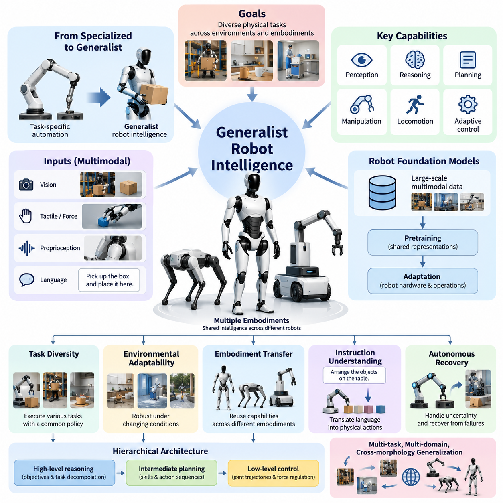
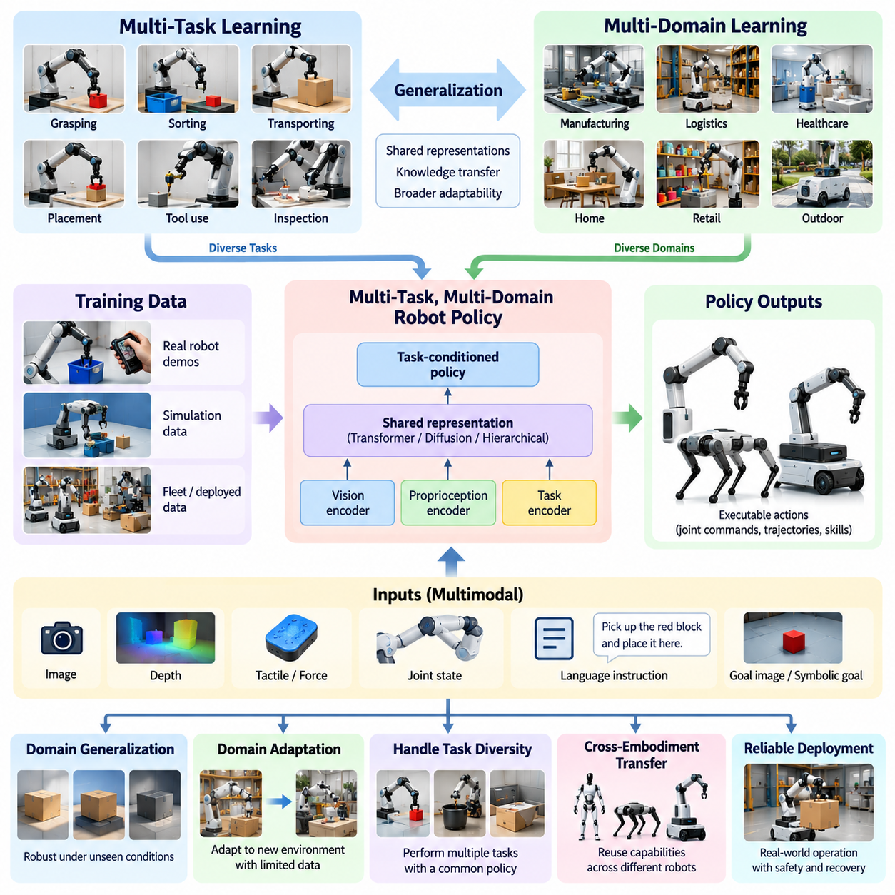
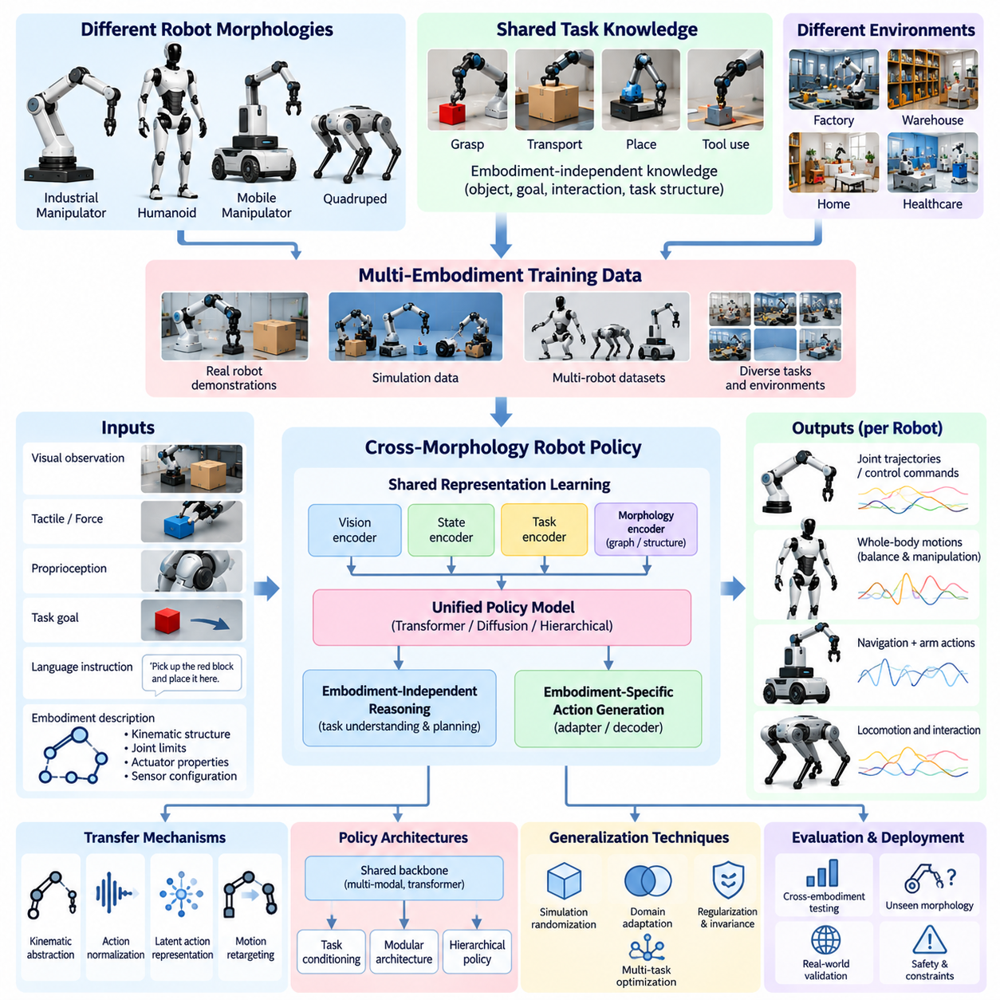
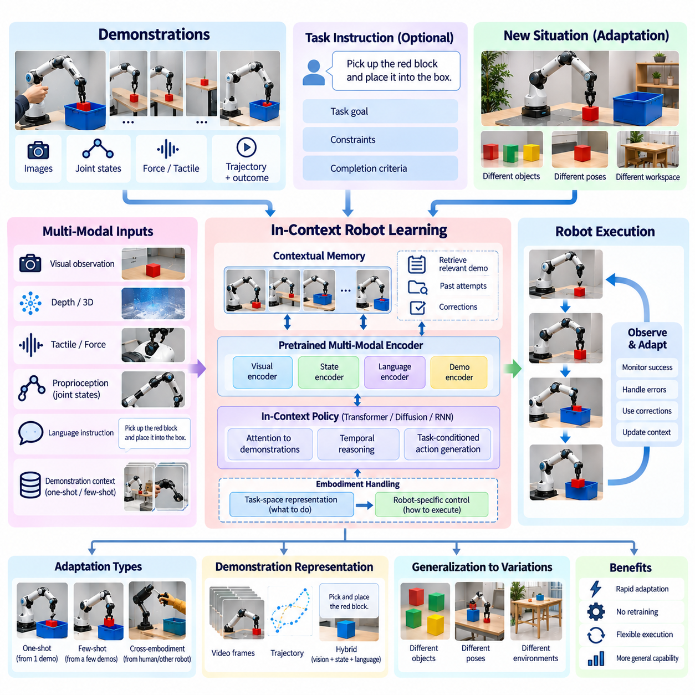
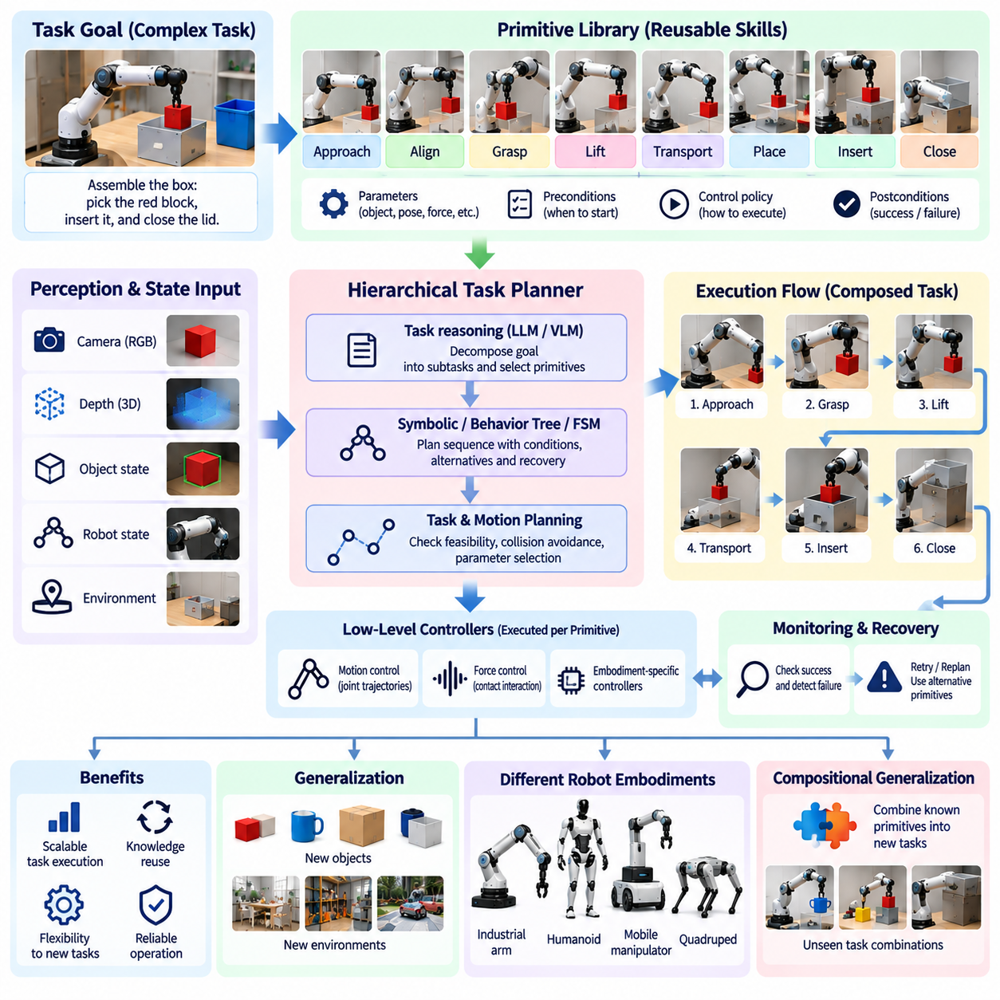
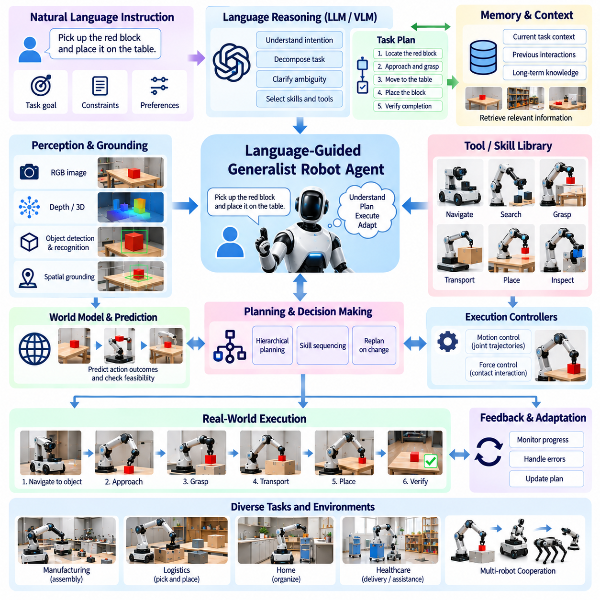
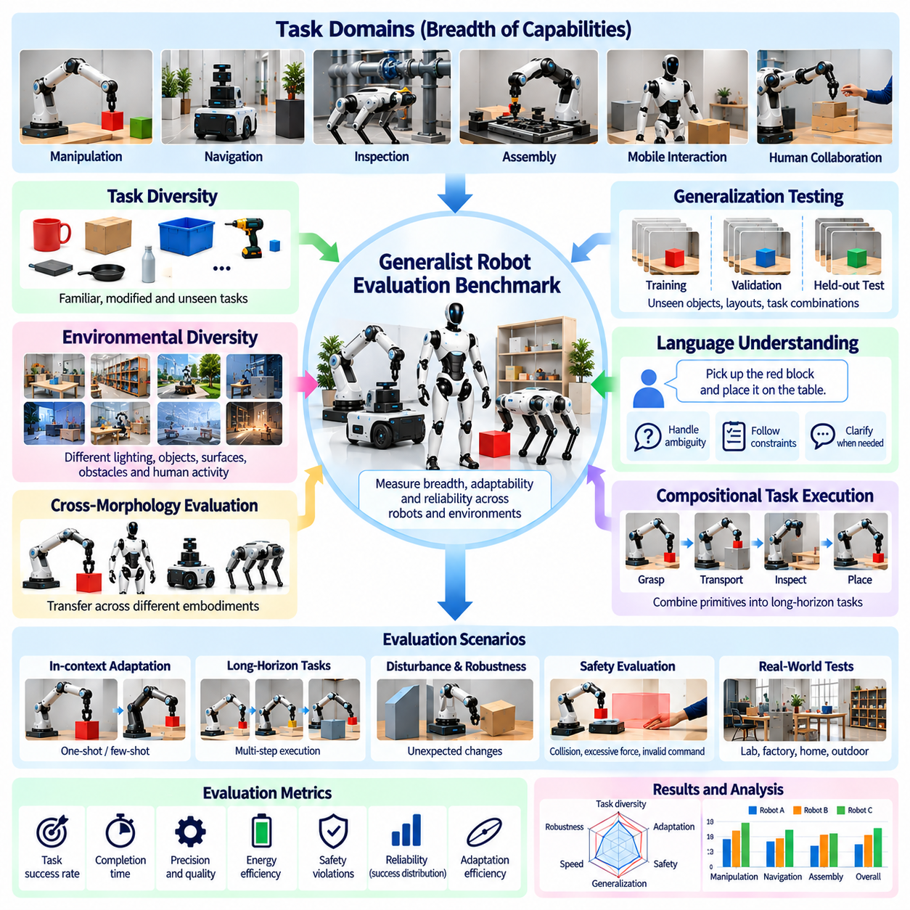
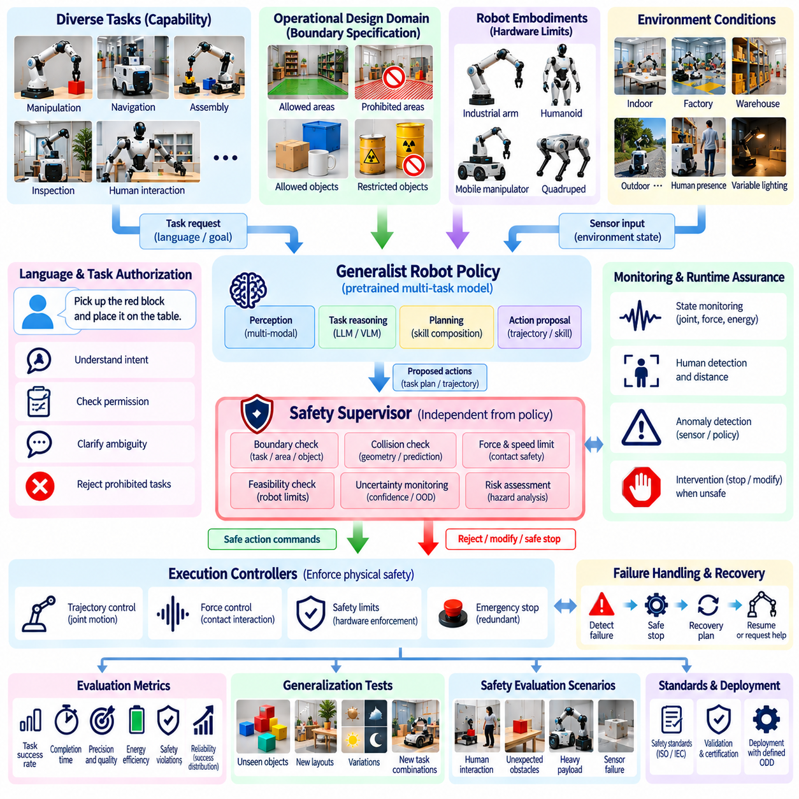
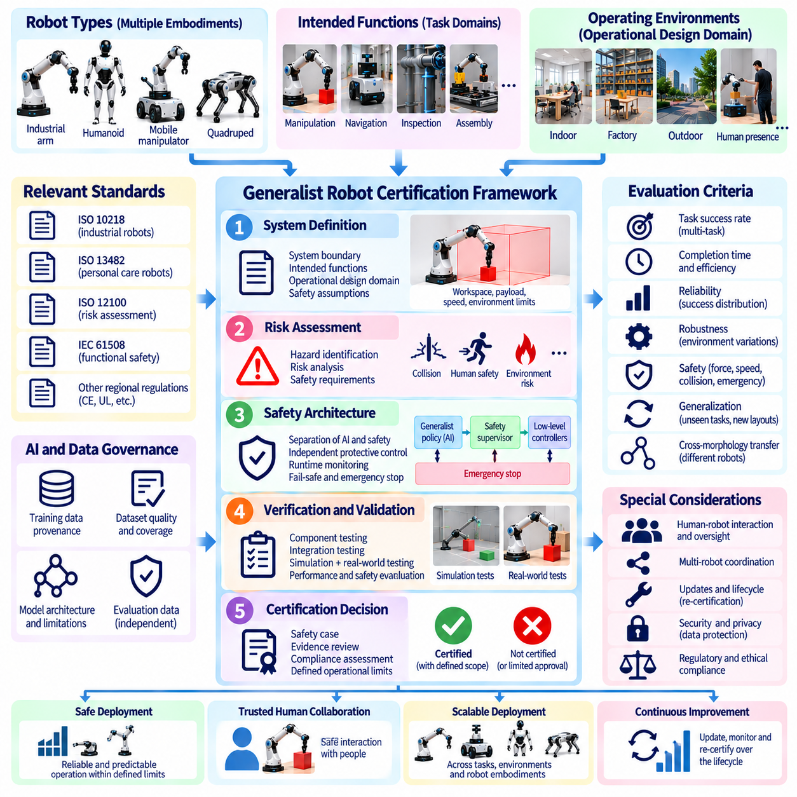
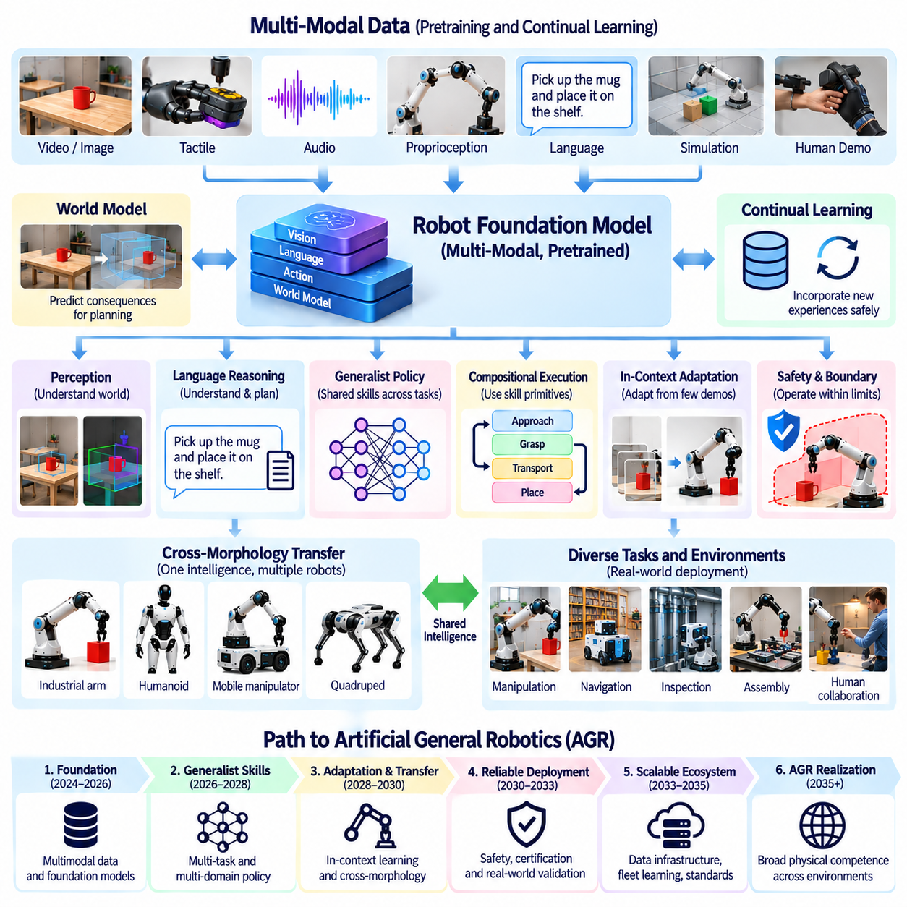

**Volume 27. Future AI Native Robotics**

# Chapter 05. Generalist Robot Intelligence

## 05.01. Generalist Robot Intelligence Definition and Scope

{width="7.268055555555556in" height="7.268055555555556in"}

Generalist Robot Intelligence represents a transition from task-specific automation toward robotic systems capable of performing diverse physical activities through shared intelligence. Unlike conventional robots designed around predefined operations, generalist robots interpret changing environments, understand task objectives, and select appropriate behaviors without requiring a separately engineered control program for every situation.

The central objective of generalist intelligence is to develop reusable cognitive and motor capabilities that remain effective across multiple tasks, environments, and robotic embodiments. Such intelligence combines perception, reasoning, planning, manipulation, locomotion, and adaptive control within a coordinated architecture. Generalization is demonstrated when previously acquired knowledge improves performance on unfamiliar but related physical problems.

Traditional industrial robots achieve high precision and repeatability within carefully structured operating conditions. Their control systems typically depend on programmed trajectories, calibrated workspaces, and explicitly defined operational sequences. Generalist robots instead attempt to interpret task requirements dynamically, allowing them to accommodate variations in object geometry, workspace configuration, human instructions, and environmental uncertainty.

Generalist intelligence should not be confused with unrestricted artificial general intelligence. A robot may demonstrate broad competence across hundreds of physical tasks while remaining limited in abstract reasoning, social understanding, or unfamiliar physical domains. Generalist Robot Intelligence therefore describes a measurable engineering capability rather than an assumption that a robotic system possesses human-equivalent cognition or universal problem-solving ability.

The functional scope of generalist robotics includes task diversity, environmental adaptability, embodiment transfer, instruction understanding, and autonomous recovery. Task diversity describes the ability to execute different activities through a common policy. Environmental adaptability concerns robustness under changing conditions, while embodiment transfer addresses whether learned capabilities can be reused across robots with different mechanical structures.

A generalist robot requires a unified representation of sensory observations, task intentions, internal states, and available actions. Visual information provides geometric and semantic understanding, while tactile sensors, force measurements, and proprioceptive feedback describe physical interaction. Language instructions communicate objectives, constraints, and contextual information that must be translated into executable physical behaviors.

Robot foundation models provide one possible computational basis for generalist intelligence. These models learn representations from large collections of multimodal observations, demonstrations, and action trajectories. Through pretraining, a model can acquire reusable knowledge about objects, spatial relationships, manipulation patterns, and task structures. Subsequent adaptation connects this knowledge to particular robot hardware and operational requirements.

Vision-Language-Action models extend multimodal learning into physical decision-making by connecting visual observations and language instructions with robot actions. A shared model may interpret commands such as retrieving equipment, arranging components, or clearing a workspace. However, successful execution requires grounding symbolic objectives in physical coordinates, actuator capabilities, collision constraints, and continuously changing sensor feedback.

The distinction between a generalist policy and a collection of specialized policies is particularly important. A specialized architecture selects among independently trained controllers, whereas a generalist policy attempts to share learned representations and decision mechanisms across tasks. Hybrid architectures may combine a generalist decision model with specialized motion controllers, allowing broad task understanding without sacrificing deterministic execution where required.

Generalist intelligence can operate at several levels of abstraction. High-level reasoning determines objectives and decomposes complex instructions into manageable activities. Intermediate planning selects skills, interaction strategies, and action sequences. Low-level control converts these decisions into joint trajectories, actuator commands, and force regulation. Effective integration requires continuous feedback between these levels rather than isolated sequential processing.

Multi-task learning provides an essential foundation for developing generalist capabilities. By training a common model on diverse manipulation, navigation, and interaction tasks, engineers encourage the discovery of reusable behavioral representations. Positive transfer occurs when learning one task improves another, while negative transfer occurs when conflicting task requirements degrade performance. Dataset composition and training objectives must therefore be carefully controlled.

Multi-domain intelligence extends this principle beyond individual tasks into distinct operating environments. A robot trained in a laboratory may encounter different lighting, surfaces, object distributions, and human behavior in warehouses or hospitals. Robust generalization requires learning which physical relationships remain stable across environments and which parameters must be adapted through observation, calibration, or additional experience.

Cross-morphology generalization introduces another dimension of complexity because robots possess different joint configurations, actuator limits, sensor arrangements, and movement capabilities. A manipulation policy developed for one arm cannot necessarily generate valid commands for another. Generalist architectures therefore require embodiment-aware representations, action normalization, kinematic constraints, or intermediate skill descriptions that separate task intentions from hardware-specific execution.

In-context robot learning offers a potential mechanism for adapting behavior without immediately modifying model parameters. A robot may observe demonstrations, receive corrective instructions, or examine recent task outcomes before selecting its next action. Contextual adaptation is especially valuable when operational requirements change rapidly, although its reliability depends on demonstration quality, context limitations, and the model\'s ability to distinguish relevant information.

Compositional intelligence allows complex activities to emerge from combinations of reusable behavioral primitives. Skills such as approaching an object, grasping, transporting, positioning, and releasing can be organized into longer task sequences. Generalist systems must determine appropriate skill ordering, recognize preconditions, monitor execution outcomes, and recover when intermediate operations fail or environmental assumptions become invalid.

Language-guided generalist agents introduce a flexible interface between human intentions and physical robot capabilities. Natural-language commands may specify desired outcomes without providing complete execution procedures. The robot must resolve ambiguities, identify relevant objects, determine operational constraints, and request clarification when necessary. Language understanding alone is insufficient unless proposed actions are physically feasible and operationally safe.

Physical reasoning distinguishes generalist robotics from purely digital intelligence. Robots must account for gravity, friction, inertia, compliance, contact dynamics, and uncertain material properties. An action that appears logically correct may fail because an object slips, a grasp becomes unstable, or the robot reaches a mechanical limit. Generalist intelligence must therefore integrate learned semantic knowledge with reliable models of physical interaction.

World models can support this integration by predicting how environmental states may evolve under candidate actions. A robot may evaluate alternative manipulation strategies, anticipate collisions, or estimate the consequences of moving an object before executing a command. Predictive representations can improve long-horizon planning, but inaccuracies accumulate over time, making sensor-based correction and uncertainty estimation essential.

The evaluation of generalist intelligence requires more than measuring success on familiar benchmark tasks. Meaningful assessment should include unseen objects, novel task combinations, unfamiliar environments, and changes in robot configuration. Performance indicators may include task completion, adaptation efficiency, recovery success, intervention frequency, execution time, and safety violations. Evaluation must distinguish memorized behavior from genuine transferable competence.

Safety boundaries remain essential even when a generalist model demonstrates advanced reasoning and adaptation. Learned policies can produce unexpected actions when encountering unfamiliar conditions or ambiguous instructions. Independent safety monitors, constrained motion planners, emergency-stop mechanisms, and verified actuator limits provide protection against unsafe outputs. Generalist autonomy must operate within explicitly defined physical and operational boundaries.

Certification presents additional challenges because generalist policies may support many behaviors that cannot be exhaustively enumerated during development. Conventional validation methods often assume relatively stable functionality and predictable operating conditions. Generalist systems require structured operational design domains, documented capability limits, scenario-based testing, runtime monitoring, and controlled procedures for evaluating changes to learned models.

The practical scope of generalist robotics also depends on computational resources, training data quality, inference latency, and energy consumption. Large models may provide broad reasoning capabilities but exceed the processing capacity of embedded robot computers. Hierarchical architectures, model compression, selective inference, and edge-cloud coordination can help balance intelligence with real-time requirements, provided essential control functions remain available during communication failures.

Generalist intelligence should ultimately be evaluated as a system-level capability rather than an isolated neural-network property. Perception accuracy, task reasoning, mechanical design, control stability, safety architecture, and operational feedback jointly determine performance. A sophisticated foundation model cannot compensate for inadequate sensing, unreliable actuation, or poorly defined operating boundaries. Successful generalization requires coordinated engineering across the complete robotic platform.

The long-term direction of Generalist Robot Intelligence is toward Artificial General Robotics, in which autonomous machines acquire increasingly transferable physical skills and execute diverse objectives across multiple environments and embodiments. Achieving this vision requires advances in multimodal learning, physical reasoning, compositional planning, continual adaptation, and verifiable safety. The immediate engineering priority is measurable, dependable generalization within progressively expanding operational boundaries.

범용 로봇 지능(Generalist Robot Intelligence)은 작업별 자동화(Task-Specific Automation)에서 공유 지능(Shared Intelligence)을 통해 다양한 물리적 활동을 수행할 수 있는 로봇 시스템으로의 전환을 의미한다. 사전에 정의된 작업을 중심으로 설계되는 기존 로봇과 달리, 범용 로봇은 변화하는 환경을 해석하고 작업 목표를 이해하며, 모든 상황에 대해 별도의 제어 프로그램을 개발하지 않고도 적절한 행동을 선택할 수 있다.

범용 지능(Generalist Intelligence)의 핵심 목표는 다양한 작업, 환경 및 로봇 구현 형태에서 효과적으로 활용할 수 있는 재사용 가능한 인지 및 운동 능력(Reusable Cognitive and Motor Capabilities)을 개발하는 것이다. 이러한 지능은 인식(Perception), 추론(Reasoning), 계획(Planning), 조작(Manipulation), 이동(Locomotion), 적응형 제어(Adaptive Control)를 통합된 구조로 결합한다. 일반화(Generalization)는 기존에 습득한 지식이 익숙하지 않지만 관련성이 있는 물리적 문제의 수행 성능을 향상시킬 때 입증된다.

기존 산업용 로봇(Industrial Robot)은 정교하게 구조화된 작업 조건에서 높은 정밀도(Precision)와 반복성(Repeatability)을 달성한다. 이러한 제어 시스템은 일반적으로 사전에 프로그래밍된 궤적(Programmed Trajectory), 보정된 작업 공간(Calibrated Workspace), 명시적으로 정의된 작업 순서에 의존한다. 반면 범용 로봇은 작업 요구사항을 동적으로 해석하여 물체 형상, 작업 공간 구성, 인간의 지시 및 환경적 불확실성의 변화에 대응하도록 설계된다.

범용 지능을 제한 없는 인공 일반 지능(Artificial General Intelligence, AGI)과 혼동해서는 안 된다. 로봇은 수백 가지 물리적 작업에서 폭넓은 능력을 보여주더라도 추상적 추론(Abstract Reasoning), 사회적 이해(Social Understanding), 익숙하지 않은 물리적 영역에서는 한계를 가질 수 있다. 따라서 범용 로봇 지능은 로봇 시스템이 인간과 동등한 인지 능력이나 보편적인 문제 해결 능력을 갖추었다는 가정이 아니라, 측정 가능한 공학적 능력(Measurable Engineering Capability)을 의미한다.

범용 로봇 기술의 기능적 범위(Functional Scope)에는 작업 다양성(Task Diversity), 환경 적응성(Environmental Adaptability), 로봇 구현 형태 간 전이(Embodiment Transfer), 명령 이해(Instruction Understanding), 자율 복구(Autonomous Recovery)가 포함된다. 작업 다양성은 공통 정책(Common Policy)을 통해 서로 다른 활동을 수행하는 능력을 의미한다. 환경 적응성은 변화하는 조건에서의 강건성(Robustness)을 나타내며, 구현 형태 간 전이는 기계적 구조가 서로 다른 로봇 사이에서 학습된 능력을 재사용할 수 있는지를 다룬다.

범용 로봇에는 센서 관측(Sensory Observation), 작업 의도(Task Intention), 내부 상태(Internal State), 사용 가능한 행동(Available Action)을 통합적으로 표현하는 체계가 필요하다. 시각 정보(Visual Information)는 기하학적 및 의미론적 이해를 제공하며, 촉각 센서(Tactile Sensor), 힘 측정(Force Measurement), 고유수용성 피드백(Proprioceptive Feedback)은 물리적 상호작용을 설명한다. 언어 명령(Language Instruction)은 실행 가능한 물리적 행동으로 변환해야 하는 목표, 제약조건 및 상황 정보를 전달한다.

로봇 파운데이션 모델(Robot Foundation Model)은 범용 지능을 구현하기 위한 하나의 계산 기반을 제공한다. 이러한 모델은 대규모 다중모달 관측(Multimodal Observation), 시연(Demonstration), 행동 궤적(Action Trajectory) 데이터로부터 표현을 학습한다. 사전학습(Pretraining)을 통해 물체, 공간 관계, 조작 패턴 및 작업 구조에 관한 재사용 가능한 지식을 습득할 수 있다. 이후 적응(Adaptation) 과정에서 이러한 지식을 특정 로봇 하드웨어 및 운용 요구사항과 연결한다.

시각-언어-행동 모델(Vision-Language-Action Model, VLA)은 시각 관측과 언어 명령을 로봇 행동에 연결하여 다중모달 학습(Multimodal Learning)을 물리적 의사결정으로 확장한다. 공유 모델(Shared Model)은 장비 가져오기, 부품 정렬, 작업 공간 정리와 같은 명령을 해석할 수 있다. 그러나 성공적인 실행을 위해서는 상징적 목표(Symbolic Objective)를 물리적 좌표, 액추에이터 능력, 충돌 제약조건 및 지속적으로 변화하는 센서 피드백과 연결해야 한다.

범용 정책(Generalist Policy)과 전문화된 정책들의 집합(Collection of Specialized Policies)을 구분하는 것은 특히 중요하다. 전문화된 아키텍처(Specialized Architecture)는 독립적으로 학습된 제어기 가운데 하나를 선택하지만, 범용 정책은 여러 작업에 걸쳐 학습된 표현과 의사결정 메커니즘을 공유하려고 한다. 하이브리드 아키텍처(Hybrid Architecture)는 범용 의사결정 모델과 전문화된 운동 제어기를 결합하여 폭넓은 작업 이해 능력을 확보하면서도 필요한 영역에서는 결정론적 실행(Deterministic Execution)을 유지할 수 있다.

범용 지능은 여러 추상화 수준(Abstraction Level)에서 작동할 수 있다. 상위 수준 추론(High-Level Reasoning)은 목표를 결정하고 복잡한 명령을 관리 가능한 활동으로 분해한다. 중간 수준 계획(Intermediate Planning)은 기술(Skill), 상호작용 전략 및 행동 순서를 선택한다. 하위 수준 제어(Low-Level Control)는 이러한 결정을 관절 궤적(Joint Trajectory), 액추에이터 명령 및 힘 조절로 변환한다. 효과적인 통합을 위해서는 각 수준을 분리된 순차 처리 단계로 구성하기보다 지속적인 피드백을 교환하도록 설계해야 한다.

다중 작업 학습(Multi-Task Learning)은 범용 능력을 개발하기 위한 핵심 기반을 제공한다. 공통 모델(Common Model)을 다양한 조작, 내비게이션 및 상호작용 작업으로 학습시키면 재사용 가능한 행동 표현(Reusable Behavioral Representation)의 발견을 촉진할 수 있다. 긍정적 전이(Positive Transfer)는 한 작업의 학습이 다른 작업의 성능을 향상시키는 현상이며, 부정적 전이(Negative Transfer)는 상충하는 작업 요구사항으로 인해 성능이 저하되는 현상이다. 따라서 데이터셋 구성과 학습 목표를 신중하게 관리해야 한다.

다중 도메인 지능(Multi-Domain Intelligence)은 이러한 원리를 개별 작업을 넘어 서로 다른 운용 환경으로 확장한다. 실험실에서 학습된 로봇은 창고나 병원에서 서로 다른 조명, 표면, 물체 분포 및 인간 행동을 경험할 수 있다. 강건한 일반화를 위해서는 환경이 달라져도 안정적으로 유지되는 물리적 관계와 관측, 보정(Calibration), 추가 경험을 통해 적응해야 하는 매개변수를 구분하여 학습해야 한다.

로봇 형태 간 일반화(Cross-Morphology Generalization)는 로봇마다 관절 구성, 액추에이터 한계, 센서 배치 및 이동 능력이 다르기 때문에 추가적인 복잡성을 발생시킨다. 특정 로봇 팔을 위해 개발된 조작 정책이 다른 로봇에서도 유효한 명령을 생성한다고 보장할 수 없다. 따라서 범용 아키텍처에는 구현 형태 인식 표현(Embodiment-Aware Representation), 행동 정규화(Action Normalization), 운동학적 제약조건(Kinematic Constraint), 작업 의도와 하드웨어별 실행을 분리하는 중간 기술 표현(Intermediate Skill Description)이 필요하다.

문맥 내 로봇 학습(In-Context Robot Learning)은 모델 매개변수를 즉시 변경하지 않고 행동을 적응시키는 잠재적인 메커니즘을 제공한다. 로봇은 다음 행동을 선택하기 전에 시연을 관찰하거나 수정 지시를 받거나 최근 작업 결과를 검토할 수 있다. 문맥 기반 적응(Contextual Adaptation)은 운용 요구사항이 빠르게 변화할 때 특히 유용하지만, 그 신뢰성은 시연 품질, 문맥 길이의 제약 및 관련 정보를 구분하는 모델의 능력에 따라 달라진다.

구성적 지능(Compositional Intelligence)은 재사용 가능한 행동 기본 요소(Behavioral Primitive)를 조합하여 복잡한 활동을 수행할 수 있도록 한다. 물체 접근, 파지(Grasping), 운반, 위치 결정 및 해제와 같은 기술을 더 긴 작업 순서로 구성할 수 있다. 범용 시스템은 적절한 기술 실행 순서를 결정하고, 선행조건(Precondition)을 인식하며, 실행 결과를 감시하고, 중간 작업이 실패하거나 환경에 대한 가정이 더 이상 유효하지 않을 때 복구해야 한다.

언어 기반 범용 에이전트(Language-Guided Generalist Agent)는 인간의 의도와 로봇의 물리적 능력 사이에 유연한 인터페이스를 제공한다. 자연어 명령(Natural-Language Command)은 완전한 실행 절차를 제시하지 않고도 원하는 결과를 지정할 수 있다. 로봇은 모호성을 해결하고 관련 물체를 식별하며 운용 제약조건을 결정하고 필요하면 추가 설명을 요청해야 한다. 제안된 행동이 물리적으로 실행 가능하고 운용상 안전하지 않다면 언어 이해만으로는 충분하지 않다.

물리적 추론(Physical Reasoning)은 범용 로봇 기술을 순수한 디지털 지능(Digital Intelligence)과 구별하는 중요한 요소이다. 로봇은 중력(Gravity), 마찰(Friction), 관성(Inertia), 유연성(Compliance), 접촉 동역학(Contact Dynamics), 불확실한 재료 특성을 고려해야 한다. 논리적으로 올바르게 보이는 행동도 물체 미끄러짐, 파지 불안정 또는 기계적 한계로 인해 실패할 수 있다. 따라서 범용 지능은 학습된 의미론적 지식과 신뢰할 수 있는 물리적 상호작용 모델을 통합해야 한다.

월드 모델(World Model)은 후보 행동에 따라 환경 상태가 어떻게 변화할지를 예측함으로써 이러한 통합을 지원할 수 있다. 로봇은 명령을 실행하기 전에 대안적인 조작 전략을 평가하고, 충돌을 예측하거나 물체 이동의 결과를 추정할 수 있다. 예측 표현(Predictive Representation)은 장기 계획(Long-Horizon Planning)을 개선할 수 있지만, 예측 오차는 시간이 지남에 따라 누적되므로 센서 기반 보정(Sensor-Based Correction)과 불확실성 추정(Uncertainty Estimation)이 필수적이다.

범용 지능의 평가(Evaluation)는 익숙한 벤치마크 작업에서 성공률을 측정하는 수준을 넘어야 한다. 의미 있는 평가는 학습하지 않은 물체, 새로운 작업 조합, 익숙하지 않은 환경 및 로봇 구성 변경을 포함해야 한다. 성능 지표(Performance Indicator)에는 작업 완료율, 적응 효율성, 복구 성공률, 개입 빈도, 실행 시간 및 안전 위반이 포함될 수 있다. 평가는 암기된 행동(Memorized Behavior)과 실제로 전이 가능한 능력(Transferable Competence)을 구분해야 한다.

범용 모델이 고급 추론 및 적응 능력을 보여주더라도 안전 경계(Safety Boundary)는 필수적이다. 학습된 정책(Learned Policy)은 익숙하지 않은 조건이나 모호한 명령에 직면했을 때 예상하지 못한 행동을 생성할 수 있다. 독립적인 안전 감시기(Independent Safety Monitor), 제약 기반 운동 계획기(Constrained Motion Planner), 비상 정지 장치(Emergency-Stop Mechanism), 검증된 액추에이터 한계가 위험한 출력으로부터 시스템을 보호한다. 범용 자율성은 명시적으로 정의된 물리적 및 운용적 경계 안에서 작동해야 한다.

범용 정책은 개발 과정에서 모든 행동을 빠짐없이 열거하기 어려우므로 인증(Certification)에도 추가적인 과제를 발생시킨다. 기존 검증 방법은 비교적 안정적인 기능과 예측 가능한 운용 조건을 전제로 하는 경우가 많다. 범용 시스템에는 구조화된 운용 설계 영역(Operational Design Domain, ODD), 문서화된 능력 한계, 시나리오 기반 시험(Scenario-Based Testing), 실행시간 감시(Runtime Monitoring), 학습 모델 변경을 평가하기 위한 통제된 절차가 필요하다.

범용 로봇 기술의 실질적인 적용 범위는 컴퓨팅 자원(Computational Resource), 학습 데이터 품질, 추론 지연시간(Inference Latency), 에너지 소비량에도 영향을 받는다. 대규모 모델은 폭넓은 추론 능력을 제공할 수 있지만 내장형 로봇 컴퓨터(Embedded Robot Computer)의 처리 능력을 초과할 수 있다. 계층형 아키텍처(Hierarchical Architecture), 모델 압축(Model Compression), 선택적 추론(Selective Inference), 엣지-클라우드 협력(Edge-Cloud Coordination)은 지능과 실시간 요구사항 사이의 균형을 지원하며, 통신 장애 시에도 필수 제어 기능이 유지되어야 한다.

범용 지능은 궁극적으로 독립적인 신경망(Neural Network)의 특성이 아니라 시스템 수준의 능력(System-Level Capability)으로 평가해야 한다. 인식 정확도, 작업 추론, 기계적 설계, 제어 안정성, 안전 아키텍처 및 운용 피드백이 결합되어 전체 성능을 결정한다. 정교한 파운데이션 모델이라도 불충분한 센싱, 신뢰할 수 없는 구동 또는 부적절하게 정의된 운용 경계를 보완할 수는 없다. 성공적인 일반화를 위해서는 전체 로봇 플랫폼에 걸친 통합적인 공학 설계가 필요하다.

범용 로봇 지능의 장기적인 발전 방향은 인공 범용 로봇 지능(Artificial General Robotics, AGR)을 향하고 있으며, 이는 자율 기계가 점점 더 전이 가능한 물리적 기술을 습득하고 다양한 환경과 로봇 구현 형태에서 여러 목표를 수행하는 것을 의미한다. 이러한 비전을 실현하려면 다중모달 학습, 물리적 추론, 구성적 계획(Compositional Planning), 지속적 적응(Continual Adaptation), 검증 가능한 안전성(Verifiable Safety)의 발전이 필요하다. 당면한 공학적 우선순위는 운용 경계를 점진적으로 확장하면서 측정 가능하고 신뢰할 수 있는 일반화 능력을 확보하는 것이다.

## 05.02. Multi Task and Multi Domain Robot Policy [w/Code]

{width="7.268055555555556in" height="7.268055555555556in"}

Multi-task and multi-domain robot policies represent a fundamental approach to developing generalist robotic intelligence capable of operating across diverse activities and environments. Instead of maintaining independent control models for every application, a unified policy learns shared representations of observations, goals, and actions. This architecture supports knowledge reuse, reduces duplicated engineering effort, and enables broader behavioral adaptability.

Multi-task learning focuses on acquiring several capabilities within a common policy architecture. A robot may learn object grasping, sorting, transportation, placement, and tool manipulation using shared perception and action representations. Each task introduces distinct objectives and constraints, while the model learns common physical relationships. Effective multi-task policies exploit these similarities without allowing conflicting training objectives to degrade individual task performance.

Multi-domain learning extends generalization across operating conditions, facilities, object distributions, and application sectors. A robot trained in manufacturing environments may encounter different lighting, layouts, materials, and human interactions when deployed in logistics or healthcare facilities. Domain adaptation mechanisms help preserve previously learned capabilities while accommodating new sensory distributions and operational requirements.

A unified robot policy can be represented as a conditional mapping from observations, task specifications, and internal states to executable actions. Observations may include camera images, depth measurements, tactile signals, joint positions, and force feedback. Task specifications may be expressed through language, goal images, symbolic commands, or target configurations. The policy must combine these inputs while respecting the robot\'s physical constraints.

Shared representation learning is central to multi-task policy development because it enables knowledge transfer between related activities. Visual encoders identify objects and spatial relationships, while proprioceptive encoders describe robot configuration and movement. Task embeddings represent intended outcomes, allowing the policy to distinguish objectives without requiring entirely separate networks. Shared representations must retain information essential to specialized tasks.

Policy architectures frequently combine a common feature extraction backbone with task-conditioned action generation. Transformer networks can integrate multimodal observations and task instructions through attention mechanisms. Alternative architectures use recurrent models, diffusion policies, or hierarchical controllers. The appropriate design depends on action dimensionality, temporal dependencies, inference latency, training data availability, and the required degree of generalization.

Task conditioning provides a mechanism for selecting different behaviors within a shared policy. A language instruction such as placing a component into a container can be encoded into a task representation and combined with current sensor observations. The policy then generates actions consistent with the requested outcome. Conditioning must also represent safety restrictions, object properties, workspace limitations, and task-specific completion criteria.

Training datasets for multi-task policies should contain diverse demonstrations with consistent observation and action semantics. Data may originate from teleoperation, autonomous execution, simulation, human demonstrations, or previously deployed robots. Each trajectory should preserve task identity, environmental context, timestamps, robot configuration, and execution outcomes. Inconsistent coordinate frames or action conventions can introduce systematic learning errors.

Dataset balancing is particularly important when some tasks produce substantially more training examples than others. Without appropriate sampling, frequently represented activities may dominate the optimization process and reduce performance on less common tasks. Balanced sampling, task weighting, curriculum learning, and adaptive loss adjustment can improve coverage. However, equal sample counts do not necessarily produce equal task competence.

Multi-task optimization introduces challenges because gradients from different objectives may conflict. Improving manipulation accuracy for one task can unintentionally reduce performance on another task requiring different motion characteristics. Gradient balancing, parameter sharing strategies, task-specific adapters, and modular network components can reduce interference. Evaluation should measure both overall capability and performance changes for individual tasks.

Domain generalization attempts to develop policies that remain effective under environmental conditions not directly represented during training. Techniques include domain randomization, visual augmentation, dynamics variation, and representation regularization. Training environments may vary illumination, object textures, friction coefficients, sensor noise, and actuator response. These variations encourage policies to rely on transferable physical relationships rather than incidental visual features.

Domain adaptation differs from domain generalization because it uses information from a particular target environment to improve performance. Adaptation may involve fine-tuning model parameters, calibrating perception systems, updating normalization statistics, or selecting environment-specific policy components. Adaptation procedures must prevent catastrophic forgetting and preserve validated capabilities in previously supported operating domains.

Simulation provides an efficient mechanism for generating diverse multi-task training experiences. A simulated robot can repeatedly practice manipulation and navigation under controlled variations of geometry, dynamics, and environmental conditions. Parallel simulation enables large-scale exploration of task combinations. Nevertheless, simulation-to-reality discrepancies require physical validation, especially for contact-rich manipulation and uncertain material interactions.

Hierarchical policies can improve scalability by separating task planning from low-level motor execution. A high-level controller selects goals or reusable skills, while lower-level policies generate actuator-compatible movements. This separation allows multiple tasks to share locomotion, grasping, positioning, and recovery behaviors. Hierarchical organization also supports clearer interfaces between learned decision-making and deterministic safety-critical controllers.

Temporal reasoning is essential because many robotic tasks require coordinated action sequences rather than isolated motor commands. A policy must recognize intermediate progress, maintain task context, and adjust its behavior when conditions change. Memory mechanisms and temporal attention can represent previous observations and actions. Long-horizon execution additionally requires detecting failed subtasks and selecting appropriate recovery strategies.

Negative transfer remains a major limitation of unified policies. Tasks with incompatible action requirements, observation structures, or physical dynamics may interfere when represented within a single model. Increasing model capacity does not automatically eliminate this problem. Effective architectures may require specialized adapters, conditional computation, or explicit task separation while preserving shared knowledge wherever transfer remains beneficial.

Cross-domain deployment requires careful treatment of uncertainty and distribution shift. A policy trained on familiar objects may encounter unexpected shapes, reflective surfaces, damaged equipment, or unfamiliar human behavior. Confidence estimates, out-of-distribution detection, and runtime monitoring help identify unsupported conditions. When uncertainty exceeds acceptable limits, the robot should enter a safe state, request assistance, or switch to a validated fallback behavior.

Evaluation of multi-task policies should distinguish task coverage, average success rate, worst-case performance, and transfer efficiency. A high average score can conceal serious failures in individual activities or operating environments. Benchmark suites should include held-out tasks, unseen object categories, altered physical conditions, and combinations of previously learned skills. Repeated physical trials are necessary to characterize reliability and variability.

Multi-domain evaluation must also examine whether a policy preserves performance after adaptation to new environments. Forward transfer measures how previous learning benefits new tasks, while backward transfer examines how subsequent learning affects earlier capabilities. Adaptation time, required demonstration count, computational cost, and intervention frequency provide additional evidence of operational usefulness. These metrics should be reported separately rather than compressed into one score.

Safety constraints must remain consistent across all supported tasks and domains. A shared policy may generate actions that are appropriate in one environment but hazardous in another. Independent collision avoidance, speed limitations, force constraints, workspace restrictions, and emergency-stop functions should therefore operate outside unrestricted policy generation. Task-specific permissions and operational boundaries must be enforced before physical execution.

Production deployment introduces requirements beyond model accuracy, including predictable latency, version control, observability, and controlled updates. Each policy release should document supported tasks, validated environments, training data provenance, and known limitations. Field telemetry can identify emerging failure patterns and previously unseen conditions. Updates should undergo regression testing across the complete supported task portfolio before deployment.

The long-term significance of multi-task and multi-domain policies lies in their ability to transform robotic intelligence from collections of isolated applications into reusable operational platforms. Progress depends on scalable data pipelines, shared multimodal representations, efficient adaptation, and rigorous safety validation. A successful generalist policy is not merely one that performs many tasks, but one that maintains dependable performance as task diversity and environmental complexity increase.

다중 작업 및 다중 도메인 로봇 정책(Multi-Task and Multi-Domain Robot Policy)은 다양한 활동과 환경에서 작동할 수 있는 범용 로봇 지능(Generalist Robot Intelligence)을 개발하기 위한 핵심 접근 방식이다. 각 응용 분야마다 독립적인 제어 모델을 유지하는 대신, 통합 정책(Unified Policy)은 관측, 목표 및 행동에 대한 공유 표현(Shared Representation)을 학습한다. 이러한 아키텍처는 지식 재사용을 지원하고 중복된 엔지니어링 작업을 줄이며, 더욱 폭넓은 행동 적응성(Behavioral Adaptability)을 가능하게 한다.

다중 작업 학습(Multi-Task Learning)은 공통 정책 아키텍처(Common Policy Architecture) 내에서 여러 능력을 습득하는 데 중점을 둔다. 로봇은 공유된 인식 및 행동 표현을 사용하여 물체 파지(Object Grasping), 분류(Sorting), 운반(Transportation), 배치(Placement), 도구 조작(Tool Manipulation)을 학습할 수 있다. 각 작업은 서로 다른 목표와 제약조건을 가지지만, 모델은 공통된 물리적 관계를 학습한다. 효과적인 다중 작업 정책은 상충하는 학습 목표로 인해 개별 작업의 성능이 저하되지 않도록 하면서 이러한 유사성을 활용한다.

다중 도메인 학습(Multi-Domain Learning)은 서로 다른 운용 조건, 시설, 물체 분포 및 응용 산업 분야에 걸쳐 일반화(Generalization)를 확장한다. 제조 환경에서 학습된 로봇은 물류 또는 의료 시설에 배치될 때 서로 다른 조명, 공간 배치, 재료 및 인간과의 상호작용을 경험할 수 있다. 도메인 적응 메커니즘(Domain Adaptation Mechanism)은 새로운 센서 데이터 분포와 운용 요구사항에 대응하면서 기존에 학습된 능력을 유지하도록 지원한다.

통합 로봇 정책(Unified Robot Policy)은 관측(Observation), 작업 명세(Task Specification), 내부 상태(Internal State)로부터 실행 가능한 행동(Executable Action)을 생성하는 조건부 매핑(Conditional Mapping)으로 표현할 수 있다. 관측에는 카메라 영상, 깊이 측정값, 촉각 신호, 관절 위치 및 힘 피드백이 포함될 수 있다. 작업 명세는 언어, 목표 영상, 기호 명령 또는 목표 구성으로 표현할 수 있다. 정책은 로봇의 물리적 제약조건을 준수하면서 이러한 입력을 결합해야 한다.

공유 표현 학습(Shared Representation Learning)은 관련 활동 사이의 지식 전이(Knowledge Transfer)를 가능하게 하므로 다중 작업 정책 개발의 중심 요소이다. 시각 인코더(Visual Encoder)는 물체와 공간 관계를 식별하고, 고유수용성 인코더(Proprioceptive Encoder)는 로봇의 구성과 움직임을 표현한다. 작업 임베딩(Task Embedding)은 의도된 결과를 표현하여 완전히 별도의 신경망 없이도 정책이 목표를 구분할 수 있도록 한다. 공유 표현은 전문화된 작업에 필수적인 정보를 유지해야 한다.

정책 아키텍처(Policy Architecture)는 일반적으로 공통 특징 추출 백본(Common Feature Extraction Backbone)과 작업 조건부 행동 생성(Task-Conditioned Action Generation)을 결합한다. 트랜스포머 네트워크(Transformer Network)는 어텐션 메커니즘(Attention Mechanism)을 통해 다중모달 관측과 작업 명령을 통합할 수 있다. 대안적인 아키텍처에는 순환 모델(Recurrent Model), 확산 정책(Diffusion Policy), 계층형 제어기(Hierarchical Controller)가 사용된다. 적절한 설계는 행동 차원, 시간적 의존성, 추론 지연시간, 학습 데이터 가용성 및 요구되는 일반화 수준에 따라 결정된다.

작업 조건화(Task Conditioning)는 공유 정책 내에서 서로 다른 행동을 선택하기 위한 메커니즘을 제공한다. 부품을 용기에 넣으라는 언어 명령은 작업 표현(Task Representation)으로 인코딩되어 현재 센서 관측과 결합될 수 있다. 이후 정책은 요청된 결과에 부합하는 행동을 생성한다. 조건화 과정에는 안전 제한사항, 물체 특성, 작업 공간의 한계 및 작업별 완료 기준(Task-Specific Completion Criteria)도 표현되어야 한다.

다중 작업 정책을 위한 학습 데이터셋(Training Dataset)은 일관된 관측 및 행동 의미 체계(Observation and Action Semantics)를 갖춘 다양한 시연 데이터를 포함해야 한다. 데이터는 원격 조작(Teleoperation), 자율 실행(Autonomous Execution), 시뮬레이션(Simulation), 인간 시연(Human Demonstration) 또는 기존에 배치된 로봇에서 수집할 수 있다. 각 궤적(Trajectory)에는 작업 식별 정보, 환경적 맥락, 타임스탬프, 로봇 구성 및 실행 결과가 보존되어야 한다. 좌표계나 행동 명령 규약이 일치하지 않으면 체계적인 학습 오류가 발생할 수 있다.

데이터셋 균형화(Dataset Balancing)는 일부 작업이 다른 작업보다 훨씬 많은 학습 사례를 생성할 때 특히 중요하다. 적절한 샘플링이 없으면 데이터가 많은 작업이 최적화 과정(Optimization Process)을 지배하여 상대적으로 드문 작업의 성능을 저하시킬 수 있다. 균형 샘플링(Balanced Sampling), 작업 가중치(Task Weighting), 커리큘럼 학습(Curriculum Learning), 적응형 손실 조정(Adaptive Loss Adjustment)은 작업 범위를 개선할 수 있다. 그러나 동일한 샘플 수가 반드시 동일한 작업 수행 능력을 보장하지는 않는다.

다중 작업 최적화(Multi-Task Optimization)는 서로 다른 목표에서 발생하는 기울기(Gradient)가 충돌할 수 있기 때문에 어려움을 수반한다. 특정 작업의 조작 정확도를 향상시키는 과정에서 다른 운동 특성을 요구하는 작업의 성능이 의도하지 않게 저하될 수 있다. 기울기 균형화(Gradient Balancing), 매개변수 공유 전략(Parameter Sharing Strategy), 작업별 어댑터(Task-Specific Adapter), 모듈형 네트워크 구성요소(Modular Network Component)는 이러한 간섭을 줄일 수 있다. 평가는 전체 능력뿐 아니라 개별 작업의 성능 변화도 측정해야 한다.

도메인 일반화(Domain Generalization)는 학습 과정에서 직접 경험하지 않은 환경 조건에서도 효과적으로 작동하는 정책을 개발하는 것을 목표로 한다. 주요 기법에는 도메인 무작위화(Domain Randomization), 시각 데이터 증강(Visual Augmentation), 동역학 변화(Dynamics Variation), 표현 정규화(Representation Regularization)가 포함된다. 학습 환경에서는 조명, 물체 질감, 마찰계수, 센서 잡음 및 액추에이터 응답을 변화시킬 수 있다. 이러한 변화는 우연한 시각적 특징보다 전이 가능한 물리적 관계에 의존하도록 정책을 유도한다.

도메인 적응(Domain Adaptation)은 특정 목표 환경(Target Environment)의 정보를 사용하여 성능을 개선한다는 점에서 도메인 일반화와 구별된다. 적응 과정에는 모델 매개변수 미세조정(Fine-Tuning), 인식 시스템 보정(Calibration), 정규화 통계(Normalization Statistics) 갱신 또는 환경별 정책 구성요소 선택이 포함될 수 있다. 적응 절차는 파국적 망각(Catastrophic Forgetting)을 방지하고 기존에 지원하던 운용 도메인에서 검증된 능력을 유지해야 한다.

시뮬레이션(Simulation)은 다양한 다중 작업 학습 경험을 효율적으로 생성하는 메커니즘을 제공한다. 시뮬레이션 로봇은 기하학적 구조, 동역학 및 환경 조건을 통제된 방식으로 변화시키면서 조작과 내비게이션을 반복적으로 연습할 수 있다. 병렬 시뮬레이션(Parallel Simulation)은 대규모 작업 조합 탐색을 가능하게 한다. 그러나 시뮬레이션과 현실 사이의 차이(Simulation-to-Reality Gap) 때문에 특히 접촉이 많은 조작과 불확실한 재료 상호작용에서는 실제 물리적 검증이 필요하다.

계층형 정책(Hierarchical Policy)은 작업 계획(Task Planning)과 하위 수준 운동 실행(Low-Level Motor Execution)을 분리하여 확장성(Scalability)을 개선할 수 있다. 상위 수준 제어기(High-Level Controller)는 목표 또는 재사용 가능한 기술을 선택하고, 하위 수준 정책(Low-Level Policy)은 액추에이터와 호환되는 움직임을 생성한다. 이러한 분리는 여러 작업이 이동, 파지, 위치 결정 및 복구 행동을 공유하도록 한다. 계층형 구성은 학습 기반 의사결정과 결정론적 안전 필수 제어기(Deterministic Safety-Critical Controller) 사이에 더욱 명확한 인터페이스를 제공한다.

시간적 추론(Temporal Reasoning)은 많은 로봇 작업이 개별 운동 명령이 아니라 조정된 행동 순서를 요구하기 때문에 필수적이다. 정책은 중간 진행 상태를 인식하고 작업 맥락을 유지하며 조건이 변화할 때 행동을 조정해야 한다. 메모리 메커니즘(Memory Mechanism)과 시간적 어텐션(Temporal Attention)은 이전 관측과 행동을 표현할 수 있다. 장기 작업 실행(Long-Horizon Execution)에서는 실패한 하위 작업을 감지하고 적절한 복구 전략을 선택하는 능력도 필요하다.

부정적 전이(Negative Transfer)는 통합 정책(Unified Policy)의 주요 한계로 남아 있다. 행동 요구사항, 관측 구조 또는 물리적 동역학이 서로 양립하기 어려운 작업은 하나의 모델로 표현될 때 간섭을 일으킬 수 있다. 모델 용량(Model Capacity)을 증가시키는 것만으로 이러한 문제가 자동으로 해결되지는 않는다. 효과적인 아키텍처에는 전문화된 어댑터(Specialized Adapter), 조건부 계산(Conditional Computation), 명시적 작업 분리(Explicit Task Separation)가 필요할 수 있으며, 전이가 유익한 영역에서는 공유 지식을 유지해야 한다.

도메인 간 배치(Cross-Domain Deployment)에서는 불확실성(Uncertainty)과 분포 변화(Distribution Shift)를 신중하게 처리해야 한다. 익숙한 물체로 학습된 정책은 예상하지 못한 형상, 반사 표면, 손상된 장비 또는 낯선 인간 행동을 마주할 수 있다. 신뢰도 추정(Confidence Estimation), 분포 외 데이터 탐지(Out-of-Distribution Detection), 실행시간 감시(Runtime Monitoring)는 지원하지 않는 조건을 식별하는 데 도움이 된다. 불확실성이 허용 한계를 초과하면 로봇은 안전 상태로 전환하거나 지원을 요청하거나 검증된 대체 행동(Fallback Behavior)으로 전환해야 한다.

다중 작업 정책의 평가(Evaluation)는 작업 범위(Task Coverage), 평균 성공률(Average Success Rate), 최악 조건 성능(Worst-Case Performance), 전이 효율성(Transfer Efficiency)을 구분해야 한다. 높은 평균 점수는 개별 활동이나 운용 환경에서 발생하는 심각한 실패를 감출 수 있다. 벤치마크 모음(Benchmark Suite)에는 학습에서 제외된 작업(Held-Out Task), 학습하지 않은 물체 범주, 변경된 물리적 조건 및 기존에 학습된 기술의 새로운 조합이 포함되어야 한다. 신뢰성과 변동성을 특성화하기 위해 반복적인 실제 로봇 시험이 필요하다.

다중 도메인 평가(Multi-Domain Evaluation)는 새로운 환경에 적응한 이후에도 정책이 기존 성능을 유지하는지 검토해야 한다. 순방향 전이(Forward Transfer)는 이전 학습이 새로운 작업에 제공하는 이점을 측정하고, 역방향 전이(Backward Transfer)는 이후 학습이 기존 능력에 미치는 영향을 평가한다. 적응 시간(Adaptation Time), 필요한 시연 횟수, 계산 비용(Computational Cost), 개입 빈도(Intervention Frequency)는 운용상 유용성을 판단하기 위한 추가적인 근거를 제공한다. 이러한 지표는 하나의 점수로 압축하지 않고 개별적으로 보고해야 한다.

안전 제약조건(Safety Constraint)은 지원되는 모든 작업과 도메인에서 일관되게 유지되어야 한다. 공유 정책은 한 환경에서는 적절하지만 다른 환경에서는 위험한 행동을 생성할 수 있다. 따라서 독립적인 충돌 회피(Collision Avoidance), 속도 제한(Speed Limitation), 힘 제약조건(Force Constraint), 작업 공간 제한(Workspace Restriction), 비상 정지 기능(Emergency-Stop Function)은 제한 없는 정책 생성 과정과 독립적으로 작동해야 한다. 작업별 권한(Task-Specific Permission)과 운용 경계(Operational Boundary)는 실제 물리적 실행 전에 강제되어야 한다.

실제 운영 환경 배치(Production Deployment)에는 모델 정확도 이외에도 예측 가능한 지연시간(Predictable Latency), 버전 관리(Version Control), 관측 가능성(Observability), 통제된 업데이트(Controlled Update)가 요구된다. 각 정책 릴리스(Policy Release)에는 지원 작업, 검증된 환경, 학습 데이터 출처(Data Provenance), 알려진 한계를 문서화해야 한다. 현장 원격 측정 데이터(Field Telemetry)는 새롭게 나타나는 실패 패턴과 이전에 경험하지 못한 조건을 식별할 수 있다. 업데이트는 배치 전에 지원되는 전체 작업 범위에 대한 회귀 시험(Regression Testing)을 거쳐야 한다.

다중 작업 및 다중 도메인 정책의 장기적인 중요성은 로봇 지능을 개별 응용 프로그램의 집합에서 재사용 가능한 운용 플랫폼(Reusable Operational Platform)으로 전환할 수 있다는 데 있다. 이러한 발전은 확장 가능한 데이터 파이프라인(Scalable Data Pipeline), 공유 다중모달 표현(Shared Multimodal Representation), 효율적인 적응(Efficient Adaptation), 엄격한 안전 검증(Rigorous Safety Validation)에 달려 있다. 성공적인 범용 정책은 단순히 많은 작업을 수행하는 정책이 아니라, 작업 다양성과 환경 복잡성이 증가하더라도 신뢰할 수 있는 성능을 유지하는 정책이다.

## 05.03. Cross Morphology Policy Transfer Mechanisms [w/Code]

{width="7.268055555555556in" height="7.268055555555556in"}

Cross-morphology policy transfer enables robotic intelligence learned on one mechanical platform to be reused across robots with different structures, actuators, sensors, and movement capabilities. This capability is essential for generalist robotics because independently training every robot configuration is expensive and inefficient. The objective is to preserve transferable task knowledge while adapting physical execution to the constraints of each embodiment.

Robot morphology describes the physical arrangement of links, joints, actuators, sensors, and contact surfaces. A six-axis industrial manipulator, a dual-arm humanoid, and a mobile manipulation robot may perform similar object-handling tasks despite substantial structural differences. Their joint dimensions, reachable workspaces, payload capacities, and dynamic characteristics differ, making direct transfer of low-level motor commands generally unreliable.

Cross-morphology transfer requires distinguishing embodiment-independent knowledge from embodiment-specific control requirements. Object relationships, task objectives, grasp intentions, and spatial goals can often be shared across platforms. Joint trajectories, torque commands, balance strategies, and actuator limitations must instead reflect the target robot. Effective architectures separate these information categories while preserving the relationships necessary for successful physical interaction.

A general formulation represents the policy as a mapping from observations, task goals, and embodiment descriptions to actions. Embodiment descriptions may include kinematic trees, joint limits, actuator characteristics, sensor configurations, and geometric dimensions. Conditioning the policy on these properties allows a shared model to generate different actions for robots executing equivalent objectives under different mechanical constraints.

Embodiment-aware representations provide a foundation for transferable robotic policies. Rather than encoding every robot as a fixed-length vector of joint positions, a model may represent its structure as a graph of connected links and joints. Graph neural networks can process these relationships and share computation across different configurations. Structural encoding helps policies distinguish mechanical differences without requiring completely independent models.

Kinematic abstraction provides another transfer mechanism by representing desired behavior in task space rather than directly in joint space. A policy may specify an end-effector pose, object displacement, or desired contact location. Robot-specific inverse kinematics then converts these objectives into feasible joint configurations. This separation supports reuse across manipulators, although differences in reachability, redundancy, and joint limits remain important.

Action normalization attempts to establish compatible control representations across heterogeneous robots. Joint positions, velocities, and torques may be scaled relative to physical limits, while actions can be expressed as normalized displacements or task-space targets. Normalization improves numerical consistency during training but does not eliminate differences in dynamics or capability. Physical feasibility must still be checked for each target platform.

Latent action representations offer a more flexible alternative to explicitly standardized motor commands. A shared encoder can map demonstrations from different embodiments into a common behavioral space, while embodiment-specific decoders translate latent actions into executable controls. Such representations may capture reusable manipulation intentions, but successful transfer depends on learning meaningful correspondences between physically different action systems.

Cross-embodiment imitation learning uses demonstrations collected from multiple robot platforms to develop shared behavioral knowledge. Trajectories may include object states, end-effector motions, contact events, and task outcomes alongside robot-specific joint information. Aligning demonstrations around common task objectives can improve transfer. However, differences in sensor viewpoints, action frequencies, and demonstration quality complicate training.

Retargeting converts motions recorded on a source embodiment into motions executable by a target embodiment. This process may involve coordinate transformations, inverse kinematics, trajectory optimization, and contact preservation. A humanoid manipulation demonstration, for example, may be adapted to a stationary robotic arm if the essential object interaction remains feasible. Retargeting must respect collision constraints, joint limits, and dynamic stability.

Morphology-conditioned policies explicitly incorporate robot configuration into action generation. A model can receive descriptions of joint connectivity, link dimensions, actuator capabilities, and available sensors alongside task observations. During training, exposure to diverse configurations encourages the model to associate physical structure with appropriate behavior. Generalization to unseen morphologies nevertheless requires evaluation beyond the configurations represented in training.

Modular policy architectures separate reusable intelligence from hardware-specific execution. Shared perception and task-planning modules identify objectives, while embodiment adapters translate intentions into platform-compatible commands. Specialized controllers handle locomotion, manipulation, balance, or force regulation. This approach can simplify integration and safety verification, although adapter quality determines how effectively shared intelligence becomes physical action.

Simulation-based morphology randomization exposes policies to variations in robot geometry and dynamics during training. Link lengths, masses, joint arrangements, actuator strengths, and contact properties can be modified across simulated embodiments. Such diversity encourages policies to learn relationships that remain useful despite mechanical variation. Unrealistic configurations or inaccurate physics can nevertheless introduce transfer failures when deployed on physical robots.

Transfer learning can reduce the amount of target-specific data required for a new robot platform. A pretrained policy may retain shared visual and task representations while adapting its action decoder or control layers using a smaller demonstration dataset. Parameter-efficient adaptation can preserve common knowledge and reduce computational cost. Fine-tuning must be controlled to avoid degrading capabilities previously validated on other embodiments.

Contact-rich manipulation presents particular difficulties because equivalent object motions may require different force distributions and grasp configurations. Robots with parallel grippers, dexterous hands, or suction tools cannot always reproduce identical interaction strategies. Transferable policies should therefore represent contact objectives and task outcomes rather than assume identical grasp mechanics. Tactile feedback and force constraints remain essential during execution.

Locomotion transfer introduces additional challenges involving balance, support geometry, terrain interaction, and dynamic stability. A quadruped, humanoid, and wheeled mobile robot may share navigation objectives but require fundamentally different motion-generation mechanisms. High-level route selection and obstacle reasoning can transfer more readily than gait or wheel control. Morphology-specific locomotion controllers must enforce feasible movement and stability constraints.

Temporal abstraction supports transfer by expressing behavior through reusable skills rather than individual actuator commands. Skills such as approach, align, grasp, transport, and release can define common task stages across embodiments. Each robot implements these stages using its available mechanical capabilities. Skill preconditions and termination criteria must account for differences in reachability, sensing, execution speed, and physical interaction.

World models can assist cross-morphology transfer by predicting how actions from different robots affect shared environmental states. A task-level world model may focus on object motion, contact outcomes, and environmental changes, while embodiment-specific dynamics models estimate robot responses. This separation supports planning across heterogeneous platforms. Prediction uncertainty must be monitored because mechanical differences can amplify modeling errors.

Evaluation of cross-morphology transfer should distinguish task success, adaptation efficiency, and physical execution quality. Important measurements include target-robot success rate, required adaptation demonstrations, collision frequency, trajectory feasibility, energy consumption, and control stability. Tests should include unseen joint configurations, altered actuator limits, and different sensor arrangements. Strong source-platform performance alone does not demonstrate transferable intelligence.

Safety validation is particularly important because transferring a policy can introduce actions that violate target-platform constraints. Independent checks must enforce joint limits, velocity bounds, torque restrictions, collision avoidance, and stability requirements. A policy should reject unreachable objectives or request alternative execution strategies when necessary. Transferability must never be interpreted as permission to bypass robot-specific safety mechanisms.

Production deployment requires standardized embodiment descriptions, calibrated coordinate frames, consistent action interfaces, and traceable policy versions. Each supported robot configuration should have documented capability limits and validated operating conditions. Regression testing must confirm that updates to shared policies do not degrade previously supported platforms. Operational telemetry can reveal morphology-dependent failures that were not observed during development.

Cross-morphology policy transfer ultimately aims to separate general robotic competence from the mechanical details of individual platforms. Its success depends on embodiment-aware learning, transferable task representations, reliable motion adaptation, and hardware-specific safety enforcement. As these mechanisms mature, robotic systems may share increasingly broad capabilities across heterogeneous embodiments while retaining the physical precision and operational reliability required for real-world deployment.

로봇 형태 간 정책 전이(Cross-Morphology Policy Transfer)는 하나의 기계적 플랫폼에서 학습한 로봇 지능을 서로 다른 구조, 액추에이터, 센서 및 이동 능력을 가진 로봇에서 재사용할 수 있도록 하는 기술이다. 이러한 능력은 모든 로봇 구성에 대해 독립적으로 학습하는 방식이 비용이 많이 들고 비효율적이기 때문에 범용 로봇 기술(Generalist Robotics)에 필수적이다. 핵심 목표는 전이 가능한 작업 지식(Transferable Task Knowledge)을 유지하면서 각 로봇 구현 형태(Embodiment)의 제약조건에 맞게 물리적 실행을 적응시키는 것이다.

로봇 형태(Robot Morphology)는 링크(Link), 관절(Joint), 액추에이터(Actuator), 센서(Sensor), 접촉 표면(Contact Surface)의 물리적 배치를 의미한다. 6축 산업용 매니퓰레이터(Six-Axis Industrial Manipulator), 양팔 휴머노이드(Dual-Arm Humanoid), 이동형 조작 로봇(Mobile Manipulation Robot)은 구조적으로 상당한 차이가 있더라도 유사한 물체 취급 작업을 수행할 수 있다. 그러나 관절 차원, 도달 가능한 작업 공간, 가반하중(Payload Capacity), 동역학적 특성이 서로 다르므로 하위 수준 모터 명령을 직접 전이하는 방식은 일반적으로 신뢰하기 어렵다.

로봇 형태 간 전이(Cross-Morphology Transfer)를 위해서는 로봇 구현 형태에 독립적인 지식(Embodiment-Independent Knowledge)과 구현 형태별 제어 요구사항(Embodiment-Specific Control Requirements)을 구분해야 한다. 물체 간 관계, 작업 목표, 파지 의도(Grasp Intention), 공간적 목표는 여러 플랫폼에서 공유할 수 있다. 반면 관절 궤적(Joint Trajectory), 토크 명령(Torque Command), 균형 유지 전략(Balance Strategy), 액추에이터 한계는 대상 로봇(Target Robot)의 특성을 반영해야 한다. 효과적인 아키텍처는 이러한 정보 범주를 분리하면서 성공적인 물리적 상호작용에 필요한 관계를 유지한다.

범용적인 수학적 표현(General Formulation)에서 정책(Policy)은 관측(Observation), 작업 목표(Task Goal), 로봇 구현 형태 설명(Embodiment Description)을 입력받아 행동(Action)을 생성하는 매핑(Mapping)으로 나타낼 수 있다. 구현 형태 설명에는 운동학적 트리(Kinematic Tree), 관절 한계(Joint Limit), 액추에이터 특성, 센서 구성 및 기하학적 치수가 포함될 수 있다. 이러한 속성을 조건으로 정책을 구성하면 공유 모델(Shared Model)이 서로 다른 기계적 제약조건에서 동일한 목표를 수행하는 로봇에 대해 서로 다른 행동을 생성할 수 있다.

로봇 구현 형태 인식 표현(Embodiment-Aware Representation)은 전이 가능한 로봇 정책의 기반을 제공한다. 모든 로봇을 고정 길이의 관절 위치 벡터(Fixed-Length Joint Position Vector)로 인코딩하는 대신, 모델은 연결된 링크와 관절의 그래프(Graph)로 로봇 구조를 표현할 수 있다. 그래프 신경망(Graph Neural Network, GNN)은 이러한 관계를 처리하고 서로 다른 구성에서 계산을 공유할 수 있다. 구조적 인코딩(Structural Encoding)은 완전히 독립적인 모델 없이도 정책이 기계적 차이를 구분하도록 지원한다.

운동학적 추상화(Kinematic Abstraction)는 원하는 행동을 관절 공간(Joint Space)이 아니라 작업 공간(Task Space)에서 표현하는 또 다른 전이 메커니즘이다. 정책은 말단효과기 자세(End-Effector Pose), 물체 변위(Object Displacement), 원하는 접촉 위치(Desired Contact Location)를 지정할 수 있다. 이후 로봇별 역운동학(Inverse Kinematics)이 이러한 목표를 실행 가능한 관절 구성으로 변환한다. 이러한 분리는 매니퓰레이터 간 재사용을 지원하지만, 도달 가능성(Reachability), 여유 자유도(Redundancy), 관절 한계의 차이는 여전히 중요하다.

행동 정규화(Action Normalization)는 이기종 로봇(Heterogeneous Robot) 사이에서 호환 가능한 제어 표현을 확립하려는 방법이다. 관절 위치, 속도 및 토크는 물리적 한계를 기준으로 스케일링할 수 있으며, 행동은 정규화된 변위(Normalized Displacement) 또는 작업 공간 목표(Task-Space Target)로 표현할 수 있다. 정규화는 학습 과정의 수치적 일관성(Numerical Consistency)을 향상시키지만 동역학이나 능력의 차이를 제거하지는 못한다. 따라서 각 대상 플랫폼에 대한 물리적 실행 가능성(Physical Feasibility)을 별도로 확인해야 한다.

잠재 행동 표현(Latent Action Representation)은 명시적으로 표준화된 모터 명령보다 유연한 대안을 제공한다. 공유 인코더(Shared Encoder)는 서로 다른 로봇 구현 형태의 시연을 공통 행동 공간(Common Behavioral Space)으로 매핑하고, 구현 형태별 디코더(Embodiment-Specific Decoder)는 잠재 행동(Latent Action)을 실행 가능한 제어 명령으로 변환한다. 이러한 표현은 재사용 가능한 조작 의도를 포착할 수 있지만, 성공적인 전이는 물리적으로 서로 다른 행동 시스템 사이에서 의미 있는 대응 관계를 학습하는 능력에 달려 있다.

로봇 구현 형태 간 모방학습(Cross-Embodiment Imitation Learning)은 여러 로봇 플랫폼에서 수집한 시연을 활용하여 공유 행동 지식(Shared Behavioral Knowledge)을 개발한다. 궤적 데이터에는 로봇별 관절 정보와 함께 물체 상태(Object State), 말단효과기 움직임, 접촉 이벤트(Contact Event), 작업 결과(Task Outcome)가 포함될 수 있다. 공통 작업 목표를 중심으로 시연을 정렬하면 전이 성능을 개선할 수 있다. 그러나 센서 시점, 행동 주파수(Action Frequency), 시연 품질의 차이는 학습을 복잡하게 만든다.

동작 재대상화(Retargeting)는 원본 로봇 구현 형태(Source Embodiment)에서 기록한 움직임을 대상 로봇이 실행할 수 있는 움직임으로 변환하는 과정이다. 이 과정에는 좌표 변환(Coordinate Transformation), 역운동학(Inverse Kinematics), 궤적 최적화(Trajectory Optimization), 접촉 유지(Contact Preservation)가 포함될 수 있다. 예를 들어 휴머노이드 조작 시연은 핵심 물체 상호작용이 실행 가능하다면 고정형 로봇 팔에 적용할 수 있다. 재대상화 과정에서는 충돌 제약조건, 관절 한계 및 동적 안정성(Dynamic Stability)을 준수해야 한다.

로봇 형태 조건부 정책(Morphology-Conditioned Policy)은 행동 생성 과정에 로봇 구성을 명시적으로 반영한다. 모델은 작업 관측과 함께 관절 연결 관계, 링크 치수, 액추에이터 능력 및 사용 가능한 센서에 대한 설명을 입력받을 수 있다. 학습 과정에서 다양한 로봇 구성을 경험하면 모델이 물리적 구조와 적절한 행동 사이의 관계를 학습하도록 유도할 수 있다. 그러나 학습하지 않은 새로운 로봇 형태(Unseen Morphology)에 대한 일반화는 학습에 사용된 구성 범위를 넘어 별도로 평가해야 한다.

모듈형 정책 아키텍처(Modular Policy Architecture)는 재사용 가능한 지능(Reusable Intelligence)과 하드웨어별 실행(Hardware-Specific Execution)을 분리한다. 공유 인식 및 작업 계획 모듈(Shared Perception and Task-Planning Module)은 목표를 식별하고, 구현 형태 어댑터(Embodiment Adapter)는 의도를 플랫폼과 호환되는 명령으로 변환한다. 전문화된 제어기(Specialized Controller)는 이동, 조작, 균형 유지 및 힘 조절을 담당한다. 이러한 접근 방식은 통합과 안전 검증을 단순화할 수 있지만, 공유 지능이 물리적 행동으로 얼마나 효과적으로 변환되는지는 어댑터 품질에 따라 결정된다.

시뮬레이션 기반 로봇 형태 무작위화(Simulation-Based Morphology Randomization)는 학습 과정에서 로봇의 기하학적 구조와 동역학을 다양하게 변화시켜 정책을 학습시키는 방법이다. 시뮬레이션된 로봇 구현 형태에 따라 링크 길이, 질량, 관절 배치, 액추에이터 출력 및 접촉 특성을 변경할 수 있다. 이러한 다양성은 기계적 변화에도 유용하게 유지되는 관계를 학습하도록 유도한다. 그러나 비현실적인 구성이나 부정확한 물리 모델은 실제 로봇에 배치할 때 전이 실패(Transfer Failure)를 발생시킬 수 있다.

전이학습(Transfer Learning)은 새로운 로봇 플랫폼에 필요한 대상별 학습 데이터(Target-Specific Training Data)의 양을 줄일 수 있다. 사전학습된 정책(Pretrained Policy)은 공유 시각 및 작업 표현을 유지하면서 더 작은 시연 데이터셋을 사용하여 행동 디코더(Action Decoder)나 제어 계층(Control Layer)을 적응시킬 수 있다. 매개변수 효율적 적응(Parameter-Efficient Adaptation)은 공통 지식을 보존하고 계산 비용을 줄일 수 있다. 미세조정(Fine-Tuning)은 다른 로봇 구현 형태에서 이미 검증된 능력을 저하시키지 않도록 통제해야 한다.

접촉 중심 조작(Contact-Rich Manipulation)은 동일한 물체 움직임에도 서로 다른 힘 분포(Force Distribution)와 파지 구성(Grasp Configuration)이 필요할 수 있기 때문에 특별한 어려움을 가진다. 평행 그리퍼(Parallel Gripper), 다자유도 로봇 손(Dexterous Hand), 흡착 도구(Suction Tool)를 사용하는 로봇은 항상 동일한 상호작용 전략을 재현할 수 있는 것은 아니다. 따라서 전이 가능한 정책은 동일한 파지 메커니즘을 가정하기보다 접촉 목표(Contact Objective)와 작업 결과를 표현해야 한다. 실행 과정에서는 촉각 피드백(Tactile Feedback)과 힘 제약조건(Force Constraint)이 필수적이다.

이동 정책 전이(Locomotion Transfer)는 균형(Balance), 지지 기하학(Support Geometry), 지형 상호작용(Terrain Interaction), 동적 안정성(Dynamic Stability)과 관련된 추가적인 과제를 발생시킨다. 사족보행 로봇(Quadruped Robot), 휴머노이드(Humanoid), 바퀴형 이동 로봇(Wheeled Mobile Robot)은 내비게이션 목표를 공유할 수 있지만 근본적으로 다른 운동 생성 메커니즘이 필요하다. 상위 수준 경로 선택과 장애물 추론은 보행 패턴(Gait)이나 바퀴 제어보다 쉽게 전이될 수 있다. 로봇 형태별 이동 제어기는 실행 가능한 움직임과 안정성 제약조건을 보장해야 한다.

시간적 추상화(Temporal Abstraction)는 개별 액추에이터 명령이 아니라 재사용 가능한 기술(Reusable Skill)을 통해 행동을 표현함으로써 전이를 지원한다. 접근(Approach), 정렬(Align), 파지(Grasp), 운반(Transport), 해제(Release)와 같은 기술은 서로 다른 로봇 구현 형태에서 공통 작업 단계를 정의할 수 있다. 각 로봇은 사용 가능한 기계적 능력을 활용하여 이러한 단계를 구현한다. 기술의 선행조건(Skill Precondition)과 종료 기준(Termination Criteria)은 도달 가능성, 센싱, 실행 속도 및 물리적 상호작용의 차이를 고려해야 한다.

월드 모델(World Model)은 서로 다른 로봇의 행동이 공유 환경 상태(Shared Environmental State)에 어떤 영향을 미치는지 예측하여 로봇 형태 간 전이를 지원할 수 있다. 작업 수준 월드 모델(Task-Level World Model)은 물체 움직임, 접촉 결과 및 환경 변화에 집중하고, 구현 형태별 동역학 모델(Embodiment-Specific Dynamics Model)은 로봇의 응답을 추정할 수 있다. 이러한 분리는 이기종 플랫폼 간 계획을 지원한다. 기계적 차이가 모델링 오류를 증폭시킬 수 있으므로 예측 불확실성(Prediction Uncertainty)을 지속적으로 감시해야 한다.

로봇 형태 간 전이의 평가(Cross-Morphology Transfer Evaluation)는 작업 성공률(Task Success Rate), 적응 효율성(Adaptation Efficiency), 물리적 실행 품질(Physical Execution Quality)을 구분해야 한다. 주요 측정 항목에는 대상 로봇의 성공률, 필요한 적응 시연 횟수, 충돌 빈도, 궤적 실행 가능성(Trajectory Feasibility), 에너지 소비량 및 제어 안정성이 포함된다. 시험에는 학습하지 않은 관절 구성, 변경된 액추에이터 한계 및 서로 다른 센서 배치를 포함해야 한다. 원본 플랫폼에서의 높은 성능만으로는 전이 가능한 지능이 입증되지 않는다.

안전 검증(Safety Validation)은 정책 전이가 대상 플랫폼의 제약조건을 위반하는 행동을 유발할 수 있기 때문에 특히 중요하다. 독립적인 검증 절차는 관절 한계, 속도 경계(Velocity Bound), 토크 제한(Torque Restriction), 충돌 회피(Collision Avoidance), 안정성 요구사항(Stability Requirement)을 강제해야 한다. 정책은 도달할 수 없는 목표를 거부하거나 필요한 경우 대체 실행 전략을 요청해야 한다. 전이 가능성(Transferability)을 로봇별 안전 메커니즘을 우회할 수 있는 권한으로 해석해서는 안 된다.

실제 운영 환경 배치(Production Deployment)에는 표준화된 로봇 구현 형태 설명(Standardized Embodiment Description), 보정된 좌표계(Calibrated Coordinate Frame), 일관된 행동 인터페이스(Consistent Action Interface), 추적 가능한 정책 버전(Traceable Policy Version)이 필요하다. 지원되는 각 로봇 구성에는 능력 한계와 검증된 운용 조건을 문서화해야 한다. 회귀 시험(Regression Testing)은 공유 정책의 업데이트가 기존 지원 플랫폼의 성능을 저하시키지 않는지 확인해야 한다. 운용 원격 측정 데이터(Operational Telemetry)는 개발 과정에서 발견하지 못한 로봇 형태 의존적 실패(Morphology-Dependent Failure)를 식별할 수 있다.

로봇 형태 간 정책 전이(Cross-Morphology Policy Transfer)의 궁극적인 목표는 범용 로봇 능력(General Robotic Competence)을 개별 플랫폼의 기계적 세부사항으로부터 분리하는 것이다. 성공 여부는 로봇 구현 형태 인식 학습(Embodiment-Aware Learning), 전이 가능한 작업 표현(Transferable Task Representation), 신뢰할 수 있는 동작 적응(Reliable Motion Adaptation), 하드웨어별 안전 강제(Hardware-Specific Safety Enforcement)에 달려 있다. 이러한 메커니즘이 발전함에 따라 로봇 시스템은 실제 환경 배치에 필요한 물리적 정밀도와 운용 신뢰성을 유지하면서 이기종 로봇 구현 형태 사이에서 더욱 폭넓은 능력을 공유할 수 있게 될 것이다.

## 05.04. In Context Robot Learning Adapt from Demo [w/Code]

{width="7.268055555555556in" height="7.268055555555556in"}

In-context robot learning enables robotic systems to adapt their behavior from demonstrations without necessarily updating the parameters of their underlying learning models. Instead of requiring extensive retraining for every new task, the robot interprets examples provided within its current context and generates appropriate actions. This capability supports rapid adaptation, flexible task execution, and increasingly generalist robotic intelligence.

The fundamental principle of in-context learning is that task-specific information can be supplied through observations, demonstrations, and instructions during inference. A pretrained policy uses this contextual information to determine how a new activity should be performed. Unlike conventional fine-tuning, adaptation may occur through temporary changes in the model\'s input context rather than permanent modifications to its learned parameters.

Robot demonstrations provide structured examples of desired physical behavior. A demonstration may contain camera observations, robot joint states, end-effector trajectories, force measurements, and task completion signals. These observations describe both the intended outcome and the physical process used to achieve it. Effective in-context learning requires identifying which aspects of the demonstration are essential for successful reproduction.

A typical in-context learning architecture combines a pretrained multimodal encoder, contextual memory, and an action-generation policy. The encoder transforms visual observations, language instructions, and robot states into compatible representations. Contextual memory stores relevant demonstration information, while the policy generates actions conditioned on the current environment and previously observed examples.

Demonstration-based adaptation begins by collecting one or more examples of the target task. A human operator may guide a robot through teleoperation, physically demonstrate an action, or provide recorded execution trajectories. The system extracts task objectives, object relationships, motion patterns, and completion conditions. These elements become contextual references for subsequent autonomous execution.

One-shot learning attempts to adapt from a single demonstration, while few-shot learning uses a small collection of examples. Both approaches aim to minimize the amount of task-specific training data required for adaptation. Their effectiveness depends on the pretrained model\'s existing knowledge, the similarity between demonstrated and target conditions, and the quality of the contextual examples provided.

Demonstration representation strongly influences adaptation performance. Raw video sequences preserve visual detail but may contain irrelevant background information and redundant frames. Structured trajectories provide explicit motion information but can depend heavily on robot morphology. Hybrid representations combine visual observations, object states, language descriptions, and action sequences to preserve task meaning while supporting physical execution.

Temporal modeling is essential because demonstrations describe sequences of interactions rather than isolated actions. A robot must recognize the order of subtasks, identify important transition events, and understand dependencies between actions. Transformer-based sequence models can use attention mechanisms to relate current observations to earlier demonstration segments, enabling behavior generation that reflects the demonstrated task structure.

Context windows impose practical limitations on the amount of demonstration information available during inference. Long trajectories may exceed the model\'s supported sequence length or computational budget. Temporal compression, keyframe selection, trajectory summarization, and retrieval-based memory can preserve important task information. Compression must retain critical contact events, failure conditions, and completion criteria.

In-context adaptation can be expressed as a policy conditioned on demonstrations and current observations. The policy receives contextual examples describing desired behavior and produces actions appropriate to the present state. Its objective is not necessarily to reproduce recorded motor commands exactly, but to infer transferable task intentions and generate feasible actions under the target environment\'s physical constraints.

Task correspondence is particularly important when demonstrations and execution conditions differ. An object may appear at a different position, the robot may approach from another direction, or the workspace geometry may change. The policy must identify relationships that remain relevant across these variations. Object-centric representations and spatial reasoning help distinguish task objectives from incidental demonstration details.

Language instructions can improve demonstration interpretation by explaining the intended outcome and operational constraints. A demonstration showing a robot placing an object into a container may be accompanied by instructions describing object orientation or placement requirements. Combining language with visual and motion evidence reduces ambiguity and helps the policy select behaviors consistent with the operator\'s actual intention.

Cross-embodiment adaptation extends in-context learning to demonstrations generated by different robots or humans. A humanoid demonstration may describe a manipulation objective that a robotic arm must execute using different joint configurations. Successful transfer requires separating task-level intentions from embodiment-specific movements. Kinematic retargeting and task-space representations can support this process.

Contextual memory provides access to demonstrations, previous attempts, and corrective feedback during execution. A robot may retrieve a relevant example when encountering an unfamiliar object or unexpected task condition. Memory selection should prioritize contextual similarity, demonstrated success, and operational relevance. Incorrect retrieval can introduce misleading guidance, making confidence assessment and memory validation important.

Interactive correction allows human operators to refine robot behavior without immediately initiating a full training cycle. An operator may demonstrate an alternative grasp, correct an object placement, or clarify a task objective. The robot incorporates this information into its active context and adjusts subsequent actions. Such adaptation is temporary unless the experience is separately incorporated into a persistent learning process.

In-context learning differs from online parameter learning because the underlying model weights can remain unchanged during adaptation. This distinction simplifies certain deployment and rollback procedures, but does not guarantee safe behavior. Context changes can still produce substantially different actions. Persistent improvement requires an additional mechanism for storing validated experiences, updating models, or maintaining reusable external memory.

World models can strengthen demonstration-based adaptation by predicting the consequences of candidate actions. Rather than directly copying observed trajectories, the robot may evaluate whether a demonstrated strategy remains feasible in its current environment. Predictive simulation can identify potential collisions, unstable grasps, or unreachable configurations. Model uncertainty must be considered before accepting predicted outcomes.

Evaluation of in-context robot learning should measure adaptation efficiency, task success, generalization, and execution reliability. Important indicators include the number of demonstrations required, success rate on unseen configurations, inference latency, intervention frequency, and recovery performance. Experiments should distinguish genuinely novel tasks from variations already represented extensively in pretraining data.

Benchmark design should examine sensitivity to demonstration quality, ordering, and contextual relevance. A robust system should tolerate moderate observation noise and irrelevant background variation without losing essential task understanding. Evaluation must also include misleading examples, incomplete demonstrations, and conflicting instructions. These conditions reveal whether the policy can identify unreliable contextual information.

Safety boundaries remain necessary because demonstrations may contain unsafe movements, accidental collisions, or behaviors unsuitable for the target robot. Independent controllers must enforce joint limits, collision avoidance, force restrictions, and operational permissions. Demonstrated actions should be treated as examples rather than automatically authorized commands. The system must reject or modify behaviors that violate validated safety constraints.

Production deployment requires controlled demonstration ingestion, contextual data management, and traceable execution records. Demonstration sources should be documented, and sensitive visual or operational data must be protected. Runtime monitoring should record which examples influenced policy decisions and whether the resulting actions satisfied task requirements. Such traceability supports debugging, regression testing, and operational accountability.

In-context robot learning offers a practical path toward robots that acquire new operational capabilities from limited human guidance. Its effectiveness depends on strong pretrained representations, meaningful demonstration alignment, efficient contextual memory, and reliable physical execution. As these technologies mature, robots may adapt to increasingly diverse tasks through examples while maintaining explicit safety boundaries and measurable operational performance.

문맥 내 로봇 학습(In-Context Robot Learning)은 기본 학습 모델의 매개변수를 반드시 업데이트하지 않고도 시연(Demonstration)을 통해 로봇 시스템이 행동을 적응시킬 수 있도록 하는 기술이다. 새로운 작업마다 광범위한 재학습(Retraining)을 수행하는 대신, 로봇은 현재 문맥(Context) 내에서 제공된 사례를 해석하고 적절한 행동을 생성한다. 이러한 능력은 신속한 적응(Rapid Adaptation), 유연한 작업 실행(Flexible Task Execution), 점차 발전하는 범용 로봇 지능(Generalist Robot Intelligence)을 지원한다.

문맥 내 학습(In-Context Learning)의 기본 원리는 추론(Inference) 과정에서 관측, 시연 및 명령을 통해 작업별 정보(Task-Specific Information)를 제공할 수 있다는 것이다. 사전학습된 정책(Pretrained Policy)은 이러한 문맥 정보를 사용하여 새로운 활동을 수행하는 방법을 결정한다. 기존의 미세조정(Fine-Tuning)과 달리, 적응은 학습된 매개변수를 영구적으로 수정하는 대신 모델 입력 문맥의 일시적인 변화를 통해 이루어질 수 있다.

로봇 시연(Robot Demonstration)은 원하는 물리적 행동에 대한 구조화된 사례(Structured Example)를 제공한다. 시연에는 카메라 관측(Camera Observation), 로봇 관절 상태(Joint State), 말단효과기 궤적(End-Effector Trajectory), 힘 측정값(Force Measurement), 작업 완료 신호(Task Completion Signal)가 포함될 수 있다. 이러한 관측은 의도된 결과와 이를 달성하기 위한 물리적 과정을 모두 설명한다. 효과적인 문맥 내 학습을 위해서는 시연의 어떤 요소가 성공적인 재현에 필수적인지 식별해야 한다.

일반적인 문맥 내 학습 아키텍처(In-Context Learning Architecture)는 사전학습된 다중모달 인코더(Pretrained Multimodal Encoder), 문맥 메모리(Contextual Memory), 행동 생성 정책(Action-Generation Policy)을 결합한다. 인코더는 시각 관측, 언어 명령 및 로봇 상태를 호환 가능한 표현으로 변환한다. 문맥 메모리는 관련 시연 정보를 저장하며, 정책은 현재 환경과 이전에 관측한 사례를 조건으로 행동을 생성한다.

시연 기반 적응(Demonstration-Based Adaptation)은 목표 작업(Target Task)에 대한 하나 이상의 사례를 수집하는 과정에서 시작된다. 인간 작업자는 원격 조작(Teleoperation)을 통해 로봇을 안내하거나, 물리적으로 행동을 시연하거나, 기록된 실행 궤적(Execution Trajectory)을 제공할 수 있다. 시스템은 작업 목표, 물체 간 관계, 동작 패턴(Motion Pattern), 완료 조건(Completion Condition)을 추출한다. 이러한 요소는 이후 자율 실행(Autonomous Execution)을 위한 문맥 참조 정보(Contextual Reference)가 된다.

원샷 학습(One-Shot Learning)은 단일 시연에서 적응하는 것을 목표로 하며, 퓨샷 학습(Few-Shot Learning)은 소수의 사례를 사용한다. 두 접근 방식 모두 적응에 필요한 작업별 학습 데이터의 양을 최소화하는 것을 목표로 한다. 효과는 사전학습된 모델이 보유한 기존 지식, 시연 조건과 목표 조건 사이의 유사성, 제공된 문맥 사례의 품질에 따라 달라진다.

시연 표현(Demonstration Representation)은 적응 성능에 큰 영향을 미친다. 원시 비디오 시퀀스(Raw Video Sequence)는 시각적 세부정보를 보존하지만 관련 없는 배경 정보와 중복된 프레임을 포함할 수 있다. 구조화된 궤적(Structured Trajectory)은 명시적인 동작 정보를 제공하지만 로봇 형태(Robot Morphology)에 크게 의존할 수 있다. 하이브리드 표현(Hybrid Representation)은 시각 관측, 물체 상태, 언어 설명 및 행동 시퀀스를 결합하여 물리적 실행을 지원하면서 작업의 의미를 유지한다.

시간적 모델링(Temporal Modeling)은 시연이 개별 행동이 아니라 상호작용의 연속적인 순서를 설명하기 때문에 필수적이다. 로봇은 하위 작업(Subtask)의 순서를 인식하고 중요한 전환 이벤트(Transition Event)를 식별하며 행동 간 의존성(Dependency)을 이해해야 한다. 트랜스포머 기반 시퀀스 모델(Transformer-Based Sequence Model)은 어텐션 메커니즘(Attention Mechanism)을 사용하여 현재 관측을 이전 시연 구간과 연결함으로써 시연된 작업 구조를 반영하는 행동 생성을 가능하게 한다.

문맥 창(Context Window)은 추론 과정에서 사용할 수 있는 시연 정보의 양에 실질적인 제약을 부여한다. 긴 궤적은 모델이 지원하는 시퀀스 길이(Sequence Length)나 계산 예산(Computational Budget)을 초과할 수 있다. 시간적 압축(Temporal Compression), 핵심 프레임 선택(Keyframe Selection), 궤적 요약(Trajectory Summarization), 검색 기반 메모리(Retrieval-Based Memory)는 중요한 작업 정보를 보존할 수 있다. 압축 과정에서는 핵심 접촉 이벤트, 실패 조건 및 완료 기준을 유지해야 한다.

문맥 내 적응(In-Context Adaptation)은 시연과 현재 관측을 조건으로 하는 정책(Policy)으로 표현할 수 있다. 정책은 원하는 행동을 설명하는 문맥 사례를 입력받고 현재 상태에 적합한 행동을 생성한다. 목표는 기록된 모터 명령(Motor Command)을 반드시 정확하게 재현하는 것이 아니라, 전이 가능한 작업 의도(Transferable Task Intention)를 추론하고 목표 환경의 물리적 제약조건에 따라 실행 가능한 행동을 생성하는 것이다.

작업 대응 관계(Task Correspondence)는 시연 조건과 실행 조건이 서로 다를 때 특히 중요하다. 물체가 다른 위치에 있거나, 로봇이 다른 방향에서 접근하거나, 작업 공간의 기하학적 구조(Workspace Geometry)가 변경될 수 있다. 정책은 이러한 변화에도 관련성을 유지하는 관계를 식별해야 한다. 물체 중심 표현(Object-Centric Representation)과 공간 추론(Spatial Reasoning)은 작업 목표를 시연에 포함된 부수적인 세부사항과 구분하는 데 도움이 된다.

언어 명령(Language Instruction)은 의도된 결과와 운용 제약조건을 설명함으로써 시연 해석(Demonstration Interpretation)을 개선할 수 있다. 로봇이 물체를 용기에 넣는 시연에는 물체 방향이나 배치 요구사항을 설명하는 명령이 함께 제공될 수 있다. 언어를 시각 및 동작 정보와 결합하면 모호성(Ambiguity)을 줄이고 정책이 작업자의 실제 의도에 부합하는 행동을 선택하도록 지원할 수 있다.

로봇 구현 형태 간 적응(Cross-Embodiment Adaptation)은 문맥 내 학습을 서로 다른 로봇이나 인간이 생성한 시연으로 확장한다. 휴머노이드(Humanoid)의 시연은 로봇 팔(Robotic Arm)이 서로 다른 관절 구성을 사용하여 수행해야 하는 조작 목표를 설명할 수 있다. 성공적인 전이를 위해서는 작업 수준의 의도(Task-Level Intention)와 로봇 구현 형태별 움직임(Embodiment-Specific Movement)을 분리해야 한다. 운동학적 동작 재대상화(Kinematic Retargeting)와 작업 공간 표현(Task-Space Representation)은 이러한 과정을 지원할 수 있다.

문맥 메모리(Contextual Memory)는 실행 과정에서 시연, 이전 시도 및 수정 피드백(Corrective Feedback)에 접근할 수 있도록 한다. 로봇은 익숙하지 않은 물체나 예상하지 못한 작업 조건을 만났을 때 관련 사례를 검색할 수 있다. 메모리 선택(Memory Selection)은 문맥 유사성(Contextual Similarity), 시연 성공 여부, 운용 관련성(Operational Relevance)을 우선적으로 고려해야 한다. 잘못된 검색은 오해를 유발하는 지침을 제공할 수 있으므로 신뢰도 평가(Confidence Assessment)와 메모리 검증(Memory Validation)이 중요하다.

상호작용 기반 수정(Interactive Correction)은 전체 학습 주기(Full Training Cycle)를 즉시 시작하지 않고도 인간 작업자가 로봇 행동을 개선할 수 있도록 한다. 작업자는 대안적인 파지 방법을 시연하거나, 물체 배치를 수정하거나, 작업 목표를 명확하게 설명할 수 있다. 로봇은 이러한 정보를 활성 문맥(Active Context)에 반영하고 이후 행동을 조정한다. 이러한 적응은 별도의 영구 학습 과정(Persistent Learning Process)에 경험을 통합하지 않는 한 일시적으로 유지된다.

문맥 내 학습(In-Context Learning)은 적응 과정에서 기본 모델의 가중치(Model Weight)가 변경되지 않을 수 있다는 점에서 온라인 매개변수 학습(Online Parameter Learning)과 구별된다. 이러한 차이는 일부 배치 및 롤백 절차(Deployment and Rollback Procedure)를 단순화하지만 안전한 행동을 보장하지는 않는다. 문맥의 변화만으로도 상당히 다른 행동이 생성될 수 있다. 지속적인 성능 개선(Persistent Improvement)을 위해서는 검증된 경험을 저장하거나 모델을 업데이트하거나 재사용 가능한 외부 메모리(External Memory)를 유지하는 추가 메커니즘이 필요하다.

월드 모델(World Model)은 후보 행동(Candidate Action)의 결과를 예측함으로써 시연 기반 적응을 강화할 수 있다. 로봇은 관측된 궤적을 직접 복사하는 대신 시연된 전략이 현재 환경에서도 실행 가능한지 평가할 수 있다. 예측 시뮬레이션(Predictive Simulation)은 잠재적인 충돌, 불안정한 파지 또는 도달할 수 없는 로봇 구성을 식별할 수 있다. 예측 결과를 수용하기 전에 모델 불확실성(Model Uncertainty)을 고려해야 한다.

문맥 내 로봇 학습의 평가(In-Context Robot Learning Evaluation)는 적응 효율성(Adaptation Efficiency), 작업 성공률(Task Success Rate), 일반화(Generalization), 실행 신뢰성(Execution Reliability)을 측정해야 한다. 주요 지표에는 필요한 시연 횟수, 학습하지 않은 구성에서의 성공률, 추론 지연시간(Inference Latency), 개입 빈도(Intervention Frequency), 복구 성능(Recovery Performance)이 포함된다. 실험에서는 실제로 새로운 작업과 사전학습 데이터에 이미 광범위하게 포함된 작업의 변형을 구분해야 한다.

벤치마크 설계(Benchmark Design)는 시연 품질, 순서 및 문맥 관련성에 대한 민감도를 검토해야 한다. 강건한 시스템(Robust System)은 핵심 작업 이해 능력을 잃지 않으면서 일정 수준의 관측 잡음(Observation Noise)과 관련 없는 배경 변화를 견딜 수 있어야 한다. 평가에는 오해를 유발하는 사례(Misleading Example), 불완전한 시연(Incomplete Demonstration), 상충하는 명령(Conflicting Instruction)도 포함해야 한다. 이러한 조건은 정책이 신뢰할 수 없는 문맥 정보를 식별할 수 있는지 보여준다.

안전 경계(Safety Boundary)는 시연에 위험한 움직임, 우발적인 충돌 또는 대상 로봇에 적합하지 않은 행동이 포함될 수 있기 때문에 여전히 필요하다. 독립적인 제어기(Independent Controller)는 관절 한계(Joint Limit), 충돌 회피(Collision Avoidance), 힘 제한(Force Restriction), 운용 권한(Operational Permission)을 강제해야 한다. 시연된 행동은 자동으로 승인된 명령이 아니라 참고 사례로 취급해야 한다. 시스템은 검증된 안전 제약조건(Safety Constraint)을 위반하는 행동을 거부하거나 수정해야 한다.

실제 운영 환경 배치(Production Deployment)에는 통제된 시연 데이터 수집 및 입력(Controlled Demonstration Ingestion), 문맥 데이터 관리(Contextual Data Management), 추적 가능한 실행 기록(Traceable Execution Record)이 필요하다. 시연 데이터의 출처를 문서화해야 하며, 민감한 시각 정보나 운용 데이터는 보호되어야 한다. 실행시간 감시(Runtime Monitoring)는 어떤 사례가 정책의 의사결정에 영향을 주었는지와 결과 행동이 작업 요구사항을 충족했는지 기록해야 한다. 이러한 추적성(Traceability)은 디버깅(Debugging), 회귀 시험(Regression Testing), 운용 책임성(Operational Accountability)을 지원한다.

문맥 내 로봇 학습(In-Context Robot Learning)은 제한된 인간의 지침만으로 새로운 운용 능력을 습득하는 로봇을 구현하기 위한 실용적인 경로를 제공한다. 그 효과는 강력한 사전학습 표현(Pretrained Representation), 의미 있는 시연 정렬(Demonstration Alignment), 효율적인 문맥 메모리(Contextual Memory), 신뢰할 수 있는 물리적 실행(Physical Execution)에 달려 있다. 이러한 기술이 발전함에 따라 로봇은 명시적인 안전 경계와 측정 가능한 운용 성능을 유지하면서 사례를 통해 점점 더 다양한 작업에 적응할 수 있을 것이다.

## 05.05. Compositional Task Execution from Primitives [w/Code]

{width="7.268055555555556in" height="7.268055555555556in"}

Compositional task execution enables generalist robots to perform complex activities by combining reusable behavioral primitives into structured action sequences. Instead of learning every task as an independent policy, the robot assembles previously acquired capabilities according to current objectives and environmental conditions. This approach improves scalability, supports knowledge reuse, and provides a practical foundation for flexible robotic autonomy.

A behavioral primitive represents a fundamental action that can be reused across different tasks. Examples include approaching an object, aligning an end effector, grasping, lifting, transporting, placing, and releasing. Each primitive defines a recognizable objective and execution behavior. Complex operations emerge when these elements are connected through appropriate sequencing, parameter selection, and conditional transitions.

Primitive-based architectures separate task-level reasoning from physical motion generation. A high-level planner determines which skills are required, while lower-level controllers execute the corresponding movements. This separation allows task strategies to remain reusable across different robot configurations. Hardware-specific controllers translate abstract commands into feasible joint trajectories, actuator signals, and contact interactions.

A primitive can be formally described through its initiation conditions, control policy, parameters, and termination criteria. Initiation conditions specify when execution is permitted, while parameters define targets, objects, and operating constraints. Termination criteria identify successful completion or failure. Explicit interfaces allow a planner to evaluate whether one primitive can safely follow another.

Task composition transforms a desired outcome into an ordered or conditional arrangement of primitives. For example, a component installation task may require locating a part, approaching it, grasping it, moving toward an assembly position, aligning its orientation, and inserting it. Each stage changes the environment and establishes conditions for subsequent actions. Correct sequencing is essential for reliable execution.

Hierarchical task planning organizes primitives into multiple levels of abstraction. Elementary motor skills can be grouped into manipulation procedures, while procedures form complete operational workflows. A reusable pick-and-place routine may itself contain approach, grasp, lift, transfer, and release primitives. Hierarchical organization reduces planning complexity and enables the reuse of complete subtasks.

Behavior trees provide a practical representation for compositional robot execution. Sequence nodes coordinate ordered actions, selector nodes choose alternatives, and condition nodes evaluate environmental or task states. Execution can react to changing conditions without rebuilding an entire plan. Behavior trees are particularly useful when deterministic transitions and explicit recovery branches are required.

Finite-state machines offer another method for organizing primitive execution. Each state corresponds to a behavior or operational condition, and transitions occur when predefined events or guards are satisfied. This structure supports predictable execution and straightforward verification. However, large workflows may become difficult to maintain when numerous exceptions and concurrent activities must be represented.

Task and motion planning integrates symbolic task composition with geometric feasibility. A symbolic planner may determine that an object must be grasped before transportation, while a motion planner verifies collision-free trajectories. The two levels must exchange constraints and feasibility information. A logically valid sequence may still be physically impossible because of limited reachability or obstructed access.

Preconditions and postconditions establish formal relationships between primitives. A grasp primitive may require the target object to be detected and reachable, while its successful postcondition indicates secure attachment. A transport primitive can then require this attachment state before execution. Explicit state contracts help prevent invalid transitions and support automated reasoning about task feasibility.

Parameterization allows one primitive to operate across different objects and environments. A grasping primitive may receive an object pose, contact region, desired force, and approach direction. These parameters adapt its execution without changing the underlying skill definition. Parameter validity must be checked against robot geometry, actuator capabilities, object properties, and environmental constraints.

Learning-based primitives can be acquired through imitation learning, reinforcement learning, or demonstration-based adaptation. A learned controller maps local observations and skill parameters to executable actions. Training should expose the primitive to variations in object placement, contact conditions, and sensor uncertainty. Generalization must be evaluated independently before the skill becomes available for composition.

Primitive libraries require consistent semantic definitions and execution interfaces. Each skill should declare supported robot embodiments, input parameters, operating conditions, expected outcomes, and known limitations. Versioned interfaces reduce integration errors when primitives are updated. A shared library can support multiple robots while retaining embodiment-specific implementations where mechanical differences require them.

Compositional generalization occurs when a robot successfully executes combinations of known primitives that were not encountered as complete tasks during training. This capability differs from memorizing previously demonstrated workflows. A robot may combine familiar grasping, inspection, and placement skills to complete a new sorting procedure. Success depends on compatible interfaces and reliable intermediate state estimation.

Temporal dependencies complicate composition because actions may have variable durations and uncertain completion times. Some operations must execute sequentially, while independent perception or monitoring activities can run concurrently. Synchronization mechanisms coordinate shared resources and prevent conflicting commands. The planner must also recognize timeouts, delayed feedback, and incomplete transitions.

Execution monitoring compares observed progress with the expected outcomes of each primitive. Sensors can confirm whether an object was grasped, a target position was reached, or an insertion succeeded. When observations disagree with expectations, the system should interrupt the current sequence and reassess the state. Reliable monitoring prevents local errors from propagating through longer workflows.

Recovery behavior is a fundamental component of compositional autonomy. A failed grasp may trigger repositioning and another attempt, while an obstructed path may require replanning. Recovery primitives should have explicit retry limits and conditions for escalation. Repeated failures must not create uncontrolled loops or unsafe movements. Human intervention may be required when validated recovery options are exhausted.

Language-guided composition allows operators to specify complex objectives without manually programming every action. A language model may translate an instruction into a candidate sequence of registered primitives. However, generated plans must be checked against available skills, object states, task permissions, and physical constraints. Natural-language interpretation should not directly bypass validated execution interfaces.

World models can improve composition by predicting intermediate states and evaluating alternative skill sequences. Before execution, a planner may estimate whether a selected grasp will permit subsequent insertion or whether an object placement will obstruct another operation. Predictive reasoning supports longer planning horizons. Uncertain predictions require observation updates and conservative execution decisions.

Safety enforcement must operate independently of unrestricted task composition. Every primitive should respect collision limits, force restrictions, speed boundaries, and workspace permissions. Composition introduces additional hazards when individually safe skills interact through unexpected state transitions. Runtime safety monitors must verify both local actions and the conditions connecting successive primitives.

Evaluation should measure primitive reliability, composition success, planning efficiency, and recovery effectiveness separately. Benchmarks should include unseen skill combinations, changed object arrangements, interrupted execution, and invalid preconditions. Long-horizon success rates are especially important because small failure probabilities can accumulate across many stages. Results should identify which primitives and transitions contribute most to failure.

Production deployment requires traceable skill versions, validated interfaces, execution logs, and regression testing across supported workflows. Changes to a primitive may affect multiple composed tasks even when its isolated performance improves. Dependency analysis and integration testing are therefore essential. Operational telemetry should capture transition failures, recovery frequency, execution time, and safety interventions.

Compositional task execution provides a scalable path from isolated robot skills toward general-purpose autonomous behavior. Its effectiveness depends on reusable primitives, explicit state contracts, hierarchical planning, continuous monitoring, and robust recovery. As primitive libraries expand, robots can address increasingly diverse tasks through new combinations of validated capabilities while preserving physical feasibility and operational safety.

조합형 작업 실행(Compositional Task Execution)은 범용 로봇(Generalist Robot)이 재사용 가능한 기본 행동 요소(Behavioral Primitive)를 구조화된 행동 시퀀스(Structured Action Sequence)로 결합하여 복잡한 활동을 수행할 수 있도록 한다. 모든 작업을 독립적인 정책(Policy)으로 학습하는 대신, 로봇은 현재 목표와 환경 조건에 따라 이전에 습득한 능력을 조합한다. 이러한 접근 방식은 확장성(Scalability)을 향상시키고 지식 재사용(Knowledge Reuse)을 지원하며 유연한 로봇 자율성(Robotic Autonomy)을 위한 실용적인 기반을 제공한다.

기본 행동 요소(Behavioral Primitive)는 서로 다른 작업에서 재사용할 수 있는 기초적인 행동을 의미한다. 대표적인 예로 물체 접근(Approach), 말단효과기 정렬(End-Effector Alignment), 파지(Grasping), 들어 올리기(Lifting), 운반(Transporting), 배치(Placing), 해제(Releasing)가 있다. 각 기본 행동 요소는 명확하게 식별할 수 있는 목표와 실행 행동을 정의한다. 이러한 요소들이 적절한 순서 지정(Sequencing), 매개변수 선택(Parameter Selection), 조건부 전환(Conditional Transition)을 통해 연결되면 복잡한 작업이 구성된다.

기본 행동 요소 기반 아키텍처(Primitive-Based Architecture)는 작업 수준 추론(Task-Level Reasoning)과 물리적 동작 생성(Physical Motion Generation)을 분리한다. 상위 수준 계획기(High-Level Planner)는 필요한 기술(Skill)을 결정하고, 하위 수준 제어기(Low-Level Controller)는 해당 움직임을 실행한다. 이러한 분리를 통해 서로 다른 로봇 구성에서도 작업 전략을 재사용할 수 있다. 하드웨어별 제어기(Hardware-Specific Controller)는 추상적인 명령을 실행 가능한 관절 궤적(Joint Trajectory), 액추에이터 신호(Actuator Signal), 접촉 상호작용(Contact Interaction)으로 변환한다.

기본 행동 요소(Primitive)는 시작 조건(Initiation Condition), 제어 정책(Control Policy), 매개변수(Parameter), 종료 기준(Termination Criteria)을 통해 형식적으로 정의할 수 있다. 시작 조건은 실행이 허용되는 시점을 지정하고, 매개변수는 목표, 물체 및 운용 제약조건을 정의한다. 종료 기준은 성공적인 완료 또는 실패를 식별한다. 명시적인 인터페이스(Explicit Interface)를 통해 계획기는 하나의 기본 행동 요소 다음에 다른 요소를 안전하게 실행할 수 있는지 평가할 수 있다.

작업 조합(Task Composition)은 원하는 결과를 기본 행동 요소들의 순차적 또는 조건부 배열로 변환한다. 예를 들어 부품 설치 작업(Component Installation Task)은 부품 탐색, 접근, 파지, 조립 위치로 이동, 방향 정렬 및 삽입 과정을 요구할 수 있다. 각 단계는 환경 상태를 변화시키고 후속 행동을 위한 조건을 형성한다. 정확한 실행 순서(Correct Sequencing)는 신뢰할 수 있는 작업 수행을 위해 필수적이다.

계층형 작업 계획(Hierarchical Task Planning)은 기본 행동 요소를 여러 추상화 수준(Abstraction Level)으로 구성한다. 기초적인 운동 기술(Elementary Motor Skill)은 조작 절차(Manipulation Procedure)로 묶을 수 있으며, 여러 절차는 완전한 운용 작업 흐름(Operational Workflow)을 형성한다. 재사용 가능한 집기 및 배치 작업(Pick-and-Place Routine)은 접근, 파지, 들어 올리기, 이동 및 해제 요소로 구성될 수 있다. 계층형 구성은 계획 복잡도(Planning Complexity)를 줄이고 완전한 하위 작업(Subtask)의 재사용을 가능하게 한다.

행동 트리(Behavior Tree)는 조합형 로봇 실행을 표현하는 실용적인 방법을 제공한다. 시퀀스 노드(Sequence Node)는 순서가 지정된 행동을 조정하고, 선택 노드(Selector Node)는 대안을 선택하며, 조건 노드(Condition Node)는 환경 또는 작업 상태를 평가한다. 전체 계획을 다시 구성하지 않고도 변화하는 조건에 대응하여 실행을 조정할 수 있다. 행동 트리는 특히 결정론적 상태 전환(Deterministic Transition)과 명시적인 복구 분기(Explicit Recovery Branch)가 필요한 경우에 유용하다.

유한상태기계(Finite-State Machine, FSM)는 기본 행동 요소의 실행을 구성하는 또 다른 방법이다. 각 상태(State)는 행동 또는 운용 조건에 대응하며, 사전에 정의된 이벤트(Event)나 전이 조건(Guard)이 충족되면 상태 전환(Transition)이 발생한다. 이러한 구조는 예측 가능한 실행과 비교적 간단한 검증을 지원한다. 그러나 수많은 예외 상황과 동시 실행 활동(Concurrent Activity)을 표현해야 하는 대규모 작업 흐름에서는 유지관리가 어려워질 수 있다.

작업 및 동작 계획(Task and Motion Planning, TAMP)은 기호적 작업 조합(Symbolic Task Composition)과 기하학적 실행 가능성(Geometric Feasibility)을 통합한다. 기호 계획기(Symbolic Planner)는 물체를 운반하기 전에 파지해야 한다고 판단하고, 동작 계획기(Motion Planner)는 충돌이 없는 궤적(Collision-Free Trajectory)을 검증할 수 있다. 두 계획 수준은 제약조건과 실행 가능성 정보를 교환해야 한다. 논리적으로 타당한 행동 순서라도 도달 범위 제한이나 접근 경로의 장애물 때문에 물리적으로 실행할 수 없을 수 있다.

선행조건(Precondition)과 사후조건(Postcondition)은 기본 행동 요소 사이의 형식적 관계를 확립한다. 파지 기본 행동 요소(Grasp Primitive)는 목표 물체가 감지되고 도달 가능한 상태를 요구할 수 있으며, 성공적인 사후조건은 물체가 안정적으로 파지되었음을 나타낸다. 이후 운반 기본 행동 요소(Transport Primitive)는 실행 전에 이러한 파지 상태를 요구할 수 있다. 명시적인 상태 계약(State Contract)은 유효하지 않은 상태 전환을 방지하고 작업 실행 가능성에 대한 자동화된 추론(Automated Reasoning)을 지원한다.

매개변수화(Parameterization)는 하나의 기본 행동 요소가 서로 다른 물체와 환경에서 작동할 수 있도록 한다. 파지 기본 행동 요소는 물체 자세(Object Pose), 접촉 영역(Contact Region), 목표 힘(Desired Force), 접근 방향(Approach Direction)을 입력받을 수 있다. 이러한 매개변수는 기본 기술의 정의를 변경하지 않고 실행 방식을 조정한다. 매개변수의 유효성(Parameter Validity)은 로봇 기하학적 구조, 액추에이터 능력, 물체 특성 및 환경 제약조건을 기준으로 검증해야 한다.

학습 기반 기본 행동 요소(Learning-Based Primitive)는 모방학습(Imitation Learning), 강화학습(Reinforcement Learning), 시연 기반 적응(Demonstration-Based Adaptation)을 통해 습득할 수 있다. 학습된 제어기(Learned Controller)는 국소 관측(Local Observation)과 기술 매개변수(Skill Parameter)를 실행 가능한 행동으로 매핑한다. 학습 과정에서는 물체 배치, 접촉 조건 및 센서 불확실성의 다양한 변화를 경험하도록 해야 한다. 기술을 작업 조합에 사용하기 전에 일반화 성능(Generalization Performance)을 독립적으로 평가해야 한다.

기본 행동 요소 라이브러리(Primitive Library)는 일관된 의미적 정의(Semantic Definition)와 실행 인터페이스(Execution Interface)를 필요로 한다. 각 기술은 지원되는 로봇 구현 형태(Robot Embodiment), 입력 매개변수, 운용 조건, 예상 결과 및 알려진 한계를 명시해야 한다. 버전이 관리되는 인터페이스(Versioned Interface)는 기본 행동 요소가 업데이트될 때 통합 오류(Integration Error)를 줄인다. 공유 라이브러리(Shared Library)는 기계적 차이로 인해 필요한 경우 로봇 구현 형태별 구현을 유지하면서 여러 로봇을 지원할 수 있다.

조합적 일반화(Compositional Generalization)는 로봇이 학습 과정에서 완전한 작업으로 경험하지 않은 기존 기본 행동 요소의 조합을 성공적으로 실행할 때 나타난다. 이러한 능력은 이전에 시연된 작업 흐름을 암기하는 것과 구별된다. 로봇은 익숙한 파지, 검사 및 배치 기술을 결합하여 새로운 분류 절차(Sorting Procedure)를 수행할 수 있다. 성공 여부는 호환 가능한 인터페이스와 신뢰할 수 있는 중간 상태 추정(Intermediate State Estimation)에 달려 있다.

시간적 의존성(Temporal Dependency)은 행동마다 실행 시간이 다르고 완료 시점이 불확실할 수 있기 때문에 작업 조합을 복잡하게 만든다. 일부 작업은 순차적으로 실행해야 하지만, 독립적인 인식 또는 감시 활동은 동시에 수행할 수 있다. 동기화 메커니즘(Synchronization Mechanism)은 공유 자원(Shared Resource)을 조정하고 충돌하는 명령을 방지한다. 계획기는 시간 초과(Timeout), 지연된 피드백(Delayed Feedback), 불완전한 상태 전환(Incomplete Transition)도 인식해야 한다.

실행 감시(Execution Monitoring)는 관측된 진행 상태를 각 기본 행동 요소의 예상 결과와 비교한다. 센서는 물체가 파지되었는지, 목표 위치에 도달했는지, 삽입 작업이 성공했는지 확인할 수 있다. 관측 결과가 예상과 일치하지 않으면 시스템은 현재 시퀀스를 중단하고 상태를 다시 평가해야 한다. 신뢰할 수 있는 감시는 국소적인 오류(Local Error)가 장기 작업 흐름(Long-Horizon Workflow) 전체로 전파되는 것을 방지한다.

복구 행동(Recovery Behavior)은 조합형 자율성(Compositional Autonomy)의 핵심 구성요소이다. 파지에 실패하면 위치를 재조정한 후 다시 시도할 수 있으며, 이동 경로가 막히면 재계획(Replanning)이 필요할 수 있다. 복구 기본 행동 요소(Recovery Primitive)에는 명시적인 재시도 한계(Retry Limit)와 상위 수준 대응 조건(Escalation Condition)이 있어야 한다. 반복적인 실패가 제어되지 않는 반복 실행이나 위험한 움직임으로 이어져서는 안 된다. 검증된 복구 방법이 모두 소진되면 인간의 개입(Human Intervention)이 필요할 수 있다.

언어 기반 작업 조합(Language-Guided Composition)은 작업자가 모든 행동을 수동으로 프로그래밍하지 않고도 복잡한 목표를 지정할 수 있도록 한다. 언어 모델(Language Model)은 명령을 등록된 기본 행동 요소의 후보 시퀀스(Candidate Sequence)로 변환할 수 있다. 그러나 생성된 계획은 사용 가능한 기술, 물체 상태, 작업 권한(Task Permission), 물리적 제약조건을 기준으로 검증해야 한다. 자연어 해석(Natural-Language Interpretation)이 검증된 실행 인터페이스를 직접 우회하도록 허용해서는 안 된다.

월드 모델(World Model)은 중간 상태(Intermediate State)를 예측하고 대안적인 기술 시퀀스를 평가함으로써 작업 조합을 개선할 수 있다. 실행 전에 계획기는 선택한 파지 방식이 후속 삽입 작업을 가능하게 하는지, 특정 물체 배치가 다른 작업을 방해하는지 예측할 수 있다. 예측 기반 추론(Predictive Reasoning)은 더 긴 계획 범위(Planning Horizon)를 지원한다. 예측의 불확실성이 높은 경우에는 관측 정보를 갱신하고 보수적인 실행 결정(Conservative Execution Decision)을 내려야 한다.

안전 강제(Safety Enforcement)는 제한 없는 작업 조합(Unrestricted Task Composition)과 독립적으로 작동해야 한다. 모든 기본 행동 요소는 충돌 한계(Collision Limit), 힘 제한(Force Restriction), 속도 경계(Speed Boundary), 작업 공간 권한(Workspace Permission)을 준수해야 한다. 작업 조합에서는 개별적으로 안전한 기술들이 예상하지 못한 상태 전환을 통해 상호작용할 때 추가적인 위험이 발생할 수 있다. 실행시간 안전 감시기(Runtime Safety Monitor)는 개별 행동과 연속된 기본 행동 요소를 연결하는 조건을 모두 검증해야 한다.

평가(Evaluation)는 기본 행동 요소의 신뢰성(Primitive Reliability), 작업 조합 성공률(Composition Success), 계획 효율성(Planning Efficiency), 복구 효과(Recovery Effectiveness)를 구분하여 측정해야 한다. 벤치마크(Benchmark)에는 학습하지 않은 기술 조합, 변경된 물체 배치, 중단된 실행 및 유효하지 않은 선행조건을 포함해야 한다. 여러 단계에서 작은 실패 확률이 누적될 수 있으므로 장기 작업 성공률(Long-Horizon Success Rate)이 특히 중요하다. 평가 결과는 어떤 기본 행동 요소와 상태 전환이 실패에 가장 크게 기여하는지 식별해야 한다.

실제 운영 환경 배치(Production Deployment)에는 추적 가능한 기술 버전(Traceable Skill Version), 검증된 인터페이스(Validated Interface), 실행 로그(Execution Log), 지원되는 작업 흐름 전반에 대한 회귀 시험(Regression Testing)이 필요하다. 기본 행동 요소의 개별 성능이 개선되더라도 변경 사항은 여러 조합 작업에 영향을 미칠 수 있다. 따라서 의존성 분석(Dependency Analysis)과 통합 시험(Integration Testing)이 필수적이다. 운용 원격 측정 데이터(Operational Telemetry)는 상태 전환 실패, 복구 빈도, 실행 시간 및 안전 개입(Safety Intervention)을 기록해야 한다.

조합형 작업 실행(Compositional Task Execution)은 개별 로봇 기술에서 범용 자율 행동(General-Purpose Autonomous Behavior)으로 발전하기 위한 확장 가능한 경로를 제공한다. 그 효과는 재사용 가능한 기본 행동 요소(Reusable Primitive), 명시적인 상태 계약(Explicit State Contract), 계층형 계획(Hierarchical Planning), 지속적인 감시(Continuous Monitoring), 강건한 복구(Robust Recovery)에 달려 있다. 기본 행동 요소 라이브러리가 확장됨에 따라 로봇은 물리적 실행 가능성(Physical Feasibility)과 운용 안전성(Operational Safety)을 유지하면서 검증된 능력의 새로운 조합을 통해 점점 더 다양한 작업을 수행할 수 있다.

## 05.06. Language Guided Generalist Robot Agent [w/Code]

{width="7.268055555555556in" height="7.268055555555556in"}

Language-guided generalist robot agents integrate natural-language understanding with perception, planning, and physical control to execute diverse tasks. Instead of requiring operators to program detailed motion sequences, these agents interpret human instructions and translate them into actionable objectives. Their central challenge is connecting abstract linguistic meaning with measurable environmental states and physically feasible robot behavior.

A language-guided agent must distinguish user intentions from executable commands. Instructions such as organizing a workstation may imply object identification, sorting, transportation, and placement. The agent decomposes these intentions into operational goals while identifying missing information and constraints. Ambiguous requests require clarification when incorrect interpretation could create unsafe or irreversible consequences.

The architecture typically combines a language reasoning model, multimodal perception, task memory, a planning system, and robot-specific controllers. Language processing identifies objectives and constraints, while perception estimates objects, locations, and environmental conditions. Planning selects available skills, and execution controllers generate physical actions. Feedback connects these components through a continuous decision cycle.

Grounding connects linguistic references to entities and relationships in the physical environment. When instructed to retrieve a component from a shelf, the agent must associate the described component with a detected object and determine its location. Visual grounding combines language embeddings with camera observations and spatial information. Uncertain identification should trigger additional observation or operator confirmation.

Vision-language-action models provide an integrated approach to converting multimodal observations and instructions into robot actions. These models may combine visual encoders, language representations, and action-generation networks within a shared architecture. Training on diverse robot trajectories can support transferable behaviors. However, predicted actions must still satisfy the target robot\'s mechanical and operational constraints.

Task planning translates language instructions into sequences of achievable operations. A request to prepare an assembly station may require locating tools, checking available materials, repositioning components, and verifying workspace readiness. Planning must account for action dependencies, resource availability, and execution feasibility. The agent should revise its plan when observations invalidate earlier assumptions.

Hierarchical reasoning separates high-level intent interpretation from low-level motion control. A language model may select a grasping skill, while a dedicated manipulation controller determines contact locations and actuator commands. This separation improves modularity and allows deterministic safety mechanisms to supervise learned decisions. High-level reasoning should not directly override validated physical control boundaries.

Tool and skill interfaces define which actions a language-guided agent can request. Each registered skill should specify input parameters, preconditions, expected outcomes, and failure states. The agent selects among these capabilities rather than inventing unsupported actuator operations. Structured interfaces enable permission checks, execution monitoring, and reliable communication between language reasoning and robotic subsystems.

Memory supports continuity across multi-step tasks and repeated interactions. Working memory maintains current goals, object states, and recent execution results, while longer-term memory may store validated procedures and environmental knowledge. Retrieval mechanisms select relevant information for the current situation. Outdated or incorrect memories must not override current sensor evidence or operational restrictions.

Context management is important because lengthy instructions, sensor histories, and previous decisions can exceed practical model limits. Summarization and selective retrieval reduce unnecessary information while preserving critical task constraints. The agent must retain safety instructions, unresolved dependencies, and execution commitments. Context compression should not silently remove conditions that affect physical actions.

Language-guided agents require temporal reasoning to coordinate activities extending across multiple actions. They must track completed steps, pending operations, and changing environmental conditions. A successful grasp does not imply that transportation or placement will also succeed. Explicit progress monitoring allows the agent to recognize incomplete tasks and select corrective actions when intermediate outcomes differ from expectations.

Interactive dialogue provides a mechanism for resolving uncertainty before execution. The agent may ask which container should receive an object or whether a restricted workspace is available. Questions should focus on information that materially changes the plan. Excessive clarification reduces efficiency, while unsupported assumptions can produce errors. Dialogue policies should balance autonomy with appropriate human oversight.

Multi-agent coordination extends language-guided control to teams of robots with different capabilities. A supervisory agent may assign navigation, manipulation, or inspection tasks according to robot availability and physical competence. Shared task descriptions enable coordination, but resource conflicts and communication delays must be managed. Assignment decisions should respect each robot\'s validated operational envelope.

World models can support language-guided planning by predicting how candidate actions affect objects and environmental conditions. The agent may evaluate whether moving a container will obstruct access to another component. Predicted outcomes help compare alternative action sequences before physical execution. Because models are imperfect, uncertain predictions should lead to additional sensing or conservative planning.

Failure recovery requires the agent to interpret execution feedback rather than repeatedly issuing the same instruction. A failed grasp may indicate inaccurate object localization, unsuitable contact geometry, or insufficient gripping force. The agent should distinguish recoverable errors from conditions requiring human intervention. Retry limits and validated fallback procedures prevent uncontrolled behavior during repeated failures.

Language models can produce plausible plans that are physically impossible or inconsistent with available skills. This limitation requires explicit feasibility checking against robot reachability, collision geometry, payload limits, and environmental state. A planning verifier should reject unsupported operations before execution. Linguistic confidence alone is not a reliable indicator of physical correctness.

Safety governance must remain independent of unrestricted language generation. Access permissions, protected zones, force limits, speed restrictions, and emergency-stop functions require enforceable runtime controls. Instructions that conflict with these restrictions must be rejected or modified. Human authorization may be necessary for hazardous operations, irreversible actions, or tasks outside the validated operating domain.

Cybersecurity and instruction integrity are also essential because language-guided agents may encounter untrusted text in documents, labels, or network messages. Such content can contain misleading commands or attempts to redirect agent behavior. The system must distinguish authorized operator instructions from environmental data. Authentication, permission enforcement, and trusted command channels reduce the risk of unauthorized physical actions.

Evaluation should examine language comprehension, grounding accuracy, planning quality, task success, and physical safety separately. Benchmarks should include ambiguous instructions, unseen objects, changed environments, and long-horizon tasks. Performance must be measured through actual execution rather than plausible textual responses. Intervention frequency, completion time, recovery success, and safety violations provide additional operational evidence.

Robustness testing should include conflicting instructions, incomplete observations, sensor failures, and unexpected human interactions. The agent must demonstrate that it can recognize uncertainty and avoid unsupported actions. Adversarial or misleading language should not bypass operational restrictions. Evaluation should also determine whether performance remains stable across different instruction styles and user terminology.

Production deployment requires versioned language models, controlled skill registries, execution logs, and traceable decision records. Each action should be associated with its originating instruction, selected skill, observed state, and validation result. Updates must undergo regression testing across supported tasks and safety scenarios. Operational telemetry helps identify recurring interpretation errors and emerging environmental limitations.

Language-guided generalist robot agents represent an important transition from task-specific automation toward adaptable physical intelligence. Their effectiveness depends on reliable language grounding, structured planning, reusable skills, continuous feedback, and independent safety enforcement. The ultimate objective is not unrestricted autonomy, but dependable execution of diverse human intentions within clearly defined physical and operational boundaries.

언어 기반 범용 로봇 에이전트(Language-Guided Generalist Robot Agent)는 자연어 이해(Natural-Language Understanding)를 인식(Perception), 계획(Planning), 물리적 제어(Physical Control)와 통합하여 다양한 작업을 수행한다. 작업자가 상세한 동작 시퀀스를 프로그래밍하도록 요구하는 대신, 이러한 에이전트는 인간의 명령을 해석하고 실행 가능한 목표(Actionable Objective)로 변환한다. 핵심 과제는 추상적인 언어적 의미를 측정 가능한 환경 상태(Measurable Environmental State) 및 물리적으로 실행 가능한 로봇 행동과 연결하는 것이다.

언어 기반 에이전트(Language-Guided Agent)는 사용자의 의도(User Intention)와 실행 가능한 명령(Executable Command)을 구분해야 한다. 작업대를 정리하라는 명령에는 물체 식별(Object Identification), 분류(Sorting), 운반(Transportation), 배치(Placement)가 포함될 수 있다. 에이전트는 이러한 의도를 운용 목표(Operational Goal)로 분해하면서 누락된 정보와 제약조건을 식별한다. 잘못된 해석이 위험하거나 되돌릴 수 없는 결과를 초래할 수 있는 모호한 요청은 명확한 확인(Clarification)이 필요하다.

일반적인 아키텍처(Architecture)는 언어 추론 모델(Language Reasoning Model), 다중모달 인식(Multimodal Perception), 작업 메모리(Task Memory), 계획 시스템(Planning System), 로봇별 제어기(Robot-Specific Controller)를 결합한다. 언어 처리는 목표와 제약조건을 식별하고, 인식 시스템은 물체, 위치 및 환경 조건을 추정한다. 계획 시스템은 사용 가능한 기술(Skill)을 선택하며, 실행 제어기(Execution Controller)는 물리적 행동을 생성한다. 피드백(Feedback)은 이러한 구성요소를 지속적인 의사결정 주기(Continuous Decision Cycle)로 연결한다.

그라운딩(Grounding)은 언어적 참조(Linguistic Reference)를 물리적 환경의 개체(Entity) 및 관계(Relationship)와 연결한다. 선반에서 특정 부품을 가져오라는 명령을 받으면 에이전트는 설명된 부품을 감지된 물체와 연결하고 위치를 결정해야 한다. 시각적 그라운딩(Visual Grounding)은 언어 임베딩(Language Embedding)을 카메라 관측 및 공간 정보와 결합한다. 물체 식별에 불확실성이 존재하면 추가 관측(Additional Observation)이나 작업자 확인(Operator Confirmation)을 요청해야 한다.

시각-언어-행동 모델(Vision-Language-Action Model, VLA)은 다중모달 관측과 명령을 로봇 행동으로 변환하는 통합 접근 방식을 제공한다. 이러한 모델은 시각 인코더(Visual Encoder), 언어 표현(Language Representation), 행동 생성 네트워크(Action-Generation Network)를 공유 아키텍처(Shared Architecture) 내에서 결합할 수 있다. 다양한 로봇 궤적(Robot Trajectory)을 활용한 학습은 전이 가능한 행동(Transferable Behavior)을 지원할 수 있다. 그러나 예측된 행동은 대상 로봇의 기계적 및 운용상 제약조건을 충족해야 한다.

작업 계획(Task Planning)은 언어 명령을 달성 가능한 작업 순서(Achievable Operation Sequence)로 변환한다. 조립 작업대를 준비하라는 요청에는 도구 탐색, 사용 가능한 자재 확인, 부품 재배치 및 작업 공간 준비 상태 검증이 필요할 수 있다. 계획은 행동 간 의존성(Action Dependency), 자원 가용성(Resource Availability), 실행 가능성(Execution Feasibility)을 고려해야 한다. 관측 결과가 이전 가정을 무효화하면 에이전트는 계획을 수정해야 한다.

계층형 추론(Hierarchical Reasoning)은 상위 수준 의도 해석(High-Level Intent Interpretation)과 하위 수준 동작 제어(Low-Level Motion Control)를 분리한다. 언어 모델(Language Model)은 파지 기술(Grasping Skill)을 선택하고, 전용 조작 제어기(Dedicated Manipulation Controller)는 접촉 위치(Contact Location)와 액추에이터 명령(Actuator Command)을 결정할 수 있다. 이러한 분리는 모듈성(Modularity)을 향상시키고 결정론적 안전 메커니즘(Deterministic Safety Mechanism)이 학습 기반 의사결정을 감독할 수 있도록 한다. 상위 수준 추론이 검증된 물리적 제어 경계(Physical Control Boundary)를 직접 무시해서는 안 된다.

도구 및 기술 인터페이스(Tool and Skill Interface)는 언어 기반 에이전트가 요청할 수 있는 행동을 정의한다. 등록된 각 기술(Registered Skill)은 입력 매개변수(Input Parameter), 선행조건(Precondition), 예상 결과(Expected Outcome), 실패 상태(Failure State)를 명시해야 한다. 에이전트는 지원하지 않는 액추에이터 동작을 임의로 생성하는 대신 이러한 기능 중에서 선택한다. 구조화된 인터페이스(Structured Interface)는 권한 검사(Permission Check), 실행 감시(Execution Monitoring), 언어 추론과 로봇 하위 시스템 간의 신뢰할 수 있는 통신을 가능하게 한다.

메모리(Memory)는 여러 단계로 구성된 작업과 반복적인 상호작용에서 연속성(Continuity)을 지원한다. 작업 메모리(Working Memory)는 현재 목표, 물체 상태 및 최근 실행 결과를 유지하며, 장기 메모리(Long-Term Memory)는 검증된 절차와 환경 지식을 저장할 수 있다. 검색 메커니즘(Retrieval Mechanism)은 현재 상황에 적합한 정보를 선택한다. 오래되거나 잘못된 메모리가 현재 센서 증거(Current Sensor Evidence)나 운용 제한사항(Operational Restriction)보다 우선해서는 안 된다.

문맥 관리(Context Management)는 긴 명령, 센서 이력(Sensor History), 이전 의사결정이 모델의 실질적인 처리 한계를 초과할 수 있기 때문에 중요하다. 요약(Summarization)과 선택적 검색(Selective Retrieval)은 핵심 작업 제약조건을 보존하면서 불필요한 정보를 줄인다. 에이전트는 안전 명령(Safety Instruction), 해결되지 않은 의존성(Unresolved Dependency), 실행 약속(Execution Commitment)을 유지해야 한다. 문맥 압축(Context Compression) 과정에서 물리적 행동에 영향을 미치는 조건이 인지되지 않은 채 제거되어서는 안 된다.

언어 기반 에이전트는 여러 행동에 걸쳐 수행되는 활동을 조정하기 위해 시간적 추론(Temporal Reasoning)이 필요하다. 완료된 단계(Completed Step), 대기 중인 작업(Pending Operation), 변화하는 환경 조건(Changing Environmental Condition)을 추적해야 한다. 파지가 성공했다고 해서 운반이나 배치까지 성공하는 것은 아니다. 명시적인 진행 상태 감시(Explicit Progress Monitoring)를 통해 에이전트는 완료되지 않은 작업을 인식하고 중간 결과가 예상과 다를 때 수정 행동(Corrective Action)을 선택할 수 있다.

상호작용형 대화(Interactive Dialogue)는 실행 전에 불확실성을 해결하기 위한 메커니즘을 제공한다. 에이전트는 물체를 어느 용기에 넣어야 하는지 또는 제한된 작업 공간을 사용할 수 있는지 질문할 수 있다. 질문은 계획을 실질적으로 변경하는 정보에 집중해야 한다. 지나친 확인 요청은 효율성을 떨어뜨리지만, 근거 없는 가정(Unsupported Assumption)은 오류를 발생시킬 수 있다. 대화 정책(Dialogue Policy)은 자율성(Autonomy)과 적절한 인간 감독(Human Oversight) 사이의 균형을 유지해야 한다.

다중 에이전트 협업(Multi-Agent Coordination)은 언어 기반 제어를 서로 다른 능력을 가진 로봇 팀으로 확장한다. 감독 에이전트(Supervisory Agent)는 로봇의 가용성(Robot Availability)과 물리적 수행 능력(Physical Competence)에 따라 내비게이션(Navigation), 조작(Manipulation), 검사(Inspection) 작업을 할당할 수 있다. 공유 작업 설명(Shared Task Description)은 협업을 가능하게 하지만 자원 충돌(Resource Conflict)과 통신 지연(Communication Delay)을 관리해야 한다. 작업 할당 결정은 각 로봇의 검증된 운용 범위(Validated Operational Envelope)를 준수해야 한다.

월드 모델(World Model)은 후보 행동(Candidate Action)이 물체와 환경 조건에 미치는 영향을 예측함으로써 언어 기반 계획을 지원할 수 있다. 에이전트는 용기를 이동하면 다른 부품에 대한 접근이 방해되는지 평가할 수 있다. 예측 결과(Predicted Outcome)는 물리적 실행 전에 대안적인 행동 시퀀스(Alternative Action Sequence)를 비교하는 데 도움이 된다. 모델은 완벽하지 않으므로 불확실한 예측에 대해서는 추가 센싱(Additional Sensing)이나 보수적인 계획(Conservative Planning)을 수행해야 한다.

실패 복구(Failure Recovery)를 위해서는 에이전트가 동일한 명령을 반복하는 대신 실행 피드백(Execution Feedback)을 해석해야 한다. 파지 실패는 부정확한 물체 위치 추정(Object Localization), 부적절한 접촉 기하학(Contact Geometry), 부족한 파지력(Gripping Force)을 나타낼 수 있다. 에이전트는 복구 가능한 오류(Recoverable Error)와 인간의 개입이 필요한 조건을 구분해야 한다. 재시도 한계(Retry Limit)와 검증된 대체 절차(Validated Fallback Procedure)는 반복적인 실패 상황에서 제어되지 않는 행동을 방지한다.

언어 모델은 그럴듯하지만 물리적으로 실행할 수 없거나 사용 가능한 기술과 일치하지 않는 계획을 생성할 수 있다. 이러한 한계 때문에 로봇의 도달 가능성(Reachability), 충돌 기하학(Collision Geometry), 가반하중 한계(Payload Limit), 환경 상태(Environmental State)를 기준으로 명시적인 실행 가능성 검사(Feasibility Checking)를 수행해야 한다. 계획 검증기(Planning Verifier)는 실행 전에 지원하지 않는 작업을 거부해야 한다. 언어적 확신도(Linguistic Confidence)만으로는 물리적 정확성(Physical Correctness)을 신뢰성 있게 판단할 수 없다.

안전 거버넌스(Safety Governance)는 제한 없는 언어 생성(Unrestricted Language Generation)과 독립적으로 유지되어야 한다. 접근 권한(Access Permission), 보호 구역(Protected Zone), 힘 제한(Force Limit), 속도 제한(Speed Restriction), 비상 정지 기능(Emergency-Stop Function)에는 강제 가능한 실행시간 제어(Runtime Control)가 필요하다. 이러한 제한사항과 충돌하는 명령은 거부하거나 수정해야 한다. 위험한 작업(Hazardous Operation), 되돌릴 수 없는 행동(Irreversible Action), 검증된 운용 도메인(Validated Operating Domain)을 벗어나는 작업에는 인간의 승인(Human Authorization)이 필요할 수 있다.

사이버보안(Cybersecurity)과 명령 무결성(Instruction Integrity)도 중요하다. 언어 기반 에이전트는 문서, 라벨 또는 네트워크 메시지에 포함된 신뢰할 수 없는 텍스트(Untrusted Text)를 접할 수 있기 때문이다. 이러한 내용에는 오해를 유발하는 명령이나 에이전트 행동을 다른 방향으로 유도하려는 시도가 포함될 수 있다. 시스템은 승인된 작업자 명령(Authorized Operator Instruction)과 환경 데이터(Environmental Data)를 구분해야 한다. 인증(Authentication), 권한 강제(Permission Enforcement), 신뢰할 수 있는 명령 채널(Trusted Command Channel)은 승인되지 않은 물리적 행동의 위험을 줄인다.

평가(Evaluation)는 언어 이해(Language Comprehension), 그라운딩 정확도(Grounding Accuracy), 계획 품질(Planning Quality), 작업 성공률(Task Success Rate), 물리적 안전성(Physical Safety)을 개별적으로 검토해야 한다. 벤치마크(Benchmark)에는 모호한 명령(Ambiguous Instruction), 학습하지 않은 물체(Unseen Object), 변경된 환경(Changed Environment), 장기 작업(Long-Horizon Task)을 포함해야 한다. 성능은 그럴듯한 텍스트 응답이 아니라 실제 실행(Actual Execution)을 통해 측정해야 한다. 개입 빈도(Intervention Frequency), 완료 시간(Completion Time), 복구 성공률(Recovery Success), 안전 위반(Safety Violation)은 추가적인 운용 근거를 제공한다.

강건성 시험(Robustness Testing)에는 상충하는 명령(Conflicting Instruction), 불완전한 관측(Incomplete Observation), 센서 고장(Sensor Failure), 예상하지 못한 인간과의 상호작용(Unexpected Human Interaction)을 포함해야 한다. 에이전트는 불확실성을 인식하고 지원하지 않는 행동을 회피할 수 있음을 입증해야 한다. 적대적이거나 오해를 유발하는 언어(Adversarial or Misleading Language)가 운용 제한사항을 우회해서는 안 된다. 또한 서로 다른 명령 표현 방식(Instruction Style)과 사용자 용어(User Terminology)에서도 성능이 안정적으로 유지되는지 평가해야 한다.

실제 운영 환경 배치(Production Deployment)에는 버전 관리되는 언어 모델(Versioned Language Model), 통제된 기술 레지스트리(Controlled Skill Registry), 실행 로그(Execution Log), 추적 가능한 의사결정 기록(Traceable Decision Record)이 필요하다. 각 행동은 원래 명령(Originating Instruction), 선택된 기술(Selected Skill), 관측 상태(Observed State), 검증 결과(Validation Result)와 연결되어야 한다. 업데이트는 지원되는 작업과 안전 시나리오 전반에 대한 회귀 시험(Regression Testing)을 거쳐야 한다. 운용 원격 측정 데이터(Operational Telemetry)는 반복되는 해석 오류와 새롭게 나타나는 환경적 한계를 식별하는 데 도움이 된다.

언어 기반 범용 로봇 에이전트(Language-Guided Generalist Robot Agent)는 작업별 자동화(Task-Specific Automation)에서 적응 가능한 물리적 지능(Adaptable Physical Intelligence)으로 전환하는 중요한 발전 단계를 나타낸다. 그 효과는 신뢰할 수 있는 언어 그라운딩(Language Grounding), 구조화된 계획(Structured Planning), 재사용 가능한 기술(Reusable Skill), 지속적인 피드백(Continuous Feedback), 독립적인 안전 강제(Independent Safety Enforcement)에 달려 있다. 궁극적인 목표는 제한 없는 자율성(Unrestricted Autonomy)이 아니라, 명확하게 정의된 물리적 및 운용 경계 내에서 다양한 인간의 의도(Human Intention)를 신뢰성 있게 실행하는 것이다.

## 05.07. Generalist Robot Evaluation Benchmark Design

{width="7.268055555555556in" height="7.268055555555556in"}

Generalist robot evaluation requires benchmarks that measure whether a single intelligent system can perform diverse tasks across changing environments and physical configurations. Unlike conventional robot testing, which often focuses on one application, generalist evaluation examines breadth, adaptability, and reliability together. A meaningful benchmark must distinguish genuine transferable competence from memorized behaviors and narrowly optimized task performance.

Benchmark design begins by defining the operational scope of generalist intelligence. Evaluation domains may include manipulation, navigation, inspection, assembly, mobile interaction, and human collaboration. Each domain should contain tasks with different complexity levels and environmental constraints. The objective is not to maximize the number of tests, but to establish representative coverage of capabilities required for dependable autonomous operation.

Task diversity is essential because performance on a limited set of demonstrations cannot establish general-purpose competence. A benchmark should include familiar tasks, modified task configurations, and previously unseen combinations of skills. Robots may be required to grasp unfamiliar objects, rearrange workspaces, or complete multistep procedures. These scenarios reveal whether learned representations support compositional generalization.

Environmental diversity measures whether policies remain effective when operating conditions differ from training distributions. Test environments should vary illumination, object geometry, surface friction, obstacles, sensor noise, and human activity. Controlled variation helps isolate specific weaknesses. Evaluation should distinguish predictable parameter changes from genuinely unfamiliar conditions that require new reasoning or adaptation strategies.

Cross-morphology evaluation examines whether learned knowledge transfers between robots with different mechanical structures. Manipulators, humanoids, and mobile robots may share task objectives while requiring different execution strategies. Benchmarks should measure transfer success, adaptation cost, and hardware-specific limitations. Results must separate failures caused by policy reasoning from those caused by insufficient physical capability.

Generalization testing requires carefully separated training, validation, and evaluation distributions. Held-out objects, unseen layouts, new task combinations, and altered dynamics can reveal dependence on memorized examples. Test contamination must be prevented through dataset governance and transparent reporting. A robot should not receive credit for novel adaptation when equivalent situations were already represented during training.

Language understanding introduces another evaluation dimension for instruction-guided robots. Benchmarks should test whether agents correctly interpret goals, constraints, object references, and task priorities. Ambiguous instructions should require appropriate clarification rather than unsupported assumptions. Successful language interpretation must be verified through physical outcomes, not merely through plausible textual plans or explanations.

Compositional task benchmarks evaluate the ability to assemble reusable primitives into unfamiliar workflows. A robot may know how to grasp, transport, inspect, and place objects independently but still fail when these skills must be coordinated. Tests should examine precondition checking, intermediate state estimation, transition reliability, and recovery behavior. Long sequences expose weaknesses that isolated skill tests cannot reveal.

In-context adaptation should be evaluated by measuring how effectively robots learn from limited demonstrations or corrective examples. One-shot and few-shot scenarios can reveal adaptation efficiency without extensive retraining. The number of demonstrations, execution attempts, and human interventions should be recorded. Evaluation must identify whether improvement results from contextual reasoning or additional parameter updates.

Task success rate is a foundational metric but cannot fully describe generalist capability. A successful operation may involve excessive time, unnecessary motion, unstable contact, or repeated interventions. Evaluation should therefore include completion time, trajectory quality, energy consumption, precision, and operational efficiency. Metrics must reflect actual task requirements rather than reward easily optimized proxy behaviors.

Reliability assessment requires repeated trials under controlled and variable conditions. A policy that succeeds once may remain unsuitable for production if its outcomes vary substantially. Success distributions, confidence intervals, failure frequency, and recovery rates provide more useful evidence than isolated demonstrations. Testing should also report worst-case performance because average scores can conceal serious operational weaknesses.

Long-horizon evaluation measures the ability to maintain task coherence across extended sequences of decisions. Errors in perception, planning, or manipulation may accumulate as execution progresses. Benchmarks should include changing objectives, interrupted actions, and unexpected environmental events. Performance should be reported by task length and complexity to reveal how reliability changes with increasing execution demands.

Safety evaluation must examine both normal operation and foreseeable abnormal conditions. Tests should include collision risks, unexpected obstacles, excessive force requests, sensor degradation, and invalid operator commands. Independent safety mechanisms must prevent unsafe execution even when learned policies make incorrect decisions. Safety results should remain separate from task success scores to avoid hiding hazardous behavior.

Robustness testing introduces controlled disturbances to determine whether a robot can maintain acceptable performance. Disturbances may include temporary sensor loss, object displacement, communication delays, or actuator uncertainty. The benchmark should distinguish successful recovery from unsafe continuation. A robot that recognizes its limitations and enters a safe state may demonstrate better operational judgment than one that continues blindly.

Uncertainty awareness is another important benchmark dimension. A generalist robot should recognize unfamiliar objects, unsupported tasks, and unreliable observations. Evaluation can measure confidence calibration, out-of-distribution detection, and appropriate requests for assistance. Excessive confidence in incorrect actions is particularly problematic. Benchmark scoring should reward justified abstention when safe execution cannot be established.

Benchmark fairness requires accounting for differences in robot hardware, computational resources, and available sensory information. Comparing systems with different payload capacities or sensor configurations can produce misleading conclusions. Evaluation protocols should document physical capabilities, inference hardware, control frequencies, and permitted external services. Shared tasks should be feasible for all compared systems whenever direct ranking is intended.

Simulation-based benchmarks support large-scale testing under reproducible conditions. Parallel environments can generate controlled variations and rare failure scenarios that are difficult to reproduce physically. However, simulated success does not establish real-world reliability. Physical testing remains necessary for contact dynamics, sensing imperfections, material variability, and human interaction. Results from simulation and hardware should be reported separately.

Benchmark datasets require consistent annotations, task definitions, and outcome criteria. Each trial should preserve initial conditions, robot configuration, instructions, observations, actions, and execution results. Version control and provenance records support reproducibility. Standardized evaluation interfaces reduce ambiguity while allowing different policy architectures to participate without requiring identical internal implementations.

Scoring frameworks should preserve multiple dimensions rather than compress all results into one aggregate number. Task coverage, success rate, adaptation efficiency, robustness, safety, and resource consumption describe different properties. Weighted composite scores may support limited comparisons, but their assumptions must be explicit. Minimum performance thresholds are necessary when weaknesses in critical tasks cannot be offset by strengths elsewhere.

Statistical evaluation must account for variability across tasks, environments, and repeated executions. Confidence intervals, stratified sampling, and clearly defined trial counts help prevent misleading conclusions. Comparisons should use equivalent test conditions and disclose unsuccessful attempts. Benchmark designers should also monitor overfitting to public evaluation suites and periodically introduce independently maintained test scenarios.

Operational evaluation extends laboratory benchmarks into realistic deployment conditions. Field trials should measure intervention frequency, recovery time, task completion consistency, maintenance requirements, and environmental adaptation. Human supervisors can document unexpected behaviors and workflow disruptions. These observations reveal limitations that standardized laboratory tasks may miss and provide evidence for deployment readiness.

A mature generalist robot benchmark should evolve as robotic capabilities improve. New tasks, robot embodiments, environmental conditions, and safety scenarios must be introduced without losing comparability with earlier results. Transparent protocols and independent replication strengthen confidence in reported progress. Ultimately, evaluation should establish not simply how many tasks a robot can perform, but how dependably it can adapt and operate within validated physical boundaries.

범용 로봇 평가(Generalist Robot Evaluation)에는 하나의 지능형 시스템이 변화하는 환경과 물리적 구성에서 다양한 작업을 수행할 수 있는지 측정하는 벤치마크(Benchmark)가 필요하다. 하나의 응용 분야에 집중하는 기존 로봇 시험과 달리, 범용 로봇 평가는 능력의 폭(Breadth), 적응성(Adaptability), 신뢰성(Reliability)을 함께 검토한다. 의미 있는 벤치마크는 진정한 전이 가능 능력(Transferable Competence)을 암기된 행동(Memorized Behavior)이나 제한된 작업에 최적화된 성능과 구분해야 한다.

벤치마크 설계(Benchmark Design)는 범용 지능(Generalist Intelligence)의 운용 범위(Operational Scope)를 정의하는 것에서 시작된다. 평가 도메인(Evaluation Domain)에는 조작(Manipulation), 내비게이션(Navigation), 검사(Inspection), 조립(Assembly), 이동형 상호작용(Mobile Interaction), 인간 협업(Human Collaboration)이 포함될 수 있다. 각 도메인에는 서로 다른 복잡도 수준(Complexity Level)과 환경 제약조건(Environmental Constraint)을 가진 작업이 포함되어야 한다. 목표는 시험의 수를 최대화하는 것이 아니라 신뢰할 수 있는 자율 운용에 필요한 능력을 대표적으로 포괄하는 것이다.

작업 다양성(Task Diversity)은 제한된 시연 집합에서의 성능만으로 범용 수행 능력(General-Purpose Competence)을 입증할 수 없기 때문에 필수적이다. 벤치마크에는 익숙한 작업, 수정된 작업 구성(Modified Task Configuration), 이전에 경험하지 않은 기술 조합(Unseen Skill Combination)이 포함되어야 한다. 로봇은 익숙하지 않은 물체를 파지하거나 작업 공간을 재배치하거나 여러 단계의 절차를 완료해야 할 수 있다. 이러한 시나리오는 학습된 표현(Learned Representation)이 조합적 일반화(Compositional Generalization)를 지원하는지 보여준다.

환경 다양성(Environmental Diversity)은 운용 조건이 학습 데이터 분포(Training Distribution)와 다를 때 정책이 효과적으로 작동하는지 측정한다. 시험 환경에서는 조명(Illumination), 물체 형상(Object Geometry), 표면 마찰(Surface Friction), 장애물(Obstacle), 센서 잡음(Sensor Noise), 인간 활동(Human Activity)을 변화시켜야 한다. 통제된 변화(Controlled Variation)는 특정 취약점을 분리하여 식별하는 데 도움이 된다. 평가는 예측 가능한 매개변수 변화와 새로운 추론 또는 적응 전략이 필요한 실제로 익숙하지 않은 조건을 구분해야 한다.

로봇 형태 간 평가(Cross-Morphology Evaluation)는 학습된 지식이 서로 다른 기계적 구조를 가진 로봇 사이에서 전이되는지 검토한다. 매니퓰레이터(Manipulator), 휴머노이드(Humanoid), 이동 로봇(Mobile Robot)은 작업 목표를 공유할 수 있지만 서로 다른 실행 전략이 필요하다. 벤치마크는 전이 성공률(Transfer Success), 적응 비용(Adaptation Cost), 하드웨어별 한계(Hardware-Specific Limitation)를 측정해야 한다. 평가 결과에서는 정책 추론(Policy Reasoning)의 실패와 물리적 수행 능력 부족으로 인한 실패를 구분해야 한다.

일반화 시험(Generalization Testing)에는 학습, 검증 및 평가 데이터 분포(Training, Validation, and Evaluation Distribution)를 신중하게 분리해야 한다. 학습에서 제외된 물체(Held-Out Object), 새로운 공간 배치(Unseen Layout), 새로운 작업 조합(New Task Combination), 변경된 동역학(Altered Dynamics)은 암기된 사례에 대한 의존성을 드러낼 수 있다. 데이터셋 거버넌스(Dataset Governance)와 투명한 보고(Transparent Reporting)를 통해 시험 데이터 오염(Test Contamination)을 방지해야 한다. 학습 과정에서 동등한 상황을 이미 경험했다면 이를 새로운 적응 능력으로 인정해서는 안 된다.

언어 이해(Language Understanding)는 명령 기반 로봇(Instruction-Guided Robot)의 또 다른 평가 차원을 형성한다. 벤치마크는 에이전트가 목표, 제약조건, 물체 참조(Object Reference), 작업 우선순위(Task Priority)를 올바르게 해석하는지 시험해야 한다. 모호한 명령(Ambiguous Instruction)에 대해서는 근거 없는 가정 대신 적절한 확인(Clarification)을 요구해야 한다. 성공적인 언어 해석은 그럴듯한 텍스트 계획이나 설명이 아니라 실제 물리적 결과(Physical Outcome)를 통해 검증해야 한다.

조합형 작업 벤치마크(Compositional Task Benchmark)는 재사용 가능한 기본 행동 요소(Reusable Primitive)를 익숙하지 않은 작업 흐름(Unfamiliar Workflow)으로 조합하는 능력을 평가한다. 로봇이 파지, 운반, 검사 및 배치 기술을 개별적으로 알고 있더라도 이러한 기술을 조정해야 할 때 실패할 수 있다. 시험에서는 선행조건 검사(Precondition Checking), 중간 상태 추정(Intermediate State Estimation), 상태 전환 신뢰성(Transition Reliability), 복구 행동(Recovery Behavior)을 검토해야 한다. 긴 작업 시퀀스는 개별 기술 시험에서 발견하기 어려운 취약점을 드러낸다.

문맥 내 적응(In-Context Adaptation)은 제한된 시연(Demonstration)이나 수정 사례(Corrective Example)로부터 로봇이 얼마나 효과적으로 학습하는지 측정하여 평가해야 한다. 원샷(One-Shot) 및 퓨샷(Few-Shot) 시나리오는 광범위한 재학습 없이 적응 효율성(Adaptation Efficiency)을 확인할 수 있다. 필요한 시연 횟수, 실행 시도 횟수 및 인간 개입(Human Intervention) 횟수를 기록해야 한다. 평가는 성능 개선이 문맥 추론(Contextual Reasoning)에서 비롯되었는지 추가적인 매개변수 업데이트(Parameter Update)에서 비롯되었는지 식별해야 한다.

작업 성공률(Task Success Rate)은 기본적인 평가 지표이지만 범용 로봇 능력을 완전히 설명하지는 못한다. 성공한 작업이라도 과도한 실행 시간, 불필요한 움직임, 불안정한 접촉 또는 반복적인 개입이 수반될 수 있다. 따라서 평가에는 완료 시간(Completion Time), 궤적 품질(Trajectory Quality), 에너지 소비량(Energy Consumption), 정밀도(Precision), 운용 효율성(Operational Efficiency)이 포함되어야 한다. 지표는 쉽게 최적화할 수 있는 대리 행동(Proxy Behavior)에 보상하기보다 실제 작업 요구사항을 반영해야 한다.

신뢰성 평가(Reliability Assessment)에는 통제된 조건과 변화하는 조건에서 반복적인 시험(Repeated Trial)이 필요하다. 한 번 성공한 정책이라도 결과의 변동성이 크다면 실제 운영 환경에 적합하지 않을 수 있다. 성공률 분포(Success Distribution), 신뢰구간(Confidence Interval), 실패 빈도(Failure Frequency), 복구율(Recovery Rate)은 개별 시연보다 유용한 근거를 제공한다. 평균 점수가 심각한 운용 취약점을 감출 수 있으므로 최악 조건 성능(Worst-Case Performance)도 보고해야 한다.

장기 작업 평가(Long-Horizon Evaluation)는 연속적인 의사결정 과정에서 작업의 일관성(Task Coherence)을 유지하는 능력을 측정한다. 인식(Perception), 계획(Planning), 조작(Manipulation) 과정의 오류는 실행이 진행될수록 누적될 수 있다. 벤치마크에는 변화하는 목표(Changing Objective), 중단된 행동(Interrupted Action), 예상하지 못한 환경 이벤트(Unexpected Environmental Event)가 포함되어야 한다. 실행 요구사항이 증가할 때 신뢰성이 어떻게 변화하는지 확인할 수 있도록 작업 길이(Task Length)와 복잡도(Complexity)에 따라 성능을 보고해야 한다.

안전 평가(Safety Evaluation)는 정상 운용(Normal Operation)과 예측 가능한 비정상 조건(Foreseeable Abnormal Condition)을 모두 검토해야 한다. 시험에는 충돌 위험(Collision Risk), 예상하지 못한 장애물, 과도한 힘 요청(Excessive Force Request), 센서 성능 저하(Sensor Degradation), 유효하지 않은 작업자 명령(Invalid Operator Command)이 포함되어야 한다. 학습된 정책이 잘못된 결정을 내리더라도 독립적인 안전 메커니즘(Independent Safety Mechanism)은 위험한 실행을 방지해야 한다. 위험한 행동이 감춰지지 않도록 안전 결과는 작업 성공 점수와 별도로 유지해야 한다.

강건성 시험(Robustness Testing)은 통제된 교란(Controlled Disturbance)을 도입하여 로봇이 허용 가능한 성능을 유지할 수 있는지 판단한다. 교란에는 일시적인 센서 손실(Temporary Sensor Loss), 물체 위치 변화(Object Displacement), 통신 지연(Communication Delay), 액추에이터 불확실성(Actuator Uncertainty)이 포함될 수 있다. 벤치마크는 성공적인 복구(Successful Recovery)와 위험한 실행 지속(Unsafe Continuation)을 구분해야 한다. 자신의 한계를 인식하고 안전 상태(Safe State)로 전환하는 로봇은 무조건 실행을 계속하는 로봇보다 더 나은 운용 판단 능력을 보여줄 수 있다.

불확실성 인식(Uncertainty Awareness)은 또 다른 중요한 벤치마크 평가 차원이다. 범용 로봇은 익숙하지 않은 물체(Unfamiliar Object), 지원하지 않는 작업(Unsupported Task), 신뢰할 수 없는 관측(Unreliable Observation)을 인식해야 한다. 평가에서는 신뢰도 보정(Confidence Calibration), 분포 외 데이터 탐지(Out-of-Distribution Detection), 적절한 지원 요청(Assistance Request)을 측정할 수 있다. 잘못된 행동에 대해 과도한 확신을 갖는 것은 특히 문제가 된다. 안전한 실행을 보장할 수 없는 경우에는 정당한 실행 보류(Justified Abstention)를 긍정적으로 평가해야 한다.

벤치마크 공정성(Benchmark Fairness)을 위해서는 로봇 하드웨어, 계산 자원(Computational Resource), 사용 가능한 센서 정보(Sensory Information)의 차이를 고려해야 한다. 가반하중(Payload Capacity)이나 센서 구성이 다른 시스템을 비교하면 잘못된 결론이 도출될 수 있다. 평가 프로토콜(Evaluation Protocol)에는 물리적 능력(Physical Capability), 추론 하드웨어(Inference Hardware), 제어 주파수(Control Frequency), 허용된 외부 서비스(External Service)를 문서화해야 한다. 직접적인 순위 비교가 목적이라면 공통 작업은 비교 대상 시스템 모두에서 실행 가능해야 한다.

시뮬레이션 기반 벤치마크(Simulation-Based Benchmark)는 재현 가능한 조건(Reproducible Condition)에서 대규모 시험을 지원한다. 병렬 환경(Parallel Environment)은 실제 환경에서 재현하기 어려운 통제된 변화와 드문 실패 시나리오(Rare Failure Scenario)를 생성할 수 있다. 그러나 시뮬레이션에서의 성공만으로 실제 환경의 신뢰성을 입증할 수는 없다. 접촉 동역학(Contact Dynamics), 센싱 불완전성(Sensing Imperfection), 재료 변동성(Material Variability), 인간 상호작용(Human Interaction)에 대해서는 실제 물리적 시험이 필요하다. 시뮬레이션과 실제 하드웨어의 결과는 별도로 보고해야 한다.

벤치마크 데이터셋(Benchmark Dataset)에는 일관된 주석(Annotation), 작업 정의(Task Definition), 결과 판정 기준(Outcome Criteria)이 필요하다. 각 시험에는 초기 조건(Initial Condition), 로봇 구성(Robot Configuration), 명령(Instruction), 관측(Observation), 행동(Action), 실행 결과(Execution Result)를 보존해야 한다. 버전 관리(Version Control)와 출처 기록(Provenance Record)은 재현성(Reproducibility)을 지원한다. 표준화된 평가 인터페이스(Standardized Evaluation Interface)는 서로 다른 정책 아키텍처가 동일한 내부 구현을 사용하지 않고도 참여할 수 있도록 하면서 모호성을 줄인다.

점수 산정 체계(Scoring Framework)는 모든 결과를 하나의 종합 점수(Aggregate Score)로 압축하기보다 여러 평가 차원을 유지해야 한다. 작업 범위(Task Coverage), 성공률(Success Rate), 적응 효율성(Adaptation Efficiency), 강건성(Robustness), 안전성(Safety), 자원 소비량(Resource Consumption)은 서로 다른 특성을 설명한다. 가중 복합 점수(Weighted Composite Score)는 제한적인 비교를 지원할 수 있지만 그 가정을 명시해야 한다. 핵심 작업의 취약점을 다른 영역의 우수한 성능으로 상쇄할 수 없는 경우에는 최소 성능 기준(Minimum Performance Threshold)이 필요하다.

통계적 평가(Statistical Evaluation)는 작업, 환경 및 반복 실행 사이의 변동성(Variability)을 고려해야 한다. 신뢰구간(Confidence Interval), 층화 표본추출(Stratified Sampling), 명확하게 정의된 시험 횟수(Trial Count)는 잘못된 결론을 방지하는 데 도움이 된다. 비교에는 동등한 시험 조건(Equivalent Test Condition)을 사용하고 실패한 시도도 공개해야 한다. 벤치마크 설계자는 공개 평가 모음(Public Evaluation Suite)에 대한 과적합(Overfitting)을 감시하고 독립적으로 관리되는 시험 시나리오를 주기적으로 도입해야 한다.

운용 평가(Operational Evaluation)는 실험실 벤치마크를 실제 배치 조건(Realistic Deployment Condition)으로 확장한다. 현장 시험(Field Trial)에서는 개입 빈도(Intervention Frequency), 복구 시간(Recovery Time), 작업 완료 일관성(Task Completion Consistency), 유지보수 요구사항(Maintenance Requirement), 환경 적응(Environmental Adaptation)을 측정해야 한다. 인간 감독자(Human Supervisor)는 예상하지 못한 행동과 작업 흐름 중단(Workflow Disruption)을 기록할 수 있다. 이러한 관측은 표준화된 실험실 작업에서 발견하지 못한 한계를 드러내고 배치 준비도(Deployment Readiness)를 판단할 근거를 제공한다.

성숙한 범용 로봇 벤치마크(Mature Generalist Robot Benchmark)는 로봇 능력이 향상됨에 따라 지속적으로 발전해야 한다. 새로운 작업, 로봇 구현 형태(Robot Embodiment), 환경 조건 및 안전 시나리오를 도입하면서도 이전 결과와의 비교 가능성(Comparability)을 유지해야 한다. 투명한 프로토콜(Transparent Protocol)과 독립적인 재현 검증(Independent Replication)은 보고된 발전에 대한 신뢰도를 높인다. 궁극적으로 평가는 로봇이 얼마나 많은 작업을 수행할 수 있는지만이 아니라, 검증된 물리적 경계(Validated Physical Boundary) 내에서 얼마나 신뢰성 있게 적응하고 운용할 수 있는지를 입증해야 한다.

## 05.08. Generalist Policy Safety and Boundary Spec [w/Code]

{width="7.268055555555556in" height="7.268055555555556in"}

Generalist robot policy safety defines the conditions under which a shared intelligent controller may generate and execute physical actions. Unlike task-specific controllers, generalist policies operate across diverse environments, objectives, and robot configurations. Their flexibility introduces uncertain behavior and broader failure modes. Safety specifications must therefore establish enforceable boundaries independent of learned policy predictions.

A safety boundary specification identifies permitted tasks, operating environments, physical limits, and prohibited behaviors. It defines the operational design domain within which a policy has been evaluated and authorized. Boundaries may include workspace geometry, payload capacity, interaction forces, speed limits, and environmental conditions. Any operation outside these limits requires explicit rejection, controlled adaptation, or additional validation.

Generalist policies must distinguish functional capability from operational authorization. A robot may possess the technical ability to manipulate a heavy object without being permitted to perform that action in a shared workspace. Capability assessment determines what the system can execute, while authorization determines what it may execute. This distinction prevents learned competence from automatically expanding operational permissions.

Safety architecture should separate intelligent decision-making from independent protective control. A generalist policy may propose trajectories, grasp strategies, or task sequences, but a safety supervisor must validate their execution. Protective functions can include collision prevention, speed monitoring, force limitation, and emergency stopping. Safety-critical enforcement should not depend exclusively on the correctness of a learned model.

A formal policy boundary can be represented through admissible states, actions, and state transitions. The system permits an action only when its predicted consequences satisfy specified constraints. State constraints may describe joint positions, human separation distances, or stability conditions. Action constraints may restrict velocity, torque, and contact force. Transition constraints prevent movement into unsafe operating states.

Runtime assurance provides a mechanism for supervising learned policies during physical execution. A monitoring component evaluates proposed actions against safety requirements and available sensor evidence. If an action violates a constraint, the supervisor can reject, modify, or replace it with a validated fallback. The architecture must define intervention latency and ensure that protective decisions occur before hazardous motion develops.

Safety shielding filters candidate actions before they reach robot actuators. A shield may apply geometric collision checks, control barrier functions, or constrained optimization to maintain admissible behavior. However, filtering cannot guarantee safety when perception is inaccurate or system dynamics are poorly modeled. Shield assumptions and computational deadlines must therefore be documented and validated.

Uncertainty management is essential because generalist policies encounter conditions outside their training distributions. Unfamiliar objects, unexpected human behavior, sensor degradation, and changing contact dynamics can invalidate learned predictions. Confidence estimation and out-of-distribution detection help identify unsupported situations. When uncertainty exceeds established thresholds, the system should reduce capability, stop safely, or request assistance.

Task-level boundaries govern which objectives the robot may pursue. An instruction may be linguistically understandable but operationally prohibited because it requires entering a restricted area or handling unauthorized materials. Permission checks should occur before planning and remain active during execution. Language models and task planners must not reinterpret safety restrictions as optional preferences.

Physical interaction safety requires explicit limits on contact forces, motion energy, and proximity to humans. Collaborative robots may need different constraints depending on tool geometry, payload, and human accessibility. Safe operation cannot be inferred from nominal task success alone. Contact scenarios, foreseeable misuse, and unexpected human movement must be included in the validation process.

Cross-morphology deployment introduces additional safety requirements because identical policy outputs can produce different physical consequences. Robots with different masses, actuator strengths, braking capabilities, and stability margins require distinct limits. Shared policies must be conditioned on validated embodiment descriptions. Hardware-specific safety controllers should enforce constraints regardless of the generalist policy\'s learned assumptions.

Hierarchical safety boundaries should apply at task, skill, trajectory, and actuator levels. Task checks determine authorization, skill checks verify preconditions, trajectory checks assess collision and reachability, and actuator controls enforce physical limits. These layers provide complementary protection rather than interchangeable guarantees. Failure in one layer must not silently disable the remaining safeguards.

Temporal safety constraints address hazards that emerge across sequences of otherwise acceptable actions. Repeated force application, cumulative thermal loading, battery depletion, or unstable object placement may become dangerous over time. Runtime monitors should track relevant histories and resource limits. Long-horizon plans require reassessment when accumulated conditions approach specified thresholds.

Failure handling must define predictable transitions from normal operation to degraded or safe states. A robot experiencing localization loss, communication interruption, or actuator anomalies should follow predefined recovery rules. Safe stopping may require controlled deceleration rather than immediate power removal. Recovery must occur only when the relevant safety conditions have been restored and verified.

Human oversight establishes authority for exceptional operations and uncertain decisions. Operators may approve specific tasks, supervise restricted activities, or intervene when autonomous recovery fails. Approval interfaces should communicate intended actions, relevant risks, and operating constraints. Human authorization must be authenticated, recorded, and limited to permissions that the system is designed to support.

Cybersecurity boundaries protect safety functions against unauthorized commands and manipulated inputs. A compromised language instruction, sensor message, or network service could redirect a robot toward hazardous behavior. Authentication, access control, integrity verification, and trusted communication channels reduce these risks. Security controls must prevent external software from bypassing independent protective mechanisms.

Safety specifications require traceability between hazards, constraints, implementation mechanisms, and verification evidence. Each identified hazard should map to a corresponding safety requirement and an enforceable control. Requirements must specify measurable thresholds and response conditions. Traceability supports design reviews, regression testing, incident investigation, and structured safety assurance arguments.

Verification should combine analytical reasoning, simulation, hardware testing, and controlled field trials. Formal methods can establish properties under explicit assumptions, while simulation explores diverse disturbances and failure scenarios. Physical experiments verify sensor behavior, contact dynamics, and actuator responses. No single technique can establish unrestricted safety across every possible environment.

Safety evaluation must include rare events and boundary violations rather than measuring only average task success. Test cases should examine invalid commands, unreachable goals, unexpected obstacles, excessive loads, and delayed protective responses. Metrics include intervention success, constraint violations, stopping performance, and residual risk. Results should distinguish verified protection from untested assumptions.

Policy updates introduce safety risks because improvements in generalization may change behavior within previously validated tasks. Every release should undergo impact analysis, regression testing, and boundary revalidation. Changes to perception, action decoding, or task planning can alter protective assumptions. Deployment systems should support version control, controlled rollout, and rollback to validated configurations.

Operational monitoring maintains safety assurance after deployment. Logs should record policy versions, operating conditions, safety interventions, abnormal states, and recovery outcomes. Field observations can reveal previously unrecognized hazards or invalid assumptions. Safety boundaries should be revised through controlled engineering processes, not automatically expanded because a policy appears capable of additional tasks.

A generalist policy safety specification ultimately defines the separation between adaptable intelligence and authorized physical behavior. Reliable deployment depends on explicit operational boundaries, independent enforcement, uncertainty handling, verified recovery, and traceable evidence. Generalist autonomy becomes operationally acceptable only when expanding task competence does not weaken the safeguards governing real-world execution.

범용 로봇 정책 안전성(Generalist Robot Policy Safety)은 공유 지능형 제어기(Shared Intelligent Controller)가 물리적 행동을 생성하고 실행할 수 있는 조건을 정의한다. 특정 작업 전용 제어기(Task-Specific Controller)와 달리 범용 정책(Generalist Policy)은 다양한 환경, 목표 및 로봇 구성에서 작동한다. 이러한 유연성은 불확실한 행동과 더욱 광범위한 고장 유형(Failure Mode)을 초래할 수 있다. 따라서 안전 명세(Safety Specification)는 학습된 정책의 예측과 독립적으로 강제할 수 있는 경계(Enforceable Boundary)를 설정해야 한다.

안전 경계 명세(Safety Boundary Specification)는 허용되는 작업, 운용 환경, 물리적 한계 및 금지된 행동을 식별한다. 이는 정책이 평가되고 승인된 운용 설계 영역(Operational Design Domain, ODD)을 정의한다. 경계에는 작업 공간 형상(Workspace Geometry), 가반하중(Payload Capacity), 상호작용 힘(Interaction Force), 속도 제한(Speed Limit), 환경 조건(Environmental Condition)이 포함될 수 있다. 이러한 한계를 벗어나는 모든 작업은 명시적인 거부(Explicit Rejection), 통제된 적응(Controlled Adaptation) 또는 추가 검증(Additional Validation)이 필요하다.

범용 정책은 기능적 수행 능력(Functional Capability)과 운용 승인(Operational Authorization)을 구분해야 한다. 로봇이 무거운 물체를 조작할 기술적 능력을 갖추고 있더라도 공유 작업 공간에서 해당 행동을 수행하도록 허가받은 것은 아닐 수 있다. 능력 평가(Capability Assessment)는 시스템이 무엇을 실행할 수 있는지 결정하고, 승인(Authorization)은 무엇을 실행하도록 허용되는지 결정한다. 이러한 구분은 학습된 능력이 운용 권한(Operational Permission)을 자동으로 확장하는 것을 방지한다.

안전 아키텍처(Safety Architecture)는 지능형 의사결정(Intelligent Decision-Making)과 독립적인 보호 제어(Independent Protective Control)를 분리해야 한다. 범용 정책은 궤적(Trajectory), 파지 전략(Grasp Strategy), 작업 시퀀스(Task Sequence)를 제안할 수 있지만 안전 감독기(Safety Supervisor)는 실행 가능성과 안전성을 검증해야 한다. 보호 기능(Protective Function)에는 충돌 방지(Collision Prevention), 속도 감시(Speed Monitoring), 힘 제한(Force Limitation), 비상 정지(Emergency Stopping)가 포함될 수 있다. 안전 필수 기능(Safety-Critical Function)의 강제 실행은 학습 모델의 정확성에만 의존해서는 안 된다.

형식적 정책 경계(Formal Policy Boundary)는 허용 가능한 상태(Admissible State), 행동(Action), 상태 전이(State Transition)를 통해 표현할 수 있다. 시스템은 행동의 예측 결과(Predicted Consequence)가 지정된 제약조건을 충족할 때만 해당 행동을 허용한다. 상태 제약조건(State Constraint)은 관절 위치(Joint Position), 인간과의 분리 거리(Human Separation Distance), 안정성 조건(Stability Condition)을 정의할 수 있다. 행동 제약조건(Action Constraint)은 속도(Velocity), 토크(Torque), 접촉력(Contact Force)을 제한할 수 있다. 전이 제약조건(Transition Constraint)은 안전하지 않은 운용 상태로 이동하는 것을 방지한다.

실행시간 보증(Runtime Assurance)은 물리적 실행 중 학습된 정책을 감독하는 메커니즘을 제공한다. 감시 구성요소(Monitoring Component)는 제안된 행동을 안전 요구사항(Safety Requirement) 및 사용 가능한 센서 증거(Sensor Evidence)와 비교하여 평가한다. 행동이 제약조건을 위반하면 감독기는 이를 거부하거나 수정하거나 검증된 대체 행동(Validated Fallback)으로 교체할 수 있다. 아키텍처는 개입 지연시간(Intervention Latency)을 정의하고 위험한 움직임이 발생하기 전에 보호 의사결정이 이루어지도록 보장해야 한다.

안전 차폐(Safety Shielding)는 후보 행동(Candidate Action)이 로봇 액추에이터(Actuator)에 전달되기 전에 필터링한다. 차폐 기능은 기하학적 충돌 검사(Geometric Collision Check), 제어 장벽 함수(Control Barrier Function), 제약 최적화(Constrained Optimization)를 적용하여 허용 가능한 행동을 유지할 수 있다. 그러나 인식이 부정확하거나 시스템 동역학(System Dynamics)이 제대로 모델링되지 않았다면 필터링만으로 안전을 보장할 수 없다. 따라서 안전 차폐의 가정(Shield Assumption)과 계산 마감시간(Computational Deadline)을 문서화하고 검증해야 한다.

불확실성 관리(Uncertainty Management)는 범용 정책이 학습 데이터 분포(Training Distribution)를 벗어나는 조건을 접하기 때문에 필수적이다. 익숙하지 않은 물체, 예상하지 못한 인간 행동, 센서 성능 저하(Sensor Degradation), 변화하는 접촉 동역학(Contact Dynamics)은 학습된 예측을 무효화할 수 있다. 신뢰도 추정(Confidence Estimation)과 분포 외 데이터 탐지(Out-of-Distribution Detection)는 지원하지 않는 상황을 식별하는 데 도움이 된다. 불확실성이 설정된 임계값(Threshold)을 초과하면 시스템은 기능을 제한하거나 안전하게 정지하거나 지원을 요청해야 한다.

작업 수준 경계(Task-Level Boundary)는 로봇이 추구할 수 있는 목표를 규정한다. 명령이 언어적으로 이해 가능하더라도 제한 구역(Restricted Area)에 진입하거나 승인되지 않은 자재(Unauthorized Material)를 취급해야 한다면 운용상 금지될 수 있다. 권한 검사(Permission Check)는 계획 수립 전에 수행되어야 하며 실행 중에도 계속 활성화되어야 한다. 언어 모델(Language Model)과 작업 계획기(Task Planner)는 안전 제한사항을 선택적으로 준수할 수 있는 선호사항으로 재해석해서는 안 된다.

물리적 상호작용 안전성(Physical Interaction Safety)에는 접촉력(Contact Force), 운동 에너지(Motion Energy), 인간과의 근접 거리(Proximity to Humans)에 대한 명시적인 제한이 필요하다. 협동 로봇(Collaborative Robot)은 도구 형상(Tool Geometry), 가반하중(Payload), 인간의 접근 가능성(Human Accessibility)에 따라 서로 다른 제약조건이 필요할 수 있다. 정상적인 작업 성공만으로 안전 운용을 추론할 수는 없다. 접촉 시나리오(Contact Scenario), 예측 가능한 오용(Foreseeable Misuse), 예상하지 못한 인간의 움직임을 검증 과정(Validation Process)에 포함해야 한다.

로봇 형태 간 배치(Cross-Morphology Deployment)는 동일한 정책 출력이 서로 다른 물리적 결과를 초래할 수 있기 때문에 추가적인 안전 요구사항을 도입한다. 질량(Mass), 액추에이터 출력(Actuator Strength), 제동 능력(Braking Capability), 안정성 여유(Stability Margin)가 다른 로봇에는 각각 다른 제한이 필요하다. 공유 정책(Shared Policy)은 검증된 로봇 구현 형태 설명(Validated Embodiment Description)을 조건으로 사용해야 한다. 하드웨어별 안전 제어기(Hardware-Specific Safety Controller)는 범용 정책의 학습된 가정과 관계없이 제약조건을 강제해야 한다.

계층형 안전 경계(Hierarchical Safety Boundary)는 작업(Task), 기술(Skill), 궤적(Trajectory), 액추에이터(Actuator) 수준에 적용되어야 한다. 작업 검사는 승인 여부를 결정하고, 기술 검사는 선행조건(Precondition)을 확인하며, 궤적 검사는 충돌과 도달 가능성(Reachability)을 평가하고, 액추에이터 제어는 물리적 한계를 강제한다. 이러한 계층은 서로 대체할 수 있는 보증이 아니라 상호 보완적인 보호 기능을 제공한다. 한 계층의 실패가 나머지 안전장치를 인지되지 않은 상태로 비활성화해서는 안 된다.

시간적 안전 제약조건(Temporal Safety Constraint)은 개별적으로 허용 가능한 행동들이 연속적으로 수행되는 과정에서 발생하는 위험을 다룬다. 반복적인 힘 적용(Repeated Force Application), 누적 열부하(Cumulative Thermal Loading), 배터리 고갈(Battery Depletion), 불안정한 물체 배치(Unstable Object Placement)는 시간이 지남에 따라 위험해질 수 있다. 실행시간 감시기(Runtime Monitor)는 관련 이력(History)과 자원 한계(Resource Limit)를 추적해야 한다. 장기 계획(Long-Horizon Plan)은 누적된 조건이 지정된 임계값에 접근하면 재평가되어야 한다.

고장 처리(Failure Handling)는 정상 운용에서 성능 저하 상태(Degraded State) 또는 안전 상태(Safe State)로 전환하는 예측 가능한 절차를 정의해야 한다. 위치 추정 손실(Localization Loss), 통신 중단(Communication Interruption), 액추에이터 이상(Actuator Anomaly)을 경험하는 로봇은 사전에 정의된 복구 규칙(Predefined Recovery Rule)을 따라야 한다. 안전 정지(Safe Stopping)는 즉각적인 전원 차단보다 제어된 감속(Controlled Deceleration)이 필요할 수 있다. 복구는 관련 안전 조건이 회복되고 검증된 경우에만 수행되어야 한다.

인간 감독(Human Oversight)은 예외적인 작업과 불확실한 의사결정에 대한 권한을 설정한다. 작업자는 특정 작업을 승인하거나 제한된 활동을 감독하거나 자율 복구(Autonomous Recovery)가 실패했을 때 개입할 수 있다. 승인 인터페이스(Approval Interface)는 의도된 행동(Intended Action), 관련 위험(Relevant Risk), 운용 제약조건(Operating Constraint)을 전달해야 한다. 인간의 승인(Human Authorization)은 인증되고 기록되어야 하며 시스템이 지원하도록 설계된 권한으로 제한되어야 한다.

사이버보안 경계(Cybersecurity Boundary)는 승인되지 않은 명령과 조작된 입력(Manipulated Input)으로부터 안전 기능을 보호한다. 침해된 언어 명령(Language Instruction), 센서 메시지(Sensor Message), 네트워크 서비스(Network Service)는 로봇을 위험한 행동으로 유도할 수 있다. 인증(Authentication), 접근 제어(Access Control), 무결성 검증(Integrity Verification), 신뢰할 수 있는 통신 채널(Trusted Communication Channel)은 이러한 위험을 줄인다. 보안 제어(Security Control)는 외부 소프트웨어가 독립적인 보호 메커니즘을 우회하지 못하도록 해야 한다.

안전 명세(Safety Specification)에는 위험요인(Hazard), 제약조건(Constraint), 구현 메커니즘(Implementation Mechanism), 검증 증거(Verification Evidence) 사이의 추적성(Traceability)이 필요하다. 식별된 각 위험요인은 해당 안전 요구사항(Safety Requirement) 및 강제 가능한 제어(Enforceable Control)와 연결되어야 한다. 요구사항에는 측정 가능한 임계값(Measurable Threshold)과 대응 조건(Response Condition)을 명시해야 한다. 추적성은 설계 검토(Design Review), 회귀 시험(Regression Testing), 사고 조사(Incident Investigation), 구조화된 안전 보증 논증(Structured Safety Assurance Argument)을 지원한다.

검증(Verification)은 분석적 추론(Analytical Reasoning), 시뮬레이션(Simulation), 하드웨어 시험(Hardware Testing), 통제된 현장 시험(Controlled Field Trial)을 결합해야 한다. 형식 기법(Formal Method)은 명시적인 가정하에서 특정 속성을 입증할 수 있으며, 시뮬레이션은 다양한 교란(Disturbance)과 고장 시나리오(Failure Scenario)를 탐색한다. 물리적 실험(Physical Experiment)은 센서 동작, 접촉 동역학, 액추에이터 응답(Actuator Response)을 검증한다. 어떤 단일 기법도 가능한 모든 환경에서 제한 없는 안전성을 입증할 수는 없다.

안전 평가(Safety Evaluation)는 평균적인 작업 성공만 측정하는 것이 아니라 드문 사건(Rare Event)과 경계 위반(Boundary Violation)을 포함해야 한다. 시험 사례(Test Case)는 유효하지 않은 명령(Invalid Command), 도달 불가능한 목표(Unreachable Goal), 예상하지 못한 장애물, 과도한 하중(Excessive Load), 지연된 보호 응답(Delayed Protective Response)을 검토해야 한다. 평가 지표(Metric)에는 개입 성공률(Intervention Success), 제약조건 위반(Constraint Violation), 정지 성능(Stopping Performance), 잔여 위험(Residual Risk)이 포함된다. 결과에서는 검증된 보호 기능과 시험되지 않은 가정을 구분해야 한다.

정책 업데이트(Policy Update)는 일반화 성능(Generalization Performance)의 향상이 이전에 검증된 작업에서의 행동을 변경할 수 있기 때문에 안전 위험을 초래한다. 모든 릴리스(Release)는 영향 분석(Impact Analysis), 회귀 시험(Regression Testing), 경계 재검증(Boundary Revalidation)을 거쳐야 한다. 인식(Perception), 행동 디코딩(Action Decoding), 작업 계획(Task Planning)의 변경은 보호 기능의 가정에 영향을 미칠 수 있다. 배치 시스템(Deployment System)은 버전 관리(Version Control), 통제된 배포(Controlled Rollout), 검증된 구성으로의 롤백(Rollback)을 지원해야 한다.

운용 감시(Operational Monitoring)는 배치 이후에도 안전 보증(Safety Assurance)을 유지한다. 로그(Log)에는 정책 버전(Policy Version), 운용 조건(Operating Condition), 안전 개입(Safety Intervention), 비정상 상태(Abnormal State), 복구 결과(Recovery Outcome)를 기록해야 한다. 현장 관측(Field Observation)은 이전에 인식하지 못했던 위험요인이나 유효하지 않은 가정을 드러낼 수 있다. 안전 경계는 정책이 추가 작업을 수행할 수 있는 것으로 보인다는 이유로 자동 확장되어서는 안 되며, 통제된 엔지니어링 절차(Controlled Engineering Process)를 통해 개정되어야 한다.

범용 정책 안전 명세(Generalist Policy Safety Specification)는 궁극적으로 적응형 지능(Adaptable Intelligence)과 승인된 물리적 행동(Authorized Physical Behavior) 사이의 구분을 정의한다. 신뢰할 수 있는 배치(Reliable Deployment)는 명시적인 운용 경계(Operational Boundary), 독립적인 강제 메커니즘(Independent Enforcement), 불확실성 처리(Uncertainty Handling), 검증된 복구(Verified Recovery), 추적 가능한 증거(Traceable Evidence)에 달려 있다. 범용 자율성(Generalist Autonomy)은 작업 수행 능력(Task Competence)의 확장이 실제 환경에서의 실행을 통제하는 안전장치(Safeguard)를 약화시키지 않을 때에만 운용상 허용될 수 있다.

## 05.09. Generalist Robot Certification Framework

{width="7.268055555555556in" height="7.268055555555556in"}

Generalist robot certification establishes a structured process for demonstrating that adaptable robotic intelligence can operate safely, reliably, and predictably within defined conditions. Unlike conventional certification focused on fixed functions, generalist systems perform multiple tasks through shared learned policies. Certification must therefore address changing behavior, uncertain environments, and the interaction between intelligent decision-making and physical safety mechanisms.

A certification framework begins by defining the system boundary, intended functions, and operational design domain. The approved domain should specify environments, task categories, robot embodiments, payloads, human interaction conditions, and operational limitations. Certification claims must remain tied to these definitions. Demonstrating successful performance in one environment does not automatically authorize deployment in unrelated conditions.

Existing robotics safety standards provide important foundations but do not constitute a complete universal certification scheme for generalist intelligence. ISO 10218 addresses industrial robot safety, while ISO 13482 covers specified personal care robots. ISO 12100 supports machinery risk assessment, and IEC 61508 provides principles for functional safety. Their applicability depends on the robot, intended use, and regulatory jurisdiction.

Certification should adopt a risk-based approach that connects hazards with safety requirements and supporting evidence. Hazard identification must consider collisions, excessive forces, unstable manipulation, incorrect task interpretation, and unexpected autonomous decisions. Risk assessment evaluates severity, exposure, and the possibility of avoiding harm. Protective measures should be selected according to identified risks rather than assumed model capability.

A safety case provides the central structure for presenting certification arguments. It connects top-level safety claims with supporting subclaims, engineering evidence, and explicit assumptions. Evidence may include design analyses, test reports, simulation results, and operational records. Structured assurance arguments help reviewers determine whether the claimed operating conditions are adequately supported by verified safeguards.

Generalist policy certification requires separating learned decision functions from safety-critical enforcement mechanisms. A foundation model may generate task plans or motion proposals, while independently validated controllers enforce physical limits. Certification should examine the interfaces and assumptions connecting these layers. A policy\'s statistical performance cannot substitute for evidence that protective controls operate correctly during foreseeable failures.

Operational boundaries must be expressed as measurable certification conditions. These may include maximum speed, payload mass, permitted contact force, workspace limits, environmental visibility, and allowable uncertainty. Runtime monitors should detect violations and initiate defined protective responses. Certification evidence must demonstrate that these mechanisms remain effective across the approved operating domain.

Artificial intelligence introduces challenges because learned models do not always provide deterministic behavior or easily interpretable decisions. Certification should examine training data provenance, dataset coverage, model architecture, and known limitations. Evaluation must distinguish observed performance from guaranteed properties. Claims of generalization require supporting evidence across representative tasks and conditions, not isolated demonstrations.

Training and evaluation data governance is essential for trustworthy certification. Records should identify dataset origins, collection conditions, annotation methods, quality controls, and permitted uses. Independent evaluation datasets reduce the risk of benchmark contamination and misleading performance claims. Data coverage analysis should identify important operational scenarios that remain underrepresented or entirely absent from the evidence base.

Verification should combine component testing, integration testing, system testing, and operational validation. Individual modules must satisfy interface and performance requirements before their combined behavior is assessed. Simulation can explore extensive scenario variations, but physical experiments are necessary to evaluate contact dynamics and hardware limitations. Evidence should clearly distinguish simulated results from demonstrated real-world performance.

Generalist capability assessment must cover multiple tasks without allowing strong performance in one domain to conceal critical weaknesses in another. Certification-oriented benchmarks should evaluate manipulation, navigation, perception, planning, and recovery where relevant. Each capability should have defined acceptance criteria. Safety-critical requirements must be satisfied independently rather than compensated for through aggregate performance scores.

Cross-morphology certification requires special attention because a shared policy may operate on robots with different mechanical characteristics. Changes in actuator power, braking performance, stability, sensing, and payload capacity affect physical risk. Evidence from one embodiment cannot automatically establish safety for another. A reusable certification argument must identify which claims transfer and which require hardware-specific verification.

Human-robot interaction introduces additional certification considerations involving shared workspaces, communication, and human behavior. Tests should examine unexpected entry into operating zones, ambiguous instructions, and delayed operator responses. Human oversight procedures must define authority, intervention mechanisms, and responsibility boundaries. Safety claims should not rely on unrealistic assumptions about perfect human attention or predictable behavior.

Runtime assurance supports certification by supervising intelligent behavior after deployment. Monitoring systems may evaluate proposed actions, detect abnormal conditions, and switch to validated fallback controllers. Their response times and failure modes must be tested under representative conditions. Protective functions should remain effective when the generalist policy produces incorrect outputs, becomes unavailable, or encounters unfamiliar situations.

Cybersecurity assurance is necessary because compromised software, network services, or language instructions can affect physical safety. Certification evidence should address authentication, authorization, software integrity, secure updates, and communication protection. Threat analysis must consider malicious instructions and manipulated sensor information. Cybersecurity controls should support, rather than bypass, independent safety mechanisms.

Configuration management provides traceability across software, models, datasets, hardware, and operational settings. Every certified configuration should have identifiable versions and documented dependencies. Model retraining, sensor replacement, or changes to action interfaces may invalidate earlier assumptions. A formal change-impact process determines whether regression testing, additional validation, or renewed certification assessment is required.

Continuous learning creates a particular challenge because autonomous model updates can change behavior after approval. A certification framework should define whether learning is permitted during operation and which parameters may change. Safety-relevant modifications require controlled evaluation before unrestricted deployment. Online adaptation must remain within validated boundaries unless a separate assurance process authorizes expanded behavior.

Certification testing should include abnormal conditions and foreseeable misuse, not merely nominal task completion. Scenarios may involve sensor failures, unexpected obstacles, invalid commands, communication interruptions, and excessive loads. Acceptance criteria should address stopping behavior, intervention reliability, fault detection, and recovery. Repeated testing and statistical confidence help establish the strength and limitations of the supporting evidence.

Independent assessment improves credibility by separating development claims from external verification. Assessors should review requirements, hazard analyses, testing procedures, evidence quality, and unresolved limitations. Certification authorities and conformity assessment arrangements vary across jurisdictions and applications. A generalist robot certification framework should therefore distinguish proposed engineering practices from legally mandatory approval requirements.

Deployment approval should be conditional on a clearly documented operational envelope and residual risk assessment. Operators need instructions describing permitted tasks, prohibited conditions, maintenance obligations, and emergency procedures. Site-specific validation may be necessary even when a robot platform has undergone earlier assessment. Certification evidence should remain accessible for audits, incident investigations, and operational reviews.

Post-deployment monitoring extends assurance throughout the robot lifecycle. Logs should capture safety interventions, unexpected behavior, software versions, environmental conditions, and operational incidents. Field evidence may reveal hazards not identified during initial evaluation. Corrective actions should follow documented engineering procedures, with revalidation when safety assumptions or certified configurations change.

A future generalist robot certification framework will likely combine established machinery safety principles with AI-specific assurance, runtime monitoring, and lifecycle governance. Its objective is not to certify unrestricted intelligence, but to establish defensible claims about defined capabilities under specified conditions. Trustworthy certification depends on explicit boundaries, independent safeguards, reproducible evidence, and controlled management of evolving robot behavior.

범용 로봇 인증(Generalist Robot Certification)은 적응형 로봇 지능(Adaptable Robotic Intelligence)이 정의된 조건 내에서 안전하고 신뢰성 있으며 예측 가능하게 작동할 수 있음을 입증하기 위한 체계적인 절차를 수립한다. 고정된 기능에 초점을 맞춘 기존 인증과 달리 범용 시스템(Generalist System)은 공유 학습 정책(Shared Learned Policy)을 통해 여러 작업을 수행한다. 따라서 인증은 변화하는 행동(Changing Behavior), 불확실한 환경(Uncertain Environment), 지능형 의사결정(Intelligent Decision-Making)과 물리적 안전 메커니즘(Physical Safety Mechanism) 사이의 상호작용을 다루어야 한다.

인증 프레임워크(Certification Framework)는 시스템 경계(System Boundary), 의도된 기능(Intended Function), 운용 설계 영역(Operational Design Domain, ODD)을 정의하는 것에서 시작된다. 승인된 영역(Approved Domain)에는 환경, 작업 범주(Task Category), 로봇 구현 형태(Robot Embodiment), 가반하중(Payload), 인간 상호작용 조건(Human Interaction Condition), 운용 제한사항(Operational Limitation)을 명시해야 한다. 인증 주장(Certification Claim)은 이러한 정의와 연결되어야 한다. 하나의 환경에서 성공적인 성능을 입증했다고 해서 관련 없는 조건에서의 배치가 자동으로 승인되는 것은 아니다.

기존 로봇 안전 표준(Robotics Safety Standard)은 중요한 기반을 제공하지만 범용 지능(Generalist Intelligence)에 대한 완전하고 보편적인 인증 체계를 구성하지는 않는다. ISO 10218은 산업용 로봇 안전(Industrial Robot Safety)을 다루며, ISO 13482는 특정 개인 서비스 로봇(Personal Care Robot)을 대상으로 한다. ISO 12100은 기계류 위험성 평가(Machinery Risk Assessment)를 지원하고, IEC 61508은 기능 안전(Functional Safety)의 원칙을 제공한다. 이러한 표준의 적용 가능성은 로봇의 종류, 의도된 용도(Intended Use), 규제 관할권(Regulatory Jurisdiction)에 따라 달라진다.

인증은 위험요인(Hazard)을 안전 요구사항(Safety Requirement) 및 이를 뒷받침하는 증거(Supporting Evidence)와 연결하는 위험 기반 접근법(Risk-Based Approach)을 채택해야 한다. 위험요인 식별(Hazard Identification)에서는 충돌(Collision), 과도한 힘(Excessive Force), 불안정한 조작(Unstable Manipulation), 잘못된 작업 해석(Incorrect Task Interpretation), 예상하지 못한 자율적 의사결정(Unexpected Autonomous Decision)을 고려해야 한다. 위험성 평가(Risk Assessment)는 심각도(Severity), 노출(Exposure), 위해 회피 가능성(Possibility of Avoiding Harm)을 평가한다. 보호 조치(Protective Measure)는 모델의 능력을 가정하기보다 식별된 위험에 따라 선정해야 한다.

안전 사례(Safety Case)는 인증 논증(Certification Argument)을 제시하기 위한 핵심 구조를 제공한다. 안전 사례는 최상위 안전 주장(Top-Level Safety Claim)을 이를 뒷받침하는 하위 주장(Subclaim), 공학적 증거(Engineering Evidence), 명시적 가정(Explicit Assumption)과 연결한다. 증거에는 설계 분석(Design Analysis), 시험 보고서(Test Report), 시뮬레이션 결과(Simulation Result), 운용 기록(Operational Record)이 포함될 수 있다. 구조화된 보증 논증(Structured Assurance Argument)은 검토자가 주장된 운용 조건이 검증된 안전장치(Verified Safeguard)에 의해 충분히 뒷받침되는지 판단하는 데 도움이 된다.

범용 정책 인증(Generalist Policy Certification)에서는 학습 기반 의사결정 기능(Learned Decision Function)과 안전 필수 강제 메커니즘(Safety-Critical Enforcement Mechanism)을 분리해야 한다. 파운데이션 모델(Foundation Model)은 작업 계획(Task Plan)이나 동작 제안(Motion Proposal)을 생성할 수 있으며, 독립적으로 검증된 제어기(Independently Validated Controller)는 물리적 한계를 강제한다. 인증에서는 이러한 계층을 연결하는 인터페이스(Interface)와 가정(Assumption)을 검토해야 한다. 정책의 통계적 성능(Statistical Performance)은 예측 가능한 고장 상황에서 보호 제어(Protective Control)가 올바르게 작동한다는 증거를 대체할 수 없다.

운용 경계(Operational Boundary)는 측정 가능한 인증 조건(Measurable Certification Condition)으로 표현되어야 한다. 여기에는 최대 속도(Maximum Speed), 가반하중 질량(Payload Mass), 허용 접촉력(Permitted Contact Force), 작업 공간 한계(Workspace Limit), 환경 가시성(Environmental Visibility), 허용 불확실성(Allowable Uncertainty)이 포함될 수 있다. 실행시간 감시기(Runtime Monitor)는 위반을 탐지하고 정의된 보호 응답(Protective Response)을 시작해야 한다. 인증 증거(Certification Evidence)는 이러한 메커니즘이 승인된 운용 영역 전체에서 효과적으로 유지됨을 입증해야 한다.

인공지능(Artificial Intelligence)은 학습 모델(Learned Model)이 항상 결정론적 행동(Deterministic Behavior)이나 쉽게 해석 가능한 의사결정(Interpretable Decision)을 제공하지 않기 때문에 새로운 과제를 제기한다. 인증에서는 학습 데이터 출처(Training Data Provenance), 데이터셋 포괄성(Dataset Coverage), 모델 아키텍처(Model Architecture), 알려진 한계(Known Limitation)를 검토해야 한다. 평가는 관측된 성능(Observed Performance)과 보장된 속성(Guaranteed Property)을 구분해야 한다. 일반화(Generalization)에 대한 주장은 개별 시연(Isolated Demonstration)이 아니라 대표적인 작업과 조건 전반에 걸친 증거로 뒷받침되어야 한다.

학습 및 평가 데이터 거버넌스(Training and Evaluation Data Governance)는 신뢰할 수 있는 인증에 필수적이다. 기록에는 데이터셋 출처(Dataset Origin), 수집 조건(Collection Condition), 주석 방법(Annotation Method), 품질 관리(Quality Control), 허용된 사용 범위(Permitted Use)를 명시해야 한다. 독립적인 평가 데이터셋(Independent Evaluation Dataset)은 벤치마크 오염(Benchmark Contamination)과 오해를 유발하는 성능 주장(Misleading Performance Claim)의 위험을 줄인다. 데이터 포괄성 분석(Data Coverage Analysis)은 증거 기반(Evidence Base)에서 충분히 대표되지 않거나 완전히 누락된 중요한 운용 시나리오를 식별해야 한다.

검증(Verification)은 구성요소 시험(Component Testing), 통합 시험(Integration Testing), 시스템 시험(System Testing), 운용 타당성 확인(Operational Validation)을 결합해야 한다. 개별 모듈(Module)은 결합된 동작을 평가하기 전에 인터페이스 및 성능 요구사항(Performance Requirement)을 충족해야 한다. 시뮬레이션(Simulation)은 광범위한 시나리오 변화를 탐색할 수 있지만 접촉 동역학(Contact Dynamics)과 하드웨어 한계(Hardware Limitation)를 평가하려면 물리적 실험(Physical Experiment)이 필요하다. 증거에서는 시뮬레이션 결과와 실제 환경에서 입증된 성능(Real-World Performance)을 명확하게 구분해야 한다.

범용 능력 평가(Generalist Capability Assessment)는 한 영역의 우수한 성능이 다른 영역의 중대한 취약점을 감추지 않도록 하면서 여러 작업을 포괄해야 한다. 인증 지향 벤치마크(Certification-Oriented Benchmark)는 관련성이 있는 경우 조작(Manipulation), 내비게이션(Navigation), 인식(Perception), 계획(Planning), 복구(Recovery)를 평가해야 한다. 각 능력에는 정의된 합격 기준(Acceptance Criteria)이 있어야 한다. 안전 필수 요구사항(Safety-Critical Requirement)은 종합 성능 점수(Aggregate Performance Score)로 상쇄하지 않고 독립적으로 충족해야 한다.

로봇 형태 간 인증(Cross-Morphology Certification)은 공유 정책(Shared Policy)이 서로 다른 기계적 특성(Mechanical Characteristic)을 가진 로봇에서 작동할 수 있으므로 특별한 주의가 필요하다. 액추에이터 출력(Actuator Power), 제동 성능(Braking Performance), 안정성(Stability), 센싱(Sensing), 가반하중(Payload Capacity)의 변화는 물리적 위험(Physical Risk)에 영향을 미친다. 하나의 로봇 구현 형태(Embodiment)에서 확보한 증거가 다른 형태의 안전성을 자동으로 입증하지는 않는다. 재사용 가능한 인증 논증(Reusable Certification Argument)은 어떤 주장이 전이 가능하고 어떤 주장이 하드웨어별 검증(Hardware-Specific Verification)을 필요로 하는지 식별해야 한다.

인간-로봇 상호작용(Human-Robot Interaction)은 공유 작업 공간(Shared Workspace), 통신(Communication), 인간 행동(Human Behavior)과 관련된 추가적인 인증 고려사항을 도입한다. 시험에서는 운용 구역(Operating Zone)에 대한 예상하지 못한 진입, 모호한 명령(Ambiguous Instruction), 지연된 작업자 응답(Delayed Operator Response)을 검토해야 한다. 인간 감독 절차(Human Oversight Procedure)는 권한(Authority), 개입 메커니즘(Intervention Mechanism), 책임 경계(Responsibility Boundary)를 정의해야 한다. 안전 주장은 인간의 완벽한 주의력이나 예측 가능한 행동에 대한 비현실적인 가정에 의존해서는 안 된다.

실행시간 보증(Runtime Assurance)은 배치 이후 지능형 행동(Intelligent Behavior)을 감독함으로써 인증을 지원한다. 감시 시스템(Monitoring System)은 제안된 행동을 평가하고 비정상 조건(Abnormal Condition)을 탐지하며 검증된 대체 제어기(Validated Fallback Controller)로 전환할 수 있다. 이러한 시스템의 응답 시간(Response Time)과 고장 유형(Failure Mode)은 대표적인 조건에서 시험되어야 한다. 보호 기능(Protective Function)은 범용 정책이 잘못된 출력을 생성하거나 사용 불가능해지거나 익숙하지 않은 상황에 직면하더라도 효과적으로 유지되어야 한다.

사이버보안 보증(Cybersecurity Assurance)은 침해된 소프트웨어, 네트워크 서비스 또는 언어 명령이 물리적 안전성에 영향을 미칠 수 있기 때문에 필요하다. 인증 증거는 인증(Authentication), 인가(Authorization), 소프트웨어 무결성(Software Integrity), 보안 업데이트(Secure Update), 통신 보호(Communication Protection)를 다루어야 한다. 위협 분석(Threat Analysis)은 악의적인 명령(Malicious Instruction)과 조작된 센서 정보(Manipulated Sensor Information)를 고려해야 한다. 사이버보안 제어(Cybersecurity Control)는 독립적인 안전 메커니즘(Independent Safety Mechanism)을 우회하는 것이 아니라 지원해야 한다.

형상 관리(Configuration Management)는 소프트웨어, 모델, 데이터셋, 하드웨어 및 운용 설정(Operational Setting) 전반에 걸친 추적성(Traceability)을 제공한다. 인증된 모든 구성(Certified Configuration)에는 식별 가능한 버전(Identifiable Version)과 문서화된 의존성(Documented Dependency)이 있어야 한다. 모델 재학습(Model Retraining), 센서 교체(Sensor Replacement), 행동 인터페이스(Action Interface)의 변경은 이전 가정을 무효화할 수 있다. 공식적인 변경 영향 평가 절차(Change-Impact Process)는 회귀 시험(Regression Testing), 추가 검증(Additional Validation), 인증 재평가(Renewed Certification Assessment)가 필요한지 결정한다.

지속 학습(Continuous Learning)은 승인 이후 자율적인 모델 업데이트(Autonomous Model Update)가 행동을 변경할 수 있기 때문에 특별한 과제를 제기한다. 인증 프레임워크는 운용 중 학습이 허용되는지와 어떤 매개변수(Parameter)를 변경할 수 있는지 정의해야 한다. 안전 관련 변경(Safety-Relevant Modification)은 제한 없는 배치(Unrestricted Deployment) 전에 통제된 평가(Controlled Evaluation)를 거쳐야 한다. 온라인 적응(Online Adaptation)은 별도의 보증 절차(Assurance Process)가 확장된 행동을 승인하지 않는 한 검증된 경계(Validated Boundary) 내에서 유지되어야 한다.

인증 시험(Certification Testing)은 정상적인 작업 완료뿐 아니라 비정상 조건(Abnormal Condition)과 예측 가능한 오용(Foreseeable Misuse)을 포함해야 한다. 시나리오에는 센서 고장(Sensor Failure), 예상하지 못한 장애물(Unexpected Obstacle), 유효하지 않은 명령(Invalid Command), 통신 중단(Communication Interruption), 과도한 하중(Excessive Load)이 포함될 수 있다. 합격 기준(Acceptance Criteria)은 정지 동작(Stopping Behavior), 개입 신뢰성(Intervention Reliability), 고장 탐지(Fault Detection), 복구(Recovery)를 다루어야 한다. 반복 시험(Repeated Testing)과 통계적 신뢰도(Statistical Confidence)는 뒷받침하는 증거의 강도와 한계를 확립하는 데 도움이 된다.

독립 평가(Independent Assessment)는 개발 과정에서 제시된 주장과 외부 검증(External Verification)을 분리함으로써 신뢰성을 높인다. 평가자(Assessor)는 요구사항(Requirement), 위험요인 분석(Hazard Analysis), 시험 절차(Testing Procedure), 증거 품질(Evidence Quality), 해결되지 않은 한계(Unresolved Limitation)를 검토해야 한다. 인증 기관(Certification Authority)과 적합성 평가 체계(Conformity Assessment Arrangement)는 관할권과 응용 분야에 따라 달라진다. 따라서 범용 로봇 인증 프레임워크는 제안된 공학적 실무(Proposed Engineering Practice)와 법적으로 의무화된 승인 요구사항(Legally Mandatory Approval Requirement)을 구분해야 한다.

배치 승인(Deployment Approval)은 명확하게 문서화된 운용 범위(Operational Envelope)와 잔여 위험 평가(Residual Risk Assessment)를 조건으로 이루어져야 한다. 운영자는 허용된 작업(Permitted Task), 금지 조건(Prohibited Condition), 유지보수 의무(Maintenance Obligation), 비상 절차(Emergency Procedure)를 설명하는 지침이 필요하다. 로봇 플랫폼(Robot Platform)이 이전에 평가를 받았더라도 현장별 타당성 확인(Site-Specific Validation)이 필요할 수 있다. 인증 증거는 감사(Audit), 사고 조사(Incident Investigation), 운용 검토(Operational Review)를 위해 접근 가능한 상태로 유지되어야 한다.

배치 후 감시(Post-Deployment Monitoring)는 로봇 수명주기(Robot Lifecycle) 전체에 걸쳐 보증(Assurance)을 확장한다. 로그(Log)에는 안전 개입(Safety Intervention), 예상하지 못한 행동(Unexpected Behavior), 소프트웨어 버전(Software Version), 환경 조건(Environmental Condition), 운용 사고(Operational Incident)를 기록해야 한다. 현장 증거(Field Evidence)는 초기 평가에서 식별되지 않은 위험요인을 드러낼 수 있다. 시정 조치(Corrective Action)는 문서화된 공학적 절차(Documented Engineering Procedure)를 따라야 하며, 안전 가정(Safety Assumption)이나 인증된 구성(Certified Configuration)이 변경되면 재검증(Revalidation)을 수행해야 한다.

미래의 범용 로봇 인증 프레임워크(Future Generalist Robot Certification Framework)는 기존 기계류 안전 원칙(Machinery Safety Principle)을 인공지능 특화 보증(AI-Specific Assurance), 실행시간 감시(Runtime Monitoring), 수명주기 거버넌스(Lifecycle Governance)와 결합할 가능성이 높다. 그 목표는 제한 없는 지능(Unrestricted Intelligence)을 인증하는 것이 아니라 지정된 조건에서 정의된 능력(Defined Capability)에 대한 방어 가능한 주장(Defensible Claim)을 확립하는 것이다. 신뢰할 수 있는 인증(Trustworthy Certification)은 명시적인 경계(Explicit Boundary), 독립적인 안전장치(Independent Safeguard), 재현 가능한 증거(Reproducible Evidence), 변화하는 로봇 행동(Evolving Robot Behavior)에 대한 통제된 관리에 달려 있다.

## 05.10. Path to AGR Artificial General Robotics

{width="7.268055555555556in" height="7.268055555555556in"}

Artificial General Robotics (AGR) represents a long-term vision of robotic intelligence capable of performing diverse physical tasks across environments without requiring separate programming for every application. Unlike narrow automation, AGR combines perception, reasoning, learning, planning, and embodied control within adaptable systems. Its defining objective is broad physical competence rather than unrestricted intelligence or perfect autonomy.

The path toward AGR begins with robot foundation models trained on diverse sensory observations, actions, and task descriptions. These models seek reusable representations of objects, environments, motion, and interaction. Large-scale pretraining may reduce dependence on task-specific datasets. However, successful generalization requires grounding learned representations in physical dynamics, embodiment constraints, and reliable execution feedback.

Multimodal intelligence provides a foundation for connecting visual, tactile, auditory, proprioceptive, and linguistic information. A general-purpose robot must understand not only what objects look like but also how they behave during contact and manipulation. Sensor fusion supports more complete environmental understanding. Robust integration must account for missing observations, asynchronous signals, and uncertainty across sensing modalities.

Generalist robot policies extend learned behavior across tasks by sharing representations and reusable action capabilities. A policy trained on manipulation, navigation, and inspection may transfer useful knowledge between these domains. Transfer effectiveness depends on task similarity, data diversity, and model architecture. Broad training alone does not guarantee competence in unfamiliar situations or physically demanding operations.

Cross-morphology transfer is essential for AGR because intelligence should not depend entirely on one robot body. Humanoids, mobile manipulators, and industrial robots possess different kinematic structures and actuation capabilities. Shared representations can encode task intentions while embodiment-specific controllers produce feasible actions. Reliable transfer requires explicit modeling of hardware limitations and validated adaptation mechanisms.

World models can improve generalist intelligence by representing environmental states and predicting the consequences of possible actions. Robots may use these predictions to compare plans, anticipate contact events, and identify obstacles before execution. Learned world models support planning under uncertainty but remain approximations of physical reality. Continuous observation and corrective feedback are necessary to prevent accumulated prediction errors.

Language-guided reasoning offers a flexible interface between human intentions and robotic behavior. A robot may interpret a complex instruction, identify required objects, decompose the objective, and select appropriate skills. Language models can support semantic reasoning and task organization. Nevertheless, physical feasibility, permissions, and safety constraints must be checked independently before generated plans are executed.

Compositional intelligence allows robots to construct unfamiliar procedures from previously learned behavioral primitives. Skills such as grasping, transporting, aligning, fastening, and inspecting can be combined into larger workflows. This approach improves reuse and reduces the need to learn every complete task independently. Reliable composition requires explicit preconditions, outcome verification, and recovery mechanisms between successive actions.

In-context robot learning could enable rapid adaptation from demonstrations, corrections, and recent interaction histories. Rather than retraining an entire model, the robot may adjust its behavior using task-specific information provided during operation. Such adaptation is valuable when objects, tools, or procedures change frequently. Its effectiveness must be measured through adaptation speed, retention, safety, and execution reliability.

Continual learning offers a longer-term mechanism for accumulating new capabilities after deployment. Robots may incorporate verified experiences into shared knowledge and improve performance across repeated operations. However, unrestricted updates can introduce catastrophic forgetting, behavioral drift, and unexpected safety regressions. Practical AGR systems require controlled learning pipelines, versioned models, and validation before modified policies receive operational authority.

Hierarchical architectures can reconcile broad reasoning capabilities with real-time physical control requirements. High-level models select goals and strategies, intermediate planners coordinate skills, and low-level controllers enforce dynamic constraints. This division supports modular verification and predictable execution. Safety-critical control loops must remain responsive even when computationally intensive reasoning components become delayed or unavailable.

Embodied reasoning distinguishes AGR from purely digital general intelligence. Physical agents must account for gravity, friction, inertia, contact mechanics, actuator limits, and environmental uncertainty. An apparently correct symbolic plan may fail because an object is too heavy or inaccessible. Genuine physical intelligence therefore requires integrating semantic understanding with measurable feasibility and the consequences of real-world actions.

Data infrastructure will strongly influence AGR development. Diverse robot trajectories, multimodal observations, simulated interactions, and human demonstrations provide complementary training signals. Dataset quality, task coverage, annotation consistency, and provenance determine how effectively knowledge can be reused. Shared data formats and carefully designed evaluation splits are necessary to distinguish transferable learning from memorization.

Simulation and digital twins can accelerate development by providing scalable environments for exploration and testing. Domain randomization exposes policies to variations in geometry, dynamics, sensing, and disturbances. Synthetic experience can complement expensive physical data collection. Nevertheless, simulation-to-reality transfer remains limited by imperfect contact models, unrepresented hazards, and differences between virtual and physical sensors.

Evaluation frameworks must measure the breadth and dependability of emerging generalist capabilities. Benchmarks should examine unseen tasks, environmental adaptation, cross-morphology transfer, language grounding, and long-horizon execution. Task success alone is insufficient. Recovery performance, intervention frequency, uncertainty awareness, energy efficiency, and safety violations provide additional evidence of practical generality.

Safety is a defining requirement for AGR because adaptable policies may encounter situations outside their validated experience. Independent supervisors should enforce workspace limits, force constraints, collision avoidance, and emergency responses. Uncertainty detection should trigger conservative behavior when reliable execution cannot be established. Expanding intelligence must not automatically expand permission to perform hazardous physical actions.

Certification presents a significant challenge because generalist robots can change behavior across tasks, environments, and software updates. Assurance frameworks must connect operational boundaries, hazard analyses, policy evaluations, and independent safety mechanisms. Existing machinery and functional safety principles provide useful foundations, but learned behavior requires additional evidence. Certification should address defined capabilities rather than claim universal safety.

Cloud robotics and fleet learning may accelerate AGR by enabling distributed experience collection and centralized model improvement. Robots operating in different facilities can contribute validated observations and failure cases to shared learning systems. Fleet-wide updates may improve capabilities more efficiently than isolated development. Secure communication, data governance, model compatibility, and controlled deployment remain essential.

Human-robot collaboration will shape the practical development of general robotics. Humans can provide goals, demonstrations, corrections, and authorization for exceptional situations. Robots should communicate uncertainty and operational limitations in understandable terms. Effective collaboration requires appropriate trust calibration rather than assumptions of perfect autonomy. Human oversight should evolve alongside demonstrated robot competence.

Progress toward AGR is likely to occur through incremental expansion of validated capabilities rather than a single technological breakthrough. Early systems may generalize within constrained task families before operating across broader environments and embodiments. Each expansion requires stronger perception, planning, adaptation, and assurance. Development roadmaps should identify measurable capability milestones instead of relying on speculative timelines.

Economic and operational feasibility will determine whether AGR can scale beyond research demonstrations. Generalist systems must justify their computational requirements, hardware costs, maintenance burden, and integration complexity. Reliable task execution and reduced reprogramming effort may provide greater value than impressive isolated demonstrations. Practical deployment requires predictable performance, serviceability, and measurable lifecycle benefits.

The long-term path to Artificial General Robotics is the integration of transferable learning, multimodal understanding, physical reasoning, compositional skills, and dependable autonomy. No single model architecture currently establishes universal robotic competence. Progress must be demonstrated through reproducible physical evaluation and controlled deployment. AGR becomes meaningful when robots can safely acquire and apply new capabilities across genuinely diverse real-world tasks.

인공 범용 로보틱스(Artificial General Robotics, AGR)는 모든 응용 분야에 대해 별도의 프로그래밍을 요구하지 않고 다양한 환경에서 여러 물리적 작업을 수행할 수 있는 로봇 지능의 장기적 비전(Long-Term Vision)을 나타낸다. 특정 목적의 자동화(Narrow Automation)와 달리 AGR은 인식(Perception), 추론(Reasoning), 학습(Learning), 계획(Planning), 체화된 제어(Embodied Control)를 적응형 시스템(Adaptable System) 내에 통합한다. AGR의 핵심 목표는 제한 없는 지능이나 완전한 자율성이 아니라 광범위한 물리적 수행 능력(Broad Physical Competence)을 확보하는 것이다.

AGR로 향하는 발전 경로는 다양한 감각 관측(Sensory Observation), 행동(Action), 작업 설명(Task Description)을 기반으로 학습된 로봇 파운데이션 모델(Robot Foundation Model)에서 시작된다. 이러한 모델은 물체, 환경, 움직임 및 상호작용에 대한 재사용 가능한 표현(Reusable Representation)을 학습하는 것을 목표로 한다. 대규모 사전학습(Large-Scale Pretraining)은 작업별 데이터셋(Task-Specific Dataset)에 대한 의존도를 줄일 수 있다. 그러나 성공적인 일반화(Generalization)를 위해서는 학습된 표현을 물리적 동역학(Physical Dynamics), 로봇 구현 형태의 제약조건(Embodiment Constraint), 신뢰할 수 있는 실행 피드백(Execution Feedback)과 연결해야 한다.

다중모달 지능(Multimodal Intelligence)은 시각(Visual), 촉각(Tactile), 청각(Auditory), 고유수용감각(Proprioceptive), 언어 정보(Linguistic Information)를 연결하기 위한 기반을 제공한다. 범용 로봇(General-Purpose Robot)은 물체의 외형뿐만 아니라 접촉과 조작 과정에서 물체가 어떻게 반응하는지도 이해해야 한다. 센서 융합(Sensor Fusion)은 더욱 완전한 환경 이해(Environmental Understanding)를 지원한다. 강건한 통합(Robust Integration)을 위해서는 누락된 관측(Missing Observation), 비동기 신호(Asynchronous Signal), 감각 양식(Sensing Modality) 간의 불확실성을 고려해야 한다.

범용 로봇 정책(Generalist Robot Policy)은 표현(Representation)과 재사용 가능한 행동 능력(Reusable Action Capability)을 공유함으로써 학습된 행동을 여러 작업으로 확장한다. 조작(Manipulation), 내비게이션(Navigation), 검사(Inspection)를 학습한 정책은 이러한 영역 사이에서 유용한 지식을 전이할 수 있다. 전이 효과(Transfer Effectiveness)는 작업 유사성(Task Similarity), 데이터 다양성(Data Diversity), 모델 아키텍처(Model Architecture)에 따라 달라진다. 광범위한 학습만으로는 익숙하지 않은 상황이나 물리적으로 까다로운 작업에서의 수행 능력을 보장할 수 없다.

로봇 형태 간 전이(Cross-Morphology Transfer)는 지능이 하나의 로봇 신체에 전적으로 의존해서는 안 되므로 AGR에 필수적이다. 휴머노이드(Humanoid), 이동형 매니퓰레이터(Mobile Manipulator), 산업용 로봇(Industrial Robot)은 서로 다른 운동학적 구조(Kinematic Structure)와 구동 능력(Actuation Capability)을 갖는다. 공유 표현(Shared Representation)은 작업 의도(Task Intention)를 인코딩하고, 로봇 구현 형태별 제어기(Embodiment-Specific Controller)는 실행 가능한 행동을 생성할 수 있다. 신뢰할 수 있는 전이를 위해서는 하드웨어 한계(Hardware Limitation)의 명시적 모델링과 검증된 적응 메커니즘(Validated Adaptation Mechanism)이 필요하다.

월드 모델(World Model)은 환경 상태(Environmental State)를 표현하고 가능한 행동의 결과를 예측함으로써 범용 지능을 향상시킬 수 있다. 로봇은 이러한 예측을 활용하여 계획을 비교하고 접촉 이벤트(Contact Event)를 예상하며 실행 전에 장애물을 식별할 수 있다. 학습 기반 월드 모델(Learned World Model)은 불확실성하의 계획(Planning Under Uncertainty)을 지원하지만 물리적 현실에 대한 근사 모델(Approximate Model)에 불과하다. 누적되는 예측 오류(Accumulated Prediction Error)를 방지하려면 지속적인 관측(Continuous Observation)과 수정 피드백(Corrective Feedback)이 필요하다.

언어 기반 추론(Language-Guided Reasoning)은 인간의 의도(Human Intention)와 로봇 행동(Robotic Behavior) 사이에 유연한 인터페이스(Flexible Interface)를 제공한다. 로봇은 복잡한 명령을 해석하고 필요한 물체를 식별하며 목표를 분해하고 적절한 기술(Skill)을 선택할 수 있다. 언어 모델(Language Model)은 의미적 추론(Semantic Reasoning)과 작업 구성(Task Organization)을 지원할 수 있다. 그러나 생성된 계획을 실행하기 전에 물리적 실행 가능성(Physical Feasibility), 권한(Permission), 안전 제약조건(Safety Constraint)을 독립적으로 검사해야 한다.

조합적 지능(Compositional Intelligence)은 로봇이 이전에 학습한 기본 행동 요소(Behavioral Primitive)를 활용하여 익숙하지 않은 절차를 구성할 수 있도록 한다. 파지(Grasping), 운반(Transporting), 정렬(Aligning), 체결(Fastening), 검사(Inspecting)와 같은 기술을 결합하여 더 큰 작업 흐름(Workflow)을 구성할 수 있다. 이러한 접근 방식은 재사용성(Reusability)을 향상시키고 모든 전체 작업을 독립적으로 학습해야 하는 필요성을 줄인다. 신뢰할 수 있는 조합을 위해서는 명시적인 선행조건(Precondition), 결과 검증(Outcome Verification), 연속적인 행동 사이의 복구 메커니즘(Recovery Mechanism)이 필요하다.

문맥 내 로봇 학습(In-Context Robot Learning)은 시연(Demonstration), 수정(Correction), 최근 상호작용 이력(Recent Interaction History)을 활용한 신속한 적응(Rapid Adaptation)을 가능하게 할 수 있다. 로봇은 전체 모델을 재학습하는 대신 운용 중 제공되는 작업별 정보(Task-Specific Information)를 활용하여 행동을 조정할 수 있다. 이러한 적응은 물체, 도구 또는 절차가 자주 변경되는 환경에서 유용하다. 효과는 적응 속도(Adaptation Speed), 유지 능력(Retention), 안전성(Safety), 실행 신뢰성(Execution Reliability)을 통해 측정해야 한다.

지속 학습(Continual Learning)은 배치 이후 새로운 능력을 축적하기 위한 장기적인 메커니즘을 제공한다. 로봇은 검증된 경험(Verified Experience)을 공유 지식(Shared Knowledge)에 통합하고 반복 작업 전반에서 성능을 향상시킬 수 있다. 그러나 제한 없는 업데이트(Unrestricted Update)는 파국적 망각(Catastrophic Forgetting), 행동 드리프트(Behavioral Drift), 예상하지 못한 안전 성능 저하(Safety Regression)를 초래할 수 있다. 실용적인 AGR 시스템에는 통제된 학습 파이프라인(Controlled Learning Pipeline), 버전 관리되는 모델(Versioned Model), 수정된 정책에 운용 권한을 부여하기 전의 검증(Validation)이 필요하다.

계층형 아키텍처(Hierarchical Architecture)는 광범위한 추론 능력(Broad Reasoning Capability)과 실시간 물리적 제어 요구사항(Real-Time Physical Control Requirement)을 조화시킬 수 있다. 상위 수준 모델(High-Level Model)은 목표와 전략을 선택하고, 중간 수준 계획기(Intermediate Planner)는 기술을 조정하며, 하위 수준 제어기(Low-Level Controller)는 동역학적 제약조건(Dynamic Constraint)을 강제한다. 이러한 분리는 모듈형 검증(Modular Verification)과 예측 가능한 실행(Predictable Execution)을 지원한다. 안전 필수 제어 루프(Safety-Critical Control Loop)는 계산량이 많은 추론 구성요소가 지연되거나 사용할 수 없더라도 응답성을 유지해야 한다.

체화된 추론(Embodied Reasoning)은 AGR을 순수한 디지털 범용 지능(Digital General Intelligence)과 구분한다. 물리적 에이전트(Physical Agent)는 중력(Gravity), 마찰(Friction), 관성(Inertia), 접촉 역학(Contact Mechanics), 액추에이터 한계(Actuator Limit), 환경 불확실성(Environmental Uncertainty)을 고려해야 한다. 기호적으로 올바르게 보이는 계획(Symbolic Plan)도 물체가 너무 무겁거나 접근할 수 없으면 실패할 수 있다. 따라서 진정한 물리적 지능(Physical Intelligence)은 의미적 이해(Semantic Understanding)를 측정 가능한 실행 가능성(Measurable Feasibility) 및 실제 행동의 결과와 통합해야 한다.

데이터 인프라(Data Infrastructure)는 AGR 개발에 큰 영향을 미친다. 다양한 로봇 궤적(Robot Trajectory), 다중모달 관측(Multimodal Observation), 시뮬레이션 상호작용(Simulated Interaction), 인간 시연(Human Demonstration)은 상호 보완적인 학습 신호(Training Signal)를 제공한다. 데이터셋 품질(Dataset Quality), 작업 포괄성(Task Coverage), 주석 일관성(Annotation Consistency), 데이터 출처(Provenance)는 지식을 얼마나 효과적으로 재사용할 수 있는지 결정한다. 전이 학습(Transferable Learning)과 암기(Memorization)를 구분하려면 공유 데이터 형식(Shared Data Format)과 신중하게 설계된 평가 데이터 분할(Evaluation Split)이 필요하다.

시뮬레이션(Simulation)과 디지털 트윈(Digital Twin)은 탐색과 시험을 위한 확장 가능한 환경(Scalable Environment)을 제공하여 개발을 가속할 수 있다. 도메인 무작위화(Domain Randomization)는 정책을 형상(Geometry), 동역학(Dynamics), 센싱(Sensing), 교란(Disturbance)의 다양한 변화에 노출시킨다. 합성 경험(Synthetic Experience)은 비용이 많이 드는 물리적 데이터 수집(Physical Data Collection)을 보완할 수 있다. 그러나 시뮬레이션에서 현실로의 전이(Simulation-to-Reality Transfer)는 불완전한 접촉 모델(Imperfect Contact Model), 표현되지 않은 위험(Unrepresented Hazard), 가상 센서와 물리적 센서 사이의 차이로 인해 여전히 제한된다.

평가 프레임워크(Evaluation Framework)는 새롭게 등장하는 범용 능력(Generalist Capability)의 폭과 신뢰성을 측정해야 한다. 벤치마크(Benchmark)는 학습하지 않은 작업(Unseen Task), 환경 적응(Environmental Adaptation), 로봇 형태 간 전이(Cross-Morphology Transfer), 언어 그라운딩(Language Grounding), 장기 작업 실행(Long-Horizon Execution)을 검토해야 한다. 작업 성공률(Task Success Rate)만으로는 충분하지 않다. 복구 성능(Recovery Performance), 개입 빈도(Intervention Frequency), 불확실성 인식(Uncertainty Awareness), 에너지 효율(Energy Efficiency), 안전 위반(Safety Violation)은 실용적인 범용성(Practical Generality)에 대한 추가 증거를 제공한다.

안전성(Safety)은 적응형 정책(Adaptable Policy)이 검증된 경험(Validated Experience)을 벗어나는 상황에 직면할 수 있기 때문에 AGR의 핵심 요구사항이다. 독립적인 감독기(Independent Supervisor)는 작업 공간 한계(Workspace Limit), 힘 제약조건(Force Constraint), 충돌 회피(Collision Avoidance), 비상 대응(Emergency Response)을 강제해야 한다. 신뢰할 수 있는 실행을 보장할 수 없는 경우 불확실성 탐지(Uncertainty Detection)는 보수적인 행동(Conservative Behavior)을 유도해야 한다. 지능의 확장이 위험한 물리적 행동을 수행할 권한의 자동 확장으로 이어져서는 안 된다.

인증(Certification)은 범용 로봇이 작업, 환경 및 소프트웨어 업데이트에 따라 행동을 변경할 수 있기 때문에 중요한 과제를 제기한다. 보증 프레임워크(Assurance Framework)는 운용 경계(Operational Boundary), 위험요인 분석(Hazard Analysis), 정책 평가(Policy Evaluation), 독립적인 안전 메커니즘(Independent Safety Mechanism)을 연결해야 한다. 기존 기계류 안전(Machinery Safety) 및 기능 안전(Functional Safety) 원칙은 유용한 기반을 제공하지만 학습된 행동(Learned Behavior)에 대해서는 추가적인 증거가 필요하다. 인증은 보편적인 안전성(Universal Safety)을 주장하기보다 정의된 능력(Defined Capability)을 대상으로 해야 한다.

클라우드 로보틱스(Cloud Robotics)와 플릿 학습(Fleet Learning)은 분산된 경험 수집(Distributed Experience Collection)과 중앙집중식 모델 개선(Centralized Model Improvement)을 가능하게 하여 AGR 발전을 가속할 수 있다. 서로 다른 시설에서 작동하는 로봇은 검증된 관측(Validated Observation)과 실패 사례(Failure Case)를 공유 학습 시스템(Shared Learning System)에 제공할 수 있다. 플릿 전체 업데이트(Fleet-Wide Update)는 개별 개발보다 효율적으로 능력을 향상시킬 수 있다. 보안 통신(Secure Communication), 데이터 거버넌스(Data Governance), 모델 호환성(Model Compatibility), 통제된 배포(Controlled Deployment)는 여전히 필수적이다.

인간-로봇 협업(Human-Robot Collaboration)은 범용 로보틱스(General Robotics)의 실질적인 발전 방향을 형성할 것이다. 인간은 목표(Goal), 시연(Demonstration), 수정(Correction), 예외 상황에 대한 승인(Authorization)을 제공할 수 있다. 로봇은 불확실성(Uncertainty)과 운용 한계(Operational Limitation)를 이해하기 쉬운 방식으로 전달해야 한다. 효과적인 협업에는 완전한 자율성(Perfect Autonomy)에 대한 가정보다 적절한 신뢰 보정(Trust Calibration)이 필요하다. 인간 감독(Human Oversight)은 입증된 로봇 수행 능력(Demonstrated Robot Competence)과 함께 발전해야 한다.

AGR을 향한 발전은 하나의 기술적 돌파구(Technological Breakthrough)보다 검증된 능력(Validated Capability)의 점진적인 확장(Incremental Expansion)을 통해 이루어질 가능성이 높다. 초기 시스템은 더 넓은 환경과 로봇 구현 형태로 확장되기 전에 제한된 작업군(Constrained Task Family) 내에서 일반화할 수 있다. 각 확장 단계에는 더욱 강력한 인식(Perception), 계획(Planning), 적응(Adaptation), 보증(Assurance)이 필요하다. 개발 로드맵(Development Roadmap)은 추측에 기반한 일정(Speculative Timeline)에 의존하기보다 측정 가능한 능력 이정표(Measurable Capability Milestone)를 식별해야 한다.

경제적 및 운용상 실행 가능성(Economic and Operational Feasibility)은 AGR이 연구 시연(Research Demonstration)을 넘어 확장될 수 있는지 결정할 것이다. 범용 시스템(Generalist System)은 계산 자원 요구사항(Computational Requirement), 하드웨어 비용(Hardware Cost), 유지보수 부담(Maintenance Burden), 통합 복잡성(Integration Complexity)을 정당화할 수 있어야 한다. 신뢰할 수 있는 작업 실행(Reliable Task Execution)과 재프로그래밍 노력 감소(Reduced Reprogramming Effort)는 인상적인 개별 시연보다 더 큰 가치를 제공할 수 있다. 실질적인 배치를 위해서는 예측 가능한 성능(Predictable Performance), 유지보수 용이성(Serviceability), 측정 가능한 수명주기 편익(Measurable Lifecycle Benefit)이 필요하다.

인공 범용 로보틱스(Artificial General Robotics, AGR)를 향한 장기적 발전 경로는 전이 가능한 학습(Transferable Learning), 다중모달 이해(Multimodal Understanding), 물리적 추론(Physical Reasoning), 조합형 기술(Compositional Skill), 신뢰할 수 있는 자율성(Dependable Autonomy)의 통합에 있다. 현재 어떤 단일 모델 아키텍처(Model Architecture)도 보편적인 로봇 수행 능력(Universal Robotic Competence)을 입증하지 못했다. 발전은 재현 가능한 물리적 평가(Reproducible Physical Evaluation)와 통제된 배포(Controlled Deployment)를 통해 입증되어야 한다. AGR은 로봇이 실제로 다양한 현실 세계의 작업(Real-World Task)에서 새로운 능력을 안전하게 습득하고 적용할 수 있을 때 실질적인 의미를 갖게 된다.
