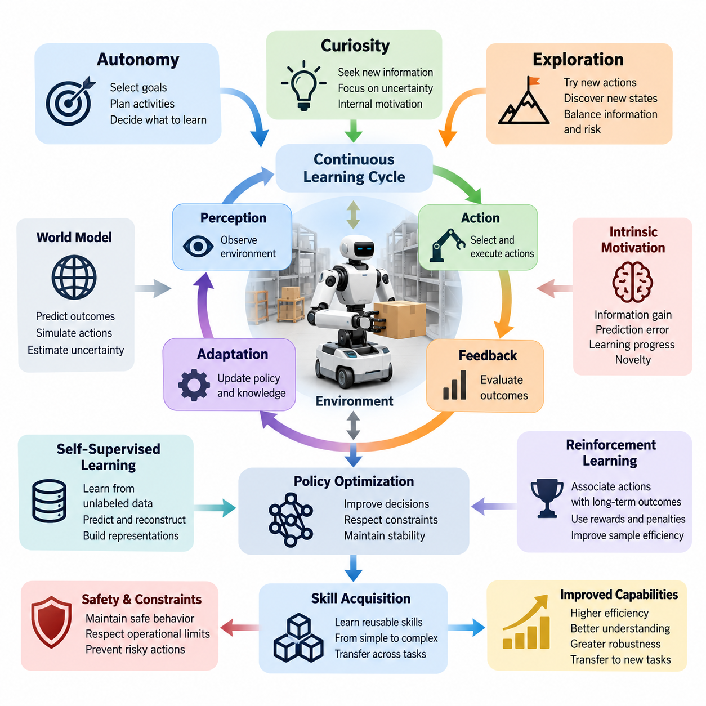
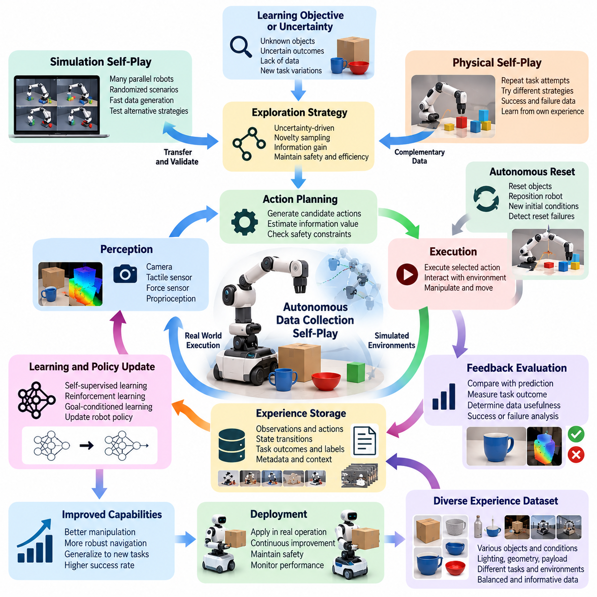
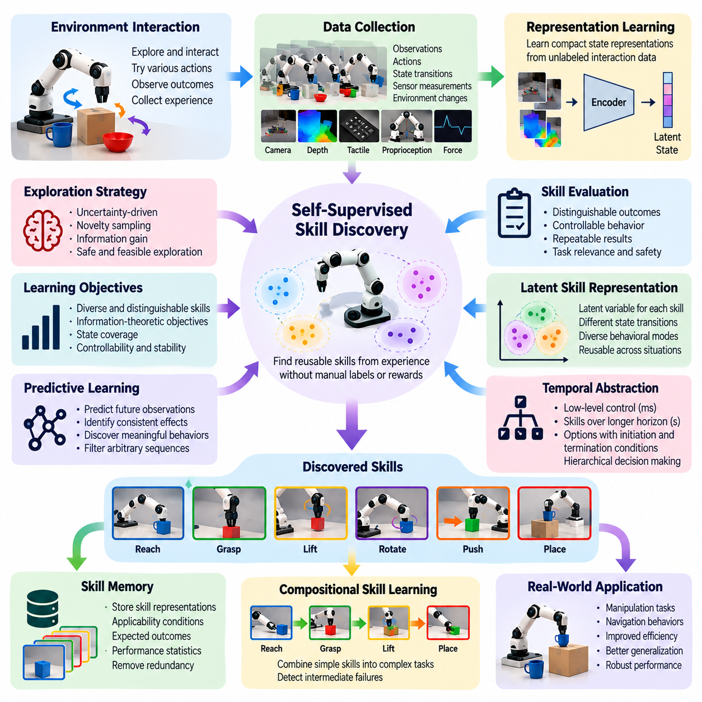
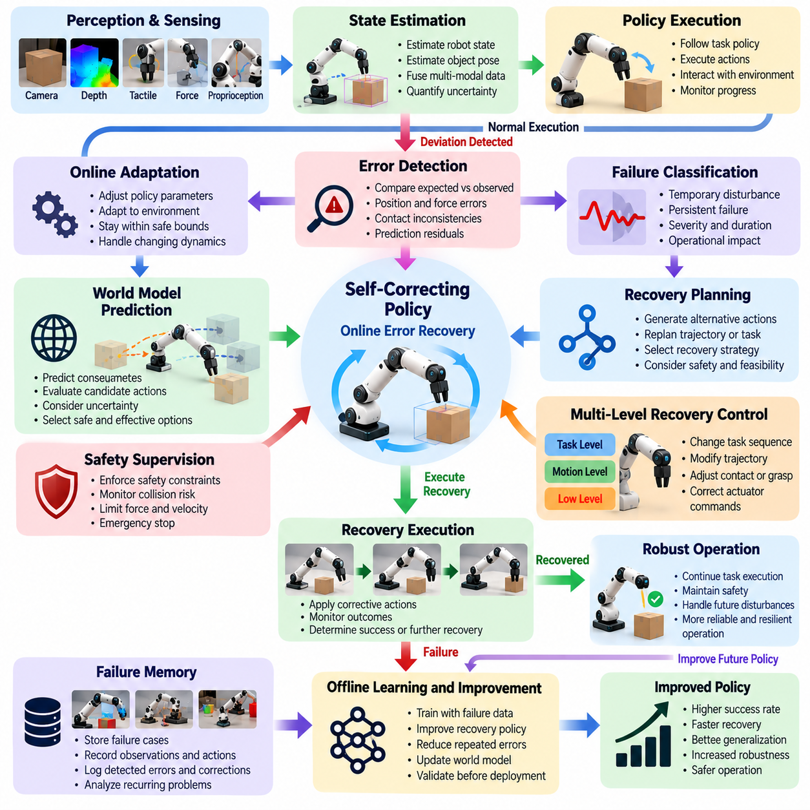
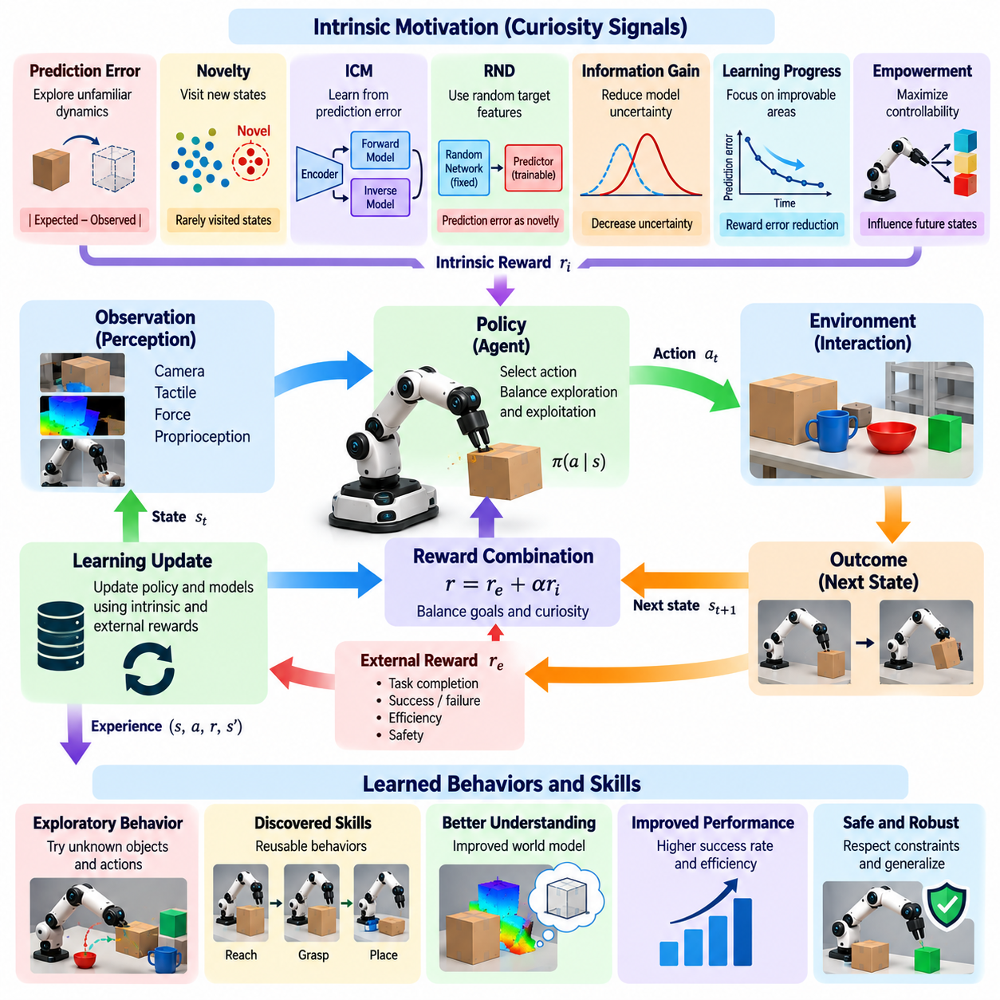
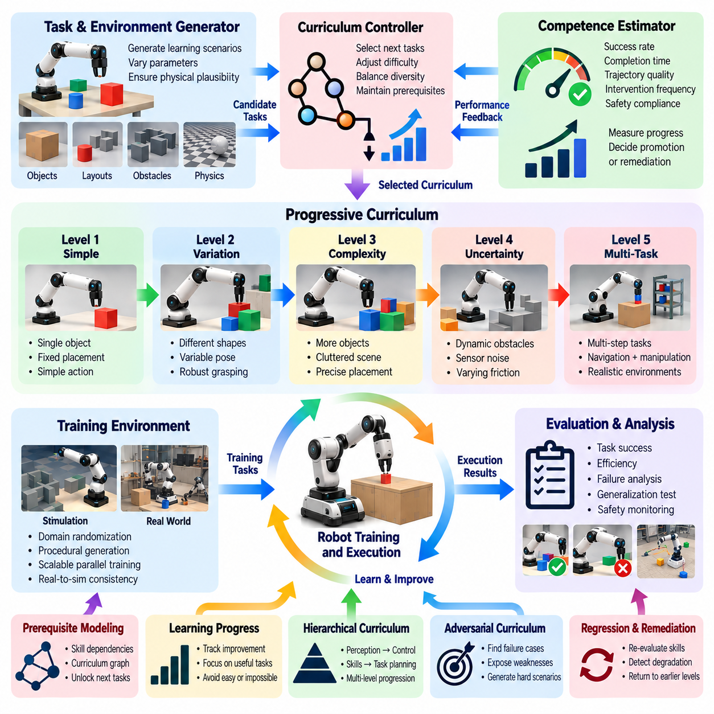
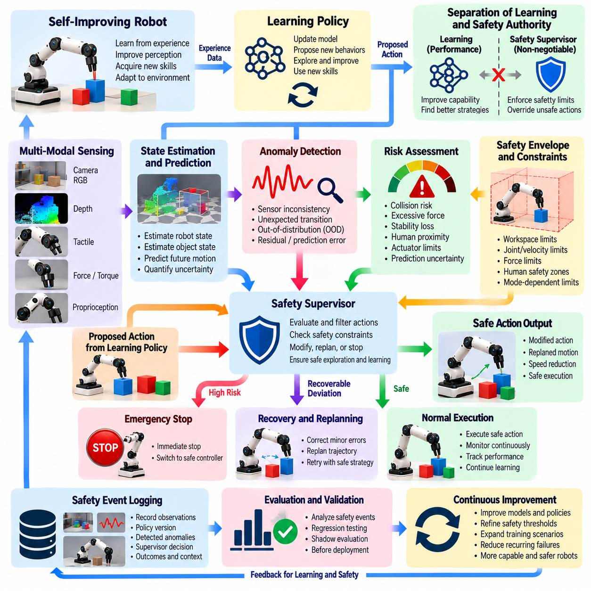
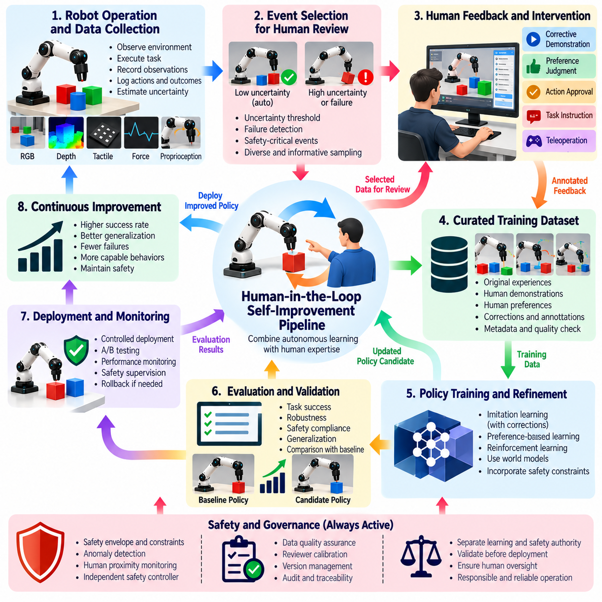
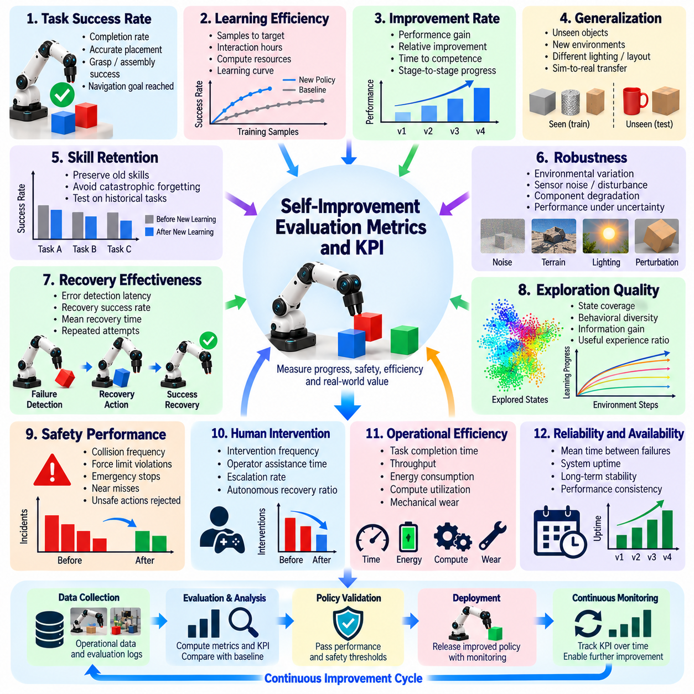
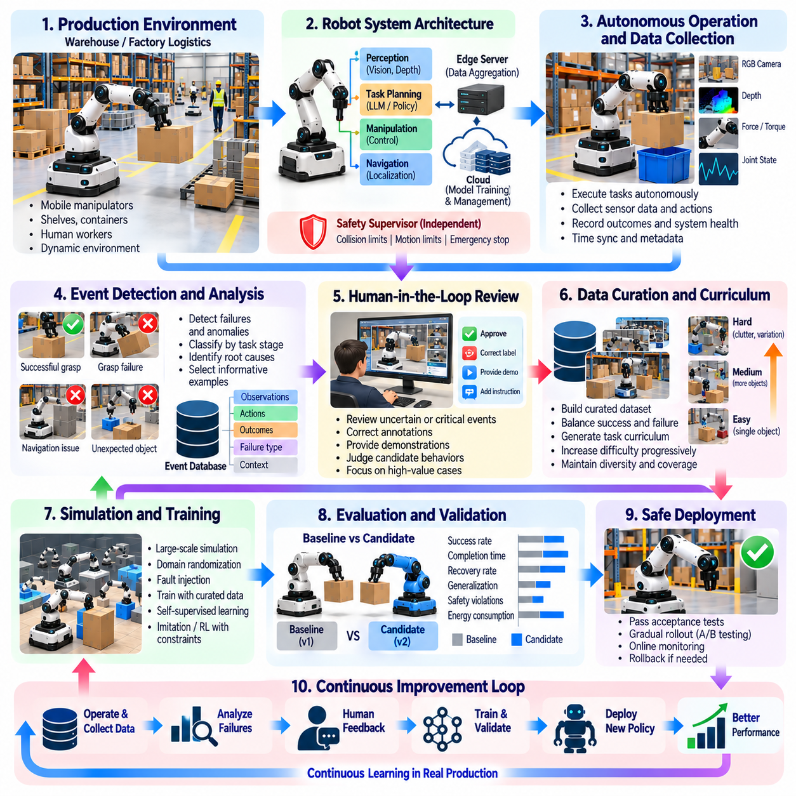

**Volume 27. Future AI Native Robotics**

# Chapter 06. Self-Improving Robot Systems

## 06.01. Self Improvement Concepts Autonomy Curiosity Explore

{width="7.268055555555556in" height="7.268055555555556in"}

Self-improving robot systems represent a transition from machines that execute predefined behaviors toward autonomous physical agents capable of improving their capabilities through experience. Rather than depending exclusively on periodic software updates or human demonstrations, these systems observe their environment, evaluate task outcomes, identify knowledge gaps, and acquire new behaviors through structured interaction with the physical world.

The fundamental principle of self-improvement is a continuous learning cycle connecting perception, action, feedback, and adaptation. A robot receives sensory observations, selects actions according to its current policy, measures the consequences, and incorporates useful information into future decisions. Repeated execution can improve task efficiency, environmental understanding, and robustness, provided that learning remains stable and operational constraints are respected.

Autonomy describes the degree to which a robot can select goals, plan activities, and execute decisions without continuous human intervention. In self-improving systems, autonomy extends beyond task execution to include decisions about what experiences should be collected and which capabilities require refinement. However, autonomous learning authority must remain separate from unrestricted permission to modify safety-critical behavior.

Curiosity introduces an internal motivation for acquiring information that may not produce immediate external rewards. A curious robot preferentially investigates unfamiliar objects, uncertain environmental conditions, or poorly understood action consequences. This behavior can accelerate knowledge acquisition when conventional task rewards are sparse, but curiosity must be directed toward informative and operationally meaningful experiences.

Exploration is the process through which a robot interacts with uncertain environments to discover previously unknown states, transitions, and behavioral possibilities. Unlike random movement, effective exploration balances information acquisition against physical risk, energy consumption, and mission requirements. A robot may investigate alternative grasp configurations or navigation paths while maintaining collision avoidance and stability constraints.

The relationship between autonomy, curiosity, and exploration establishes the conceptual foundation of self-improving intelligence. Autonomy determines whether the robot can initiate learning activities, curiosity influences which uncertainties deserve attention, and exploration generates observations needed to reduce those uncertainties. Together, these mechanisms transform ordinary operational experience into opportunities for measurable capability development.

Self-improvement can be represented as an optimization process in which the robot updates a parameterized policy using accumulated experience. The policy maps observations and internal states to candidate actions, while an evaluation function measures expected performance, uncertainty, and risk. Learning seeks to improve future decisions without violating operational constraints or degrading previously validated capabilities.

An important distinction exists between adaptation and genuine capability improvement. Adaptation modifies behavior in response to immediate environmental changes, such as adjusting grip force when friction decreases. Capability improvement produces a more persistent enhancement that transfers across repeated tasks or related environments. Demonstrating such improvement requires evaluation against stable reference conditions rather than relying on apparent short-term success.

Self-supervised learning provides one mechanism for extracting useful knowledge from robot-generated observations without requiring extensive manual labeling. By predicting future sensor readings, reconstructing missing information, or estimating action consequences, a robot can learn representations of physical interactions. These representations may support downstream manipulation, navigation, and planning tasks even when explicit reward signals are unavailable.

Reinforcement learning provides another mechanism by associating actions with expected long-term outcomes. A robot explores possible behaviors and updates its policy according to rewards, penalties, or estimated value functions. In self-improving architectures, reinforcement learning can be combined with learned world models and uncertainty estimation to reduce unnecessary physical experimentation and improve the efficiency of experience collection.

Intrinsic motivation addresses the limitations of learning systems that depend exclusively on externally specified objectives. Information gain, prediction error, learning progress, and state novelty can serve as internal signals encouraging useful exploration. However, prediction error alone may attract robots toward inherently unpredictable phenomena, making learning progress and controllable uncertainty important considerations in motivation design.

A robot equipped with a predictive world model can estimate how its environment might respond before executing a physical action. This capability supports model-based exploration, where candidate actions are evaluated through simulated consequences and uncertainty estimates. The robot can prioritize experiments expected to improve its internal model while rejecting actions that exceed defined safety, stability, or resource limitations.

Skill acquisition introduces another dimension of self-improvement by converting repeated experiences into reusable behavioral capabilities. A robot may initially learn simple reaching, alignment, and gripping operations before combining them into more complex manipulation sequences. Reusable skills reduce planning complexity and enable previously acquired knowledge to support unfamiliar tasks, creating a foundation for progressively more general robotic intelligence.

Autonomous curriculum learning organizes exploration into progressively challenging experiences. Instead of repeatedly attempting tasks that are either trivial or impossible, the robot selects learning activities near its current competence boundary. Task difficulty can be adjusted using success probability, uncertainty, execution time, and recovery performance, allowing learning resources to concentrate on achievable improvements.

Experience management is essential because not every interaction contributes equally to learning. A self-improving robot must distinguish informative failures, successful demonstrations, redundant observations, and potentially corrupted measurements. Structured experience buffers can preserve relevant sensor states, actions, outcomes, environmental conditions, and model versions, enabling reproducible training and reliable comparisons between successive policies.

Continual learning introduces the challenge of preserving previously acquired capabilities while incorporating new knowledge. Neural policies updated using recent experiences may suffer catastrophic forgetting, causing performance degradation on older tasks. Replay mechanisms, regularization, modular representations, and controlled parameter updates can reduce this risk, although their effectiveness must be established through evaluation across representative operating conditions.

Safety represents a fundamental boundary between experimental learning and unrestricted autonomous behavior. Physical robots can damage equipment, injure people, or create hazardous conditions through poorly selected exploratory actions. Consequently, self-improvement architectures require independent safety supervision, constrained action spaces, emergency stopping mechanisms, and validated fallback policies that remain available when experimental learning becomes unreliable.

Human oversight remains important even when learning and exploration are largely autonomous. Operators may establish permissible learning objectives, approve policy deployments, investigate unexpected failures, and provide corrective demonstrations. This arrangement allows robots to discover useful behaviors independently while maintaining organizational accountability, operational transparency, and human authority over consequential changes.

Evaluation must distinguish improvements in training environments from improvements in real-world operational performance. Relevant measurements include task success rate, sample efficiency, recovery capability, generalization, energy consumption, and safety violations. Controlled benchmark conditions and previously unseen scenarios help determine whether a new policy provides genuine improvements rather than exploiting narrow characteristics of its training data.

A practical self-improving robot architecture separates real-time control, experience collection, learning computation, policy evaluation, and deployment management. Time-critical control remains governed by validated execution components, while computationally intensive learning can occur on edge servers or cloud infrastructure. Candidate policies undergo testing and approval before replacing operational versions, preventing uncontrolled modification of deployed behavior.

The long-term significance of self-improving robotics lies in the possibility of systems whose capabilities expand through accumulated physical experience. Achieving this vision requires coordinated advances in autonomous exploration, intrinsic motivation, world modeling, continual learning, and safety assurance. The central engineering objective is not unlimited autonomous modification, but demonstrable, reproducible, and safely governed improvement throughout the robot\'s operational lifetime.

자가 개선 로봇 시스템(Self-Improving Robot Systems)은 사전에 정의된 동작을 수행하는 기계에서 경험을 통해 자체 능력을 향상시킬 수 있는 자율 물리 에이전트(Autonomous Physical Agents)로의 전환을 의미한다. 이러한 시스템은 정기적인 소프트웨어 업데이트나 인간의 시연에만 의존하지 않고, 주변 환경을 관찰하고 작업 결과를 평가하며 지식의 부족한 부분을 식별한다. 또한 물리적 환경과의 체계적인 상호작용을 통해 새로운 행동 능력을 습득한다.

자가 개선(Self-Improvement)의 기본 원리는 인지(Perception), 행동(Action), 피드백(Feedback), 적응(Adaptation)을 연결하는 지속적인 학습 순환 구조(Continuous Learning Cycle)에 있다. 로봇은 센서 관측 정보를 수신하고 현재 정책(Policy)에 따라 행동을 선택하며, 그 결과를 측정하여 향후 의사결정에 반영한다. 이러한 과정이 반복되면 학습의 안정성과 운영 제약조건이 유지되는 범위에서 작업 효율성, 환경 이해 능력, 강건성(Robustness)이 향상될 수 있다.

자율성(Autonomy)은 로봇이 지속적인 인간의 개입 없이 목표를 선택하고 활동을 계획하며 의사결정을 실행할 수 있는 정도를 나타낸다. 자가 개선 시스템에서 자율성은 단순한 작업 수행을 넘어 어떤 경험을 수집하고 어떤 능력을 개선해야 하는지 결정하는 영역까지 확장된다. 그러나 자율 학습 권한은 안전 필수 동작(Safety-Critical Behavior)을 제한 없이 변경할 수 있는 권한과 명확하게 분리되어야 한다.

호기심(Curiosity)은 즉각적인 외부 보상(External Reward)을 제공하지 않더라도 새로운 정보를 획득하도록 유도하는 내부 동기(Intrinsic Motivation)를 의미한다. 호기심을 가진 로봇은 익숙하지 않은 물체, 불확실한 환경 조건, 충분히 이해하지 못한 행동 결과를 우선적으로 탐색한다. 이러한 특성은 일반적인 작업 보상이 부족한 상황에서 지식 획득을 촉진하지만, 호기심은 정보 가치와 운영 목적을 고려한 경험으로 유도되어야 한다.

탐색(Exploration)은 로봇이 불확실한 환경과 상호작용하면서 이전에 알려지지 않은 상태(State), 상태 전이(State Transition), 행동 가능성을 발견하는 과정이다. 효과적인 탐색은 무작위 움직임과 달리 정보 획득, 물리적 위험, 에너지 소비, 임무 요구사항 사이의 균형을 고려한다. 로봇은 충돌 회피(Collision Avoidance)와 안정성 제약조건을 유지하면서 대안적인 파지 구성(Grasp Configuration)이나 이동 경로를 조사할 수 있다.

자율성(Autonomy), 호기심(Curiosity), 탐색(Exploration)의 상호관계는 자가 개선 지능(Self-Improving Intelligence)의 개념적 기반을 형성한다. 자율성은 로봇이 학습 활동을 스스로 시작할 수 있는지를 결정하고, 호기심은 어떤 불확실성에 주의를 기울여야 하는지에 영향을 준다. 탐색은 이러한 불확실성을 감소시키는 데 필요한 관측 정보를 생성한다. 세 가지 메커니즘은 일반적인 운영 경험을 측정 가능한 능력 개발 기회로 전환한다.

자가 개선은 로봇이 축적된 경험을 활용하여 매개변수화된 정책(Parameterized Policy)을 갱신하는 최적화 과정(Optimization Process)으로 표현할 수 있다. 정책은 관측 정보와 내부 상태를 후보 행동에 대응시키며, 평가 함수(Evaluation Function)는 예상 성능, 불확실성, 위험을 측정한다. 학습은 운영 제약조건을 위반하거나 이전에 검증된 능력을 저하시키지 않으면서 향후 의사결정의 품질을 개선하는 것을 목표로 한다.

적응(Adaptation)과 실질적인 능력 향상(Capability Improvement) 사이에는 중요한 차이가 존재한다. 적응은 마찰력이 감소할 때 파지력을 조정하는 것처럼 즉각적인 환경 변화에 대응하여 행동을 수정한다. 반면 능력 향상은 반복 작업이나 관련 환경으로 전이될 수 있는 지속적인 성능 개선을 의미한다. 이러한 개선을 입증하려면 단기적인 성공 결과에만 의존하지 않고 안정적인 기준 조건(Reference Conditions)에 대한 평가가 필요하다.

자기 지도 학습(Self-Supervised Learning)은 광범위한 수작업 레이블링 없이 로봇이 생성한 관측 데이터에서 유용한 지식을 추출하는 방법을 제공한다. 미래 센서 측정값을 예측하거나 누락된 정보를 복원하고 행동의 결과를 추정함으로써 로봇은 물리적 상호작용에 대한 표현(Representation)을 학습할 수 있다. 이러한 표현은 명시적인 보상 신호가 없는 상황에서도 조작, 내비게이션, 계획 수립과 같은 후속 작업을 지원할 수 있다.

강화 학습(Reinforcement Learning)은 행동과 예상되는 장기적 결과를 연결하여 능력을 개선하는 또 다른 메커니즘이다. 로봇은 가능한 행동을 탐색하고 보상, 페널티 또는 추정된 가치 함수(Value Function)에 따라 정책을 갱신한다. 자가 개선 아키텍처에서는 강화 학습을 학습된 세계 모델(World Model) 및 불확실성 추정(Uncertainty Estimation)과 결합하여 불필요한 물리적 실험을 줄이고 경험 수집 효율성을 향상시킬 수 있다.

내재적 동기(Intrinsic Motivation)는 외부에서 지정된 목표에만 의존하는 학습 시스템의 한계를 보완한다. 정보 이득(Information Gain), 예측 오차(Prediction Error), 학습 진전도(Learning Progress), 상태 신규성(State Novelty)은 유용한 탐색을 촉진하는 내부 신호로 활용될 수 있다. 그러나 예측 오차만을 기준으로 사용하면 본질적으로 예측하기 어려운 현상에 로봇이 집중할 수 있으므로, 학습 진전도와 제어 가능한 불확실성을 함께 고려해야 한다.

예측 세계 모델(Predictive World Model)을 탑재한 로봇은 물리적 행동을 실행하기 전에 환경이 어떻게 반응할 것인지 추정할 수 있다. 이러한 능력은 모델 기반 탐색(Model-Based Exploration)을 지원하며, 후보 행동을 시뮬레이션된 결과와 불확실성 추정을 통해 평가하도록 한다. 로봇은 내부 모델의 개선에 기여할 것으로 예상되는 실험을 우선 수행하면서 안전성, 안정성, 자원 제약조건을 초과하는 행동은 제외할 수 있다.

기술 습득(Skill Acquisition)은 반복 경험을 재사용 가능한 행동 능력으로 전환함으로써 자가 개선의 새로운 차원을 제공한다. 로봇은 초기 단계에서 도달(Reaching), 정렬(Alignment), 파지(Gripping)와 같은 단순한 동작을 학습한 후 이를 결합하여 복잡한 조작 순서를 구성할 수 있다. 재사용 가능한 기술은 계획 수립의 복잡성을 줄이고 기존 지식을 새로운 작업에 적용할 수 있도록 하여 점진적으로 일반화된 로봇 지능의 기반을 형성한다.

자율 커리큘럼 학습(Autonomous Curriculum Learning)은 탐색 경험을 점진적으로 어려워지는 학습 과정으로 구성한다. 로봇은 지나치게 쉽거나 수행이 불가능한 작업을 반복하는 대신 현재 능력 수준의 경계에 가까운 학습 활동을 선택한다. 작업 난이도는 성공 확률, 불확실성, 실행 시간, 복구 성능을 기준으로 조정할 수 있으며, 이를 통해 학습 자원을 실현 가능한 능력 개선에 집중시킬 수 있다.

경험 관리(Experience Management)는 모든 상호작용이 학습에 동일하게 기여하지 않기 때문에 중요하다. 자가 개선 로봇은 정보 가치가 높은 실패, 성공적인 시연, 중복 관측, 잠재적으로 손상된 측정 데이터를 구분해야 한다. 구조화된 경험 버퍼(Experience Buffer)는 센서 상태, 행동, 결과, 환경 조건, 모델 버전 등을 보존하여 재현 가능한 학습과 연속적인 정책 버전 사이의 신뢰성 있는 비교를 지원한다.

지속 학습(Continual Learning)은 새로운 지식을 통합하면서 기존에 습득한 능력을 유지해야 하는 과제를 수반한다. 최근 경험을 이용하여 갱신된 신경망 정책(Neural Policy)은 파국적 망각(Catastrophic Forgetting)을 경험하여 이전 작업의 성능이 저하될 수 있다. 경험 재생(Replay), 정규화(Regularization), 모듈형 표현(Modular Representation), 제어된 매개변수 갱신은 이러한 위험을 완화할 수 있지만, 대표적인 운영 조건에서 효과를 검증해야 한다.

안전성(Safety)은 실험적 학습과 무제한적인 자율 행동을 구분하는 핵심 경계이다. 물리적 로봇은 부적절한 탐색 행동으로 장비를 손상시키거나 사람에게 부상을 입히고 위험한 상황을 발생시킬 수 있다. 따라서 자가 개선 아키텍처에는 독립적인 안전 감독(Safety Supervision), 제약된 행동 공간(Constrained Action Space), 비상 정지 메커니즘(Emergency Stopping Mechanism), 검증된 대체 정책(Fallback Policy)이 필요하다.

인간 감독(Human Oversight)은 학습과 탐색이 상당 부분 자율적으로 이루어지는 환경에서도 중요한 역할을 한다. 운영자는 허용 가능한 학습 목표를 설정하고 정책 배포를 승인하며 예상하지 못한 실패를 조사하고 교정 시연(Corrective Demonstration)을 제공할 수 있다. 이러한 체계는 로봇이 유용한 행동을 독립적으로 발견하도록 지원하면서 조직적 책임성, 운영 투명성, 중요한 변경 사항에 대한 인간의 통제 권한을 유지한다.

평가(Evaluation)는 학습 환경에서의 성능 향상과 실제 운영 환경에서의 성능 향상을 구분해야 한다. 주요 측정 항목에는 작업 성공률(Task Success Rate), 샘플 효율성(Sample Efficiency), 복구 능력(Recovery Capability), 일반화 성능(Generalization), 에너지 소비(Energy Consumption), 안전 위반(Safety Violations)이 포함된다. 통제된 벤치마크 조건과 이전에 경험하지 않은 시나리오는 새로운 정책이 학습 데이터의 제한적인 특성을 이용한 것이 아니라 실질적인 개선을 제공하는지 판단하도록 지원한다.

실용적인 자가 개선 로봇 아키텍처(Practical Self-Improving Robot Architecture)는 실시간 제어(Real-Time Control), 경험 수집(Experience Collection), 학습 연산(Learning Computation), 정책 평가(Policy Evaluation), 배포 관리(Deployment Management)를 분리한다. 시간 제약이 엄격한 제어 기능은 검증된 실행 구성요소가 담당하고, 계산량이 많은 학습은 엣지 서버(Edge Server)나 클라우드 인프라(Cloud Infrastructure)에서 수행할 수 있다. 후보 정책은 운영 버전을 대체하기 전에 시험과 승인을 거쳐야 한다.

자가 개선 로봇 기술의 장기적인 중요성은 축적된 물리적 경험을 통해 능력을 지속적으로 확장하는 시스템의 가능성에 있다. 이러한 비전을 실현하려면 자율 탐색(Autonomous Exploration), 내재적 동기(Intrinsic Motivation), 세계 모델링(World Modeling), 지속 학습(Continual Learning), 안전성 보증(Safety Assurance)의 발전이 함께 이루어져야 한다. 핵심 공학적 목표는 제한 없는 자율적 변경이 아니라 로봇의 전체 운영 수명 동안 입증 가능하고 재현 가능하며 안전하게 관리되는 지속적인 능력 개선이다.

## 06.02. Autonomous Data Collection Robot Self Play [w/Code]

{width="7.268055555555556in" height="7.268055555555556in"}

Autonomous data collection is a fundamental capability of self-improving robot systems, enabling machines to generate learning experiences without continuous human supervision. Traditional robot learning depends heavily on manually recorded demonstrations and predefined datasets. Autonomous collection instead allows robots to select informative actions, observe physical outcomes, and construct training datasets directly from their operational environments.

Robot self-play extends this principle by allowing a robot to generate training experiences through repeated interaction with itself, simulated counterparts, or coordinated robotic agents. Unlike competitive self-play in games, physical robot self-play may involve manipulating objects, resetting environments, testing alternative strategies, and evaluating task outcomes. The objective is to produce increasingly useful experiences while reducing dependence on human demonstrations.

The architecture of autonomous data collection integrates perception, action planning, execution, feedback evaluation, and experience storage. Cameras, tactile sensors, force sensors, and proprioceptive measurements capture the robot\'s interaction with its surroundings. A learning controller selects candidate actions, while monitoring components record resulting state transitions and determine whether each experience contributes useful information.

An autonomous collection cycle begins with the identification of a learning objective or uncertainty requiring investigation. The robot generates candidate actions, estimates their expected information value, and executes an acceptable action under safety constraints. Subsequent observations are compared with predicted outcomes, and the resulting experience is stored with contextual information for training, analysis, and future policy improvement.

Self-play can be implemented through repeated task attempts in which a robot explores alternative strategies and evaluates their effectiveness. A manipulation robot may repeatedly grasp objects using different contact points, approach angles, and force profiles. Successful and unsuccessful attempts provide complementary information about object geometry, friction, grasp stability, and action feasibility, supporting progressive improvement of manipulation policies.

A particularly useful approach involves goal-conditioned self-play, where robots generate achievable target states and attempt to reproduce them. One policy may establish a target configuration, while another policy attempts to reach that configuration from a different initial state. The resulting trajectories provide training examples for goal-conditioned control, enabling robots to learn useful behaviors without requiring explicit human rewards for every action.

Autonomous reset mechanisms are essential for maintaining efficient physical learning cycles. After completing an experiment, a robot must restore objects, reposition itself, or establish a new initial condition before continuing. Automated fixtures, reversible manipulation tasks, and coordinated robot pairs can reduce manual intervention. However, reset failures must be detected because inconsistent initial conditions can distort learning results.

Simulation environments provide scalable infrastructure for autonomous experience generation. Thousands of robot instances can explore different policies, environmental parameters, and task configurations in parallel. Physics-based simulation supports rapid experimentation without exposing physical equipment to every exploratory failure. Nevertheless, simulated experiences must be evaluated against real-world dynamics because inaccurate contact, friction, and sensor models can produce misleading policies.

The integration of simulation and physical experimentation creates a hybrid data collection strategy. Simulation generates broad behavioral coverage, while physical robots collect targeted evidence in regions where model predictions are uncertain or unreliable. Real-world measurements can subsequently improve simulation parameters, creating a feedback cycle between virtual experimentation and physical validation that increases learning efficiency.

Exploration strategies strongly influence the quality of autonomously collected datasets. Uniform random exploration often produces redundant or irrelevant observations, particularly in high-dimensional robotic action spaces. Uncertainty-driven exploration, novelty sampling, and expected information gain can direct experiments toward informative transitions. These methods improve data efficiency when their uncertainty estimates accurately represent meaningful learning opportunities.

Active learning provides a framework for selecting experiences expected to reduce model uncertainty. A robot may compare predictions from multiple models and prioritize situations where disagreement is significant. For example, disagreement about grasp success under unfamiliar surface conditions may justify a controlled physical experiment. Such selection mechanisms can reduce unnecessary trials while improving model performance in poorly understood operating regions.

Experience diversity is necessary to prevent self-generated datasets from becoming narrowly concentrated around familiar behaviors. Robots should encounter variations in object properties, lighting, geometry, payload, surface conditions, and task objectives. Structured randomization and coverage monitoring can identify underrepresented conditions. Without sufficient diversity, self-play may reinforce existing policy limitations instead of expanding generalization capabilities.

Autonomous data pipelines must preserve temporal consistency and accurate relationships between observations and actions. Each experience should contain synchronized sensor measurements, robot states, action commands, execution timestamps, environmental context, and observed outcomes. Calibration metadata and software versions are also important because changes in sensing or control configurations can alter the interpretation of previously collected data.

Data quality management becomes increasingly important as robots generate large quantities of training information. Sensor failures, synchronization errors, unexpected human interference, and incomplete task resets may produce unreliable samples. Automated validation can detect missing measurements, inconsistent state transitions, and abnormal sensor behavior. Suspect experiences should be quarantined or flagged rather than silently incorporated into training datasets.

Self-play learning can incorporate reinforcement learning, imitation learning, and self-supervised representation learning within a unified pipeline. Reinforcement learning improves action selection through evaluated outcomes, while successful autonomous trajectories can provide demonstrations for imitation-based refinement. Self-supervised learning extracts representations from the broader collection of observations, including experiences that do not achieve the intended task.

A central challenge is preventing autonomous learning from amplifying systematic errors. If a robot repeatedly collects data using a biased policy, its training distribution may exclude important states or overrepresent misleading outcomes. Dataset balancing, independent evaluation, and periodic reference-policy comparisons help identify this problem. Exploration policies should therefore be evaluated not only by immediate success but also by the information they contribute.

Safety constraints must govern every stage of physical self-play. Candidate actions should be checked against collision limits, joint constraints, actuator capabilities, workspace boundaries, and human proximity requirements. Independent safety controllers must retain authority to interrupt unsafe experiments. High-risk exploration should remain in simulation or controlled test environments until sufficient evidence supports physical execution.

Multi-robot self-play can increase experience diversity through cooperative and adversarial task generation. One robot may present objects in different configurations while another attempts manipulation, or multiple mobile robots may practice coordinated navigation under changing traffic conditions. These interactions generate complex training scenarios, although coordination protocols must prevent unsafe interference and uncontrolled escalation of task difficulty.

Evaluation of autonomous collection systems requires measurements beyond the total number of recorded samples. Important indicators include useful experience yield, task coverage, learning improvement per interaction, reset success rate, physical wear, energy consumption, and safety incidents. Comparing policy performance before and after training provides stronger evidence of data value than dataset size alone.

Production deployment requires a controlled data-to-policy improvement pipeline connecting autonomous collection, dataset validation, training, testing, and release management. Candidate models should undergo simulation testing, hardware validation, and monitored deployment before replacing established policies. Through this governed process, robot self-play can transform ordinary physical interactions into a scalable source of knowledge while preserving operational reliability and human oversight.

자율 데이터 수집(Autonomous Data Collection)은 자가 개선 로봇 시스템(Self-Improving Robot Systems)의 핵심 능력으로, 지속적인 인간의 감독 없이 로봇이 학습 경험을 생성할 수 있도록 한다. 기존 로봇 학습은 수작업으로 기록된 시연 데이터와 사전에 정의된 데이터셋(Dataset)에 크게 의존한다. 반면 자율 데이터 수집은 로봇이 정보 가치가 높은 행동을 선택하고 물리적 결과를 관찰하며 실제 운영 환경에서 직접 학습 데이터셋을 구축할 수 있도록 한다.

로봇 셀프 플레이(Robot Self-Play)는 로봇이 자기 자신, 시뮬레이션된 상대 또는 협력하는 다른 로봇 에이전트(Robot Agent)와 반복적으로 상호작용하면서 학습 경험을 생성하도록 하는 개념이다. 게임에서의 경쟁적 셀프 플레이와 달리 물리적 로봇 셀프 플레이는 물체 조작, 환경 초기화, 대안 전략 시험, 작업 결과 평가 등을 포함할 수 있다. 목표는 인간의 시연에 대한 의존도를 줄이면서 점점 더 유용한 학습 경험을 생성하는 것이다.

자율 데이터 수집 아키텍처(Autonomous Data Collection Architecture)는 인지(Perception), 행동 계획(Action Planning), 실행(Execution), 피드백 평가(Feedback Evaluation), 경험 저장(Experience Storage)을 통합한다. 카메라, 촉각 센서(Tactile Sensor), 힘 센서(Force Sensor), 고유수용성 측정(Proprioceptive Measurement)은 로봇과 주변 환경 사이의 상호작용을 기록한다. 학습 제어기(Learning Controller)는 후보 행동을 선택하고 감시 구성요소는 상태 전이(State Transition)를 기록하여 각 경험의 정보 가치를 판단한다.

자율 데이터 수집 주기(Autonomous Collection Cycle)는 학습 목표 또는 추가 조사가 필요한 불확실성을 식별하는 과정에서 시작된다. 로봇은 후보 행동을 생성하고 예상 정보 가치(Expected Information Value)를 추정한 후 안전 제약조건을 만족하는 행동을 실행한다. 이후 관측 결과를 예측 결과와 비교하고, 생성된 경험을 학습, 분석, 향후 정책 개선에 활용할 수 있도록 관련 상황 정보(Contextual Information)와 함께 저장한다.

셀프 플레이(Self-Play)는 로봇이 대안적인 전략을 탐색하고 효과를 평가하는 반복 작업 시도(Repeated Task Attempts)를 통해 구현할 수 있다. 조작 로봇(Manipulation Robot)은 서로 다른 접촉점, 접근 각도, 힘 프로파일(Force Profile)을 적용하여 물체 파지를 반복적으로 시도할 수 있다. 성공과 실패 경험은 물체 형상, 마찰, 파지 안정성, 행동 실행 가능성에 대한 상호보완적인 정보를 제공하여 조작 정책(Manipulation Policy)의 점진적인 개선을 지원한다.

특히 유용한 접근 방식은 목표 조건부 셀프 플레이(Goal-Conditioned Self-Play)로, 로봇이 달성 가능한 목표 상태를 생성하고 이를 재현하도록 학습하는 방법이다. 하나의 정책이 목표 구성을 설정하면 다른 정책은 서로 다른 초기 상태에서 해당 목표에 도달하려고 시도한다. 이러한 과정에서 생성된 궤적(Trajectory)은 목표 조건부 제어(Goal-Conditioned Control)의 학습 사례로 활용되며, 모든 행동에 명시적인 인간 보상을 제공하지 않아도 유용한 행동을 학습할 수 있도록 한다.

자율 초기화 메커니즘(Autonomous Reset Mechanism)은 효율적인 물리적 학습 주기를 유지하는 데 필수적이다. 실험을 완료한 로봇은 다음 실험을 위해 물체를 원래 위치로 복원하거나 자신의 위치를 조정하고 새로운 초기 조건을 설정해야 한다. 자동화된 고정 장치(Automated Fixture), 가역적 조작 작업(Reversible Manipulation Task), 협력 로봇 쌍(Coordinated Robot Pair)은 수작업 개입을 줄일 수 있다. 그러나 초기화 실패는 학습 결과를 왜곡할 수 있으므로 반드시 감지해야 한다.

시뮬레이션 환경(Simulation Environment)은 자율 경험 생성을 위한 확장 가능한 인프라를 제공한다. 수천 개의 로봇 인스턴스(Robot Instance)가 서로 다른 정책, 환경 매개변수, 작업 구성을 병렬로 탐색할 수 있다. 물리 기반 시뮬레이션(Physics-Based Simulation)은 모든 탐색 실패에 실제 장비를 노출하지 않고 빠른 실험을 지원한다. 그러나 접촉, 마찰, 센서 모델의 부정확성은 잘못된 정책을 생성할 수 있으므로 시뮬레이션 경험을 실제 물리적 동작과 비교하여 검증해야 한다.

시뮬레이션과 물리적 실험을 통합하면 하이브리드 데이터 수집 전략(Hybrid Data Collection Strategy)을 구성할 수 있다. 시뮬레이션은 광범위한 행동 영역을 탐색하고, 실제 로봇은 모델 예측이 불확실하거나 신뢰성이 낮은 영역에서 목표 지향적인 데이터를 수집한다. 이후 실제 측정값을 이용하여 시뮬레이션 매개변수를 개선함으로써 가상 실험과 물리적 검증 사이의 피드백 순환 구조(Feedback Cycle)를 형성하고 학습 효율성을 높일 수 있다.

탐색 전략(Exploration Strategy)은 자율적으로 수집되는 데이터셋의 품질에 큰 영향을 미친다. 균일 무작위 탐색(Uniform Random Exploration)은 특히 고차원 로봇 행동 공간에서 중복되거나 관련성이 낮은 관측 결과를 생성하기 쉽다. 불확실성 기반 탐색(Uncertainty-Driven Exploration), 신규성 샘플링(Novelty Sampling), 예상 정보 이득(Expected Information Gain)은 정보 가치가 높은 상태 전이에 실험을 집중시킬 수 있다. 이러한 방법은 불확실성 추정이 의미 있는 학습 기회를 정확하게 반영할 때 데이터 효율성을 개선한다.

능동 학습(Active Learning)은 모델의 불확실성을 감소시킬 것으로 예상되는 경험을 선택하기 위한 체계를 제공한다. 로봇은 여러 모델의 예측 결과를 비교하고 모델 간 불일치가 큰 상황을 우선적으로 조사할 수 있다. 예를 들어 익숙하지 않은 표면 조건에서 파지 성공 여부에 대한 예측이 서로 다르면 통제된 물리적 실험을 수행할 수 있다. 이러한 선택 메커니즘은 불필요한 실험을 줄이면서 충분히 이해되지 않은 운영 영역에서 모델 성능을 개선한다.

경험 다양성(Experience Diversity)은 자체 생성 데이터셋이 익숙한 행동에 지나치게 집중되는 것을 방지하기 위해 필요하다. 로봇은 물체 특성, 조명, 형상, 적재 하중(Payload), 표면 조건, 작업 목표의 다양한 변화를 경험해야 한다. 구조화된 무작위화(Structured Randomization)와 데이터 범위 모니터링(Coverage Monitoring)은 충분히 표현되지 않은 조건을 식별할 수 있다. 다양성이 부족하면 셀프 플레이가 일반화 능력을 확장하기보다 기존 정책의 한계를 강화할 수 있다.

자율 데이터 파이프라인(Autonomous Data Pipeline)은 시간적 일관성(Temporal Consistency)과 관측 및 행동 사이의 정확한 관계를 유지해야 한다. 각 경험에는 동기화된 센서 측정값, 로봇 상태, 행동 명령, 실행 타임스탬프(Execution Timestamp), 환경 정보, 관측 결과가 포함되어야 한다. 센서 및 제어 구성의 변경은 이전에 수집된 데이터의 해석에 영향을 줄 수 있으므로 보정 메타데이터(Calibration Metadata)와 소프트웨어 버전 정보도 중요하다.

로봇이 대량의 학습 데이터를 생성할수록 데이터 품질 관리(Data Quality Management)의 중요성이 높아진다. 센서 고장, 동기화 오류, 예상하지 못한 인간의 개입, 불완전한 작업 초기화는 신뢰할 수 없는 샘플을 생성할 수 있다. 자동 검증(Automated Validation)은 누락된 측정값, 일관성이 없는 상태 전이, 비정상적인 센서 동작을 감지한다. 의심스러운 경험은 별도로 격리하거나 표시하여 검증 없이 학습 데이터셋에 포함되지 않도록 해야 한다.

셀프 플레이 학습(Self-Play Learning)은 강화 학습(Reinforcement Learning), 모방 학습(Imitation Learning), 자기 지도 표현 학습(Self-Supervised Representation Learning)을 하나의 통합 파이프라인으로 결합할 수 있다. 강화 학습은 평가된 결과를 이용하여 행동 선택을 개선하고, 성공적인 자율 실행 궤적은 모방 기반 개선을 위한 시연 데이터로 활용될 수 있다. 자기 지도 학습은 목표 작업에 성공하지 못한 경험까지 포함한 광범위한 관측 데이터에서 유용한 표현을 추출한다.

핵심적인 과제 중 하나는 자율 학습이 체계적인 오류(Systematic Error)를 증폭시키지 않도록 방지하는 것이다. 로봇이 편향된 정책(Biased Policy)을 사용하여 데이터를 반복적으로 수집하면 학습 분포(Training Distribution)에서 중요한 상태가 누락되거나 잘못된 결과가 과도하게 표현될 수 있다. 데이터셋 균형 조정(Dataset Balancing), 독립적인 평가(Independent Evaluation), 기준 정책 비교(Reference-Policy Comparison)는 이러한 문제를 식별하는 데 도움이 된다. 따라서 탐색 정책은 즉각적인 성공뿐 아니라 학습에 제공하는 정보 가치로 평가해야 한다.

안전 제약조건(Safety Constraints)은 물리적 셀프 플레이의 모든 단계를 통제해야 한다. 후보 행동은 충돌 제한, 관절 제약조건(Joint Constraints), 액추에이터 성능(Actuator Capabilities), 작업 공간 경계(Workspace Boundaries), 인간과의 근접 조건을 기준으로 검사해야 한다. 독립적인 안전 제어기(Safety Controller)는 위험한 실험을 중단할 수 있는 권한을 유지해야 한다. 위험도가 높은 탐색은 물리적 실행을 뒷받침할 충분한 근거가 확보될 때까지 시뮬레이션이나 통제된 시험 환경에서 수행해야 한다.

다중 로봇 셀프 플레이(Multi-Robot Self-Play)는 협력적 및 적대적 작업 생성(Cooperative and Adversarial Task Generation)을 통해 경험의 다양성을 높일 수 있다. 하나의 로봇이 물체를 다양한 구성으로 제시하고 다른 로봇이 조작을 시도하거나, 여러 이동 로봇이 변화하는 교통 조건에서 협력 내비게이션(Coordinated Navigation)을 연습할 수 있다. 이러한 상호작용은 복잡한 학습 시나리오를 생성하지만, 협력 프로토콜(Coordination Protocol)은 위험한 간섭과 통제되지 않는 작업 난이도 증가를 방지해야 한다.

자율 데이터 수집 시스템의 평가(Evaluation)는 기록된 전체 샘플 수를 넘어서는 측정 기준이 필요하다. 주요 지표에는 유효 경험 생성률(Useful Experience Yield), 작업 범위(Task Coverage), 상호작용당 학습 개선도(Learning Improvement per Interaction), 초기화 성공률(Reset Success Rate), 물리적 마모(Physical Wear), 에너지 소비, 안전 사고가 포함된다. 학습 전후의 정책 성능을 비교하면 단순한 데이터셋 크기보다 데이터의 실제 가치를 더욱 명확하게 입증할 수 있다.

실제 운영 환경에 배포하려면 자율 데이터 수집, 데이터셋 검증, 학습, 시험, 릴리스 관리(Release Management)를 연결하는 통제된 데이터-정책 개선 파이프라인(Data-to-Policy Improvement Pipeline)이 필요하다. 후보 모델은 기존 정책을 대체하기 전에 시뮬레이션 시험, 하드웨어 검증(Hardware Validation), 모니터링 기반 배포(Monitored Deployment)를 거쳐야 한다. 이러한 관리 체계를 통해 로봇 셀프 플레이는 운영 신뢰성과 인간 감독을 유지하면서 일반적인 물리적 상호작용을 확장 가능한 지식 자원으로 전환할 수 있다.

## 06.03. Self Supervised Skill Discovery [w/Code]

{width="7.268055555555556in" height="7.268055555555556in"}

Self-supervised skill discovery enables robots to acquire reusable behavioral capabilities without requiring explicit human demonstrations or manually assigned rewards for every task. Instead of learning only predefined actions, a robot explores its environment and identifies meaningful patterns in the consequences of its behavior. These patterns can be organized into skills that support increasingly complex manipulation, navigation, and physical interaction.

A skill represents a temporally extended behavior that transforms an initial robot-environment state into a meaningful outcome. Unlike individual motor commands, skills may involve coordinated sequences of perception, planning, and control. Examples include approaching an object, adjusting a grasp, opening a container, or navigating around an obstacle. Effective skill discovery identifies behaviors that are reusable across different situations.

Self-supervised skill discovery relies on information extracted directly from interaction experiences. A robot records observations, actions, state transitions, and resulting environmental changes while performing exploratory behaviors. Learning algorithms identify recurring relationships between actions and outcomes, allowing the system to construct behavioral representations without requiring humans to label every successful or unsuccessful interaction.

A typical skill discovery architecture combines sensory encoding, latent representation learning, exploratory policy generation, skill evaluation, and skill memory. Visual, tactile, proprioceptive, and force measurements are transformed into compact state representations. A discovery module proposes candidate behaviors, while an evaluation mechanism determines whether these behaviors produce distinguishable, controllable, and repeatable outcomes.

Latent skill representations provide a compact mechanism for organizing behavioral diversity. Each skill can be associated with a latent variable that conditions the robot\'s policy over multiple time steps. Different latent variables encourage different state transitions or interaction outcomes. Through training, the robot learns a mapping between latent skill descriptions and executable behaviors that can later support higher-level task planning.

Information-theoretic objectives offer a mathematical foundation for discovering diverse skills. Mutual information between skill identifiers and resulting states can encourage behaviors that produce distinguishable outcomes. Methods such as Diversity Is All You Need and related unsupervised reinforcement learning approaches use this principle to learn multiple behaviors without conventional task rewards, although the discovered behaviors are not necessarily useful for downstream tasks.

State coverage is another important objective in autonomous skill discovery. A robot may attempt to visit diverse reachable states or generate a wide range of controllable environmental changes. However, maximizing state diversity alone can encourage irrelevant movements or unsafe exploration. Practical systems therefore combine diversity objectives with feasibility constraints, task relevance, and physical safety requirements.

Predictive learning helps robots distinguish meaningful skills from arbitrary action sequences. By learning how actions influence future observations, the robot can identify behavioral patterns that produce consistent effects. A manipulation system may discover that particular motion sequences rotate, translate, lift, or stabilize objects. Such discoveries provide a foundation for constructing reusable manipulation primitives.

Temporal abstraction allows complex behaviors to be represented at multiple levels of duration and complexity. Low-level control commands operate over milliseconds, while skills may extend across seconds or longer task intervals. Hierarchical reinforcement learning formalizes this distinction through options containing initiation conditions, internal policies, and termination rules. These structures enable higher-level planners to select skills without specifying every motor command.

Skill initiation conditions determine when a discovered behavior can be executed reliably. A grasping skill may require an object to be reachable, visible, and compatible with the robot\'s gripper. Termination conditions identify successful completion, timeout, or failure. Learning these boundaries prevents inappropriate skill activation and supports reliable transitions between behaviors during complex task execution.

Skill discovery must also account for controllability, which measures whether the robot can reliably influence a target state or environmental property. A behavior that produces diverse but unpredictable outcomes may offer limited practical value. Controllability-aware learning prioritizes skills whose consequences can be reproduced under defined conditions, supporting more dependable planning and transfer to real-world tasks.

A structured skill memory stores discovered behaviors together with their representations, applicability conditions, expected outcomes, and performance statistics. This memory allows robots to retrieve previously learned capabilities rather than repeatedly discovering similar behaviors. Skill similarity measures and clustering techniques can identify redundant behaviors, while version management preserves validated capabilities during subsequent learning.

Compositional skill learning enables robots to combine simpler behaviors into increasingly sophisticated action sequences. A robot that independently discovers reaching, gripping, lifting, and placement can potentially organize these capabilities into object relocation tasks. Composition requires compatible skill interfaces, reliable state transitions, and mechanisms for detecting intermediate failures before they propagate through longer action sequences.

Curriculum-based discovery progressively increases the complexity of learning environments and target behaviors. Early exploration may focus on isolated objects and simple movements, while later stages introduce clutter, variable geometry, and multi-step interactions. Automatically adjusting difficulty according to skill competence helps concentrate learning resources on challenges that are informative but still achievable.

Cross-task transfer is a major benefit of reusable skill representations. A skill learned during one manipulation task may support another task involving similar physical relationships. For example, a controlled pushing behavior could assist object alignment, obstacle displacement, or workspace organization. Successful transfer depends on whether the skill representation captures relevant physical properties rather than memorizing specific training configurations.

Simulation can accelerate skill discovery by supporting large-scale parallel exploration and controlled environmental variation. Robots can test many candidate behaviors without repeatedly exposing physical hardware to exploratory failures. However, contact dynamics, friction, actuator limitations, and sensor uncertainty can create simulation-to-reality differences. Physical validation remains necessary before discovered skills become operational capabilities.

Safety constraints must be integrated into both skill discovery and execution. Exploratory policies should respect joint limits, collision boundaries, force thresholds, stability requirements, and human proximity restrictions. Independent safety supervision can reject unsafe candidate behaviors or interrupt execution. Discovered skills should not receive operational authority solely because they achieve favorable learning objectives in simulation.

Evaluation of discovered skills requires more than measuring behavioral diversity. Important criteria include repeatability, controllability, task transfer, execution efficiency, robustness, and safety compliance. Testing across unfamiliar objects, environmental configurations, and initial states reveals whether a skill represents a generalizable capability. Comparisons against simple baseline policies help determine whether discovery produces meaningful performance improvements.

Integration with foundation models and vision-language-action systems offers a pathway from low-level skill discovery to semantic task execution. Discovered behaviors can be associated with language descriptions, visual goals, and higher-level planning objectives. A language-guided robot may then retrieve suitable skills from memory and compose them into task sequences, although semantic grounding and execution reliability require independent verification.

The long-term objective of self-supervised skill discovery is to create robots that expand their behavioral repertoire through accumulated physical experience. Achieving this capability requires reliable representation learning, structured exploration, temporal abstraction, skill composition, and continuous evaluation. A governed discovery pipeline can transform previously unfamiliar interactions into reusable, validated capabilities that support progressively more autonomous robot systems.

자기 지도 기술 발견(Self-Supervised Skill Discovery)은 모든 작업에 대해 명시적인 인간 시연(Human Demonstration)이나 수동으로 지정된 보상(Reward)을 요구하지 않고 로봇이 재사용 가능한 행동 능력을 습득하도록 하는 기술이다. 로봇은 사전에 정의된 행동만 학습하는 대신 주변 환경을 탐색하고 자신의 행동 결과에서 의미 있는 패턴을 식별한다. 이러한 패턴은 점점 더 복잡한 조작(Manipulation), 내비게이션(Navigation), 물리적 상호작용(Physical Interaction)을 지원하는 기술(Skill)로 체계화될 수 있다.

기술(Skill)은 초기 로봇-환경 상태를 의미 있는 결과로 전환하는 시간적으로 확장된 행동(Temporally Extended Behavior)을 의미한다. 개별 모터 명령과 달리 기술은 인지(Perception), 계획(Planning), 제어(Control)가 조정된 일련의 동작을 포함할 수 있다. 물체 접근, 파지 조정, 용기 개방, 장애물 우회 등이 대표적인 사례이다. 효과적인 기술 발견은 서로 다른 상황에서도 재사용할 수 있는 행동을 식별하는 것을 목표로 한다.

자기 지도 기술 발견은 상호작용 경험(Interaction Experience)에서 직접 추출한 정보에 의존한다. 로봇은 탐색 행동을 수행하면서 관측 정보(Observation), 행동(Action), 상태 전이(State Transition), 환경 변화(Environmental Change)를 기록한다. 학습 알고리즘은 행동과 결과 사이에서 반복적으로 나타나는 관계를 식별하며, 모든 성공과 실패 경험에 인간이 직접 레이블(Label)을 부여하지 않아도 행동 표현(Behavioral Representation)을 구성할 수 있도록 한다.

일반적인 기술 발견 아키텍처(Skill Discovery Architecture)는 센서 인코딩(Sensory Encoding), 잠재 표현 학습(Latent Representation Learning), 탐색 정책 생성(Exploratory Policy Generation), 기술 평가(Skill Evaluation), 기술 메모리(Skill Memory)를 결합한다. 시각, 촉각, 고유수용성 감각(Proprioception), 힘 측정값은 압축된 상태 표현으로 변환된다. 발견 모듈(Discovery Module)은 후보 행동을 제안하고 평가 메커니즘은 해당 행동이 구별 가능하고 제어 가능하며 반복 가능한 결과를 생성하는지 판단한다.

잠재 기술 표현(Latent Skill Representation)은 행동 다양성(Behavioral Diversity)을 체계적으로 구성하기 위한 압축된 표현 방법을 제공한다. 각 기술은 여러 시간 단계에 걸쳐 로봇 정책(Policy)을 조건화하는 잠재 변수(Latent Variable)와 연결될 수 있다. 서로 다른 잠재 변수는 서로 다른 상태 전이나 상호작용 결과를 유도한다. 학습을 통해 로봇은 잠재 기술 설명과 실행 가능한 행동 사이의 대응 관계를 습득하며, 이를 상위 수준의 작업 계획에 활용할 수 있다.

정보 이론적 목적 함수(Information-Theoretic Objective)는 다양한 기술을 발견하기 위한 수학적 기반을 제공한다. 기술 식별자(Skill Identifier)와 결과 상태 사이의 상호정보량(Mutual Information)을 활용하면 서로 구별되는 결과를 생성하는 행동을 학습하도록 유도할 수 있다. DIAYN(Diversity Is All You Need)과 관련 비지도 강화 학습(Unsupervised Reinforcement Learning) 방법은 이러한 원리를 이용하여 일반적인 작업 보상 없이 여러 행동을 학습하지만, 발견된 행동이 반드시 후속 작업에 유용한 것은 아니다.

상태 공간 커버리지(State Coverage)는 자율 기술 발견의 또 다른 중요한 목표이다. 로봇은 도달 가능한 다양한 상태를 방문하거나 제어 가능한 환경 변화를 폭넓게 생성하려고 시도할 수 있다. 그러나 상태 다양성만을 최대화하면 작업과 관련성이 낮은 움직임이나 위험한 탐색이 발생할 수 있다. 따라서 실제 시스템은 다양성 목표(Diversity Objective)를 실행 가능성 제약조건(Feasibility Constraints), 작업 관련성(Task Relevance), 물리적 안전 요구사항과 결합해야 한다.

예측 학습(Predictive Learning)은 로봇이 의미 있는 기술과 임의적인 행동 순서를 구분하도록 지원한다. 로봇은 행동이 미래 관측 정보에 미치는 영향을 학습함으로써 일관된 결과를 생성하는 행동 패턴을 식별할 수 있다. 조작 시스템은 특정 동작 순서가 물체를 회전시키거나 이동시키고 들어 올리거나 안정화한다는 사실을 발견할 수 있다. 이러한 발견은 재사용 가능한 조작 기본 동작(Manipulation Primitive)을 구성하기 위한 기반을 제공한다.

시간적 추상화(Temporal Abstraction)는 복잡한 행동을 서로 다른 지속 시간과 복잡도 수준에서 표현하도록 한다. 저수준 제어 명령(Low-Level Control Command)은 밀리초 단위로 작동하지만 기술은 수초 또는 그 이상의 작업 구간에 걸쳐 실행될 수 있다. 계층적 강화 학습(Hierarchical Reinforcement Learning)은 시작 조건(Initiation Condition), 내부 정책(Internal Policy), 종료 규칙(Termination Rule)을 포함하는 옵션(Option)을 통해 이러한 차이를 형식화한다. 이를 통해 상위 수준의 계획기는 모든 모터 명령을 직접 지정하지 않고 기술을 선택할 수 있다.

기술 시작 조건(Skill Initiation Condition)은 발견된 행동을 신뢰성 있게 실행할 수 있는 상황을 결정한다. 파지 기술은 물체가 도달 가능한 위치에 있고 시각적으로 확인되며 로봇 그리퍼(Gripper)와 호환되는 조건을 요구할 수 있다. 종료 조건(Termination Condition)은 성공적인 완료, 시간 초과, 실패를 식별한다. 이러한 경계를 학습하면 부적절한 기술 실행을 방지하고 복잡한 작업 수행 과정에서 행동 사이의 신뢰성 있는 전환을 지원할 수 있다.

기술 발견에서는 로봇이 목표 상태나 환경 속성에 안정적으로 영향을 미칠 수 있는지를 나타내는 제어 가능성(Controllability)도 고려해야 한다. 다양하지만 예측할 수 없는 결과를 생성하는 행동은 실제 활용 가치가 제한적일 수 있다. 제어 가능성 인식 학습(Controllability-Aware Learning)은 정의된 조건에서 결과를 재현할 수 있는 기술을 우선적으로 학습하며, 더욱 신뢰성 있는 계획 수립과 실제 작업으로의 전이(Transfer)를 지원한다.

구조화된 기술 메모리(Structured Skill Memory)는 발견된 행동을 표현 정보, 적용 가능 조건(Applicability Condition), 예상 결과(Expected Outcome), 성능 통계(Performance Statistics)와 함께 저장한다. 이를 통해 로봇은 유사한 행동을 반복적으로 발견하는 대신 기존에 학습한 능력을 검색하여 재사용할 수 있다. 기술 유사도 측정(Skill Similarity Measure)과 군집화(Clustering)는 중복된 행동을 식별하며, 버전 관리(Version Management)는 후속 학습 과정에서도 검증된 능력을 보존하도록 지원한다.

조합적 기술 학습(Compositional Skill Learning)은 로봇이 단순한 행동을 결합하여 점점 더 정교한 행동 순서를 구성하도록 한다. 도달(Reaching), 파지(Gripping), 들어 올리기(Lifting), 배치(Placement)를 독립적으로 발견한 로봇은 이러한 능력을 결합하여 물체 이동 작업(Object Relocation Task)을 수행할 수 있다. 기술 조합에는 호환 가능한 기술 인터페이스(Skill Interface), 신뢰성 있는 상태 전이, 중간 실패가 긴 행동 순서 전체로 전파되기 전에 이를 감지하는 메커니즘이 필요하다.

커리큘럼 기반 기술 발견(Curriculum-Based Skill Discovery)은 학습 환경과 목표 행동의 복잡도를 점진적으로 증가시킨다. 초기 탐색은 독립된 물체와 단순한 움직임에 집중할 수 있으며, 이후 단계에서는 복잡한 물체 배치(Clutter), 다양한 형상(Variable Geometry), 다단계 상호작용(Multi-Step Interaction)을 도입한다. 기술 숙련도(Skill Competence)에 따라 난이도를 자동으로 조정하면 정보 가치가 높으면서도 달성 가능한 학습 과제에 자원을 집중할 수 있다.

작업 간 전이(Cross-Task Transfer)는 재사용 가능한 기술 표현의 주요 장점이다. 하나의 조작 작업에서 학습한 기술은 유사한 물리적 관계를 포함하는 다른 작업에도 활용될 수 있다. 예를 들어 제어된 밀기 동작(Controlled Pushing)은 물체 정렬, 장애물 이동, 작업 공간 정리에 활용될 수 있다. 성공적인 전이는 기술 표현이 특정 학습 구성을 암기하는 대신 관련된 물리적 특성을 포착하는지에 따라 달라진다.

시뮬레이션(Simulation)은 대규모 병렬 탐색과 통제된 환경 변화를 지원하여 기술 발견을 가속할 수 있다. 로봇은 탐색 실패에 실제 하드웨어를 반복적으로 노출하지 않고 다양한 후보 행동을 시험할 수 있다. 그러나 접촉 역학(Contact Dynamics), 마찰(Friction), 액추에이터 제약조건(Actuator Limitations), 센서 불확실성(Sensor Uncertainty)은 시뮬레이션과 현실 사이의 차이(Simulation-to-Reality Gap)를 발생시킬 수 있다. 따라서 발견된 기술을 실제 운영 능력으로 적용하기 전에 물리적 검증(Physical Validation)이 필요하다.

안전 제약조건(Safety Constraints)은 기술 발견과 실행 과정 모두에 통합되어야 한다. 탐색 정책(Exploratory Policy)은 관절 제한(Joint Limits), 충돌 경계(Collision Boundaries), 힘 임계값(Force Thresholds), 안정성 요구사항(Stability Requirements), 인간 근접 제한(Human Proximity Restrictions)을 준수해야 한다. 독립적인 안전 감독(Safety Supervision)은 위험한 후보 행동을 거부하거나 실행을 중단할 수 있어야 한다. 발견된 기술이 시뮬레이션에서 높은 학습 성과를 달성했다는 이유만으로 실제 운영 권한을 부여해서는 안 된다.

발견된 기술의 평가(Evaluation)는 단순한 행동 다양성 측정을 넘어야 한다. 주요 평가 기준에는 반복 가능성(Repeatability), 제어 가능성(Controllability), 작업 전이(Task Transfer), 실행 효율성(Execution Efficiency), 강건성(Robustness), 안전 요구사항 준수(Safety Compliance)가 포함된다. 익숙하지 않은 물체, 환경 구성, 초기 상태에서 시험하면 해당 기술이 일반화 가능한 능력인지 판단할 수 있다. 단순한 기준 정책(Baseline Policy)과의 비교는 기술 발견이 실질적인 성능 개선을 제공하는지 확인하는 데 도움이 된다.

파운데이션 모델(Foundation Model)과 시각-언어-행동 시스템(Vision-Language-Action System)의 통합은 저수준 기술 발견을 의미 기반 작업 실행(Semantic Task Execution)으로 확장할 수 있는 경로를 제공한다. 발견된 행동은 언어 설명(Language Description), 시각적 목표(Visual Goal), 상위 수준 계획 목표(Higher-Level Planning Objective)와 연결될 수 있다. 언어 지시 기반 로봇(Language-Guided Robot)은 기술 메모리에서 적절한 행동을 검색하고 작업 순서로 조합할 수 있지만, 의미적 정합성(Semantic Grounding)과 실행 신뢰성(Execution Reliability)은 별도로 검증해야 한다.

자기 지도 기술 발견의 장기적인 목표는 축적된 물리적 경험을 통해 로봇이 자신의 행동 능력 목록(Behavioral Repertoire)을 지속적으로 확장하도록 하는 것이다. 이를 실현하려면 신뢰성 있는 표현 학습(Representation Learning), 구조화된 탐색(Structured Exploration), 시간적 추상화(Temporal Abstraction), 기술 조합(Skill Composition), 지속적인 평가(Continuous Evaluation)가 필요하다. 체계적으로 관리되는 기술 발견 파이프라인(Governed Skill Discovery Pipeline)은 이전에 경험하지 못한 상호작용을 재사용 가능하고 검증된 능력으로 전환하여 점점 더 높은 자율성을 갖춘 로봇 시스템을 지원할 수 있다.

## 06.04. Self Correcting Policy Online Error Recovery [w/Code]

{width="7.268055555555556in" height="7.268055555555556in"}

A self-correcting robot policy enables an autonomous system to detect execution errors, interpret unexpected outcomes, and recover from failures while operating in dynamic environments. Unlike conventional control systems that primarily follow predefined trajectories, self-correcting policies continuously compare intended behavior with observed results. This capability supports resilient task execution without requiring human intervention after every deviation.

Online error recovery refers to the ability to identify and respond to failures during active task execution rather than waiting for offline analysis or retraining. A robot may encounter unexpected obstacles, object slippage, localization errors, or inaccurate manipulation outcomes. Recovery mechanisms evaluate the current situation, determine whether the original objective remains achievable, and select corrective actions within operational safety constraints.

The architecture of a self-correcting policy integrates perception, state estimation, policy execution, error detection, recovery planning, and safety supervision. Sensor observations are continuously compared with predicted state transitions and task objectives. When deviations exceed acceptable thresholds, a recovery controller evaluates alternative actions while independent safety mechanisms retain authority over hazardous movements.

Error detection begins by establishing measurable relationships between expected and observed behavior. A robot can calculate position tracking errors, force deviations, contact inconsistencies, or differences between predicted and actual environmental states. These residual signals provide evidence of abnormal execution, although measurement noise and model uncertainty must be considered to avoid unnecessary recovery actions.

A self-correcting system must distinguish temporary disturbances from persistent failures. Minor deviations may be resolved through ordinary feedback control, while larger discrepancies may require replanning or task interruption. Persistent failures can indicate damaged components, incorrect environmental assumptions, or unsuitable policies. Classification based on severity, duration, and operational consequences supports proportionate recovery decisions.

State estimation plays a central role because corrective decisions depend on an accurate understanding of the robot\'s current condition. Visual observations, proprioceptive measurements, tactile feedback, and force sensing can be fused to estimate object poses, contact states, and robot configuration. Uncertainty-aware estimation prevents the controller from treating unreliable measurements as definitive evidence.

Recovery policies can operate at multiple levels of the robot control hierarchy. Low-level recovery adjusts actuator commands to compensate for disturbances, while motion-level recovery modifies trajectories or contact configurations. Task-level recovery may change action sequences, select alternative tools, or request human assistance. Coordinating these levels prevents local corrections from conflicting with broader mission objectives.

Model predictive control provides a structured approach to short-horizon corrective action. The controller predicts future system behavior under candidate control inputs and selects actions that minimize tracking errors while satisfying constraints. Repeated optimization incorporates updated observations, allowing the robot to respond to disturbances. Its effectiveness depends on model accuracy, computational latency, and the feasibility of available recovery actions.

Learning-based recovery policies extend conventional feedback control by exploiting previous failure experiences. A robot can learn relationships between abnormal sensor patterns, corrective actions, and subsequent outcomes. Reinforcement learning and imitation learning may improve recovery behavior through simulation or recorded demonstrations. However, learned recovery policies require validation before receiving authority in safety-critical operating conditions.

World models can support recovery by predicting the consequences of alternative corrective strategies. When a grasp becomes unstable, a robot may evaluate whether adjusting finger pressure, changing wrist orientation, or placing the object down offers the safest outcome. Model uncertainty should influence these decisions because predictions outside familiar operating conditions may be unreliable.

Online adaptation allows a robot to adjust selected policy parameters in response to changing environmental conditions. Examples include modifying grip force for unfamiliar surfaces or adjusting motion speed when payload dynamics change. Such adaptation should operate within validated parameter boundaries. Persistent model updates require additional safeguards because uncontrolled learning may degrade previously reliable behavior.

A critical distinction exists between online recovery and online policy learning. Recovery can use an unchanged policy to select corrective actions, whereas online learning modifies the policy itself using newly collected experiences. These functions should be architecturally separated so that immediate safety decisions do not depend on unverified model updates. Candidate improvements can be evaluated independently before operational deployment.

Failure memory provides a mechanism for converting repeated operational errors into long-term improvements. Each recovery event can record sensor observations, predicted outcomes, detected anomalies, selected corrections, and final results. Structured failure records enable clustering of recurring problems and identification of effective responses. This information supports offline retraining, diagnostic analysis, and subsequent policy refinement.

Recovery behavior must account for partial task completion and irreversible environmental changes. A manipulation robot may drop an object, alter its orientation, or obstruct its original workspace. Simply repeating the previous action may therefore produce another failure. Effective recovery requires reassessing the current state, verifying remaining task prerequisites, and constructing a feasible continuation plan.

Confidence estimation helps determine whether autonomous recovery should proceed. A controller may combine state uncertainty, predicted recovery success, failure severity, and environmental risk into a decision criterion. High-confidence recovery actions can proceed within approved limits, while uncertain situations trigger conservative behavior, safe stopping, or human intervention. Confidence estimates must be calibrated against observed outcomes.

Safety supervision must remain independent of the adaptive recovery policy. Joint limits, collision boundaries, force thresholds, emergency stopping conditions, and human proximity restrictions cannot be overridden merely to complete a task. A safety controller should reject hazardous recovery commands and enforce a verified safe state when necessary. Recovery success is meaningful only when achieved without violating essential safety requirements.

Simulation and digital twins provide controlled environments for training and evaluating recovery behavior. Disturbances such as sensor dropout, actuator degradation, unexpected contact, and object displacement can be introduced systematically. Large-scale testing exposes recovery policies to diverse failure scenarios, while physical experiments establish whether simulated performance transfers to real hardware.

Evaluation of self-correcting policies requires measurements of both recovery effectiveness and operational consequences. Relevant metrics include error detection latency, false alarm rate, recovery success rate, recovery duration, task completion rate, and safety violations. Additional measurements of energy consumption, mechanical wear, and repeated failure frequency reveal whether corrective behavior remains practical during extended operation.

Production architectures should integrate recovery event logging, policy version control, monitoring, and controlled deployment. Newly learned corrective behaviors must pass regression tests covering previously validated operating conditions. Hardware-in-the-loop testing and staged field trials provide additional evidence before deployment. Rollback mechanisms preserve the ability to restore established recovery behavior when unexpected degradation appears.

The long-term objective of self-correcting robot policies is to transform operational failures into opportunities for dependable capability improvement. By combining accurate error detection, hierarchical recovery, predictive modeling, structured experience collection, and independent safety supervision, robots can become more resilient over time. Reliable self-correction requires not unlimited adaptation, but verified recovery decisions and continuously evaluated learning processes.

자가 교정 로봇 정책(Self-Correcting Robot Policy)은 자율 시스템이 동적 환경(Dynamic Environment)에서 작동하는 동안 실행 오류를 감지하고 예상하지 못한 결과를 해석하며 실패로부터 복구할 수 있도록 한다. 주로 사전에 정의된 궤적을 추종하는 기존 제어 시스템과 달리, 자가 교정 정책은 의도된 행동과 실제 관측 결과를 지속적으로 비교한다. 이러한 능력은 모든 편차가 발생할 때마다 인간의 개입을 요구하지 않고 강건한 작업 실행(Resilient Task Execution)을 지원한다.

온라인 오류 복구(Online Error Recovery)는 오프라인 분석(Offline Analysis)이나 재학습(Retraining)을 기다리지 않고 작업 실행 중에 실패를 식별하고 대응하는 능력을 의미한다. 로봇은 예상하지 못한 장애물, 물체 미끄러짐(Object Slippage), 위치 추정 오류(Localization Error), 부정확한 조작 결과에 직면할 수 있다. 복구 메커니즘(Recovery Mechanism)은 현재 상황을 평가하고 원래 목표의 달성 가능성을 판단한 후 운영 안전 제약조건 내에서 교정 행동(Corrective Action)을 선택한다.

자가 교정 정책 아키텍처(Self-Correcting Policy Architecture)는 인지(Perception), 상태 추정(State Estimation), 정책 실행(Policy Execution), 오류 감지(Error Detection), 복구 계획(Recovery Planning), 안전 감독(Safety Supervision)을 통합한다. 센서 관측값은 예측된 상태 전이(State Transition) 및 작업 목표와 지속적으로 비교된다. 편차가 허용 임계값(Acceptable Threshold)을 초과하면 복구 제어기(Recovery Controller)가 대안 행동을 평가하며, 독립적인 안전 메커니즘은 위험한 움직임에 대한 통제 권한을 유지한다.

오류 감지(Error Detection)는 예상 행동과 관측 행동 사이의 관계를 측정 가능한 형태로 정의하는 것에서 시작된다. 로봇은 위치 추종 오차(Position Tracking Error), 힘 편차(Force Deviation), 접촉 불일치(Contact Inconsistency), 예측된 환경 상태와 실제 상태 사이의 차이를 계산할 수 있다. 이러한 잔차 신호(Residual Signal)는 비정상적인 실행 상태를 판단하는 근거를 제공하지만, 불필요한 복구 행동을 방지하려면 측정 잡음(Measurement Noise)과 모델 불확실성(Model Uncertainty)을 함께 고려해야 한다.

자가 교정 시스템(Self-Correcting System)은 일시적인 외란(Temporary Disturbance)과 지속적인 고장(Persistent Failure)을 구분해야 한다. 작은 편차는 일반적인 피드백 제어(Feedback Control)로 해결할 수 있지만, 큰 불일치는 재계획(Replanning)이나 작업 중단(Task Interruption)이 필요할 수 있다. 지속적인 실패는 구성요소 손상, 잘못된 환경 가정, 부적절한 정책을 나타낼 수 있다. 심각도(Severity), 지속 시간(Duration), 운영상 결과(Operational Consequence)에 따른 분류는 상황에 비례하는 복구 의사결정을 지원한다.

상태 추정(State Estimation)은 교정 의사결정이 로봇의 현재 상태에 대한 정확한 이해에 의존하기 때문에 핵심적인 역할을 한다. 시각 관측(Visual Observation), 고유수용성 측정(Proprioceptive Measurement), 촉각 피드백(Tactile Feedback), 힘 감지(Force Sensing)를 융합하여 물체 자세(Object Pose), 접촉 상태(Contact State), 로봇 구성(Robot Configuration)을 추정할 수 있다. 불확실성 인식 상태 추정(Uncertainty-Aware State Estimation)은 신뢰성이 낮은 측정값을 확정적인 근거로 취급하지 않도록 한다.

복구 정책(Recovery Policy)은 로봇 제어 계층(Robot Control Hierarchy)의 여러 수준에서 작동할 수 있다. 저수준 복구(Low-Level Recovery)는 외란을 보상하기 위해 액추에이터 명령(Actuator Command)을 조정하고, 동작 수준 복구(Motion-Level Recovery)는 궤적이나 접촉 구성을 변경한다. 작업 수준 복구(Task-Level Recovery)는 행동 순서를 변경하거나 대체 도구를 선택하고 인간의 지원을 요청할 수 있다. 이러한 수준을 조정하면 국소적인 교정이 전체 임무 목표와 충돌하는 것을 방지할 수 있다.

모델 예측 제어(Model Predictive Control, MPC)는 단기 예측 구간(Short Horizon)에서 교정 행동을 결정하기 위한 체계적인 접근 방법을 제공한다. 제어기는 후보 제어 입력에 따른 미래 시스템 동작을 예측하고 제약조건을 만족하면서 추종 오차를 최소화하는 행동을 선택한다. 반복적인 최적화(Repeated Optimization)는 갱신된 관측 정보를 반영하여 로봇이 외란에 대응하도록 한다. 효과는 모델 정확도(Model Accuracy), 계산 지연(Computational Latency), 사용 가능한 복구 행동의 실행 가능성에 따라 달라진다.

학습 기반 복구 정책(Learning-Based Recovery Policy)은 이전의 실패 경험을 활용하여 기존 피드백 제어의 기능을 확장한다. 로봇은 비정상적인 센서 패턴(Abnormal Sensor Pattern), 교정 행동(Corrective Action), 후속 결과(Subsequent Outcome) 사이의 관계를 학습할 수 있다. 강화 학습(Reinforcement Learning)과 모방 학습(Imitation Learning)은 시뮬레이션이나 기록된 시연 데이터를 통해 복구 행동을 개선할 수 있다. 그러나 학습된 복구 정책이 안전 필수 운영 조건(Safety-Critical Operating Conditions)에서 실행 권한을 얻기 전에 검증이 필요하다.

세계 모델(World Model)은 대안적인 교정 전략의 결과를 예측하여 복구 과정을 지원할 수 있다. 파지가 불안정해지면 로봇은 손가락 압력(Finger Pressure)을 조정하거나 손목 방향(Wrist Orientation)을 변경하거나 물체를 내려놓는 방법 중 어느 것이 가장 안전한지 평가할 수 있다. 익숙하지 않은 운영 조건에서 생성된 예측은 신뢰성이 낮을 수 있으므로 모델 불확실성(Model Uncertainty)을 이러한 의사결정에 반영해야 한다.

온라인 적응(Online Adaptation)은 로봇이 변화하는 환경 조건에 대응하여 일부 정책 매개변수(Policy Parameter)를 조정하도록 한다. 예를 들어 익숙하지 않은 표면에 맞추어 파지력(Grip Force)을 변경하거나 적재 하중의 동역학(Payload Dynamics)이 변화할 때 이동 속도를 조정할 수 있다. 이러한 적응은 검증된 매개변수 경계(Validated Parameter Boundary) 내에서 수행되어야 한다. 통제되지 않은 학습은 기존의 신뢰성 있는 동작을 저하시킬 수 있으므로 지속적인 모델 갱신에는 추가적인 보호 장치가 필요하다.

온라인 복구(Online Recovery)와 온라인 정책 학습(Online Policy Learning) 사이에는 중요한 차이가 존재한다. 복구는 변경되지 않은 정책을 사용하여 교정 행동을 선택할 수 있지만, 온라인 학습은 새롭게 수집된 경험을 이용하여 정책 자체를 수정한다. 즉각적인 안전 의사결정이 검증되지 않은 모델 갱신에 의존하지 않도록 두 기능은 아키텍처 수준에서 분리되어야 한다. 후보 개선 사항은 실제 운영에 배포하기 전에 독립적으로 평가할 수 있다.

실패 메모리(Failure Memory)는 반복적인 운영 오류를 장기적인 능력 개선으로 전환하기 위한 메커니즘을 제공한다. 각 복구 이벤트(Recovery Event)는 센서 관측값, 예측 결과, 감지된 이상(Detected Anomaly), 선택된 교정 행동, 최종 결과를 기록할 수 있다. 구조화된 실패 기록(Structured Failure Record)은 반복적으로 발생하는 문제를 군집화(Clustering)하고 효과적인 대응 방법을 식별하도록 한다. 이러한 정보는 오프라인 재학습, 진단 분석(Diagnostic Analysis), 후속 정책 개선을 지원한다.

복구 행동은 부분적인 작업 완료(Partial Task Completion)와 되돌릴 수 없는 환경 변화(Irreversible Environmental Change)를 고려해야 한다. 조작 로봇은 물체를 떨어뜨리거나 방향을 변경하거나 기존 작업 공간을 막을 수 있다. 따라서 이전 행동을 단순히 반복하면 또 다른 실패가 발생할 수 있다. 효과적인 복구를 위해서는 현재 상태를 다시 평가하고 남아 있는 작업의 선행 조건(Task Prerequisite)을 확인한 후 실행 가능한 작업 지속 계획(Continuation Plan)을 구성해야 한다.

신뢰도 추정(Confidence Estimation)은 자율 복구를 계속 진행할 수 있는지 판단하는 데 도움이 된다. 제어기는 상태 불확실성(State Uncertainty), 예상 복구 성공률(Predicted Recovery Success), 실패 심각도(Failure Severity), 환경 위험(Environmental Risk)을 결합하여 의사결정 기준을 구성할 수 있다. 신뢰도가 높은 복구 행동은 승인된 범위에서 실행하고, 불확실성이 높은 상황에서는 보수적인 행동(Conservative Behavior), 안전 정지(Safe Stopping), 인간 개입(Human Intervention)을 수행하도록 한다. 신뢰도 추정값은 실제 관측 결과를 기준으로 보정되어야 한다.

안전 감독(Safety Supervision)은 적응형 복구 정책(Adaptive Recovery Policy)과 독립적으로 유지되어야 한다. 관절 제한(Joint Limits), 충돌 경계(Collision Boundaries), 힘 임계값(Force Thresholds), 비상 정지 조건(Emergency Stopping Conditions), 인간 근접 제한(Human Proximity Restrictions)은 작업 완료를 이유로 무시하거나 우회할 수 없다. 안전 제어기(Safety Controller)는 위험한 복구 명령을 거부하고 필요한 경우 검증된 안전 상태(Verified Safe State)를 강제해야 한다. 복구 성공은 필수 안전 요구사항을 위반하지 않았을 때만 의미가 있다.

시뮬레이션(Simulation)과 디지털 트윈(Digital Twin)은 복구 행동을 학습하고 평가하기 위한 통제된 환경을 제공한다. 센서 데이터 손실(Sensor Dropout), 액추에이터 성능 저하(Actuator Degradation), 예상하지 못한 접촉(Unexpected Contact), 물체 위치 변화(Object Displacement)와 같은 외란을 체계적으로 도입할 수 있다. 대규모 시험(Large-Scale Testing)은 복구 정책을 다양한 실패 시나리오에 노출하며, 물리적 실험(Physical Experiment)은 시뮬레이션 성능이 실제 하드웨어로 전이되는지 확인한다.

자가 교정 정책의 평가(Evaluation)는 복구 효과(Recovery Effectiveness)와 운영상 결과(Operational Consequence)를 모두 측정해야 한다. 주요 지표에는 오류 감지 지연(Error Detection Latency), 오경보율(False Alarm Rate), 복구 성공률(Recovery Success Rate), 복구 소요 시간(Recovery Duration), 작업 완료율(Task Completion Rate), 안전 위반(Safety Violation)이 포함된다. 에너지 소비(Energy Consumption), 기계적 마모(Mechanical Wear), 반복 실패 빈도(Repeated Failure Frequency)를 추가로 측정하면 장기간 운영에서 교정 행동의 실용성을 판단할 수 있다.

실제 운영 아키텍처(Production Architecture)는 복구 이벤트 로깅(Recovery Event Logging), 정책 버전 관리(Policy Version Control), 모니터링(Monitoring), 통제된 배포(Controlled Deployment)를 통합해야 한다. 새롭게 학습된 교정 행동은 이전에 검증된 운영 조건을 포함하는 회귀 시험(Regression Test)을 통과해야 한다. 하드웨어 인 더 루프 시험(Hardware-in-the-Loop Testing)과 단계적 현장 시험(Staged Field Trial)은 배포 전에 추가적인 검증 근거를 제공한다. 롤백 메커니즘(Rollback Mechanism)은 예상하지 못한 성능 저하가 발생했을 때 기존의 복구 행동을 복원할 수 있도록 한다.

자가 교정 로봇 정책의 장기적인 목표는 운영 중 발생하는 실패를 신뢰성 있는 능력 개선의 기회로 전환하는 것이다. 정확한 오류 감지(Error Detection), 계층적 복구(Hierarchical Recovery), 예측 모델링(Predictive Modeling), 구조화된 경험 수집(Structured Experience Collection), 독립적인 안전 감독(Independent Safety Supervision)을 결합하면 로봇은 시간이 지남에 따라 더욱 강건해질 수 있다. 신뢰성 있는 자가 교정에는 제한 없는 적응이 아니라 검증된 복구 의사결정과 지속적으로 평가되는 학습 과정이 필요하다.

## 06.05. Intrinsic Motivation and Curiosity Driven RL [w/Code]

{width="7.268055555555556in" height="7.268055555555556in"}

Intrinsic motivation provides a mechanism through which robots initiate learning activities without depending entirely on externally assigned task rewards. In conventional reinforcement learning, agents optimize behavior according to predefined objectives. Curiosity-driven reinforcement learning introduces internally generated rewards that encourage exploration, knowledge acquisition, and competence development, allowing robots to discover useful experiences before specific tasks are assigned.

The fundamental concept of intrinsic motivation is that learning itself can provide a measurable source of value. A robot may receive internal rewards when it encounters unfamiliar states, reduces uncertainty, or improves its ability to predict environmental dynamics. These rewards complement extrinsic rewards associated with task completion. Their combination supports autonomous exploration while maintaining a connection to practical operational objectives.

Curiosity-driven reinforcement learning extends the standard interaction cycle between an agent and its environment. At each time step, the robot observes its current state, selects an action, and receives environmental feedback. An intrinsic reward module evaluates the informational value of the resulting experience. The learning algorithm then updates its policy using intrinsic rewards, external task rewards, or a controlled combination of both.

Prediction-error curiosity measures the difference between expected and observed outcomes. A robot learns a forward dynamics model that predicts future states from current observations and selected actions. When actual observations differ significantly from predictions, the resulting error may generate an intrinsic reward. This mechanism encourages exploration of unfamiliar dynamics, although prediction errors can also arise from noise and inherently unpredictable events.

The Intrinsic Curiosity Module provides a representative architecture for prediction-based exploration. A learned feature encoder transforms observations into compact representations, while a forward model predicts subsequent features from actions. An inverse model can help identify representations related to controllable changes. Prediction errors in the learned feature space provide intrinsic rewards that encourage the agent to investigate unfamiliar transitions.

Novelty-based motivation rewards experiences that differ from previously encountered states. A robot can estimate novelty using state visitation counts, density models, or distances in learned representation spaces. Rarely visited regions receive greater exploratory value than familiar regions. However, novelty alone does not guarantee practical usefulness, making representation quality and environmental constraints important elements of system design.

Random Network Distillation offers another method for generating curiosity signals. A fixed randomly initialized neural network produces target features, while a trainable predictor attempts to reproduce them. Prediction errors tend to be larger for unfamiliar observations and decrease as those observations become familiar. This approach provides a practical novelty signal without requiring an explicit environmental dynamics model.

Information gain provides a more principled interpretation of curiosity by measuring how much an observation reduces uncertainty about a learned model. A robot can estimate the expected change in its belief about environmental dynamics after performing an action. Actions that produce substantial reductions in uncertainty receive greater exploratory value. Accurate uncertainty estimation is essential because model confidence may not always reflect actual predictive reliability.

Learning-progress motivation addresses situations where prediction errors remain high despite repeated experience. Highly stochastic environments may continuously generate surprising observations without offering learnable structure. Instead of rewarding prediction error alone, learning-progress methods reward reductions in error over time. This encourages robots to investigate environments where their predictive competence can improve rather than repeatedly pursuing uncontrollable randomness.

Empowerment-based motivation emphasizes the robot\'s ability to influence future environmental states. A robot seeks situations where its actions can produce distinguishable and controllable outcomes. This objective can encourage the discovery of useful interaction capabilities, such as repositioning objects or navigating toward accessible regions. Nevertheless, maximizing controllability requires safety constraints to prevent undesirable environmental manipulation.

The balance between exploration and exploitation is central to curiosity-driven reinforcement learning. Exploration collects information that may improve future decisions, while exploitation uses existing knowledge to achieve immediate objectives. Excessive exploration wastes energy and increases operational risk, whereas insufficient exploration limits adaptation. Adaptive reward weighting can adjust exploratory behavior according to uncertainty, task urgency, and available resources.

Intrinsic rewards must be normalized and calibrated to avoid overwhelming external objectives. If curiosity rewards dominate the learning signal, a robot may repeatedly investigate novel conditions while neglecting assigned tasks. Conversely, weak intrinsic rewards may provide insufficient incentives for discovery. Reward scheduling, constrained optimization, and separate exploration policies can maintain a productive relationship between curiosity and operational performance.

Representation learning strongly influences the effectiveness of intrinsic motivation. Raw sensory observations contain variations caused by lighting, noise, camera motion, and irrelevant background changes. A useful representation should emphasize meaningful environmental properties and action-dependent transitions. Self-supervised encoders and multimodal feature learning can help distinguish controllable physical changes from superficial sensory differences.

Curiosity-driven exploration can support robotic manipulation by encouraging experiments with unfamiliar object properties. A robot may test different grasp locations, contact forces, or motion directions to understand friction, compliance, and stability. The resulting experiences can improve predictive models and manipulation policies. However, exploratory actions must remain within validated force, collision, and workspace limits.

In autonomous navigation, intrinsic motivation can encourage robots to investigate poorly mapped regions or uncertain traversability conditions. Novelty and information gain may guide exploration toward locations that improve environmental understanding. Such behavior can support mapping, localization, and future route planning. Safety supervision must prevent curiosity from directing robots into inaccessible, unstable, or hazardous terrain.

Hierarchical reinforcement learning can organize curiosity-driven behavior into reusable exploration skills. Low-level policies acquire capabilities such as approaching objects, inspecting surfaces, or testing contact responses. Higher-level policies select exploration objectives according to expected information value and task relevance. This hierarchy reduces planning complexity and connects local curiosity with broader autonomous learning objectives.

World models can improve curiosity-driven learning by evaluating candidate experiments before physical execution. A robot may simulate alternative actions and estimate which outcomes would provide the greatest reduction in model uncertainty. Model-based exploration can reduce unnecessary trials and improve sample efficiency. However, uncertainty estimates and simulated predictions must be validated against real observations to avoid misleading exploration decisions.

Safety is a fundamental limitation of unrestricted intrinsic motivation in physical robots. An internally generated reward must never authorize violations of collision limits, actuator constraints, human proximity restrictions, or emergency stopping requirements. Independent safety controllers should filter exploratory actions and interrupt hazardous behavior. High-risk experiments should remain in simulation or controlled testing environments until adequately validated.

Evaluation of curiosity-driven reinforcement learning requires measurements beyond accumulated intrinsic reward. Relevant metrics include state coverage, information gain, learning progress, sample efficiency, task transfer, and downstream performance improvement. Physical wear, energy consumption, safety incidents, and recovery frequency provide additional operational evidence. Comparisons against reward-free exploration and conventional reinforcement learning baselines help establish practical value.

The long-term objective of intrinsic motivation is to enable robots to become active participants in their own capability development. By combining curiosity, uncertainty estimation, predictive learning, and constrained exploration, robots can identify valuable learning opportunities without continuous human instruction. Reliable deployment requires calibrated motivation signals, independent safety supervision, and measurable improvements in real-world task performance.

내재적 동기(Intrinsic Motivation)는 로봇이 외부에서 부여된 작업 보상(Extrinsic Task Reward)에 전적으로 의존하지 않고 스스로 학습 활동을 시작할 수 있도록 하는 메커니즘이다. 기존 강화 학습(Reinforcement Learning)에서는 에이전트(Agent)가 사전에 정의된 목표에 따라 행동을 최적화한다. 호기심 기반 강화 학습(Curiosity-Driven Reinforcement Learning)은 탐색, 지식 획득, 능력 개발을 촉진하는 내부 생성 보상(Internally Generated Reward)을 도입하여 특정 작업이 주어지기 전에도 로봇이 유용한 경험을 발견하도록 한다.

내재적 동기의 기본 개념은 학습 자체가 측정 가능한 가치의 원천이 될 수 있다는 것이다. 로봇은 익숙하지 않은 상태를 경험하거나 불확실성을 감소시키고 환경 동역학(Environmental Dynamics)을 예측하는 능력을 개선할 때 내부 보상(Intrinsic Reward)을 받을 수 있다. 이러한 보상은 작업 완료와 관련된 외재적 보상(Extrinsic Reward)을 보완한다. 두 보상의 결합은 실제 운영 목표와의 연관성을 유지하면서 자율 탐색(Autonomous Exploration)을 지원한다.

호기심 기반 강화 학습은 에이전트와 환경 사이의 표준 상호작용 주기(Interaction Cycle)를 확장한다. 각 시간 단계(Time Step)에서 로봇은 현재 상태를 관측하고 행동을 선택한 후 환경 피드백(Environmental Feedback)을 수신한다. 내재적 보상 모듈(Intrinsic Reward Module)은 해당 경험의 정보 가치(Informational Value)를 평가한다. 이후 학습 알고리즘은 내재적 보상, 외부 작업 보상 또는 두 보상의 통제된 조합을 이용하여 정책(Policy)을 갱신한다.

예측 오차 기반 호기심(Prediction-Error Curiosity)은 예상 결과와 실제 관측 결과 사이의 차이를 측정한다. 로봇은 현재 관측값과 선택된 행동으로부터 미래 상태를 예측하는 순방향 동역학 모델(Forward Dynamics Model)을 학습한다. 실제 관측 결과가 예측과 크게 다르면 해당 오차가 내재적 보상을 생성할 수 있다. 이러한 메커니즘은 익숙하지 않은 동역학의 탐색을 촉진하지만, 예측 오차는 잡음(Noise)이나 본질적으로 예측하기 어려운 사건에서도 발생할 수 있다.

내재적 호기심 모듈(Intrinsic Curiosity Module, ICM)은 예측 기반 탐색(Prediction-Based Exploration)의 대표적인 아키텍처를 제공한다. 학습된 특징 인코더(Feature Encoder)는 관측값을 압축된 표현으로 변환하고, 순방향 모델(Forward Model)은 행동을 이용하여 다음 단계의 특징을 예측한다. 역방향 모델(Inverse Model)은 제어 가능한 변화와 관련된 표현을 식별하는 데 도움을 줄 수 있다. 학습된 특징 공간(Feature Space)에서 발생하는 예측 오차는 익숙하지 않은 상태 전이를 탐색하도록 유도하는 내재적 보상으로 활용된다.

신규성 기반 동기(Novelty-Based Motivation)는 이전에 경험한 상태와 다른 경험에 보상을 부여한다. 로봇은 상태 방문 횟수(State Visitation Count), 밀도 모델(Density Model), 학습된 표현 공간에서의 거리(Distance in Learned Representation Space)를 이용하여 신규성을 추정할 수 있다. 방문 빈도가 낮은 영역은 익숙한 영역보다 높은 탐색 가치를 갖는다. 그러나 신규성만으로 실제 유용성이 보장되지는 않으므로 표현 품질(Representation Quality)과 환경 제약조건(Environmental Constraints)이 중요한 설계 요소가 된다.

무작위 네트워크 증류(Random Network Distillation, RND)는 호기심 신호(Curiosity Signal)를 생성하는 또 다른 방법이다. 고정된 무작위 초기화 신경망(Fixed Randomly Initialized Neural Network)이 목표 특징(Target Feature)을 생성하고, 학습 가능한 예측기(Trainable Predictor)가 이를 재현하도록 학습한다. 예측 오차는 익숙하지 않은 관측값에서 상대적으로 크고 해당 관측값이 익숙해질수록 감소하는 경향이 있다. 이 방법은 명시적인 환경 동역학 모델 없이 실용적인 신규성 신호(Novelty Signal)를 제공한다.

정보 이득(Information Gain)은 관측을 통해 학습 모델의 불확실성이 얼마나 감소하는지 측정함으로써 호기심을 더욱 체계적으로 해석한다. 로봇은 특정 행동을 수행한 후 환경 동역학에 대한 믿음(Belief)이 얼마나 변화할지 추정할 수 있다. 불확실성을 크게 감소시킬 것으로 예상되는 행동은 더 높은 탐색 가치를 얻는다. 모델 신뢰도(Model Confidence)가 실제 예측 신뢰성(Predictive Reliability)을 항상 정확하게 반영하지는 않으므로 정밀한 불확실성 추정(Uncertainty Estimation)이 필수적이다.

학습 진전도 기반 동기(Learning-Progress Motivation)는 반복적인 경험에도 예측 오차가 높은 수준으로 유지되는 상황을 해결하기 위한 접근 방법이다. 확률성이 높은 환경(Highly Stochastic Environment)은 학습 가능한 구조를 제공하지 않으면서 지속적으로 예상 밖의 관측 결과를 생성할 수 있다. 학습 진전도 기반 방법은 예측 오차 자체보다 시간에 따른 오차 감소량을 보상한다. 이를 통해 로봇은 제어할 수 없는 무작위 현상을 반복적으로 추구하는 대신 예측 능력을 개선할 수 있는 환경을 탐색한다.

역량 강화 기반 동기(Empowerment-Based Motivation)는 로봇이 미래 환경 상태에 영향을 미칠 수 있는 능력을 강조한다. 로봇은 자신의 행동이 서로 구별 가능하고 제어 가능한 결과를 생성할 수 있는 상황을 추구한다. 이러한 목표는 물체 위치 변경이나 접근 가능한 영역으로의 이동과 같은 유용한 상호작용 능력의 발견을 촉진할 수 있다. 그러나 제어 가능성(Controllability)을 최대화하는 과정에서 바람직하지 않은 환경 조작이 발생하지 않도록 안전 제약조건을 적용해야 한다.

탐색과 활용의 균형(Exploration-Exploitation Balance)은 호기심 기반 강화 학습의 핵심 요소이다. 탐색(Exploration)은 미래 의사결정을 개선할 수 있는 정보를 수집하고, 활용(Exploitation)은 기존 지식을 사용하여 즉각적인 목표를 달성한다. 과도한 탐색은 에너지를 낭비하고 운영 위험을 증가시키지만, 탐색이 부족하면 적응 능력이 제한된다. 적응형 보상 가중치(Adaptive Reward Weighting)는 불확실성, 작업 긴급도(Task Urgency), 사용 가능한 자원에 따라 탐색 행동을 조정할 수 있다.

내재적 보상(Intrinsic Reward)은 외부 목표를 압도하지 않도록 정규화(Normalization)하고 보정(Calibration)해야 한다. 호기심 보상이 학습 신호를 지배하면 로봇은 할당된 작업을 무시하면서 새로운 조건만 반복적으로 조사할 수 있다. 반대로 내재적 보상이 지나치게 약하면 새로운 능력을 발견하기 위한 동기가 부족해질 수 있다. 보상 스케줄링(Reward Scheduling), 제약 최적화(Constrained Optimization), 별도의 탐색 정책(Exploration Policy)은 호기심과 운영 성능 사이의 생산적인 관계를 유지하도록 지원한다.

표현 학습(Representation Learning)은 내재적 동기의 효과에 큰 영향을 미친다. 원시 센서 관측값(Raw Sensory Observation)에는 조명, 잡음, 카메라 움직임, 관련성이 낮은 배경 변화로 인한 다양한 변동이 포함된다. 유용한 표현은 의미 있는 환경 속성과 행동에 따른 상태 전이(Action-Dependent Transition)를 강조해야 한다. 자기 지도 인코더(Self-Supervised Encoder)와 다중 모달 특징 학습(Multimodal Feature Learning)은 제어 가능한 물리적 변화와 표면적인 센서 변화를 구분하는 데 도움을 줄 수 있다.

호기심 기반 탐색(Curiosity-Driven Exploration)은 익숙하지 않은 물체 특성에 대한 실험을 촉진하여 로봇 조작(Robotic Manipulation)을 지원할 수 있다. 로봇은 마찰(Friction), 유연성(Compliance), 안정성(Stability)을 이해하기 위해 서로 다른 파지 위치(Grasp Location), 접촉력(Contact Force), 이동 방향(Motion Direction)을 시험할 수 있다. 이러한 경험은 예측 모델(Predictive Model)과 조작 정책(Manipulation Policy)을 개선할 수 있다. 그러나 탐색 행동은 검증된 힘, 충돌, 작업 공간 제한 범위 내에서 수행되어야 한다.

자율 내비게이션(Autonomous Navigation)에서 내재적 동기는 로봇이 충분히 지도화되지 않은 영역(Poorly Mapped Region)이나 통과 가능성이 불확실한 조건(Uncertain Traversability Condition)을 조사하도록 유도할 수 있다. 신규성과 정보 이득은 환경 이해를 개선할 수 있는 위치로 탐색을 안내한다. 이러한 행동은 지도 작성(Mapping), 위치 추정(Localization), 향후 경로 계획(Route Planning)을 지원할 수 있다. 안전 감독(Safety Supervision)은 호기심으로 인해 로봇이 접근 불가능하거나 불안정하고 위험한 지형으로 이동하지 않도록 방지해야 한다.

계층적 강화 학습(Hierarchical Reinforcement Learning)은 호기심 기반 행동을 재사용 가능한 탐색 기술(Exploration Skill)로 구성할 수 있다. 저수준 정책(Low-Level Policy)은 물체 접근, 표면 검사, 접촉 반응 시험과 같은 능력을 습득한다. 상위 수준 정책(Higher-Level Policy)은 예상 정보 가치(Expected Information Value)와 작업 관련성(Task Relevance)에 따라 탐색 목표를 선택한다. 이러한 계층 구조는 계획 복잡성을 줄이고 국소적인 호기심을 더욱 광범위한 자율 학습 목표와 연결한다.

세계 모델(World Model)은 물리적 실행 전에 후보 실험을 평가함으로써 호기심 기반 학습을 개선할 수 있다. 로봇은 대안 행동을 시뮬레이션하고 어떤 결과가 모델 불확실성을 가장 크게 감소시킬지 추정할 수 있다. 모델 기반 탐색(Model-Based Exploration)은 불필요한 실험을 줄이고 샘플 효율성(Sample Efficiency)을 높일 수 있다. 그러나 잘못된 탐색 의사결정을 방지하려면 불확실성 추정값과 시뮬레이션 예측 결과를 실제 관측값과 비교하여 검증해야 한다.

안전성(Safety)은 물리적 로봇에서 제한 없는 내재적 동기(Unrestricted Intrinsic Motivation)를 적용할 때 발생하는 근본적인 제약조건이다. 내부에서 생성된 보상은 충돌 제한(Collision Limits), 액추에이터 제약조건(Actuator Constraints), 인간 근접 제한(Human Proximity Restrictions), 비상 정지 요구사항(Emergency Stopping Requirements)의 위반을 허용해서는 안 된다. 독립적인 안전 제어기(Independent Safety Controller)는 탐색 행동을 필터링하고 위험한 동작을 중단해야 한다. 위험도가 높은 실험은 충분히 검증될 때까지 시뮬레이션이나 통제된 시험 환경에서 수행해야 한다.

호기심 기반 강화 학습의 평가(Evaluation)는 누적 내재적 보상(Accumulated Intrinsic Reward)만을 측정하는 수준을 넘어야 한다. 주요 지표에는 상태 공간 커버리지(State Coverage), 정보 이득(Information Gain), 학습 진전도(Learning Progress), 샘플 효율성(Sample Efficiency), 작업 전이(Task Transfer), 후속 작업 성능 개선(Downstream Performance Improvement)이 포함된다. 물리적 마모(Physical Wear), 에너지 소비(Energy Consumption), 안전 사고(Safety Incident), 복구 빈도(Recovery Frequency)는 추가적인 운영 근거를 제공한다. 내재적 보상이 없는 탐색 및 기존 강화 학습과의 비교는 실제 활용 가치를 확인하는 데 도움이 된다.

내재적 동기의 장기적인 목표는 로봇이 자신의 능력 개발(Capability Development)에 능동적으로 참여하도록 하는 것이다. 호기심(Curiosity), 불확실성 추정(Uncertainty Estimation), 예측 학습(Predictive Learning), 제약된 탐색(Constrained Exploration)을 결합하면 로봇은 지속적인 인간 지시 없이도 가치 있는 학습 기회를 식별할 수 있다. 신뢰성 있는 실제 배포(Reliable Deployment)를 위해서는 보정된 동기 신호(Calibrated Motivation Signal), 독립적인 안전 감독(Independent Safety Supervision), 실제 작업 성능의 측정 가능한 개선(Measurable Performance Improvement)이 필요하다.

## 06.06. Automated Curriculum Generation and Progression [w/Code]

{width="7.268055555555556in" height="7.268055555555556in"}

Automated curriculum generation enables robots to organize learning experiences into progressively challenging sequences without requiring humans to design every training stage. Instead of exposing a learning policy to randomly selected tasks, a curriculum system adapts task difficulty according to demonstrated competence. This approach improves learning efficiency, reduces unproductive exploration, and supports the gradual acquisition of complex autonomous capabilities.

A curriculum defines the order, difficulty, and diversity of experiences presented during robot training. Early stages may involve simple object interactions, predictable environments, and limited action spaces. Later stages introduce uncertainty, dynamic obstacles, and multi-step objectives. Automated progression adjusts these conditions according to measured performance, allowing robots to advance when prerequisite capabilities become sufficiently reliable.

The architecture of an automated curriculum system typically integrates a task generator, competence estimator, difficulty controller, training environment, and evaluation module. The task generator proposes learning scenarios, while the competence estimator measures current policy performance. A curriculum controller selects subsequent tasks based on progress and learning objectives. Evaluation results continuously update the difficulty schedule.

Task difficulty must be represented through measurable environmental and behavioral parameters. Manipulation tasks may vary object geometry, mass, friction, placement uncertainty, and required precision. Navigation tasks may vary obstacle density, terrain complexity, localization uncertainty, and route length. Parameterized task spaces allow curriculum generators to adjust individual challenges while maintaining controlled experimental conditions.

Competence estimation determines whether a robot is ready to progress toward more demanding tasks. Success rate, completion time, trajectory quality, intervention frequency, and safety compliance provide complementary evidence. A single successful trial is insufficient to establish mastery because performance may depend on favorable initial conditions. Reliable progression requires repeated evaluation across representative task variations.

Learning progress offers an alternative to fixed difficulty schedules. A curriculum controller can estimate improvement by comparing recent performance with historical results. Tasks producing substantial improvement may receive greater training priority than tasks already mastered or currently impossible. This strategy concentrates computational and physical training resources on challenges where additional experience is likely to improve competence.

Automatic domain randomization generates diverse training conditions by varying simulation parameters. Lighting, object placement, surface friction, sensor noise, actuator response, and environmental geometry can be modified within specified ranges. Curriculum-based randomization gradually expands these ranges as the robot becomes more capable. The objective is to improve robustness without overwhelming the learner with unrealistic conditions.

Procedural environment generation provides another mechanism for producing progressively difficult experiences. Simulation systems can construct new obstacle arrangements, manipulation scenes, or navigation layouts using configurable rules. Difficulty can increase through tighter clearances, greater clutter, or more complex interaction sequences. Generated environments must remain physically plausible and consistent with intended deployment conditions.

Teacher-student learning architectures formalize curriculum selection as a decision-making problem. A teacher algorithm chooses training tasks, while a student robot policy attempts to solve them. The teacher receives feedback based on student improvement, competence, or task coverage. This arrangement enables adaptive task selection, although poorly designed teacher objectives may prioritize easily manipulated metrics rather than genuine capability development.

Adversarial curriculum generation introduces challenges designed to expose weaknesses in the current policy. An environment generator may search for obstacle configurations, object placements, or disturbances that cause failures. These scenarios can reveal brittle behaviors and support targeted retraining. However, adversarial difficulty must remain bounded by feasibility and safety constraints to avoid producing impossible or physically hazardous tasks.

Prerequisite modeling establishes dependencies between skills and learning objectives. A robot may need reliable reaching and grasping before attempting coordinated object assembly. A curriculum graph can represent these dependencies and determine which capabilities should be acquired first. Explicit prerequisites prevent premature progression and support efficient construction of increasingly complex behavioral sequences.

Hierarchical curricula organize learning across perception, control, skill execution, and task planning. Lower levels develop stable motor primitives and state estimation, while higher levels combine these capabilities into coordinated behaviors. Progression between levels depends on demonstrated readiness rather than elapsed training time. This structure helps prevent weaknesses in foundational skills from propagating into complex autonomous operations.

Curriculum progression should include mechanisms for regression and remediation. A robot that previously mastered a task may experience declining performance after policy updates or environmental changes. Periodic reassessment identifies such degradation and can trigger additional practice at earlier difficulty levels. Maintaining previously validated skills is essential because advancement without retention may produce fragile learning systems.

Multi-objective curriculum optimization must balance task success, efficiency, robustness, and safety. A training scenario that improves completion speed but increases collision risk should not automatically be considered beneficial. Curriculum controllers can apply constrained optimization or weighted performance criteria to select appropriate challenges. Safety-critical requirements should remain mandatory rather than becoming negotiable reward components.

Simulation-based curricula allow large numbers of training scenarios to be executed without repeatedly exposing physical robots to experimental risks. Parallel environments accelerate data collection and enable controlled difficulty adjustments. Nevertheless, simulation inaccuracies may create misleading competence estimates. Hardware validation and carefully selected real-world trials are necessary before advancing operational difficulty.

Sim-to-real curriculum transfer gradually introduces physical uncertainty and deployment-specific constraints. A robot may progress from idealized simulation to randomized simulation, hardware-in-the-loop testing, and supervised physical operation. Each stage provides evidence about the reliability of learned capabilities. Progression gates should consider sensor limitations, actuator behavior, contact dynamics, and operational safety requirements.

Human oversight remains important even when curriculum generation is automated. Engineers define allowable task spaces, safety boundaries, acceptance criteria, and deployment objectives. Automated controllers select experiences within these constraints, while human reviewers investigate unexpected failures and approve significant capability transitions. This governance separates autonomous learning decisions from operational authorization.

Evaluation of automated curricula requires comparison with fixed schedules, random task selection, and manually designed training sequences. Important metrics include sample efficiency, time to competence, final task success, generalization, skill retention, and safety violations. Testing on unseen scenarios reveals whether the curriculum produces transferable abilities rather than specialization to its own generated training distribution.

Production learning pipelines should record curriculum parameters, task distributions, policy versions, evaluation outcomes, and progression decisions. Reproducible experiments allow engineers to investigate performance changes and identify problematic training stages. Automated regression testing and rollback mechanisms protect validated capabilities when new curriculum configurations produce unexpected degradation.

The long-term objective of automated curriculum generation is to establish robots that continuously organize their own learning toward increasingly sophisticated capabilities. Competence-aware progression, procedural task generation, structured prerequisites, and safety-constrained evaluation form the foundation of this process. Effective curricula transform accumulated experience into measurable improvement while preserving reliability across previously mastered tasks.

자동화된 커리큘럼 생성(Automated Curriculum Generation)은 인간이 모든 학습 단계를 직접 설계하지 않아도 로봇이 학습 경험을 점진적으로 어려워지는 순서로 구성하도록 하는 기술이다. 학습 정책(Learning Policy)에 무작위로 선택된 작업을 제공하는 대신, 커리큘럼 시스템(Curriculum System)은 입증된 숙련도(Demonstrated Competence)에 따라 작업 난이도를 조정한다. 이러한 접근 방법은 학습 효율성(Learning Efficiency)을 향상시키고 비생산적인 탐색을 줄이며 복잡한 자율 능력(Autonomous Capability)의 단계적인 습득을 지원한다.

커리큘럼(Curriculum)은 로봇 학습 과정에서 제공되는 경험의 순서, 난이도, 다양성을 정의한다. 초기 단계에서는 단순한 물체 상호작용(Object Interaction), 예측 가능한 환경(Predictable Environment), 제한된 행동 공간(Action Space)을 사용할 수 있다. 이후 단계에서는 불확실성(Uncertainty), 동적 장애물(Dynamic Obstacle), 다단계 목표(Multi-Step Objective)를 도입한다. 자동화된 학습 단계 진행(Automated Progression)은 측정된 성능에 따라 이러한 조건을 조정하여 선행 능력(Prerequisite Capability)이 충분히 신뢰할 수 있는 수준에 도달하면 로봇이 다음 단계로 진행하도록 한다.

자동화된 커리큘럼 시스템의 아키텍처(Architecture)는 일반적으로 작업 생성기(Task Generator), 숙련도 추정기(Competence Estimator), 난이도 제어기(Difficulty Controller), 학습 환경(Training Environment), 평가 모듈(Evaluation Module)을 통합한다. 작업 생성기는 학습 시나리오를 제안하고 숙련도 추정기는 현재 정책 성능을 측정한다. 커리큘럼 제어기(Curriculum Controller)는 학습 진전도(Learning Progress)와 학습 목표에 따라 후속 작업을 선택한다. 평가 결과는 난이도 일정(Difficulty Schedule)을 지속적으로 갱신하는 데 활용된다.

작업 난이도(Task Difficulty)는 측정 가능한 환경 및 행동 매개변수(Environmental and Behavioral Parameter)를 통해 표현되어야 한다. 조작 작업(Manipulation Task)에서는 물체 형상(Object Geometry), 질량(Mass), 마찰(Friction), 배치 불확실성(Placement Uncertainty), 요구 정밀도(Required Precision)를 변경할 수 있다. 내비게이션 작업(Navigation Task)에서는 장애물 밀도(Obstacle Density), 지형 복잡도(Terrain Complexity), 위치 추정 불확실성(Localization Uncertainty), 경로 길이(Route Length)를 변경할 수 있다. 매개변수화된 작업 공간(Parameterized Task Space)은 통제된 실험 조건을 유지하면서 개별 도전 요소를 조정하도록 한다.

숙련도 추정(Competence Estimation)은 로봇이 더 어려운 작업으로 진행할 준비가 되었는지 판단한다. 성공률(Success Rate), 완료 시간(Completion Time), 궤적 품질(Trajectory Quality), 개입 빈도(Intervention Frequency), 안전 요구사항 준수(Safety Compliance)는 상호 보완적인 평가 근거를 제공한다. 단 한 번의 성공적인 시험으로는 숙달(Mastery)을 입증하기 어렵다. 성능이 유리한 초기 조건(Initial Condition)에 의존할 수 있기 때문이다. 신뢰성 있는 단계 진행을 위해서는 대표적인 작업 변형(Task Variation)에 대한 반복 평가가 필요하다.

학습 진전도(Learning Progress)는 고정된 난이도 일정(Fixed Difficulty Schedule)을 대체할 수 있는 기준을 제공한다. 커리큘럼 제어기는 최근 성능과 과거 결과를 비교하여 개선 정도를 추정할 수 있다. 상당한 성능 향상을 유도하는 작업은 이미 숙달했거나 현재 해결할 수 없는 작업보다 높은 학습 우선순위(Training Priority)를 받을 수 있다. 이러한 전략은 추가 경험을 통해 숙련도를 개선할 가능성이 높은 과제에 계산 자원(Computational Resource)과 물리적 학습 자원(Physical Training Resource)을 집중하도록 한다.

자동 도메인 무작위화(Automatic Domain Randomization)는 시뮬레이션 매개변수(Simulation Parameter)를 변경하여 다양한 학습 조건을 생성한다. 조명(Lighting), 물체 배치(Object Placement), 표면 마찰(Surface Friction), 센서 잡음(Sensor Noise), 액추에이터 응답(Actuator Response), 환경 형상(Environmental Geometry)을 지정된 범위 내에서 변경할 수 있다. 커리큘럼 기반 무작위화(Curriculum-Based Randomization)는 로봇의 능력이 향상됨에 따라 이러한 범위를 점진적으로 확장한다. 목표는 비현실적인 조건으로 학습 시스템에 과도한 부담을 주지 않으면서 강건성(Robustness)을 향상시키는 것이다.

절차적 환경 생성(Procedural Environment Generation)은 점진적으로 어려워지는 학습 경험을 생성하기 위한 또 다른 메커니즘이다. 시뮬레이션 시스템은 설정 가능한 규칙(Configurable Rule)을 사용하여 새로운 장애물 배치(Obstacle Arrangement), 조작 장면(Manipulation Scene), 내비게이션 환경 구성(Navigation Layout)을 생성할 수 있다. 통과 여유 공간(Clearance)을 줄이거나 장애물 밀집도(Clutter)를 높이고 상호작용 순서(Interaction Sequence)를 복잡하게 만들어 난이도를 증가시킬 수 있다. 생성된 환경은 물리적으로 타당해야 하며 실제 배포 환경(Deployment Condition)과 일관성을 유지해야 한다.

교사-학생 학습 아키텍처(Teacher-Student Learning Architecture)는 커리큘럼 선택을 의사결정 문제(Decision-Making Problem)로 정형화한다. 교사 알고리즘(Teacher Algorithm)은 학습 작업을 선택하고 학생 로봇 정책(Student Robot Policy)은 해당 작업을 해결하려고 시도한다. 교사는 학생의 성능 향상, 숙련도 또는 작업 커버리지(Task Coverage)에 따라 피드백을 받는다. 이러한 구조는 적응형 작업 선택(Adaptive Task Selection)을 가능하게 하지만, 교사의 목표가 잘못 설계되면 실제 능력 개발보다 쉽게 조작할 수 있는 성능 지표를 우선시할 수 있다.

적대적 커리큘럼 생성(Adversarial Curriculum Generation)은 현재 정책의 약점을 드러내도록 설계된 도전 과제를 도입한다. 환경 생성기(Environment Generator)는 실패를 유발하는 장애물 구성, 물체 배치 또는 외란(Disturbance)을 탐색할 수 있다. 이러한 시나리오는 취약한 행동(Brittle Behavior)을 식별하고 목표 지향적 재학습(Targeted Retraining)을 지원한다. 그러나 적대적 난이도(Adversarial Difficulty)는 실행 가능성(Feasibility)과 안전 제약조건(Safety Constraints)에 의해 제한되어야 하며, 불가능하거나 물리적으로 위험한 작업이 생성되지 않도록 해야 한다.

선행 조건 모델링(Prerequisite Modeling)은 기술(Skill)과 학습 목표(Learning Objective) 사이의 의존 관계를 설정한다. 로봇은 협조적인 물체 조립(Coordinated Object Assembly)을 시도하기 전에 신뢰성 있는 도달(Reaching) 및 파지(Grasping) 능력을 갖추어야 할 수 있다. 커리큘럼 그래프(Curriculum Graph)는 이러한 의존 관계를 표현하고 어떤 능력을 먼저 습득해야 하는지 결정할 수 있다. 명시적인 선행 조건(Explicit Prerequisite)은 성급한 단계 진행을 방지하고 점점 더 복잡한 행동 순서(Behavioral Sequence)를 효율적으로 구성하도록 지원한다.

계층적 커리큘럼(Hierarchical Curriculum)은 인지(Perception), 제어(Control), 기술 실행(Skill Execution), 작업 계획(Task Planning)에 걸쳐 학습을 구성한다. 하위 수준에서는 안정적인 기본 운동 기술(Motor Primitive)과 상태 추정(State Estimation)을 개발하고, 상위 수준에서는 이러한 능력을 결합하여 조정된 행동(Coordinated Behavior)을 구성한다. 수준 간 진행은 경과된 학습 시간이 아니라 입증된 준비 상태(Demonstrated Readiness)에 따라 결정된다. 이러한 구조는 기초 기술의 약점이 복잡한 자율 운영으로 전파되는 것을 방지하는 데 도움이 된다.

커리큘럼 진행(Curriculum Progression)에는 성능 회귀(Regression)와 보완 학습(Remediation)을 위한 메커니즘이 포함되어야 한다. 이전에 특정 작업을 숙달한 로봇도 정책 갱신(Policy Update)이나 환경 변화(Environmental Change) 이후 성능이 저하될 수 있다. 주기적인 재평가(Periodic Reassessment)는 이러한 성능 저하를 식별하고 이전 난이도 수준에서 추가 학습을 수행하도록 할 수 있다. 이미 검증된 기술을 유지하는 것은 필수적이다. 기존 능력을 보존하지 못한 채 학습 단계만 진행하면 취약한 학습 시스템이 형성될 수 있기 때문이다.

다목적 커리큘럼 최적화(Multi-Objective Curriculum Optimization)는 작업 성공(Task Success), 효율성(Efficiency), 강건성(Robustness), 안전성(Safety) 사이의 균형을 유지해야 한다. 완료 속도를 개선하지만 충돌 위험(Collision Risk)을 증가시키는 학습 시나리오를 자동으로 유익하다고 판단해서는 안 된다. 커리큘럼 제어기는 제약 최적화(Constrained Optimization) 또는 가중 성능 기준(Weighted Performance Criteria)을 적용하여 적절한 도전 과제를 선택할 수 있다. 안전 필수 요구사항(Safety-Critical Requirement)은 협상 가능한 보상 요소가 아니라 반드시 충족해야 하는 조건으로 유지되어야 한다.

시뮬레이션 기반 커리큘럼(Simulation-Based Curriculum)은 실제 로봇을 반복적으로 실험 위험에 노출하지 않고 많은 학습 시나리오를 실행하도록 한다. 병렬 환경(Parallel Environment)은 데이터 수집을 가속하고 통제된 난이도 조정을 가능하게 한다. 그러나 시뮬레이션의 부정확성(Simulation Inaccuracy)은 잘못된 숙련도 추정(Misleading Competence Estimate)을 초래할 수 있다. 실제 운영 난이도를 높이기 전에 하드웨어 검증(Hardware Validation)과 신중하게 선정된 실제 환경 시험(Real-World Trial)이 필요하다.

시뮬레이션에서 현실로의 커리큘럼 전이(Sim-to-Real Curriculum Transfer)는 물리적 불확실성(Physical Uncertainty)과 배포 환경별 제약조건(Deployment-Specific Constraint)을 점진적으로 도입한다. 로봇은 이상화된 시뮬레이션(Idealized Simulation)에서 무작위화된 시뮬레이션(Randomized Simulation), 하드웨어 인 더 루프 시험(Hardware-in-the-Loop Testing), 감독하의 실제 운영(Supervised Physical Operation)으로 진행할 수 있다. 각 단계는 학습된 능력의 신뢰성에 관한 근거를 제공한다. 단계 진행 승인 기준(Progression Gate)은 센서 한계, 액추에이터 동작, 접촉 동역학(Contact Dynamics), 운영 안전 요구사항을 고려해야 한다.

커리큘럼 생성이 자동화되더라도 인간 감독(Human Oversight)은 여전히 중요하다. 엔지니어는 허용 가능한 작업 공간(Allowable Task Space), 안전 경계(Safety Boundary), 수용 기준(Acceptance Criteria), 배포 목표(Deployment Objective)를 정의한다. 자동화된 제어기는 이러한 제약조건 내에서 학습 경험을 선택하고, 인간 검토자(Human Reviewer)는 예상하지 못한 실패를 조사하고 중요한 능력 전환(Capability Transition)을 승인한다. 이러한 거버넌스(Governance)는 자율 학습 의사결정(Autonomous Learning Decision)과 실제 운영 승인(Operational Authorization)을 분리한다.

자동화된 커리큘럼의 평가(Evaluation)는 고정 일정(Fixed Schedule), 무작위 작업 선택(Random Task Selection), 수동 설계 학습 순서(Manually Designed Training Sequence)와의 비교가 필요하다. 주요 지표에는 샘플 효율성(Sample Efficiency), 숙련도 달성 시간(Time to Competence), 최종 작업 성공률(Final Task Success), 일반화(Generalization), 기술 유지(Skill Retention), 안전 위반(Safety Violation)이 포함된다. 학습에서 사용하지 않은 시나리오(Unseen Scenario)에 대한 시험은 커리큘럼이 자체적으로 생성한 학습 분포(Training Distribution)에만 특화되는 것이 아니라 전이 가능한 능력(Transferable Ability)을 형성하는지 확인하도록 한다.

실제 운영 학습 파이프라인(Production Learning Pipeline)은 커리큘럼 매개변수(Curriculum Parameter), 작업 분포(Task Distribution), 정책 버전(Policy Version), 평가 결과(Evaluation Outcome), 단계 진행 결정(Progression Decision)을 기록해야 한다. 재현 가능한 실험(Reproducible Experiment)은 엔지니어가 성능 변화를 조사하고 문제가 있는 학습 단계를 식별하도록 한다. 자동화된 회귀 시험(Automated Regression Testing)과 롤백 메커니즘(Rollback Mechanism)은 새로운 커리큘럼 구성이 예상하지 못한 성능 저하를 발생시킬 때 기존에 검증된 능력을 보호한다.

자동화된 커리큘럼 생성의 장기적인 목표는 로봇이 점점 더 정교한 능력을 향해 자신의 학습 과정을 지속적으로 조직하도록 하는 것이다. 숙련도 인식 단계 진행(Competence-Aware Progression), 절차적 작업 생성(Procedural Task Generation), 구조화된 선행 조건(Structured Prerequisite), 안전 제약 기반 평가(Safety-Constrained Evaluation)는 이러한 과정의 기반을 형성한다. 효과적인 커리큘럼은 이전에 숙달한 작업의 신뢰성을 유지하면서 축적된 경험을 측정 가능한 능력 개선(Measurable Capability Improvement)으로 전환한다.

## 06.07. Self Improving AI Safety Monitoring Design [w/Code]

{width="7.268055555555556in" height="7.268055555555556in"}

Self-improving AI safety monitoring enables robots to detect emerging hazards while their learning policies evolve through continued experience. Unlike static monitoring systems designed around fixed behavior, adaptive safety monitoring must account for changing action distributions and newly acquired capabilities. Its primary objective is to preserve operational safety while allowing controlled improvement in perception, planning, and physical interaction.

A self-improving robot requires a clear separation between learning functions and safety authority. Learning algorithms may propose new behaviors, update internal models, or modify task strategies, but they should not independently redefine essential safety constraints. A supervisory safety layer evaluates proposed actions against validated operating limits. This separation prevents performance optimization from silently weakening established protection mechanisms.

The monitoring architecture integrates sensor validation, state estimation, anomaly detection, risk assessment, safety enforcement, and event recording. Robot observations are continuously examined for inconsistencies, unexpected transitions, and hazardous operating conditions. A safety supervisor determines whether execution may continue, requires modification, or must stop. Monitoring results also provide structured evidence for subsequent learning and verification.

Safety monitoring begins with the definition of an operational safety envelope. This envelope specifies permissible joint positions, velocities, actuator forces, workspace boundaries, contact conditions, and human proximity restrictions. The limits depend on robot configuration, operating mode, and environmental context. Learning policies must remain within approved boundaries even when exploratory actions promise substantial performance improvements.

Anomaly detection identifies deviations from expected sensor patterns, control responses, and environmental behavior. Residual-based methods compare predicted observations with actual measurements, while learning-based detectors identify unusual combinations of operating variables. Detection thresholds must account for normal variability and measurement uncertainty. Excessively sensitive monitors interrupt productive operation, whereas insensitive monitors may overlook dangerous conditions.

Runtime assurance provides a framework for supervising adaptive controllers during execution. A high-performance learning controller proposes actions, while a verified safety mechanism monitors whether those actions remain acceptable. When risk exceeds defined limits, control can transfer to a conservative backup controller or a safe stopping procedure. The switching mechanism must operate within known timing constraints to prevent hazards from developing before intervention.

Control barrier functions can support safety enforcement by expressing constraints on allowable system states and control inputs. A safety filter may modify proposed actions to prevent entry into prohibited regions of the state space. Such methods require appropriate system models and assumptions about disturbances. Their guarantees apply only within the conditions under which the models, constraints, and computational implementation have been validated.

Predictive safety monitoring evaluates possible future consequences rather than relying exclusively on current measurements. Short-horizon models can estimate collision likelihood, stability loss, excessive contact forces, or actuator saturation. When predicted trajectories approach unsafe conditions, the supervisor can reduce speed, change the planned motion, or initiate controlled stopping. Prediction uncertainty must be considered because inaccurate models can produce misleading safety estimates.

Uncertainty-aware monitoring is essential when robots operate outside familiar training distributions. Novel objects, unusual lighting, changing terrain, or unexpected human behavior can reduce the reliability of learned perception and control models. Out-of-distribution detection and calibrated confidence estimates can identify situations requiring conservative responses. Low confidence should trigger restricted operation rather than unrestricted exploratory behavior.

Continuous learning introduces additional hazards because policy updates may alter previously validated behavior. A new model can improve average task success while degrading performance in rare but safety-critical scenarios. Therefore, model updates should be evaluated separately from active operational control. Shadow evaluation, regression testing, and controlled deployment gates provide evidence before revised policies receive execution authority.

Safety monitoring should distinguish between recoverable deviations and conditions requiring immediate intervention. Minor tracking errors may permit bounded corrective control, while excessive force, imminent collision, or unstable motion may require emergency stopping. Recovery decisions must consider available reaction time and the reliability of state estimates. A robot should never prioritize task completion over an independently established safety requirement.

Human-robot interaction creates safety challenges because human motion and intentions are difficult to predict precisely. Monitoring systems may combine vision, proximity sensing, force measurements, and workspace occupancy estimates. Protective responses can include speed reduction, separation maintenance, or controlled stopping. Human detection uncertainty and sensor coverage limitations must be reflected in the operational safety policy.

Safety event logging converts operational monitoring into evidence for systematic improvement. Each event should record relevant observations, policy versions, predicted risks, detected anomalies, supervisory interventions, and final outcomes. Structured records enable engineers to identify recurring hazards and evaluate whether corrective modifications reduce risk. Logs must preserve timing information and sufficient context for reproducible investigation.

A self-improving monitoring system can refine its anomaly models using accumulated operational experience. However, adapting detection thresholds without oversight may normalize dangerous behavior or suppress important warnings. Candidate monitor updates should be evaluated against representative normal conditions and known hazardous scenarios. Independent acceptance criteria must prevent the monitoring system from weakening its own safety boundaries.

Simulation and digital twins support systematic evaluation of monitoring behavior under controlled disturbances. Engineers can introduce sensor failures, communication delays, actuator degradation, unexpected obstacles, and abnormal contact events. Fault injection reveals whether monitors detect hazardous conditions before safety margins are exhausted. Physical validation remains necessary because simulation cannot fully reproduce all environmental uncertainties.

Safety monitoring must also address failures within the monitoring infrastructure itself. Sensor disconnection, corrupted messages, processor overload, clock synchronization errors, and communication interruptions can compromise supervisory decisions. Health monitoring and watchdog mechanisms can detect these failures. When reliable supervision becomes unavailable, the robot should transition to a predefined safe state appropriate to its operating conditions.

Verification requires measurable evidence that safety functions operate within specified performance limits. Relevant metrics include hazard detection latency, false alarm rate, missed detection rate, intervention response time, and safety constraint violations. Tests should cover nominal operation, foreseeable disturbances, and representative fault conditions. Statistical learning performance alone cannot establish the correctness of safety-critical supervisory functions.

Production deployment requires controlled configuration management and traceability between hazards, safety requirements, monitors, and validation evidence. Policy updates, sensor changes, and operating environment modifications may invalidate previous safety assumptions. Change impact analysis determines which tests must be repeated before approval. Version control and rollback mechanisms preserve previously validated configurations when unexpected degradation occurs.

Safety governance should define which decisions may be automated and which require explicit human authorization. Robots may autonomously adjust behavior within approved limits, but expanding operational boundaries or disabling protective functions requires separate review. Engineers should retain access to safety evidence, incident histories, and configuration records. This governance supports accountability while permitting carefully bounded autonomous improvement.

The long-term objective of self-improving AI safety monitoring is to enable robots to acquire new capabilities without sacrificing established safety guarantees. Achieving this requires independent supervision, predictive risk assessment, uncertainty management, controlled model updates, and continuous verification. Safety improvement should be measured through demonstrated risk reduction and validated protection, not merely through fewer alarms or higher task completion rates.

자가 개선형 인공지능 안전 모니터링(Self-Improving AI Safety Monitoring)은 로봇의 학습 정책(Learning Policy)이 지속적인 경험을 통해 발전하는 동안 새롭게 발생하는 위험을 감지하도록 한다. 고정된 행동을 기준으로 설계된 정적 모니터링 시스템(Static Monitoring System)과 달리, 적응형 안전 모니터링(Adaptive Safety Monitoring)은 변화하는 행동 분포(Action Distribution)와 새롭게 습득한 능력을 고려해야 한다. 주요 목표는 인지(Perception), 계획(Planning), 물리적 상호작용(Physical Interaction)의 통제된 개선을 허용하면서 운영 안전성(Operational Safety)을 유지하는 것이다.

자가 개선형 로봇(Self-Improving Robot)은 학습 기능(Learning Function)과 안전 통제 권한(Safety Authority)을 명확하게 분리해야 한다. 학습 알고리즘(Learning Algorithm)은 새로운 행동을 제안하거나 내부 모델을 갱신하고 작업 전략을 수정할 수 있지만, 필수 안전 제약조건(Essential Safety Constraint)을 독립적으로 재정의해서는 안 된다. 감독형 안전 계층(Supervisory Safety Layer)은 제안된 행동을 검증된 운영 제한(Validated Operating Limit)과 비교하여 평가한다. 이러한 분리는 성능 최적화가 기존 보호 메커니즘(Protection Mechanism)을 인지하지 못하는 사이에 약화시키는 것을 방지한다.

모니터링 아키텍처(Monitoring Architecture)는 센서 검증(Sensor Validation), 상태 추정(State Estimation), 이상 감지(Anomaly Detection), 위험 평가(Risk Assessment), 안전 제약 강제(Safety Enforcement), 이벤트 기록(Event Recording)을 통합한다. 로봇의 관측 정보는 불일치, 예상하지 못한 상태 전이, 위험한 운영 조건을 확인하기 위해 지속적으로 분석된다. 안전 감독기(Safety Supervisor)는 실행을 계속할 수 있는지, 수정이 필요한지, 중단해야 하는지를 결정한다. 모니터링 결과는 후속 학습과 검증을 위한 구조화된 근거도 제공한다.

안전 모니터링(Safety Monitoring)은 운영 안전 범위(Operational Safety Envelope)를 정의하는 것에서 시작된다. 이 범위는 허용 가능한 관절 위치(Joint Position), 속도(Velocity), 액추에이터 힘(Actuator Force), 작업 공간 경계(Workspace Boundary), 접촉 조건(Contact Condition), 인간 근접 제한(Human Proximity Restriction)을 규정한다. 제한값은 로봇 구성(Robot Configuration), 운영 모드(Operating Mode), 환경적 맥락(Environmental Context)에 따라 달라진다. 학습 정책은 탐색 행동이 상당한 성능 향상을 제공할 가능성이 있더라도 승인된 경계 내에서 작동해야 한다.

이상 감지(Anomaly Detection)는 예상된 센서 패턴(Sensor Pattern), 제어 응답(Control Response), 환경 행동(Environmental Behavior)에서 발생하는 편차를 식별한다. 잔차 기반 방법(Residual-Based Method)은 예측된 관측값과 실제 측정값을 비교하고, 학습 기반 감지기(Learning-Based Detector)는 운영 변수의 비정상적인 조합을 식별한다. 감지 임계값(Detection Threshold)은 정상적인 변동성과 측정 불확실성을 고려해야 한다. 지나치게 민감한 모니터는 생산적인 운영을 중단시키지만, 민감도가 낮은 모니터는 위험한 상태를 놓칠 수 있다.

런타임 보증(Runtime Assurance)은 실행 중 적응형 제어기(Adaptive Controller)를 감독하기 위한 프레임워크를 제공한다. 고성능 학습 제어기(High-Performance Learning Controller)가 행동을 제안하면 검증된 안전 메커니즘(Verified Safety Mechanism)이 해당 행동의 허용 가능성을 감시한다. 위험이 정의된 한계를 초과하면 보수적인 백업 제어기(Conservative Backup Controller) 또는 안전 정지 절차(Safe Stopping Procedure)로 제어 권한을 전환할 수 있다. 전환 메커니즘(Switching Mechanism)은 개입 전에 위험이 발생하지 않도록 알려진 시간 제약조건 내에서 작동해야 한다.

제어 장벽 함수(Control Barrier Function, CBF)는 허용 가능한 시스템 상태(System State)와 제어 입력(Control Input)에 대한 제약조건을 표현하여 안전 제약을 강제하는 데 활용할 수 있다. 안전 필터(Safety Filter)는 상태 공간(State Space)의 금지된 영역으로 진입하지 않도록 제안된 행동을 수정할 수 있다. 이러한 방법에는 적절한 시스템 모델(System Model)과 외란(Disturbance)에 관한 가정이 필요하다. 안전 보장은 모델, 제약조건, 계산 구현(Computational Implementation)이 검증된 조건 내에서만 유효하다.

예측형 안전 모니터링(Predictive Safety Monitoring)은 현재 측정값에만 의존하지 않고 가능한 미래 결과를 평가한다. 단기 예측 모델(Short-Horizon Model)은 충돌 가능성(Collision Likelihood), 안정성 상실(Stability Loss), 과도한 접촉력(Excessive Contact Force), 액추에이터 포화(Actuator Saturation)를 추정할 수 있다. 예측 궤적(Predicted Trajectory)이 위험한 조건에 접근하면 감독기는 속도를 줄이거나 계획된 동작을 변경하고 제어된 정지(Controlled Stopping)를 시작할 수 있다. 부정확한 모델은 잘못된 안전 추정값을 생성할 수 있으므로 예측 불확실성(Prediction Uncertainty)을 고려해야 한다.

불확실성 인식 모니터링(Uncertainty-Aware Monitoring)은 로봇이 익숙한 학습 분포(Training Distribution)를 벗어나 작동할 때 필수적이다. 새로운 물체, 비정상적인 조명, 변화하는 지형, 예상하지 못한 인간 행동은 학습된 인지 및 제어 모델의 신뢰성을 감소시킬 수 있다. 분포 외 감지(Out-of-Distribution Detection)와 보정된 신뢰도 추정(Calibrated Confidence Estimation)은 보수적인 대응이 필요한 상황을 식별할 수 있다. 신뢰도가 낮은 상황에서는 제한 없는 탐색 행동이 아니라 운영 제한(Restricted Operation)이 적용되어야 한다.

지속 학습(Continuous Learning)은 정책 갱신(Policy Update)이 이전에 검증된 행동을 변경할 수 있으므로 추가적인 위험을 발생시킨다. 새로운 모델은 평균 작업 성공률(Average Task Success Rate)을 개선하면서도 드물지만 안전에 중요한 시나리오(Safety-Critical Scenario)에서 성능을 저하시킬 수 있다. 따라서 모델 갱신은 실제 운영 제어(Operational Control)와 분리하여 평가해야 한다. 섀도 평가(Shadow Evaluation), 회귀 시험(Regression Testing), 통제된 배포 승인 절차(Controlled Deployment Gate)는 수정된 정책에 실행 권한을 부여하기 전에 검증 근거를 제공한다.

안전 모니터링은 복구 가능한 편차(Recoverable Deviation)와 즉각적인 개입이 필요한 조건을 구분해야 한다. 작은 추종 오차(Tracking Error)는 제한된 교정 제어(Bounded Corrective Control)로 해결할 수 있지만, 과도한 힘, 임박한 충돌(Imminent Collision), 불안정한 움직임은 비상 정지(Emergency Stopping)를 요구할 수 있다. 복구 의사결정(Recovery Decision)은 사용 가능한 반응 시간(Reaction Time)과 상태 추정값의 신뢰성을 고려해야 한다. 로봇은 독립적으로 확립된 안전 요구사항보다 작업 완료를 우선해서는 안 된다.

인간-로봇 상호작용(Human-Robot Interaction)은 인간의 움직임과 의도를 정확하게 예측하기 어렵기 때문에 안전 문제를 발생시킨다. 모니터링 시스템은 시각(Vision), 근접 감지(Proximity Sensing), 힘 측정(Force Measurement), 작업 공간 점유 추정(Workspace Occupancy Estimation)을 결합할 수 있다. 보호 대응(Protective Response)에는 속도 감소(Speed Reduction), 이격 거리 유지(Separation Maintenance), 제어된 정지(Controlled Stopping)가 포함될 수 있다. 인간 감지 불확실성(Human Detection Uncertainty)과 센서 감지 범위의 한계(Sensor Coverage Limitation)는 운영 안전 정책(Operational Safety Policy)에 반영되어야 한다.

안전 이벤트 로깅(Safety Event Logging)은 운영 모니터링 결과를 체계적인 개선을 위한 근거로 전환한다. 각 이벤트는 관련 관측값, 정책 버전(Policy Version), 예측 위험(Predicted Risk), 감지된 이상(Detected Anomaly), 감독 개입(Supervisory Intervention), 최종 결과를 기록해야 한다. 구조화된 기록(Structured Record)은 엔지니어가 반복되는 위험을 식별하고 교정 조치(Corrective Modification)가 위험을 감소시키는지 평가하도록 한다. 로그(Log)는 재현 가능한 조사(Reproducible Investigation)를 위해 시간 정보(Timing Information)와 충분한 상황 정보를 보존해야 한다.

자가 개선형 모니터링 시스템(Self-Improving Monitoring System)은 축적된 운영 경험을 활용하여 이상 감지 모델(Anomaly Detection Model)을 개선할 수 있다. 그러나 감독 없이 감지 임계값을 조정하면 위험한 행동을 정상적인 것으로 받아들이거나 중요한 경고를 억제할 수 있다. 후보 모니터 갱신(Candidate Monitor Update)은 대표적인 정상 조건(Normal Condition)과 알려진 위험 시나리오(Hazardous Scenario)를 기준으로 평가해야 한다. 독립적인 수용 기준(Independent Acceptance Criteria)은 모니터링 시스템이 스스로 안전 경계를 약화시키지 못하도록 해야 한다.

시뮬레이션(Simulation)과 디지털 트윈(Digital Twin)은 통제된 외란 조건에서 모니터링 행동을 체계적으로 평가하도록 지원한다. 엔지니어는 센서 고장(Sensor Failure), 통신 지연(Communication Delay), 액추에이터 성능 저하(Actuator Degradation), 예상하지 못한 장애물(Unexpected Obstacle), 비정상적인 접촉 이벤트(Abnormal Contact Event)를 도입할 수 있다. 결함 주입(Fault Injection)은 안전 여유(Safety Margin)가 소진되기 전에 모니터가 위험 상태를 감지하는지 확인하도록 한다. 시뮬레이션은 모든 환경 불확실성을 완벽하게 재현할 수 없으므로 물리적 검증(Physical Validation)이 여전히 필요하다.

안전 모니터링은 모니터링 인프라(Monitoring Infrastructure) 자체에서 발생하는 고장도 처리해야 한다. 센서 연결 해제(Sensor Disconnection), 손상된 메시지(Corrupted Message), 프로세서 과부하(Processor Overload), 시계 동기화 오류(Clock Synchronization Error), 통신 중단(Communication Interruption)은 감독 의사결정의 신뢰성을 저하시킬 수 있다. 상태 감시(Health Monitoring)와 워치독 메커니즘(Watchdog Mechanism)은 이러한 고장을 감지할 수 있다. 신뢰성 있는 감독 기능을 사용할 수 없게 되면 로봇은 운영 조건에 적합한 사전 정의된 안전 상태(Predefined Safe State)로 전환해야 한다.

검증(Verification)에는 안전 기능(Safety Function)이 지정된 성능 제한 내에서 작동한다는 측정 가능한 근거가 필요하다. 주요 지표에는 위험 감지 지연(Hazard Detection Latency), 오경보율(False Alarm Rate), 미검출률(Missed Detection Rate), 개입 응답 시간(Intervention Response Time), 안전 제약조건 위반(Safety Constraint Violation)이 포함된다. 시험은 정상 운영(Nominal Operation), 예측 가능한 외란(Foreseeable Disturbance), 대표적인 결함 조건(Representative Fault Condition)을 포함해야 한다. 통계적인 학습 성능(Statistical Learning Performance)만으로는 안전 필수 감독 기능(Safety-Critical Supervisory Function)의 정확성을 입증할 수 없다.

실제 운영 배포(Production Deployment)에는 위험 요소(Hazard), 안전 요구사항(Safety Requirement), 모니터(Monitor), 검증 근거(Validation Evidence) 사이의 추적성(Traceability)과 통제된 형상 관리(Configuration Management)가 필요하다. 정책 갱신, 센서 변경, 운영 환경 수정은 이전의 안전 가정(Safety Assumption)을 무효화할 수 있다. 변경 영향 분석(Change Impact Analysis)은 승인 전에 어떤 시험을 반복해야 하는지 결정한다. 버전 관리(Version Control)와 롤백 메커니즘(Rollback Mechanism)은 예상하지 못한 성능 저하가 발생할 경우 이전에 검증된 구성을 보존한다.

안전 거버넌스(Safety Governance)는 자동화할 수 있는 의사결정과 명시적인 인간 승인(Human Authorization)이 필요한 의사결정을 정의해야 한다. 로봇은 승인된 제한 범위 내에서 자율적으로 행동을 조정할 수 있지만, 운영 경계(Operational Boundary)를 확장하거나 보호 기능(Protective Function)을 비활성화하려면 별도의 검토가 필요하다. 엔지니어는 안전 검증 근거(Safety Evidence), 사고 이력(Incident History), 형상 기록(Configuration Record)에 접근할 수 있어야 한다. 이러한 거버넌스는 신중하게 제한된 자율 개선을 허용하면서 책임성(Accountability)을 지원한다.

자가 개선형 인공지능 안전 모니터링의 장기적인 목표는 로봇이 기존의 안전 보장(Safety Guarantee)을 희생하지 않고 새로운 능력을 습득하도록 하는 것이다. 이를 실현하려면 독립적인 감독(Independent Supervision), 예측 위험 평가(Predictive Risk Assessment), 불확실성 관리(Uncertainty Management), 통제된 모델 갱신(Controlled Model Update), 지속적인 검증(Continuous Verification)이 필요하다. 안전성 개선은 단순히 경보 횟수가 감소하거나 작업 완료율이 증가했다는 사실이 아니라, 입증된 위험 감소(Demonstrated Risk Reduction)와 검증된 보호 기능(Validated Protection)을 기준으로 측정해야 한다.

## 06.08. Human in the Loop Self Improvement Pipeline [w/Code]

{width="7.268055555555556in" height="7.268055555555556in"}

Human-in-the-loop self-improvement enables robots to enhance their capabilities through autonomous learning while incorporating human judgment at critical decision points. Rather than requiring continuous manual control, this approach assigns humans responsibility for supervision, correction, validation, and authorization. The resulting pipeline combines scalable machine learning with human expertise to improve performance without surrendering operational accountability.

A human-in-the-loop pipeline connects robot execution, experience collection, failure detection, human feedback, policy refinement, and deployment validation. During operation, robots record observations, actions, outcomes, and uncertainty estimates. Events requiring additional judgment are selected for human review. Approved corrections become training evidence, while revised policies undergo evaluation before receiving operational authority.

Human involvement should be concentrated where autonomous decisions are unreliable or operational consequences are significant. Examples include ambiguous object identification, unfamiliar manipulation conditions, unexpected task failures, and safety-critical interactions. Routine decisions can remain automated within validated limits. This selective intervention strategy reduces supervisory workload while preserving meaningful human control over important outcomes.

Uncertainty estimation provides a systematic mechanism for requesting human assistance. A robot may monitor prediction confidence, disagreement between models, unfamiliar environmental states, and expected task failure probability. When predefined thresholds are exceeded, the system can request clarification or intervention. Threshold selection must consider both the cost of unnecessary requests and the risk of incorrect autonomous decisions.

Human feedback can take several forms, including corrective demonstrations, preference judgments, action approvals, and task-level instructions. A supervisor may demonstrate a successful grasp, identify an unsafe trajectory, or select between alternative recovery strategies. Different feedback types provide different learning signals. The pipeline should preserve their meaning rather than treating all human responses as interchangeable labels.

Interactive imitation learning allows robots to improve policies using corrective demonstrations collected during operation. A human supervisor intervenes when the robot approaches an undesirable state and demonstrates an appropriate action. Methods such as Dataset Aggregation incorporate expert corrections into subsequent training datasets. Repeated cycles can reduce distribution mismatch between training experiences and actual policy execution.

Preference-based learning supports situations where humans can evaluate outcomes more easily than demonstrate optimal actions. Supervisors compare alternative trajectories, manipulation results, or task strategies and identify preferred behavior. A learned reward model can translate these judgments into training signals. However, preference models may inherit inconsistent judgments or overlook safety requirements that were not explicitly represented.

Active learning reduces annotation effort by selecting experiences that are especially informative. A robot can prioritize uncertain observations, disagreement cases, rare failures, or unfamiliar operating conditions for human review. Sampling strategies should avoid focusing exclusively on unusual events because representative routine data remains necessary. Balanced selection improves learning efficiency and helps maintain performance across normal operations.

A structured feedback interface should provide humans with sufficient context to make reliable decisions. Relevant information includes sensor observations, intended actions, predicted outcomes, uncertainty estimates, and detected hazards. Clear visualization of the robot\'s current state and proposed alternatives can reduce interpretation errors. Feedback interfaces must also record who provided a correction and which policy version was involved.

Teleoperation provides a practical mechanism for recovering from situations beyond current autonomous competence. A remote operator may temporarily control robot motion, complete a difficult manipulation, or guide the robot toward a recoverable state. These interventions can produce valuable demonstrations for future learning. However, communication delays, limited situational awareness, and operator workload require explicit operational safeguards.

Shared autonomy distributes control between robot policies and human operators according to task conditions. The robot may handle stable motion execution while the human selects goals, resolves ambiguity, or approves critical actions. Control authority can change dynamically as confidence and risk evolve. Clear transition rules are essential to prevent conflicting commands, delayed interventions, or uncertainty about responsibility.

Feedback quality directly affects the reliability of self-improvement. Human demonstrations may contain inconsistent timing, suboptimal actions, or errors caused by limited visibility. Multiple reviewers may disagree about acceptable outcomes. Quality assurance should include consistency checks, contextual metadata, reviewer calibration, and mechanisms for resolving conflicting annotations before they influence deployed policies.

A human-in-the-loop learning pipeline should maintain separation between data collection, candidate model training, and operational deployment. Human-approved examples can update an offline training dataset without immediately modifying the active controller. Candidate policies are then evaluated against established benchmarks and safety requirements. This separation prevents unverified corrections from directly changing physical robot behavior.

Continuous improvement requires mechanisms for converting individual interventions into generalizable capabilities. A correction that succeeds for one object or environment may not transfer to different conditions. Training should combine human feedback with diverse experiences, simulation variations, and regression datasets. Generalization testing determines whether the revised policy improves related tasks without degrading previously reliable behaviors.

Safety supervision remains independent of human feedback and adaptive learning. Human approval of a proposed action does not automatically establish that the action satisfies mechanical or operational safety constraints. Joint limits, collision protection, force thresholds, and emergency stopping requirements must remain enforceable. Human operators should not be able to bypass essential safeguards through ordinary feedback interfaces.

Workflow orchestration determines how review requests are assigned, prioritized, and resolved. Safety-critical events may require immediate operator attention, while uncertain but nonurgent experiences can enter an asynchronous review queue. Escalation rules should account for response deadlines, operator availability, and task consequences. When assistance is unavailable, the robot must follow predefined conservative operating procedures.

Evaluation should measure both autonomous learning performance and the effectiveness of human participation. Relevant metrics include intervention frequency, annotation time, correction success rate, learning efficiency, task completion, and post-update regression. Human workload, response latency, and disagreement rates reveal operational costs. A successful pipeline should improve autonomy without merely transferring excessive complexity to human supervisors.

Production deployment requires traceability across observations, feedback, training datasets, model versions, and approval decisions. Each policy update should identify the human contributions and evaluation evidence supporting its release. Audit logs, controlled access, and rollback procedures enable investigation when performance deteriorates. Sensitive operational recordings should also be managed according to appropriate privacy and data retention requirements.

As robot fleets expand, human-in-the-loop systems must scale beyond one operator supervising one robot. Centralized review services can aggregate difficult experiences from multiple platforms and distribute validated improvements. Fleet-wide learning requires careful handling of hardware differences, operating contexts, and policy compatibility. Shared corrections should be tested before deployment to robots with different physical configurations.

The long-term objective of human-in-the-loop self-improvement is to establish a controlled learning partnership between autonomous robots and human experts. Robots increasingly manage routine execution and experience collection, while humans provide judgment, corrective knowledge, and governance at critical boundaries. Reliable progress depends on selective intervention, high-quality feedback, independent safety enforcement, and verified policy improvement.

인간 참여형 자가 개선(Human-in-the-Loop Self-Improvement)은 로봇이 자율 학습(Autonomous Learning)을 통해 능력을 향상시키면서 중요한 의사결정 지점에 인간의 판단(Human Judgment)을 통합하도록 한다. 지속적인 수동 제어(Manual Control)를 요구하는 대신, 이 접근 방법은 인간에게 감독(Supervision), 교정(Correction), 검증(Validation), 승인(Authorization)의 책임을 부여한다. 이러한 파이프라인(Pipeline)은 확장 가능한 기계 학습(Machine Learning)과 인간의 전문 지식(Human Expertise)을 결합하여 운영 책임성(Operational Accountability)을 유지하면서 성능을 개선한다.

인간 참여형 파이프라인(Human-in-the-Loop Pipeline)은 로봇 실행(Robot Execution), 경험 수집(Experience Collection), 실패 감지(Failure Detection), 인간 피드백(Human Feedback), 정책 개선(Policy Refinement), 배포 검증(Deployment Validation)을 연결한다. 운영 중 로봇은 관측값, 행동, 결과, 불확실성 추정값(Uncertainty Estimate)을 기록한다. 추가적인 판단이 필요한 이벤트는 인간 검토(Human Review) 대상으로 선택된다. 승인된 교정 사항은 학습 근거(Training Evidence)가 되며, 수정된 정책은 운영 권한(Operational Authority)을 부여받기 전에 평가를 거친다.

인간의 개입(Human Intervention)은 자율적 의사결정의 신뢰성이 낮거나 운영상 결과가 중요한 상황에 집중되어야 한다. 대표적인 사례에는 모호한 물체 식별(Ambiguous Object Identification), 익숙하지 않은 조작 조건(Unfamiliar Manipulation Condition), 예상하지 못한 작업 실패(Unexpected Task Failure), 안전 필수 상호작용(Safety-Critical Interaction)이 포함된다. 일상적인 의사결정은 검증된 제한 범위 내에서 자동화할 수 있다. 이러한 선택적 개입 전략(Selective Intervention Strategy)은 감독 업무 부담(Supervisory Workload)을 줄이면서 중요한 결과에 대한 실질적인 인간 통제(Human Control)를 유지한다.

불확실성 추정(Uncertainty Estimation)은 인간의 지원을 요청하기 위한 체계적인 메커니즘을 제공한다. 로봇은 예측 신뢰도(Prediction Confidence), 모델 간 불일치(Model Disagreement), 익숙하지 않은 환경 상태(Unfamiliar Environmental State), 예상 작업 실패 확률(Expected Task Failure Probability)을 모니터링할 수 있다. 사전에 정의된 임계값(Predefined Threshold)을 초과하면 시스템은 추가 설명이나 개입을 요청할 수 있다. 임계값 선정은 불필요한 요청으로 발생하는 비용과 잘못된 자율 의사결정의 위험을 모두 고려해야 한다.

인간 피드백(Human Feedback)은 교정 시연(Corrective Demonstration), 선호도 판단(Preference Judgment), 행동 승인(Action Approval), 작업 수준 지시(Task-Level Instruction) 등 다양한 형태로 제공될 수 있다. 감독자는 성공적인 파지(Grasp)를 시연하거나 위험한 궤적(Unsafe Trajectory)을 식별하고 대안적인 복구 전략(Recovery Strategy) 중 하나를 선택할 수 있다. 피드백 유형에 따라 서로 다른 학습 신호(Learning Signal)가 제공된다. 따라서 파이프라인은 모든 인간 응답을 동일한 레이블(Label)로 취급하지 않고 각각의 의미를 보존해야 한다.

대화형 모방 학습(Interactive Imitation Learning)은 운영 중 수집된 교정 시연을 활용하여 로봇 정책(Robot Policy)을 개선하도록 한다. 인간 감독자는 로봇이 바람직하지 않은 상태(Undesirable State)에 접근할 때 개입하여 적절한 행동을 시연한다. 데이터셋 집계(Dataset Aggregation, DAgger)와 같은 방법은 전문가 교정(Expert Correction)을 후속 학습 데이터셋(Training Dataset)에 통합한다. 이러한 과정을 반복하면 학습 경험과 실제 정책 실행 사이의 분포 불일치(Distribution Mismatch)를 줄일 수 있다.

선호도 기반 학습(Preference-Based Learning)은 인간이 최적 행동을 직접 시연하는 것보다 결과를 평가하는 것이 더 쉬운 상황을 지원한다. 감독자는 대안적인 궤적(Alternative Trajectory), 조작 결과(Manipulation Outcome), 작업 전략(Task Strategy)을 비교하고 선호하는 행동을 식별한다. 학습된 보상 모델(Learned Reward Model)은 이러한 판단을 학습 신호로 변환할 수 있다. 그러나 선호도 모델(Preference Model)은 일관되지 않은 판단을 학습하거나 명시적으로 표현되지 않은 안전 요구사항(Safety Requirement)을 간과할 수 있다.

능동 학습(Active Learning)은 정보 가치가 특히 높은 경험을 선택하여 주석 작업(Annotation)에 필요한 노력을 줄인다. 로봇은 불확실한 관측값(Uncertain Observation), 모델 간 불일치 사례(Disagreement Case), 드문 실패(Rare Failure), 익숙하지 않은 운영 조건(Unfamiliar Operating Condition)을 인간 검토 대상으로 우선 선정할 수 있다. 그러나 대표적인 일상 데이터(Representative Routine Data)도 필요하므로 샘플링 전략(Sampling Strategy)이 비정상적인 이벤트에만 집중해서는 안 된다. 균형 잡힌 데이터 선택은 학습 효율성을 높이고 정상 운영 전반의 성능을 유지하도록 한다.

구조화된 피드백 인터페이스(Structured Feedback Interface)는 인간이 신뢰성 있는 의사결정을 내릴 수 있도록 충분한 상황 정보를 제공해야 한다. 관련 정보에는 센서 관측값(Sensor Observation), 의도된 행동(Intended Action), 예측 결과(Predicted Outcome), 불확실성 추정값(Uncertainty Estimate), 감지된 위험(Detected Hazard)이 포함된다. 로봇의 현재 상태와 제안된 대안을 명확하게 시각화하면 해석 오류(Interpretation Error)를 줄일 수 있다. 피드백 인터페이스는 교정 제공자와 해당 정책 버전(Policy Version)도 기록해야 한다.

원격 조작(Teleoperation)은 현재 자율 능력(Autonomous Competence)을 넘어서는 상황에서 복구를 수행하기 위한 실용적인 메커니즘을 제공한다. 원격 운영자(Remote Operator)는 일시적으로 로봇 동작을 제어하거나 어려운 조작 작업을 완료하고 로봇을 복구 가능한 상태(Recoverable State)로 유도할 수 있다. 이러한 개입은 향후 학습에 활용할 수 있는 가치 있는 시연 데이터(Demonstration Data)를 생성한다. 그러나 통신 지연(Communication Delay), 제한된 상황 인식(Limited Situational Awareness), 운영자 업무 부담(Operator Workload)을 고려한 명시적인 운영 안전장치(Operational Safeguard)가 필요하다.

공유 자율성(Shared Autonomy)은 작업 조건에 따라 로봇 정책과 인간 운영자 사이에 제어 권한(Control Authority)을 분배한다. 로봇은 안정적인 동작 실행(Stable Motion Execution)을 담당하고 인간은 목표를 선택하거나 모호성을 해결하며 중요한 행동을 승인할 수 있다. 신뢰도(Confidence)와 위험(Risk)이 변화함에 따라 제어 권한은 동적으로 전환될 수 있다. 명확한 전환 규칙(Transition Rule)은 명령 충돌(Conflicting Command), 개입 지연(Delayed Intervention), 책임 소재의 불확실성(Uncertainty About Responsibility)을 방지하는 데 필수적이다.

피드백 품질(Feedback Quality)은 자가 개선(Self-Improvement)의 신뢰성에 직접적인 영향을 미친다. 인간 시연(Human Demonstration)에는 일관되지 않은 타이밍(Inconsistent Timing), 최적이 아닌 행동(Suboptimal Action), 제한된 시야(Limited Visibility)로 인한 오류가 포함될 수 있다. 여러 검토자(Reviewer)가 허용 가능한 결과에 대해 서로 다른 판단을 내릴 수도 있다. 품질 보증(Quality Assurance)에는 일관성 검사(Consistency Check), 상황별 메타데이터(Contextual Metadata), 검토자 보정(Reviewer Calibration), 상충되는 주석(Conflicting Annotation)을 해결하는 메커니즘이 포함되어야 하며, 이러한 검증은 피드백이 배포된 정책에 영향을 미치기 전에 수행되어야 한다.

인간 참여형 학습 파이프라인(Human-in-the-Loop Learning Pipeline)은 데이터 수집(Data Collection), 후보 모델 학습(Candidate Model Training), 실제 운영 배포(Operational Deployment)를 분리하여 유지해야 한다. 인간이 승인한 사례는 활성 제어기(Active Controller)를 즉시 수정하지 않고 오프라인 학습 데이터셋(Offline Training Dataset)에 추가할 수 있다. 이후 후보 정책(Candidate Policy)은 기존 벤치마크(Benchmark)와 안전 요구사항을 기준으로 평가된다. 이러한 분리는 검증되지 않은 교정 사항이 실제 로봇의 물리적 행동을 직접 변경하는 것을 방지한다.

지속적인 개선(Continuous Improvement)을 위해서는 개별 개입을 일반화 가능한 능력(Generalizable Capability)으로 전환하는 메커니즘이 필요하다. 특정 물체나 환경에서 성공한 교정 행동이 다른 조건에서도 유효하다고 보장할 수는 없다. 학습 과정은 인간 피드백을 다양한 경험(Diverse Experience), 시뮬레이션 변형(Simulation Variation), 회귀 시험 데이터셋(Regression Dataset)과 결합해야 한다. 일반화 시험(Generalization Testing)은 수정된 정책이 이전에 신뢰성 있게 수행하던 행동을 저하시키지 않으면서 관련 작업의 성능을 개선하는지 판단한다.

안전 감독(Safety Supervision)은 인간 피드백과 적응형 학습(Adaptive Learning)으로부터 독립적으로 유지되어야 한다. 제안된 행동에 대한 인간의 승인이 해당 행동이 기계적 또는 운영상 안전 제약조건(Mechanical or Operational Safety Constraint)을 충족한다는 사실을 자동으로 입증하지는 않는다. 관절 제한(Joint Limit), 충돌 방지(Collision Protection), 힘 임계값(Force Threshold), 비상 정지 요구사항(Emergency Stopping Requirement)은 지속적으로 강제되어야 한다. 인간 운영자가 일반적인 피드백 인터페이스를 통해 필수 안전장치(Essential Safeguard)를 우회할 수 있어서는 안 된다.

워크플로 오케스트레이션(Workflow Orchestration)은 검토 요청(Review Request)을 어떻게 할당하고 우선순위를 지정하며 해결할지 결정한다. 안전 필수 이벤트(Safety-Critical Event)는 운영자의 즉각적인 대응이 필요할 수 있지만, 긴급하지 않은 불확실한 경험은 비동기 검토 대기열(Asynchronous Review Queue)에 등록할 수 있다. 에스컬레이션 규칙(Escalation Rule)은 응답 기한(Response Deadline), 운영자 가용성(Operator Availability), 작업 결과(Task Consequence)를 고려해야 한다. 지원을 받을 수 없는 경우 로봇은 사전에 정의된 보수적인 운영 절차(Conservative Operating Procedure)를 따라야 한다.

평가(Evaluation)는 자율 학습 성능(Autonomous Learning Performance)과 인간 참여의 효과(Human Participation Effectiveness)를 모두 측정해야 한다. 주요 지표에는 개입 빈도(Intervention Frequency), 주석 작업 시간(Annotation Time), 교정 성공률(Correction Success Rate), 학습 효율성(Learning Efficiency), 작업 완료(Task Completion), 정책 갱신 이후 성능 회귀(Post-Update Regression)가 포함된다. 인간 업무 부담(Human Workload), 응답 지연(Response Latency), 의견 불일치율(Disagreement Rate)은 운영 비용을 나타낸다. 성공적인 파이프라인은 과도한 복잡성을 인간 감독자에게 전가하지 않으면서 자율성을 개선해야 한다.

실제 운영 배포(Production Deployment)에는 관측값(Observation), 피드백(Feedback), 학습 데이터셋(Training Dataset), 모델 버전(Model Version), 승인 결정(Approval Decision) 전반에 걸친 추적성(Traceability)이 필요하다. 각 정책 갱신(Policy Update)은 배포를 뒷받침하는 인간의 기여(Human Contribution)와 평가 근거(Evaluation Evidence)를 식별할 수 있어야 한다. 감사 로그(Audit Log), 통제된 접근(Controlled Access), 롤백 절차(Rollback Procedure)는 성능이 저하되었을 때 원인을 조사하도록 지원한다. 민감한 운영 기록(Sensitive Operational Recording)은 적절한 개인정보 보호(Privacy) 및 데이터 보존(Data Retention) 요구사항에 따라 관리해야 한다.

로봇 군집(Robot Fleet)이 확장됨에 따라 인간 참여형 시스템은 한 명의 운영자가 한 대의 로봇을 감독하는 구조를 넘어 확장되어야 한다. 중앙 집중식 검토 서비스(Centralized Review Service)는 여러 플랫폼에서 발생한 어려운 경험을 통합하고 검증된 개선 사항을 배포할 수 있다. 군집 전체 학습(Fleet-Wide Learning)에서는 하드웨어 차이(Hardware Difference), 운영 환경(Operating Context), 정책 호환성(Policy Compatibility)을 신중하게 처리해야 한다. 공유된 교정 사항(Shared Correction)은 물리적 구성이 다른 로봇에 배포하기 전에 시험해야 한다.

인간 참여형 자가 개선의 장기적인 목표는 자율 로봇(Autonomous Robot)과 인간 전문가(Human Expert) 사이에 통제된 학습 협력 관계(Controlled Learning Partnership)를 구축하는 것이다. 로봇은 일상적인 실행과 경험 수집을 점차 자율적으로 관리하고, 인간은 중요한 경계에서 판단(Judgment), 교정 지식(Corrective Knowledge), 거버넌스(Governance)를 제공한다. 신뢰성 있는 발전을 위해서는 선택적 개입(Selective Intervention), 고품질 피드백(High-Quality Feedback), 독립적인 안전 제약 강제(Independent Safety Enforcement), 검증된 정책 개선(Verified Policy Improvement)이 필요하다.

## 06.09. Self Improvement Evaluation Metrics and KPI

{width="7.268055555555556in" height="7.268055555555556in"}

Self-improvement evaluation establishes whether a robot\'s learning process produces measurable, reliable, and transferable improvements in autonomous capability. Unlike conventional testing of fixed controllers, evaluation must track performance across successive policy versions and changing environments. Key performance indicators provide quantitative evidence that learning contributes to operational value rather than merely increasing training activity or model complexity.

A comprehensive evaluation framework distinguishes learning efficiency, task competence, generalization, robustness, safety, and operational sustainability. Each dimension captures a different aspect of improvement and requires independent measurements. A robot may achieve higher task success while consuming excessive energy or experiencing more failures. Therefore, overall progress should be assessed through balanced indicators rather than a single performance score.

Task success rate measures the proportion of attempts that satisfy predefined completion criteria. For manipulation, success may require accurate placement, stable grasping, or successful assembly. For navigation, it may require reaching a destination without violating constraints. Evaluation protocols must define success consistently across policy versions and record partial completion, timeout, and failure categories separately.

Learning efficiency measures how effectively additional experience translates into performance improvement. Common indicators include training samples required to reach a target success rate, physical interaction hours, and computational resources consumed. Learning curves reveal whether progress is accelerating, stagnating, or reversing. Comparisons should use equivalent experience budgets and evaluation conditions to avoid misleading conclusions.

Improvement rate quantifies changes in capability between successive learning stages. Performance differences can be calculated using absolute gains, relative percentage improvements, or changes in time required to reach a competence threshold. However, improvements measured on training scenarios may not transfer to unfamiliar conditions. Independent validation datasets and fixed benchmark tasks are necessary to establish genuine progress.

Generalization evaluates whether acquired capabilities remain effective beyond the conditions encountered during learning. Robots should be tested with unfamiliar objects, different lighting, altered layouts, and varied initial states. Performance gaps between familiar and unseen scenarios indicate sensitivity to training distributions. Strong generalization demonstrates that learning captures reusable physical relationships rather than memorized action sequences.

Skill retention measures whether newly acquired capabilities preserve previously mastered behaviors. Continuous policy updates can introduce catastrophic forgetting, where performance on earlier tasks declines after learning new ones. Retention testing should maintain a representative suite of historical tasks. A self-improving system cannot be considered reliably progressive if each new capability repeatedly damages established operational competence.

Robustness evaluates performance under disturbances, sensor uncertainty, environmental variation, and component degradation. Tests may introduce object displacement, communication latency, friction changes, or noisy observations. Relevant indicators include completion rate under disturbance, performance degradation relative to nominal conditions, and recovery frequency. Robustness testing reveals whether improvements survive realistic operating uncertainty.

Recovery effectiveness measures how successfully a robot detects and resolves execution failures. Important indicators include error detection latency, recovery success rate, mean recovery time, and the number of repeated corrective attempts. Recovery evaluation should distinguish minor disturbances from failures requiring replanning or human assistance. Faster recovery is beneficial only when it does not increase safety violations or subsequent failures.

Exploration quality evaluates whether autonomous learning discovers informative and useful experiences. State coverage, behavioral diversity, information gain, and learning progress provide complementary measures. High exploration coverage alone does not demonstrate improved task competence. Evaluation should determine whether exploration produces reusable skills, better predictive models, or measurable downstream task improvements.

Safety performance must be evaluated independently from task efficiency and learning rewards. Indicators include collision frequency, force-limit violations, emergency stops, near misses, and unsafe action proposals rejected by supervisors. Incident severity and exposure time should accompany event counts. A reduction in reported alarms does not necessarily indicate safer operation if monitoring sensitivity or operating conditions have changed.

Human intervention metrics reveal the degree of practical autonomy achieved through self-improvement. Intervention frequency, operator assistance time, escalation rate, and successful autonomous recovery provide useful evidence. These measurements should be normalized by task complexity and operating duration. Reduced intervention is meaningful only when task quality, safety, and reliability remain acceptable.

Operational efficiency connects learning performance to real deployment value. Task completion time, throughput, energy consumption, compute utilization, and mechanical wear can reveal whether improved policies are economically practical. A faster policy may require excessive computation or produce damaging actuator loads. Evaluation must consider these tradeoffs alongside task success and learning efficiency.

Reliability indicators characterize consistency across repeated trials and extended operation. Failure probability, mean time between failures, task availability, and performance variance provide evidence of dependable behavior. Rare but severe failures require special attention because average success rates may conceal unacceptable risk. Confidence intervals and sufficient trial coverage help distinguish genuine improvements from random variation.

Evaluation should separate offline training metrics from online operational outcomes. Lower training loss or higher simulated reward does not guarantee better physical performance. Candidate policies should undergo benchmark evaluation, hardware testing, and supervised field trials before deployment. Differences between simulation and real-world results should be recorded to identify model assumptions that fail under physical conditions.

Statistical evaluation is necessary because observed performance differences may arise from random initial conditions or limited test samples. Repeated trials, confidence intervals, and paired comparisons improve the credibility of conclusions. Test scenarios should represent relevant operating conditions while including challenging edge cases. Evaluation reports must disclose sample sizes, failure definitions, and uncertainty rather than presenting isolated best-case results.

A practical KPI dashboard should combine leading indicators and lagging indicators. Leading indicators include uncertainty trends, anomaly frequency, learning progress, and regression test results. Lagging indicators include field task success, safety incidents, downtime, and maintenance costs. Their combined interpretation supports early detection of degradation while confirming whether learning delivers sustained operational benefits.

Policy version tracking is essential for attributing improvements to specific changes. Every evaluation should identify model parameters, training data versions, curriculum settings, hardware configuration, and operating conditions. Reproducible benchmarks enable comparisons between candidate and deployed policies. Regression gates should prevent promotion when safety, retention, or critical task performance falls below approved thresholds.

Fleet-level evaluation examines whether improvements learned by individual robots transfer across different platforms and operating sites. Metrics should account for hardware differences, environmental conditions, task distributions, and software compatibility. Aggregate performance can conceal failures affecting particular robot configurations. Stratified analysis and controlled rollout help identify where a policy update is beneficial or unsuitable.

The long-term objective of self-improvement evaluation is to establish a verifiable relationship between accumulated experience and dependable autonomous capability. Meaningful progress requires simultaneous evidence of competence growth, generalization, retention, robustness, safety, and operational efficiency. Well-designed metrics transform self-improvement from an abstract learning objective into a measurable engineering process governed by validated performance and risk.

자가 개선 평가(Self-Improvement Evaluation)는 로봇의 학습 과정이 자율 능력(Autonomous Capability)에 측정 가능하고 신뢰할 수 있으며 전이 가능한 개선을 제공하는지 확인하는 과정이다. 고정된 제어기(Fixed Controller)에 대한 기존 시험과 달리, 평가에서는 연속적인 정책 버전(Policy Version)과 변화하는 환경 전반에 걸쳐 성능을 추적해야 한다. 핵심 성과 지표(Key Performance Indicator, KPI)는 학습이 단순히 학습 활동이나 모델 복잡도를 증가시키는 것이 아니라 실제 운영 가치(Operational Value)에 기여한다는 정량적 근거를 제공한다.

종합적인 평가 프레임워크(Comprehensive Evaluation Framework)는 학습 효율성(Learning Efficiency), 작업 숙련도(Task Competence), 일반화(Generalization), 강건성(Robustness), 안전성(Safety), 운영 지속 가능성(Operational Sustainability)을 구분한다. 각 차원은 개선의 서로 다른 측면을 나타내며 독립적인 측정이 필요하다. 로봇은 작업 성공률을 높이면서도 과도한 에너지를 소비하거나 더 많은 실패를 경험할 수 있다. 따라서 전체적인 발전은 단일 성능 점수가 아니라 균형 잡힌 지표를 통해 평가해야 한다.

작업 성공률(Task Success Rate)은 사전에 정의된 완료 기준(Completion Criteria)을 충족한 시도의 비율을 측정한다. 조작 작업(Manipulation Task)에서는 정확한 배치(Accurate Placement), 안정적인 파지(Stable Grasping), 성공적인 조립(Successful Assembly)이 성공 조건이 될 수 있다. 내비게이션(Navigation)에서는 제약조건을 위반하지 않고 목적지에 도달하는 것이 성공 조건이 될 수 있다. 평가 프로토콜(Evaluation Protocol)은 정책 버전 전반에서 성공을 일관되게 정의하고 부분 완료(Partial Completion), 시간 초과(Timeout), 실패 유형(Failure Category)을 구분하여 기록해야 한다.

학습 효율성(Learning Efficiency)은 추가적인 경험이 성능 개선으로 얼마나 효과적으로 전환되는지 측정한다. 일반적인 지표에는 목표 성공률(Target Success Rate)에 도달하는 데 필요한 학습 샘플(Training Sample), 물리적 상호작용 시간(Physical Interaction Hours), 소비된 계산 자원(Computational Resource)이 포함된다. 학습 곡선(Learning Curve)은 발전 속도가 증가하는지, 정체되는지, 역전되는지를 보여준다. 잘못된 결론을 방지하려면 동일한 경험 예산(Experience Budget)과 평가 조건에서 비교해야 한다.

개선율(Improvement Rate)은 연속적인 학습 단계 사이에서 발생하는 능력 변화를 정량화한다. 성능 차이는 절대 개선량(Absolute Gain), 상대적 백분율 개선(Relative Percentage Improvement), 숙련도 임계값(Competence Threshold)에 도달하는 데 필요한 시간의 변화로 계산할 수 있다. 그러나 학습 시나리오에서 측정된 개선이 익숙하지 않은 조건으로 전이된다는 보장은 없다. 실제 발전을 입증하려면 독립적인 검증 데이터셋(Validation Dataset)과 고정된 벤치마크 작업(Fixed Benchmark Task)이 필요하다.

일반화(Generalization)는 학습된 능력이 학습 과정에서 경험한 조건을 벗어나서도 효과적으로 유지되는지 평가한다. 로봇은 익숙하지 않은 물체(Unfamiliar Object), 서로 다른 조명(Different Lighting), 변경된 환경 배치(Altered Layout), 다양한 초기 상태(Initial State)에서 시험해야 한다. 익숙한 시나리오와 새로운 시나리오 사이의 성능 차이(Performance Gap)는 학습 분포(Training Distribution)에 대한 민감도를 나타낸다. 높은 일반화 성능은 학습이 암기된 행동 순서(Memorized Action Sequence)가 아니라 재사용 가능한 물리적 관계(Reusable Physical Relationship)를 습득했음을 보여준다.

기술 유지(Skill Retention)는 새롭게 습득한 능력이 이전에 숙달한 행동을 보존하는지 측정한다. 지속적인 정책 갱신(Continuous Policy Update)은 새로운 작업을 학습한 이후 이전 작업의 성능이 저하되는 파국적 망각(Catastrophic Forgetting)을 발생시킬 수 있다. 기술 유지 시험(Retention Testing)은 대표적인 과거 작업(Historical Task)으로 구성된 시험 집합을 유지해야 한다. 새로운 능력을 습득할 때마다 기존의 운영 능력이 반복적으로 손상된다면 해당 시스템을 신뢰성 있게 발전하는 자가 개선 시스템으로 평가할 수 없다.

강건성(Robustness)은 외란(Disturbance), 센서 불확실성(Sensor Uncertainty), 환경 변화(Environmental Variation), 구성요소 성능 저하(Component Degradation) 상황에서의 성능을 평가한다. 시험에서는 물체 위치 변화(Object Displacement), 통신 지연(Communication Latency), 마찰 변화(Friction Change), 잡음이 포함된 관측값(Noisy Observation)을 도입할 수 있다. 주요 지표에는 외란 상황에서의 작업 완료율(Completion Rate Under Disturbance), 정상 조건 대비 성능 저하(Performance Degradation), 복구 빈도(Recovery Frequency)가 포함된다. 강건성 시험은 개선된 능력이 실제 운영의 불확실성 속에서도 유지되는지 확인하도록 한다.

복구 효과(Recovery Effectiveness)는 로봇이 실행 실패(Execution Failure)를 얼마나 성공적으로 감지하고 해결하는지 측정한다. 중요한 지표에는 오류 감지 지연(Error Detection Latency), 복구 성공률(Recovery Success Rate), 평균 복구 시간(Mean Recovery Time), 반복적인 교정 시도 횟수(Repeated Corrective Attempts)가 포함된다. 복구 평가는 작은 외란과 재계획(Replanning) 또는 인간 지원(Human Assistance)이 필요한 실패를 구분해야 한다. 빠른 복구는 안전 위반(Safety Violation)이나 후속 실패(Subsequent Failure)를 증가시키지 않을 때만 유익하다.

탐색 품질(Exploration Quality)은 자율 학습이 정보 가치가 높고 유용한 경험을 발견하는지 평가한다. 상태 공간 커버리지(State Coverage), 행동 다양성(Behavioral Diversity), 정보 이득(Information Gain), 학습 진전도(Learning Progress)는 상호 보완적인 측정 기준을 제공한다. 높은 탐색 커버리지(Exploration Coverage)만으로 작업 숙련도의 향상을 입증할 수는 없다. 평가는 탐색이 재사용 가능한 기술(Reusable Skill), 향상된 예측 모델(Predictive Model), 측정 가능한 후속 작업 성능 개선(Downstream Task Performance Improvement)을 생성하는지 판단해야 한다.

안전 성능(Safety Performance)은 작업 효율성(Task Efficiency) 및 학습 보상(Learning Reward)과 독립적으로 평가해야 한다. 주요 지표에는 충돌 빈도(Collision Frequency), 힘 제한 위반(Force-Limit Violation), 비상 정지(Emergency Stop), 아차 사고(Near Miss), 안전 감독기(Safety Supervisor)가 거부한 위험한 행동 제안(Unsafe Action Proposal)이 포함된다. 사고 횟수와 함께 사고 심각도(Incident Severity)와 위험 노출 시간(Exposure Time)을 기록해야 한다. 모니터링 민감도(Monitoring Sensitivity)나 운영 조건이 변화했다면 보고된 경보 횟수의 감소가 반드시 안전성 향상을 의미하지는 않는다.

인간 개입 지표(Human Intervention Metric)는 자가 개선을 통해 달성한 실질적인 자율성(Practical Autonomy)의 수준을 보여준다. 개입 빈도(Intervention Frequency), 운영자 지원 시간(Operator Assistance Time), 에스컬레이션 비율(Escalation Rate), 성공적인 자율 복구(Successful Autonomous Recovery)는 유용한 평가 근거를 제공한다. 이러한 측정값은 작업 복잡도(Task Complexity)와 운영 시간(Operating Duration)을 기준으로 정규화해야 한다. 인간 개입의 감소는 작업 품질(Task Quality), 안전성, 신뢰성이 허용 가능한 수준으로 유지될 때만 의미가 있다.

운영 효율성(Operational Efficiency)은 학습 성능을 실제 배포 가치(Deployment Value)와 연결한다. 작업 완료 시간(Task Completion Time), 처리량(Throughput), 에너지 소비(Energy Consumption), 계산 자원 활용률(Compute Utilization), 기계적 마모(Mechanical Wear)는 개선된 정책의 경제적 실용성(Economic Practicality)을 판단하는 데 활용할 수 있다. 더 빠른 정책이라도 과도한 계산 자원을 요구하거나 액추에이터에 손상을 유발하는 부하(Actuator Load)를 발생시킬 수 있다. 따라서 평가는 작업 성공률 및 학습 효율성과 함께 이러한 상충관계(Tradeoff)를 고려해야 한다.

신뢰성 지표(Reliability Indicator)는 반복 시험과 장기간 운영에서 나타나는 성능의 일관성을 평가한다. 실패 확률(Failure Probability), 평균 고장 간격(Mean Time Between Failures, MTBF), 작업 가용성(Task Availability), 성능 분산(Performance Variance)은 신뢰할 수 있는 행동의 근거를 제공한다. 드물지만 심각한 실패(Rare but Severe Failure)는 평균 성공률에 의해 허용할 수 없는 위험이 가려질 수 있으므로 특별한 주의가 필요하다. 신뢰 구간(Confidence Interval)과 충분한 시험 범위(Trial Coverage)는 실제 개선과 무작위 변동(Random Variation)을 구분하는 데 도움이 된다.

평가에서는 오프라인 학습 지표(Offline Training Metric)와 온라인 운영 결과(Online Operational Outcome)를 분리해야 한다. 낮은 학습 손실(Training Loss)이나 높은 시뮬레이션 보상(Simulated Reward)이 반드시 더 나은 물리적 성능을 보장하지는 않는다. 후보 정책(Candidate Policy)은 배포 전에 벤치마크 평가(Benchmark Evaluation), 하드웨어 시험(Hardware Testing), 감독하의 현장 시험(Supervised Field Trial)을 거쳐야 한다. 시뮬레이션과 실제 환경 결과의 차이는 물리적 조건에서 성립하지 않는 모델 가정(Model Assumption)을 식별할 수 있도록 기록해야 한다.

통계적 평가(Statistical Evaluation)는 관측된 성능 차이가 무작위 초기 조건(Random Initial Condition)이나 제한된 시험 샘플(Test Sample)에서 발생할 수 있기 때문에 필요하다. 반복 시험(Repeated Trial), 신뢰 구간(Confidence Interval), 대응 비교(Paired Comparison)는 결론의 신뢰도를 높인다. 시험 시나리오(Test Scenario)는 관련 운영 조건을 대표하면서도 까다로운 경계 사례(Edge Case)를 포함해야 한다. 평가 보고서(Evaluation Report)는 가장 유리한 결과만 제시하는 대신 표본 크기(Sample Size), 실패 정의(Failure Definition), 불확실성(Uncertainty)을 공개해야 한다.

실용적인 핵심 성과 지표 대시보드(KPI Dashboard)는 선행 지표(Leading Indicator)와 후행 지표(Lagging Indicator)를 결합해야 한다. 선행 지표에는 불확실성 추세(Uncertainty Trend), 이상 발생 빈도(Anomaly Frequency), 학습 진전도(Learning Progress), 회귀 시험 결과(Regression Test Result)가 포함된다. 후행 지표에는 현장 작업 성공률(Field Task Success), 안전 사고(Safety Incident), 가동 중단 시간(Downtime), 유지보수 비용(Maintenance Cost)이 포함된다. 두 지표를 함께 해석하면 성능 저하를 조기에 감지하면서 학습이 지속적인 운영 이익을 제공하는지 확인할 수 있다.

정책 버전 추적(Policy Version Tracking)은 개선 효과를 특정 변경 사항과 연결하기 위해 필수적이다. 모든 평가에서는 모델 매개변수(Model Parameter), 학습 데이터 버전(Training Data Version), 커리큘럼 설정(Curriculum Setting), 하드웨어 구성(Hardware Configuration), 운영 조건(Operating Condition)을 식별해야 한다. 재현 가능한 벤치마크(Reproducible Benchmark)는 후보 정책과 배포된 정책 사이의 비교를 가능하게 한다. 회귀 시험 승인 기준(Regression Gate)은 안전성, 기술 유지 또는 핵심 작업 성능이 승인된 임계값 아래로 떨어지는 경우 새로운 정책의 승격(Promotion)을 방지해야 한다.

로봇 군집 수준 평가(Fleet-Level Evaluation)는 개별 로봇이 학습한 개선 사항이 서로 다른 플랫폼과 운영 현장으로 전이되는지 확인한다. 평가 지표는 하드웨어 차이(Hardware Difference), 환경 조건(Environmental Condition), 작업 분포(Task Distribution), 소프트웨어 호환성(Software Compatibility)을 고려해야 한다. 집계 성능(Aggregate Performance)은 특정 로봇 구성에서 발생하는 실패를 가릴 수 있다. 계층화 분석(Stratified Analysis)과 통제된 단계적 배포(Controlled Rollout)는 정책 갱신이 유익하거나 부적합한 조건을 식별하도록 지원한다.

자가 개선 평가의 장기적인 목표는 축적된 경험(Accumulated Experience)과 신뢰할 수 있는 자율 능력(Dependable Autonomous Capability) 사이에 검증 가능한 관계(Verifiable Relationship)를 확립하는 것이다. 의미 있는 발전을 위해서는 숙련도 향상(Competence Growth), 일반화(Generalization), 기술 유지(Skill Retention), 강건성(Robustness), 안전성(Safety), 운영 효율성(Operational Efficiency)에 대한 동시적인 근거가 필요하다. 잘 설계된 평가 지표는 자가 개선을 추상적인 학습 목표에서 검증된 성능과 위험 관리에 의해 통제되는 측정 가능한 공학적 과정(Measurable Engineering Process)으로 전환한다.

## 06.10. Self Improving Robot System Production Case

{width="7.268055555555556in" height="7.268055555555556in"}

A production self-improving robot system combines autonomous execution, operational data collection, policy refinement, and controlled deployment into a continuous improvement process. Unlike experimental robots trained primarily in laboratories, production systems must preserve availability, safety, and predictable performance. A representative industrial case involves mobile manipulation robots that perform material handling while learning from operational failures and environmental variation.

The deployment environment consists of warehouse aisles, storage racks, transfer stations, and shared workspaces containing human operators. Mobile manipulators navigate between locations, identify containers, grasp objects, and place materials at designated destinations. Operational challenges include changing inventory layouts, variable object properties, pedestrian traffic, and occasional sensor occlusion. These conditions create opportunities for learning but also impose strict safety requirements.

The system architecture separates real-time robot control, autonomous task planning, learning infrastructure, and safety supervision. Onboard processors execute perception, localization, motion planning, and manipulation policies. Edge servers aggregate operational records, while centralized computing resources support model training and evaluation. Independent safety controllers enforce collision boundaries, motion limits, and emergency stopping requirements.

During normal operation, robots continuously collect synchronized observations, action commands, task outcomes, and system health information. Cameras, depth sensors, joint encoders, and force measurements provide complementary descriptions of physical interactions. Data collection policies prioritize relevant transitions without unnecessarily storing every sensor sample. Time synchronization and metadata ensure that recorded experiences can be reconstructed for subsequent analysis.

An automated event detection pipeline identifies unsuccessful grasps, unexpected object movement, navigation interruptions, and repeated corrective actions. Each event is associated with its environmental context, active policy version, and observed consequences. Failure records are classified according to task stage and probable cause. This structured approach distinguishes recurring capability limitations from isolated disturbances or hardware faults.

The initial production policy is established through supervised training, simulation, and controlled physical validation. Baseline capabilities include reliable navigation, object localization, grasp execution, and safe task termination. Acceptance testing defines minimum performance thresholds before autonomous deployment. These validated behaviors provide a reference against which future policy improvements can be measured.

Early operational data may reveal that grasp failures occur more frequently with reflective packaging or partially obstructed containers. Engineers examine these patterns and identify limitations in visual representation, grasp selection, or force control. Rather than immediately modifying deployed behavior, the learning pipeline constructs targeted training datasets. Additional examples are collected from safe physical trials and simulated variations.

Self-supervised learning extracts useful representations from unlabeled operational observations. Visual encoders can learn object geometry and appearance relationships, while predictive models estimate how actions influence contact and motion. These representations support improved perception and manipulation policies. However, learned features must be evaluated against downstream tasks because representation quality cannot be established through training loss alone.

Human-in-the-loop review is applied to ambiguous or high-consequence events. Operators inspect selected failures, correct object annotations, demonstrate recovery procedures, or identify unsafe candidate actions. Their feedback becomes part of a curated learning dataset with traceable review records. Routine successful interactions remain largely automated, allowing expert attention to concentrate on situations where human judgment adds substantial value.

The curriculum generator organizes retraining scenarios according to observed failure patterns and current policy competence. Initial exercises may involve isolated containers with predictable geometry, followed by cluttered scenes, variable lighting, and uncertain object placement. Difficulty increases when repeated evaluations demonstrate sufficient reliability. Previously mastered tasks remain in the curriculum to reduce catastrophic forgetting.

Simulation provides a scalable environment for evaluating alternative grasp policies and recovery strategies. Candidate models encounter randomized object positions, friction coefficients, payload masses, and sensor disturbances. Fault injection introduces unexpected contact, localization errors, and partial actuator degradation. These experiments expose weaknesses before physical deployment, although simulation results require confirmation through real hardware testing.

A candidate policy is trained using selected operational experiences, validated demonstrations, and simulated interactions. Training objectives combine task completion, manipulation stability, execution efficiency, and appropriate recovery behavior. Safety requirements remain external constraints rather than optional reward components. The training pipeline records dataset versions, model configurations, and experiment parameters to support reproducibility.

Offline evaluation compares the candidate policy against the active production baseline. Tests measure grasp success, placement accuracy, task completion time, recovery effectiveness, and performance on unfamiliar objects. Historical regression datasets verify that improvements do not degrade established capabilities. A candidate advances only when predefined acceptance criteria are satisfied across representative operating conditions.

Before receiving execution authority, the candidate may operate in shadow mode using live observations without controlling robot actuators. Its proposed actions are compared with those of the deployed controller and examined for unsafe or inconsistent decisions. Hardware-in-the-loop testing then evaluates timing behavior and integration reliability. Supervised physical trials provide further evidence that improvements transfer beyond recorded datasets.

Deployment proceeds through controlled stages rather than immediate fleet-wide replacement. A limited group of robots receives the validated update under monitored operating conditions. Engineers compare operational performance with unchanged baseline robots and investigate unexpected deviations. Rollback procedures restore the previous policy when critical metrics deteriorate. Wider deployment requires evidence of stable improvements across different shifts and workspaces.

Online recovery remains available independently of the model improvement cycle. When a grasp becomes unstable, the robot may adjust contact force, reposition its gripper, or place the object safely before retrying. More severe failures trigger task suspension or operator assistance. Recovery events are logged for future analysis, but they do not automatically authorize unverified changes to the active policy.

Safety monitoring continuously checks robot velocity, separation distance, contact force, actuator condition, and operational uncertainty. Independent protective mechanisms can override learning-based commands when validated limits are approached. Novel situations may require reduced speed, restricted motion, or safe stopping. Learning systems cannot expand approved operating boundaries without separate engineering review and authorization.

Production evaluation combines technical learning metrics with operational key performance indicators. Relevant measures include task success rate, interventions per operating hour, mean recovery time, throughput, energy consumption, and equipment wear. Safety incidents and near misses are monitored independently. Improvements must be evaluated against comparable workloads because changes in task difficulty can distort apparent performance gains.

Fleet-level learning aggregates experiences from multiple robots while preserving hardware and environmental context. A failure pattern observed at one station may inform training for similar installations, but policy compatibility must be verified before transfer. Centralized model management supports version tracking, staged distribution, and auditability. Site-specific validation prevents a globally improved policy from degrading performance in particular operating conditions.

The production case demonstrates that self-improvement is an engineered lifecycle rather than unrestricted online policy modification. Operational experience generates candidate improvements, structured training develops revised capabilities, and independent evaluation determines whether deployment is justified. Reliable progress depends on controlled data pipelines, human oversight, regression protection, and safety governance that preserves dependable operation while autonomy gradually expands.

실제 운영 환경의 자가 개선형 로봇 시스템(Production Self-Improving Robot System)은 자율 실행(Autonomous Execution), 운영 데이터 수집(Operational Data Collection), 정책 개선(Policy Refinement), 통제된 배포(Controlled Deployment)를 지속적인 개선 과정(Continuous Improvement Process)으로 통합한다. 주로 실험실에서 학습하는 실험용 로봇과 달리, 실제 운영 시스템은 가용성(Availability), 안전성(Safety), 예측 가능한 성능(Predictable Performance)을 유지해야 한다. 대표적인 산업 적용 사례로는 운영 중 발생하는 실패와 환경 변화로부터 학습하면서 자재 취급(Material Handling) 작업을 수행하는 모바일 매니퓰레이션 로봇(Mobile Manipulation Robot)을 들 수 있다.

배포 환경(Deployment Environment)은 창고 통로(Warehouse Aisle), 보관 선반(Storage Rack), 이송 스테이션(Transfer Station), 인간 운영자가 함께 작업하는 공유 작업 공간(Shared Workspace)으로 구성된다. 모바일 매니퓰레이터(Mobile Manipulator)는 위치 사이를 이동하고, 컨테이너를 식별하며, 물체를 파지하고, 지정된 목적지에 자재를 배치한다. 운영상의 과제에는 변화하는 재고 배치(Inventory Layout), 다양한 물체 특성(Object Property), 보행자 이동(Pedestrian Traffic), 간헐적인 센서 가림(Sensor Occlusion)이 포함된다. 이러한 조건은 학습 기회를 제공하지만 동시에 엄격한 안전 요구사항(Safety Requirement)을 부과한다.

시스템 아키텍처(System Architecture)는 실시간 로봇 제어(Real-Time Robot Control), 자율 작업 계획(Autonomous Task Planning), 학습 인프라(Learning Infrastructure), 안전 감독(Safety Supervision)을 분리한다. 온보드 프로세서(Onboard Processor)는 인식(Perception), 위치 추정(Localization), 동작 계획(Motion Planning), 조작 정책(Manipulation Policy)을 실행한다. 엣지 서버(Edge Server)는 운영 기록을 통합하고, 중앙 집중식 컴퓨팅 자원(Centralized Computing Resource)은 모델 학습과 평가를 지원한다. 독립적인 안전 제어기(Independent Safety Controller)는 충돌 방지 경계(Collision Boundary), 동작 제한(Motion Limit), 비상 정지 요구사항(Emergency Stopping Requirement)을 강제한다.

정상 운영(Normal Operation) 중 로봇은 동기화된 관측값(Synchronized Observation), 행동 명령(Action Command), 작업 결과(Task Outcome), 시스템 상태 정보(System Health Information)를 지속적으로 수집한다. 카메라(Camera), 깊이 센서(Depth Sensor), 관절 인코더(Joint Encoder), 힘 측정값(Force Measurement)은 물리적 상호작용(Physical Interaction)에 대한 상호 보완적인 정보를 제공한다. 데이터 수집 정책(Data Collection Policy)은 모든 센서 샘플을 불필요하게 저장하지 않으면서 관련성이 높은 상태 전이(Relevant Transition)를 우선적으로 수집한다. 시간 동기화(Time Synchronization)와 메타데이터(Metadata)는 기록된 경험을 후속 분석을 위해 재구성할 수 있도록 보장한다.

자동화된 이벤트 감지 파이프라인(Automated Event Detection Pipeline)은 실패한 파지(Unsuccessful Grasp), 예상하지 못한 물체 이동(Unexpected Object Movement), 내비게이션 중단(Navigation Interruption), 반복적인 교정 행동(Repeated Corrective Action)을 식별한다. 각 이벤트는 환경적 맥락(Environmental Context), 활성 정책 버전(Active Policy Version), 관측된 결과(Observed Consequence)와 연결된다. 실패 기록(Failure Record)은 작업 단계(Task Stage)와 추정 원인(Probable Cause)에 따라 분류된다. 이러한 구조화된 접근 방법(Structured Approach)은 반복적으로 발생하는 능력의 한계(Capability Limitation)를 일시적인 외란(Isolated Disturbance)이나 하드웨어 고장(Hardware Fault)과 구분한다.

초기 운영 정책(Initial Production Policy)은 지도 학습(Supervised Training), 시뮬레이션(Simulation), 통제된 물리적 검증(Controlled Physical Validation)을 통해 확립된다. 기본 능력(Baseline Capability)에는 신뢰성 있는 내비게이션(Reliable Navigation), 물체 위치 추정(Object Localization), 파지 실행(Grasp Execution), 안전한 작업 종료(Safe Task Termination)가 포함된다. 인수 시험(Acceptance Testing)은 자율 배포(Autonomous Deployment) 이전에 최소 성능 임계값(Minimum Performance Threshold)을 정의한다. 이렇게 검증된 행동은 향후 정책 개선을 측정하기 위한 기준(Baseline)을 제공한다.

초기 운영 데이터(Early Operational Data)는 반사성 포장재(Reflective Packaging)나 부분적으로 가려진 컨테이너(Partially Obstructed Container)에서 파지 실패(Grasp Failure)가 더 빈번하게 발생한다는 사실을 보여줄 수 있다. 엔지니어는 이러한 패턴을 분석하여 시각적 표현(Visual Representation), 파지 선택(Grasp Selection), 힘 제어(Force Control)의 한계를 식별한다. 배포된 행동을 즉시 수정하는 대신, 학습 파이프라인(Learning Pipeline)은 특정 문제를 대상으로 하는 학습 데이터셋(Targeted Training Dataset)을 구성한다. 추가 사례는 안전한 물리적 시험(Safe Physical Trial)과 시뮬레이션 변형(Simulated Variation)을 통해 수집된다.

자기 지도 학습(Self-Supervised Learning)은 레이블이 없는 운영 관측값(Unlabeled Operational Observation)에서 유용한 표현(Representation)을 추출한다. 시각 인코더(Visual Encoder)는 물체 형상(Object Geometry)과 외관 관계(Appearance Relationship)를 학습할 수 있으며, 예측 모델(Predictive Model)은 행동이 접촉(Contact)과 운동(Motion)에 어떤 영향을 미치는지 추정한다. 이러한 표현은 향상된 인식 및 조작 정책(Perception and Manipulation Policy)을 지원한다. 그러나 표현 품질(Representation Quality)은 학습 손실(Training Loss)만으로 확립할 수 없으므로 후속 작업(Downstream Task)을 기준으로 평가해야 한다.

인간 참여형 검토(Human-in-the-Loop Review)는 모호하거나 중대한 결과를 초래할 수 있는 이벤트에 적용된다. 운영자는 선택된 실패 사례를 검토하고, 물체 주석(Object Annotation)을 교정하며, 복구 절차(Recovery Procedure)를 시연하거나, 위험한 후보 행동(Unsafe Candidate Action)을 식별한다. 이러한 피드백은 추적 가능한 검토 기록(Traceable Review Record)과 함께 선별된 학습 데이터셋(Curated Learning Dataset)의 일부가 된다. 일상적인 성공적 상호작용은 대부분 자동화된 상태로 유지되므로 전문가의 주의를 인간의 판단이 실질적인 가치를 제공하는 상황에 집중할 수 있다.

커리큘럼 생성기(Curriculum Generator)는 관측된 실패 패턴(Observed Failure Pattern)과 현재 정책 숙련도(Current Policy Competence)에 따라 재학습 시나리오(Retraining Scenario)를 구성한다. 초기 훈련은 예측 가능한 형상(Predictable Geometry)을 가진 분리된 컨테이너에서 시작하여 복잡하게 배치된 장면(Cluttered Scene), 가변 조명(Variable Lighting), 불확실한 물체 배치(Uncertain Object Placement)로 확장될 수 있다. 반복 평가(Repeated Evaluation)에서 충분한 신뢰성이 입증되면 난이도가 증가한다. 이전에 숙달한 작업은 파국적 망각(Catastrophic Forgetting)을 줄이기 위해 커리큘럼에 계속 포함된다.

시뮬레이션(Simulation)은 대안적인 파지 정책(Alternative Grasp Policy)과 복구 전략(Recovery Strategy)을 평가하기 위한 확장 가능한 환경을 제공한다. 후보 모델(Candidate Model)은 무작위화된 물체 위치(Object Position), 마찰 계수(Friction Coefficient), 탑재 하중(Payload Mass), 센서 외란(Sensor Disturbance)을 경험한다. 결함 주입(Fault Injection)은 예상하지 못한 접촉(Unexpected Contact), 위치 추정 오류(Localization Error), 액추에이터의 부분적인 성능 저하(Partial Actuator Degradation)를 도입한다. 이러한 실험은 실제 배포 전에 취약점을 드러내지만, 시뮬레이션 결과는 실제 하드웨어 시험(Real Hardware Testing)을 통해 확인해야 한다.

후보 정책(Candidate Policy)은 선택된 운영 경험(Selected Operational Experience), 검증된 시연(Validated Demonstration), 시뮬레이션 상호작용(Simulated Interaction)을 활용하여 학습된다. 학습 목표(Training Objective)는 작업 완료(Task Completion), 조작 안정성(Manipulation Stability), 실행 효율성(Execution Efficiency), 적절한 복구 행동(Appropriate Recovery Behavior)을 결합한다. 안전 요구사항(Safety Requirement)은 선택적인 보상 구성요소(Optional Reward Component)가 아니라 외부 제약조건(External Constraint)으로 유지된다. 학습 파이프라인은 재현성(Reproducibility)을 지원하기 위해 데이터셋 버전(Dataset Version), 모델 구성(Model Configuration), 실험 매개변수(Experiment Parameter)를 기록한다.

오프라인 평가(Offline Evaluation)는 후보 정책을 현재 운영 중인 기준 정책(Active Production Baseline)과 비교한다. 시험에서는 파지 성공률(Grasp Success Rate), 배치 정확도(Placement Accuracy), 작업 완료 시간(Task Completion Time), 복구 효과(Recovery Effectiveness), 익숙하지 않은 물체에 대한 성능을 측정한다. 과거 회귀 시험 데이터셋(Historical Regression Dataset)은 개선 사항이 기존 능력을 저하시키지 않는지 검증한다. 후보 정책은 대표적인 운영 조건(Representative Operating Condition) 전반에서 사전에 정의된 인수 기준(Predefined Acceptance Criteria)을 충족한 경우에만 다음 단계로 진행한다.

실행 권한(Execution Authority)을 부여받기 전에 후보 정책은 로봇 액추에이터(Robot Actuator)를 제어하지 않고 실시간 관측값(Live Observation)을 사용하는 섀도 모드(Shadow Mode)에서 동작할 수 있다. 후보 정책이 제안한 행동은 배포된 제어기(Deployed Controller)의 행동과 비교되며, 위험하거나 일관성이 없는 의사결정이 있는지 검사한다. 이후 하드웨어 인 더 루프 시험(Hardware-in-the-Loop Testing)은 타이밍 동작(Timing Behavior)과 통합 신뢰성(Integration Reliability)을 평가한다. 감독하의 물리적 시험(Supervised Physical Trial)은 개선 사항이 기록된 데이터셋을 넘어 실제 환경으로 전이되는지에 대한 추가 근거를 제공한다.

배포(Deployment)는 로봇 군집 전체를 즉시 교체하는 방식이 아니라 통제된 단계(Controlled Stage)를 통해 진행된다. 제한된 로봇 그룹(Limited Robot Group)이 모니터링되는 운영 조건(Monitored Operating Condition)에서 검증된 업데이트를 적용받는다. 엔지니어는 운영 성능을 변경되지 않은 기준 로봇(Baseline Robot)과 비교하고 예상하지 못한 편차(Unexpected Deviation)를 조사한다. 핵심 지표(Critical Metric)가 악화되면 롤백 절차(Rollback Procedure)를 통해 이전 정책을 복원한다. 더 넓은 범위의 배포에는 서로 다른 근무 교대조(Shift)와 작업 공간(Workspace)에서 안정적인 개선이 입증되어야 한다.

온라인 복구(Online Recovery)는 모델 개선 주기(Model Improvement Cycle)와 독립적으로 계속 사용할 수 있어야 한다. 파지가 불안정해지면 로봇은 접촉력(Contact Force)을 조정하거나 그리퍼(Gripper)의 위치를 변경하고, 재시도하기 전에 물체를 안전하게 내려놓을 수 있다. 더 심각한 실패는 작업 중단(Task Suspension)이나 운영자 지원(Operator Assistance)을 유발한다. 복구 이벤트(Recovery Event)는 향후 분석을 위해 기록되지만, 활성 정책(Active Policy)에 대한 검증되지 않은 변경을 자동으로 승인하지는 않는다.

안전 모니터링(Safety Monitoring)은 로봇 속도(Robot Velocity), 이격 거리(Separation Distance), 접촉력(Contact Force), 액추에이터 상태(Actuator Condition), 운영 불확실성(Operational Uncertainty)을 지속적으로 확인한다. 독립적인 보호 메커니즘(Independent Protective Mechanism)은 검증된 제한값에 접근하면 학습 기반 명령(Learning-Based Command)을 무효화할 수 있다. 새로운 상황(Novel Situation)에서는 속도 감소(Reduced Speed), 동작 제한(Restricted Motion), 안전 정지(Safe Stopping)가 필요할 수 있다. 학습 시스템은 별도의 엔지니어링 검토(Engineering Review)와 승인(Authorization) 없이 승인된 운영 경계(Approved Operating Boundary)를 확장할 수 없다.

실제 운영 평가(Production Evaluation)는 기술적 학습 지표(Technical Learning Metric)와 운영 핵심 성과 지표(Operational Key Performance Indicator, KPI)를 결합한다. 관련 측정 항목에는 작업 성공률(Task Success Rate), 운영 시간당 개입 횟수(Interventions per Operating Hour), 평균 복구 시간(Mean Recovery Time), 처리량(Throughput), 에너지 소비(Energy Consumption), 장비 마모(Equipment Wear)가 포함된다. 안전 사고(Safety Incident)와 아차 사고(Near Miss)는 독립적으로 모니터링한다. 작업 난이도(Task Difficulty)의 변화가 겉으로 드러나는 성능 개선을 왜곡할 수 있으므로, 개선 효과는 비교 가능한 작업 부하(Comparable Workload)를 기준으로 평가해야 한다.

로봇 군집 수준 학습(Fleet-Level Learning)은 하드웨어 및 환경적 맥락(Hardware and Environmental Context)을 보존하면서 여러 로봇의 경험을 통합한다. 한 스테이션(Station)에서 관측된 실패 패턴은 유사한 설비의 학습에 활용될 수 있지만, 전이(Transfer) 이전에 정책 호환성(Policy Compatibility)을 검증해야 한다. 중앙 집중식 모델 관리(Centralized Model Management)는 버전 추적(Version Tracking), 단계적 배포(Staged Distribution), 감사 가능성(Auditability)을 지원한다. 현장별 검증(Site-Specific Validation)은 전체적으로 개선된 정책이 특정 운영 조건에서 성능을 저하시키는 것을 방지한다.

이 실제 운영 사례(Production Case)는 자가 개선(Self-Improvement)이 제한 없는 온라인 정책 수정(Unrestricted Online Policy Modification)이 아니라 체계적으로 설계된 생명주기(Engineered Lifecycle)임을 보여준다. 운영 경험(Operational Experience)은 후보 개선 사항(Candidate Improvement)을 생성하고, 구조화된 학습(Structured Training)은 수정된 능력을 개발하며, 독립적인 평가(Independent Evaluation)는 배포의 타당성을 판단한다. 신뢰성 있는 발전은 통제된 데이터 파이프라인(Controlled Data Pipeline), 인간 감독(Human Oversight), 회귀 방지(Regression Protection), 안전 거버넌스(Safety Governance)에 달려 있으며, 이를 통해 자율성(Autonomy)이 점진적으로 확장되는 동안 신뢰할 수 있는 운영(Dependable Operation)을 유지할 수 있다.
