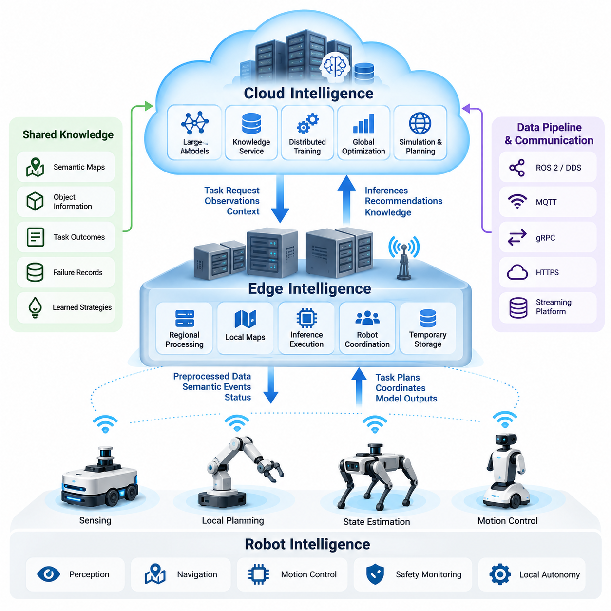
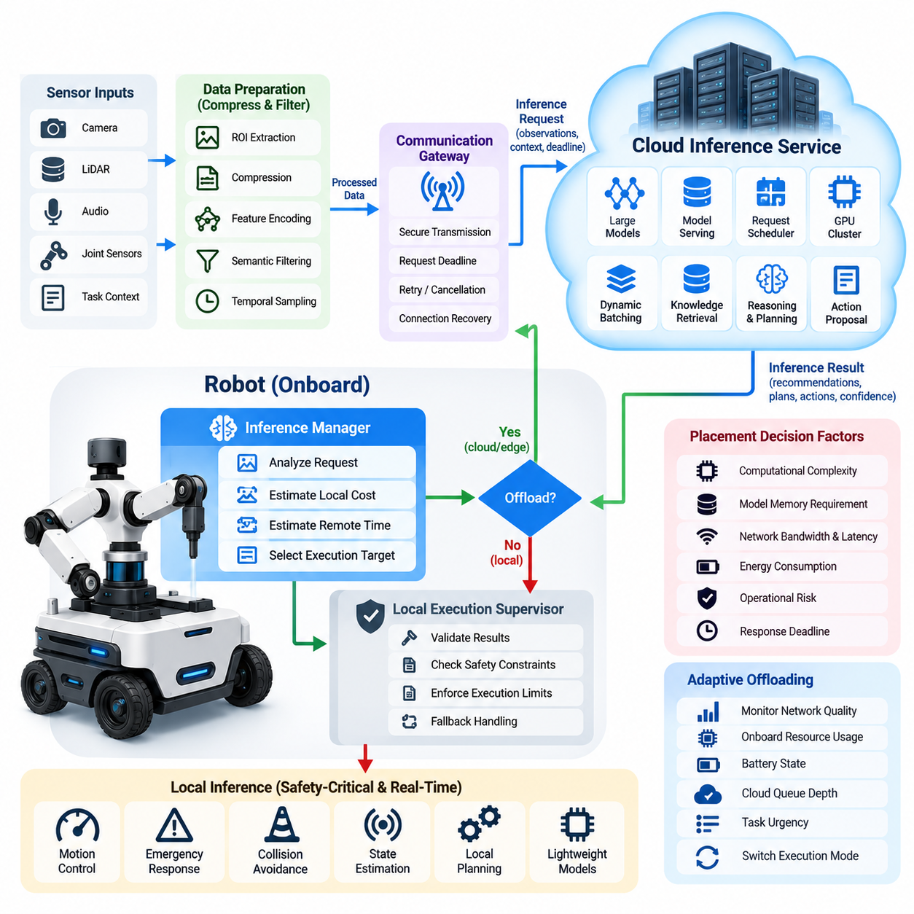
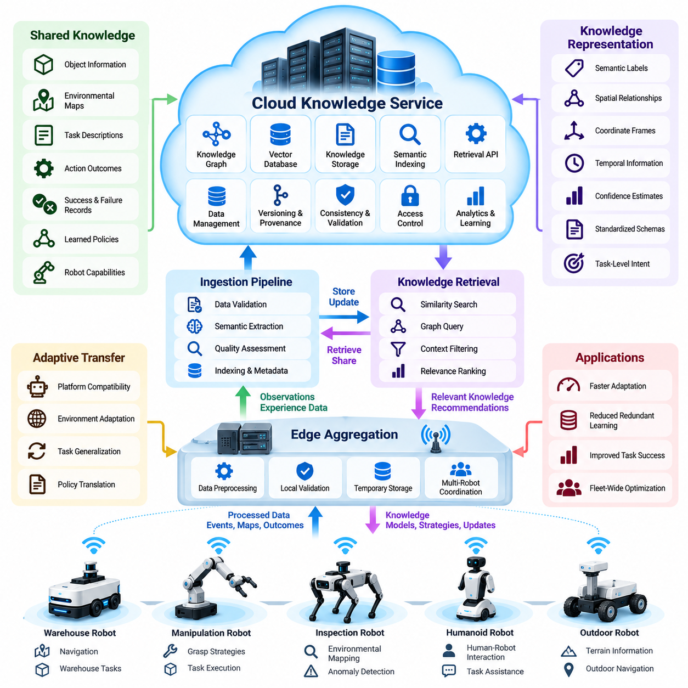
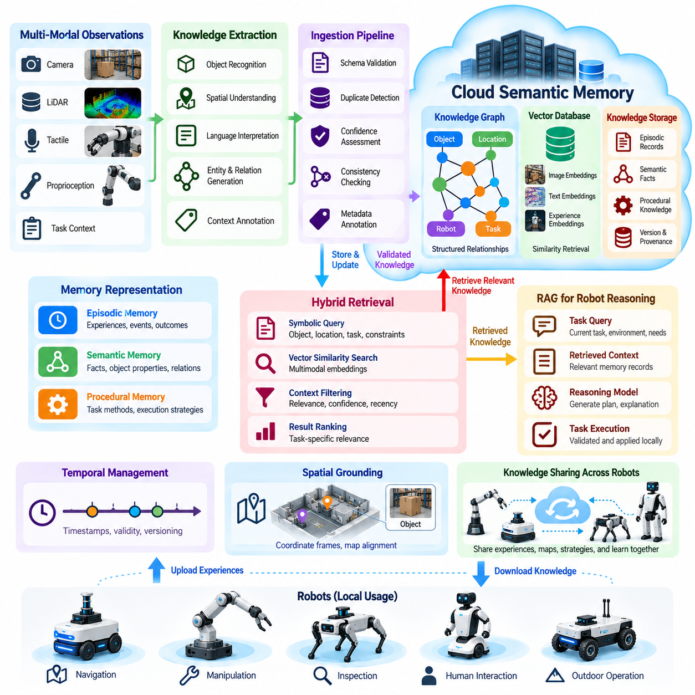
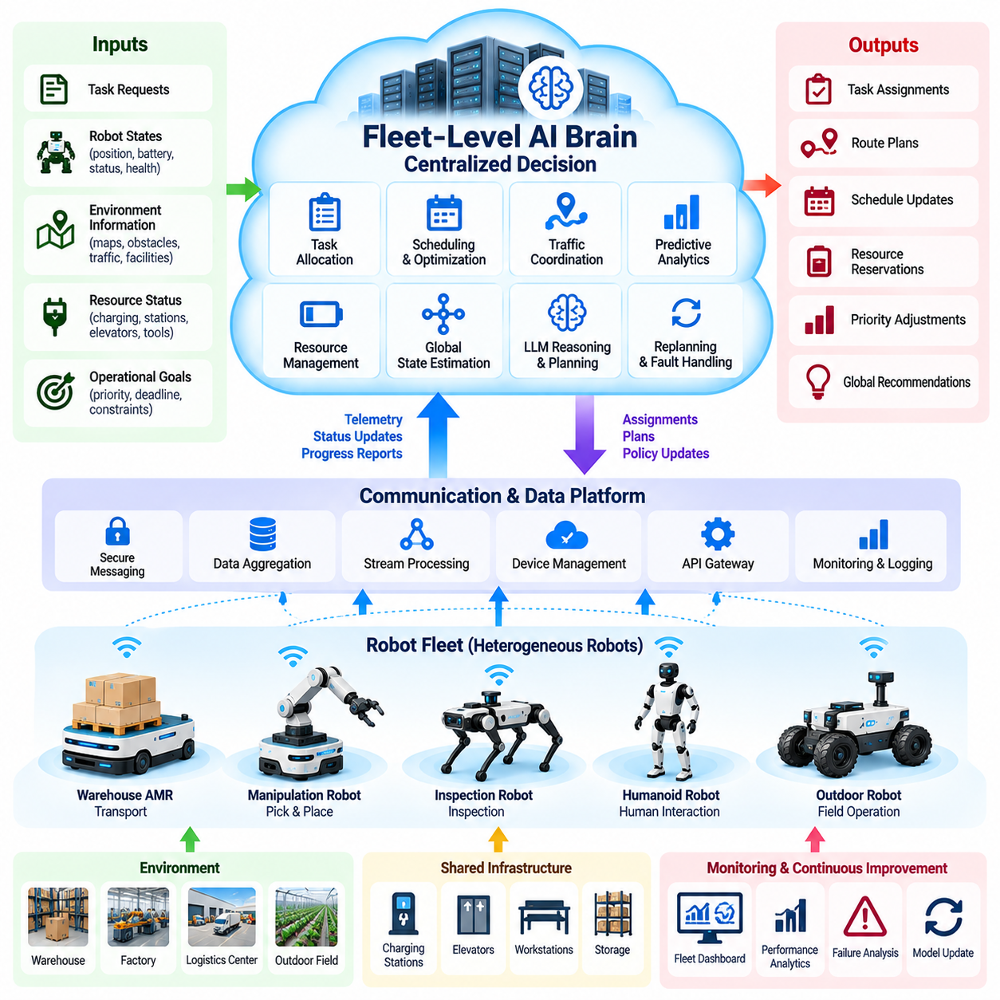
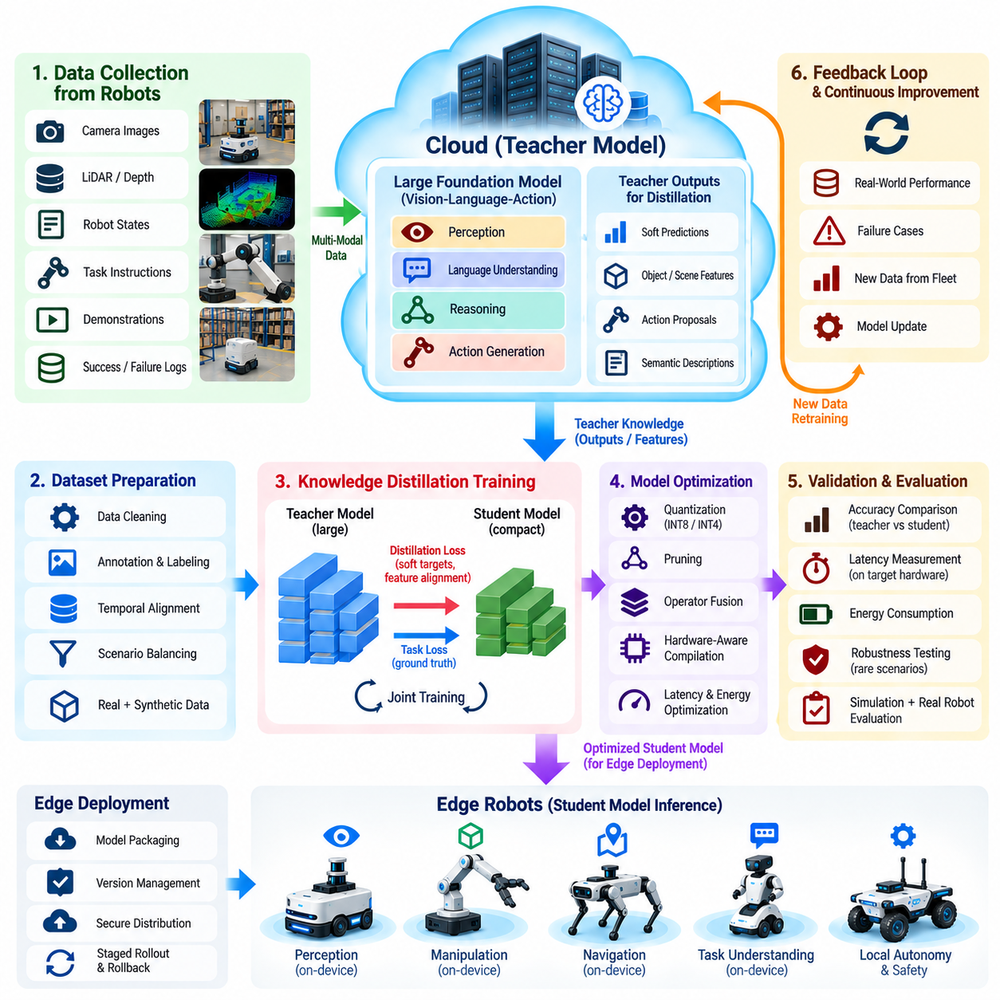
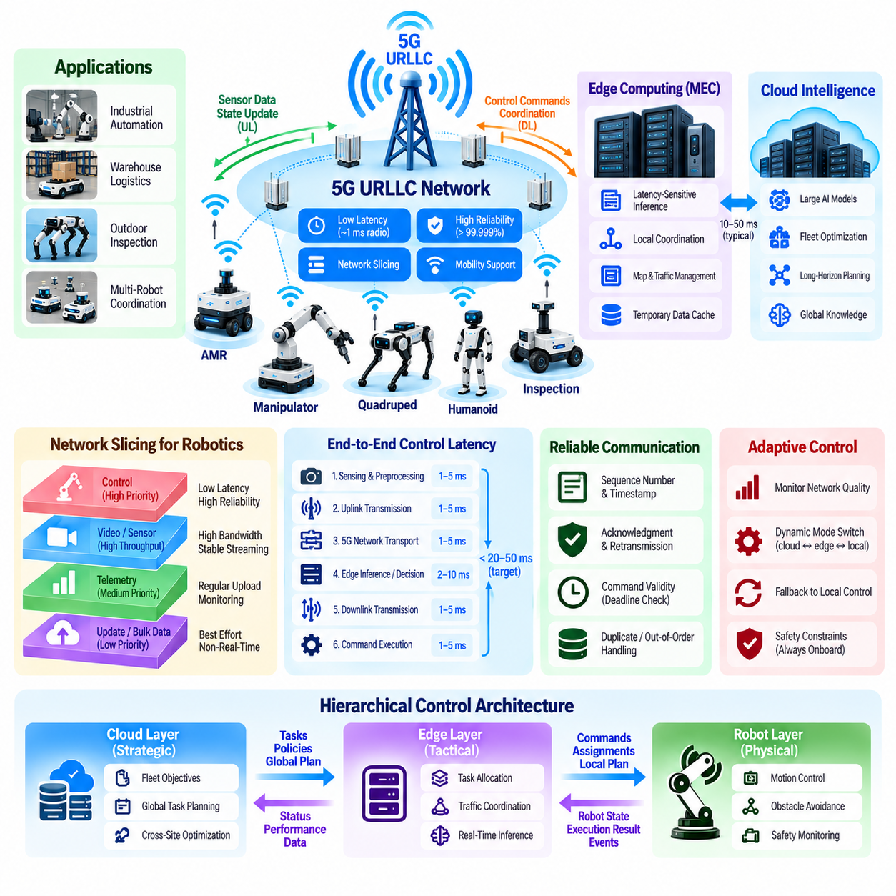
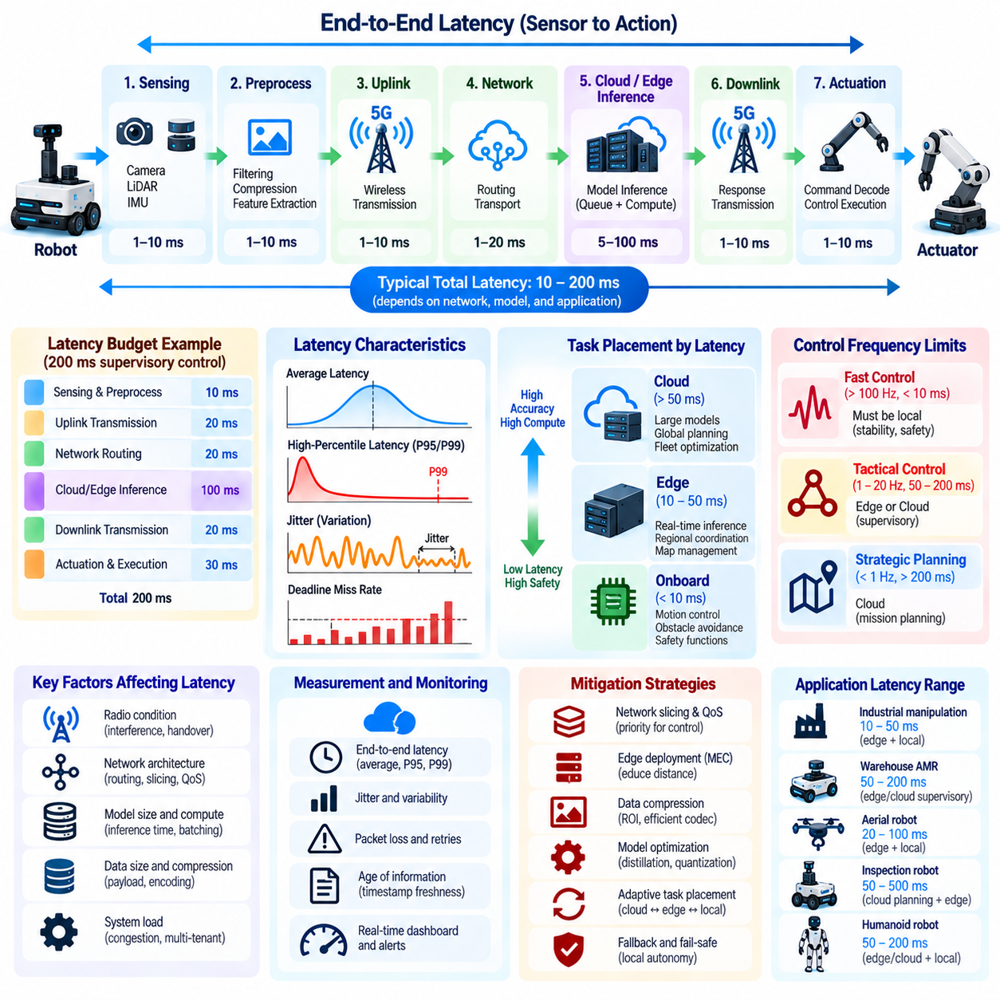
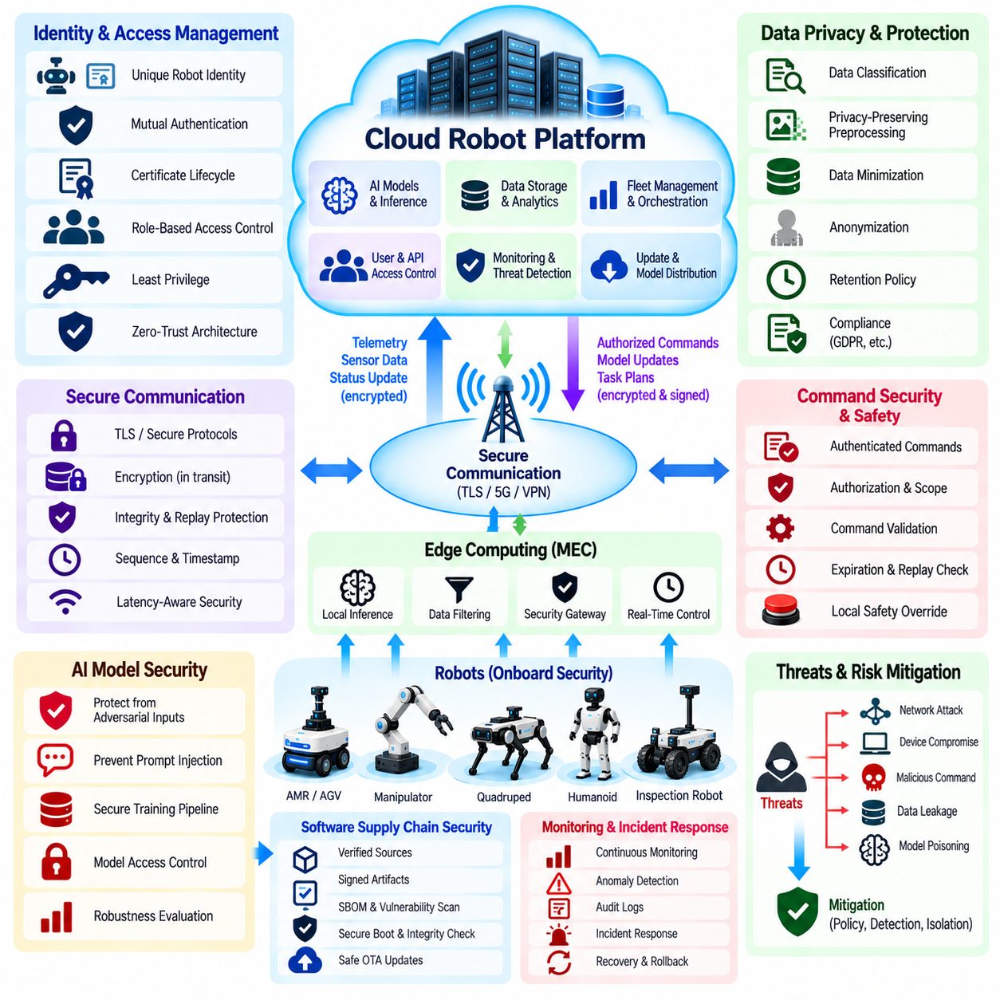
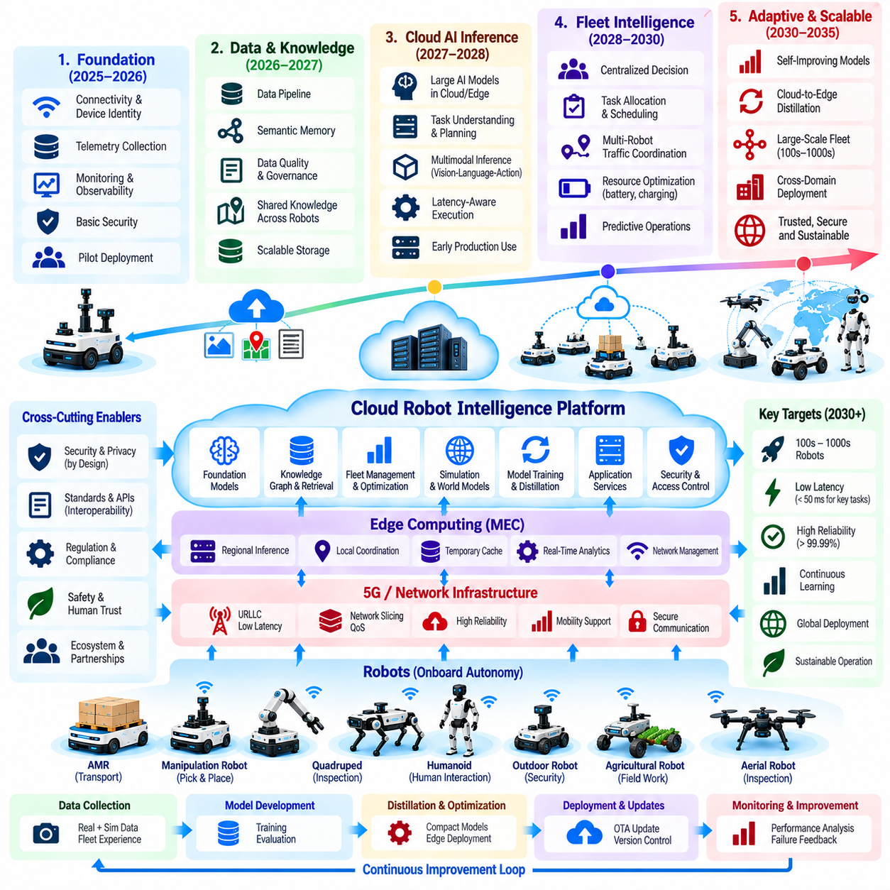

**Volume 27. Future AI Native Robotics**


# Chapter 07. Cloud Robot Intelligence

##  

## 07.01. Cloud Robot Intelligence Architecture Overview

{width="7.268055555555556in" height="7.268055555555556in"}

Cloud robot intelligence represents an architectural evolution in which robotic systems combine local autonomy with remotely accessible artificial intelligence, shared knowledge, and scalable computational resources. Instead of treating each robot as an isolated intelligent machine, the architecture establishes a distributed intelligence environment where individual robots contribute operational experience while benefiting from collective learning and centralized computational capabilities.

The fundamental architectural principle is the separation of intelligence functions according to computational demand, response-time requirements, communication reliability, and safety criticality. Immediate motion control, emergency stopping, and obstacle avoidance remain within the robot or its local edge infrastructure. Computationally intensive reasoning, large-scale learning, semantic knowledge retrieval, and fleet-wide optimization can be assigned to cloud services when communication conditions permit.

A typical cloud robot intelligence architecture contains three cooperating computational domains: robot-level intelligence, edge-level intelligence, and cloud-level intelligence. The robot domain performs sensing, state estimation, local planning, and actuator control. Edge infrastructure provides regional processing, temporary data storage, and communication coordination. Cloud infrastructure supplies large AI models, persistent knowledge services, distributed training, and global operational intelligence.

Robot-level intelligence establishes the minimum autonomous capability required for safe and reliable operation. Embedded processors and onboard accelerators execute perception models, navigation algorithms, motion controllers, and safety monitors. These components must maintain predictable behavior even when external communication becomes unavailable. Local autonomy therefore serves as the operational foundation rather than merely functioning as a lightweight interface to remote intelligence.

Edge-level intelligence occupies an intermediate position between individual robots and centralized cloud platforms. Edge servers can aggregate sensor observations, maintain local environmental maps, execute moderately demanding inference workloads, and coordinate nearby robots. Their physical proximity reduces communication delays and enables localized intelligence sharing without continuously transmitting high-volume sensor streams to distant data centers.

Cloud-level intelligence provides computational elasticity and access to knowledge accumulated across multiple robots, locations, and operational periods. Large foundation models, vision-language-action models, and predictive world models may operate within cloud GPU clusters. Cloud services can also support long-horizon reasoning, task decomposition, policy evaluation, and large-scale simulation. Their outputs must be translated into bounded instructions suitable for execution by local robotic controllers.

The communication architecture connects these computational domains through secure and observable interfaces. Robot middleware, message brokers, streaming platforms, and application programming interfaces transport telemetry, semantic observations, task requests, and model outputs. Communication mechanisms may include ROS 2 gateways, DDS-based local networks, MQTT, gRPC, and HTTPS. Protocol selection depends on message semantics, reliability requirements, bandwidth, and deployment constraints.

Data movement should distinguish high-frequency control information from lower-frequency intelligence information. Raw camera frames, LiDAR point clouds, and tactile measurements may generate substantial communication loads, making continuous cloud transmission impractical. Local preprocessing can convert these observations into compact features, semantic events, or selected evidence. This reduces network consumption while preserving information required for centralized reasoning and learning.

A cloud intelligence request generally begins when the robot identifies a task exceeding its local computational or knowledge capabilities. The onboard system constructs a request containing relevant observations, environmental context, task objectives, and operational constraints. Cloud services perform inference or knowledge retrieval and return structured recommendations. The robot then validates these recommendations against its current state, safety boundaries, and execution permissions.

This interaction introduces an important distinction between remote reasoning and remote control. Cloud-generated plans may describe goals, routes, manipulation sequences, or task priorities, but their execution should remain subject to local feasibility checks. Network latency, outdated observations, and unexpected environmental changes can invalidate otherwise reasonable instructions. Consequently, the architecture should avoid depending on remote responses for safety-critical closed-loop control.

Shared knowledge is another defining capability of cloud robot intelligence. Robots operating in different environments can contribute semantic maps, object descriptions, task outcomes, failure records, and learned manipulation strategies to a common knowledge infrastructure. Other robots may retrieve relevant information when encountering similar situations. This collective memory can reduce repeated exploration and improve task preparation, although transferred knowledge still requires local validation.

Persistent semantic memory extends beyond conventional telemetry storage by preserving relationships among objects, environments, actions, and outcomes. A cloud knowledge service may combine structured databases, vector retrieval systems, and temporal event records. When a robot encounters an unfamiliar operational condition, it can retrieve related experiences and supporting context. Retrieval results should retain provenance, timestamps, confidence estimates, and applicability constraints.

Fleet-level intelligence introduces coordination across many autonomous machines. A centralized optimization service can evaluate task priorities, robot availability, battery conditions, geographic distribution, and operational dependencies. It may recommend task assignments, charging schedules, and resource allocation strategies. Individual robots nevertheless retain responsibility for executing assigned tasks safely, while local fleet services provide continuity when centralized coordination becomes temporarily inaccessible.

Cloud intelligence also enables a continuous improvement process connecting operational experience with AI model development. Robots generate observations and performance records during deployment, while centralized pipelines filter, annotate, and evaluate collected data. Training infrastructure produces candidate models, and validation systems compare them against established performance and safety requirements. Approved models can subsequently be distributed to compatible robotic platforms through controlled deployment mechanisms.

Model distillation provides a practical bridge between powerful cloud intelligence and resource-constrained onboard systems. Large models can generate demonstrations, intermediate representations, or supervisory targets for smaller edge models. These compact models may reproduce selected capabilities with lower memory consumption and inference latency. However, distillation introduces approximation errors, requiring systematic evaluation of accuracy, robustness, uncertainty, and behavior outside the training distribution.

The architecture must explicitly address network uncertainty. Wireless congestion, temporary disconnection, packet loss, and variable round-trip delays can affect remote inference availability. Robots should maintain local operating modes that do not require uninterrupted cloud access. Requests may use deadlines, cancellation mechanisms, bounded retries, and cached responses where appropriate. When communication quality deteriorates, the system should degrade gracefully rather than entering an uncontrolled state.

Latency budgeting is essential for determining which intelligence functions can be remotely executed. Total response time includes observation preparation, network transmission, cloud scheduling, inference execution, return transmission, and local validation. Average latency alone is insufficient because occasional extreme delays may disrupt robotic operations. Designers should evaluate tail latency, deadline violations, request age, and the consequences of receiving a correct response too late.

Scalability requires cloud services to accommodate changing numbers of robots, concurrent inference requests, and geographically distributed deployments. Stateless inference gateways, distributed queues, autoscaling compute pools, and partitioned data services can improve resource utilization. Stateful components such as semantic memory and fleet coordination require additional consistency management. Scaling policies must consider both computational efficiency and the operational importance of individual requests.

Security boundaries extend across robot devices, edge gateways, communication networks, cloud services, and model repositories. Device identity, mutual authentication, encrypted communication, least-privilege authorization, and auditable access controls help protect these boundaries. Remote commands and model artifacts require integrity verification before acceptance. Compromised cloud services must not automatically gain unrestricted authority over physical actuators or safety-critical operating functions.

Privacy and data governance become increasingly important when robots observe workplaces, public environments, or human activities. Cloud intelligence systems should minimize unnecessary collection of identifiable information and establish explicit retention and access policies. Sensitive observations may be processed locally, anonymized, or selectively transmitted. Dataset provenance, geographic restrictions, and permitted secondary uses must be considered throughout the data lifecycle.

Operational observability provides the evidence needed to evaluate distributed intelligence performance. Monitoring systems should correlate robot state, network conditions, cloud request traces, model versions, and task outcomes. Useful measurements include inference response time, cloud availability, task completion rate, fallback frequency, communication cost, and resource utilization. These measurements support fault diagnosis and reveal whether cloud intelligence provides measurable operational improvements.

Digital twins and simulation environments complement the architecture by allowing cloud-generated policies and coordination strategies to be evaluated before physical deployment. Simulated robot fleets can reproduce network delays, environmental disturbances, resource contention, and equipment failures. Results help identify unsafe dependencies and performance bottlenecks. Simulation evidence must nevertheless be supplemented by hardware testing and representative field validation.

A successful cloud robot intelligence platform is ultimately defined by its ability to distribute computation and knowledge without compromising local autonomy. Cloud services expand reasoning capacity, shared memory, and collective learning, while edge and onboard systems preserve responsiveness and physical safety. This separation creates a foundation for increasingly capable AI-native robots that improve through shared experience while remaining dependable under real-world operating constraints.

클라우드 로봇 지능(Cloud Robot Intelligence)은 로봇 시스템이 로컬 자율성(Local Autonomy)과 원격으로 접근할 수 있는 인공지능(Artificial Intelligence), 공유 지식(Shared Knowledge), 확장 가능한 컴퓨팅 자원(Scalable Computing Resources)을 결합하는 아키텍처의 진화를 의미한다. 이 아키텍처는 개별 로봇을 독립적인 지능형 기계로 취급하는 대신, 각 로봇이 운영 경험을 제공하면서 집단 학습(Collective Learning)과 중앙 집중식 연산 능력(Centralized Computational Capabilities)의 혜택을 얻는 분산 지능 환경(Distributed Intelligence Environment)을 구축한다.

기본적인 아키텍처 원칙은 연산 요구량(Computational Demand), 응답 시간 요구사항(Response-Time Requirements), 통신 신뢰성(Communication Reliability), 안전 중요도(Safety Criticality)에 따라 지능 기능을 분리하는 것이다. 즉각적인 모션 제어(Motion Control), 비상 정지(Emergency Stopping), 장애물 회피(Obstacle Avoidance)는 로봇 내부 또는 로컬 엣지 인프라(Local Edge Infrastructure)에 유지된다. 반면 연산 집약적인 추론(Reasoning), 대규모 학습(Large-Scale Learning), 의미 기반 지식 검색(Semantic Knowledge Retrieval), 로봇 군집 전체의 최적화(Fleet-Wide Optimization)는 통신 조건이 허용하는 경우 클라우드 서비스(Cloud Services)에 할당할 수 있다.

일반적인 클라우드 로봇 지능 아키텍처는 로봇 수준 지능(Robot-Level Intelligence), 엣지 수준 지능(Edge-Level Intelligence), 클라우드 수준 지능(Cloud-Level Intelligence)이라는 세 가지 협력적 연산 영역으로 구성된다. 로봇 영역은 센싱(Sensing), 상태 추정(State Estimation), 로컬 경로 계획(Local Planning), 액추에이터 제어(Actuator Control)를 수행한다. 엣지 인프라는 지역별 데이터 처리(Regional Processing), 임시 데이터 저장(Temporary Data Storage), 통신 조정(Communication Coordination)을 제공한다. 클라우드 인프라는 대규모 AI 모델(Large AI Models), 영구 지식 서비스(Persistent Knowledge Services), 분산 학습(Distributed Training), 전역 운영 지능(Global Operational Intelligence)을 지원한다.

로봇 수준 지능은 안전하고 신뢰할 수 있는 작동에 필요한 최소 자율 기능(Minimum Autonomous Capability)을 확립한다. 임베디드 프로세서(Embedded Processors)와 온보드 가속기(Onboard Accelerators)는 인지 모델(Perception Models), 내비게이션 알고리즘(Navigation Algorithms), 모션 제어기(Motion Controllers), 안전 감시기(Safety Monitors)를 실행한다. 이러한 구성요소는 외부 통신이 불가능해지는 상황에서도 예측 가능한 동작을 유지해야 한다. 따라서 로컬 자율성은 원격 지능에 연결되는 단순한 경량 인터페이스(Lightweight Interface)가 아니라 로봇 운영의 기본 토대가 된다.

엣지 수준 지능은 개별 로봇과 중앙 집중식 클라우드 플랫폼(Centralized Cloud Platforms) 사이의 중간 위치를 차지한다. 엣지 서버(Edge Servers)는 센서 관측 데이터(Sensor Observations)를 집계하고, 로컬 환경 지도(Local Environmental Maps)를 유지하며, 중간 수준의 연산을 요구하는 추론 작업(Inference Workloads)을 실행하고, 인접한 로봇들을 조정할 수 있다. 물리적으로 가까운 위치에 배치되므로 통신 지연(Communication Delays)을 줄이고, 대용량 센서 데이터 스트림(High-Volume Sensor Streams)을 원격 데이터센터(Data Centers)에 지속적으로 전송하지 않고도 지역적 지능 공유(Localized Intelligence Sharing)를 가능하게 한다.

클라우드 수준 지능은 연산 자원의 탄력적 확장성(Computational Elasticity)과 여러 로봇, 장소, 운영 기간에 걸쳐 축적된 지식에 대한 접근성을 제공한다. 대규모 파운데이션 모델(Foundation Models), 시각-언어-행동 모델(Vision-Language-Action Models), 예측형 월드 모델(Predictive World Models)은 클라우드 GPU 클러스터(GPU Clusters)에서 실행될 수 있다. 클라우드 서비스는 장기 범위 추론(Long-Horizon Reasoning), 작업 분해(Task Decomposition), 정책 평가(Policy Evaluation), 대규모 시뮬레이션(Large-Scale Simulation)도 지원한다. 이러한 결과는 로컬 로봇 제어기가 실행할 수 있는 제한된 명령(Bounded Instructions)으로 변환되어야 한다.

통신 아키텍처(Communication Architecture)는 안전하고 관측 가능한 인터페이스(Secure and Observable Interfaces)를 통해 이러한 연산 영역들을 연결한다. 로봇 미들웨어(Robot Middleware), 메시지 브로커(Message Brokers), 스트리밍 플랫폼(Streaming Platforms), 응용 프로그래밍 인터페이스(Application Programming Interfaces)는 텔레메트리(Telemetry), 의미 기반 관측 정보(Semantic Observations), 작업 요청(Task Requests), 모델 출력(Model Outputs)을 전달한다. 통신 메커니즘에는 ROS 2 게이트웨이(ROS 2 Gateways), DDS 기반 로컬 네트워크(DDS-Based Local Networks), MQTT, gRPC, HTTPS 등이 포함될 수 있다. 프로토콜 선택은 메시지 의미(Message Semantics), 신뢰성 요구사항(Reliability Requirements), 대역폭(Bandwidth), 배포 제약조건(Deployment Constraints)에 따라 결정된다.

데이터 이동(Data Movement)은 고주파 제어 정보(High-Frequency Control Information)와 상대적으로 낮은 주파수의 지능 정보(Lower-Frequency Intelligence Information)를 구분해야 한다. 원시 카메라 프레임(Raw Camera Frames), LiDAR 포인트 클라우드(LiDAR Point Clouds), 촉각 측정값(Tactile Measurements)은 상당한 통신 부하를 발생시키므로 지속적인 클라우드 전송이 비현실적일 수 있다. 로컬 전처리(Local Preprocessing)는 이러한 관측 데이터를 압축된 특징(Compact Features), 의미 기반 이벤트(Semantic Events), 선별된 증거 데이터(Selected Evidence)로 변환할 수 있다. 이를 통해 중앙 집중식 추론과 학습에 필요한 정보를 유지하면서 네트워크 사용량(Network Consumption)을 줄일 수 있다.

클라우드 지능 요청(Cloud Intelligence Request)은 일반적으로 로봇이 로컬 연산 능력이나 지식 범위를 초과하는 작업을 식별할 때 시작된다. 온보드 시스템(Onboard System)은 관련 관측 정보, 환경 맥락(Environmental Context), 작업 목표(Task Objectives), 운영 제약조건(Operational Constraints)을 포함하는 요청을 구성한다. 클라우드 서비스는 추론(Inference) 또는 지식 검색(Knowledge Retrieval)을 수행하고 구조화된 권고 결과(Structured Recommendations)를 반환한다. 이후 로봇은 현재 상태(Current State), 안전 경계(Safety Boundaries), 실행 권한(Execution Permissions)을 기준으로 해당 결과를 검증한다.

이러한 상호작용은 원격 추론(Remote Reasoning)과 원격 제어(Remote Control) 사이의 중요한 차이를 보여준다. 클라우드에서 생성된 계획은 목표(Goals), 이동 경로(Routes), 조작 순서(Manipulation Sequences), 작업 우선순위(Task Priorities)를 설명할 수 있지만, 실제 실행은 로컬 실행 가능성 검사(Local Feasibility Checks)를 거쳐야 한다. 네트워크 지연(Network Latency), 오래된 관측 정보(Outdated Observations), 예상하지 못한 환경 변화(Unexpected Environmental Changes)는 합리적으로 보이는 명령도 무효화할 수 있다. 따라서 아키텍처는 안전 필수 폐루프 제어(Safety-Critical Closed-Loop Control)가 원격 응답에 의존하지 않도록 설계해야 한다.

공유 지식(Shared Knowledge)은 클라우드 로봇 지능을 정의하는 또 다른 핵심 기능이다. 서로 다른 환경에서 작동하는 로봇들은 의미 지도(Semantic Maps), 객체 설명(Object Descriptions), 작업 결과(Task Outcomes), 고장 기록(Failure Records), 학습된 조작 전략(Learned Manipulation Strategies)을 공통 지식 인프라(Common Knowledge Infrastructure)에 제공할 수 있다. 다른 로봇들은 유사한 상황을 마주할 때 관련 정보를 검색하여 활용할 수 있다. 이러한 집단 기억(Collective Memory)은 반복적인 탐색을 줄이고 작업 준비 효율을 높일 수 있지만, 전달된 지식은 여전히 로컬 검증(Local Validation)을 필요로 한다.

영구 의미 기억(Persistent Semantic Memory)은 객체, 환경, 행동, 결과 사이의 관계를 보존함으로써 기존 텔레메트리 저장(Telemetry Storage)의 범위를 확장한다. 클라우드 지식 서비스(Cloud Knowledge Service)는 구조화된 데이터베이스(Structured Databases), 벡터 검색 시스템(Vector Retrieval Systems), 시간 기반 이벤트 기록(Temporal Event Records)을 결합할 수 있다. 로봇이 익숙하지 않은 운영 조건을 마주하면 관련 경험과 지원 맥락(Supporting Context)을 검색할 수 있다. 검색 결과에는 출처 정보(Provenance), 타임스탬프(Timestamps), 신뢰도 추정값(Confidence Estimates), 적용 가능성 제약조건(Applicability Constraints)이 유지되어야 한다.

로봇 군집 수준 지능(Fleet-Level Intelligence)은 다수의 자율 기계(Autonomous Machines)에 걸친 조정을 가능하게 한다. 중앙 집중식 최적화 서비스(Centralized Optimization Service)는 작업 우선순위, 로봇 가용성(Robot Availability), 배터리 상태(Battery Conditions), 지리적 분포(Geographic Distribution), 운영 의존성(Operational Dependencies)을 평가할 수 있다. 이를 통해 작업 할당(Task Assignments), 충전 일정(Charging Schedules), 자원 배분(Resource Allocation) 전략을 권고할 수 있다. 그러나 개별 로봇은 할당된 작업을 안전하게 실행할 책임을 유지하며, 로컬 군집 서비스(Local Fleet Services)는 중앙 집중식 조정이 일시적으로 불가능할 때 운영 연속성을 제공한다.

클라우드 지능은 운영 경험과 AI 모델 개발을 연결하는 지속적 개선 프로세스(Continuous Improvement Process)도 가능하게 한다. 로봇은 실제 배포 환경에서 관측 데이터와 성능 기록(Performance Records)을 생성하며, 중앙 집중식 파이프라인(Centralized Pipelines)은 수집된 데이터를 필터링(Filtering), 어노테이션(Annotation), 평가(Evaluation)한다. 학습 인프라(Training Infrastructure)는 후보 모델(Candidate Models)을 생성하고, 검증 시스템(Validation Systems)은 기존 성능 및 안전 요구사항과 비교한다. 승인된 모델은 통제된 배포 메커니즘(Controlled Deployment Mechanisms)을 통해 호환 가능한 로봇 플랫폼에 전달될 수 있다.

모델 증류(Model Distillation)는 강력한 클라우드 지능과 자원이 제한된 온보드 시스템(Resource-Constrained Onboard Systems)을 연결하는 실용적인 방법이다. 대규모 모델은 소형 엣지 모델(Smaller Edge Models)을 위한 시연 데이터(Demonstrations), 중간 표현(Intermediate Representations), 지도 학습 목표(Supervisory Targets)를 생성할 수 있다. 이러한 경량 모델(Compact Models)은 더 적은 메모리 사용량(Memory Consumption)과 추론 지연(Inference Latency)으로 특정 기능을 재현할 수 있다. 그러나 증류 과정에서는 근사 오차(Approximation Errors)가 발생하므로 정확도(Accuracy), 강건성(Robustness), 불확실성(Uncertainty), 학습 분포 외부 동작(Out-of-Distribution Behavior)에 대한 체계적인 평가가 필요하다.

아키텍처는 네트워크 불확실성(Network Uncertainty)을 명시적으로 처리해야 한다. 무선 혼잡(Wireless Congestion), 일시적 연결 중단(Temporary Disconnection), 패킷 손실(Packet Loss), 가변적인 왕복 지연(Variable Round-Trip Delays)은 원격 추론의 가용성(Remote Inference Availability)에 영향을 줄 수 있다. 로봇은 클라우드에 지속적으로 연결되지 않아도 작동할 수 있는 로컬 운영 모드(Local Operating Modes)를 유지해야 한다. 요청에는 적절한 기한(Deadlines), 취소 메커니즘(Cancellation Mechanisms), 제한된 재시도(Bounded Retries), 캐시된 응답(Cached Responses)을 적용할 수 있다. 통신 품질이 악화되면 시스템은 제어 불가능한 상태에 진입하는 대신 기능을 단계적으로 축소하는 우아한 성능 저하(Graceful Degradation)를 수행해야 한다.

지연 예산(Latency Budgeting)은 어떤 지능 기능을 원격으로 실행할 수 있는지 결정하는 데 필수적이다. 전체 응답 시간(Total Response Time)에는 관측 데이터 준비(Observation Preparation), 네트워크 전송(Network Transmission), 클라우드 스케줄링(Cloud Scheduling), 추론 실행(Inference Execution), 결과 반환(Return Transmission), 로컬 검증(Local Validation)이 포함된다. 평균 지연(Average Latency)만으로는 충분하지 않으며, 간헐적으로 발생하는 극단적인 지연이 로봇 운영을 방해할 수 있다. 설계자는 꼬리 지연(Tail Latency), 기한 위반(Deadline Violations), 요청 경과 시간(Request Age), 정확한 응답이 너무 늦게 도착했을 때의 결과를 평가해야 한다.

확장성(Scalability)은 클라우드 서비스가 변화하는 로봇 수, 동시 추론 요청(Concurrent Inference Requests), 지리적으로 분산된 배포 환경(Geographically Distributed Deployments)을 수용할 수 있도록 요구한다. 무상태 추론 게이트웨이(Stateless Inference Gateways), 분산 큐(Distributed Queues), 자동 확장 연산 자원 풀(Autoscaling Compute Pools), 분할된 데이터 서비스(Partitioned Data Services)는 자원 활용 효율(Resource Utilization)을 개선할 수 있다. 의미 기억과 군집 조정처럼 상태를 유지하는 구성요소(Stateful Components)는 추가적인 일관성 관리(Consistency Management)가 필요하다. 확장 정책(Scaling Policies)은 연산 효율성과 개별 요청의 운영 중요성을 함께 고려해야 한다.

보안 경계(Security Boundaries)는 로봇 장치, 엣지 게이트웨이(Edge Gateways), 통신 네트워크, 클라우드 서비스, 모델 저장소(Model Repositories) 전반에 걸쳐 형성된다. 장치 신원(Device Identity), 상호 인증(Mutual Authentication), 암호화 통신(Encrypted Communication), 최소 권한 인가(Least-Privilege Authorization), 감사 가능한 접근 제어(Auditable Access Controls)는 이러한 경계를 보호하는 데 도움이 된다. 원격 명령(Remote Commands)과 모델 산출물(Model Artifacts)은 수락 전에 무결성 검증(Integrity Verification)을 거쳐야 한다. 침해된 클라우드 서비스(Compromised Cloud Services)가 물리적 액추에이터나 안전 필수 운영 기능에 무제한 접근 권한을 자동으로 획득해서는 안 된다.

개인정보 보호(Privacy)와 데이터 거버넌스(Data Governance)는 로봇이 작업장, 공공 환경, 인간 활동을 관측할 때 더욱 중요해진다. 클라우드 지능 시스템은 개인 식별 정보(Identifiable Information)의 불필요한 수집을 최소화하고 명시적인 보존 정책(Retention Policies)과 접근 정책(Access Policies)을 수립해야 한다. 민감한 관측 정보(Sensitive Observations)는 로컬에서 처리하거나 익명화(Anonymization)하거나 선택적으로 전송할 수 있다. 데이터 수명주기(Data Lifecycle) 전반에서 데이터셋 출처(Dataset Provenance), 지리적 제한(Geographic Restrictions), 허용된 2차 활용(Permitted Secondary Uses)을 고려해야 한다.

운영 관측 가능성(Operational Observability)은 분산 지능(Distributed Intelligence)의 성능을 평가하는 데 필요한 증거를 제공한다. 모니터링 시스템(Monitoring Systems)은 로봇 상태(Robot State), 네트워크 조건(Network Conditions), 클라우드 요청 추적 정보(Cloud Request Traces), 모델 버전(Model Versions), 작업 결과(Task Outcomes)를 상호 연관시켜야 한다. 유용한 측정 지표에는 추론 응답 시간(Inference Response Time), 클라우드 가용성(Cloud Availability), 작업 완료율(Task Completion Rate), 대체 운영 모드 전환 빈도(Fallback Frequency), 통신 비용(Communication Cost), 자원 활용률(Resource Utilization)이 포함된다. 이러한 지표는 고장 진단(Fault Diagnosis)을 지원하고 클라우드 지능이 실제 운영 개선 효과를 제공하는지 판단하는 근거가 된다.

디지털 트윈(Digital Twins)과 시뮬레이션 환경(Simulation Environments)은 클라우드에서 생성된 정책과 조정 전략을 실제 배포 전에 평가할 수 있도록 아키텍처를 보완한다. 시뮬레이션된 로봇 군집(Simulated Robot Fleets)은 네트워크 지연, 환경 교란(Environmental Disturbances), 자원 경합(Resource Contention), 장비 고장(Equipment Failures)을 재현할 수 있다. 이러한 결과는 안전하지 않은 의존성(Unsafe Dependencies)과 성능 병목현상(Performance Bottlenecks)을 식별하는 데 도움이 된다. 그러나 시뮬레이션 증거(Simulation Evidence)는 하드웨어 시험(Hardware Testing)과 대표적인 현장 검증(Representative Field Validation)을 통해 보완되어야 한다.

성공적인 클라우드 로봇 지능 플랫폼(Cloud Robot Intelligence Platform)은 로컬 자율성을 손상시키지 않으면서 연산과 지식을 분산할 수 있는 능력으로 평가된다. 클라우드 서비스는 추론 능력(Reasoning Capacity), 공유 기억(Shared Memory), 집단 학습(Collective Learning)을 확장하고, 엣지 및 온보드 시스템은 응답성(Responsiveness)과 물리적 안전성(Physical Safety)을 유지한다. 이러한 기능 분리는 실제 운영 환경의 제약조건에서도 신뢰성을 유지하면서 공유 경험(Shared Experience)을 통해 지속적으로 발전하는 고도화된 AI 네이티브 로봇(AI-Native Robots)을 위한 기반을 형성한다.

##  

## 07.02. Offloading Heavy Inference to Cloud Design [w/Code]

{width="7.268055555555556in" height="7.268055555555556in"}

Offloading heavy inference to the cloud is a fundamental design strategy for extending robot intelligence beyond the computational limits of onboard processors. Modern robotic applications increasingly require large foundation models, vision-language-action models, and predictive world models that demand substantial memory and processing capacity. Cloud offloading enables robots to access these capabilities while preserving lightweight, responsive, and energy-efficient local execution.

The central architectural challenge is determining which inference workloads should remain onboard and which can safely execute remotely. Real-time motor control, emergency response, collision avoidance, and critical state estimation must remain independent of cloud connectivity. Computationally demanding semantic reasoning, scene interpretation, long-horizon planning, and knowledge-intensive decision support are more suitable for remote execution when their timing requirements permit network communication.

A practical inference offloading architecture consists of an onboard inference manager, communication gateway, cloud inference service, and local execution supervisor. The inference manager evaluates incoming computational requests and selects an execution destination. The communication gateway handles secure data transmission, while cloud services execute selected AI models. The local supervisor validates returned results before allowing them to influence robot behavior.

Inference placement decisions should consider computational complexity, model memory requirements, network bandwidth, communication latency, energy consumption, and operational risk. A large multimodal model may provide superior reasoning accuracy but require several gigabytes of accelerator memory. Executing the model remotely can reduce onboard hardware requirements, although communication delays and cloud service availability introduce additional dependencies that must be explicitly managed.

A useful design approach classifies inference workloads according to their response deadlines and consequences of failure. Safety-critical inference remains local, while latency-tolerant analytical tasks may execute in the cloud. Intermediate workloads can use edge servers positioned near operating environments. This classification should reflect measured end-to-end response times rather than relying solely on theoretical processor performance or nominal network speed.

The offloading process begins when an onboard application submits an inference request containing sensor observations, task context, model requirements, and an execution deadline. The inference manager estimates local processing cost and expected remote completion time. If cloud execution offers an acceptable performance advantage within the specified deadline, the request is transmitted to a remote service. Otherwise, the system selects a local model or an alternative operating strategy.

Data preparation is essential because transmitting raw sensor streams can eliminate the computational advantages of remote inference. High-resolution camera images, LiDAR point clouds, and synchronized multimodal observations may consume significant bandwidth. Robots can reduce transmission volume through region-of-interest extraction, image compression, feature encoding, temporal sampling, and semantic filtering. These transformations must preserve information necessary for reliable inference.

Cloud inference services typically operate on GPU clusters equipped with model-serving frameworks, request schedulers, and resource management systems. Incoming requests are authenticated, assigned to appropriate model instances, and processed according to workload priorities. Dynamic batching can improve accelerator utilization by combining compatible requests. However, batching delays must remain bounded when requests originate from robots with operational deadlines.

Large model execution may involve multiple processing stages, including visual encoding, language interpretation, contextual retrieval, reasoning, and action proposal generation. Separating these stages allows different computational resources to serve different functions. A cloud platform may cache reusable visual embeddings or retrieve previously established environmental knowledge. Such optimizations reduce repeated computation but require careful management of context validity and data freshness.

Communication latency is a decisive constraint in cloud inference design. Total response time includes request preparation, uplink transmission, service queuing, model execution, downlink transmission, and onboard validation. Even when cloud inference executes faster than local processing, network and scheduling overhead may eliminate the advantage. Engineers should measure end-to-end latency distributions, including high-percentile delays, rather than comparing inference execution times alone.

Network conditions vary considerably across industrial facilities, outdoor environments, and mobile robotic deployments. Wireless interference, handovers, congestion, and intermittent connectivity can disrupt inference requests. The communication subsystem should support request deadlines, cancellation, bounded retries, and connection recovery. Requests associated with changing physical environments must also include timestamps so that robots can reject responses based on observations that are no longer valid.

Adaptive offloading allows execution placement to change dynamically as operating conditions evolve. The inference manager can monitor network quality, onboard accelerator utilization, battery state, cloud queue depth, and task urgency. When connectivity is strong and remote resources are available, complex reasoning may execute in the cloud. When conditions deteriorate, the robot can switch to smaller local models or reduce the complexity of its requested tasks.

Hybrid inference provides another mechanism for balancing intelligence and responsiveness. An onboard model may perform rapid object detection and preliminary scene understanding, while a cloud model performs deeper semantic interpretation. The robot can continue local navigation while awaiting remote reasoning results. This asynchronous architecture prevents high-level inference from blocking time-sensitive control loops and enables cloud intelligence to augment rather than replace local autonomy.

Model partitioning can distribute individual neural network computations between onboard and remote resources. Early network layers may execute locally to extract compact intermediate features, while later layers execute in the cloud. This approach can reduce transmitted data volume under suitable model architectures. Nevertheless, partition boundaries must be evaluated carefully because intermediate representations may remain large, contain sensitive information, or require expensive serialization.

Cloud-generated outputs should be treated as proposals rather than unrestricted actuator commands. A remote model may recommend navigation goals, manipulation sequences, object identities, or task strategies, but local controllers must verify feasibility and safety. Validation includes checking workspace constraints, obstacle proximity, robot capabilities, confidence estimates, and current environmental conditions. Commands that violate operational boundaries must be rejected regardless of model confidence.

Fallback behavior is a mandatory architectural consideration. If a cloud inference request exceeds its deadline or the service becomes unavailable, the robot must transition to a defined local operating mode. Depending on the application, this may involve executing a smaller model, continuing a previously validated task, requesting human assistance, or entering a safe state. Fallback decisions should be deterministic where safety requires predictable behavior.

Cloud inference security requires strong authentication, encrypted communication, model access controls, and integrity protection for requests and responses. Sensitive camera observations and operational data should be minimized before transmission whenever possible. Cloud services must isolate requests from different robots or customers and enforce authorization boundaries. Model outputs should carry identifiable version information to support auditing, debugging, and operational traceability.

Resource allocation becomes increasingly important when hundreds or thousands of robots share cloud inference infrastructure. Concurrent requests can create GPU contention, queue delays, and unpredictable response times. Scheduling policies may account for task urgency, computational cost, service priority, and deadline constraints. Admission control can reject workloads that cannot meet their requirements, preventing overloaded services from producing late responses with little operational value.

Cost optimization must consider both computational expenses and communication infrastructure. Cloud GPU execution, data transfer, persistent model hosting, and network connectivity contribute to operating costs. Frequent remote inference may become economically inefficient when local accelerators can perform equivalent tasks. Engineers should compare cost per successful task, energy consumption, latency, and model quality when selecting between onboard, edge, and cloud execution.

Testing an inference offloading architecture requires more than evaluating model accuracy. Validation environments should reproduce network congestion, packet loss, cloud overload, service interruption, and rapidly changing robot observations. Hardware-in-the-loop testing can measure how delayed or incorrect remote responses influence physical behavior. Acceptance criteria should include deadline compliance, fallback reliability, safety boundary enforcement, and recovery following communication failures.

Production monitoring should continuously measure inference request frequency, response latency, cloud utilization, network consumption, model accuracy, and fallback events. Distributed tracing can connect onboard requests with cloud execution records and final task outcomes. These measurements reveal whether remote inference improves operational performance under actual deployment conditions. They also provide evidence for adjusting placement policies, capacity planning, and model optimization.

The long-term objective of cloud inference offloading is to establish an intelligent computational hierarchy in which each workload executes at the most appropriate location. Robots retain immediate physical autonomy, edge systems provide regional responsiveness, and cloud infrastructure delivers large-scale reasoning and shared intelligence. Successful designs combine adaptive execution placement, reliable communication, bounded latency, and independent safety enforcement to achieve scalable AI-native robotic operation.

고부하 추론의 클라우드 오프로딩(Offloading Heavy Inference to the Cloud)은 온보드 프로세서(Onboard Processors)의 연산 한계를 넘어 로봇 지능(Robot Intelligence)을 확장하기 위한 핵심 설계 전략이다. 현대 로봇 응용 분야에서는 상당한 메모리와 처리 능력을 요구하는 대규모 파운데이션 모델(Foundation Models), 시각-언어-행동 모델(Vision-Language-Action Models), 예측형 월드 모델(Predictive World Models)의 필요성이 증가하고 있다. 클라우드 오프로딩(Cloud Offloading)을 통해 로봇은 경량화되고 응답성이 높으며 에너지 효율적인 로컬 실행(Local Execution)을 유지하면서 이러한 고급 지능 기능을 활용할 수 있다.

핵심적인 아키텍처 설계 과제(Architectural Design Challenge)는 어떤 추론 작업(Inference Workloads)을 온보드에 유지하고 어떤 작업을 원격에서 안전하게 실행할 수 있는지 결정하는 것이다. 실시간 모터 제어(Real-Time Motor Control), 비상 대응(Emergency Response), 충돌 회피(Collision Avoidance), 핵심 상태 추정(Critical State Estimation)은 클라우드 연결(Cloud Connectivity)에 의존하지 않아야 한다. 반면 연산 요구량이 높은 의미 기반 추론(Semantic Reasoning), 장면 해석(Scene Interpretation), 장기 범위 계획(Long-Horizon Planning), 지식 집약적 의사결정 지원(Knowledge-Intensive Decision Support)은 시간 요구사항이 네트워크 통신을 허용하는 경우 원격 실행에 더 적합하다.

실용적인 추론 오프로딩 아키텍처(Inference Offloading Architecture)는 온보드 추론 관리자(Onboard Inference Manager), 통신 게이트웨이(Communication Gateway), 클라우드 추론 서비스(Cloud Inference Service), 로컬 실행 감독기(Local Execution Supervisor)로 구성된다. 추론 관리자는 입력되는 연산 요청을 평가하고 실행 위치(Execution Destination)를 선택한다. 통신 게이트웨이는 안전한 데이터 전송(Secure Data Transmission)을 담당하고, 클라우드 서비스는 선택된 AI 모델을 실행한다. 로컬 실행 감독기는 반환된 결과가 로봇 동작에 영향을 미치도록 허용하기 전에 해당 결과를 검증한다.

추론 배치 결정(Inference Placement Decisions)은 연산 복잡도(Computational Complexity), 모델 메모리 요구사항(Model Memory Requirements), 네트워크 대역폭(Network Bandwidth), 통신 지연(Communication Latency), 에너지 소비(Energy Consumption), 운영 위험(Operational Risk)을 고려해야 한다. 대규모 멀티모달 모델(Large Multimodal Model)은 우수한 추론 정확도(Reasoning Accuracy)를 제공할 수 있지만 수 기가바이트의 가속기 메모리(Accelerator Memory)를 요구할 수 있다. 모델을 원격으로 실행하면 온보드 하드웨어 요구사항을 줄일 수 있지만, 통신 지연과 클라우드 서비스 가용성(Cloud Service Availability)에 따른 추가적인 의존성을 명시적으로 관리해야 한다.

효과적인 설계 접근법은 추론 작업을 응답 기한(Response Deadlines)과 실패 결과(Consequences of Failure)에 따라 분류하는 것이다. 안전 필수 추론(Safety-Critical Inference)은 로컬에 유지하고, 지연을 허용할 수 있는 분석 작업(Latency-Tolerant Analytical Tasks)은 클라우드에서 실행할 수 있다. 중간 수준의 작업은 운영 환경 가까이에 배치된 엣지 서버(Edge Servers)를 활용할 수 있다. 이러한 분류는 이론적인 프로세서 성능(Theoretical Processor Performance)이나 명목상 네트워크 속도(Nominal Network Speed)에만 의존하지 않고 실제 측정된 종단 간 응답 시간(End-to-End Response Times)을 반영해야 한다.

오프로딩 프로세스(Offloading Process)는 온보드 애플리케이션(Onboard Application)이 센서 관측 정보(Sensor Observations), 작업 맥락(Task Context), 모델 요구사항(Model Requirements), 실행 기한(Execution Deadline)을 포함한 추론 요청을 제출하면서 시작된다. 추론 관리자는 로컬 처리 비용(Local Processing Cost)과 예상 원격 완료 시간(Expected Remote Completion Time)을 추정한다. 클라우드 실행이 지정된 기한 내에서 허용 가능한 성능상의 이점(Performance Advantage)을 제공하면 요청을 원격 서비스로 전송한다. 그렇지 않으면 로컬 모델(Local Model)이나 대체 운영 전략(Alternative Operating Strategy)을 선택한다.

데이터 준비(Data Preparation)는 원시 센서 스트림(Raw Sensor Streams)의 전송이 원격 추론의 연산상 이점을 상쇄할 수 있기 때문에 필수적이다. 고해상도 카메라 영상(High-Resolution Camera Images), LiDAR 포인트 클라우드(LiDAR Point Clouds), 동기화된 멀티모달 관측 데이터(Synchronized Multimodal Observations)는 상당한 대역폭을 소비할 수 있다. 로봇은 관심 영역 추출(Region-of-Interest Extraction), 영상 압축(Image Compression), 특징 인코딩(Feature Encoding), 시간적 샘플링(Temporal Sampling), 의미 기반 필터링(Semantic Filtering)을 통해 전송 데이터량을 줄일 수 있다. 이러한 변환은 신뢰할 수 있는 추론에 필요한 정보를 보존해야 한다.

클라우드 추론 서비스(Cloud Inference Services)는 일반적으로 모델 서빙 프레임워크(Model-Serving Frameworks), 요청 스케줄러(Request Schedulers), 자원 관리 시스템(Resource Management Systems)을 갖춘 GPU 클러스터(GPU Clusters)에서 운영된다. 입력 요청은 인증(Authentication)을 거쳐 적절한 모델 인스턴스(Model Instances)에 할당되고 작업 우선순위(Workload Priorities)에 따라 처리된다. 동적 배칭(Dynamic Batching)은 호환 가능한 요청을 결합하여 가속기 활용률(Accelerator Utilization)을 높일 수 있다. 그러나 로봇의 운영 기한이 설정된 요청에서는 배칭 지연(Batching Delays)이 제한된 범위 내에서 유지되어야 한다.

대규모 모델 실행(Large Model Execution)은 시각 인코딩(Visual Encoding), 언어 해석(Language Interpretation), 맥락 검색(Contextual Retrieval), 추론(Reasoning), 행동 제안 생성(Action Proposal Generation)을 포함하는 여러 처리 단계로 구성될 수 있다. 이러한 단계를 분리하면 서로 다른 연산 자원(Computational Resources)이 각 기능을 담당할 수 있다. 클라우드 플랫폼은 재사용 가능한 시각 임베딩(Visual Embeddings)을 캐싱(Caching)하거나 이전에 구축된 환경 지식(Environmental Knowledge)을 검색할 수 있다. 이러한 최적화는 반복 연산을 줄이지만 맥락 유효성(Context Validity)과 데이터 최신성(Data Freshness)을 신중하게 관리해야 한다.

통신 지연(Communication Latency)은 클라우드 추론 설계(Cloud Inference Design)에서 결정적인 제약조건이다. 전체 응답 시간(Total Response Time)에는 요청 준비(Request Preparation), 업링크 전송(Uplink Transmission), 서비스 대기열 처리(Service Queuing), 모델 실행(Model Execution), 다운링크 전송(Downlink Transmission), 온보드 검증(Onboard Validation)이 포함된다. 클라우드 추론이 로컬 처리보다 빠르게 실행되더라도 네트워크 및 스케줄링 오버헤드(Network and Scheduling Overhead)가 그 이점을 상쇄할 수 있다. 엔지니어는 추론 실행 시간만 비교하지 않고 높은 백분위수 지연(High-Percentile Delays)을 포함한 종단 간 지연 분포(End-to-End Latency Distributions)를 측정해야 한다.

네트워크 조건(Network Conditions)은 산업 시설, 실외 환경, 이동형 로봇 배포 환경(Mobile Robotic Deployments)에 따라 크게 달라진다. 무선 간섭(Wireless Interference), 핸드오버(Handovers), 혼잡(Congestion), 간헐적인 연결(Intermittent Connectivity)은 추론 요청을 방해할 수 있다. 통신 하위 시스템(Communication Subsystem)은 요청 기한(Request Deadlines), 취소(Cancellation), 제한된 재시도(Bounded Retries), 연결 복구(Connection Recovery)를 지원해야 한다. 변화하는 물리적 환경과 관련된 요청에는 타임스탬프(Timestamps)를 포함하여 로봇이 더 이상 유효하지 않은 관측 정보에 기반한 응답을 거부할 수 있도록 해야 한다.

적응형 오프로딩(Adaptive Offloading)은 운영 조건의 변화에 따라 실행 위치(Execution Placement)를 동적으로 변경할 수 있도록 한다. 추론 관리자는 네트워크 품질(Network Quality), 온보드 가속기 활용률(Onboard Accelerator Utilization), 배터리 상태(Battery State), 클라우드 대기열 깊이(Cloud Queue Depth), 작업 긴급도(Task Urgency)를 모니터링할 수 있다. 연결 상태가 양호하고 원격 자원을 사용할 수 있으면 복잡한 추론을 클라우드에서 실행할 수 있다. 반대로 조건이 악화되면 로봇은 더 작은 로컬 모델로 전환하거나 요청하는 작업의 복잡도를 줄일 수 있다.

하이브리드 추론(Hybrid Inference)은 지능 수준과 응답성 사이의 균형을 유지하는 또 다른 방법이다. 온보드 모델(Onboard Model)은 빠른 객체 감지(Object Detection)와 초기 장면 이해(Preliminary Scene Understanding)를 수행하고, 클라우드 모델(Cloud Model)은 더 깊은 의미 해석(Semantic Interpretation)을 수행할 수 있다. 로봇은 원격 추론 결과를 기다리는 동안에도 로컬 내비게이션(Local Navigation)을 계속 수행할 수 있다. 이러한 비동기 아키텍처(Asynchronous Architecture)는 상위 수준 추론(High-Level Inference)이 시간에 민감한 제어 루프(Time-Sensitive Control Loops)를 차단하지 않도록 하며, 클라우드 지능이 로컬 자율성을 대체하는 대신 보완하도록 한다.

모델 분할(Model Partitioning)은 개별 신경망 연산(Neural Network Computations)을 온보드와 원격 자원에 분산할 수 있다. 신경망의 초기 계층(Early Network Layers)은 로컬에서 실행하여 압축된 중간 특징(Compact Intermediate Features)을 추출하고, 후반 계층(Later Layers)은 클라우드에서 실행할 수 있다. 이 접근법은 적절한 모델 아키텍처(Model Architectures)에서 전송 데이터량을 줄일 수 있다. 그러나 중간 표현(Intermediate Representations)은 여전히 크기가 크거나 민감한 정보를 포함하거나 높은 직렬화 비용(Serialization Cost)을 요구할 수 있으므로 분할 경계(Partition Boundaries)를 신중하게 평가해야 한다.

클라우드에서 생성된 출력(Cloud-Generated Outputs)은 제한 없는 액추에이터 명령(Unrestricted Actuator Commands)이 아니라 제안(Proposals)으로 취급해야 한다. 원격 모델은 내비게이션 목표(Navigation Goals), 조작 순서(Manipulation Sequences), 객체 식별 결과(Object Identities), 작업 전략(Task Strategies)을 권고할 수 있지만, 로컬 제어기(Local Controllers)는 실행 가능성(Feasibility)과 안전성(Safety)을 검증해야 한다. 검증에는 작업 공간 제약조건(Workspace Constraints), 장애물 근접도(Obstacle Proximity), 로봇 능력(Robot Capabilities), 신뢰도 추정값(Confidence Estimates), 현재 환경 조건(Current Environmental Conditions)의 확인이 포함된다. 운영 경계(Operational Boundaries)를 위반하는 명령은 모델 신뢰도와 관계없이 거부되어야 한다.

대체 운영 동작(Fallback Behavior)은 필수적인 아키텍처 설계 고려사항이다. 클라우드 추론 요청이 기한을 초과하거나 서비스가 사용할 수 없는 상태가 되면 로봇은 정의된 로컬 운영 모드(Local Operating Mode)로 전환해야 한다. 응용 분야에 따라 소형 모델(Smaller Model)을 실행하거나, 이전에 검증된 작업(Previously Validated Task)을 계속 수행하거나, 인간의 지원(Human Assistance)을 요청하거나, 안전 상태(Safe State)로 진입할 수 있다. 안전을 위해 예측 가능한 동작이 요구되는 경우 대체 운영 결정(Fallback Decisions)은 결정론적(Deterministic)이어야 한다.

클라우드 추론 보안(Cloud Inference Security)은 강력한 인증(Authentication), 암호화 통신(Encrypted Communication), 모델 접근 제어(Model Access Controls), 요청 및 응답의 무결성 보호(Integrity Protection)를 요구한다. 민감한 카메라 관측 정보(Sensitive Camera Observations)와 운영 데이터(Operational Data)는 가능한 경우 전송 전에 최소화해야 한다. 클라우드 서비스는 서로 다른 로봇이나 고객의 요청을 격리(Isolation)하고 인가 경계(Authorization Boundaries)를 강제해야 한다. 모델 출력에는 감사(Auditing), 디버깅(Debugging), 운영 추적성(Operational Traceability)을 지원할 수 있도록 식별 가능한 버전 정보(Version Information)가 포함되어야 한다.

수백 또는 수천 대의 로봇이 클라우드 추론 인프라(Cloud Inference Infrastructure)를 공유하면 자원 할당(Resource Allocation)이 더욱 중요해진다. 동시 요청(Concurrent Requests)은 GPU 자원 경합(GPU Contention), 대기열 지연(Queue Delays), 예측하기 어려운 응답 시간(Unpredictable Response Times)을 발생시킬 수 있다. 스케줄링 정책(Scheduling Policies)은 작업 긴급도(Task Urgency), 연산 비용(Computational Cost), 서비스 우선순위(Service Priority), 기한 제약조건(Deadline Constraints)을 고려할 수 있다. 수락 제어(Admission Control)는 요구사항을 충족할 수 없는 작업을 거부하여 과부하된 서비스가 운영 가치가 낮은 지연 응답을 생성하는 것을 방지할 수 있다.

비용 최적화(Cost Optimization)는 연산 비용(Computational Expenses)과 통신 인프라(Communication Infrastructure)를 함께 고려해야 한다. 클라우드 GPU 실행(Cloud GPU Execution), 데이터 전송(Data Transfer), 상시 모델 호스팅(Persistent Model Hosting), 네트워크 연결(Network Connectivity)은 운영 비용(Operating Costs)을 구성한다. 로컬 가속기(Local Accelerators)가 동등한 작업을 수행할 수 있다면 빈번한 원격 추론(Frequent Remote Inference)은 경제적으로 비효율적일 수 있다. 엔지니어는 온보드, 엣지, 클라우드 실행 중에서 선택할 때 성공적인 작업당 비용(Cost per Successful Task), 에너지 소비(Energy Consumption), 지연(Latency), 모델 품질(Model Quality)을 비교해야 한다.

추론 오프로딩 아키텍처(Inference Offloading Architecture)의 시험은 모델 정확도(Model Accuracy)를 평가하는 것만으로 충분하지 않다. 검증 환경(Validation Environments)은 네트워크 혼잡(Network Congestion), 패킷 손실(Packet Loss), 클라우드 과부하(Cloud Overload), 서비스 중단(Service Interruption), 빠르게 변화하는 로봇 관측 정보(Rapidly Changing Robot Observations)를 재현해야 한다. 하드웨어 인 더 루프 시험(Hardware-in-the-Loop Testing)은 지연되거나 잘못된 원격 응답이 물리적 동작에 미치는 영향을 측정할 수 있다. 수락 기준(Acceptance Criteria)에는 기한 준수(Deadline Compliance), 대체 운영 신뢰성(Fallback Reliability), 안전 경계 강제(Safety Boundary Enforcement), 통신 장애 이후 복구(Recovery Following Communication Failures)가 포함되어야 한다.

운영 환경 모니터링(Production Monitoring)은 추론 요청 빈도(Inference Request Frequency), 응답 지연(Response Latency), 클라우드 활용률(Cloud Utilization), 네트워크 사용량(Network Consumption), 모델 정확도(Model Accuracy), 대체 운영 이벤트(Fallback Events)를 지속적으로 측정해야 한다. 분산 추적(Distributed Tracing)은 온보드 요청(Onboard Requests)을 클라우드 실행 기록(Cloud Execution Records) 및 최종 작업 결과(Final Task Outcomes)와 연결할 수 있다. 이러한 측정은 실제 배포 조건에서 원격 추론이 운영 성능을 개선하는지 보여준다. 또한 실행 위치 결정 정책(Placement Policies), 용량 계획(Capacity Planning), 모델 최적화(Model Optimization)를 조정하기 위한 근거를 제공한다.

클라우드 추론 오프로딩(Cloud Inference Offloading)의 장기적인 목표는 각 작업이 가장 적합한 위치에서 실행되는 지능형 연산 계층 구조(Intelligent Computational Hierarchy)를 구축하는 것이다. 로봇은 즉각적인 물리적 자율성(Physical Autonomy)을 유지하고, 엣지 시스템(Edge Systems)은 지역적 응답성(Regional Responsiveness)을 제공하며, 클라우드 인프라(Cloud Infrastructure)는 대규모 추론(Large-Scale Reasoning)과 공유 지능(Shared Intelligence)을 제공한다. 성공적인 설계는 적응형 실행 위치 결정(Adaptive Execution Placement), 신뢰할 수 있는 통신(Reliable Communication), 제한된 지연(Bounded Latency), 독립적인 안전 강제(Independent Safety Enforcement)를 결합하여 확장 가능한 AI 네이티브 로봇 운영(Scalable AI-Native Robotic Operation)을 실현한다.

##  

## 07.03. Cloud Based Multi Robot Shared Knowledge [w/Code]

{width="7.268055555555556in" height="7.268055555555556in"}

Cloud-based multi-robot shared knowledge establishes a distributed intelligence framework in which robots exchange learned experiences, environmental information, and operational capabilities through centralized knowledge services. Instead of independently discovering identical objects, routes, or manipulation strategies, robots contribute reusable information to a common repository. This architecture transforms isolated learning processes into collective intelligence that can improve fleet-wide performance.

The primary objective of shared knowledge is to reduce redundant learning while accelerating adaptation across heterogeneous robotic platforms. A robot operating in one warehouse may discover an effective navigation strategy that benefits robots deployed elsewhere. However, knowledge transfer requires consideration of differences in hardware, sensor configurations, environmental conditions, and task objectives. Shared information must therefore include sufficient context to determine its applicability.

A cloud knowledge architecture typically combines robot data collectors, edge aggregation services, centralized storage, semantic indexing, and knowledge retrieval interfaces. Individual robots generate observations and experience records during operation. Edge services preprocess and validate incoming information before cloud ingestion. Centralized services organize reusable knowledge, while retrieval interfaces deliver relevant information to robots requesting assistance.

Knowledge representation is fundamental to interoperability among robots with different physical configurations. Shared records may contain object properties, spatial relationships, environmental maps, task descriptions, action outcomes, and confidence estimates. Standardized schemas define coordinate frames, measurement units, semantic labels, and temporal references. These conventions allow knowledge generated by one robot to be interpreted consistently by another.

A shared knowledge repository should distinguish raw observations from verified facts, learned policies, and operational recommendations. Raw sensor data represents direct measurements, while semantic knowledge describes interpreted relationships. Learned policies encode behavioral capabilities, and recommendations suggest possible actions under specific conditions. Maintaining these distinctions prevents uncertain observations from being incorrectly treated as universally applicable instructions.

Cloud-based knowledge graphs provide a structured mechanism for representing relationships among robots, objects, environments, and tasks. Graph nodes can describe entities such as equipment, workstations, obstacles, and robot capabilities. Edges represent spatial, functional, or temporal relationships. Graph queries enable robots to retrieve connected information, such as which manipulation tools are compatible with a particular object category.

Vector databases complement structured knowledge graphs by supporting similarity-based retrieval of visual observations, language descriptions, and learned experience embeddings. When a robot encounters an unfamiliar object, it can submit a compact representation to identify related experiences. Retrieved examples may provide grasp strategies or recognition guidance. Similarity alone does not establish correctness, so retrieved knowledge requires contextual verification.

Knowledge ingestion pipelines transform robot-generated data into reusable information. Incoming records undergo format validation, timestamp synchronization, duplicate detection, and quality assessment. Semantic extraction models may identify objects, actions, environmental conditions, and task outcomes. Validated information is indexed and associated with metadata describing its source, confidence, model version, and operational context.

Experience sharing enables robots to benefit from both successful actions and documented failures. A manipulation robot may record the force profile and grasp configuration associated with a successful operation. Another robot can retrieve this experience when handling a similar object. Failure records are equally valuable because they identify unstable grasps, blocked routes, unexpected collisions, and environmental conditions associated with poor outcomes.

Cross-robot knowledge transfer becomes more challenging when platforms differ in morphology, actuator capability, and sensing equipment. A strategy developed for a mobile manipulator cannot necessarily be executed by a humanoid or quadruped robot without modification. Shared knowledge should separate task-level intent from embodiment-specific control parameters. Adaptation mechanisms can then translate reusable task knowledge into platform-compatible execution strategies.

Environmental knowledge sharing allows multiple robots to maintain collective awareness of operating spaces. Robots may contribute updated obstacle locations, semantic landmarks, traversability estimates, and infrastructure changes. Cloud services merge these observations into shared environmental representations. Because environments change continuously, map updates require timestamps, confidence estimates, and conflict-resolution procedures to prevent outdated information from overriding newer observations.

Consistency management is essential when many robots simultaneously modify shared knowledge. Centralized repositories may receive contradictory object classifications, conflicting map updates, or inconsistent task outcomes. Versioned records and provenance tracking preserve the origin of each contribution. Conflict resolution can incorporate observation quality, sensor reliability, temporal relevance, and independent confirmation rather than assuming that the latest update is always correct.

Knowledge retrieval should be designed around the operational needs of the requesting robot. A navigation robot may request updated semantic maps, while a manipulation robot may retrieve object handling instructions. Retrieval services can combine symbolic queries, vector similarity, and contextual filtering. Responses should include relevant evidence, applicability constraints, and uncertainty estimates so that local decision systems can evaluate their usefulness.

Caching frequently requested knowledge at the edge reduces cloud communication overhead and improves response time. Regional edge servers may store local maps, common object descriptions, and validated task procedures. Robots can continue using cached knowledge during temporary network interruptions. Cache expiration policies and version synchronization are necessary because stale environmental information may create operational risks when physical conditions change.

Shared knowledge also supports coordinated fleet learning through centralized analysis of operational patterns. Aggregated experience records can reveal recurring navigation failures, inefficient task sequences, and equipment-specific limitations. Cloud analytics can identify candidate improvements and distribute validated recommendations across the fleet. Such learning should distinguish correlations from causal explanations and require controlled evaluation before operational deployment.

Federated learning provides an alternative when transferring raw operational data to centralized servers is undesirable. Robots or edge systems can train local model updates using their own observations and transmit selected parameters or gradients for aggregation. This approach may reduce raw-data exposure, although model updates can still leak information. Secure aggregation, privacy controls, and validation against malicious contributions remain necessary.

Security and access governance determine which robots may contribute, retrieve, or modify shared knowledge. Device authentication, role-based authorization, encryption, and audit logging protect the knowledge infrastructure. Multi-tenant deployments require separation of customer-specific operational information. Shared knowledge should also carry ownership, licensing, and permitted-use metadata to prevent unauthorized redistribution of proprietary experience.

Knowledge quality must be evaluated before information becomes available for fleet-wide reuse. Validation procedures may compare new observations against existing records, simulation results, and independent robot measurements. Confidence scores should reflect evidence quality rather than model certainty alone. High-impact knowledge, such as safety-related navigation constraints, may require additional verification or human approval before publication.

Operational monitoring should measure knowledge contribution rates, retrieval accuracy, reuse frequency, synchronization delay, and downstream task performance. A successful retrieval is not necessarily beneficial unless it improves execution outcomes. Evaluation should compare robots using shared knowledge against appropriate baselines without shared assistance. These measurements establish whether collective intelligence delivers measurable improvements in efficiency, reliability, and adaptability.

A production deployment may begin with a limited robot fleet sharing semantic maps and verified object information. After establishing reliable data ingestion and retrieval, the platform can incorporate task experiences, failure knowledge, and reusable skills. Expansion should follow demonstrated improvements in knowledge quality and operational safety. Incremental deployment reduces the risk of propagating incorrect information across large numbers of robots.

The long-term significance of cloud-based multi-robot shared knowledge lies in transforming individual robotic experiences into persistent organizational intelligence. Each robot becomes both a consumer and contributor of reusable knowledge, while cloud infrastructure supports integration, retrieval, validation, and continuous improvement. Effective architectures combine standardized representations, contextual transfer, secure governance, and local safety verification to enable scalable collective robotic intelligence.

클라우드 기반 다중 로봇 공유 지식(Cloud-Based Multi-Robot Shared Knowledge)은 로봇들이 중앙 집중식 지식 서비스(Centralized Knowledge Services)를 통해 학습된 경험(Learned Experiences), 환경 정보(Environmental Information), 운영 능력(Operational Capabilities)을 교환하는 분산 지능 프레임워크(Distributed Intelligence Framework)를 구축한다. 각 로봇이 동일한 객체, 경로, 조작 전략을 독립적으로 발견하는 대신, 재사용 가능한 정보를 공통 저장소(Common Repository)에 제공한다. 이러한 아키텍처는 개별적인 학습 과정을 로봇 군집 전체의 성능을 향상시킬 수 있는 집단 지능(Collective Intelligence)으로 전환한다.

공유 지식(Shared Knowledge)의 주요 목표는 중복 학습(Redundant Learning)을 줄이면서 이기종 로봇 플랫폼(Heterogeneous Robotic Platforms) 간의 적응을 가속화하는 것이다. 한 창고에서 작동하는 로봇이 발견한 효과적인 내비게이션 전략(Navigation Strategy)은 다른 장소에 배포된 로봇에도 도움이 될 수 있다. 그러나 지식 전이(Knowledge Transfer)를 위해서는 하드웨어(Hardware), 센서 구성(Sensor Configurations), 환경 조건(Environmental Conditions), 작업 목표(Task Objectives)의 차이를 고려해야 한다. 따라서 공유 정보에는 적용 가능성(Applicability)을 판단할 수 있는 충분한 맥락 정보(Contextual Information)가 포함되어야 한다.

클라우드 지식 아키텍처(Cloud Knowledge Architecture)는 일반적으로 로봇 데이터 수집기(Robot Data Collectors), 엣지 집계 서비스(Edge Aggregation Services), 중앙 집중식 저장소(Centralized Storage), 의미 기반 인덱싱(Semantic Indexing), 지식 검색 인터페이스(Knowledge Retrieval Interfaces)를 결합한다. 개별 로봇은 운영 과정에서 관측 정보(Observations)와 경험 기록(Experience Records)을 생성한다. 엣지 서비스는 클라우드 수집(Cloud Ingestion) 전에 입력 정보를 전처리하고 검증한다. 중앙 집중식 서비스는 재사용 가능한 지식을 체계화하며, 검색 인터페이스는 지원을 요청하는 로봇에 관련 정보를 제공한다.

지식 표현(Knowledge Representation)은 서로 다른 물리적 구성을 가진 로봇 간 상호운용성(Interoperability)을 확보하는 데 필수적이다. 공유 기록에는 객체 속성(Object Properties), 공간 관계(Spatial Relationships), 환경 지도(Environmental Maps), 작업 설명(Task Descriptions), 행동 결과(Action Outcomes), 신뢰도 추정값(Confidence Estimates)이 포함될 수 있다. 표준화된 스키마(Standardized Schemas)는 좌표계(Coordinate Frames), 측정 단위(Measurement Units), 의미 레이블(Semantic Labels), 시간 참조(Temporal References)를 정의한다. 이러한 규약을 통해 한 로봇이 생성한 지식을 다른 로봇이 일관되게 해석할 수 있다.

공유 지식 저장소(Shared Knowledge Repository)는 원시 관측 정보(Raw Observations), 검증된 사실(Verified Facts), 학습된 정책(Learned Policies), 운영 권고사항(Operational Recommendations)을 구분해야 한다. 원시 센서 데이터(Raw Sensor Data)는 직접 측정한 값을 나타내며, 의미 지식(Semantic Knowledge)은 해석된 관계를 설명한다. 학습된 정책은 행동 능력(Behavioral Capabilities)을 인코딩하고, 권고사항은 특정 조건에서 가능한 행동을 제안한다. 이러한 구분을 유지하면 불확실한 관측 정보가 보편적으로 적용할 수 있는 명령으로 잘못 취급되는 것을 방지할 수 있다.

클라우드 기반 지식 그래프(Cloud-Based Knowledge Graphs)는 로봇, 객체, 환경, 작업 사이의 관계를 표현하는 구조화된 메커니즘(Structured Mechanism)을 제공한다. 그래프 노드(Graph Nodes)는 장비(Equipment), 작업대(Workstations), 장애물(Obstacles), 로봇 능력(Robot Capabilities)과 같은 개체를 설명할 수 있다. 그래프 엣지(Graph Edges)는 공간적, 기능적, 시간적 관계(Spatial, Functional, or Temporal Relationships)를 나타낸다. 그래프 질의(Graph Queries)를 통해 로봇은 특정 객체 범주(Object Category)와 호환되는 조작 도구(Manipulation Tools)와 같은 연결된 정보를 검색할 수 있다.

벡터 데이터베이스(Vector Databases)는 시각적 관측 정보(Visual Observations), 언어 설명(Language Descriptions), 학습된 경험 임베딩(Learned Experience Embeddings)에 대한 유사도 기반 검색(Similarity-Based Retrieval)을 지원하여 구조화된 지식 그래프를 보완한다. 로봇이 익숙하지 않은 객체를 발견하면 압축된 표현(Compact Representation)을 제출하여 관련 경험을 식별할 수 있다. 검색된 사례는 파지 전략(Grasp Strategies)이나 인식 지침(Recognition Guidance)을 제공할 수 있다. 그러나 유사성만으로 정확성이 보장되는 것은 아니므로 검색된 지식에는 맥락 기반 검증(Contextual Verification)이 필요하다.

지식 수집 파이프라인(Knowledge Ingestion Pipelines)은 로봇이 생성한 데이터를 재사용 가능한 정보로 변환한다. 입력 기록은 형식 검증(Format Validation), 타임스탬프 동기화(Timestamp Synchronization), 중복 탐지(Duplicate Detection), 품질 평가(Quality Assessment)를 거친다. 의미 추출 모델(Semantic Extraction Models)은 객체, 행동, 환경 조건, 작업 결과를 식별할 수 있다. 검증된 정보는 인덱싱(Indexing)되며 출처(Source), 신뢰도(Confidence), 모델 버전(Model Version), 운영 맥락(Operational Context)을 설명하는 메타데이터(Metadata)와 연결된다.

경험 공유(Experience Sharing)를 통해 로봇은 성공적인 행동뿐만 아니라 기록된 실패에서도 학습할 수 있다. 조작 로봇(Manipulation Robot)은 성공적인 작업과 관련된 힘 프로파일(Force Profile)과 파지 구성(Grasp Configuration)을 기록할 수 있다. 다른 로봇은 유사한 객체를 취급할 때 이러한 경험을 검색할 수 있다. 실패 기록(Failure Records) 역시 불안정한 파지(Unstable Grasps), 차단된 경로(Blocked Routes), 예상하지 못한 충돌(Unexpected Collisions), 성능 저하와 관련된 환경 조건을 식별하므로 동일하게 중요한 가치를 가진다.

로봇 간 지식 전이(Cross-Robot Knowledge Transfer)는 플랫폼마다 형태(Morphology), 액추에이터 성능(Actuator Capability), 센싱 장비(Sensing Equipment)가 다를 때 더욱 어려워진다. 이동형 매니퓰레이터(Mobile Manipulator)를 위해 개발된 전략은 수정 없이 휴머노이드 로봇(Humanoid Robot)이나 사족보행 로봇(Quadruped Robot)에서 실행할 수 있다고 보장할 수 없다. 공유 지식은 작업 수준 의도(Task-Level Intent)와 로봇 형태에 특화된 제어 매개변수(Embodiment-Specific Control Parameters)를 분리해야 한다. 이후 적응 메커니즘(Adaptation Mechanisms)은 재사용 가능한 작업 지식을 플랫폼과 호환되는 실행 전략(Platform-Compatible Execution Strategies)으로 변환할 수 있다.

환경 지식 공유(Environmental Knowledge Sharing)는 여러 로봇이 운영 공간에 대한 집단적 상황 인식(Collective Awareness)을 유지하도록 한다. 로봇은 갱신된 장애물 위치(Obstacle Locations), 의미 기반 랜드마크(Semantic Landmarks), 주행 가능성 추정값(Traversability Estimates), 인프라 변화(Infrastructure Changes)를 제공할 수 있다. 클라우드 서비스는 이러한 관측 정보를 공유 환경 표현(Shared Environmental Representations)으로 통합한다. 환경은 지속적으로 변화하므로 지도 갱신(Map Updates)에는 오래된 정보가 새로운 관측 정보를 덮어쓰지 않도록 타임스탬프(Timestamps), 신뢰도 추정값(Confidence Estimates), 충돌 해결 절차(Conflict-Resolution Procedures)가 필요하다.

많은 로봇이 동시에 공유 지식을 수정하는 경우 일관성 관리(Consistency Management)가 필수적이다. 중앙 집중식 저장소(Centralized Repositories)는 서로 모순되는 객체 분류(Object Classifications), 충돌하는 지도 갱신(Conflicting Map Updates), 일관되지 않은 작업 결과(Inconsistent Task Outcomes)를 수신할 수 있다. 버전 관리된 기록(Versioned Records)과 출처 추적(Provenance Tracking)은 각 기여 정보의 원천을 보존한다. 충돌 해결(Conflict Resolution)은 가장 최근의 갱신이 항상 정확하다고 가정하는 대신 관측 품질(Observation Quality), 센서 신뢰성(Sensor Reliability), 시간적 관련성(Temporal Relevance), 독립적인 확인(Independent Confirmation)을 반영할 수 있다.

지식 검색(Knowledge Retrieval)은 요청하는 로봇의 운영 요구사항(Operational Needs)을 중심으로 설계되어야 한다. 내비게이션 로봇(Navigation Robot)은 갱신된 의미 지도(Semantic Maps)를 요청할 수 있으며, 조작 로봇(Manipulation Robot)은 객체 취급 지침(Object Handling Instructions)을 검색할 수 있다. 검색 서비스(Retrieval Services)는 기호 기반 질의(Symbolic Queries), 벡터 유사도(Vector Similarity), 맥락 기반 필터링(Contextual Filtering)을 결합할 수 있다. 응답에는 로컬 의사결정 시스템(Local Decision Systems)이 유용성을 평가할 수 있도록 관련 증거(Relevant Evidence), 적용 가능성 제약조건(Applicability Constraints), 불확실성 추정값(Uncertainty Estimates)이 포함되어야 한다.

자주 요청되는 지식을 엣지에서 캐싱(Edge Caching)하면 클라우드 통신 오버헤드(Cloud Communication Overhead)를 줄이고 응답 시간을 개선할 수 있다. 지역별 엣지 서버(Regional Edge Servers)는 로컬 지도(Local Maps), 공통 객체 설명(Common Object Descriptions), 검증된 작업 절차(Validated Task Procedures)를 저장할 수 있다. 로봇은 일시적인 네트워크 중단(Temporary Network Interruptions) 중에도 캐시된 지식(Cached Knowledge)을 계속 활용할 수 있다. 그러나 오래된 환경 정보(Stale Environmental Information)는 물리적 조건이 변할 때 운영 위험을 발생시킬 수 있으므로 캐시 만료 정책(Cache Expiration Policies)과 버전 동기화(Version Synchronization)가 필요하다.

공유 지식은 운영 패턴(Operational Patterns)에 대한 중앙 집중식 분석(Centralized Analysis)을 통해 협력적 군집 학습(Coordinated Fleet Learning)도 지원한다. 집계된 경험 기록(Aggregated Experience Records)은 반복되는 내비게이션 실패(Recurring Navigation Failures), 비효율적인 작업 순서(Inefficient Task Sequences), 장비별 한계(Equipment-Specific Limitations)를 드러낼 수 있다. 클라우드 분석(Cloud Analytics)은 개선 후보(Candidate Improvements)를 식별하고 검증된 권고사항(Validated Recommendations)을 로봇 군집 전체에 배포할 수 있다. 이러한 학습에서는 상관관계(Correlations)와 인과적 설명(Causal Explanations)을 구분하고 실제 운영 배포 전에 통제된 평가(Controlled Evaluation)를 수행해야 한다.

연합 학습(Federated Learning)은 원시 운영 데이터(Raw Operational Data)를 중앙 서버로 전송하는 것이 바람직하지 않을 때 사용할 수 있는 대안이다. 로봇이나 엣지 시스템은 자체 관측 정보를 이용해 로컬 모델 갱신(Local Model Updates)을 학습하고, 선택된 매개변수(Parameters) 또는 기울기(Gradients)를 전송하여 집계(Aggregation)할 수 있다. 이 접근법은 원시 데이터 노출(Raw-Data Exposure)을 줄일 수 있지만 모델 갱신 정보에서도 데이터가 유출될 가능성이 있다. 따라서 보안 집계(Secure Aggregation), 개인정보 보호 제어(Privacy Controls), 악의적인 기여(Malicious Contributions)에 대한 검증이 여전히 필요하다.

보안 및 접근 거버넌스(Security and Access Governance)는 어떤 로봇이 공유 지식에 기여하거나 이를 검색하고 수정할 수 있는지 결정한다. 장치 인증(Device Authentication), 역할 기반 인가(Role-Based Authorization), 암호화(Encryption), 감사 로깅(Audit Logging)은 지식 인프라(Knowledge Infrastructure)를 보호한다. 다중 테넌트 배포 환경(Multi-Tenant Deployments)에서는 고객별 운영 정보(Customer-Specific Operational Information)를 분리해야 한다. 공유 지식에는 독점적 경험(Proprietary Experience)의 무단 재배포를 방지하기 위해 소유권(Ownership), 라이선스(Licensing), 허용된 사용 범위(Permitted-Use)에 관한 메타데이터도 포함되어야 한다.

지식 품질(Knowledge Quality)은 정보가 로봇 군집 전체에서 재사용되기 전에 평가되어야 한다. 검증 절차(Validation Procedures)는 새로운 관측 정보를 기존 기록(Existing Records), 시뮬레이션 결과(Simulation Results), 독립적인 로봇 측정값(Independent Robot Measurements)과 비교할 수 있다. 신뢰도 점수(Confidence Scores)는 모델의 확신도(Model Certainty)만이 아니라 증거의 품질(Evidence Quality)을 반영해야 한다. 안전 관련 내비게이션 제약조건(Safety-Related Navigation Constraints)과 같이 영향도가 높은 지식(High-Impact Knowledge)은 공개 전에 추가 검증(Additional Verification)이나 인간 승인(Human Approval)이 필요할 수 있다.

운영 모니터링(Operational Monitoring)은 지식 기여율(Knowledge Contribution Rates), 검색 정확도(Retrieval Accuracy), 재사용 빈도(Reuse Frequency), 동기화 지연(Synchronization Delay), 후속 작업 성능(Downstream Task Performance)을 측정해야 한다. 검색이 성공했다고 해서 반드시 운영상 이점이 발생하는 것은 아니며, 실제 실행 결과가 개선되어야 한다. 평가는 공유 지식을 사용하는 로봇과 공유 지원을 받지 않는 적절한 기준 시스템(Baselines)을 비교해야 한다. 이러한 측정을 통해 집단 지능(Collective Intelligence)이 효율성(Efficiency), 신뢰성(Reliability), 적응성(Adaptability)에서 측정 가능한 개선 효과를 제공하는지 확인할 수 있다.

실제 운영 배포(Production Deployment)는 의미 지도(Semantic Maps)와 검증된 객체 정보(Verified Object Information)를 공유하는 제한된 규모의 로봇 군집(Limited Robot Fleet)에서 시작할 수 있다. 신뢰할 수 있는 데이터 수집(Data Ingestion)과 검색(Retrieval)이 확립되면 플랫폼은 작업 경험(Task Experiences), 실패 지식(Failure Knowledge), 재사용 가능한 기술(Reusable Skills)을 포함하도록 확장할 수 있다. 확장은 지식 품질과 운영 안전성(Operational Safety)의 개선이 입증된 이후에 진행되어야 한다. 점진적 배포(Incremental Deployment)는 잘못된 정보가 대규모 로봇 군집으로 전파되는 위험을 줄인다.

클라우드 기반 다중 로봇 공유 지식(Cloud-Based Multi-Robot Shared Knowledge)의 장기적인 중요성은 개별 로봇의 경험을 지속적으로 축적되는 조직적 지능(Persistent Organizational Intelligence)으로 전환하는 데 있다. 각 로봇은 재사용 가능한 지식의 소비자(Consumer)이자 기여자(Contributor)가 되며, 클라우드 인프라는 통합(Integration), 검색(Retrieval), 검증(Validation), 지속적 개선(Continuous Improvement)을 지원한다. 효과적인 아키텍처는 표준화된 표현(Standardized Representations), 맥락 기반 전이(Contextual Transfer), 안전한 거버넌스(Secure Governance), 로컬 안전 검증(Local Safety Verification)을 결합하여 확장 가능한 집단 로봇 지능(Scalable Collective Robotic Intelligence)을 실현한다.

##  

## 07.04. Cloud Robot Semantic Memory and Retrieval [w/Code]

{width="7.268055555555556in" height="7.268055555555556in"}

Cloud robot semantic memory provides a persistent knowledge infrastructure that allows autonomous robots to store, organize, retrieve, and reuse information acquired through physical interaction. Unlike conventional data logging, semantic memory preserves meaningful relationships among objects, locations, tasks, actions, and outcomes. Cloud integration extends this capability across multiple robots, enabling accumulated experience to support future reasoning and decision-making.

The architectural purpose of semantic memory is to transform transient sensor observations into reusable knowledge representations. Cameras, LiDAR sensors, tactile devices, and robot controllers continuously generate data describing the environment and robot behavior. Semantic processing converts selected observations into structured entities, attributes, relationships, and events. These representations allow robots to reason about operational context without repeatedly analyzing historical raw data.

A cloud semantic memory architecture typically includes onboard perception, local memory caching, knowledge extraction, cloud storage, semantic indexing, and retrieval services. Onboard components identify relevant observations and construct contextual records. Cloud services integrate information from multiple robots and maintain persistent knowledge repositories. Retrieval interfaces provide task-specific information that can be incorporated into local planning and decision processes.

Semantic memory can be organized into episodic, semantic, and procedural representations. Episodic memory records particular experiences, including timestamps, locations, actions, and observed outcomes. Semantic memory stores generalized facts and relationships about the environment. Procedural memory preserves reusable task methods and execution strategies. Maintaining distinctions among these representations supports more accurate retrieval and prevents individual experiences from being mistaken for universal rules.

Knowledge extraction begins by identifying meaningful entities within multimodal observations. Vision models may recognize objects, while spatial perception systems estimate positions and relationships. Language models can interpret task instructions and generate semantic descriptions. The extracted information is associated with coordinate frames, temporal references, robot identity, and confidence estimates. These contextual attributes are necessary for reliable interpretation across different operating environments.

Structured knowledge graphs represent semantic relationships through interconnected entities and relations. Nodes may describe robots, objects, workstations, tools, and operational locations. Edges encode relationships such as object containment, spatial proximity, functional compatibility, or task dependency. Graph-based retrieval allows a robot to answer contextual questions, including which tools are suitable for manipulating a particular object in a specific workspace.

Vector embeddings provide an additional representation for semantic retrieval. Visual observations, textual descriptions, and task experiences can be encoded into numerical feature vectors. A vector database indexes these representations and supports approximate nearest-neighbor searches. When a robot encounters an unfamiliar situation, similarity retrieval can identify related historical experiences. Retrieved matches must still be evaluated for relevance, reliability, and operational compatibility.

Hybrid retrieval combines symbolic knowledge queries with embedding-based similarity search. Symbolic filtering can enforce explicit constraints involving object categories, robot capabilities, locations, or timestamps. Vector retrieval identifies semantically related records that may not share identical labels. Combining both approaches improves retrieval flexibility while preserving structured operational requirements. Ranking mechanisms should account for relevance, confidence, recency, and source quality.

Temporal memory management is essential because robotic environments continuously change. An object observed at one location may subsequently be moved, removed, or replaced. Semantic records should distinguish persistent properties from temporary environmental states. Timestamped observations, validity intervals, and version histories help prevent outdated information from being interpreted as current reality. Dynamic facts require confirmation before they influence safety-relevant decisions.

Spatial grounding connects semantic knowledge to physical coordinates and environmental maps. Object descriptions become operationally useful when associated with reference frames, estimated poses, and localization uncertainty. Cloud memory may preserve relationships between semantic landmarks and geometric map elements. When knowledge is transferred between robots, coordinate transformations and map alignment must be verified to avoid incorrect spatial interpretation.

Memory ingestion pipelines should validate information before persistent storage. Incoming records may undergo schema verification, duplicate detection, confidence assessment, and consistency checking. Contradictory observations should retain their provenance rather than being silently overwritten. Independent confirmations can strengthen knowledge reliability, while uncertain records remain distinguishable from verified facts. This approach supports traceability and reduces the propagation of incorrect information.

Retrieval-augmented generation enables robot reasoning models to incorporate external semantic memory into their responses. A robot can formulate a query describing its current task, environment, and information requirements. Retrieval services select relevant records and provide them as contextual evidence to a reasoning model. The model may then generate task recommendations or explanations grounded in stored knowledge. Local controllers must independently validate any proposed physical actions.

Memory retrieval should operate within explicit latency and resource budgets. Complex searches across large repositories can introduce delays that are unacceptable for time-sensitive tasks. Frequently accessed knowledge may be cached onboard or at regional edge servers. Cloud retrieval can handle broader historical searches and knowledge-intensive reasoning. Asynchronous requests allow robots to continue independent operation while waiting for noncritical information.

Shared semantic memory enables collective learning across robot fleets. A robot that discovers a new object category, environmental constraint, or successful task procedure can contribute the information to a common repository. Other robots may retrieve this knowledge when encountering related conditions. However, differences in sensing, embodiment, and operating environments require contextual adaptation. Shared memory provides evidence for decisions rather than guaranteed executable instructions.

Memory consolidation transforms repeated observations into more stable knowledge. Cloud analytics may identify recurring object relationships, successful manipulation patterns, or environmental characteristics across multiple experiences. Consolidation can reduce redundant records and improve retrieval efficiency. Nevertheless, generalization must preserve exceptions and uncertainty. Rare failures or unusual conditions should not disappear merely because they occur less frequently than successful operations.

Knowledge forgetting and retention policies are equally important for long-term operation. Unlimited accumulation increases storage costs, retrieval complexity, and exposure of sensitive information. Memory systems can archive historical records, expire temporary observations, and remove information according to governance requirements. Retention decisions should consider operational relevance, safety evidence, legal obligations, and the possibility that infrequent experiences remain valuable for future failure analysis.

Security architecture must protect semantic memory against unauthorized access, manipulation, and information leakage. Robot identity verification, encrypted communication, access control, and audit logging establish basic protections. Multi-tenant cloud environments require separation of proprietary operational knowledge. Retrieved content must also be treated as untrusted evidence because malicious or corrupted records could influence downstream reasoning. Authorization should restrict both memory modification and retrieval.

Semantic memory quality can be evaluated through retrieval precision, contextual relevance, factual consistency, temporal freshness, and downstream task performance. Benchmark scenarios should include ambiguous object descriptions, conflicting observations, outdated locations, and unfamiliar operating conditions. Evaluation must determine whether retrieved knowledge improves robot decisions rather than merely producing plausible textual responses. Error analysis should distinguish extraction failures from retrieval and reasoning failures.

Operational observability should connect memory queries with their sources, retrieval results, model versions, and subsequent robot actions. Distributed tracing can reveal whether incorrect behavior originated from stale observations, poor semantic indexing, inappropriate retrieval ranking, or faulty interpretation. Monitoring also supports capacity planning by measuring query frequency, storage growth, cache effectiveness, and response latency. These measurements provide evidence for continuous architectural improvement.

A production deployment can begin with a limited semantic repository containing verified objects, locations, and task descriptions. Subsequent stages may introduce episodic experience storage, vector retrieval, knowledge graphs, and retrieval-augmented reasoning. Each expansion should undergo controlled validation before fleet-wide deployment. Gradual integration allows developers to establish reliable data governance, synchronization procedures, and local safety boundaries.

The long-term objective of cloud robot semantic memory is to establish persistent organizational intelligence that survives individual tasks, robot replacements, and operational transitions. Robots become contributors to and consumers of accumulated knowledge, while cloud infrastructure provides scalable storage, contextual retrieval, and knowledge consolidation. Reliable semantic memory combines structured representation, temporal awareness, evidence-based retrieval, and independent execution validation to support adaptive AI-native robotics.

클라우드 로봇 의미 기억(Cloud Robot Semantic Memory)은 자율 로봇(Autonomous Robots)이 물리적 상호작용(Physical Interaction)을 통해 획득한 정보를 저장, 구성, 검색 및 재사용할 수 있도록 지원하는 영속적 지식 인프라(Persistent Knowledge Infrastructure)를 제공한다. 기존 데이터 로깅(Conventional Data Logging)과 달리 의미 기억(Semantic Memory)은 객체, 위치, 작업, 행동 및 결과 사이의 의미 있는 관계를 보존한다. 클라우드 통합(Cloud Integration)은 이러한 기능을 여러 로봇으로 확장하여 축적된 경험이 향후 추론(Reasoning)과 의사결정(Decision-Making)을 지원하도록 한다.

의미 기억(Semantic Memory)의 아키텍처적 목적은 일시적인 센서 관측 정보(Transient Sensor Observations)를 재사용 가능한 지식 표현(Reusable Knowledge Representations)으로 변환하는 것이다. 카메라(Cameras), 라이다 센서(LiDAR Sensors), 촉각 장치(Tactile Devices), 로봇 제어기(Robot Controllers)는 환경과 로봇 행동을 설명하는 데이터를 지속적으로 생성한다. 의미 처리(Semantic Processing)는 선택된 관측 정보를 구조화된 개체(Structured Entities), 속성(Attributes), 관계(Relationships), 이벤트(Events)로 변환한다. 이러한 표현을 통해 로봇은 과거의 원시 데이터(Raw Data)를 반복적으로 분석하지 않고도 운영 맥락(Operational Context)을 추론할 수 있다.

클라우드 의미 기억 아키텍처(Cloud Semantic Memory Architecture)는 일반적으로 온보드 인식(Onboard Perception), 로컬 메모리 캐싱(Local Memory Caching), 지식 추출(Knowledge Extraction), 클라우드 저장소(Cloud Storage), 의미 기반 인덱싱(Semantic Indexing), 검색 서비스(Retrieval Services)를 포함한다. 온보드 구성요소(Onboard Components)는 관련 관측 정보를 식별하고 맥락 기록(Contextual Records)을 생성한다. 클라우드 서비스(Cloud Services)는 여러 로봇의 정보를 통합하고 영속적 지식 저장소(Persistent Knowledge Repositories)를 유지한다. 검색 인터페이스(Retrieval Interfaces)는 로컬 계획(Local Planning)과 의사결정 과정(Decision Processes)에 활용할 수 있는 작업별 정보를 제공한다.

의미 기억 시스템은 일화 기억(Episodic Memory), 의미 기억(Semantic Memory), 절차 기억(Procedural Memory)으로 구성할 수 있다. 일화 기억은 타임스탬프(Timestamps), 위치(Locations), 행동(Actions), 관측된 결과(Observed Outcomes)를 포함하는 특정 경험을 기록한다. 의미 기억은 환경에 관한 일반화된 사실과 관계를 저장한다. 절차 기억은 재사용 가능한 작업 방법(Task Methods)과 실행 전략(Execution Strategies)을 보존한다. 이러한 표현을 구분하여 유지하면 검색 정확도를 높이고 개별 경험이 보편적인 규칙으로 잘못 해석되는 것을 방지할 수 있다.

지식 추출(Knowledge Extraction)은 멀티모달 관측 정보(Multimodal Observations)에서 의미 있는 개체(Meaningful Entities)를 식별하는 것으로 시작한다. 비전 모델(Vision Models)은 객체를 인식하고, 공간 인식 시스템(Spatial Perception Systems)은 위치와 관계를 추정할 수 있다. 언어 모델(Language Models)은 작업 지시(Task Instructions)를 해석하고 의미 설명(Semantic Descriptions)을 생성할 수 있다. 추출된 정보는 좌표계(Coordinate Frames), 시간 참조(Temporal References), 로봇 식별 정보(Robot Identity), 신뢰도 추정값(Confidence Estimates)과 연결된다. 이러한 맥락 속성(Contextual Attributes)은 서로 다른 운영 환경에서 정보를 신뢰성 있게 해석하는 데 필요하다.

구조화된 지식 그래프(Structured Knowledge Graphs)는 상호 연결된 개체(Interconnected Entities)와 관계(Relations)를 통해 의미적 관계(Semantic Relationships)를 표현한다. 노드(Nodes)는 로봇, 객체, 작업대(Workstations), 도구(Tools), 운영 위치(Operational Locations)를 설명할 수 있다. 엣지(Edges)는 객체 포함 관계(Object Containment), 공간적 근접성(Spatial Proximity), 기능적 호환성(Functional Compatibility), 작업 의존성(Task Dependency)과 같은 관계를 인코딩한다. 그래프 기반 검색(Graph-Based Retrieval)을 통해 로봇은 특정 작업 공간에서 특정 객체를 조작하는 데 적합한 도구가 무엇인지와 같은 맥락적 질문에 답할 수 있다.

벡터 임베딩(Vector Embeddings)은 의미 검색(Semantic Retrieval)을 위한 추가적인 표현 방식을 제공한다. 시각적 관측 정보(Visual Observations), 텍스트 설명(Textual Descriptions), 작업 경험(Task Experiences)은 수치 특징 벡터(Numerical Feature Vectors)로 인코딩할 수 있다. 벡터 데이터베이스(Vector Database)는 이러한 표현을 인덱싱하고 근사 최근접 이웃 검색(Approximate Nearest-Neighbor Search)을 지원한다. 로봇이 익숙하지 않은 상황을 마주하면 유사도 검색(Similarity Retrieval)을 통해 관련된 과거 경험을 식별할 수 있다. 검색된 결과는 관련성(Relevance), 신뢰성(Reliability), 운영 호환성(Operational Compatibility)에 대한 평가를 거쳐야 한다.

하이브리드 검색(Hybrid Retrieval)은 기호 기반 지식 질의(Symbolic Knowledge Queries)와 임베딩 기반 유사도 검색(Embedding-Based Similarity Search)을 결합한다. 기호 기반 필터링(Symbolic Filtering)은 객체 범주(Object Categories), 로봇 능력(Robot Capabilities), 위치(Locations), 타임스탬프(Timestamps)와 관련된 명시적 제약조건(Explicit Constraints)을 적용할 수 있다. 벡터 검색(Vector Retrieval)은 동일한 레이블을 공유하지 않더라도 의미적으로 관련된 기록을 식별한다. 두 접근법을 결합하면 구조화된 운영 요구사항(Structured Operational Requirements)을 유지하면서 검색 유연성(Retrieval Flexibility)을 향상시킬 수 있다. 순위 결정 메커니즘(Ranking Mechanisms)은 관련성, 신뢰도, 최신성(Recency), 출처 품질(Source Quality)을 고려해야 한다.

로봇의 운영 환경은 지속적으로 변화하므로 시간 기반 기억 관리(Temporal Memory Management)가 필수적이다. 특정 위치에서 관측된 객체는 이후 이동되거나 제거되거나 교체될 수 있다. 의미 기록(Semantic Records)은 영속적인 속성(Persistent Properties)과 일시적인 환경 상태(Temporary Environmental States)를 구분해야 한다. 타임스탬프가 포함된 관측 정보(Timestamped Observations), 유효 기간(Validity Intervals), 버전 이력(Version Histories)은 오래된 정보가 현재의 실제 상태로 해석되는 것을 방지한다. 동적으로 변화하는 사실(Dynamic Facts)은 안전 관련 의사결정(Safety-Relevant Decisions)에 영향을 미치기 전에 확인되어야 한다.

공간적 정합(Spatial Grounding)은 의미 지식(Semantic Knowledge)을 물리적 좌표(Physical Coordinates)와 환경 지도(Environmental Maps)에 연결한다. 객체 설명(Object Descriptions)은 기준 좌표계(Reference Frames), 추정 자세(Estimated Poses), 위치 추정 불확실성(Localization Uncertainty)과 연결될 때 운영상 유용해진다. 클라우드 기억(Cloud Memory)은 의미 랜드마크(Semantic Landmarks)와 기하학적 지도 요소(Geometric Map Elements) 사이의 관계를 보존할 수 있다. 로봇 간 지식을 전이할 때는 잘못된 공간 해석을 방지하기 위해 좌표 변환(Coordinate Transformations)과 지도 정합(Map Alignment)을 검증해야 한다.

기억 수집 파이프라인(Memory Ingestion Pipelines)은 정보를 영구 저장(Persistent Storage)하기 전에 검증해야 한다. 입력 기록(Incoming Records)은 스키마 검증(Schema Verification), 중복 탐지(Duplicate Detection), 신뢰도 평가(Confidence Assessment), 일관성 검사(Consistency Checking)를 거칠 수 있다. 서로 모순되는 관측 정보(Contradictory Observations)는 조용히 덮어쓰는 대신 출처 정보(Provenance)를 보존해야 한다. 독립적인 확인(Independent Confirmations)은 지식 신뢰성(Knowledge Reliability)을 강화하며, 불확실한 기록(Uncertain Records)은 검증된 사실(Verified Facts)과 구분된 상태로 유지된다. 이러한 접근법은 추적성(Traceability)을 지원하고 잘못된 정보의 전파를 줄인다.

검색 증강 생성(Retrieval-Augmented Generation, RAG)은 로봇 추론 모델(Robot Reasoning Models)이 외부 의미 기억(External Semantic Memory)을 응답에 반영하도록 한다. 로봇은 현재 작업(Current Task), 환경(Environment), 정보 요구사항(Information Requirements)을 설명하는 질의(Query)를 구성할 수 있다. 검색 서비스(Retrieval Services)는 관련 기록을 선택하여 추론 모델에 맥락적 증거(Contextual Evidence)로 제공한다. 이후 모델은 저장된 지식에 근거한 작업 권고사항(Task Recommendations)이나 설명(Explanations)을 생성할 수 있다. 로컬 제어기(Local Controllers)는 제안된 물리적 행동(Physical Actions)을 독립적으로 검증해야 한다.

기억 검색(Memory Retrieval)은 명시적인 지연 및 자원 예산(Latency and Resource Budgets) 내에서 동작해야 한다. 대규모 저장소(Large Repositories)에 대한 복잡한 검색은 시간에 민감한 작업(Time-Sensitive Tasks)에서 허용할 수 없는 지연을 발생시킬 수 있다. 자주 접근하는 지식은 온보드(Onboard) 또는 지역별 엣지 서버(Regional Edge Servers)에 캐싱(Caching)할 수 있다. 클라우드 검색(Cloud Retrieval)은 더 광범위한 과거 기록 검색(Historical Searches)과 지식 집약적 추론(Knowledge-Intensive Reasoning)을 처리할 수 있다. 비동기 요청(Asynchronous Requests)을 사용하면 로봇은 중요도가 낮은 정보(Noncritical Information)를 기다리는 동안에도 독립적인 운영을 계속할 수 있다.

공유 의미 기억(Shared Semantic Memory)은 로봇 군집(Robot Fleets) 전체의 집단 학습(Collective Learning)을 지원한다. 새로운 객체 범주(Object Category), 환경 제약조건(Environmental Constraint), 성공적인 작업 절차(Successful Task Procedure)를 발견한 로봇은 해당 정보를 공통 저장소(Common Repository)에 제공할 수 있다. 다른 로봇은 관련 조건에 직면했을 때 이러한 지식을 검색할 수 있다. 그러나 센싱(Sensing), 로봇 형태(Embodiment), 운영 환경(Operating Environments)의 차이로 인해 맥락 기반 적응(Contextual Adaptation)이 필요하다. 공유 기억은 실행이 보장된 명령이 아니라 의사결정을 위한 증거(Evidence)를 제공한다.

기억 통합(Memory Consolidation)은 반복되는 관측 정보를 보다 안정적인 지식(Stable Knowledge)으로 변환한다. 클라우드 분석(Cloud Analytics)은 여러 경험에서 반복되는 객체 관계(Object Relationships), 성공적인 조작 패턴(Successful Manipulation Patterns), 환경 특성(Environmental Characteristics)을 식별할 수 있다. 기억 통합은 중복 기록(Redundant Records)을 줄이고 검색 효율성(Retrieval Efficiency)을 향상시킬 수 있다. 그러나 일반화(Generalization)는 예외(Exceptions)와 불확실성(Uncertainty)을 보존해야 한다. 드물게 발생하는 실패(Rare Failures)나 비정상적인 조건(Unusual Conditions)이 성공적인 운영보다 발생 빈도가 낮다는 이유만으로 사라져서는 안 된다.

지식 망각 및 보존 정책(Knowledge Forgetting and Retention Policies)도 장기 운영(Long-Term Operation)에서 중요하다. 무제한적인 정보 축적(Unlimited Accumulation)은 저장 비용(Storage Costs), 검색 복잡도(Retrieval Complexity), 민감한 정보 노출(Sensitive Information Exposure)을 증가시킨다. 기억 시스템(Memory Systems)은 과거 기록(Historical Records)을 보관하고, 일시적인 관측 정보(Temporary Observations)를 만료시키며, 거버넌스 요구사항(Governance Requirements)에 따라 정보를 제거할 수 있다. 보존 결정(Retention Decisions)은 운영 관련성(Operational Relevance), 안전 증거(Safety Evidence), 법적 의무(Legal Obligations), 발생 빈도가 낮은 경험이 향후 고장 분석(Failure Analysis)에 유용할 가능성을 고려해야 한다.

보안 아키텍처(Security Architecture)는 의미 기억(Semantic Memory)을 무단 접근(Unauthorized Access), 조작(Manipulation), 정보 유출(Information Leakage)로부터 보호해야 한다. 로봇 신원 확인(Robot Identity Verification), 암호화 통신(Encrypted Communication), 접근 제어(Access Control), 감사 로깅(Audit Logging)은 기본적인 보호 체계를 구축한다. 다중 테넌트 클라우드 환경(Multi-Tenant Cloud Environments)에서는 독점적 운영 지식(Proprietary Operational Knowledge)을 분리해야 한다. 악의적이거나 손상된 기록(Malicious or Corrupted Records)이 후속 추론(Downstream Reasoning)에 영향을 줄 수 있으므로 검색된 콘텐츠(Retrieved Content)도 신뢰할 수 없는 증거(Untrusted Evidence)로 취급해야 한다. 인가(Authorization)는 기억 수정(Memory Modification)과 검색(Retrieval)을 모두 제한해야 한다.

의미 기억 품질(Semantic Memory Quality)은 검색 정밀도(Retrieval Precision), 맥락적 관련성(Contextual Relevance), 사실적 일관성(Factual Consistency), 시간적 최신성(Temporal Freshness), 후속 작업 성능(Downstream Task Performance)을 통해 평가할 수 있다. 벤치마크 시나리오(Benchmark Scenarios)에는 모호한 객체 설명(Ambiguous Object Descriptions), 충돌하는 관측 정보(Conflicting Observations), 오래된 위치 정보(Outdated Locations), 익숙하지 않은 운영 조건(Unfamiliar Operating Conditions)이 포함되어야 한다. 평가는 검색된 지식이 단순히 그럴듯한 텍스트 응답(Plausible Textual Responses)을 생성하는 것이 아니라 로봇의 의사결정을 개선하는지 판단해야 한다. 오류 분석(Error Analysis)은 지식 추출 실패(Extraction Failures), 검색 실패(Retrieval Failures), 추론 실패(Reasoning Failures)를 구분해야 한다.

운영 관측 가능성(Operational Observability)은 기억 질의(Memory Queries)를 출처(Sources), 검색 결과(Retrieval Results), 모델 버전(Model Versions), 후속 로봇 행동(Subsequent Robot Actions)과 연결해야 한다. 분산 추적(Distributed Tracing)은 잘못된 행동이 오래된 관측 정보(Stale Observations), 부적절한 의미 인덱싱(Poor Semantic Indexing), 부적절한 검색 순위 결정(Inappropriate Retrieval Ranking), 잘못된 해석(Faulty Interpretation) 중 어디에서 비롯되었는지 밝혀낼 수 있다. 모니터링(Monitoring)은 질의 빈도(Query Frequency), 저장소 증가량(Storage Growth), 캐시 효과(Cache Effectiveness), 응답 지연(Response Latency)을 측정하여 용량 계획(Capacity Planning)도 지원한다. 이러한 측정값은 지속적인 아키텍처 개선(Continuous Architectural Improvement)을 위한 근거를 제공한다.

실제 운영 배포(Production Deployment)는 검증된 객체(Verified Objects), 위치(Locations), 작업 설명(Task Descriptions)을 포함하는 제한된 의미 지식 저장소(Limited Semantic Repository)에서 시작할 수 있다. 이후 단계에서는 일화 경험 저장(Episodic Experience Storage), 벡터 검색(Vector Retrieval), 지식 그래프(Knowledge Graphs), 검색 증강 추론(Retrieval-Augmented Reasoning)을 도입할 수 있다. 각 확장 단계는 로봇 군집 전체에 배포(Fleet-Wide Deployment)하기 전에 통제된 검증(Controlled Validation)을 거쳐야 한다. 점진적 통합(Gradual Integration)을 통해 개발자는 신뢰할 수 있는 데이터 거버넌스(Data Governance), 동기화 절차(Synchronization Procedures), 로컬 안전 경계(Local Safety Boundaries)를 확립할 수 있다.

클라우드 로봇 의미 기억(Cloud Robot Semantic Memory)의 장기적인 목표는 개별 작업(Individual Tasks), 로봇 교체(Robot Replacements), 운영 전환(Operational Transitions) 이후에도 유지되는 영속적 조직 지능(Persistent Organizational Intelligence)을 구축하는 것이다. 로봇은 축적된 지식(Accumulated Knowledge)의 기여자(Contributors)이자 소비자(Consumers)가 되며, 클라우드 인프라(Cloud Infrastructure)는 확장 가능한 저장소(Scalable Storage), 맥락 기반 검색(Contextual Retrieval), 지식 통합(Knowledge Consolidation)을 제공한다. 신뢰할 수 있는 의미 기억은 구조화된 표현(Structured Representation), 시간적 인식(Temporal Awareness), 증거 기반 검색(Evidence-Based Retrieval), 독립적인 실행 검증(Independent Execution Validation)을 결합하여 적응형 AI 네이티브 로보틱스(Adaptive AI-Native Robotics)를 지원한다.

##  

## 07.05. Fleet Level AI Brain Centralized Decision [w/Code]

{width="7.268055555555556in" height="7.268055555555556in"}

A fleet-level AI brain provides centralized intelligence for coordinating multiple robots as a unified operational system. Instead of allowing each robot to optimize its activities independently, the central platform evaluates collective objectives, resource availability, environmental conditions, and task priorities. This architecture enables coordinated decision-making while preserving local autonomy for immediate control, obstacle avoidance, and safety-critical responses.

The primary purpose of centralized fleet intelligence is to transform distributed robotic capabilities into coordinated operational performance. Individual robots possess limited knowledge of fleet-wide demand, infrastructure constraints, and competing priorities. A central AI brain integrates these perspectives to optimize task allocation, resource utilization, traffic coordination, and operational continuity across warehouses, factories, logistics centers, and other robotic environments.

A typical fleet intelligence architecture includes robot agents, communication gateways, state aggregation services, a centralized decision engine, and execution monitoring components. Robot agents continuously report relevant operational states, including position, battery level, task progress, and equipment health. The decision engine combines this information with production objectives and environmental constraints to generate coordinated plans.

Centralized decision-making depends on maintaining an accurate representation of the entire robotic fleet. State aggregation services collect telemetry, task status, navigation information, and infrastructure availability from distributed robots. Incoming information must be timestamped, validated, and associated with identifiable robot instances. State estimation mechanisms reconcile delayed or incomplete updates to maintain a sufficiently consistent operational picture.

Fleet-level task allocation is a fundamental responsibility of the central AI brain. Incoming tasks may differ in urgency, location, payload requirements, expected duration, and required robotic capabilities. The decision engine evaluates available robots against these requirements and assigns work according to operational objectives. Optimization may minimize completion time, energy consumption, travel distance, or service delays while respecting capacity and safety constraints.

Task scheduling must account for dependencies among activities and shared resources. A manufacturing robot may need to complete material preparation before another robot begins assembly. Autonomous mobile robots may compete for loading stations, elevators, charging infrastructure, or narrow transport corridors. Centralized scheduling coordinates these dependencies and reduces resource conflicts while allowing local controllers to manage immediate execution details.

Multi-robot traffic coordination extends beyond independent path planning. A central system can identify congestion risks, reserve shared passageways, and coordinate access to constrained operating zones. Global route planning considers interactions among robots rather than optimizing each route separately. Nevertheless, robots must retain onboard collision avoidance and emergency stopping capabilities because network delays prevent centralized systems from guaranteeing instantaneous responses.

The central AI brain may incorporate predictive models to anticipate future fleet conditions. Historical telemetry, task demand patterns, battery consumption, and equipment reliability can support forecasts of workload congestion or resource shortages. Predictive scheduling allows the system to reposition robots, reserve charging capacity, or adjust task priorities before operational bottlenecks occur. Predictions must be continuously compared with observed conditions.

Cloud-based reasoning models can enhance fleet coordination by interpreting complex operational instructions and proposing high-level strategies. Language models may translate production requests into structured task requirements, while optimization engines generate feasible schedules. Combining symbolic constraints with learned predictions improves decision flexibility. However, generated plans must undergo deterministic feasibility checks before being released for execution.

A hierarchical decision architecture separates strategic planning, tactical coordination, and local control. Strategic planning determines fleet-wide priorities and resource allocation over longer time horizons. Tactical coordination manages task assignments, traffic reservations, and short-term scheduling. Local robot controllers execute trajectories, monitor physical conditions, and enforce safety constraints. This separation prevents cloud-level intelligence from becoming a direct dependency of real-time control.

Centralized decisions must be distributed through reliable command and acknowledgment mechanisms. Each assignment should include a unique identifier, execution constraints, validity period, and expected completion conditions. Robots acknowledge accepted tasks and report progress or rejection reasons. Commands require versioning and idempotent handling to prevent duplicated execution after communication retries. Expired instructions must not override newer local operating states.

Dynamic replanning is essential because fleet conditions rarely remain constant. Robots may encounter unexpected obstacles, mechanical faults, low battery levels, or changes in production demand. The central system detects deviations and updates task assignments or resource schedules. Replanning should minimize unnecessary disruption by preserving valid commitments where possible. Local safety responses must remain effective even while revised global plans are being computed.

Scalability becomes a major challenge as the number of connected robots increases. Centralized optimization complexity, telemetry volume, communication traffic, and decision latency can grow rapidly with fleet size. Hierarchical coordination, regional partitioning, incremental optimization, and event-driven updates can reduce computational overhead. Cloud infrastructure may scale inference and planning services independently, although shared resources still require consistent coordination.

Fault tolerance is necessary to prevent centralized intelligence from becoming a single point of operational failure. Cloud service interruptions, communication outages, and inconsistent fleet states must trigger defined degradation procedures. Robots may complete previously authorized tasks, operate within restricted local zones, or enter safe states according to application requirements. Redundant services and state recovery mechanisms support restoration without compromising operational safety.

Fleet intelligence also requires robust cybersecurity and access governance. Robot identities, task commands, telemetry streams, and optimization services must be protected through authentication, authorization, and encrypted communication. Centralized decision privileges should follow least-privilege principles. Audit trails must connect decisions with their input data, model versions, constraints, and execution outcomes to support incident investigation and operational accountability.

Operational performance should be evaluated using fleet-wide metrics rather than isolated robot efficiency. Relevant indicators include task throughput, average completion time, utilization balance, charging delays, congestion frequency, and mission success rate. Additional measurements should capture scheduling latency, replanning frequency, communication reliability, and safety-related interventions. Optimization improvements must be validated against realistic workloads and operational constraints.

Simulation and digital twins provide controlled environments for evaluating centralized fleet decisions before deployment. Virtual robot fleets can reproduce traffic congestion, resource contention, equipment failures, and changing task demand. Scenario testing reveals weaknesses in scheduling policies and coordination algorithms. Hardware-in-the-loop validation further examines communication behavior and execution interfaces, reducing the risk of unexpected interactions during physical operation.

Continuous improvement requires collecting decision histories and comparing planned outcomes with actual fleet performance. Cloud analytics can identify inefficient allocations, recurring delays, and systematic prediction errors. Updated scheduling policies or AI models should undergo offline evaluation and controlled rollout before replacing production versions. Monitoring for performance regression and distribution shifts helps prevent optimization changes from degrading established operations.

A practical deployment strategy begins with centralized visibility and task monitoring before introducing automated allocation and optimization. Once reliable fleet state aggregation is established, the platform can progressively enable dynamic scheduling, predictive resource management, and AI-assisted coordination. Each stage should define measurable acceptance criteria, rollback procedures, and operational responsibilities. Incremental adoption reduces integration complexity and deployment risk.

The long-term objective of a fleet-level AI brain is to create a coordinated robotic ecosystem that adapts intelligently to changing operational requirements. Centralized intelligence contributes global awareness, optimization, and shared reasoning, while distributed robots preserve responsive physical autonomy. Successful implementations balance collective efficiency with local safety, communication resilience, explainable decisions, and scalable infrastructure to support reliable AI-native robotic fleets.

로봇 군집 수준 AI 브레인(Fleet-Level AI Brain)은 여러 로봇을 통합된 운영 시스템(Unified Operational System)으로 조정하기 위한 중앙 집중식 지능(Centralized Intelligence)을 제공한다. 각 로봇이 독립적으로 자신의 활동을 최적화하도록 하는 대신, 중앙 플랫폼(Central Platform)은 집단적 목표(Collective Objectives), 자원 가용성(Resource Availability), 환경 조건(Environmental Conditions), 작업 우선순위(Task Priorities)를 평가한다. 이러한 아키텍처는 즉각적인 제어(Immediate Control), 장애물 회피(Obstacle Avoidance), 안전 필수 대응(Safety-Critical Responses)을 위한 로컬 자율성(Local Autonomy)을 유지하면서 협력적 의사결정(Coordinated Decision-Making)을 가능하게 한다.

중앙 집중식 군집 지능(Centralized Fleet Intelligence)의 주요 목적은 분산된 로봇 능력(Distributed Robotic Capabilities)을 조정된 운영 성능(Coordinated Operational Performance)으로 전환하는 것이다. 개별 로봇은 군집 전체의 작업 수요(Fleet-Wide Demand), 인프라 제약조건(Infrastructure Constraints), 경쟁하는 우선순위(Competing Priorities)에 대한 제한된 정보만 보유한다. 중앙 AI 브레인(Central AI Brain)은 이러한 정보를 통합하여 창고, 공장, 물류센터 및 기타 로봇 운영 환경 전반에서 작업 할당(Task Allocation), 자원 활용(Resource Utilization), 교통 조정(Traffic Coordination), 운영 연속성(Operational Continuity)을 최적화한다.

일반적인 군집 지능 아키텍처(Fleet Intelligence Architecture)는 로봇 에이전트(Robot Agents), 통신 게이트웨이(Communication Gateways), 상태 집계 서비스(State Aggregation Services), 중앙 집중식 의사결정 엔진(Centralized Decision Engine), 실행 모니터링 구성요소(Execution Monitoring Components)를 포함한다. 로봇 에이전트는 위치(Position), 배터리 수준(Battery Level), 작업 진행 상태(Task Progress), 장비 건전성(Equipment Health)을 포함한 관련 운영 상태(Operational States)를 지속적으로 보고한다. 의사결정 엔진은 이러한 정보를 생산 목표(Production Objectives) 및 환경 제약조건(Environmental Constraints)과 결합하여 조정된 계획(Coordinated Plans)을 생성한다.

중앙 집중식 의사결정(Centralized Decision-Making)은 전체 로봇 군집에 대한 정확한 표현(Accurate Representation)을 유지하는 데 의존한다. 상태 집계 서비스(State Aggregation Services)는 분산된 로봇으로부터 원격 측정 데이터(Telemetry), 작업 상태(Task Status), 내비게이션 정보(Navigation Information), 인프라 가용성(Infrastructure Availability)을 수집한다. 입력 정보에는 타임스탬프(Timestamps)를 부여하고 검증(Validation)을 수행하며, 식별 가능한 로봇 인스턴스(Robot Instances)와 연결해야 한다. 상태 추정 메커니즘(State Estimation Mechanisms)은 지연되거나 불완전한 갱신 정보를 조정하여 충분히 일관된 운영 상황 정보(Operational Picture)를 유지한다.

군집 수준 작업 할당(Fleet-Level Task Allocation)은 중앙 AI 브레인의 기본적인 책임이다. 입력되는 작업은 긴급도(Urgency), 위치(Location), 적재물 요구사항(Payload Requirements), 예상 소요 시간(Expected Duration), 필요한 로봇 능력(Required Robotic Capabilities)이 서로 다를 수 있다. 의사결정 엔진(Decision Engine)은 이러한 요구사항에 따라 사용 가능한 로봇을 평가하고 운영 목표(Operational Objectives)에 맞게 작업을 할당한다. 최적화(Optimization)는 용량 제약조건(Capacity Constraints)과 안전 제약조건(Safety Constraints)을 준수하면서 완료 시간(Completion Time), 에너지 소비(Energy Consumption), 이동 거리(Travel Distance), 서비스 지연(Service Delays)을 최소화할 수 있다.

작업 스케줄링(Task Scheduling)은 활동 간 의존성(Dependencies)과 공유 자원(Shared Resources)을 고려해야 한다. 제조 로봇(Manufacturing Robot)은 다른 로봇이 조립(Assembly)을 시작하기 전에 자재 준비(Material Preparation)를 완료해야 할 수 있다. 자율 이동 로봇(Autonomous Mobile Robots)은 적재 스테이션(Loading Stations), 엘리베이터(Elevators), 충전 인프라(Charging Infrastructure), 좁은 운송 통로(Narrow Transport Corridors)를 두고 경쟁할 수 있다. 중앙 집중식 스케줄링(Centralized Scheduling)은 이러한 의존성을 조정하고 자원 충돌(Resource Conflicts)을 줄이면서 로컬 제어기(Local Controllers)가 즉각적인 실행 세부사항(Immediate Execution Details)을 관리하도록 한다.

다중 로봇 교통 조정(Multi-Robot Traffic Coordination)은 개별 경로 계획(Independent Path Planning)을 넘어서는 기능이다. 중앙 시스템(Central System)은 혼잡 위험(Congestion Risks)을 식별하고, 공유 통로(Shared Passageways)를 예약하며, 제약된 운영 구역(Constrained Operating Zones)에 대한 접근을 조정할 수 있다. 전역 경로 계획(Global Route Planning)은 각 경로를 개별적으로 최적화하는 대신 로봇 간 상호작용(Interactions Among Robots)을 고려한다. 그러나 네트워크 지연(Network Delays)으로 인해 중앙 집중식 시스템이 즉각적인 응답을 보장할 수 없으므로 로봇은 온보드 충돌 회피(Onboard Collision Avoidance)와 비상 정지 기능(Emergency Stopping Capabilities)을 유지해야 한다.

중앙 AI 브레인(Central AI Brain)은 미래의 군집 상태(Future Fleet Conditions)를 예측하기 위해 예측 모델(Predictive Models)을 통합할 수 있다. 과거 원격 측정 데이터(Historical Telemetry), 작업 수요 패턴(Task Demand Patterns), 배터리 소비(Battery Consumption), 장비 신뢰성(Equipment Reliability)은 작업 부하 혼잡(Workload Congestion)이나 자원 부족(Resource Shortages)을 예측하는 데 활용될 수 있다. 예측 스케줄링(Predictive Scheduling)을 통해 시스템은 운영 병목현상(Operational Bottlenecks)이 발생하기 전에 로봇을 재배치하고, 충전 용량(Charging Capacity)을 예약하거나, 작업 우선순위를 조정할 수 있다. 예측 결과(Predictions)는 실제 관측 조건(Observed Conditions)과 지속적으로 비교해야 한다.

클라우드 기반 추론 모델(Cloud-Based Reasoning Models)은 복잡한 운영 지시(Complex Operational Instructions)를 해석하고 상위 수준 전략(High-Level Strategies)을 제안하여 군집 조정(Fleet Coordination)을 향상시킬 수 있다. 언어 모델(Language Models)은 생산 요청(Production Requests)을 구조화된 작업 요구사항(Structured Task Requirements)으로 변환하고, 최적화 엔진(Optimization Engines)은 실행 가능한 일정(Feasible Schedules)을 생성할 수 있다. 기호 기반 제약조건(Symbolic Constraints)과 학습된 예측(Learned Predictions)을 결합하면 의사결정 유연성(Decision Flexibility)이 향상된다. 그러나 생성된 계획(Generated Plans)은 실행을 위해 배포되기 전에 결정론적 실행 가능성 검사(Deterministic Feasibility Checks)를 거쳐야 한다.

계층적 의사결정 아키텍처(Hierarchical Decision Architecture)는 전략적 계획(Strategic Planning), 전술적 조정(Tactical Coordination), 로컬 제어(Local Control)를 분리한다. 전략적 계획은 장기적인 시간 범위(Longer Time Horizons)에서 군집 전체의 우선순위(Fleet-Wide Priorities)와 자원 할당(Resource Allocation)을 결정한다. 전술적 조정은 작업 할당(Task Assignments), 교통 예약(Traffic Reservations), 단기 스케줄링(Short-Term Scheduling)을 관리한다. 로컬 로봇 제어기(Local Robot Controllers)는 궤적(Trajectories)을 실행하고 물리적 조건(Physical Conditions)을 모니터링하며 안전 제약조건(Safety Constraints)을 강제한다. 이러한 분리는 클라우드 수준 지능(Cloud-Level Intelligence)이 실시간 제어(Real-Time Control)의 직접적인 의존 요소가 되는 것을 방지한다.

중앙 집중식 의사결정 결과(Centralized Decisions)는 신뢰할 수 있는 명령 및 확인 메커니즘(Command and Acknowledgment Mechanisms)을 통해 전달되어야 한다. 각 작업 할당(Assignment)에는 고유 식별자(Unique Identifier), 실행 제약조건(Execution Constraints), 유효 기간(Validity Period), 예상 완료 조건(Expected Completion Conditions)이 포함되어야 한다. 로봇은 수락한 작업을 확인하고 진행 상태(Progress) 또는 거부 사유(Rejection Reasons)를 보고한다. 통신 재시도(Communication Retries) 이후 중복 실행(Duplicated Execution)을 방지하기 위해 명령에는 버전 관리(Versioning)와 멱등적 처리(Idempotent Handling)가 필요하다. 만료된 지시(Expired Instructions)는 새로운 로컬 운영 상태(Local Operating States)를 덮어써서는 안 된다.

군집 운영 조건(Fleet Conditions)은 일정하게 유지되는 경우가 드물기 때문에 동적 재계획(Dynamic Replanning)이 필수적이다. 로봇은 예상하지 못한 장애물(Unexpected Obstacles), 기계적 고장(Mechanical Faults), 낮은 배터리 수준(Low Battery Levels), 생산 수요 변화(Changes in Production Demand)에 직면할 수 있다. 중앙 시스템은 이러한 편차(Deviations)를 감지하고 작업 할당(Task Assignments)이나 자원 일정(Resource Schedules)을 갱신한다. 재계획은 가능한 경우 유효한 기존 약속(Valid Commitments)을 유지하여 불필요한 운영 중단(Unnecessary Disruption)을 최소화해야 한다. 수정된 전역 계획(Revised Global Plans)을 계산하는 동안에도 로컬 안전 대응(Local Safety Responses)은 계속 유효하게 작동해야 한다.

연결된 로봇의 수가 증가하면 확장성(Scalability)이 주요 과제가 된다. 중앙 집중식 최적화 복잡도(Centralized Optimization Complexity), 원격 측정 데이터량(Telemetry Volume), 통신 트래픽(Communication Traffic), 의사결정 지연(Decision Latency)은 군집 규모(Fleet Size)에 따라 빠르게 증가할 수 있다. 계층적 조정(Hierarchical Coordination), 지역별 분할(Regional Partitioning), 증분 최적화(Incremental Optimization), 이벤트 기반 갱신(Event-Driven Updates)은 연산 오버헤드(Computational Overhead)를 줄일 수 있다. 클라우드 인프라(Cloud Infrastructure)는 추론 서비스(Inference Services)와 계획 서비스(Planning Services)를 독립적으로 확장할 수 있지만, 공유 자원(Shared Resources)에 대해서는 여전히 일관된 조정(Consistent Coordination)이 필요하다.

장애 허용성(Fault Tolerance)은 중앙 집중식 지능(Centralized Intelligence)이 운영상의 단일 장애점(Single Point of Failure)이 되는 것을 방지하기 위해 필요하다. 클라우드 서비스 중단(Cloud Service Interruptions), 통신 장애(Communication Outages), 일관되지 않은 군집 상태(Inconsistent Fleet States)는 정의된 성능 저하 대응 절차(Degradation Procedures)를 실행하도록 해야 한다. 로봇은 응용 분야의 요구사항에 따라 이전에 승인된 작업(Previously Authorized Tasks)을 완료하거나, 제한된 로컬 구역(Restricted Local Zones)에서 운영하거나, 안전 상태(Safe States)로 진입할 수 있다. 이중화 서비스(Redundant Services)와 상태 복구 메커니즘(State Recovery Mechanisms)은 운영 안전성(Operational Safety)을 저해하지 않으면서 시스템 복구를 지원한다.

군집 지능(Fleet Intelligence)에는 강력한 사이버보안(Cybersecurity)과 접근 거버넌스(Access Governance)도 필요하다. 로봇 신원(Robot Identities), 작업 명령(Task Commands), 원격 측정 스트림(Telemetry Streams), 최적화 서비스(Optimization Services)는 인증(Authentication), 인가(Authorization), 암호화 통신(Encrypted Communication)을 통해 보호되어야 한다. 중앙 집중식 의사결정 권한(Centralized Decision Privileges)은 최소 권한 원칙(Least-Privilege Principles)을 따라야 한다. 감사 추적(Audit Trails)은 사고 조사(Incident Investigation)와 운영 책임성(Operational Accountability)을 지원할 수 있도록 의사결정을 입력 데이터(Input Data), 모델 버전(Model Versions), 제약조건(Constraints), 실행 결과(Execution Outcomes)와 연결해야 한다.

운영 성능(Operational Performance)은 개별 로봇 효율성(Isolated Robot Efficiency)이 아니라 군집 전체 지표(Fleet-Wide Metrics)를 사용하여 평가해야 한다. 관련 지표에는 작업 처리량(Task Throughput), 평균 완료 시간(Average Completion Time), 활용률 균형(Utilization Balance), 충전 지연(Charging Delays), 혼잡 발생 빈도(Congestion Frequency), 임무 성공률(Mission Success Rate)이 포함된다. 추가 측정 항목에는 스케줄링 지연(Scheduling Latency), 재계획 빈도(Replanning Frequency), 통신 신뢰성(Communication Reliability), 안전 관련 개입(Safety-Related Interventions)이 포함되어야 한다. 최적화 개선 효과(Optimization Improvements)는 현실적인 작업 부하(Realistic Workloads)와 운영 제약조건(Operational Constraints)을 기준으로 검증해야 한다.

시뮬레이션(Simulation)과 디지털 트윈(Digital Twins)은 중앙 집중식 군집 의사결정(Centralized Fleet Decisions)을 실제 배포 전에 평가할 수 있는 통제된 환경(Controlled Environments)을 제공한다. 가상 로봇 군집(Virtual Robot Fleets)은 교통 혼잡(Traffic Congestion), 자원 경합(Resource Contention), 장비 고장(Equipment Failures), 변화하는 작업 수요(Changing Task Demand)를 재현할 수 있다. 시나리오 시험(Scenario Testing)은 스케줄링 정책(Scheduling Policies)과 조정 알고리즘(Coordination Algorithms)의 취약점을 드러낸다. 하드웨어 인 더 루프 검증(Hardware-in-the-Loop Validation)은 통신 동작(Communication Behavior)과 실행 인터페이스(Execution Interfaces)를 추가로 검사하여 실제 운영 중 예상하지 못한 상호작용(Unexpected Interactions)의 위험을 줄인다.

지속적 개선(Continuous Improvement)을 위해서는 의사결정 이력(Decision Histories)을 수집하고 계획된 결과(Planned Outcomes)를 실제 군집 성능(Actual Fleet Performance)과 비교해야 한다. 클라우드 분석(Cloud Analytics)은 비효율적인 할당(Inefficient Allocations), 반복되는 지연(Recurring Delays), 체계적인 예측 오류(Systematic Prediction Errors)를 식별할 수 있다. 갱신된 스케줄링 정책(Scheduling Policies)이나 AI 모델(AI Models)은 운영 버전(Production Versions)을 대체하기 전에 오프라인 평가(Offline Evaluation)와 통제된 배포(Controlled Rollout)를 거쳐야 한다. 성능 회귀(Performance Regression)와 데이터 분포 변화(Distribution Shifts)에 대한 모니터링은 최적화 변경으로 인해 기존 운영 성능이 저하되는 것을 방지하는 데 도움이 된다.

실용적인 배포 전략(Practical Deployment Strategy)은 자동화된 작업 할당(Automated Allocation)과 최적화(Optimization)를 도입하기 전에 중앙 집중식 가시성(Centralized Visibility)과 작업 모니터링(Task Monitoring)을 구축하는 것에서 시작한다. 신뢰할 수 있는 군집 상태 집계(Fleet State Aggregation)가 확립되면 플랫폼은 동적 스케줄링(Dynamic Scheduling), 예측 기반 자원 관리(Predictive Resource Management), AI 지원 조정(AI-Assisted Coordination)을 점진적으로 활성화할 수 있다. 각 단계에서는 측정 가능한 수락 기준(Measurable Acceptance Criteria), 롤백 절차(Rollback Procedures), 운영 책임(Operational Responsibilities)을 정의해야 한다. 점진적 도입(Incremental Adoption)은 통합 복잡도(Integration Complexity)와 배포 위험(Deployment Risk)을 줄인다.

군집 수준 AI 브레인(Fleet-Level AI Brain)의 장기적인 목표는 변화하는 운영 요구사항(Changing Operational Requirements)에 지능적으로 적응하는 협력적 로봇 생태계(Coordinated Robotic Ecosystem)를 구축하는 것이다. 중앙 집중식 지능(Centralized Intelligence)은 전역 상황 인식(Global Awareness), 최적화(Optimization), 공유 추론(Shared Reasoning)을 제공하며, 분산된 로봇(Distributed Robots)은 응답성이 높은 물리적 자율성(Responsive Physical Autonomy)을 유지한다. 성공적인 구현은 집단적 효율성(Collective Efficiency)과 로컬 안전성(Local Safety), 통신 복원력(Communication Resilience), 설명 가능한 의사결정(Explainable Decisions), 확장 가능한 인프라(Scalable Infrastructure) 사이의 균형을 유지하여 신뢰할 수 있는 AI 네이티브 로봇 군집(AI-Native Robotic Fleets)을 지원한다.

##  

## 07.06. Cloud to Edge AI Model Distillation Pipeline [w/Code]

{width="7.268055555555556in" height="7.268055555555556in"}

Cloud-to-edge AI model distillation is a systematic process for transferring capabilities from computationally intensive cloud models into compact models suitable for robotic edge devices. Large foundation models provide advanced perception, reasoning, and task understanding but often exceed onboard memory and processing limits. Distillation enables robots to retain selected intelligent capabilities locally while reducing dependence on continuous cloud connectivity.

The central objective is to preserve task-relevant knowledge while minimizing model size, inference latency, energy consumption, and hardware requirements. A cloud teacher model generates informative predictions or internal representations that guide a smaller student model. The student learns to approximate selected teacher behaviors within a defined operating domain. Successful distillation prioritizes reliable robotic performance rather than reproducing every capability of the original model.

A typical distillation pipeline includes operational data collection, teacher inference, training dataset construction, student optimization, hardware adaptation, validation, and controlled deployment. Cloud infrastructure performs expensive model evaluation and training, while edge devices execute optimized student models. Feedback from deployed robots returns to the cloud for subsequent improvement. This establishes a continuous development cycle connecting fleet experience with local intelligence.

Training data should represent the conditions that robots encounter during actual operation. Camera observations, depth measurements, robot states, task instructions, and action outcomes provide complementary information. Dataset preparation must preserve temporal relationships and relevant environmental context. Rare obstacles, unusual lighting, sensor degradation, and unsuccessful actions deserve explicit coverage because average-case examples alone cannot establish operational reliability.

Teacher models may produce class probabilities, object detections, semantic descriptions, predicted trajectories, or task-level action proposals. These outputs provide richer supervision than hard labels alone. Soft probability distributions can communicate similarities among categories, while intermediate features reveal useful representations. However, teacher predictions must be checked against trusted observations because distillation can reproduce systematic teacher errors.

Student architecture selection depends on the robot\'s computational platform and intended functions. Compact convolutional networks, lightweight transformers, and specialized multimodal encoders offer different performance characteristics. Memory bandwidth, accelerator support, thermal constraints, and real-time scheduling requirements influence architecture choices. The smallest model is not necessarily optimal if reduced accuracy increases task failures or recovery costs.

Knowledge distillation commonly combines supervised task losses with teacher-student alignment objectives. Classification students may match softened output distributions, while perception models may align feature maps or object predictions. Action models can learn from validated trajectories and task demonstrations. Loss weighting must balance teacher imitation with ground-truth correctness, especially when teacher outputs contain uncertainty or errors.

Representation distillation transfers selected intermediate features rather than only final predictions. A student may learn compact visual embeddings, spatial relationships, or multimodal associations produced by a larger teacher. Projection layers can reconcile differences in feature dimensions. This technique can improve knowledge transfer when teacher and student architectures differ substantially, although feature alignment introduces additional training complexity.

For robotic action models, distillation must account for sequential decisions and physical dynamics. A student trained only on isolated action predictions may accumulate errors during extended execution. Training should therefore include temporal context, closed-loop simulation, and recovery situations. Behavioral cloning can provide initial capabilities, while controlled interaction data helps expose distribution shifts between demonstrated trajectories and actual robot behavior.

Synthetic data generation can expand training coverage when real-world observations are limited. Cloud simulation environments may produce variations in object placement, illumination, surface properties, and task conditions. Teacher models can annotate selected synthetic examples, reducing manual labeling requirements. Synthetic datasets require realism checks and real-world validation because simulation artifacts may produce misleading improvements in offline accuracy.

Model compression techniques complement knowledge distillation by reducing deployment costs. Quantization converts model parameters and activations into lower-precision representations, while pruning removes selected redundant structures. Operator fusion and graph optimization reduce execution overhead. These methods should be evaluated together because aggressive compression can degrade accuracy, numerical stability, or performance on uncommon operational conditions.

Hardware-aware optimization ensures that student models exploit the capabilities of target edge processors. Training and compilation decisions may depend on GPU, NPU, or embedded accelerator characteristics. Supported operators, tensor layouts, memory allocation, and batch sizes influence practical inference performance. Benchmarking must occur on representative hardware because desktop execution speed does not reliably predict embedded latency or energy consumption.

Validation should compare teacher and student performance using identical operational scenarios. Relevant metrics include task success rate, perception accuracy, inference latency, memory utilization, energy consumption, and robustness to environmental changes. Safety-related errors require separate analysis rather than aggregation into average accuracy. Hardware-in-the-loop tests and physical robot trials determine whether compressed models satisfy deployment requirements.

The deployment pipeline should package student models with version identifiers, input specifications, preprocessing rules, and compatibility metadata. Signed artifacts and integrity checks protect models during distribution. Edge runtime systems verify hardware compatibility and available resources before activation. Staged deployment allows selected robots to receive new models first, providing evidence of operational stability before broader fleet distribution.

Continuous monitoring detects performance degradation after deployment. Robots can report inference latency, confidence distributions, task outcomes, and selected failure events without transmitting unnecessary raw data. Cloud analytics identifies conditions where student behavior diverges from validated expectations. Difficult examples can be prioritized for subsequent teacher evaluation and retraining, creating a feedback loop focused on measurable operational weaknesses.

A mature cloud-to-edge distillation system maintains clear separation between model improvement and safety authorization. Newly trained students should not automatically replace validated production models. Each candidate requires regression testing, compatibility checks, and controlled release approval. Rollback mechanisms must restore a previously verified model when unacceptable performance changes occur. This governance protects operational continuity during continuous learning.

The long-term objective of cloud-to-edge AI model distillation is to distribute advanced intelligence across resource-constrained robotic platforms without sacrificing responsiveness or reliability. Cloud systems provide large-scale learning and model refinement, while edge devices deliver fast, autonomous inference near physical processes. Effective pipelines combine representative data, teacher supervision, hardware-aware compression, rigorous validation, and lifecycle governance to support scalable AI-native robotics.

클라우드-엣지 AI 모델 증류(Cloud-to-Edge AI Model Distillation)는 연산 집약적인 클라우드 모델(Cloud Models)의 능력을 로봇 엣지 장치(Robotic Edge Devices)에 적합한 경량 모델(Compact Models)로 이전하는 체계적인 프로세스이다. 대규모 파운데이션 모델(Large Foundation Models)은 고급 인식(Advanced Perception), 추론(Reasoning), 작업 이해(Task Understanding) 기능을 제공하지만 온보드 메모리(Onboard Memory)와 처리 능력(Processing Capacity)의 한계를 초과하는 경우가 많다. 모델 증류(Model Distillation)를 통해 로봇은 지속적인 클라우드 연결(Cloud Connectivity)에 대한 의존도를 줄이면서 선택된 지능 기능을 로컬에 유지할 수 있다.

핵심 목표는 모델 크기(Model Size), 추론 지연(Inference Latency), 에너지 소비(Energy Consumption), 하드웨어 요구사항(Hardware Requirements)을 최소화하면서 작업 관련 지식(Task-Relevant Knowledge)을 보존하는 것이다. 클라우드 교사 모델(Cloud Teacher Model)은 소형 학생 모델(Student Model)의 학습을 안내하는 유용한 예측값(Predictions)이나 내부 표현(Internal Representations)을 생성한다. 학생 모델은 정의된 운영 영역(Operating Domain) 내에서 선택된 교사 모델의 동작을 근사하도록 학습한다. 성공적인 증류는 원본 모델의 모든 능력을 재현하는 것보다 신뢰할 수 있는 로봇 성능(Reliable Robotic Performance)을 우선시한다.

일반적인 증류 파이프라인(Distillation Pipeline)은 운영 데이터 수집(Operational Data Collection), 교사 모델 추론(Teacher Inference), 학습 데이터셋 구성(Training Dataset Construction), 학생 모델 최적화(Student Optimization), 하드웨어 적응(Hardware Adaptation), 검증(Validation), 통제된 배포(Controlled Deployment)를 포함한다. 클라우드 인프라(Cloud Infrastructure)는 높은 연산 비용이 필요한 모델 평가(Model Evaluation)와 학습(Training)을 수행하고, 엣지 장치(Edge Devices)는 최적화된 학생 모델을 실행한다. 배포된 로봇의 피드백(Feedback)은 후속 개선을 위해 클라우드로 반환된다. 이를 통해 로봇 군집의 경험(Fleet Experience)과 로컬 지능(Local Intelligence)을 연결하는 지속적인 개발 주기(Continuous Development Cycle)가 구축된다.

학습 데이터(Training Data)는 로봇이 실제 운영 중에 마주하는 조건을 대표해야 한다. 카메라 관측 정보(Camera Observations), 깊이 측정값(Depth Measurements), 로봇 상태(Robot States), 작업 지시(Task Instructions), 행동 결과(Action Outcomes)는 상호 보완적인 정보를 제공한다. 데이터셋 준비(Dataset Preparation)에서는 시간적 관계(Temporal Relationships)와 관련 환경 맥락(Environmental Context)을 보존해야 한다. 드물게 발생하는 장애물(Rare Obstacles), 비정상적인 조명(Unusual Lighting), 센서 성능 저하(Sensor Degradation), 실패한 행동(Unsuccessful Actions)을 명시적으로 포함해야 한다. 평균적인 사례(Average-Case Examples)만으로는 운영 신뢰성(Operational Reliability)을 입증할 수 없기 때문이다.

교사 모델(Teacher Models)은 클래스 확률(Class Probabilities), 객체 감지 결과(Object Detections), 의미 설명(Semantic Descriptions), 예측 궤적(Predicted Trajectories), 작업 수준 행동 제안(Task-Level Action Proposals)을 생성할 수 있다. 이러한 출력은 하드 레이블(Hard Labels)만 사용하는 것보다 풍부한 지도 정보(Supervision)를 제공한다. 소프트 확률 분포(Soft Probability Distributions)는 범주 간 유사성(Similarities Among Categories)을 전달하고, 중간 특징(Intermediate Features)은 유용한 표현(Representations)을 드러낼 수 있다. 그러나 증류 과정에서 교사 모델의 체계적인 오류(Systematic Teacher Errors)가 복제될 수 있으므로 교사 모델의 예측은 신뢰할 수 있는 관측 정보(Trusted Observations)를 기준으로 검증해야 한다.

학생 모델 아키텍처(Student Architecture)의 선택은 로봇의 연산 플랫폼(Computational Platform)과 목표 기능(Intended Functions)에 따라 달라진다. 경량 합성곱 신경망(Compact Convolutional Networks), 경량 트랜스포머(Lightweight Transformers), 특화된 멀티모달 인코더(Specialized Multimodal Encoders)는 서로 다른 성능 특성(Performance Characteristics)을 제공한다. 메모리 대역폭(Memory Bandwidth), 가속기 지원(Accelerator Support), 열 제약조건(Thermal Constraints), 실시간 스케줄링 요구사항(Real-Time Scheduling Requirements)은 아키텍처 선택에 영향을 미친다. 모델 크기를 줄여 정확도가 저하되고 작업 실패(Task Failures)나 복구 비용(Recovery Costs)이 증가한다면 가장 작은 모델이 반드시 최적의 선택은 아니다.

지식 증류(Knowledge Distillation)는 일반적으로 지도 학습 작업 손실(Supervised Task Losses)과 교사-학생 정렬 목적함수(Teacher-Student Alignment Objectives)를 결합한다. 분류 학생 모델(Classification Students)은 완화된 출력 분포(Softened Output Distributions)를 일치시키고, 인식 모델(Perception Models)은 특징 맵(Feature Maps)이나 객체 예측(Object Predictions)을 정렬할 수 있다. 행동 모델(Action Models)은 검증된 궤적(Validated Trajectories)과 작업 시연(Task Demonstrations)으로부터 학습할 수 있다. 특히 교사 모델의 출력에 불확실성(Uncertainty)이나 오류(Errors)가 포함된 경우 손실 가중치(Loss Weighting)는 교사 모델 모방(Teacher Imitation)과 실제 정답의 정확성(Ground-Truth Correctness) 사이에서 균형을 유지해야 한다.

표현 증류(Representation Distillation)는 최종 예측(Final Predictions)만이 아니라 선택된 중간 특징(Intermediate Features)을 이전한다. 학생 모델은 더 큰 교사 모델이 생성한 압축된 시각 임베딩(Compact Visual Embeddings), 공간 관계(Spatial Relationships), 멀티모달 연관성(Multimodal Associations)을 학습할 수 있다. 투영 계층(Projection Layers)은 특징 차원(Feature Dimensions)의 차이를 조정할 수 있다. 이 기법은 교사 모델과 학생 모델의 아키텍처가 상당히 다른 경우 지식 전이(Knowledge Transfer)를 개선할 수 있지만, 특징 정렬(Feature Alignment)로 인해 추가적인 학습 복잡도(Training Complexity)가 발생한다.

로봇 행동 모델(Robotic Action Models)의 경우 증류는 순차적 의사결정(Sequential Decisions)과 물리 동역학(Physical Dynamics)을 고려해야 한다. 개별 행동 예측(Isolated Action Predictions)만으로 학습한 학생 모델은 장시간 실행(Extended Execution) 중 오류가 누적될 수 있다. 따라서 학습에는 시간적 맥락(Temporal Context), 폐루프 시뮬레이션(Closed-Loop Simulation), 복구 상황(Recovery Situations)이 포함되어야 한다. 행동 복제(Behavioral Cloning)는 초기 능력을 제공할 수 있으며, 통제된 상호작용 데이터(Controlled Interaction Data)는 시연된 궤적(Demonstrated Trajectories)과 실제 로봇 동작(Actual Robot Behavior) 사이의 분포 변화(Distribution Shifts)를 드러내는 데 도움이 된다.

합성 데이터 생성(Synthetic Data Generation)은 실제 관측 정보(Real-World Observations)가 제한적인 경우 학습 범위(Training Coverage)를 확장할 수 있다. 클라우드 시뮬레이션 환경(Cloud Simulation Environments)은 객체 배치(Object Placement), 조명(Illumination), 표면 특성(Surface Properties), 작업 조건(Task Conditions)의 다양한 변형을 생성할 수 있다. 교사 모델은 선택된 합성 사례(Synthetic Examples)에 주석(Annotations)을 부여하여 수작업 레이블링(Manual Labeling) 요구사항을 줄일 수 있다. 그러나 시뮬레이션 아티팩트(Simulation Artifacts)가 오프라인 정확도(Offline Accuracy)의 개선 효과를 잘못 나타낼 수 있으므로 합성 데이터셋(Synthetic Datasets)에는 현실성 검사(Realism Checks)와 실제 환경 검증(Real-World Validation)이 필요하다.

모델 압축 기법(Model Compression Techniques)은 배포 비용(Deployment Costs)을 줄여 지식 증류를 보완한다. 양자화(Quantization)는 모델 매개변수(Model Parameters)와 활성화 값(Activations)을 낮은 정밀도 표현(Lower-Precision Representations)으로 변환하고, 가지치기(Pruning)는 선택된 중복 구조(Redundant Structures)를 제거한다. 연산자 융합(Operator Fusion)과 그래프 최적화(Graph Optimization)는 실행 오버헤드(Execution Overhead)를 줄인다. 그러나 과도한 압축(Aggressive Compression)은 정확도(Accuracy), 수치적 안정성(Numerical Stability), 드물게 발생하는 운영 조건(Uncommon Operational Conditions)에서의 성능을 저하시킬 수 있으므로 이러한 기법을 함께 평가해야 한다.

하드웨어 인식 최적화(Hardware-Aware Optimization)는 학생 모델이 대상 엣지 프로세서(Target Edge Processors)의 기능을 효과적으로 활용하도록 한다. 학습 및 컴파일 결정(Training and Compilation Decisions)은 GPU, NPU 또는 임베디드 가속기(Embedded Accelerator)의 특성에 따라 달라질 수 있다. 지원되는 연산자(Supported Operators), 텐서 레이아웃(Tensor Layouts), 메모리 할당(Memory Allocation), 배치 크기(Batch Sizes)는 실제 추론 성능(Practical Inference Performance)에 영향을 미친다. 데스크톱 실행 속도(Desktop Execution Speed)가 임베디드 지연(Embedded Latency)이나 에너지 소비(Energy Consumption)를 신뢰성 있게 예측하지 못하므로 벤치마킹(Benchmarking)은 대표적인 하드웨어(Representative Hardware)에서 수행해야 한다.

검증(Validation)은 동일한 운영 시나리오(Identical Operational Scenarios)를 사용하여 교사 모델과 학생 모델의 성능을 비교해야 한다. 관련 지표에는 작업 성공률(Task Success Rate), 인식 정확도(Perception Accuracy), 추론 지연(Inference Latency), 메모리 사용률(Memory Utilization), 에너지 소비(Energy Consumption), 환경 변화에 대한 강건성(Robustness to Environmental Changes)이 포함된다. 안전 관련 오류(Safety-Related Errors)는 평균 정확도(Average Accuracy)에 통합하지 않고 별도로 분석해야 한다. 하드웨어 인 더 루프 시험(Hardware-in-the-Loop Tests)과 실제 로봇 시험(Physical Robot Trials)은 압축된 모델(Compressed Models)이 배포 요구사항(Deployment Requirements)을 충족하는지 판단한다.

배포 파이프라인(Deployment Pipeline)은 학생 모델을 버전 식별자(Version Identifiers), 입력 사양(Input Specifications), 전처리 규칙(Preprocessing Rules), 호환성 메타데이터(Compatibility Metadata)와 함께 패키징해야 한다. 디지털 서명된 아티팩트(Signed Artifacts)와 무결성 검사(Integrity Checks)는 배포 과정에서 모델을 보호한다. 엣지 런타임 시스템(Edge Runtime Systems)은 모델을 활성화하기 전에 하드웨어 호환성(Hardware Compatibility)과 사용 가능한 자원(Available Resources)을 검증한다. 단계적 배포(Staged Deployment)를 통해 선택된 로봇에 새로운 모델을 먼저 적용하고, 운영 안정성(Operational Stability)에 대한 근거를 확보한 후 로봇 군집 전체로 배포를 확대할 수 있다.

지속적인 모니터링(Continuous Monitoring)은 배포 이후의 성능 저하(Performance Degradation)를 감지한다. 로봇은 불필요한 원시 데이터(Raw Data)를 전송하지 않고도 추론 지연(Inference Latency), 신뢰도 분포(Confidence Distributions), 작업 결과(Task Outcomes), 선택된 실패 이벤트(Failure Events)를 보고할 수 있다. 클라우드 분석(Cloud Analytics)은 학생 모델의 동작(Student Behavior)이 검증된 기대 수준(Validated Expectations)에서 벗어나는 조건을 식별한다. 어려운 사례(Difficult Examples)는 후속 교사 모델 평가(Teacher Evaluation)와 재학습(Retraining)을 위해 우선적으로 선정할 수 있으며, 이를 통해 측정 가능한 운영 취약점(Operational Weaknesses)에 초점을 맞춘 피드백 루프(Feedback Loop)가 형성된다.

성숙한 클라우드-엣지 증류 시스템(Mature Cloud-to-Edge Distillation System)은 모델 개선(Model Improvement)과 안전 승인(Safety Authorization)을 명확하게 분리한다. 새롭게 학습된 학생 모델(Newly Trained Students)이 검증된 운영 모델(Validated Production Models)을 자동으로 대체해서는 안 된다. 각 후보 모델(Candidate Model)은 회귀 시험(Regression Testing), 호환성 검사(Compatibility Checks), 통제된 릴리스 승인(Controlled Release Approval)을 거쳐야 한다. 허용할 수 없는 성능 변화(Unacceptable Performance Changes)가 발생하면 롤백 메커니즘(Rollback Mechanisms)을 통해 이전에 검증된 모델(Previously Verified Model)을 복원해야 한다. 이러한 거버넌스(Governance)는 지속적 학습(Continuous Learning) 과정에서 운영 연속성(Operational Continuity)을 보호한다.

클라우드-엣지 AI 모델 증류(Cloud-to-Edge AI Model Distillation)의 장기적인 목표는 응답성(Responsiveness)이나 신뢰성(Reliability)을 희생하지 않으면서 자원이 제한된 로봇 플랫폼(Resource-Constrained Robotic Platforms)에 고급 지능(Advanced Intelligence)을 분산하는 것이다. 클라우드 시스템(Cloud Systems)은 대규모 학습(Large-Scale Learning)과 모델 개선(Model Refinement)을 제공하고, 엣지 장치(Edge Devices)는 물리적 프로세스(Physical Processes) 가까이에서 빠르고 자율적인 추론(Fast, Autonomous Inference)을 수행한다. 효과적인 파이프라인은 대표성 있는 데이터(Representative Data), 교사 모델 지도(Teacher Supervision), 하드웨어 인식 압축(Hardware-Aware Compression), 엄격한 검증(Rigorous Validation), 생애주기 거버넌스(Lifecycle Governance)를 결합하여 확장 가능한 AI 네이티브 로보틱스(Scalable AI-Native Robotics)를 지원한다.

##  

## 07.07. 5G URLLC for Real Time Cloud Robot Control [w/Code]

{width="7.268055555555556in" height="7.268055555555556in"}

5G Ultra-Reliable Low-Latency Communication (URLLC) provides a wireless networking foundation for coordinating cloud-connected robots under demanding timing and reliability requirements. Its purpose is to support predictable communication between mobile robots, edge computing infrastructure, and centralized intelligence services. However, low radio latency alone does not guarantee real-time robotic control, because processing delays, network congestion, and application execution also affect response times.

The central design challenge is determining which robotic functions can safely depend on remote communication. Motion stabilization, emergency stopping, collision avoidance, and protective control should remain onboard or within independently validated local safety systems. Remote infrastructure can support supervisory commands, coordinated navigation, and selected time-sensitive decisions when end-to-end deadlines and failure responses are explicitly defined.

A practical 5G robotic architecture combines onboard controllers, 5G user equipment, radio access networks, edge computing nodes, and cloud intelligence services. Robots exchange operational states and commands through secured communication channels. Edge servers execute latency-sensitive applications close to the radio network, while centralized cloud platforms handle computationally intensive planning, learning, and fleet optimization.

URLLC capabilities are designed to provide stringent communication reliability and latency under specified network conditions. Certain 5G performance targets describe approximately millisecond-scale radio-interface latency for small packets, but these figures are not guarantees of application-level response time. Actual performance depends on radio configuration, deployment conditions, scheduling policies, packet characteristics, and network architecture.

End-to-end control latency includes sensor acquisition, onboard preprocessing, uplink transmission, network transport, edge inference, downlink delivery, and actuator command processing. Each stage contributes delay and variability. Engineers must establish a latency budget that allocates acceptable execution time to individual components. Measurements should include worst-case behavior and high-percentile delays rather than relying only on average round-trip time.

Multi-access edge computing (MEC) reduces communication distance by positioning computational services near robotic operating environments. Instead of routing every inference request to a distant cloud region, robots can communicate with local edge applications. This arrangement can reduce transport latency and improve response consistency. Nevertheless, edge placement alone cannot eliminate wireless interference, processing overload, or scheduling uncertainty.

Network slicing allows operators to create logically separated network services with differentiated performance and management policies. Robotic control traffic may receive distinct treatment from video streaming, telemetry collection, and software updates. Quality-of-service configurations can prioritize deadline-sensitive messages. However, network slicing does not automatically provide deterministic latency or physical isolation, and its guarantees depend on implementation and available capacity.

Traffic engineering should distinguish command messages, sensor streams, diagnostic telemetry, and bulk data transfers. Small control messages may require bounded delivery times, while camera streams demand sustained throughput. Software updates and historical data uploads can tolerate substantial delay. Separating these traffic classes prevents bandwidth-intensive applications from unnecessarily interfering with operational coordination and time-sensitive communication.

Reliable communication requires more than successful packet delivery. Robots must detect delayed, duplicated, reordered, and obsolete commands. Sequence numbers, timestamps, validity periods, and acknowledgment mechanisms help preserve command integrity. A command arriving after its operational deadline may be unsafe even when its contents are correct. Application protocols must therefore evaluate temporal validity before accepting remote instructions.

Wireless mobility introduces additional challenges as robots move between coverage areas. Radio handovers can cause temporary interruptions, packet delay variations, and changes in available bandwidth. Industrial facilities may also contain metallic structures, moving machinery, and electromagnetic interference. Network planning should evaluate coverage continuity, antenna placement, interference conditions, and handover performance along actual robotic operating routes.

Adaptive control architectures can modify communication behavior according to measured network conditions. When latency and reliability satisfy defined requirements, robots may accept selected remote supervisory decisions. If performance deteriorates, execution can shift toward local planning and onboard inference. This transition should follow explicit operating policies rather than unpredictable application behavior, ensuring that communication degradation does not create unsafe control dependencies.

Cloud-assisted robot control benefits from separating strategic, tactical, and physical execution layers. Cloud intelligence can generate fleet objectives and long-horizon plans, while edge services coordinate regional traffic and short-term task execution. Onboard controllers maintain fast feedback loops and enforce actuator constraints. This hierarchical arrangement supports centralized intelligence without requiring every physical control cycle to traverse the wireless network.

Time synchronization is important when multiple robots coordinate actions using distributed observations. Networked systems may employ Precision Time Protocol, synchronized clocks, or other suitable timing mechanisms. Consistent timestamps support event ordering, sensor fusion, and latency measurement. Clock accuracy and synchronization failures must be monitored because timing errors can produce misleading state estimates or invalidate coordinated execution schedules.

Communication reliability should be evaluated using packet delivery probability, deadline compliance, jitter, interruption duration, and recovery time. Average bandwidth alone provides insufficient evidence for real-time suitability. Testing should reproduce congestion, weak signal conditions, mobility, and edge server overload. Statistical measurements must specify packet sizes, traffic loads, environmental conditions, and observation periods to support meaningful performance claims.

Fault-tolerant operation requires defined behavior during network loss or excessive delay. Robots may continue previously authorized movements within verified limits, switch to local navigation, reduce operating speed, or enter a safe state. The appropriate response depends on the robot\'s hazards and application requirements. Communication watchdogs and local safety mechanisms must remain independent of remote services when required by the safety architecture.

Cybersecurity is essential because wireless communication carries commands that can influence physical equipment. Mutual authentication, encrypted transport, device identity management, and access authorization protect communication interfaces. Network segmentation can restrict access between robotic control services and less trusted applications. Security mechanisms must also be included in latency measurements because encryption, inspection, and authentication introduce computational overhead.

Fleet-level communication management becomes increasingly complex as robot populations grow. Hundreds of connected robots may generate simultaneous telemetry, video, and inference requests. Admission control, traffic prioritization, and edge resource scheduling help manage contention. Capacity planning must consider peak operational demand rather than average utilization. Overloaded infrastructure should degrade noncritical services before compromising time-sensitive coordination.

Digital twins and network simulation environments can evaluate proposed 5G control architectures before physical deployment. Simulated scenarios may include radio interference, handovers, traffic congestion, and edge processing delays. Hardware-in-the-loop testing connects real controllers with representative communication systems. These evaluations reveal whether timing assumptions remain valid when networking and robotic dynamics interact under realistic operating conditions.

Production validation should establish measurable acceptance criteria for communication latency, reliability, command freshness, and failure recovery. Tests must examine both normal operation and degraded conditions. Robot behavior should be evaluated alongside network performance to determine whether communication disturbances cause unsafe actions or unacceptable task failures. Results should be recorded with network configurations, software versions, and environmental conditions for traceability.

Continuous monitoring allows operators to detect communication degradation before it causes widespread operational disruption. Edge gateways and robot agents can report latency distributions, packet loss, signal quality, handover events, and application deadline violations. Correlating these measurements with robot task outcomes helps identify whether failures originate from wireless transport, edge processing, or application logic. Monitoring supports capacity adjustments and preventive maintenance.

The long-term objective of 5G URLLC in cloud robotics is to provide dependable connectivity for distributed intelligence while preserving safe local autonomy. Successful systems combine wireless quality-of-service engineering, edge computing, hierarchical control, temporal validation, and fault-tolerant operation. Real-time suitability must be demonstrated through measured end-to-end performance and system-level safety validation rather than inferred from nominal 5G capabilities alone.

5G 초고신뢰 저지연 통신(Ultra-Reliable Low-Latency Communication, URLLC)은 엄격한 시간 및 신뢰성 요구사항(Timing and Reliability Requirements) 아래에서 클라우드 연결 로봇(Cloud-Connected Robots)을 조정하기 위한 무선 네트워킹 기반(Wireless Networking Foundation)을 제공한다. 주요 목적은 이동형 로봇(Mobile Robots), 엣지 컴퓨팅 인프라(Edge Computing Infrastructure), 중앙 집중식 지능 서비스(Centralized Intelligence Services) 사이에서 예측 가능한 통신(Predictable Communication)을 지원하는 것이다. 그러나 낮은 무선 지연(Radio Latency)만으로 실시간 로봇 제어(Real-Time Robotic Control)가 보장되지는 않는다. 처리 지연(Processing Delays), 네트워크 혼잡(Network Congestion), 애플리케이션 실행(Application Execution)도 응답 시간(Response Times)에 영향을 미치기 때문이다.

핵심 설계 과제(Design Challenge)는 어떤 로봇 기능이 원격 통신(Remote Communication)에 안전하게 의존할 수 있는지 결정하는 것이다. 동작 안정화(Motion Stabilization), 비상 정지(Emergency Stopping), 충돌 회피(Collision Avoidance), 보호 제어(Protective Control)는 온보드(Onboard) 또는 독립적으로 검증된 로컬 안전 시스템(Local Safety Systems)에 유지되어야 한다. 원격 인프라(Remote Infrastructure)는 종단 간 기한(End-to-End Deadlines)과 장애 대응(Failure Responses)이 명확하게 정의된 경우 감독 명령(Supervisory Commands), 협력 내비게이션(Coordinated Navigation), 선택된 시간 민감형 의사결정(Time-Sensitive Decisions)을 지원할 수 있다.

실용적인 5G 로봇 아키텍처(5G Robotic Architecture)는 온보드 제어기(Onboard Controllers), 5G 사용자 장비(User Equipment), 무선 접속망(Radio Access Networks), 엣지 컴퓨팅 노드(Edge Computing Nodes), 클라우드 지능 서비스(Cloud Intelligence Services)를 결합한다. 로봇은 보안 통신 채널(Secured Communication Channels)을 통해 운영 상태(Operational States)와 명령(Commands)을 교환한다. 엣지 서버(Edge Servers)는 무선 네트워크 가까이에서 지연에 민감한 애플리케이션(Latency-Sensitive Applications)을 실행하고, 중앙 집중식 클라우드 플랫폼(Centralized Cloud Platforms)은 연산 집약적 계획(Computationally Intensive Planning), 학습(Learning), 군집 최적화(Fleet Optimization)를 처리한다.

URLLC 기능(URLLC Capabilities)은 지정된 네트워크 조건(Network Conditions)에서 엄격한 통신 신뢰성(Communication Reliability)과 지연 요구사항(Latency Requirements)을 충족하도록 설계된다. 일부 5G 성능 목표(5G Performance Targets)는 소형 패킷(Small Packets)에 대해 약 밀리초 수준의 무선 인터페이스 지연(Millisecond-Scale Radio-Interface Latency)을 제시하지만, 이러한 수치는 애플리케이션 수준 응답 시간(Application-Level Response Time)을 보장하지 않는다. 실제 성능(Actual Performance)은 무선 구성(Radio Configuration), 배포 조건(Deployment Conditions), 스케줄링 정책(Scheduling Policies), 패킷 특성(Packet Characteristics), 네트워크 아키텍처(Network Architecture)에 따라 달라진다.

종단 간 제어 지연(End-to-End Control Latency)은 센서 데이터 획득(Sensor Acquisition), 온보드 전처리(Onboard Preprocessing), 업링크 전송(Uplink Transmission), 네트워크 전송(Network Transport), 엣지 추론(Edge Inference), 다운링크 전달(Downlink Delivery), 액추에이터 명령 처리(Actuator Command Processing)를 포함한다. 각 단계는 지연(Delay)과 변동성(Variability)에 영향을 미친다. 엔지니어는 개별 구성요소에 허용 가능한 실행 시간을 할당하는 지연 예산(Latency Budget)을 수립해야 한다. 측정에는 평균 왕복 시간(Average Round-Trip Time)에만 의존하지 않고 최악 조건 동작(Worst-Case Behavior)과 높은 백분위수 지연(High-Percentile Delays)을 포함해야 한다.

다중 접속 엣지 컴퓨팅(Multi-Access Edge Computing, MEC)은 로봇 운영 환경(Robotic Operating Environments) 가까이에 연산 서비스를 배치하여 통신 거리(Communication Distance)를 줄인다. 모든 추론 요청(Inference Requests)을 멀리 떨어진 클라우드 리전(Cloud Region)으로 전송하는 대신, 로봇은 로컬 엣지 애플리케이션(Local Edge Applications)과 통신할 수 있다. 이러한 구성은 전송 지연(Transport Latency)을 줄이고 응답 일관성(Response Consistency)을 개선할 수 있다. 그러나 엣지 배치(Edge Placement)만으로 무선 간섭(Wireless Interference), 처리 과부하(Processing Overload), 스케줄링 불확실성(Scheduling Uncertainty)을 제거할 수는 없다.

네트워크 슬라이싱(Network Slicing)은 통신 사업자가 차별화된 성능 및 관리 정책(Differentiated Performance and Management Policies)을 갖춘 논리적으로 분리된 네트워크 서비스(Logically Separated Network Services)를 구성할 수 있도록 한다. 로봇 제어 트래픽(Robotic Control Traffic)은 비디오 스트리밍(Video Streaming), 원격 측정 데이터 수집(Telemetry Collection), 소프트웨어 업데이트(Software Updates)와 구분하여 처리할 수 있다. 서비스 품질 구성(Quality-of-Service Configurations)은 기한에 민감한 메시지(Deadline-Sensitive Messages)에 우선순위를 부여할 수 있다. 그러나 네트워크 슬라이싱이 결정론적 지연(Deterministic Latency)이나 물리적 격리(Physical Isolation)를 자동으로 제공하는 것은 아니며, 보장 수준은 구현 방식(Implementation)과 가용 용량(Available Capacity)에 따라 달라진다.

트래픽 엔지니어링(Traffic Engineering)은 명령 메시지(Command Messages), 센서 스트림(Sensor Streams), 진단 원격 측정 데이터(Diagnostic Telemetry), 대용량 데이터 전송(Bulk Data Transfers)을 구분해야 한다. 소형 제어 메시지(Small Control Messages)는 제한된 전달 시간(Bounded Delivery Times)이 필요할 수 있지만, 카메라 스트림(Camera Streams)은 지속적인 처리량(Sustained Throughput)을 요구한다. 소프트웨어 업데이트(Software Updates)와 과거 데이터 업로드(Historical Data Uploads)는 상당한 지연을 허용할 수 있다. 이러한 트래픽 유형(Traffic Classes)을 분리하면 대역폭 집약적 애플리케이션(Bandwidth-Intensive Applications)이 운영 조정(Operational Coordination)과 시간 민감형 통신(Time-Sensitive Communication)을 불필요하게 방해하는 것을 방지할 수 있다.

신뢰할 수 있는 통신(Reliable Communication)은 성공적인 패킷 전달(Successful Packet Delivery) 이상의 기능을 요구한다. 로봇은 지연되거나 중복되거나 순서가 변경되거나 유효기간이 지난 명령(Delayed, Duplicated, Reordered, and Obsolete Commands)을 탐지해야 한다. 시퀀스 번호(Sequence Numbers), 타임스탬프(Timestamps), 유효 기간(Validity Periods), 확인 응답 메커니즘(Acknowledgment Mechanisms)은 명령 무결성(Command Integrity)을 유지하는 데 도움이 된다. 운영 기한(Operational Deadline)이 지난 후 도착한 명령은 내용이 정확하더라도 안전하지 않을 수 있다. 따라서 애플리케이션 프로토콜(Application Protocols)은 원격 지시(Remote Instructions)를 수락하기 전에 시간적 유효성(Temporal Validity)을 평가해야 한다.

무선 이동성(Wireless Mobility)은 로봇이 통신 커버리지 영역(Coverage Areas) 사이를 이동할 때 추가적인 과제를 발생시킨다. 무선 핸드오버(Radio Handovers)는 일시적인 통신 중단(Temporary Interruptions), 패킷 지연 변동(Packet Delay Variations), 가용 대역폭 변화(Changes in Available Bandwidth)를 유발할 수 있다. 산업 시설(Industrial Facilities)에는 금속 구조물(Metallic Structures), 이동하는 기계(Moving Machinery), 전자기 간섭(Electromagnetic Interference)이 존재할 수도 있다. 네트워크 계획(Network Planning)은 실제 로봇 운영 경로(Robotic Operating Routes)를 따라 커버리지 연속성(Coverage Continuity), 안테나 배치(Antenna Placement), 간섭 조건(Interference Conditions), 핸드오버 성능(Handover Performance)을 평가해야 한다.

적응형 제어 아키텍처(Adaptive Control Architectures)는 측정된 네트워크 조건(Measured Network Conditions)에 따라 통신 동작(Communication Behavior)을 변경할 수 있다. 지연(Latency)과 신뢰성(Reliability)이 정의된 요구사항을 충족하면 로봇은 선택된 원격 감독 의사결정(Remote Supervisory Decisions)을 수락할 수 있다. 성능이 저하되면 실행 기능(Execution Functions)을 로컬 계획(Local Planning)과 온보드 추론(Onboard Inference)으로 전환할 수 있다. 이러한 전환은 예측하기 어려운 애플리케이션 동작(Unpredictable Application Behavior)이 아니라 명시적인 운영 정책(Explicit Operating Policies)을 따라야 하며, 통신 성능 저하(Communication Degradation)가 안전하지 않은 제어 의존성(Unsafe Control Dependencies)을 생성하지 않도록 해야 한다.

클라우드 지원 로봇 제어(Cloud-Assisted Robot Control)는 전략적 계층(Strategic Layer), 전술적 계층(Tactical Layer), 물리적 실행 계층(Physical Execution Layer)을 분리함으로써 이점을 얻는다. 클라우드 지능(Cloud Intelligence)은 군집 목표(Fleet Objectives)와 장기 계획(Long-Horizon Plans)을 생성할 수 있으며, 엣지 서비스(Edge Services)는 지역 교통(Regional Traffic)과 단기 작업 실행(Short-Term Task Execution)을 조정한다. 온보드 제어기(Onboard Controllers)는 빠른 피드백 루프(Fast Feedback Loops)를 유지하고 액추에이터 제약조건(Actuator Constraints)을 강제한다. 이러한 계층적 구성(Hierarchical Arrangement)은 모든 물리적 제어 주기(Physical Control Cycle)가 무선 네트워크를 통과하도록 요구하지 않으면서 중앙 집중식 지능(Centralized Intelligence)을 지원한다.

시간 동기화(Time Synchronization)는 여러 로봇이 분산된 관측 정보(Distributed Observations)를 사용하여 행동을 조정할 때 중요하다. 네트워크 시스템(Networked Systems)은 정밀 시간 프로토콜(Precision Time Protocol, PTP), 동기화된 시계(Synchronized Clocks), 기타 적절한 타이밍 메커니즘(Timing Mechanisms)을 사용할 수 있다. 일관된 타임스탬프(Consistent Timestamps)는 이벤트 순서 결정(Event Ordering), 센서 융합(Sensor Fusion), 지연 측정(Latency Measurement)을 지원한다. 시간 오차(Timing Errors)는 잘못된 상태 추정(State Estimates)을 생성하거나 협력 실행 일정(Coordinated Execution Schedules)을 무효화할 수 있으므로 시계 정확도(Clock Accuracy)와 동기화 장애(Synchronization Failures)를 모니터링해야 한다.

통신 신뢰성(Communication Reliability)은 패킷 전달 확률(Packet Delivery Probability), 기한 준수(Deadline Compliance), 지터(Jitter), 통신 중단 지속 시간(Interruption Duration), 복구 시간(Recovery Time)을 사용하여 평가해야 한다. 평균 대역폭(Average Bandwidth)만으로는 실시간 적합성(Real-Time Suitability)을 판단하기에 충분하지 않다. 시험(Testing)은 네트워크 혼잡(Congestion), 약한 신호 조건(Weak Signal Conditions), 이동성(Mobility), 엣지 서버 과부하(Edge Server Overload)를 재현해야 한다. 통계적 측정(Statistical Measurements)은 의미 있는 성능 주장(Performance Claims)을 뒷받침할 수 있도록 패킷 크기(Packet Sizes), 트래픽 부하(Traffic Loads), 환경 조건(Environmental Conditions), 관측 기간(Observation Periods)을 명시해야 한다.

장애 허용 운영(Fault-Tolerant Operation)은 네트워크 손실(Network Loss)이나 과도한 지연(Excessive Delay)이 발생했을 때의 동작을 정의해야 한다. 로봇은 검증된 제한 범위(Verified Limits) 내에서 이전에 승인된 이동(Previously Authorized Movements)을 계속하거나, 로컬 내비게이션(Local Navigation)으로 전환하거나, 운영 속도(Operating Speed)를 줄이거나, 안전 상태(Safe State)로 진입할 수 있다. 적절한 대응은 로봇의 위험요인(Hazards)과 응용 분야 요구사항(Application Requirements)에 따라 달라진다. 안전 아키텍처(Safety Architecture)에서 요구하는 경우 통신 감시 타이머(Communication Watchdogs)와 로컬 안전 메커니즘(Local Safety Mechanisms)은 원격 서비스(Remote Services)와 독립적으로 유지되어야 한다.

무선 통신(Wireless Communication)은 물리적 장비(Physical Equipment)에 영향을 미칠 수 있는 명령을 전달하므로 사이버보안(Cybersecurity)이 필수적이다. 상호 인증(Mutual Authentication), 암호화 전송(Encrypted Transport), 장치 신원 관리(Device Identity Management), 접근 인가(Access Authorization)는 통신 인터페이스(Communication Interfaces)를 보호한다. 네트워크 분할(Network Segmentation)은 로봇 제어 서비스(Robotic Control Services)와 신뢰 수준이 낮은 애플리케이션(Less Trusted Applications) 사이의 접근을 제한할 수 있다. 암호화(Encryption), 검사(Inspection), 인증(Authentication)은 연산 오버헤드(Computational Overhead)를 발생시키므로 보안 메커니즘(Security Mechanisms)도 지연 측정(Latency Measurements)에 포함되어야 한다.

로봇 수가 증가하면 군집 수준 통신 관리(Fleet-Level Communication Management)가 더욱 복잡해진다. 수백 대의 연결된 로봇(Connected Robots)은 원격 측정 데이터(Telemetry), 비디오(Video), 추론 요청(Inference Requests)을 동시에 생성할 수 있다. 수락 제어(Admission Control), 트래픽 우선순위 지정(Traffic Prioritization), 엣지 자원 스케줄링(Edge Resource Scheduling)은 자원 경합(Contention)을 관리하는 데 도움이 된다. 용량 계획(Capacity Planning)은 평균 활용률(Average Utilization)이 아니라 최대 운영 수요(Peak Operational Demand)를 고려해야 한다. 과부하된 인프라(Overloaded Infrastructure)는 시간 민감형 조정(Time-Sensitive Coordination)을 손상시키기 전에 비핵심 서비스(Noncritical Services)의 성능을 우선적으로 낮추어야 한다.

디지털 트윈(Digital Twins)과 네트워크 시뮬레이션 환경(Network Simulation Environments)은 실제 배포(Physical Deployment) 전에 제안된 5G 제어 아키텍처(5G Control Architectures)를 평가할 수 있다. 시뮬레이션 시나리오(Simulated Scenarios)에는 무선 간섭(Radio Interference), 핸드오버(Handovers), 트래픽 혼잡(Traffic Congestion), 엣지 처리 지연(Edge Processing Delays)이 포함될 수 있다. 하드웨어 인 더 루프 시험(Hardware-in-the-Loop Testing)은 실제 제어기(Real Controllers)를 대표적인 통신 시스템(Representative Communication Systems)에 연결한다. 이러한 평가는 현실적인 운영 조건(Realistic Operating Conditions)에서 네트워킹(Networking)과 로봇 동역학(Robotic Dynamics)이 상호작용할 때 타이밍 가정(Timing Assumptions)이 여전히 유효한지 확인하는 데 도움이 된다.

운영 환경 검증(Production Validation)은 통신 지연(Communication Latency), 신뢰성(Reliability), 명령 최신성(Command Freshness), 장애 복구(Failure Recovery)에 대한 측정 가능한 수락 기준(Measurable Acceptance Criteria)을 수립해야 한다. 시험은 정상 운영(Normal Operation)과 성능 저하 조건(Degraded Conditions)을 모두 검토해야 한다. 통신 장애(Communication Disturbances)가 안전하지 않은 행동(Unsafe Actions)이나 허용할 수 없는 작업 실패(Unacceptable Task Failures)를 발생시키는지 판단하기 위해 로봇 동작(Robot Behavior)을 네트워크 성능(Network Performance)과 함께 평가해야 한다. 추적성(Traceability)을 확보하기 위해 결과는 네트워크 구성(Network Configurations), 소프트웨어 버전(Software Versions), 환경 조건(Environmental Conditions)과 함께 기록해야 한다.

지속적인 모니터링(Continuous Monitoring)을 통해 운영자는 통신 성능 저하(Communication Degradation)가 광범위한 운영 중단(Widespread Operational Disruption)을 유발하기 전에 이를 탐지할 수 있다. 엣지 게이트웨이(Edge Gateways)와 로봇 에이전트(Robot Agents)는 지연 분포(Latency Distributions), 패킷 손실(Packet Loss), 신호 품질(Signal Quality), 핸드오버 이벤트(Handover Events), 애플리케이션 기한 위반(Application Deadline Violations)을 보고할 수 있다. 이러한 측정값을 로봇 작업 결과(Robot Task Outcomes)와 연관 분석하면 장애가 무선 전송(Wireless Transport), 엣지 처리(Edge Processing), 애플리케이션 로직(Application Logic) 중 어디에서 발생했는지 식별하는 데 도움이 된다. 모니터링은 용량 조정(Capacity Adjustments)과 예방 정비(Preventive Maintenance)를 지원한다.

클라우드 로보틱스(Cloud Robotics)에서 5G URLLC의 장기적인 목표는 안전한 로컬 자율성(Safe Local Autonomy)을 유지하면서 분산 지능(Distributed Intelligence)을 위한 신뢰할 수 있는 연결성(Dependable Connectivity)을 제공하는 것이다. 성공적인 시스템은 무선 서비스 품질 엔지니어링(Wireless Quality-of-Service Engineering), 엣지 컴퓨팅(Edge Computing), 계층적 제어(Hierarchical Control), 시간적 유효성 검증(Temporal Validation), 장애 허용 운영(Fault-Tolerant Operation)을 결합한다. 실시간 적합성(Real-Time Suitability)은 명목상의 5G 기능(Nominal 5G Capabilities)만으로 추정해서는 안 되며, 측정된 종단 간 성능(Measured End-to-End Performance)과 시스템 수준 안전 검증(System-Level Safety Validation)을 통해 입증해야 한다.

##  

## 07.08. Cloud Robot Latency Analysis and Design Limits

{width="7.268055555555556in" height="7.268055555555556in"}

Cloud robot latency analysis determines whether distributed intelligence can support robotic operations within acceptable timing constraints. Cloud architectures introduce communication and processing delays between physical sensors, remote inference services, and local actuators. These delays influence control stability, task responsiveness, and operational safety. Effective design requires evaluating the complete decision cycle rather than treating network latency as an isolated performance metric.

End-to-end latency begins when a robot captures sensor information and ends when the resulting decision influences physical execution. The processing chain may include sensor acquisition, preprocessing, serialization, wireless transmission, network routing, cloud inference, response delivery, and actuator scheduling. Each component introduces delay and uncertainty. Accurate analysis requires measuring individual stages and their combined effect under representative operating conditions.

Latency budgets translate operational requirements into measurable timing constraints. Engineers allocate portions of an overall deadline to sensing, communication, inference, and execution. For example, a supervisory decision with a 200-millisecond deadline might reserve separate intervals for network transport and model processing. These allocations are engineering assumptions that require validation, not universal performance guarantees.

Average latency alone cannot establish whether a cloud robot system is dependable. Network congestion, radio interference, operating-system scheduling, and shared computing resources create variable delays. High-percentile latency, jitter, and deadline violation rates provide additional evidence of performance. Safety-critical assessments must consider credible worst-case conditions, including temporary communication interruptions and overloaded inference services.

Round-trip time measures communication delay between a robot and remote service, but it does not represent the complete control response. Sensor processing, request queuing, inference execution, and actuator activation may contribute substantially to total latency. One-way measurements require sufficiently synchronized clocks. Without reliable time synchronization, engineers should use carefully designed round-trip measurements or local timestamps to avoid misleading conclusions.

Cloud deployment location strongly influences communication performance. Regional data centers may provide substantial computational capacity but introduce longer network paths than local edge servers. Multi-access edge computing reduces transport distance and can improve responsiveness. Nevertheless, geographic proximity does not guarantee low latency because routing behavior, virtualization overhead, resource contention, and wireless conditions remain important.

Inference latency depends on model architecture, input resolution, accelerator utilization, and concurrent workload. Large vision-language models may require substantially more processing time than compact perception networks. Dynamic batching improves computational throughput but can increase individual request waiting time. Robotics applications must balance inference accuracy and aggregate efficiency against strict response deadlines and predictable execution.

Communication bandwidth and latency represent different system properties. High bandwidth supports large sensor streams but does not necessarily provide rapid delivery of small control messages. Video compression can reduce transmission volume while adding encoding and decoding delays. Engineers should evaluate payload size, serialization format, compression strategy, and transport protocol together to determine the practical cost of cloud inference.

Control-loop frequency establishes an important architectural boundary. High-frequency motor control and stabilization require consistent feedback at intervals that may be shorter than achievable cloud communication delays. Such functions should remain local. Cloud services are better suited to semantic interpretation, mission planning, and slower supervisory decisions. The exact boundary depends on system dynamics, hazard analysis, and validated timing performance.

Delayed feedback can destabilize closed-loop robotic control by causing commands to act on outdated system states. The severity depends on plant dynamics, controller design, delay magnitude, and timing variability. Predictive control and state estimation may compensate for bounded delays, but their effectiveness requires explicit assumptions. Unbounded network interruptions cannot be treated as ordinary deterministic control delays.

Age of information measures how outdated the latest available state estimate has become. A cloud service may receive sensor packets successfully while still making decisions from stale observations. Timestamp validation and freshness thresholds help prevent obsolete information from influencing robot actions. Systems should reject expired commands and distinguish missing updates from genuinely unchanged physical conditions.

Deadline-aware scheduling can prioritize requests according to their operational urgency. Edge gateways may classify inference tasks, reserve computational resources, and reject requests that cannot finish before their deadlines. Admission control prevents excessive workloads from degrading every connected robot. However, priority mechanisms require capacity planning because overloaded infrastructure cannot guarantee unlimited low-latency service.

Latency-aware task placement determines whether computation should execute onboard, at the edge, or in a distant cloud. Placement decisions consider estimated execution time, communication cost, available accelerators, energy consumption, and deadline constraints. Frequently used models may remain cached locally, while computationally intensive analysis runs remotely. Dynamic offloading must account for migration overhead and rapidly changing network conditions.

A useful design method separates hard real-time, firm real-time, and soft real-time requirements. Hard real-time functions cannot tolerate deadline violations without unacceptable consequences. Firm real-time results lose operational value after their deadlines, while soft real-time functions may tolerate occasional delays. These classifications guide deployment boundaries, scheduling policies, and fallback behavior, but safety requirements must be established through application-specific hazard analysis.

Latency testing should reproduce realistic combinations of robot mobility, wireless interference, concurrent inference requests, and cloud resource contention. Measurements should include normal operation, peak demand, network degradation, and service recovery. Hardware-in-the-loop environments reveal interactions between communication delays and physical controllers. Statistical reports must identify test conditions and sample coverage rather than presenting isolated benchmark figures.

Fault handling is necessary when communication deadlines cannot be satisfied. Robots may continue bounded local actions, switch to onboard models, reduce speed, or enter a defined safe state. Watchdog mechanisms detect missing responses and prevent obsolete commands from being executed. Fallback transitions must be validated for the specific robot and environment because an automatic stop is not always the safest response in every operating situation.

Scalability introduces additional timing uncertainty as fleet size increases. Shared cloud services experience competing inference workloads, network traffic, and scheduling contention. Horizontal scaling can increase capacity, but service initialization and load balancing may introduce temporary delays. Fleet architectures should monitor queue depth, resource saturation, and deadline compliance to determine when additional infrastructure or workload partitioning is necessary.

Operational monitoring should continuously record latency distributions across sensing, transport, inference, and execution. Distributed tracing connects individual requests with their processing stages and resulting robot actions. Correlating timing measurements with task failures helps distinguish communication problems from model errors or mechanical limitations. Performance alerts should identify sustained deadline violations and unexpected changes in latency variability.

Design limits should be documented as explicit operating envelopes rather than assumed properties of cloud technology. These envelopes define supported robot populations, network conditions, inference workloads, maximum acceptable delays, and required fallback responses. Changes to model complexity, deployment topology, or wireless infrastructure may invalidate previous measurements. Configuration management and repeated validation are therefore essential throughout the system lifecycle.

The long-term objective of cloud robot latency engineering is to distribute intelligence without compromising physical responsiveness or safety. Cloud systems provide scalable reasoning and shared knowledge, while edge and onboard computing preserve time-sensitive autonomy. Successful architectures use measured latency budgets, deadline-aware scheduling, adaptive computation placement, and validated degradation procedures to establish reliable boundaries between remote intelligence and local robotic control.

클라우드 로봇 지연 분석(Cloud Robot Latency Analysis)은 분산 지능(Distributed Intelligence)이 허용 가능한 시간 제약조건(Timing Constraints) 내에서 로봇 운영을 지원할 수 있는지 판단하는 과정이다. 클라우드 아키텍처(Cloud Architectures)는 물리적 센서(Physical Sensors), 원격 추론 서비스(Remote Inference Services), 로컬 액추에이터(Local Actuators) 사이에 통신 및 처리 지연(Communication and Processing Delays)을 발생시킨다. 이러한 지연은 제어 안정성(Control Stability), 작업 응답성(Task Responsiveness), 운영 안전성(Operational Safety)에 영향을 미친다. 효과적인 설계를 위해서는 네트워크 지연(Network Latency)을 독립적인 성능 지표(Performance Metric)로 취급하는 대신 전체 의사결정 주기(Complete Decision Cycle)를 평가해야 한다.

종단 간 지연(End-to-End Latency)은 로봇이 센서 정보(Sensor Information)를 획득하는 시점부터 그 결과로 생성된 의사결정(Decision)이 물리적 실행(Physical Execution)에 영향을 미치는 시점까지의 시간을 의미한다. 처리 체인(Processing Chain)에는 센서 데이터 획득(Sensor Acquisition), 전처리(Preprocessing), 직렬화(Serialization), 무선 전송(Wireless Transmission), 네트워크 라우팅(Network Routing), 클라우드 추론(Cloud Inference), 응답 전달(Response Delivery), 액추에이터 스케줄링(Actuator Scheduling)이 포함될 수 있다. 각 구성요소는 지연(Delay)과 불확실성(Uncertainty)을 발생시킨다. 정확한 분석을 위해서는 대표적인 운영 조건(Representative Operating Conditions)에서 개별 단계와 이들의 결합 효과(Combined Effect)를 측정해야 한다.

지연 예산(Latency Budgets)은 운영 요구사항(Operational Requirements)을 측정 가능한 시간 제약조건(Measurable Timing Constraints)으로 변환한다. 엔지니어는 전체 기한(Overall Deadline)의 일부를 센싱(Sensing), 통신(Communication), 추론(Inference), 실행(Execution)에 할당한다. 예를 들어 200밀리초의 기한(200-Millisecond Deadline)을 가진 감독 의사결정(Supervisory Decision)은 네트워크 전송(Network Transport)과 모델 처리(Model Processing)에 별도의 시간 구간을 할당할 수 있다. 이러한 할당은 검증이 필요한 공학적 가정(Engineering Assumptions)이며, 보편적인 성능 보장(Universal Performance Guarantees)이 아니다.

평균 지연(Average Latency)만으로는 클라우드 로봇 시스템(Cloud Robot System)의 신뢰성을 입증할 수 없다. 네트워크 혼잡(Network Congestion), 무선 간섭(Radio Interference), 운영체제 스케줄링(Operating-System Scheduling), 공유 컴퓨팅 자원(Shared Computing Resources)은 가변적인 지연(Variable Delays)을 발생시킨다. 높은 백분위수 지연(High-Percentile Latency), 지터(Jitter), 기한 위반율(Deadline Violation Rates)은 성능을 판단하기 위한 추가적인 근거를 제공한다. 안전 필수 평가(Safety-Critical Assessments)에서는 일시적인 통신 중단(Temporary Communication Interruptions)과 과부하된 추론 서비스(Overloaded Inference Services)를 포함하여 발생 가능한 최악 조건(Credible Worst-Case Conditions)을 고려해야 한다.

왕복 시간(Round-Trip Time, RTT)은 로봇과 원격 서비스(Remote Service) 사이의 통신 지연(Communication Delay)을 측정하지만 전체 제어 응답(Complete Control Response)을 나타내지는 않는다. 센서 처리(Sensor Processing), 요청 대기열(Request Queuing), 추론 실행(Inference Execution), 액추에이터 활성화(Actuator Activation)는 전체 지연(Total Latency)에 상당한 영향을 미칠 수 있다. 단방향 측정(One-Way Measurements)에는 충분히 동기화된 시계(Synchronized Clocks)가 필요하다. 신뢰할 수 있는 시간 동기화(Time Synchronization)가 없다면 엔지니어는 잘못된 결론을 방지하기 위해 신중하게 설계된 왕복 측정(Round-Trip Measurements)이나 로컬 타임스탬프(Local Timestamps)를 사용해야 한다.

클라우드 배포 위치(Cloud Deployment Location)는 통신 성능(Communication Performance)에 큰 영향을 미친다. 지역 데이터센터(Regional Data Centers)는 상당한 연산 용량(Computational Capacity)을 제공할 수 있지만, 로컬 엣지 서버(Local Edge Servers)보다 긴 네트워크 경로(Network Paths)를 필요로 할 수 있다. 다중 접속 엣지 컴퓨팅(Multi-Access Edge Computing)은 전송 거리(Transport Distance)를 줄여 응답성(Responsiveness)을 개선할 수 있다. 그러나 지리적 근접성(Geographic Proximity)이 낮은 지연(Low Latency)을 보장하지는 않는다. 라우팅 동작(Routing Behavior), 가상화 오버헤드(Virtualization Overhead), 자원 경합(Resource Contention), 무선 조건(Wireless Conditions)도 여전히 중요하기 때문이다.

추론 지연(Inference Latency)은 모델 아키텍처(Model Architecture), 입력 해상도(Input Resolution), 가속기 활용률(Accelerator Utilization), 동시 작업 부하(Concurrent Workload)에 따라 달라진다. 대규모 비전-언어 모델(Large Vision-Language Models)은 경량 인식 네트워크(Compact Perception Networks)보다 훨씬 긴 처리 시간이 필요할 수 있다. 동적 배치 처리(Dynamic Batching)는 연산 처리량(Computational Throughput)을 개선하지만 개별 요청 대기 시간(Individual Request Waiting Time)을 증가시킬 수 있다. 로봇 응용 분야(Robotics Applications)는 추론 정확도(Inference Accuracy)와 전체 처리 효율성(Aggregate Efficiency)을 엄격한 응답 기한(Strict Response Deadlines) 및 예측 가능한 실행(Predictable Execution)과 균형 있게 고려해야 한다.

통신 대역폭(Communication Bandwidth)과 지연(Latency)은 서로 다른 시스템 특성(System Properties)을 나타낸다. 높은 대역폭(High Bandwidth)은 대용량 센서 스트림(Large Sensor Streams)을 지원하지만 소형 제어 메시지(Small Control Messages)의 빠른 전달을 반드시 보장하지는 않는다. 비디오 압축(Video Compression)은 전송 데이터량(Transmission Volume)을 줄일 수 있지만 인코딩 및 디코딩 지연(Encoding and Decoding Delays)을 추가한다. 엔지니어는 클라우드 추론(Cloud Inference)의 실제 비용(Practical Cost)을 판단하기 위해 페이로드 크기(Payload Size), 직렬화 형식(Serialization Format), 압축 전략(Compression Strategy), 전송 프로토콜(Transport Protocol)을 함께 평가해야 한다.

제어 루프 주파수(Control-Loop Frequency)는 중요한 아키텍처 경계(Architectural Boundary)를 설정한다. 고주파 모터 제어(High-Frequency Motor Control)와 안정화(Stabilization)는 클라우드 통신 지연(Cloud Communication Delays)보다 짧을 수 있는 일정한 간격(Consistent Feedback Intervals)의 피드백을 요구한다. 이러한 기능은 로컬에 유지되어야 한다. 클라우드 서비스(Cloud Services)는 의미 해석(Semantic Interpretation), 임무 계획(Mission Planning), 상대적으로 느린 감독 의사결정(Slower Supervisory Decisions)에 더 적합하다. 정확한 경계는 시스템 동역학(System Dynamics), 위험 분석(Hazard Analysis), 검증된 타이밍 성능(Validated Timing Performance)에 따라 결정된다.

지연된 피드백(Delayed Feedback)은 명령이 오래된 시스템 상태(Outdated System States)에 작용하도록 하여 폐루프 로봇 제어(Closed-Loop Robotic Control)를 불안정하게 만들 수 있다. 영향의 심각도는 제어 대상 동역학(Plant Dynamics), 제어기 설계(Controller Design), 지연 크기(Delay Magnitude), 시간 변동성(Timing Variability)에 따라 달라진다. 예측 제어(Predictive Control)와 상태 추정(State Estimation)은 제한된 지연(Bounded Delays)을 보상할 수 있지만, 그 효과를 보장하려면 명시적인 가정(Explicit Assumptions)이 필요하다. 상한이 없는 네트워크 중단(Unbounded Network Interruptions)을 일반적인 결정론적 제어 지연(Deterministic Control Delays)으로 취급해서는 안 된다.

정보 경과 시간(Age of Information)은 가장 최근에 이용 가능한 상태 추정값(State Estimate)이 얼마나 오래된 정보인지를 측정한다. 클라우드 서비스(Cloud Service)는 센서 패킷(Sensor Packets)을 성공적으로 수신하더라도 오래된 관측 정보(Stale Observations)를 기반으로 의사결정을 수행할 수 있다. 타임스탬프 검증(Timestamp Validation)과 최신성 임계값(Freshness Thresholds)은 유효하지 않은 오래된 정보(Obsolete Information)가 로봇 행동(Robot Actions)에 영향을 미치는 것을 방지한다. 시스템은 만료된 명령(Expired Commands)을 거부하고, 갱신 정보 누락(Missing Updates)과 실제로 변화하지 않은 물리적 조건(Unchanged Physical Conditions)을 구분해야 한다.

기한 인식 스케줄링(Deadline-Aware Scheduling)은 운영상 긴급도(Operational Urgency)에 따라 요청의 우선순위를 지정할 수 있다. 엣지 게이트웨이(Edge Gateways)는 추론 작업(Inference Tasks)을 분류하고, 연산 자원(Computational Resources)을 예약하며, 기한 전에 완료할 수 없는 요청을 거부할 수 있다. 수락 제어(Admission Control)는 과도한 작업 부하(Excessive Workloads)가 연결된 모든 로봇의 성능을 저하시키는 것을 방지한다. 그러나 과부하된 인프라(Overloaded Infrastructure)는 무제한의 저지연 서비스(Low-Latency Service)를 보장할 수 없으므로 우선순위 메커니즘(Priority Mechanisms)에는 용량 계획(Capacity Planning)이 필요하다.

지연 인식 작업 배치(Latency-Aware Task Placement)는 연산을 온보드(Onboard), 엣지(Edge), 원격 클라우드(Distant Cloud) 중 어디에서 실행해야 하는지 결정한다. 배치 결정(Placement Decisions)은 예상 실행 시간(Estimated Execution Time), 통신 비용(Communication Cost), 사용 가능한 가속기(Available Accelerators), 에너지 소비(Energy Consumption), 기한 제약조건(Deadline Constraints)을 고려한다. 자주 사용하는 모델(Frequently Used Models)은 로컬에 캐싱(Caching)할 수 있으며, 연산 집약적인 분석(Computationally Intensive Analysis)은 원격에서 실행할 수 있다. 동적 오프로딩(Dynamic Offloading)은 마이그레이션 오버헤드(Migration Overhead)와 빠르게 변화하는 네트워크 조건(Rapidly Changing Network Conditions)을 고려해야 한다.

유용한 설계 방법(Design Method)은 경성 실시간(Hard Real-Time), 확정 기한 실시간(Firm Real-Time), 연성 실시간(Soft Real-Time) 요구사항을 구분하는 것이다. 경성 실시간 기능(Hard Real-Time Functions)은 허용할 수 없는 결과 없이 기한 위반(Deadline Violations)을 감수할 수 없다. 확정 기한 실시간 결과(Firm Real-Time Results)는 기한이 지나면 운영상 가치(Operational Value)를 상실하며, 연성 실시간 기능(Soft Real-Time Functions)은 간헐적인 지연(Occasional Delays)을 허용할 수 있다. 이러한 분류는 배포 경계(Deployment Boundaries), 스케줄링 정책(Scheduling Policies), 대체 동작(Fallback Behavior)을 결정하는 데 도움이 되지만, 안전 요구사항(Safety Requirements)은 응용 분야별 위험 분석(Application-Specific Hazard Analysis)을 통해 수립해야 한다.

지연 시험(Latency Testing)은 로봇 이동성(Robot Mobility), 무선 간섭(Wireless Interference), 동시 추론 요청(Concurrent Inference Requests), 클라우드 자원 경합(Cloud Resource Contention)이 현실적으로 결합된 조건을 재현해야 한다. 측정에는 정상 운영(Normal Operation), 최대 수요(Peak Demand), 네트워크 성능 저하(Network Degradation), 서비스 복구(Service Recovery)가 포함되어야 한다. 하드웨어 인 더 루프 환경(Hardware-in-the-Loop Environments)은 통신 지연(Communication Delays)과 물리적 제어기(Physical Controllers) 사이의 상호작용을 드러낸다. 통계 보고서(Statistical Reports)는 개별 벤치마크 수치(Isolated Benchmark Figures)만 제시하지 않고 시험 조건(Test Conditions)과 표본 범위(Sample Coverage)를 명시해야 한다.

통신 기한(Communication Deadlines)을 충족할 수 없는 경우에는 장애 처리(Fault Handling)가 필요하다. 로봇은 제한된 로컬 행동(Bounded Local Actions)을 계속하거나, 온보드 모델(Onboard Models)로 전환하거나, 속도를 줄이거나, 정의된 안전 상태(Defined Safe State)로 진입할 수 있다. 감시 타이머 메커니즘(Watchdog Mechanisms)은 응답 누락(Missing Responses)을 탐지하고 오래된 명령(Obsolete Commands)의 실행을 방지한다. 자동 정지(Automatic Stop)가 모든 운영 상황에서 반드시 가장 안전한 대응은 아니므로 대체 동작 전환(Fallback Transitions)은 특정 로봇과 환경에 대해 검증되어야 한다.

확장성(Scalability)은 로봇 군집 규모(Fleet Size)가 증가함에 따라 추가적인 시간 불확실성(Timing Uncertainty)을 발생시킨다. 공유 클라우드 서비스(Shared Cloud Services)는 서로 경쟁하는 추론 작업 부하(Inference Workloads), 네트워크 트래픽(Network Traffic), 스케줄링 경합(Scheduling Contention)을 경험한다. 수평 확장(Horizontal Scaling)은 용량(Capacity)을 증가시킬 수 있지만 서비스 초기화(Service Initialization)와 부하 분산(Load Balancing)이 일시적인 지연(Temporary Delays)을 발생시킬 수 있다. 군집 아키텍처(Fleet Architectures)는 대기열 깊이(Queue Depth), 자원 포화도(Resource Saturation), 기한 준수(Deadline Compliance)를 모니터링하여 추가 인프라(Additional Infrastructure)나 작업 부하 분할(Workload Partitioning)이 필요한 시점을 판단해야 한다.

운영 모니터링(Operational Monitoring)은 센싱(Sensing), 전송(Transport), 추론(Inference), 실행(Execution) 전반의 지연 분포(Latency Distributions)를 지속적으로 기록해야 한다. 분산 추적(Distributed Tracing)은 개별 요청(Individual Requests)을 처리 단계(Processing Stages) 및 그에 따른 로봇 행동(Robot Actions)과 연결한다. 시간 측정값(Timing Measurements)과 작업 실패(Task Failures)를 연관 분석하면 통신 문제(Communication Problems)를 모델 오류(Model Errors)나 기계적 한계(Mechanical Limitations)와 구분하는 데 도움이 된다. 성능 경고(Performance Alerts)는 지속적인 기한 위반(Sustained Deadline Violations)과 지연 변동성(Latency Variability)의 예상하지 못한 변화를 식별해야 한다.

설계 한계(Design Limits)는 클라우드 기술(Cloud Technology)의 가정된 특성이 아니라 명시적인 운영 범위(Operating Envelopes)로 문서화해야 한다. 이러한 운영 범위는 지원 가능한 로봇 수(Supported Robot Populations), 네트워크 조건(Network Conditions), 추론 작업 부하(Inference Workloads), 최대 허용 지연(Maximum Acceptable Delays), 필수 대체 대응(Required Fallback Responses)을 정의한다. 모델 복잡도(Model Complexity), 배포 토폴로지(Deployment Topology), 무선 인프라(Wireless Infrastructure)의 변경은 이전 측정 결과(Previous Measurements)를 무효화할 수 있다. 따라서 시스템 생애주기(System Lifecycle) 전반에 걸쳐 형상 관리(Configuration Management)와 반복 검증(Repeated Validation)이 필수적이다.

클라우드 로봇 지연 엔지니어링(Cloud Robot Latency Engineering)의 장기적인 목표는 물리적 응답성(Physical Responsiveness)이나 안전성(Safety)을 저해하지 않으면서 지능(Intelligence)을 분산하는 것이다. 클라우드 시스템(Cloud Systems)은 확장 가능한 추론(Scalable Reasoning)과 공유 지식(Shared Knowledge)을 제공하고, 엣지 및 온보드 컴퓨팅(Edge and Onboard Computing)은 시간 민감형 자율성(Time-Sensitive Autonomy)을 유지한다. 성공적인 아키텍처는 측정된 지연 예산(Measured Latency Budgets), 기한 인식 스케줄링(Deadline-Aware Scheduling), 적응형 연산 배치(Adaptive Computation Placement), 검증된 성능 저하 대응 절차(Validated Degradation Procedures)를 활용하여 원격 지능(Remote Intelligence)과 로컬 로봇 제어(Local Robotic Control) 사이에 신뢰할 수 있는 경계(Reliable Boundaries)를 설정한다.

##  

## 07.09. Cloud Robot Security and Privacy Design [w/Code]

{width="7.268055555555556in" height="7.268055555555556in"}

Cloud robot security and privacy design protects distributed robotic systems that exchange operational data, intelligence models, and control instructions across connected infrastructure. Unlike isolated robots, cloud-connected platforms expose communication interfaces, remote services, and shared information resources. Security architecture must therefore address cyber threats, physical consequences, and personal data protection throughout the robotic system lifecycle.

The fundamental design principle is to establish explicit trust boundaries between robots, edge gateways, cloud services, operators, and external applications. Every connection crossing these boundaries introduces potential attack paths. Threat modeling identifies valuable assets, possible adversaries, communication dependencies, and failure consequences. Security controls should reflect operational risks rather than assuming that internal networks or authenticated devices are inherently trustworthy.

Robot identity management provides the foundation for secure cloud connectivity. Each robot should possess a unique cryptographic identity linked to its authorized hardware and software configuration. Mutual authentication allows robots and cloud services to verify each other before exchanging sensitive information. Certificate provisioning, expiration handling, revocation, and credential rotation must be supported without creating uncontrolled operational interruptions.

Zero-trust architecture requires continuous verification of identities, permissions, and communication contexts. Authentication alone does not authorize unrestricted access to robotic resources. Policies should restrict each device and service to the operations necessary for its assigned role. Microsegmentation and service-level authorization reduce lateral movement when an endpoint is compromised. Privileged access should require additional verification and detailed auditing.

Secure communication protects telemetry, sensor observations, model outputs, and remote commands against interception and manipulation. Transport Layer Security and appropriately configured secure messaging protocols can provide confidentiality and integrity. Replay protection, sequence validation, and command expiration prevent previously captured instructions from being reused. Communication security must also consider latency overhead and behavior during connection recovery.

Cloud command authorization is particularly important because malicious instructions may produce physical consequences. Commands should include authenticated origins, permitted operating scopes, validity periods, and relevant safety constraints. Robots must verify authorization and operational feasibility before execution. Remote commands should never bypass independently enforced local safety functions, even when originating from trusted administrative accounts or centralized AI services.

Data privacy begins with identifying which robotic observations contain personal or sensitive information. Camera streams, audio recordings, location histories, and human interaction logs may reveal identities, behavior patterns, or confidential operations. Data classification should distinguish essential operational information from unnecessary personal details. Collection policies must specify legitimate purposes, permitted uses, retention periods, and authorized recipients.

Privacy-preserving preprocessing can reduce exposure before information leaves the robot. Edge processing may remove identifying image regions, filter audio content, aggregate telemetry, or extract task-relevant features. Data minimization reduces transmission and storage of unnecessary information. However, anonymization techniques require evaluation because combined datasets and behavioral patterns may enable reidentification even after obvious identifiers have been removed.

Cloud storage architecture should enforce encryption, access control, and separation between operational datasets. Encryption at rest protects stored information, while managed key services support controlled cryptographic operations. Sensitive datasets may require tenant isolation and geographic processing restrictions. Backup copies, diagnostic logs, and temporary inference artifacts must follow consistent protection and retention policies rather than becoming unmonitored repositories.

AI model security extends beyond conventional communication protection. Cloud-hosted models may be exposed to malicious prompts, manipulated sensor inputs, poisoned training datasets, and unauthorized model extraction. Adversarial inputs can cause incorrect perception or task recommendations. Model development pipelines should validate data provenance, control training permissions, and evaluate robustness against representative attacks before models influence physical robotic operations.

Prompt injection becomes relevant when cloud robotic agents interpret documents, operator messages, or external information sources. Untrusted content may attempt to override task policies or generate unauthorized actions. Agent architectures should separate retrieved information from executable instructions. Tool permissions, structured command schemas, and independent safety validation help prevent language-model outputs from directly controlling protected robotic functions.

Software supply-chain security protects the components used to construct and maintain cloud robotic platforms. Firmware, containers, inference runtimes, libraries, and AI models should originate from verified sources. Signed artifacts, software bills of materials, dependency scanning, and vulnerability management improve traceability. Secure boot and runtime integrity checks help prevent unauthorized code from executing on robotic devices and supporting infrastructure.

Over-the-air updates require authenticated distribution, compatibility verification, and controlled activation. Robots should reject unsigned or incompatible firmware and model packages. Deployment systems need version tracking, staged rollout, and rollback capabilities. Updates affecting motion control or safety-related interfaces require additional validation. Recovery procedures must remain available when interrupted downloads or corrupted installations prevent normal startup.

Availability protection is essential because cloud outages can disrupt coordinated robotic operations. Distributed denial-of-service attacks, compromised gateways, and exhausted cloud resources may interrupt intelligence services. Rate limiting, resource isolation, redundancy, and traffic filtering improve resilience. Robots must retain defined local operating modes when cloud communication becomes unavailable. Safety decisions should not depend exclusively on remotely accessible infrastructure.

Fleet-level security monitoring correlates events across robots, gateways, identity services, and cloud applications. Relevant evidence includes authentication failures, abnormal command patterns, unexpected model changes, and unusual data transfers. Centralized logging supports incident detection and forensic analysis. Monitoring systems should protect log integrity while limiting collection of unnecessary personal information. Alert thresholds must account for normal robotic mobility and workload variations.

Incident response procedures should distinguish cybersecurity containment from physical safety management. Isolating a compromised robot may interrupt an active mission or create hazards in shared environments. Response plans must define authorized shutdown methods, local fallback behavior, and coordination with human operators. Recovery requires credential replacement, software integrity verification, and controlled reconnection before affected devices resume normal fleet participation.

Security and privacy requirements must be incorporated into system engineering from initial design through retirement. Risk assessments should consider data flows, attack surfaces, legal obligations, and physical hazards. Privacy impact assessments help identify excessive collection and inappropriate secondary uses. Verification activities should include penetration testing, access-control evaluation, recovery exercises, and evidence that security mechanisms do not compromise required safety functions.

A mature governance framework assigns responsibility for robot identities, cloud permissions, data ownership, model changes, and incident decisions. Security policies should be versioned and auditable across distributed deployments. Suppliers and cloud providers require clearly defined responsibilities for vulnerability disclosure, patch delivery, and data handling. Compliance evidence must reflect actual technical controls and operational practices rather than documentation alone.

Continuous improvement depends on incorporating operational incidents, vulnerability discoveries, and changing threat conditions into engineering decisions. Security telemetry and periodic assessments can reveal weaknesses in authentication, segmentation, or model interfaces. Corrective changes should undergo regression testing and staged deployment. Privacy protections must also be reassessed when new sensors, analytics capabilities, or data-sharing arrangements alter the original processing purpose.

The long-term objective of cloud robot security and privacy design is to enable scalable distributed intelligence without exposing robotic operations or sensitive information to unacceptable risks. Successful architectures combine zero-trust access, secure communications, privacy-preserving data processing, protected AI pipelines, and resilient local autonomy. Security, privacy, and physical safety must remain coordinated throughout the lifecycle of AI-native robotic platforms.

클라우드 로봇 보안 및 개인정보 보호 설계(Cloud Robot Security and Privacy Design)는 연결된 인프라(Connected Infrastructure)를 통해 운영 데이터(Operational Data), 지능 모델(Intelligence Models), 제어 명령(Control Instructions)을 교환하는 분산 로봇 시스템(Distributed Robotic Systems)을 보호한다. 독립형 로봇(Isolated Robots)과 달리 클라우드 연결 플랫폼(Cloud-Connected Platforms)은 통신 인터페이스(Communication Interfaces), 원격 서비스(Remote Services), 공유 정보 자원(Shared Information Resources)을 외부에 노출한다. 따라서 보안 아키텍처(Security Architecture)는 로봇 시스템 생애주기(Robotic System Lifecycle) 전반에 걸쳐 사이버 위협(Cyber Threats), 물리적 영향(Physical Consequences), 개인정보 보호(Personal Data Protection)를 다루어야 한다.

기본 설계 원칙(Fundamental Design Principle)은 로봇(Robots), 엣지 게이트웨이(Edge Gateways), 클라우드 서비스(Cloud Services), 운영자(Operators), 외부 애플리케이션(External Applications) 사이에 명확한 신뢰 경계(Trust Boundaries)를 설정하는 것이다. 이러한 경계를 통과하는 모든 연결은 잠재적인 공격 경로(Attack Paths)를 생성한다. 위협 모델링(Threat Modeling)은 중요한 자산(Valuable Assets), 잠재적 공격자(Possible Adversaries), 통신 의존성(Communication Dependencies), 장애의 결과(Failure Consequences)를 식별한다. 보안 통제(Security Controls)는 내부 네트워크(Internal Networks)나 인증된 장치(Authenticated Devices)를 본질적으로 신뢰할 수 있다고 가정하는 대신 운영 위험(Operational Risks)을 반영해야 한다.

로봇 신원 관리(Robot Identity Management)는 안전한 클라우드 연결(Secure Cloud Connectivity)의 기반을 제공한다. 각 로봇은 승인된 하드웨어 및 소프트웨어 구성(Authorized Hardware and Software Configuration)과 연결된 고유한 암호학적 신원(Unique Cryptographic Identity)을 보유해야 한다. 상호 인증(Mutual Authentication)을 통해 로봇과 클라우드 서비스는 민감한 정보(Sensitive Information)를 교환하기 전에 서로의 신원을 검증할 수 있다. 인증서 프로비저닝(Certificate Provisioning), 만료 처리(Expiration Handling), 폐기(Revocation), 자격 증명 교체(Credential Rotation)는 통제되지 않은 운영 중단(Uncontrolled Operational Interruptions)을 발생시키지 않으면서 지원되어야 한다.

제로 트러스트 아키텍처(Zero-Trust Architecture)는 신원(Identities), 권한(Permissions), 통신 맥락(Communication Contexts)에 대한 지속적인 검증(Continuous Verification)을 요구한다. 인증(Authentication)만으로 로봇 자원(Robotic Resources)에 대한 무제한 접근이 허용되는 것은 아니다. 정책(Policies)은 각 장치와 서비스가 할당된 역할(Assigned Role)을 수행하는 데 필요한 작업으로 접근을 제한해야 한다. 마이크로세그멘테이션(Microsegmentation)과 서비스 수준 인가(Service-Level Authorization)는 엔드포인트(Endpoint)가 침해되었을 때 횡적 이동(Lateral Movement)을 줄인다. 특권 접근(Privileged Access)에는 추가적인 검증(Additional Verification)과 상세한 감사(Detailed Auditing)가 필요하다.

보안 통신(Secure Communication)은 원격 측정 데이터(Telemetry), 센서 관측 정보(Sensor Observations), 모델 출력(Model Outputs), 원격 명령(Remote Commands)을 가로채기(Interception)와 조작(Manipulation)으로부터 보호한다. 전송 계층 보안(Transport Layer Security, TLS)과 적절하게 구성된 보안 메시징 프로토콜(Secure Messaging Protocols)은 기밀성(Confidentiality)과 무결성(Integrity)을 제공할 수 있다. 재전송 공격 방지(Replay Protection), 시퀀스 검증(Sequence Validation), 명령 만료(Command Expiration)는 이전에 획득한 명령이 재사용되는 것을 방지한다. 통신 보안(Communication Security)은 지연 오버헤드(Latency Overhead)와 연결 복구(Connection Recovery) 중의 동작도 고려해야 한다.

클라우드 명령 인가(Cloud Command Authorization)는 악의적인 명령(Malicious Instructions)이 물리적 결과(Physical Consequences)를 초래할 수 있으므로 특히 중요하다. 명령에는 인증된 출처(Authenticated Origins), 허용된 운영 범위(Permitted Operating Scopes), 유효 기간(Validity Periods), 관련 안전 제약조건(Safety Constraints)이 포함되어야 한다. 로봇은 실행 전에 인가(Authorization)와 운영 실행 가능성(Operational Feasibility)을 검증해야 한다. 원격 명령은 신뢰할 수 있는 관리자 계정(Trusted Administrative Accounts)이나 중앙 집중식 AI 서비스(Centralized AI Services)에서 발생하더라도 독립적으로 강제되는 로컬 안전 기능(Local Safety Functions)을 우회해서는 안 된다.

데이터 개인정보 보호(Data Privacy)는 어떤 로봇 관측 정보(Robotic Observations)에 개인 정보(Personal Information)나 민감한 정보(Sensitive Information)가 포함되어 있는지 식별하는 것에서 시작한다. 카메라 스트림(Camera Streams), 오디오 녹음(Audio Recordings), 위치 이력(Location Histories), 인간 상호작용 로그(Human Interaction Logs)는 신원(Identities), 행동 패턴(Behavior Patterns), 기밀 운영 정보(Confidential Operations)를 드러낼 수 있다. 데이터 분류(Data Classification)는 필수 운영 정보(Essential Operational Information)와 불필요한 개인 정보(Unnecessary Personal Details)를 구분해야 한다. 데이터 수집 정책(Collection Policies)은 정당한 목적(Legitimate Purposes), 허용된 사용(Permitted Uses), 보존 기간(Retention Periods), 승인된 수신자(Authorized Recipients)를 명시해야 한다.

개인정보 보호형 전처리(Privacy-Preserving Preprocessing)는 정보가 로봇 외부로 전송되기 전에 노출 위험(Exposure)을 줄일 수 있다. 엣지 처리(Edge Processing)는 신원을 식별할 수 있는 이미지 영역(Identifying Image Regions)을 제거하고, 오디오 내용(Audio Content)을 필터링하며, 원격 측정 데이터(Telemetry)를 집계하거나, 작업 관련 특징(Task-Relevant Features)을 추출할 수 있다. 데이터 최소화(Data Minimization)는 불필요한 정보의 전송과 저장을 줄인다. 그러나 명백한 식별자(Obvious Identifiers)를 제거한 후에도 결합된 데이터셋(Combined Datasets)과 행동 패턴(Behavioral Patterns)을 통해 재식별(Reidentification)이 가능할 수 있으므로 익명화 기법(Anonymization Techniques)은 평가가 필요하다.

클라우드 저장소 아키텍처(Cloud Storage Architecture)는 암호화(Encryption), 접근 제어(Access Control), 운영 데이터셋 간 분리(Separation Between Operational Datasets)를 강제해야 한다. 저장 데이터 암호화(Encryption at Rest)는 저장된 정보를 보호하며, 관리형 키 서비스(Managed Key Services)는 통제된 암호화 작업(Controlled Cryptographic Operations)을 지원한다. 민감한 데이터셋(Sensitive Datasets)에는 테넌트 격리(Tenant Isolation)와 지리적 처리 제한(Geographic Processing Restrictions)이 필요할 수 있다. 백업 복사본(Backup Copies), 진단 로그(Diagnostic Logs), 임시 추론 아티팩트(Temporary Inference Artifacts)에도 일관된 보호 및 보존 정책(Protection and Retention Policies)을 적용하여 관리되지 않는 저장소(Unmonitored Repositories)가 되지 않도록 해야 한다.

AI 모델 보안(AI Model Security)은 기존의 통신 보호(Conventional Communication Protection)를 넘어선다. 클라우드 호스팅 모델(Cloud-Hosted Models)은 악의적인 프롬프트(Malicious Prompts), 조작된 센서 입력(Manipulated Sensor Inputs), 오염된 학습 데이터셋(Poisoned Training Datasets), 무단 모델 추출(Unauthorized Model Extraction)에 노출될 수 있다. 적대적 입력(Adversarial Inputs)은 잘못된 인식(Incorrect Perception)이나 작업 권고(Task Recommendations)를 유발할 수 있다. 모델 개발 파이프라인(Model Development Pipelines)은 모델이 물리적 로봇 운영(Physical Robotic Operations)에 영향을 미치기 전에 데이터 출처(Data Provenance)를 검증하고, 학습 권한(Training Permissions)을 통제하며, 대표적인 공격(Representative Attacks)에 대한 강건성(Robustness)을 평가해야 한다.

프롬프트 인젝션(Prompt Injection)은 클라우드 로봇 에이전트(Cloud Robotic Agents)가 문서(Documents), 운영자 메시지(Operator Messages), 외부 정보원(External Information Sources)을 해석할 때 중요한 문제가 된다. 신뢰할 수 없는 콘텐츠(Untrusted Content)는 작업 정책(Task Policies)을 무시하도록 유도하거나 승인되지 않은 행동(Unauthorized Actions)을 생성하려고 시도할 수 있다. 에이전트 아키텍처(Agent Architectures)는 검색된 정보(Retrieved Information)와 실행 가능한 지시(Executable Instructions)를 분리해야 한다. 도구 권한(Tool Permissions), 구조화된 명령 스키마(Structured Command Schemas), 독립적인 안전 검증(Independent Safety Validation)은 언어 모델 출력(Language-Model Outputs)이 보호된 로봇 기능(Protected Robotic Functions)을 직접 제어하는 것을 방지하는 데 도움이 된다.

소프트웨어 공급망 보안(Software Supply-Chain Security)은 클라우드 로봇 플랫폼(Cloud Robotic Platforms)을 구축하고 유지하는 데 사용되는 구성요소를 보호한다. 펌웨어(Firmware), 컨테이너(Containers), 추론 런타임(Inference Runtimes), 라이브러리(Libraries), AI 모델(AI Models)은 검증된 출처(Verified Sources)에서 제공되어야 한다. 서명된 아티팩트(Signed Artifacts), 소프트웨어 자재명세서(Software Bills of Materials, SBOM), 의존성 검사(Dependency Scanning), 취약점 관리(Vulnerability Management)는 추적성(Traceability)을 향상시킨다. 보안 부팅(Secure Boot)과 런타임 무결성 검사(Runtime Integrity Checks)는 로봇 장치와 지원 인프라(Supporting Infrastructure)에서 승인되지 않은 코드(Unauthorized Code)가 실행되는 것을 방지하는 데 도움이 된다.

무선 소프트웨어 업데이트(Over-the-Air Updates, OTA)는 인증된 배포(Authenticated Distribution), 호환성 검증(Compatibility Verification), 통제된 활성화(Controlled Activation)를 요구한다. 로봇은 서명되지 않았거나 호환되지 않는 펌웨어 및 모델 패키지(Unsigned or Incompatible Firmware and Model Packages)를 거부해야 한다. 배포 시스템(Deployment Systems)에는 버전 추적(Version Tracking), 단계적 배포(Staged Rollout), 롤백 기능(Rollback Capabilities)이 필요하다. 동작 제어(Motion Control)나 안전 관련 인터페이스(Safety-Related Interfaces)에 영향을 미치는 업데이트에는 추가적인 검증(Additional Validation)이 필요하다. 다운로드 중단(Interrupted Downloads)이나 손상된 설치(Corrupted Installations)로 정상 시작(Normal Startup)이 불가능한 경우에도 복구 절차(Recovery Procedures)를 사용할 수 있어야 한다.

가용성 보호(Availability Protection)는 클라우드 장애(Cloud Outages)가 협력적 로봇 운영(Coordinated Robotic Operations)을 방해할 수 있으므로 필수적이다. 분산 서비스 거부 공격(Distributed Denial-of-Service Attacks), 침해된 게이트웨이(Compromised Gateways), 고갈된 클라우드 자원(Exhausted Cloud Resources)은 지능 서비스(Intelligence Services)를 중단시킬 수 있다. 속도 제한(Rate Limiting), 자원 격리(Resource Isolation), 이중화(Redundancy), 트래픽 필터링(Traffic Filtering)은 복원력(Resilience)을 향상시킨다. 로봇은 클라우드 통신(Cloud Communication)을 사용할 수 없을 때에도 정의된 로컬 운영 모드(Local Operating Modes)를 유지해야 한다. 안전 의사결정(Safety Decisions)은 원격 접근 가능한 인프라(Remotely Accessible Infrastructure)에만 의존해서는 안 된다.

군집 수준 보안 모니터링(Fleet-Level Security Monitoring)은 로봇(Robots), 게이트웨이(Gateways), 신원 서비스(Identity Services), 클라우드 애플리케이션(Cloud Applications) 전반의 이벤트를 연관 분석한다. 관련 증거(Relevant Evidence)에는 인증 실패(Authentication Failures), 비정상적인 명령 패턴(Abnormal Command Patterns), 예상하지 못한 모델 변경(Unexpected Model Changes), 비정상적인 데이터 전송(Unusual Data Transfers)이 포함된다. 중앙 집중식 로깅(Centralized Logging)은 사고 탐지(Incident Detection)와 디지털 포렌식 분석(Forensic Analysis)을 지원한다. 모니터링 시스템(Monitoring Systems)은 불필요한 개인 정보(Unnecessary Personal Information)의 수집을 제한하면서 로그 무결성(Log Integrity)을 보호해야 한다. 경고 임계값(Alert Thresholds)은 정상적인 로봇 이동성(Robotic Mobility)과 작업 부하 변동(Workload Variations)을 고려해야 한다.

사고 대응 절차(Incident Response Procedures)는 사이버보안 격리(Cybersecurity Containment)와 물리적 안전 관리(Physical Safety Management)를 구분해야 한다. 침해된 로봇(Compromised Robot)을 격리하면 진행 중인 임무(Active Mission)가 중단되거나 공유 환경(Shared Environments)에서 위험요인(Hazards)이 발생할 수 있다. 대응 계획(Response Plans)은 승인된 종료 방법(Authorized Shutdown Methods), 로컬 대체 동작(Local Fallback Behavior), 인간 운영자(Human Operators)와의 조정을 정의해야 한다. 영향을 받은 장치(Affected Devices)가 정상적인 군집 운영(Normal Fleet Participation)에 복귀하기 전에 자격 증명 교체(Credential Replacement), 소프트웨어 무결성 검증(Software Integrity Verification), 통제된 재연결(Controlled Reconnection)이 필요하다.

보안 및 개인정보 보호 요구사항(Security and Privacy Requirements)은 초기 설계(Initial Design)부터 폐기(Retirement)까지 시스템 엔지니어링(System Engineering)에 통합되어야 한다. 위험 평가(Risk Assessments)는 데이터 흐름(Data Flows), 공격 표면(Attack Surfaces), 법적 의무(Legal Obligations), 물리적 위험요인(Physical Hazards)을 고려해야 한다. 개인정보 영향평가(Privacy Impact Assessments)는 과도한 데이터 수집(Excessive Collection)과 부적절한 2차 사용(Inappropriate Secondary Uses)을 식별하는 데 도움이 된다. 검증 활동(Verification Activities)에는 침투 시험(Penetration Testing), 접근 제어 평가(Access-Control Evaluation), 복구 훈련(Recovery Exercises), 보안 메커니즘(Security Mechanisms)이 필수 안전 기능(Required Safety Functions)을 저해하지 않는다는 증거가 포함되어야 한다.

성숙한 거버넌스 프레임워크(Mature Governance Framework)는 로봇 신원(Robot Identities), 클라우드 권한(Cloud Permissions), 데이터 소유권(Data Ownership), 모델 변경(Model Changes), 사고 관련 의사결정(Incident Decisions)에 대한 책임을 할당한다. 보안 정책(Security Policies)은 분산 배포 환경(Distributed Deployments) 전반에서 버전 관리(Versioning)와 감사(Auditing)가 가능해야 한다. 공급업체(Suppliers)와 클라우드 제공업체(Cloud Providers)는 취약점 공개(Vulnerability Disclosure), 패치 제공(Patch Delivery), 데이터 처리(Data Handling)에 대한 책임을 명확하게 정의해야 한다. 규정 준수 증거(Compliance Evidence)는 문서화(Documentation)만이 아니라 실제 기술적 통제(Technical Controls)와 운영 관행(Operational Practices)을 반영해야 한다.

지속적 개선(Continuous Improvement)은 운영 사고(Operational Incidents), 취약점 발견(Vulnerability Discoveries), 변화하는 위협 조건(Changing Threat Conditions)을 엔지니어링 의사결정(Engineering Decisions)에 반영하는 데 달려 있다. 보안 원격 측정 데이터(Security Telemetry)와 정기 평가(Periodic Assessments)는 인증(Authentication), 네트워크 분할(Segmentation), 모델 인터페이스(Model Interfaces)의 취약점을 드러낼 수 있다. 시정 조치(Corrective Changes)는 회귀 시험(Regression Testing)과 단계적 배포(Staged Deployment)를 거쳐야 한다. 새로운 센서(New Sensors), 분석 기능(Analytics Capabilities), 데이터 공유 방식(Data-Sharing Arrangements)이 원래의 처리 목적(Original Processing Purpose)을 변경하는 경우 개인정보 보호 조치(Privacy Protections)도 재평가해야 한다.

클라우드 로봇 보안 및 개인정보 보호 설계(Cloud Robot Security and Privacy Design)의 장기적인 목표는 로봇 운영(Robotic Operations)이나 민감한 정보(Sensitive Information)를 허용할 수 없는 위험(Unacceptable Risks)에 노출하지 않으면서 확장 가능한 분산 지능(Scalable Distributed Intelligence)을 구현하는 것이다. 성공적인 아키텍처는 제로 트러스트 접근 제어(Zero-Trust Access), 보안 통신(Secure Communications), 개인정보 보호형 데이터 처리(Privacy-Preserving Data Processing), 보호된 AI 파이프라인(Protected AI Pipelines), 복원력 있는 로컬 자율성(Resilient Local Autonomy)을 결합한다. 보안(Security), 개인정보 보호(Privacy), 물리적 안전(Physical Safety)은 AI 네이티브 로봇 플랫폼(AI-Native Robotic Platforms)의 생애주기(Lifecycle) 전반에 걸쳐 상호 조정된 상태를 유지해야 한다.

##  

## 07.10. Cloud Robot Intelligence Platform Hills Roadmap

{width="7.268055555555556in" height="7.268055555555556in"}

A cloud robot intelligence platform roadmap defines the progressive evolution from connected robotic devices toward coordinated, adaptive, and scalable distributed intelligence. The roadmap must integrate cloud infrastructure, edge computing, onboard autonomy, shared knowledge, and fleet-level optimization. Its purpose is not simply to increase cloud dependence, but to distribute intelligence according to computational requirements, operational constraints, and safety responsibilities.

The initial development stage establishes a reliable connectivity and observability foundation. Robots require standardized identities, secure communication interfaces, synchronized timestamps, and consistent operational telemetry. Cloud services collect robot status, task execution records, and system health information. This foundation enables engineers to understand fleet behavior before introducing centralized decision-making or remote AI inference into production operations.

Platform architecture should separate device connectivity, data management, intelligence services, orchestration, and operational governance. Modular interfaces allow components to evolve without requiring complete system replacement. Standardized APIs and message schemas support heterogeneous robots and multiple hardware generations. Architectural boundaries must preserve independent local safety functions and prevent cloud failures from directly disabling essential physical control.

The next stage introduces centralized data infrastructure and shared robotic knowledge. Sensor observations, environment maps, task outcomes, and equipment diagnostics are collected through governed data pipelines. Semantic indexing and retrieval services allow authorized robots to reuse previously acquired information. Data quality controls, versioning, and provenance tracking are essential because inaccurate shared knowledge can propagate errors across an entire robotic fleet.

Cloud-based AI inference should initially target functions that tolerate variable communication delays. Suitable applications include semantic scene interpretation, complex task decomposition, operational analytics, and long-horizon planning. Heavy models execute in cloud or edge infrastructure while robots retain time-sensitive perception and control locally. Deployment decisions should be based on measured end-to-end latency, communication reliability, and application-specific deadlines.

As platform maturity increases, shared intelligence enables coordinated fleet-level decisions. Centralized services combine robot availability, task priorities, battery conditions, and infrastructure constraints to generate optimized assignments. Traffic coordination and resource scheduling improve collective efficiency. However, global optimization must coexist with onboard collision avoidance, local fault handling, and independently enforced safety constraints.

A cloud-to-edge model improvement pipeline becomes a central capability during subsequent development. Large cloud models act as teachers for compact student models deployed on robotic processors. Knowledge distillation, quantization, and hardware-aware optimization reduce inference costs. Model registries, compatibility checks, staged deployment, and rollback procedures ensure that continuous improvement does not introduce uncontrolled changes into operational robots.

The platform should progressively introduce multi-access edge computing to support applications requiring shorter communication paths. Edge nodes can host regional inference, traffic coordination, and temporary knowledge caches. Workload placement mechanisms select onboard, edge, or cloud execution according to latency budgets and resource availability. Network interruptions must trigger defined fallback behavior rather than leaving robots dependent on unavailable remote services.

Communication evolution may incorporate private 5G networks, quality-of-service management, and URLLC capabilities where operational requirements justify them. Network slicing and traffic prioritization can distinguish control coordination from video and bulk telemetry. Performance validation must examine deadline compliance, jitter, handover behavior, and packet loss. Nominal wireless specifications cannot substitute for measured application-level reliability.

Advanced platform intelligence may integrate multimodal foundation models, world models, and structured planning engines. These components combine visual observations, language instructions, spatial relationships, and predicted environmental changes. Cloud reasoning can propose task strategies and evaluate alternative plans. Deterministic constraint checking and local execution safeguards remain necessary because generative models cannot independently guarantee physically safe behavior.

Fleet learning creates opportunities to improve robotic capabilities through accumulated operational experience. Cloud analytics identifies recurring failures, inefficient task assignments, and environmental conditions associated with poor performance. Selected observations support retraining, simulation, and model evaluation. Federated or privacy-preserving learning may reduce unnecessary data transfer, although model updates still require rigorous validation before deployment.

Scalability planning must address increasing robot populations, inference workloads, storage requirements, and network traffic. Distributed services, regional partitioning, asynchronous processing, and elastic computing can improve capacity. Nevertheless, shared scheduling resources and global state consistency remain architectural challenges. Performance targets should specify supported fleet sizes, peak workloads, service availability, and acceptable decision latency.

Security and privacy capabilities must mature alongside intelligence functions. Zero-trust identity verification, encrypted communication, least-privilege authorization, and protected model distribution establish essential controls. Data governance defines collection purposes, retention limits, and access responsibilities. Threat modeling should include compromised robots, malicious commands, model manipulation, and cloud service outages with potential physical consequences.

Operational reliability requires continuous monitoring across cloud, edge, and onboard components. Distributed tracing connects sensor events, inference requests, decisions, and physical outcomes. Observability services measure task success, communication latency, model performance, and resource utilization. Automated alerts and incident procedures support timely recovery. Service-level objectives must distinguish cloud availability from actual robotic mission continuity.

Digital twins and simulation environments provide a controlled foundation for evaluating future platform capabilities. Virtual fleets can reproduce congestion, communication failures, equipment degradation, and changing task demand. Simulation results guide architecture decisions and identify operational risks before deployment. Hardware-in-the-loop testing and physical trials remain necessary because simulated performance cannot establish complete real-world reliability.

Platform governance should define measurable acceptance criteria for each maturity stage. Early milestones emphasize connectivity, data quality, and monitoring coverage. Intermediate milestones evaluate inference offloading, coordinated scheduling, and edge deployment. Advanced milestones examine fleet learning, adaptive optimization, and resilience. Each transition requires evidence of operational benefit, compatibility, safety validation, and a practical rollback strategy.

A realistic roadmap must recognize that different robotic applications require different development sequences. Warehouse fleets may prioritize shared traffic management, while industrial manipulators may emphasize model optimization and process integration. Outdoor robots face additional connectivity and environmental uncertainty. Platform modules should therefore support configurable deployment profiles rather than enforcing one universal architecture across all robot categories.

Economic feasibility is another essential consideration. Cloud inference costs, network subscriptions, edge hardware, storage, and maintenance expenses must be evaluated against measurable productivity gains. Resource optimization can reduce unnecessary data transfers and expensive model execution. Fleet-wide cost analysis should include downtime, recovery effort, cybersecurity operations, and model lifecycle management rather than considering computational expenditure alone.

Long-term development may enable increasingly autonomous fleet adaptation through predictive maintenance, self-optimizing task allocation, and continuously refined shared world models. Such capabilities require controlled learning loops, trustworthy evaluation data, and explainable operational decisions. Autonomous changes must remain within approved operating boundaries, with human oversight and independent safety mechanisms governing consequential physical actions.

The ultimate objective is an AI-native robotic ecosystem in which cloud intelligence, edge processing, and onboard autonomy operate as complementary layers. Cloud infrastructure contributes large-scale reasoning, shared memory, and fleet optimization, while local systems preserve responsiveness and safety. A successful roadmap advances these capabilities incrementally through measurable performance, secure integration, operational validation, and sustainable lifecycle governance.

클라우드 로봇 지능 플랫폼 로드맵(Cloud Robot Intelligence Platform Roadmap)은 연결된 로봇 장치(Connected Robotic Devices)에서 협력적이고 적응적이며 확장 가능한 분산 지능(Coordinated, Adaptive, and Scalable Distributed Intelligence)으로 발전하는 단계적 진화 과정을 정의한다. 로드맵은 클라우드 인프라(Cloud Infrastructure), 엣지 컴퓨팅(Edge Computing), 온보드 자율성(Onboard Autonomy), 공유 지식(Shared Knowledge), 군집 수준 최적화(Fleet-Level Optimization)를 통합해야 한다. 그 목적은 단순히 클라우드 의존성(Cloud Dependence)을 높이는 것이 아니라 연산 요구사항(Computational Requirements), 운영 제약조건(Operational Constraints), 안전 책임(Safety Responsibilities)에 따라 지능을 분산하는 것이다.

초기 개발 단계(Initial Development Stage)는 신뢰할 수 있는 연결성 및 관측 가능성 기반(Connectivity and Observability Foundation)을 구축한다. 로봇에는 표준화된 신원(Standardized Identities), 보안 통신 인터페이스(Secure Communication Interfaces), 동기화된 타임스탬프(Synchronized Timestamps), 일관된 운영 원격 측정 데이터(Operational Telemetry)가 필요하다. 클라우드 서비스(Cloud Services)는 로봇 상태(Robot Status), 작업 실행 기록(Task Execution Records), 시스템 건전성 정보(System Health Information)를 수집한다. 이러한 기반을 통해 엔지니어는 중앙 집중식 의사결정(Centralized Decision-Making)이나 원격 AI 추론(Remote AI Inference)을 실제 운영 환경에 도입하기 전에 군집 동작(Fleet Behavior)을 이해할 수 있다.

플랫폼 아키텍처(Platform Architecture)는 장치 연결성(Device Connectivity), 데이터 관리(Data Management), 지능 서비스(Intelligence Services), 오케스트레이션(Orchestration), 운영 거버넌스(Operational Governance)를 분리해야 한다. 모듈형 인터페이스(Modular Interfaces)는 전체 시스템을 교체하지 않고도 구성요소를 발전시킬 수 있도록 한다. 표준화된 API(Standardized APIs)와 메시지 스키마(Message Schemas)는 이기종 로봇(Heterogeneous Robots)과 여러 세대의 하드웨어(Multiple Hardware Generations)를 지원한다. 아키텍처 경계(Architectural Boundaries)는 독립적인 로컬 안전 기능(Independent Local Safety Functions)을 유지하고 클라우드 장애(Cloud Failures)가 필수적인 물리적 제어(Essential Physical Control)를 직접 비활성화하지 못하도록 해야 한다.

다음 단계에서는 중앙 집중식 데이터 인프라(Centralized Data Infrastructure)와 공유 로봇 지식(Shared Robotic Knowledge)을 도입한다. 센서 관측 정보(Sensor Observations), 환경 지도(Environment Maps), 작업 결과(Task Outcomes), 장비 진단 정보(Equipment Diagnostics)는 관리되는 데이터 파이프라인(Governed Data Pipelines)을 통해 수집된다. 의미 기반 인덱싱(Semantic Indexing)과 검색 서비스(Retrieval Services)를 통해 승인된 로봇은 이전에 획득한 정보를 재사용할 수 있다. 부정확한 공유 지식(Inaccurate Shared Knowledge)은 전체 로봇 군집(Robotic Fleet)에 오류를 확산시킬 수 있으므로 데이터 품질 관리(Data Quality Controls), 버전 관리(Versioning), 출처 추적(Provenance Tracking)이 필수적이다.

클라우드 기반 AI 추론(Cloud-Based AI Inference)은 초기에는 가변적인 통신 지연(Variable Communication Delays)을 허용할 수 있는 기능을 대상으로 해야 한다. 적합한 응용 분야에는 의미 기반 장면 해석(Semantic Scene Interpretation), 복잡한 작업 분해(Complex Task Decomposition), 운영 분석(Operational Analytics), 장기 계획(Long-Horizon Planning)이 포함된다. 대규모 모델(Heavy Models)은 클라우드 또는 엣지 인프라(Cloud or Edge Infrastructure)에서 실행하고, 로봇은 시간 민감형 인식(Time-Sensitive Perception)과 제어(Control)를 로컬에 유지한다. 배포 결정(Deployment Decisions)은 측정된 종단 간 지연(Measured End-to-End Latency), 통신 신뢰성(Communication Reliability), 응용 분야별 기한(Application-Specific Deadlines)을 기준으로 이루어져야 한다.

플랫폼 성숙도(Platform Maturity)가 높아지면 공유 지능(Shared Intelligence)을 통해 협력적인 군집 수준 의사결정(Coordinated Fleet-Level Decisions)이 가능해진다. 중앙 집중식 서비스(Centralized Services)는 로봇 가용성(Robot Availability), 작업 우선순위(Task Priorities), 배터리 상태(Battery Conditions), 인프라 제약조건(Infrastructure Constraints)을 결합하여 최적화된 작업 할당(Optimized Assignments)을 생성한다. 교통 조정(Traffic Coordination)과 자원 스케줄링(Resource Scheduling)은 집단적 효율성(Collective Efficiency)을 향상시킨다. 그러나 전역 최적화(Global Optimization)는 온보드 충돌 회피(Onboard Collision Avoidance), 로컬 장애 처리(Local Fault Handling), 독립적으로 강제되는 안전 제약조건(Independently Enforced Safety Constraints)과 공존해야 한다.

클라우드-엣지 모델 개선 파이프라인(Cloud-to-Edge Model Improvement Pipeline)은 후속 개발 단계에서 핵심 기능이 된다. 대규모 클라우드 모델(Large Cloud Models)은 로봇 프로세서(Robotic Processors)에 배포되는 경량 학생 모델(Compact Student Models)의 교사 모델(Teacher Models) 역할을 수행한다. 지식 증류(Knowledge Distillation), 양자화(Quantization), 하드웨어 인식 최적화(Hardware-Aware Optimization)는 추론 비용(Inference Costs)을 줄인다. 모델 레지스트리(Model Registries), 호환성 검사(Compatibility Checks), 단계적 배포(Staged Deployment), 롤백 절차(Rollback Procedures)는 지속적 개선(Continuous Improvement)이 운영 중인 로봇에 통제되지 않은 변경(Uncontrolled Changes)을 도입하지 않도록 보장한다.

플랫폼은 더 짧은 통신 경로(Shorter Communication Paths)가 필요한 응용 분야를 지원하기 위해 다중 접속 엣지 컴퓨팅(Multi-Access Edge Computing)을 점진적으로 도입해야 한다. 엣지 노드(Edge Nodes)는 지역 추론(Regional Inference), 교통 조정(Traffic Coordination), 임시 지식 캐시(Temporary Knowledge Caches)를 호스팅할 수 있다. 작업 부하 배치 메커니즘(Workload Placement Mechanisms)은 지연 예산(Latency Budgets)과 자원 가용성(Resource Availability)에 따라 온보드(Onboard), 엣지(Edge), 클라우드(Cloud) 실행을 선택한다. 네트워크 중단(Network Interruptions)은 로봇이 사용할 수 없는 원격 서비스(Unavailable Remote Services)에 의존하도록 방치하는 대신 정의된 대체 동작(Defined Fallback Behavior)을 실행하도록 해야 한다.

통신 기술의 발전(Communication Evolution)에는 운영 요구사항(Operational Requirements)이 정당화되는 경우 사설 5G 네트워크(Private 5G Networks), 서비스 품질 관리(Quality-of-Service Management), 초고신뢰 저지연 통신(Ultra-Reliable Low-Latency Communication, URLLC) 기능이 포함될 수 있다. 네트워크 슬라이싱(Network Slicing)과 트래픽 우선순위 지정(Traffic Prioritization)은 제어 조정(Control Coordination)을 비디오(Video) 및 대용량 원격 측정 데이터(Bulk Telemetry)와 구분할 수 있다. 성능 검증(Performance Validation)은 기한 준수(Deadline Compliance), 지터(Jitter), 핸드오버 동작(Handover Behavior), 패킷 손실(Packet Loss)을 검토해야 한다. 명목상의 무선 통신 사양(Nominal Wireless Specifications)이 측정된 애플리케이션 수준 신뢰성(Measured Application-Level Reliability)을 대신할 수는 없다.

고급 플랫폼 지능(Advanced Platform Intelligence)은 멀티모달 파운데이션 모델(Multimodal Foundation Models), 월드 모델(World Models), 구조화된 계획 엔진(Structured Planning Engines)을 통합할 수 있다. 이러한 구성요소는 시각 관측 정보(Visual Observations), 언어 지시(Language Instructions), 공간 관계(Spatial Relationships), 예측된 환경 변화(Predicted Environmental Changes)를 결합한다. 클라우드 추론(Cloud Reasoning)은 작업 전략(Task Strategies)을 제안하고 대안 계획(Alternative Plans)을 평가할 수 있다. 생성형 모델(Generative Models)은 물리적으로 안전한 동작(Physically Safe Behavior)을 독립적으로 보장할 수 없으므로 결정론적 제약조건 검사(Deterministic Constraint Checking)와 로컬 실행 안전장치(Local Execution Safeguards)가 여전히 필요하다.

군집 학습(Fleet Learning)은 축적된 운영 경험(Accumulated Operational Experience)을 통해 로봇 능력(Robotic Capabilities)을 개선할 기회를 제공한다. 클라우드 분석(Cloud Analytics)은 반복되는 장애(Recurring Failures), 비효율적인 작업 할당(Inefficient Task Assignments), 성능 저하와 관련된 환경 조건(Environmental Conditions Associated with Poor Performance)을 식별한다. 선택된 관측 정보(Selected Observations)는 재학습(Retraining), 시뮬레이션(Simulation), 모델 평가(Model Evaluation)를 지원한다. 연합 학습(Federated Learning)이나 개인정보 보호형 학습(Privacy-Preserving Learning)은 불필요한 데이터 전송(Unnecessary Data Transfer)을 줄일 수 있지만, 모델 업데이트(Model Updates)는 배포 전에 여전히 엄격한 검증(Rigorous Validation)을 거쳐야 한다.

확장성 계획(Scalability Planning)은 증가하는 로봇 수(Robot Populations), 추론 작업 부하(Inference Workloads), 저장소 요구사항(Storage Requirements), 네트워크 트래픽(Network Traffic)을 다루어야 한다. 분산 서비스(Distributed Services), 지역별 분할(Regional Partitioning), 비동기 처리(Asynchronous Processing), 탄력적 컴퓨팅(Elastic Computing)은 시스템 용량(Capacity)을 개선할 수 있다. 그러나 공유 스케줄링 자원(Shared Scheduling Resources)과 전역 상태 일관성(Global State Consistency)은 여전히 아키텍처상의 과제로 남는다. 성능 목표(Performance Targets)는 지원 가능한 군집 규모(Supported Fleet Sizes), 최대 작업 부하(Peak Workloads), 서비스 가용성(Service Availability), 허용 가능한 의사결정 지연(Acceptable Decision Latency)을 명시해야 한다.

보안 및 개인정보 보호 기능(Security and Privacy Capabilities)은 지능 기능(Intelligence Functions)과 함께 성숙해야 한다. 제로 트러스트 신원 검증(Zero-Trust Identity Verification), 암호화 통신(Encrypted Communication), 최소 권한 인가(Least-Privilege Authorization), 보호된 모델 배포(Protected Model Distribution)는 필수적인 통제 수단(Essential Controls)을 구축한다. 데이터 거버넌스(Data Governance)는 수집 목적(Collection Purposes), 보존 한도(Retention Limits), 접근 책임(Access Responsibilities)을 정의한다. 위협 모델링(Threat Modeling)은 물리적 결과(Physical Consequences)를 초래할 수 있는 침해된 로봇(Compromised Robots), 악의적인 명령(Malicious Commands), 모델 조작(Model Manipulation), 클라우드 서비스 중단(Cloud Service Outages)을 포함해야 한다.

운영 신뢰성(Operational Reliability)을 확보하려면 클라우드(Cloud), 엣지(Edge), 온보드(Onboard) 구성요소 전반에 대한 지속적인 모니터링(Continuous Monitoring)이 필요하다. 분산 추적(Distributed Tracing)은 센서 이벤트(Sensor Events), 추론 요청(Inference Requests), 의사결정(Decisions), 물리적 결과(Physical Outcomes)를 연결한다. 관측 가능성 서비스(Observability Services)는 작업 성공률(Task Success), 통신 지연(Communication Latency), 모델 성능(Model Performance), 자원 활용률(Resource Utilization)을 측정한다. 자동 경고(Automated Alerts)와 사고 대응 절차(Incident Procedures)는 신속한 복구(Timely Recovery)를 지원한다. 서비스 수준 목표(Service-Level Objectives)는 클라우드 가용성(Cloud Availability)과 실제 로봇 임무 연속성(Robotic Mission Continuity)을 구분해야 한다.

디지털 트윈(Digital Twins)과 시뮬레이션 환경(Simulation Environments)은 미래 플랫폼 기능(Future Platform Capabilities)을 평가하기 위한 통제된 기반(Controlled Foundation)을 제공한다. 가상 로봇 군집(Virtual Fleets)은 혼잡(Congestion), 통신 장애(Communication Failures), 장비 성능 저하(Equipment Degradation), 변화하는 작업 수요(Changing Task Demand)를 재현할 수 있다. 시뮬레이션 결과(Simulation Results)는 아키텍처 의사결정(Architecture Decisions)을 안내하고 배포 전에 운영 위험(Operational Risks)을 식별한다. 시뮬레이션 성능(Simulated Performance)만으로 실제 환경에서의 완전한 신뢰성(Real-World Reliability)을 입증할 수 없으므로 하드웨어 인 더 루프 시험(Hardware-in-the-Loop Testing)과 실제 로봇 시험(Physical Trials)이 여전히 필요하다.

플랫폼 거버넌스(Platform Governance)는 각 성숙도 단계(Maturity Stage)에 대해 측정 가능한 수락 기준(Measurable Acceptance Criteria)을 정의해야 한다. 초기 마일스톤(Early Milestones)은 연결성(Connectivity), 데이터 품질(Data Quality), 모니터링 범위(Monitoring Coverage)를 강조한다. 중간 단계 마일스톤(Intermediate Milestones)은 추론 오프로딩(Inference Offloading), 협력 스케줄링(Coordinated Scheduling), 엣지 배포(Edge Deployment)를 평가한다. 고급 단계 마일스톤(Advanced Milestones)은 군집 학습(Fleet Learning), 적응형 최적화(Adaptive Optimization), 복원력(Resilience)을 검토한다. 각 단계의 전환(Transition)에는 운영상 이점(Operational Benefit), 호환성(Compatibility), 안전 검증(Safety Validation), 실용적인 롤백 전략(Practical Rollback Strategy)에 대한 근거가 필요하다.

현실적인 로드맵(Realistic Roadmap)은 로봇 응용 분야(Robotic Applications)에 따라 서로 다른 개발 순서(Development Sequences)가 필요하다는 점을 인식해야 한다. 창고 로봇 군집(Warehouse Fleets)은 공유 교통 관리(Shared Traffic Management)를 우선시할 수 있으며, 산업용 매니퓰레이터(Industrial Manipulators)는 모델 최적화(Model Optimization)와 공정 통합(Process Integration)을 강조할 수 있다. 실외 로봇(Outdoor Robots)은 추가적인 연결성 불확실성(Connectivity Uncertainty)과 환경 불확실성(Environmental Uncertainty)에 직면한다. 따라서 플랫폼 모듈(Platform Modules)은 모든 로봇 범주(Robot Categories)에 하나의 보편적인 아키텍처(Universal Architecture)를 강제하기보다 구성 가능한 배포 프로파일(Configurable Deployment Profiles)을 지원해야 한다.

경제적 타당성(Economic Feasibility)도 필수적인 고려사항이다. 클라우드 추론 비용(Cloud Inference Costs), 네트워크 구독 비용(Network Subscriptions), 엣지 하드웨어(Edge Hardware), 저장소(Storage), 유지보수 비용(Maintenance Expenses)은 측정 가능한 생산성 향상(Measurable Productivity Gains)과 비교하여 평가해야 한다. 자원 최적화(Resource Optimization)는 불필요한 데이터 전송(Unnecessary Data Transfers)과 비용이 높은 모델 실행(Expensive Model Execution)을 줄일 수 있다. 군집 전체 비용 분석(Fleet-Wide Cost Analysis)은 연산 비용(Computational Expenditure)만 고려하지 않고 가동 중단 시간(Downtime), 복구 노력(Recovery Effort), 사이버보안 운영(Cybersecurity Operations), 모델 생애주기 관리(Model Lifecycle Management)를 포함해야 한다.

장기적인 개발(Long-Term Development)은 예측 정비(Predictive Maintenance), 자가 최적화 작업 할당(Self-Optimizing Task Allocation), 지속적으로 개선되는 공유 월드 모델(Continuously Refined Shared World Models)을 통해 점점 더 높은 수준의 자율적인 군집 적응(Autonomous Fleet Adaptation)을 가능하게 할 수 있다. 이러한 기능에는 통제된 학습 루프(Controlled Learning Loops), 신뢰할 수 있는 평가 데이터(Trustworthy Evaluation Data), 설명 가능한 운영 의사결정(Explainable Operational Decisions)이 필요하다. 자율적인 변경(Autonomous Changes)은 승인된 운영 경계(Approved Operating Boundaries) 내에서 이루어져야 하며, 인간 감독(Human Oversight)과 독립적인 안전 메커니즘(Independent Safety Mechanisms)이 중대한 물리적 행동(Consequential Physical Actions)을 관리해야 한다.

궁극적인 목표는 클라우드 지능(Cloud Intelligence), 엣지 처리(Edge Processing), 온보드 자율성(Onboard Autonomy)이 상호 보완적인 계층(Complementary Layers)으로 작동하는 AI 네이티브 로봇 생태계(AI-Native Robotic Ecosystem)를 구축하는 것이다. 클라우드 인프라(Cloud Infrastructure)는 대규모 추론(Large-Scale Reasoning), 공유 메모리(Shared Memory), 군집 최적화(Fleet Optimization)를 제공하고, 로컬 시스템(Local Systems)은 응답성(Responsiveness)과 안전성(Safety)을 유지한다. 성공적인 로드맵(Successful Roadmap)은 측정 가능한 성능(Measurable Performance), 보안 통합(Secure Integration), 운영 검증(Operational Validation), 지속 가능한 생애주기 거버넌스(Sustainable Lifecycle Governance)를 통해 이러한 기능을 점진적으로 발전시킨다.
