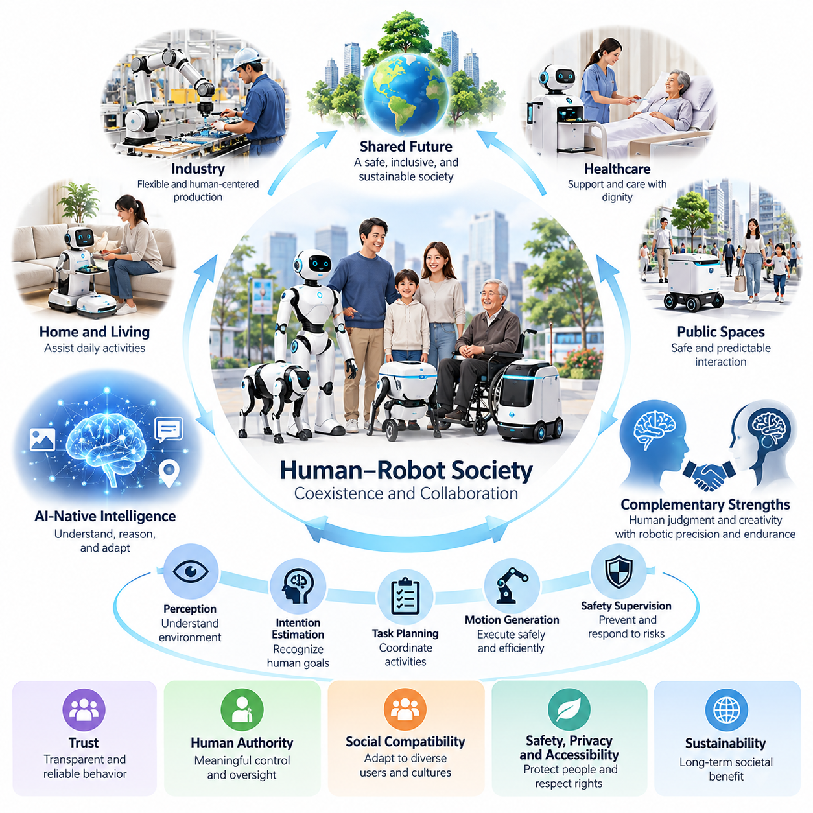
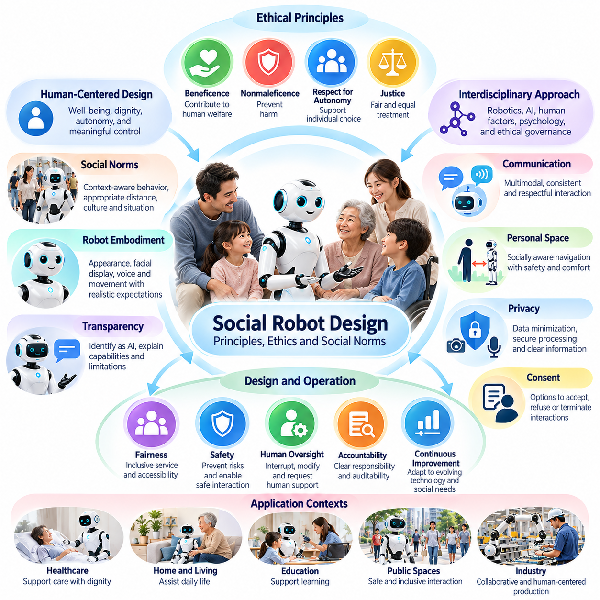
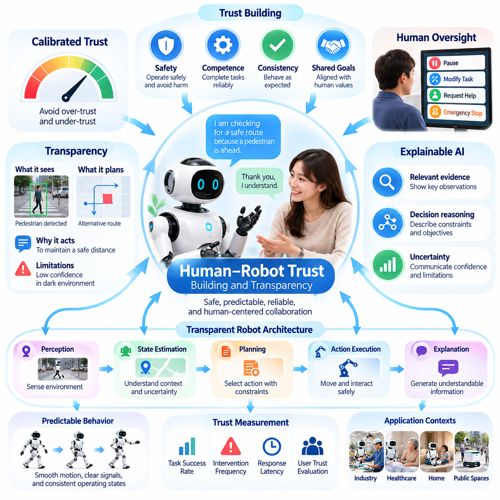
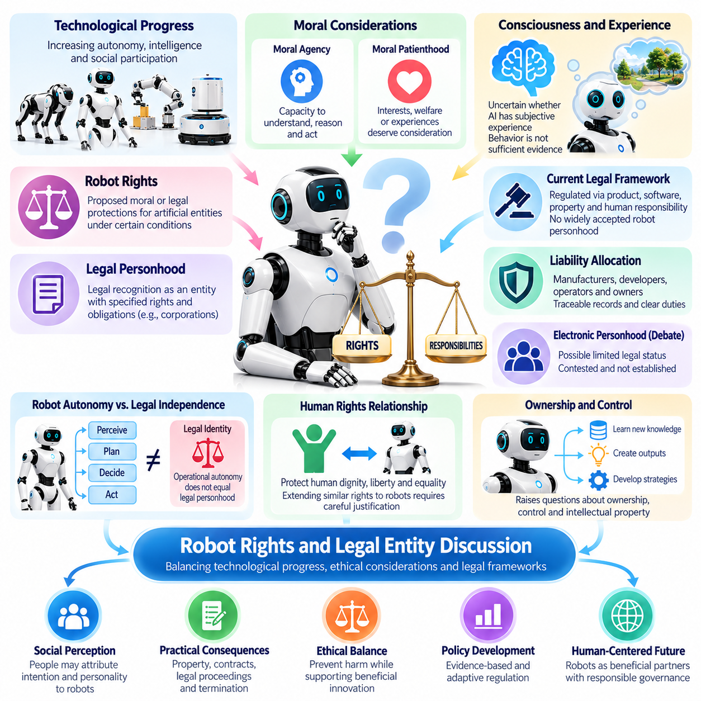
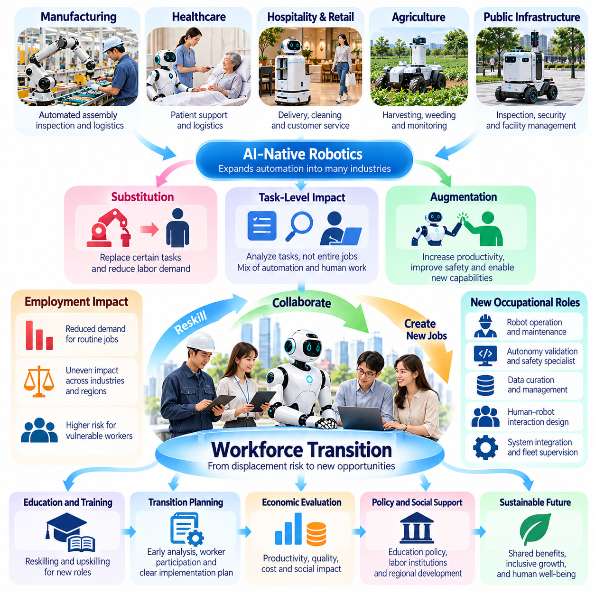
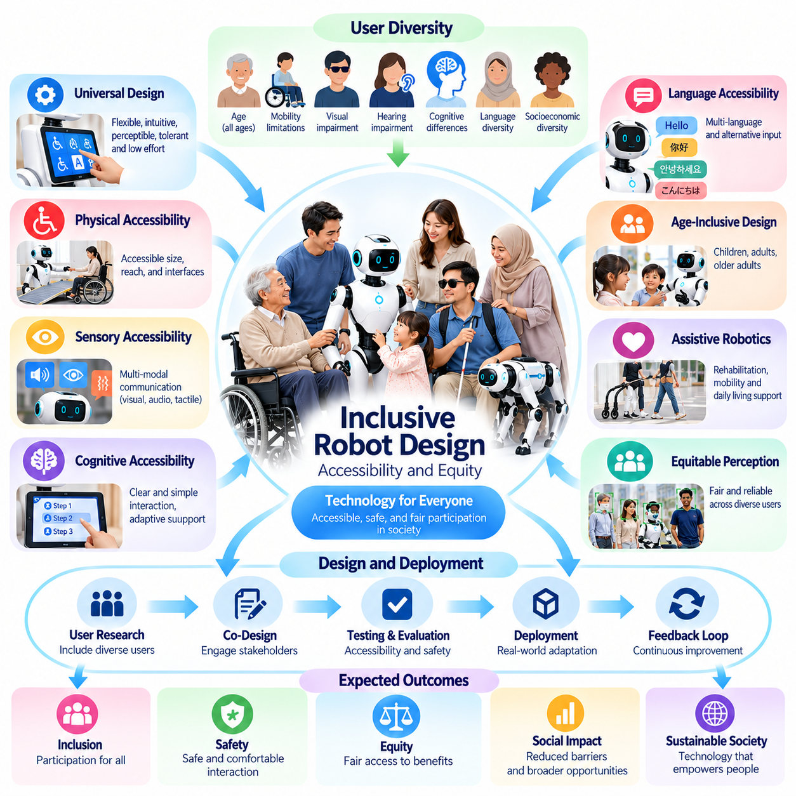
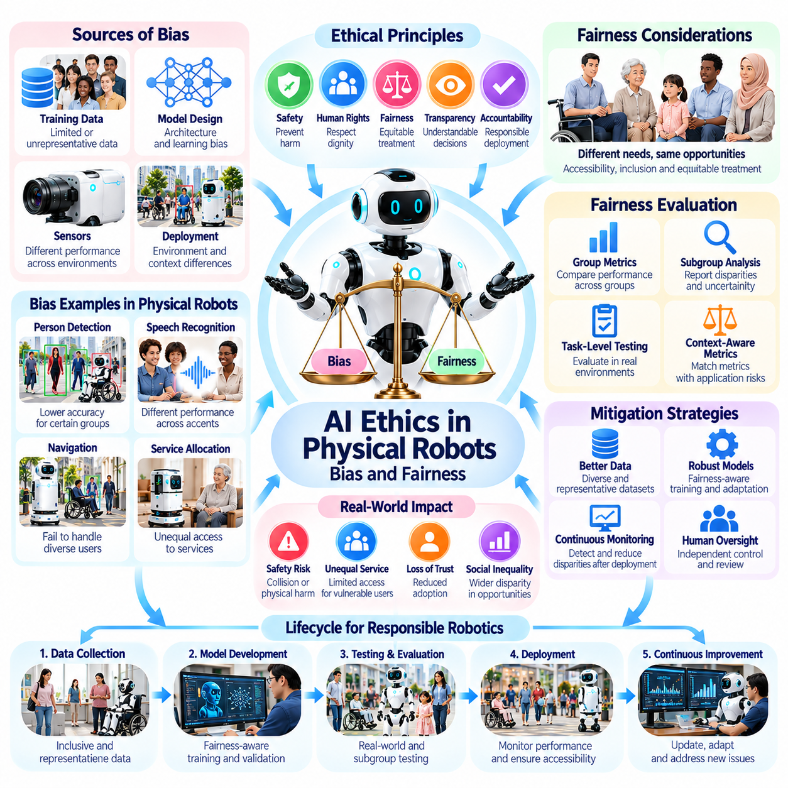
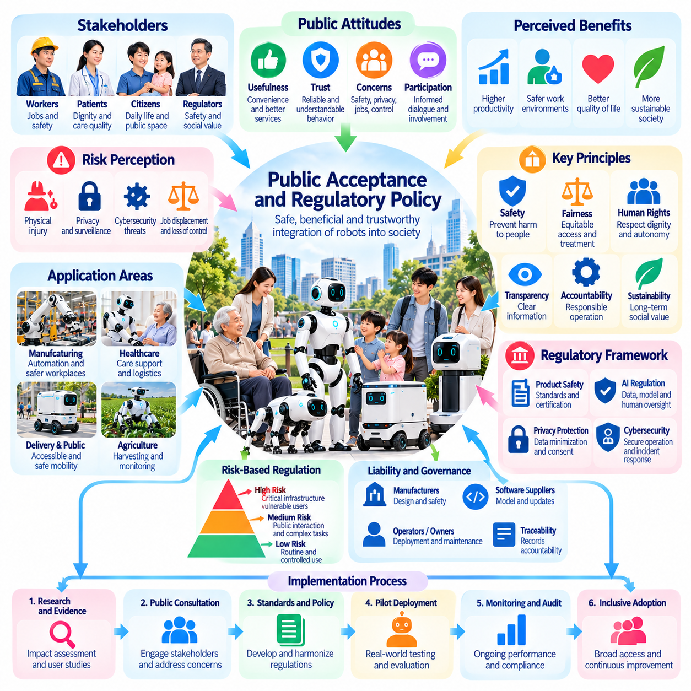
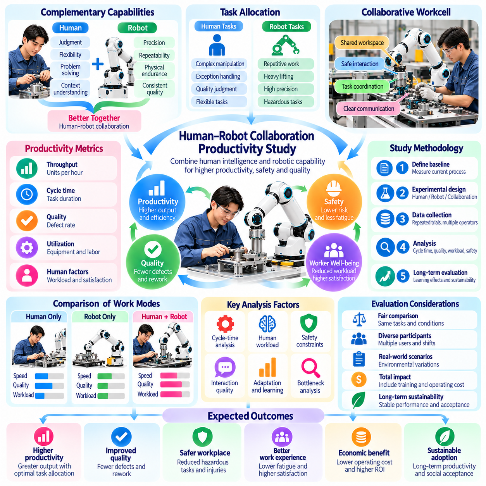
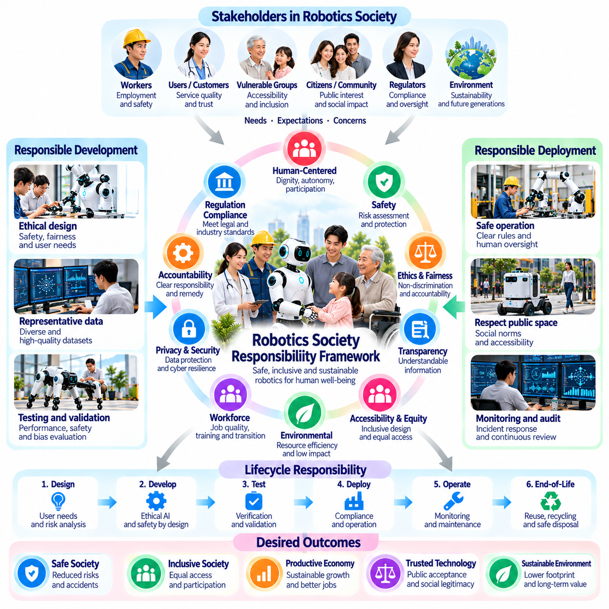

**Volume 27. Future AI Native Robotics**


# Chapter 08. Human Robot Society

##  

## 08.01. Human Robot Society Vision Coexistence Collaboration

{width="7.268055555555556in" height="7.268055555555556in"}

The vision of a human--robot society describes a future in which intelligent robots become integrated participants in everyday environments while humans retain authority over social values, institutional decisions, and technological development. Rather than replacing human activity indiscriminately, robots are expected to extend physical capabilities, reduce exposure to hazardous conditions, and support increasingly complex tasks through adaptive collaboration.

Human--robot coexistence requires more than advanced perception, manipulation, and autonomous navigation. Robots must operate within environments shaped by human expectations, cultural conventions, legal responsibilities, and unpredictable behavior. A technically successful robot may still be socially unacceptable if its movements appear threatening, its decisions remain unexplained, or its presence interferes with human independence and established interpersonal relationships.

The transition toward AI-native robotics introduces a fundamental change in the relationship between humans and machines. Traditional robots generally execute predefined procedures within controlled operating boundaries, whereas AI-native robots can interpret multimodal information, reason about unfamiliar situations, and adapt their behavior through learned policies. These capabilities expand collaboration opportunities while introducing new requirements for supervision, accountability, and behavioral predictability.

A sustainable human--robot society should distinguish coexistence from collaboration. Coexistence means that humans and robots share physical and organizational environments without unacceptable interference, injury, or disruption. Collaboration requires coordinated activities in which human judgment, contextual understanding, creativity, and ethical responsibility complement robotic precision, endurance, computational capacity, and repeatable physical execution.

In industrial environments, collaborative robotics can transform conventional automation into flexible human-centered production systems. Human workers may define objectives, evaluate exceptions, and supervise complex operations while robots perform material handling, repetitive assembly, inspection, and physically demanding movements. Effective collaboration depends on reliable task allocation, transparent operating states, appropriate separation distances, and mechanisms for immediate human intervention.

Healthcare and assisted-living environments demonstrate the importance of preserving human dignity during robotic deployment. Mobile service robots may transport supplies, support logistics, or assist with selected daily activities, allowing professionals and caregivers to devote greater attention to interpersonal care. However, robots should not be assumed to understand emotional needs or possess clinical judgment merely because they can generate natural language and socially convincing responses.

Public spaces introduce additional challenges because robots encounter individuals who have not explicitly agreed to participate in robotic interactions. Autonomous delivery platforms, cleaning robots, security systems, and mobility assistants must recognize pedestrians, accommodate vulnerable users, and behave predictably under congestion. Their operating policies should prioritize physical safety, accessibility, privacy, and clear communication over maximum task efficiency.

The architecture of human--robot collaboration should integrate perception, intention estimation, task planning, motion generation, and safety supervision. Multimodal sensing can identify human position, gestures, speech, and environmental context, while AI models estimate possible intentions and generate candidate actions. Independent safety mechanisms must constrain these actions, particularly when model uncertainty, sensor degradation, or unexpected human movement increases operational risk.

Trust represents a central requirement for long-term coexistence, but trust must be calibrated to demonstrated capabilities rather than persuasive appearance. Robots should communicate what they are doing, why an action was selected, and when assistance is required. Consistent behavior, understandable explanations, visible operating limitations, and dependable recovery procedures help users develop realistic expectations without encouraging excessive reliance on imperfect autonomous systems.

Human authority must remain meaningful even as robot intelligence becomes increasingly general-purpose. Operators need practical mechanisms to pause operations, reject proposed actions, revise objectives, and transfer control to qualified personnel. Emergency stops, operational overrides, authorization boundaries, and auditable decision records provide distinct forms of protection. Human oversight becomes ineffective when interfaces conceal critical information or intervention requires unrealistic response times.

Socially compatible robot behavior also requires sensitivity to differences among users and environments. Communication conventions, interpersonal distances, accessibility needs, and acceptable levels of automation vary across cultures and applications. A robot designed for a manufacturing facility may require substantially different interaction policies when deployed in a hospital, school, or residential building. Adaptation should occur within explicitly defined safety and ethical boundaries.

The development of generalist robot intelligence may enable a single robotic platform to perform multiple activities across changing environments. Foundation models, vision-language-action systems, and world models could support task interpretation, contextual reasoning, and transferable motor skills. Nevertheless, broad task competence does not establish universal reliability. Each deployment must evaluate environmental constraints, failure consequences, interaction requirements, and the limits of learned behavior.

Human--robot collaboration should be evaluated as a combined sociotechnical system rather than through isolated robot performance measurements. Task completion time, productivity, collision avoidance, and operational availability remain important, but they are insufficient indicators of successful integration. Evaluation must also consider workload distribution, user comprehension, perceived safety, accessibility, intervention frequency, trust calibration, and the preservation of human decision-making authority.

Economic transformation will influence whether human--robot coexistence develops inclusively. Automation may increase productivity, reduce hazardous labor, and create demand for robot maintenance, integration, supervision, and AI engineering. At the same time, particular occupations and routine tasks may experience substantial displacement. Workforce transition therefore requires practical retraining pathways, institutional planning, and mechanisms that distribute technological benefits beyond robot owners and developers.

Accessibility provides another essential measure of social progress. Robots can potentially assist individuals with mobility limitations, support independent living, and improve access to services in environments with labor shortages. These benefits depend on affordable deployment, inclusive interface design, compatibility with assistive technologies, and meaningful participation by affected communities. Systems optimized only for typical users may reproduce existing inequalities or create new forms of exclusion.

Privacy and cybersecurity become inseparable from social acceptance when robots continuously observe physical environments. Cameras, microphones, spatial maps, and interaction histories can reveal sensitive information about individuals and organizations. Responsible architectures should apply data minimization, access control, secure communication, retention limits, and purpose restrictions. Cloud-connected intelligence must not transform routine physical assistance into unnecessary surveillance or uncontrolled personal-data collection.

The governance of human--robot society requires clearly assigned responsibility throughout the technology lifecycle. Manufacturers, software developers, system integrators, operators, and deploying organizations may control different aspects of robot behavior. Governance frameworks should define safety obligations, validation requirements, incident reporting, software update responsibilities, and mechanisms for investigating harmful outcomes. Increasing autonomy does not eliminate the need for accountable human institutions.

Continuous learning creates a particularly important governance challenge. Robots that adapt from operational experience may improve their capabilities, but uncontrolled policy changes can invalidate previously established safety assumptions. A responsible deployment architecture should distinguish data collection, model training, validation, approval, and operational release. Safety-critical behavior should remain subject to controlled change management, traceability, rollback capabilities, and independent verification where appropriate.

At the societal level, robotic intelligence should complement rather than dictate collective priorities. Decisions concerning acceptable risk, public surveillance, employment policy, accessibility, and distribution of economic benefits require democratic institutions, professional expertise, and affected-community participation. Robot optimization objectives cannot independently determine what society should value. Technical performance must remain subordinate to legitimate human choices about acceptable and desirable outcomes.

The long-term vision is therefore not simply a world containing more autonomous machines, but a society capable of coordinating human intelligence and robotic capabilities responsibly. Success will depend on trustworthy engineering, inclusive deployment, accountable governance, and continuous assessment of social consequences. Human--robot coexistence becomes sustainable when technological advancement strengthens human safety, dignity, opportunity, and collective well-being while preserving meaningful human control.

인간--로봇 사회(Human--Robot Society)의 비전(Vision)은 지능형 로봇(Intelligent Robot)이 일상생활 환경에 통합되어 활동하면서도 인간이 사회적 가치(Social Values), 제도적 의사결정(Institutional Decision-Making), 기술 발전(Technological Development)에 대한 주도권을 유지하는 미래를 의미한다. 로봇은 인간의 활동을 무조건 대체하기보다 신체적 능력을 확장하고, 위험한 작업 환경에 대한 노출을 줄이며, 적응형 협업(Adaptive Collaboration)을 통해 복잡한 작업을 지원하는 방향으로 발전해야 한다.

인간--로봇 공존(Human--Robot Coexistence)을 실현하려면 고도화된 인식(Perception), 조작(Manipulation), 자율주행(Autonomous Navigation) 기술만으로는 충분하지 않다. 로봇은 인간의 기대, 문화적 관습(Cultural Conventions), 법적 책임(Legal Responsibilities), 예측하기 어려운 행동으로 구성된 환경에서 작동해야 한다. 기술적으로 우수한 로봇이라도 움직임이 위협적으로 보이거나, 의사결정을 설명할 수 없거나, 인간의 자율성과 기존 대인관계를 방해한다면 사회적으로 수용되기 어렵다.

인공지능 네이티브 로봇공학(AI-Native Robotics)으로의 전환은 인간과 기계의 관계에 근본적인 변화를 가져온다. 전통적인 로봇(Traditional Robot)은 일반적으로 통제된 작동 범위 내에서 사전에 정의된 절차를 수행하지만, AI 네이티브 로봇(AI-Native Robot)은 다중모달 정보(Multimodal Information)를 해석하고, 익숙하지 않은 상황을 추론하며, 학습된 정책(Learned Policy)을 통해 행동을 적응시킬 수 있다. 이러한 능력은 협업 기회를 확대하는 동시에 감독, 책임성, 행동 예측 가능성에 대한 새로운 요구사항을 발생시킨다.

지속 가능한 인간--로봇 사회(Sustainable Human--Robot Society)를 구축하려면 공존(Coexistence)과 협업(Collaboration)을 구분해야 한다. 공존은 인간과 로봇이 동일한 물리적·조직적 환경을 공유하면서 허용할 수 없는 간섭, 부상, 운영 중단을 발생시키지 않는 상태를 의미한다. 협업은 인간의 판단력, 상황 이해력, 창의성, 윤리적 책임과 로봇의 정밀성, 지속 작업 능력, 계산 능력, 반복적인 물리적 작업 수행 능력이 상호 보완되는 공동 활동을 의미한다.

산업 환경(Industrial Environment)에서 협업 로봇공학(Collaborative Robotics)은 기존 자동화(Conventional Automation)를 유연한 인간 중심 생산 시스템(Human-Centered Production System)으로 전환할 수 있다. 작업자는 목표를 정의하고 예외 상황을 평가하며 복잡한 작업을 감독하는 반면, 로봇은 자재 운반, 반복 조립, 검사, 신체적으로 부담이 큰 작업을 수행할 수 있다. 효과적인 협업을 위해서는 신뢰할 수 있는 작업 할당(Task Allocation), 투명한 운영 상태, 적절한 안전거리, 즉각적인 인간 개입 메커니즘이 필요하다.

의료 및 생활 지원 환경(Healthcare and Assisted-Living Environment)은 로봇 도입 과정에서 인간의 존엄성(Human Dignity)을 유지하는 것이 얼마나 중요한지를 보여준다. 이동형 서비스 로봇(Mobile Service Robot)은 물품 운송, 물류 업무, 일부 일상 활동을 지원하여 의료 전문가와 돌봄 인력이 대인 돌봄에 더 많은 시간을 할애하도록 할 수 있다. 그러나 로봇이 자연어(Natural Language)를 생성하고 사회적으로 설득력 있는 반응을 보인다는 이유만으로 감정적 요구를 이해하거나 임상적 판단 능력을 갖추었다고 가정해서는 안 된다.

공공장소(Public Space)에서는 로봇과의 상호작용에 명시적으로 동의하지 않은 사람들을 만나기 때문에 추가적인 문제가 발생한다. 자율 배송 플랫폼(Autonomous Delivery Platform), 청소 로봇(Cleaning Robot), 보안 시스템(Security System), 이동 지원 로봇(Mobility Assistant)은 보행자를 인식하고, 취약한 이용자를 배려하며, 혼잡한 환경에서도 예측 가능한 행동을 수행해야 한다. 운영 정책(Operating Policy)은 최대 작업 효율보다 물리적 안전, 접근성(Accessibility), 개인정보 보호(Privacy), 명확한 의사소통을 우선해야 한다.

인간--로봇 협업 아키텍처(Human--Robot Collaboration Architecture)는 인식, 의도 추정(Intention Estimation), 작업 계획(Task Planning), 동작 생성(Motion Generation), 안전 감독(Safety Supervision)을 통합해야 한다. 다중모달 센싱(Multimodal Sensing)은 인간의 위치, 제스처, 음성, 환경적 맥락을 파악하며, AI 모델은 가능한 의도를 추정하고 후보 행동을 생성한다. 특히 모델 불확실성(Model Uncertainty), 센서 성능 저하, 예상하지 못한 인간의 움직임으로 운영 위험이 증가할 때 독립적인 안전 메커니즘(Safety Mechanism)이 이러한 행동을 제한해야 한다.

신뢰(Trust)는 장기적인 공존을 위한 핵심 요구사항이지만, 로봇에 대한 신뢰는 설득력 있는 외형이 아니라 입증된 능력에 근거하여 적절하게 형성되어야 한다. 로봇은 현재 수행하는 작업, 특정 행동을 선택한 이유, 인간의 지원이 필요한 시점을 전달해야 한다. 일관된 행동, 이해 가능한 설명, 명확한 작동 한계, 신뢰할 수 있는 복구 절차(Recovery Procedure)는 사용자가 불완전한 자율 시스템(Autonomous System)에 과도하게 의존하지 않으면서 현실적인 기대를 형성하도록 돕는다.

로봇 지능(Robot Intelligence)이 점차 범용화되더라도 인간의 권한(Human Authority)은 실질적으로 유지되어야 한다. 운영자는 작업을 일시 정지하고, 제안된 행동을 거부하며, 목표를 수정하고, 자격을 갖춘 담당자에게 제어권을 이전할 수 있어야 한다. 비상 정지(Emergency Stop), 운영 개입(Operational Override), 권한 경계(Authorization Boundary), 감사 가능한 의사결정 기록(Auditable Decision Record)은 서로 다른 보호 기능을 제공한다. 인터페이스가 핵심 정보를 숨기거나 비현실적으로 짧은 대응 시간을 요구한다면 인간 감독(Human Oversight)은 실효성을 잃게 된다.

사회적으로 적합한 로봇 행동(Socially Compatible Robot Behavior)을 구현하려면 사용자와 환경 사이의 차이를 고려해야 한다. 의사소통 관습(Communication Conventions), 대인 거리(Interpersonal Distance), 접근성 요구사항, 허용 가능한 자동화 수준은 문화와 적용 분야에 따라 달라진다. 제조시설용 로봇을 병원, 학교, 주거시설에 배치할 경우 상호작용 정책(Interaction Policy)을 상당 부분 변경해야 할 수 있다. 이러한 적응은 명확하게 정의된 안전 및 윤리적 경계(Safety and Ethical Boundaries) 내에서 이루어져야 한다.

범용 로봇 지능(Generalist Robot Intelligence)의 발전은 하나의 로봇 플랫폼(Robot Platform)이 변화하는 환경에서 여러 작업을 수행하도록 만들 수 있다. 파운데이션 모델(Foundation Model), 시각--언어--행동 시스템(Vision-Language-Action System), 월드 모델(World Model)은 작업 해석, 상황 추론(Contextual Reasoning), 전이 가능한 운동 기술(Transferable Motor Skills)을 지원할 수 있다. 그러나 폭넓은 작업 수행 능력이 보편적인 신뢰성을 보장하지는 않는다. 각 배치 환경에서는 환경 제약, 고장 결과, 상호작용 요구사항, 학습된 행동의 한계를 평가해야 한다.

인간--로봇 협업(Human--Robot Collaboration)은 개별 로봇의 성능 측정이 아니라 통합된 사회기술 시스템(Sociotechnical System)으로 평가해야 한다. 작업 완료 시간, 생산성(Productivity), 충돌 회피(Collision Avoidance), 운영 가용성(Operational Availability)은 여전히 중요하지만 성공적인 통합을 판단하기에는 충분하지 않다. 평가에는 업무 부담 분배, 사용자 이해도, 체감 안전성(Perceived Safety), 접근성, 개입 빈도, 신뢰 수준의 적절성(Trust Calibration), 인간의 의사결정 권한 유지 여부도 포함되어야 한다.

경제적 전환(Economic Transformation)은 인간--로봇 공존이 포용적으로 발전할 수 있는지를 결정하는 중요한 요인이다. 자동화(Automation)는 생산성을 향상하고 위험 노동을 줄이며 로봇 유지보수, 시스템 통합(System Integration), 운영 감독, AI 엔지니어링 분야의 새로운 수요를 창출할 수 있다. 동시에 특정 직업과 반복적인 업무에서는 상당한 일자리 대체가 발생할 수 있다. 따라서 노동력 전환(Workforce Transition)에는 실질적인 재교육 경로, 제도적 계획, 로봇 소유자와 개발자 이외의 집단에도 기술적 혜택을 분배하는 메커니즘이 필요하다.

접근성(Accessibility)은 사회적 발전을 평가하는 또 다른 핵심 기준이다. 로봇은 이동에 제약이 있는 사람을 지원하고, 독립적인 생활(Independent Living)을 돕고, 노동력이 부족한 환경에서 서비스 접근성을 개선할 수 있다. 이러한 혜택은 경제적으로 부담 가능한 도입 비용, 포용적 인터페이스 설계(Inclusive Interface Design), 보조공학(Assistive Technology)과의 호환성, 영향을 받는 공동체의 실질적인 참여에 달려 있다. 일반적인 사용자만을 대상으로 최적화된 시스템은 기존 불평등을 재생산하거나 새로운 형태의 배제를 초래할 수 있다.

로봇이 물리적 환경을 지속적으로 관찰하는 상황에서는 개인정보 보호(Privacy)와 사이버보안(Cybersecurity)이 사회적 수용성(Social Acceptance)과 분리될 수 없다. 카메라, 마이크, 공간 지도(Spatial Map), 상호작용 기록(Interaction History)은 개인과 조직의 민감한 정보를 드러낼 수 있다. 책임 있는 아키텍처는 데이터 최소화(Data Minimization), 접근 제어(Access Control), 보안 통신(Secure Communication), 보존 기간 제한, 목적 제한(Purpose Restriction)을 적용해야 한다. 클라우드 연결 지능(Cloud-Connected Intelligence)이 일상적인 물리적 지원을 불필요한 감시나 통제되지 않는 개인정보 수집으로 전환해서는 안 된다.

인간--로봇 사회의 거버넌스(Governance)는 기술 생명주기(Technology Lifecycle) 전반에 걸쳐 책임을 명확하게 할당해야 한다. 제조업체, 소프트웨어 개발자, 시스템 통합업체(System Integrator), 운영자, 로봇 도입 기관은 로봇 행동의 서로 다른 측면을 통제할 수 있다. 거버넌스 프레임워크(Governance Framework)는 안전 의무, 검증 요구사항, 사고 보고(Incident Reporting), 소프트웨어 업데이트 책임, 피해 발생 원인 조사 메커니즘을 정의해야 한다. 자율성이 증가하더라도 책임을 지는 인간 조직의 필요성이 사라지는 것은 아니다.

지속 학습(Continuous Learning)은 특히 중요한 거버넌스 문제를 발생시킨다. 운영 경험을 통해 적응하는 로봇은 성능을 개선할 수 있지만, 통제되지 않은 정책 변경(Policy Change)은 기존에 확립된 안전 가정(Safety Assumption)을 무효화할 수 있다. 책임 있는 배치 아키텍처(Deployment Architecture)는 데이터 수집, 모델 학습, 검증, 승인, 운영 배포를 구분해야 한다. 안전 필수 행동(Safety-Critical Behavior)은 적절한 변경 관리(Change Management), 추적성(Traceability), 롤백 기능(Rollback Capability), 필요한 경우 독립적 검증(Independent Verification)의 적용을 받아야 한다.

사회적 차원에서 로봇 지능은 공동체의 우선순위를 결정하기보다 이를 보완해야 한다. 허용 가능한 위험(Acceptable Risk), 공공 감시(Public Surveillance), 고용 정책, 접근성, 경제적 혜택의 분배에 관한 결정에는 민주적 제도(Democratic Institutions), 전문적 지식, 영향을 받는 공동체의 참여가 필요하다. 로봇 최적화 목표(Robot Optimization Objective)만으로 사회가 무엇을 가치 있게 여겨야 하는지를 결정할 수는 없다. 기술적 성능은 허용 가능하고 바람직한 결과에 대한 정당한 인간의 선택에 종속되어야 한다.

따라서 장기적인 비전(Long-Term Vision)은 단순히 더 많은 자율 기계(Autonomous Machine)가 존재하는 세계가 아니라 인간 지능(Human Intelligence)과 로봇의 능력을 책임 있게 조정할 수 있는 사회를 의미한다. 성공 여부는 신뢰할 수 있는 엔지니어링(Trustworthy Engineering), 포용적 도입(Inclusive Deployment), 책임 있는 거버넌스(Accountable Governance), 사회적 영향에 대한 지속적인 평가에 달려 있다. 인간--로봇 공존은 의미 있는 인간 통제(Meaningful Human Control)를 유지하면서 인간의 안전, 존엄성, 기회, 공동체의 복지를 강화할 때 지속 가능해진다.

##  

## 08.02. Social Robot Design Principles Ethics Norms

{width="7.268055555555556in" height="7.268055555555556in"}

Social robot design establishes the principles that allow intelligent machines to interact with humans in socially acceptable, ethically responsible, and operationally safe ways. Unlike conventional industrial automation, social robots must interpret human behavior, communicate intentions, and respond to interpersonal expectations. Their design therefore requires the integration of robotics engineering, artificial intelligence, human factors, psychology, and ethical governance.

The fundamental objective of social robot design is to support human well-being while preserving autonomy, dignity, and meaningful control. Robots should assist people without unnecessarily restricting their choices or creating dependence on automated decisions. This human-centered approach requires designers to evaluate not only technical functionality but also the consequences of robotic behavior for individual users, surrounding communities, and broader social institutions.

Ethical principles provide a foundation for determining acceptable robot behavior. Beneficence encourages systems that contribute positively to human welfare, while nonmaleficence emphasizes the prevention of foreseeable harm. Respect for autonomy protects individual decision-making, and justice requires fair treatment across different populations. These principles must be translated into measurable engineering requirements rather than remaining abstract declarations.

Social norms represent the informal expectations governing human interactions within particular environments. Appropriate interpersonal distance, conversational timing, gestures, eye contact, and movement patterns vary according to cultural and situational context. A robot operating in a hospital may require restrained behavior and careful communication, whereas a robot in a public exhibition may employ more expressive interaction. Context awareness is therefore essential for socially appropriate autonomy.

Robot embodiment strongly influences human expectations and interaction patterns. Humanoid appearance, facial displays, voice characteristics, and movement styles can encourage users to attribute intelligence, emotion, or social understanding beyond the robot\'s actual capabilities. Designers must carefully balance approachability with accurate capability representation. Excessively anthropomorphic interfaces may produce misplaced trust, emotional attachment, or misunderstanding about machine agency.

Transparency is a central design principle because users need to understand the nature and limitations of robotic intelligence. A social robot should clearly identify itself as an artificial system, communicate relevant operational boundaries, and distinguish verified information from uncertain predictions. When decisions affect safety, privacy, or personal welfare, explanations should be understandable to the intended audience without exposing unnecessary technical complexity.

Social robot communication must support predictable and respectful interaction. Speech, visual indicators, gestures, and physical motion should convey consistent intentions across different operating conditions. Multimodal communication can improve accessibility and reduce ambiguity, but conflicting signals may undermine trust. A robot that verbally announces one action while physically preparing another creates unnecessary uncertainty and increases the likelihood of unsafe human responses.

Respect for personal space is particularly important because social robots occupy the same physical environments as humans. Navigation systems should account for interpersonal distance, approach direction, pedestrian movement, and socially sensitive locations. A technically collision-free trajectory may still be uncomfortable or inappropriate. Socially aware navigation must therefore optimize both physical safety and human comfort while accommodating individual accessibility requirements.

Privacy protection should be embedded into social robot architecture from the earliest design stages. Cameras, microphones, location sensors, and interaction histories may capture sensitive information about individuals who have not explicitly requested robotic services. Data minimization, local processing, purpose limitation, secure storage, and controlled retention can reduce unnecessary exposure. Users should receive understandable information about what data is collected and how it is used.

Consent becomes especially important when robots initiate interactions, record conversations, or provide personalized assistance. Users should have practical opportunities to accept, refuse, or terminate nonessential interactions without unreasonable consequences. Consent mechanisms must consider children, older adults, and individuals with cognitive or communication limitations. In public environments, visible recording indicators and privacy-preserving operating modes can help establish reasonable expectations.

Fairness requires social robots to provide dependable service across diverse demographic groups, physical abilities, languages, and communication styles. Perception systems may perform differently under variations in appearance, speech patterns, mobility aids, or environmental conditions. These disparities can create unequal access or safety risks. Representative testing, accessibility evaluation, and continuous performance monitoring are necessary to identify and reduce discriminatory outcomes.

Human oversight must remain effective even when social robots operate autonomously for extended periods. Users and authorized supervisors should be able to interrupt inappropriate behavior, modify operational objectives, and request human assistance. Escalation procedures are especially important when robots encounter emotionally sensitive situations, ambiguous instructions, or potentially harmful requests. Autonomous behavior should remain bounded by explicit authority and safety constraints.

Ethical decision-making in social robots cannot rely exclusively on learned language models or statistical predictions. Foundation models may generate plausible responses without reliably understanding legal obligations, interpersonal boundaries, or the consequences of physical actions. A layered architecture should combine AI-based interpretation with policy constraints, authorization checks, safety monitors, and deterministic intervention mechanisms. High-risk decisions require stronger verification and human accountability.

Cultural adaptability introduces additional complexity because acceptable social behavior differs across communities and institutions. Communication styles, forms of address, interpersonal distance, and expectations regarding assistance may vary substantially. Robots should support configurable interaction policies rather than imposing a universal behavioral standard. However, cultural adaptation must never override fundamental safety requirements, human rights protections, or applicable legal obligations.

Emotional interaction requires particular caution because robots can simulate empathy without necessarily possessing emotional understanding or subjective experience. Supportive language and expressive behavior may improve usability, but designers should avoid deliberately exploiting loneliness, vulnerability, or emotional dependence. In caregiving environments, robotic companionship should complement rather than automatically replace meaningful human relationships. Users must remain aware of the artificial nature of the interaction.

Accountability requires clear responsibility for the design, deployment, operation, and maintenance of social robots. Manufacturers, software developers, integrators, and operating organizations may influence different aspects of system behavior. Traceable requirements, documented design decisions, operational logs, and incident investigation procedures help establish responsibility when failures occur. Increased autonomy does not justify transferring legal or ethical accountability to the robot itself.

Social robot safety extends beyond collision prevention and mechanical reliability. Psychological discomfort, misleading communication, privacy violations, inappropriate persuasion, and exclusion from essential services may also constitute significant harm. Risk assessment should therefore consider physical, informational, emotional, and societal consequences. Evaluation methods must examine realistic interactions involving uncertainty, conflicting expectations, vulnerable users, and unexpected environmental changes.

Ethical requirements should be integrated throughout the robot development lifecycle rather than introduced only during final validation. Concept development should identify stakeholders and foreseeable harms, while system design should translate ethical objectives into operational constraints. Simulation, user studies, field testing, and post-deployment monitoring should evaluate whether actual behavior satisfies these constraints. Software updates and learned-policy changes must undergo appropriate reassessment.

The effectiveness of social robot design should be measured through both technical and human-centered indicators. Task success, response latency, navigation safety, and system availability describe operational performance, while user comprehension, perceived comfort, accessibility, trust calibration, and intervention effectiveness describe interaction quality. Longitudinal evaluation is necessary because social expectations and user behavior may change as familiarity with robotic systems increases.

Ultimately, responsible social robot design aims to create machines that participate constructively in human environments without undermining human agency or social relationships. Ethical principles define acceptable objectives, social norms guide contextual behavior, and engineering safeguards enforce operational boundaries. A sustainable human--robot society will depend on robots that remain understandable, inclusive, predictable, accountable, and consistently aligned with human welfare.

사회적 로봇 설계(Social Robot Design)는 지능형 기계(Intelligent Machine)가 사회적으로 수용 가능하고, 윤리적으로 책임 있으며, 운영상 안전한 방식으로 인간과 상호작용할 수 있도록 하는 원칙을 수립한다. 기존 산업 자동화(Industrial Automation)와 달리 사회적 로봇(Social Robot)은 인간의 행동을 해석하고, 의도를 전달하며, 대인관계에서 기대되는 행동에 대응해야 한다. 따라서 로봇 설계에는 로봇공학(Robotics Engineering), 인공지능(Artificial Intelligence), 인간공학(Human Factors), 심리학(Psychology), 윤리적 거버넌스(Ethical Governance)의 통합이 필요하다.

사회적 로봇 설계의 근본적인 목표는 인간의 자율성(Autonomy), 존엄성(Dignity), 실질적인 통제권(Meaningful Control)을 유지하면서 인간의 복지(Human Well-Being)를 지원하는 것이다. 로봇은 인간의 선택을 불필요하게 제한하거나 자동화된 의사결정(Automated Decision-Making)에 대한 의존성을 유발하지 않으면서 사람을 지원해야 한다. 이러한 인간 중심 접근법(Human-Centered Approach)은 기술적 기능뿐만 아니라 로봇의 행동이 개별 사용자, 주변 공동체, 광범위한 사회 제도에 미치는 영향까지 평가하도록 요구한다.

윤리적 원칙(Ethical Principles)은 허용 가능한 로봇 행동(Acceptable Robot Behavior)을 결정하기 위한 기반을 제공한다. 선행(Beneficence)은 인간의 복지에 긍정적으로 기여하는 시스템을 장려하며, 무해성(Nonmaleficence)은 예측 가능한 피해를 예방하는 데 중점을 둔다. 자율성 존중(Respect for Autonomy)은 개인의 의사결정 권한을 보호하고, 정의(Justice)는 다양한 집단에 대한 공정한 대우를 요구한다. 이러한 원칙은 추상적인 선언에 머무르지 않고 측정 가능한 공학적 요구사항(Engineering Requirements)으로 전환되어야 한다.

사회적 규범(Social Norms)은 특정 환경에서 인간의 상호작용을 지배하는 비공식적인 기대를 의미한다. 적절한 대인 거리(Interpersonal Distance), 대화 시점(Conversational Timing), 제스처(Gestures), 시선 접촉(Eye Contact), 움직임 패턴(Movement Patterns)은 문화적·상황적 맥락에 따라 달라진다. 병원에서 작동하는 로봇은 절제된 행동과 신중한 의사소통이 필요하지만, 공공 전시장에서 작동하는 로봇은 더욱 표현적인 상호작용을 사용할 수 있다. 따라서 상황 인식(Context Awareness)은 사회적으로 적절한 자율성(Socially Appropriate Autonomy)을 구현하는 데 필수적이다.

로봇의 신체적 형태(Robot Embodiment)는 인간의 기대와 상호작용 패턴에 큰 영향을 미친다. 휴머노이드 외형(Humanoid Appearance), 얼굴 디스플레이(Facial Display), 음성 특성(Voice Characteristics), 움직임 방식(Movement Style)은 사용자가 로봇의 실제 능력을 넘어서는 지능, 감정, 사회적 이해 능력을 부여하도록 유도할 수 있다. 설계자는 친근함(Approachability)과 정확한 능력 표현(Capability Representation) 사이의 균형을 신중하게 유지해야 한다. 지나친 의인화 인터페이스(Anthropomorphic Interface)는 잘못된 신뢰, 정서적 애착, 기계의 행위 주체성(Machine Agency)에 대한 오해를 초래할 수 있다.

투명성(Transparency)은 사용자가 로봇 지능(Robotic Intelligence)의 특성과 한계를 이해해야 한다는 점에서 핵심 설계 원칙이다. 사회적 로봇은 자신이 인공 시스템(Artificial System)임을 명확히 밝히고, 관련된 운영 경계(Operational Boundaries)를 전달하며, 검증된 정보와 불확실한 예측을 구분해야 한다. 의사결정이 안전, 개인정보 보호, 개인의 복지에 영향을 미치는 경우 설명은 불필요한 기술적 복잡성을 노출하지 않으면서 대상 사용자가 이해할 수 있는 수준으로 제공되어야 한다.

사회적 로봇의 의사소통(Social Robot Communication)은 예측 가능하고 존중하는 상호작용을 지원해야 한다. 음성(Speech), 시각적 표시(Visual Indicators), 제스처(Gestures), 물리적 움직임(Physical Motion)은 다양한 작동 조건에서 일관된 의도를 전달해야 한다. 다중모달 의사소통(Multimodal Communication)은 접근성을 향상하고 모호성을 줄일 수 있지만, 서로 충돌하는 신호는 신뢰를 약화시킬 수 있다. 로봇이 말로는 하나의 행동을 알리면서 물리적으로는 다른 행동을 준비한다면 불필요한 불확실성이 발생하고 인간의 불안전한 반응 가능성이 증가한다.

개인 공간(Personal Space)에 대한 존중은 사회적 로봇이 인간과 동일한 물리적 환경을 사용한다는 점에서 특히 중요하다. 내비게이션 시스템(Navigation System)은 대인 거리, 접근 방향(Approach Direction), 보행자 움직임(Pedestrian Movement), 사회적으로 민감한 위치를 고려해야 한다. 기술적으로 충돌이 없는 궤적(Collision-Free Trajectory)이라도 인간에게 불편하거나 부적절할 수 있다. 따라서 사회적 인식 기반 내비게이션(Socially Aware Navigation)은 개인별 접근성 요구사항을 수용하면서 물리적 안전과 인간의 편안함을 함께 최적화해야 한다.

개인정보 보호(Privacy Protection)는 사회적 로봇 아키텍처(Social Robot Architecture)의 초기 설계 단계부터 내재화되어야 한다. 카메라, 마이크, 위치 센서(Location Sensor), 상호작용 기록(Interaction History)은 로봇 서비스를 명시적으로 요청하지 않은 사람들의 민감한 정보를 수집할 수 있다. 데이터 최소화(Data Minimization), 로컬 처리(Local Processing), 목적 제한(Purpose Limitation), 보안 저장(Secure Storage), 통제된 보존 기간(Controlled Retention)은 불필요한 정보 노출을 줄일 수 있다. 사용자는 어떤 데이터가 수집되고 어떻게 사용되는지 이해할 수 있는 정보를 제공받아야 한다.

동의(Consent)는 로봇이 상호작용을 시작하거나 대화를 녹음하거나 개인화된 지원(Personalized Assistance)을 제공할 때 특히 중요하다. 사용자는 불합리한 불이익 없이 필수적이지 않은 상호작용을 수락하거나 거부하거나 종료할 수 있어야 한다. 동의 메커니즘(Consent Mechanism)은 어린이, 고령자, 인지 또는 의사소통에 제약이 있는 사람들을 고려해야 한다. 공공 환경에서는 눈에 보이는 녹화 표시(Recording Indicators)와 개인정보 보호 중심 작동 모드(Privacy-Preserving Operating Modes)가 합리적인 기대를 형성하는 데 도움이 될 수 있다.

공정성(Fairness)은 사회적 로봇이 다양한 인구집단(Demographic Groups), 신체 능력(Physical Abilities), 언어, 의사소통 방식에 걸쳐 신뢰할 수 있는 서비스를 제공하도록 요구한다. 인식 시스템(Perception System)은 외형, 음성 패턴(Speech Patterns), 이동 보조기구(Mobility Aids), 환경 조건의 차이에 따라 성능이 달라질 수 있다. 이러한 격차는 서비스 접근의 불평등이나 안전 위험을 발생시킬 수 있다. 차별적인 결과를 식별하고 줄이기 위해서는 대표성 있는 시험(Representative Testing), 접근성 평가(Accessibility Evaluation), 지속적인 성능 모니터링(Continuous Performance Monitoring)이 필요하다.

인간 감독(Human Oversight)은 사회적 로봇이 장시간 자율적으로 작동하는 경우에도 효과적으로 유지되어야 한다. 사용자와 권한을 가진 감독자는 부적절한 행동을 중단하고, 운영 목표를 수정하며, 인간의 지원을 요청할 수 있어야 한다. 단계적 대응 절차(Escalation Procedures)는 로봇이 감정적으로 민감한 상황, 모호한 지시, 잠재적으로 유해한 요청을 접할 때 특히 중요하다. 자율 행동(Autonomous Behavior)은 명시적인 권한(Authority)과 안전 제약(Safety Constraints)에 의해 제한되어야 한다.

사회적 로봇의 윤리적 의사결정(Ethical Decision-Making)은 학습된 언어 모델(Language Model)이나 통계적 예측(Statistical Prediction)에만 의존해서는 안 된다. 파운데이션 모델(Foundation Model)은 법적 의무, 대인관계의 경계, 물리적 행동의 결과를 신뢰성 있게 이해하지 못하면서도 그럴듯한 응답을 생성할 수 있다. 계층형 아키텍처(Layered Architecture)는 AI 기반 해석(AI-Based Interpretation)을 정책 제약(Policy Constraints), 권한 검사(Authorization Checks), 안전 모니터(Safety Monitors), 결정론적 개입 메커니즘(Deterministic Intervention Mechanisms)과 결합해야 한다. 고위험 의사결정(High-Risk Decisions)에는 더욱 엄격한 검증과 인간의 책임성이 필요하다.

문화적 적응성(Cultural Adaptability)은 공동체와 제도에 따라 허용 가능한 사회적 행동이 달라지기 때문에 추가적인 복잡성을 발생시킨다. 의사소통 방식(Communication Styles), 호칭 방식(Forms of Address), 대인 거리, 지원에 대한 기대는 상당한 차이를 보일 수 있다. 로봇은 보편적인 행동 기준(Universal Behavioral Standard)을 일방적으로 적용하기보다 설정 가능한 상호작용 정책(Configurable Interaction Policies)을 지원해야 한다. 그러나 문화적 적응이 기본적인 안전 요구사항, 인권 보호(Human Rights Protections), 적용 가능한 법적 의무(Legal Obligations)를 무시하는 근거가 되어서는 안 된다.

감정적 상호작용(Emotional Interaction)은 로봇이 실제 감정 이해(Emotional Understanding)나 주관적 경험(Subjective Experience)을 반드시 보유하지 않더라도 공감(Empathy)을 모방할 수 있기 때문에 특별한 주의가 필요하다. 지지적인 언어(Supportive Language)와 표현적인 행동(Expressive Behavior)은 사용성을 개선할 수 있지만, 설계자는 외로움, 취약성, 정서적 의존(Emotional Dependence)을 의도적으로 이용해서는 안 된다. 돌봄 환경(Caregiving Environment)에서 로봇 동반자(Robotic Companionship)는 의미 있는 인간관계를 자동으로 대체하기보다 보완해야 한다. 사용자는 상호작용 대상이 인공적인 존재라는 사실을 계속 인식할 수 있어야 한다.

책임성(Accountability)은 사회적 로봇의 설계, 배치, 운영, 유지보수에 대한 책임을 명확히 할 것을 요구한다. 제조업체(Manufacturers), 소프트웨어 개발자(Software Developers), 시스템 통합업체(System Integrators), 운영 조직(Operating Organizations)은 시스템 행동의 서로 다른 측면에 영향을 미칠 수 있다. 추적 가능한 요구사항(Traceable Requirements), 문서화된 설계 결정(Documented Design Decisions), 운영 로그(Operational Logs), 사고 조사 절차(Incident Investigation Procedures)는 고장 발생 시 책임을 규명하는 데 도움이 된다. 자율성 증가가 법적 또는 윤리적 책임을 로봇 자체에 이전하는 근거가 될 수는 없다.

사회적 로봇의 안전(Social Robot Safety)은 충돌 방지(Collision Prevention)와 기계적 신뢰성(Mechanical Reliability)을 넘어서는 개념이다. 심리적 불편(Psychological Discomfort), 오해를 유발하는 의사소통(Misleading Communication), 개인정보 침해(Privacy Violations), 부적절한 설득(Inappropriate Persuasion), 필수 서비스에서의 배제(Exclusion from Essential Services) 역시 중대한 피해가 될 수 있다. 따라서 위험 평가(Risk Assessment)는 물리적, 정보적, 정서적, 사회적 결과를 고려해야 한다. 평가 방법은 불확실성, 상충하는 기대, 취약한 사용자, 예상하지 못한 환경 변화가 포함된 현실적인 상호작용을 검토해야 한다.

윤리적 요구사항(Ethical Requirements)은 최종 검증 단계에서만 도입되는 것이 아니라 로봇 개발 생명주기(Robot Development Lifecycle) 전반에 통합되어야 한다. 개념 개발(Concept Development)에서는 이해관계자(Stakeholders)와 예측 가능한 피해를 식별하고, 시스템 설계(System Design)에서는 윤리적 목표를 운영 제약(Operational Constraints)으로 전환해야 한다. 시뮬레이션(Simulation), 사용자 연구(User Studies), 현장 시험(Field Testing), 배포 후 모니터링(Post-Deployment Monitoring)은 실제 행동이 이러한 제약을 충족하는지 평가해야 한다. 소프트웨어 업데이트와 학습된 정책 변경(Learned-Policy Changes)은 적절한 재평가를 거쳐야 한다.

사회적 로봇 설계의 효과성(Effectiveness)은 기술적 지표(Technical Indicators)와 인간 중심 지표(Human-Centered Indicators)를 함께 사용하여 측정해야 한다. 작업 성공률(Task Success), 응답 지연(Response Latency), 내비게이션 안전성(Navigation Safety), 시스템 가용성(System Availability)은 운영 성능을 나타내며, 사용자 이해도(User Comprehension), 체감 편안함(Perceived Comfort), 접근성, 신뢰 수준의 적절성(Trust Calibration), 개입 효과성(Intervention Effectiveness)은 상호작용 품질을 나타낸다. 로봇 시스템에 대한 친숙도가 증가함에 따라 사회적 기대와 사용자 행동이 달라질 수 있으므로 장기 평가(Longitudinal Evaluation)가 필요하다.

궁극적으로 책임 있는 사회적 로봇 설계(Responsible Social Robot Design)는 인간의 주체성(Human Agency)이나 사회적 관계(Social Relationships)를 훼손하지 않으면서 인간 환경에 건설적으로 참여하는 기계를 만드는 것을 목표로 한다. 윤리적 원칙(Ethical Principles)은 허용 가능한 목표를 정의하고, 사회적 규범(Social Norms)은 상황에 적합한 행동을 안내하며, 공학적 안전장치(Engineering Safeguards)는 운영 경계(Operational Boundaries)를 강제한다. 지속 가능한 인간--로봇 사회(Sustainable Human--Robot Society)는 이해 가능하고, 포용적이며, 예측 가능하고, 책임성을 갖추고, 인간의 복지(Human Welfare)에 일관되게 부합하는 로봇에 달려 있다.

##  

## 08.03. Human Robot Trust Building and Transparency [w/Code]

{width="7.268055555555556in" height="7.268055555555556in"}

Trust between humans and robots is a fundamental requirement for the successful integration of autonomous systems into everyday society. Human--robot trust emerges when users develop justified confidence that robotic behavior will remain safe, predictable, competent, and consistent with declared objectives. Trust building must therefore be treated as an engineering responsibility supported by measurable system performance, transparent communication, and effective human oversight.

Trust differs from simple user satisfaction because it influences whether individuals delegate tasks, accept robotic recommendations, and intervene during unexpected situations. Excessive trust may encourage dangerous reliance on unreliable automation, while insufficient trust prevents useful technologies from being adopted. The objective of trustworthy robot design is calibrated trust, in which human expectations accurately reflect demonstrated capabilities and operational limitations.

Transparency enables users to understand what a robot perceives, intends, and executes within its operating environment. A transparent robotic system communicates its current task, relevant environmental observations, decision status, and foreseeable limitations. Transparency does not require exposing every internal computation. Instead, information should be presented at an appropriate level of abstraction so that operators can interpret system behavior and make informed decisions.

Human--robot trust develops through repeated interactions in which expectations are compared with actual outcomes. Consistent task completion, predictable movement, understandable communication, and reliable error recovery strengthen confidence over time. Unexpected actions, unexplained failures, or inconsistent responses can rapidly undermine trust. Robot developers should therefore consider trust as a dynamic relationship influenced by operational history, user experience, and environmental conditions.

Explainable artificial intelligence provides mechanisms for communicating the reasoning behind robotic decisions. A robot may explain that it selected an alternative route because a pedestrian entered its planned path or that it requested assistance because object recognition confidence was insufficient. Such explanations should describe relevant evidence, decision constraints, and uncertainty without presenting generated narratives as verified internal reasoning.

The architecture of a transparent robot should connect perception, planning, action execution, and explanation generation through traceable information flows. Sensor observations establish environmental context, while decision modules select actions according to task objectives and operating constraints. Explanation components can summarize these relationships using recorded decision evidence. This architecture reduces the risk of producing explanations disconnected from actual robotic behavior.

Uncertainty communication is essential because AI-native robots frequently operate under incomplete or ambiguous information. Perception confidence, localization uncertainty, prediction reliability, and task feasibility may change during operation. Robots should communicate uncertainty when it materially affects user decisions or safety. Numerical confidence scores alone may be misleading unless they are calibrated and accompanied by understandable descriptions of operational consequences.

Predictability represents another important dimension of trust. Humans working near robots need to anticipate movement direction, stopping behavior, task transitions, and responses to unexpected obstacles. Predictable behavior can be supported through smooth motion planning, consistent signaling, and explicit operating states. However, predictability should not require rigid behavior when adaptation is necessary to maintain safety under changing environmental conditions.

Human oversight strengthens trust by preserving the ability to intervene when autonomous decisions become inappropriate. Operators should have accessible mechanisms for pausing tasks, modifying objectives, requesting explanations, and transferring control. Intervention interfaces must clearly indicate whether commands were received and executed. Safety-critical overrides should operate independently of potentially unreliable AI reasoning components whenever technically appropriate.

Trustworthy interaction also requires transparency regarding robot identity and capabilities. Social robots should not imply that they possess human emotions, unrestricted understanding, or authority beyond their actual design. Humanoid appearance and conversational fluency may create exaggerated expectations of competence. Clear communication about artificial intelligence limitations helps prevent anthropomorphic misunderstanding and supports more realistic human--robot relationships.

Trust measurement requires both objective performance indicators and human-centered evaluation. Task success rates, intervention frequency, safety incidents, response latency, and recovery effectiveness describe observable reliability. User questionnaires, behavioral observations, and controlled interaction studies provide complementary evidence about perceived trust. These measurements should distinguish justified confidence from overreliance, hesitation, and inappropriate delegation.

Trust calibration can be evaluated by comparing human reliance decisions with the robot\'s actual performance under representative conditions. Users should generally delegate tasks when robotic capability is sufficient and intervene when operational limitations become significant. Experimental scenarios can examine responses to uncertainty warnings, unexpected failures, and changing autonomy levels. Calibration results should inform interface design and operator training.

Failure transparency is particularly important because no autonomous robot can guarantee perfect performance. When errors occur, the system should identify observable failure conditions, communicate immediate consequences, and describe available recovery actions. Incident records should preserve relevant sensor data, software versions, operating states, and intervention histories. Transparent failure handling supports accountability and continuous improvement without encouraging unsupported claims about root causes.

Privacy protection and cybersecurity directly influence trust in connected robotic systems. Cameras, microphones, location sensors, and cloud services may process sensitive information during routine operations. Users need understandable information about data collection, retention, access permissions, and external communication. Secure authentication, encrypted communication, access logging, and controlled software updates help establish a technical foundation for trustworthy deployment.

Different operational environments require different transparency strategies. Industrial operators may need detailed diagnostic information, safety states, and performance metrics, while hospital patients may benefit from simple explanations of robot intentions and assistance options. Public service robots should communicate clearly with individuals unfamiliar with robotic technology. Interface complexity must therefore reflect user expertise, situational urgency, and the consequences of misunderstanding.

Adaptive robots introduce additional trust challenges because their behavior may change after learning or software updates. A previously familiar robot may acquire new capabilities, modify task strategies, or respond differently to established situations. Significant behavioral changes should undergo validation and be communicated to affected users. Version tracking, deployment approval, rollback mechanisms, and change documentation help preserve confidence in evolving robotic systems.

Multi-robot environments require trust mechanisms that extend beyond individual machines. Fleet management systems may redistribute tasks, coordinate shared spaces, and modify robot priorities dynamically. Operators should understand which component initiated a decision and how responsibilities are distributed across robots and centralized services. Traceable command histories and consistent fleet-level policies reduce confusion when coordinated behavior produces unexpected outcomes.

Ethical transparency requires organizations to communicate the purposes and boundaries of robotic deployment. Users should understand whether a robot is providing assistance, collecting operational data, conducting surveillance, or making recommendations that affect access to services. Meaningful consent and accessible complaint mechanisms strengthen institutional accountability. Trust should arise from responsible conduct rather than persuasive interfaces or selective disclosure.

Long-term trust depends on continuous verification rather than one-time demonstrations of reliability. Operational monitoring should detect performance degradation, distribution shifts, communication failures, and emerging safety risks. Periodic evaluation can compare real-world outcomes with established acceptance criteria and user expectations. When evidence indicates reduced reliability, systems should provide appropriate warnings, restrict affected functions, or request human assistance.

Ultimately, human--robot trust building and transparency form an integrated framework connecting technical reliability, understandable behavior, human authority, and organizational accountability. Trustworthy robots must demonstrate their capabilities through consistent performance while communicating uncertainty and limitations accurately. Sustainable collaboration emerges when humans can understand robotic actions, recognize operational boundaries, and maintain informed control throughout the system lifecycle.

인간과 로봇 사이의 신뢰(Trust)는 자율 시스템(Autonomous System)이 일상 사회에 성공적으로 통합되기 위한 기본적인 요구사항이다. 인간--로봇 신뢰(Human--Robot Trust)는 사용자가 로봇의 행동이 안전하고, 예측 가능하며, 충분한 능력을 갖추고, 명시된 목표와 일관성을 유지할 것이라는 정당한 확신을 형성할 때 발생한다. 따라서 신뢰 구축(Trust Building)은 측정 가능한 시스템 성능(System Performance), 투명한 의사소통(Transparent Communication), 효과적인 인간 감독(Human Oversight)을 통해 뒷받침되는 공학적 책임(Engineering Responsibility)으로 다루어져야 한다.

신뢰는 단순한 사용자 만족도(User Satisfaction)와 다르다. 신뢰는 개인이 작업을 위임하고, 로봇의 권고를 수용하며, 예상하지 못한 상황에서 개입할 것인지를 결정하는 데 영향을 미치기 때문이다. 과도한 신뢰(Excessive Trust)는 신뢰성이 부족한 자동화 시스템(Unreliable Automation)에 위험하게 의존하도록 만들 수 있으며, 불충분한 신뢰(Insufficient Trust)는 유용한 기술의 도입을 방해한다. 신뢰할 수 있는 로봇 설계(Trustworthy Robot Design)의 목표는 인간의 기대가 입증된 능력과 운영상의 한계를 정확하게 반영하는 적정 신뢰(Calibrated Trust)를 형성하는 것이다.

투명성(Transparency)은 사용자가 로봇이 운영 환경에서 무엇을 인식하고, 의도하며, 실행하는지를 이해할 수 있도록 한다. 투명한 로봇 시스템(Transparent Robotic System)은 현재 작업, 관련 환경 관측 정보(Environmental Observations), 의사결정 상태(Decision Status), 예측 가능한 한계를 전달한다. 투명성을 확보하기 위해 모든 내부 연산(Internal Computation)을 공개할 필요는 없다. 대신 운영자가 시스템 행동을 해석하고 정보에 근거한 의사결정(Informed Decision-Making)을 수행할 수 있도록 적절한 추상화 수준(Level of Abstraction)에서 정보를 제공해야 한다.

인간--로봇 신뢰는 반복적인 상호작용(Repeated Interactions)을 통해 기대와 실제 결과를 비교하는 과정에서 발전한다. 일관된 작업 완료(Consistent Task Completion), 예측 가능한 움직임(Predictable Movement), 이해 가능한 의사소통, 신뢰할 수 있는 오류 복구(Error Recovery)는 시간이 지남에 따라 신뢰를 강화한다. 예상하지 못한 행동, 설명되지 않은 고장(Unexplained Failure), 일관성 없는 응답은 신뢰를 빠르게 약화시킬 수 있다. 따라서 로봇 개발자는 신뢰를 운영 이력(Operational History), 사용자 경험(User Experience), 환경 조건(Environmental Conditions)의 영향을 받는 동적인 관계(Dynamic Relationship)로 고려해야 한다.

설명 가능한 인공지능(Explainable Artificial Intelligence, XAI)은 로봇의 의사결정 근거를 전달하기 위한 메커니즘을 제공한다. 로봇은 보행자가 계획된 경로에 진입했기 때문에 대체 경로(Alternative Route)를 선택했다거나, 객체 인식 신뢰도(Object Recognition Confidence)가 충분하지 않아 지원을 요청했다고 설명할 수 있다. 이러한 설명은 관련 증거(Relevant Evidence), 의사결정 제약(Decision Constraints), 불확실성(Uncertainty)을 기술해야 하며, 생성된 설명문을 검증된 내부 추론(Verified Internal Reasoning)인 것처럼 제시해서는 안 된다.

투명한 로봇 아키텍처(Transparent Robot Architecture)는 인식(Perception), 계획(Planning), 행동 실행(Action Execution), 설명 생성(Explanation Generation)을 추적 가능한 정보 흐름(Traceable Information Flow)으로 연결해야 한다. 센서 관측(Sensor Observations)은 환경적 맥락(Environmental Context)을 형성하며, 의사결정 모듈(Decision Module)은 작업 목표(Task Objectives)와 운영 제약(Operating Constraints)에 따라 행동을 선택한다. 설명 구성요소(Explanation Components)는 기록된 의사결정 증거(Recorded Decision Evidence)를 활용하여 이러한 관계를 요약할 수 있다. 이 아키텍처는 실제 로봇 행동과 연결되지 않은 설명이 생성될 위험을 줄인다.

불확실성 전달(Uncertainty Communication)은 AI 네이티브 로봇(AI-Native Robot)이 불완전하거나 모호한 정보에서 자주 작동한다는 점에서 필수적이다. 인식 신뢰도(Perception Confidence), 위치 추정 불확실성(Localization Uncertainty), 예측 신뢰성(Prediction Reliability), 작업 실행 가능성(Task Feasibility)은 운영 중 변화할 수 있다. 로봇은 불확실성이 사용자 의사결정이나 안전에 실질적인 영향을 미칠 때 이를 전달해야 한다. 수치화된 신뢰도 점수(Numerical Confidence Scores)는 적절하게 보정되지 않거나 운영상 결과에 대한 이해 가능한 설명이 수반되지 않으면 오해를 유발할 수 있다.

예측 가능성(Predictability)은 신뢰의 또 다른 중요한 요소이다. 로봇 주변에서 작업하는 인간은 이동 방향(Movement Direction), 정지 행동(Stopping Behavior), 작업 전환(Task Transitions), 예상하지 못한 장애물에 대한 반응을 예측할 수 있어야 한다. 예측 가능한 행동은 부드러운 동작 계획(Smooth Motion Planning), 일관된 신호 전달(Consistent Signaling), 명시적인 운영 상태(Explicit Operating States)를 통해 지원할 수 있다. 그러나 변화하는 환경에서 안전을 유지하기 위해 적응이 필요한 경우까지 행동을 경직되게 제한해서는 안 된다.

인간 감독(Human Oversight)은 자율적인 의사결정(Autonomous Decision-Making)이 부적절해질 때 개입할 수 있는 능력을 유지함으로써 신뢰를 강화한다. 운영자는 작업 일시 정지(Pause), 목표 수정(Objective Modification), 설명 요청(Explanation Request), 제어권 이전(Control Transfer)을 수행할 수 있는 접근 가능한 메커니즘을 갖추어야 한다. 개입 인터페이스(Intervention Interface)는 명령이 수신되고 실행되었는지를 명확하게 표시해야 한다. 기술적으로 적절한 경우 안전 필수 제어권 전환(Safety-Critical Override)은 신뢰성이 부족할 수 있는 AI 추론 구성요소(AI Reasoning Components)와 독립적으로 작동해야 한다.

신뢰할 수 있는 상호작용(Trustworthy Interaction)을 위해서는 로봇의 정체성(Robot Identity)과 능력(Capabilities)에 대한 투명성도 필요하다. 사회적 로봇(Social Robot)은 실제 설계 범위를 넘어서는 인간의 감정(Human Emotions), 무제한적인 이해 능력(Unrestricted Understanding), 권한(Authority)을 보유한 것처럼 암시해서는 안 된다. 휴머노이드 외형(Humanoid Appearance)과 유창한 대화 능력(Conversational Fluency)은 실제보다 과장된 능력에 대한 기대를 형성할 수 있다. 인공지능의 한계(Artificial Intelligence Limitations)를 명확하게 전달하면 의인화에 따른 오해(Anthropomorphic Misunderstanding)를 방지하고 더욱 현실적인 인간--로봇 관계를 형성할 수 있다.

신뢰 측정(Trust Measurement)에는 객관적인 성능 지표(Objective Performance Indicators)와 인간 중심 평가(Human-Centered Evaluation)가 모두 필요하다. 작업 성공률(Task Success Rate), 개입 빈도(Intervention Frequency), 안전 사고(Safety Incidents), 응답 지연(Response Latency), 복구 효과성(Recovery Effectiveness)은 관찰 가능한 신뢰성(Observable Reliability)을 나타낸다. 사용자 설문(User Questionnaires), 행동 관찰(Behavioral Observations), 통제된 상호작용 연구(Controlled Interaction Studies)는 인지된 신뢰(Perceived Trust)에 대한 보완적인 증거를 제공한다. 이러한 측정은 정당한 확신(Justified Confidence)을 과도한 의존(Overreliance), 주저(Hesitation), 부적절한 작업 위임(Inappropriate Delegation)과 구분해야 한다.

신뢰 보정(Trust Calibration)은 대표적인 운영 조건에서 인간의 의존 결정(Human Reliance Decisions)과 로봇의 실제 성능을 비교하여 평가할 수 있다. 사용자는 로봇의 능력이 충분할 때 일반적으로 작업을 위임하고, 운영상의 한계가 중요해질 때 개입해야 한다. 실험 시나리오(Experimental Scenarios)는 불확실성 경고(Uncertainty Warnings), 예상하지 못한 고장(Unexpected Failures), 변화하는 자율성 수준(Autonomy Levels)에 대한 반응을 조사할 수 있다. 신뢰 보정 결과는 인터페이스 설계(Interface Design)와 운영자 교육(Operator Training)에 반영되어야 한다.

고장 투명성(Failure Transparency)은 어떤 자율 로봇(Autonomous Robot)도 완벽한 성능을 보장할 수 없다는 점에서 특히 중요하다. 오류가 발생하면 시스템은 관찰 가능한 고장 조건(Failure Conditions)을 식별하고, 즉각적인 결과를 전달하며, 사용 가능한 복구 조치(Recovery Actions)를 설명해야 한다. 사고 기록(Incident Records)에는 관련 센서 데이터(Sensor Data), 소프트웨어 버전(Software Versions), 운영 상태(Operating States), 개입 이력(Intervention Histories)이 보존되어야 한다. 투명한 고장 처리(Transparent Failure Handling)는 근본 원인(Root Causes)에 대해 검증되지 않은 주장을 하지 않으면서 책임성(Accountability)과 지속적인 개선(Continuous Improvement)을 지원한다.

개인정보 보호(Privacy Protection)와 사이버보안(Cybersecurity)은 연결된 로봇 시스템(Connected Robotic Systems)에 대한 신뢰에 직접적인 영향을 미친다. 카메라, 마이크, 위치 센서(Location Sensors), 클라우드 서비스(Cloud Services)는 일상적인 운영 과정에서 민감한 정보를 처리할 수 있다. 사용자는 데이터 수집(Data Collection), 보존(Retention), 접근 권한(Access Permissions), 외부 통신(External Communication)에 대해 이해할 수 있는 정보를 제공받아야 한다. 보안 인증(Secure Authentication), 암호화 통신(Encrypted Communication), 접근 로깅(Access Logging), 통제된 소프트웨어 업데이트(Controlled Software Updates)는 신뢰할 수 있는 배치(Trustworthy Deployment)를 위한 기술적 기반을 제공한다.

운영 환경(Operational Environments)에 따라 서로 다른 투명성 전략(Transparency Strategies)이 필요하다. 산업 운영자(Industrial Operators)는 상세한 진단 정보(Diagnostic Information), 안전 상태(Safety States), 성능 지표(Performance Metrics)를 필요로 할 수 있지만, 병원 환자는 로봇의 의도와 지원 선택지에 대한 간단한 설명을 통해 더 많은 도움을 받을 수 있다. 공공 서비스 로봇(Public Service Robot)은 로봇 기술에 익숙하지 않은 사람들과도 명확하게 의사소통해야 한다. 따라서 인터페이스 복잡성(Interface Complexity)은 사용자 전문성(User Expertise), 상황의 긴급성(Situational Urgency), 오해로 인한 결과에 맞추어 조정되어야 한다.

적응형 로봇(Adaptive Robot)은 학습이나 소프트웨어 업데이트 이후 행동이 변화할 수 있기 때문에 추가적인 신뢰 문제를 발생시킨다. 이전에 익숙했던 로봇이 새로운 능력을 습득하거나 작업 전략(Task Strategies)을 수정하거나 기존 상황에 다르게 반응할 수 있다. 중요한 행동 변화(Significant Behavioral Changes)는 검증을 거쳐야 하며 영향을 받는 사용자에게 전달되어야 한다. 버전 추적(Version Tracking), 배포 승인(Deployment Approval), 롤백 메커니즘(Rollback Mechanisms), 변경 문서화(Change Documentation)는 발전하는 로봇 시스템에 대한 신뢰를 유지하는 데 도움이 된다.

다중 로봇 환경(Multi-Robot Environment)에서는 개별 기계를 넘어서는 신뢰 메커니즘(Trust Mechanisms)이 필요하다. 군집 관리 시스템(Fleet Management System)은 작업을 재분배하고, 공유 공간을 조정하며, 로봇의 우선순위를 동적으로 변경할 수 있다. 운영자는 어떤 구성요소가 의사결정을 시작했는지, 로봇과 중앙 집중형 서비스(Centralized Services) 사이에 책임이 어떻게 분배되는지를 이해할 수 있어야 한다. 추적 가능한 명령 이력(Traceable Command Histories)과 일관된 군집 수준 정책(Fleet-Level Policies)은 협조된 행동에서 예상하지 못한 결과가 발생할 때 혼란을 줄인다.

윤리적 투명성(Ethical Transparency)은 조직이 로봇 배치(Robotic Deployment)의 목적과 경계를 명확하게 전달하도록 요구한다. 사용자는 로봇이 지원을 제공하는지, 운영 데이터를 수집하는지, 감시(Surveillance)를 수행하는지, 서비스 접근에 영향을 미치는 권고(Recommendations)를 생성하는지를 이해해야 한다. 실질적인 동의(Meaningful Consent)와 접근 가능한 이의 제기 메커니즘(Accessible Complaint Mechanisms)은 제도적 책임성(Institutional Accountability)을 강화한다. 신뢰는 설득력 있는 인터페이스(Persuasive Interfaces)나 선택적 정보 공개(Selective Disclosure)가 아니라 책임 있는 운영(Responsible Conduct)에서 형성되어야 한다.

장기적인 신뢰(Long-Term Trust)는 일회성 신뢰성 시연(One-Time Reliability Demonstrations)이 아니라 지속적인 검증(Continuous Verification)에 달려 있다. 운영 모니터링(Operational Monitoring)은 성능 저하(Performance Degradation), 분포 변화(Distribution Shifts), 통신 장애(Communication Failures), 새롭게 발생하는 안전 위험(Emerging Safety Risks)을 탐지해야 한다. 주기적인 평가(Periodic Evaluation)는 실제 운영 결과를 확립된 수용 기준(Acceptance Criteria)과 사용자 기대(User Expectations)에 비교할 수 있다. 신뢰성이 감소했다는 증거가 확인되면 시스템은 적절한 경고를 제공하고, 영향을 받는 기능을 제한하거나, 인간의 지원을 요청해야 한다.

궁극적으로 인간--로봇 신뢰 구축(Human--Robot Trust Building)과 투명성(Transparency)은 기술적 신뢰성(Technical Reliability), 이해 가능한 행동(Understandable Behavior), 인간의 권한(Human Authority), 조직적 책임성(Organizational Accountability)을 연결하는 통합 프레임워크(Integrated Framework)를 형성한다. 신뢰할 수 있는 로봇(Trustworthy Robot)은 일관된 성능을 통해 능력을 입증하는 동시에 불확실성과 한계를 정확하게 전달해야 한다. 지속 가능한 협업(Sustainable Collaboration)은 인간이 로봇의 행동을 이해하고, 운영 경계를 인식하며, 시스템 생명주기(System Lifecycle) 전반에 걸쳐 충분한 정보에 기반한 통제(Informed Control)를 유지할 수 있을 때 실현된다.

##  

## 08.04. Robot Rights and Legal Entity Discussion

{width="7.268055555555556in" height="7.268055555555556in"}

The discussion of robot rights and legal entity status emerges from the increasing autonomy, intelligence, and social participation of advanced robotic systems. As AI-native robots perform complex tasks, negotiate interactions, and make operational decisions, traditional distinctions between tools and independent agents become more difficult to apply. However, technological sophistication alone does not establish moral rights, legal personality, or independent responsibility.

Robot rights refer to proposed moral or legal protections that might be extended to artificial entities under particular philosophical or institutional conditions. Legal personhood is a separate concept through which a legal system recognizes an entity as capable of holding specified rights and obligations. Corporations already demonstrate that legal personality does not necessarily depend on biological humanity, although this analogy does not establish that robots should receive equivalent status.

A fundamental distinction exists between moral agency and moral patienthood. Moral agency concerns the capacity to understand obligations, evaluate consequences, and act according to ethical reasons. Moral patienthood concerns whether an entity possesses interests that deserve moral consideration, potentially including welfare or experiences. A robot might demonstrate sophisticated decision-making without possessing the characteristics required for moral patienthood.

Consciousness and subjective experience represent central uncertainties in debates about artificial moral status. Current behavioral evaluations cannot conclusively establish whether an AI system possesses phenomenal experience or merely generates convincing responses. Humanlike conversation, emotional expression, and adaptive behavior are insufficient evidence of consciousness. Ethical discussions should therefore distinguish observable functional capabilities from unresolved claims about internal experience.

The legal treatment of robots currently depends primarily on established frameworks governing products, software, property, organizations, and human responsibility. Autonomous machines are generally regulated through obligations imposed on manufacturers, developers, operators, owners, and deploying institutions. Specific legal classifications vary across jurisdictions and applications. No broadly accepted international framework currently grants ordinary autonomous robots independent legal personhood comparable to natural persons.

Granting legal personality to robots would require defining the practical consequences of that recognition. Questions include whether a robot could own property, enter contracts, initiate legal proceedings, or become responsible for damages. Such arrangements would also require mechanisms for representation, enforcement, financial resources, and termination of legal status. Without these supporting institutions, nominal legal recognition could create ambiguity rather than meaningful accountability.

Liability allocation is especially important when autonomous robots cause physical injury, property damage, or economic loss. Traditional responsibility may involve product defects, negligent deployment, inadequate maintenance, unsafe operating procedures, or failures in organizational supervision. AI-generated decisions complicate causal analysis but do not automatically eliminate human or corporate responsibility. Traceable records and clearly assigned duties remain essential for effective legal remedies.

The concept of electronic personhood has appeared in policy debates as a possible response to increasingly autonomous machines. Supporters sometimes argue that limited legal status could simplify contractual relationships or liability administration. Critics contend that such arrangements may obscure the responsibility of manufacturers and operators while attributing independence to systems without meaningful legal accountability. Electronic personhood remains a contested proposal rather than an established general legal category.

Robot autonomy should not be confused with legal independence. An autonomous mobile robot may select routes, avoid obstacles, negotiate task priorities, and recover from operational failures without continuous human commands. These capabilities describe delegated operational authority within a designed system. They do not demonstrate independent ownership of objectives, ethical understanding, or entitlement to rights. Engineering autonomy and legal personhood must therefore be evaluated separately.

The relationship between robot rights and human rights requires careful consideration. Human rights frameworks protect dignity, liberty, equality, and fundamental interests associated with persons. Extending analogous protections to artificial systems without sufficient justification could create conflicts over resources, accountability, and institutional priorities. Conversely, future evidence concerning artificial welfare or experience might justify reconsidering particular forms of moral protection.

Social perception can influence legal debates because people frequently attribute intention, personality, and emotional states to interactive machines. Humanoid robots and conversational AI systems may encourage attachment or the impression of independent identity. These reactions are important for human--robot interaction design but cannot independently establish legal or moral status. Regulatory decisions should rely on explicit criteria rather than appearance or persuasive social behavior.

Ownership and control present additional questions when robots learn continuously or generate novel behaviors. A robot may acquire task-specific knowledge, produce creative outputs, or develop operational strategies through interaction with its environment. Such capabilities raise questions about intellectual property, data ownership, licensing, and responsibility for generated outcomes. Existing legal rules may require clarification, but learning capability does not itself establish robot ownership rights.

Human oversight remains essential regardless of whether future legal systems introduce limited forms of artificial entity recognition. Organizations must retain responsibility for defining operating boundaries, authorizing deployments, evaluating safety, and responding to harmful incidents. Robots should provide mechanisms for intervention, shutdown, auditability, and controlled updates. Any proposed legal status must not undermine the practical ability to protect people from unsafe autonomous behavior.

The possibility of robot welfare introduces a different ethical dimension from legal liability. If future artificial systems were shown through credible evidence to possess morally relevant experiences, questions concerning harmful treatment, exploitation, and termination might require serious examination. At present, there is no established scientific consensus that contemporary robots possess such experiences. Precautionary discussion should acknowledge uncertainty without treating speculative consciousness as demonstrated fact.

Robot rights debates also intersect with labor and economic institutions. Autonomous robots may perform activities traditionally associated with human employment, but productive contribution alone does not establish entitlement to wages, workplace representation, or social benefits. Legal systems must distinguish protections for human workers from rules governing automated equipment. The immediate governance priority remains ensuring that robotic deployment does not weaken human labor protections or accountability.

International regulatory coordination becomes increasingly important as autonomous robots operate across national boundaries. Differences in product liability, artificial intelligence regulation, privacy law, and safety certification can create inconsistent obligations for manufacturers and operators. Harmonized terminology and interoperable compliance practices may reduce uncertainty. Nevertheless, recognition of robot legal personality would require deeper political and philosophical agreement than ordinary technical standardization.

A practical governance approach should classify robots according to operational capabilities, risk exposure, and responsibility structures rather than assumed personhood. Low-risk service robots may require conventional product safety and privacy controls, while high-risk autonomous systems demand stronger verification, monitoring, and incident accountability. Regulatory requirements should remain proportional to foreseeable consequences and should clearly identify the human or organizational entities responsible for compliance.

Future developments in generalist robotics, foundation models, and embodied artificial intelligence may intensify questions about artificial agency. Systems capable of long-term planning, self-improvement, and complex social interaction could challenge existing assumptions about machine behavior. Nevertheless, greater intelligence does not logically imply consciousness, moral standing, or legal rights. Each claim requires separate evidence, conceptual criteria, and institutional justification.

Public participation is necessary because decisions about robot rights concern collective values rather than engineering performance alone. Legislators, legal scholars, ethicists, roboticists, workers, and affected communities should participate in evaluating possible frameworks. Transparent deliberation can distinguish practical regulatory needs from speculative philosophical claims. Policies should remain revisable as scientific understanding, technological capabilities, and social expectations evolve.

Ultimately, robot rights and legal entity discussions should preserve a clear distinction between technical autonomy, legal responsibility, and potential moral status. Contemporary governance should prioritize human safety, enforceable accountability, and transparent institutional control while remaining open to future evidence about artificial experience. A responsible human--robot society can examine emerging questions of machine status without prematurely granting personhood or weakening established human protections.

로봇의 권리(Robot Rights)와 법적 주체성(Legal Entity Status)에 관한 논의는 첨단 로봇 시스템(Advanced Robotic Systems)의 자율성(Autonomy), 지능(Intelligence), 사회적 참여(Social Participation)가 증가하면서 등장하였다. AI 네이티브 로봇(AI-Native Robot)이 복잡한 작업을 수행하고, 상호작용을 조율하며, 운영상의 의사결정을 내리게 되면서 도구(Tool)와 독립적 행위자(Independent Agent) 사이의 전통적인 구분을 적용하기가 점점 어려워지고 있다. 그러나 기술적 정교함(Technological Sophistication)만으로 도덕적 권리(Moral Rights), 법인격(Legal Personality), 독립적 책임(Independent Responsibility)이 성립하는 것은 아니다.

로봇의 권리(Robot Rights)는 특정한 철학적 또는 제도적 조건에서 인공적 존재(Artificial Entity)에 부여할 수 있다고 제안되는 도덕적 또는 법적 보호(Moral or Legal Protections)를 의미한다. 법인격(Legal Personhood)은 법률 체계가 특정 주체에게 정해진 권리와 의무를 보유할 능력을 인정하는 별개의 개념이다. 기업(Corporation)은 법인격이 반드시 생물학적 인간(Biological Humanity)에 의존하지 않는다는 사실을 보여준다. 그러나 이러한 유사성이 로봇에도 동등한 법적 지위를 부여해야 한다는 근거가 되는 것은 아니다.

도덕적 행위자성(Moral Agency)과 도덕적 피고려자성(Moral Patienthood) 사이에는 근본적인 차이가 존재한다. 도덕적 행위자성은 의무를 이해하고, 결과를 평가하며, 윤리적 이유(Ethical Reasons)에 따라 행동할 수 있는 능력과 관련된다. 도덕적 피고려자성은 어떤 존재가 복지(Welfare)나 경험(Experience)을 포함하여 도덕적으로 고려할 가치가 있는 이익(Interests)을 보유하는지에 관한 개념이다. 로봇은 정교한 의사결정 능력을 보여주더라도 도덕적 피고려자성에 필요한 특성을 갖추지 못할 수 있다.

의식(Consciousness)과 주관적 경험(Subjective Experience)은 인공적 존재의 도덕적 지위(Artificial Moral Status)에 관한 논쟁에서 핵심적인 불확실성(Uncertainty)을 나타낸다. 현재의 행동 평가(Behavioral Evaluation)만으로는 AI 시스템이 현상적 경험(Phenomenal Experience)을 보유하는지, 아니면 설득력 있는 반응을 생성하는 것인지 확정적으로 판단할 수 없다. 인간과 유사한 대화, 감정 표현(Emotional Expression), 적응적 행동(Adaptive Behavior)은 의식의 충분한 증거가 아니다. 따라서 윤리적 논의에서는 관찰 가능한 기능적 능력(Functional Capabilities)과 아직 해결되지 않은 내부 경험(Internal Experience)에 관한 주장을 구분해야 한다.

현재 로봇에 대한 법적 취급(Legal Treatment)은 주로 제품(Product), 소프트웨어(Software), 재산(Property), 조직(Organization), 인간의 책임(Human Responsibility)에 관한 기존 법적 체계에 의존한다. 자율 기계(Autonomous Machine)는 일반적으로 제조업체(Manufacturer), 개발자(Developer), 운영자(Operator), 소유자(Owner), 배치 기관(Deploying Institution)에 부과되는 의무를 통해 규제된다. 구체적인 법적 분류(Legal Classification)는 관할권(Jurisdiction)과 적용 분야에 따라 달라진다. 현재 일반적인 자율 로봇에 자연인(Natural Person)과 유사한 독립적 법인격을 부여하는 국제적으로 널리 수용된 체계는 존재하지 않는다.

로봇에 법인격(Legal Personality)을 부여하려면 그러한 인정이 가져오는 실질적인 결과를 정의해야 한다. 여기에는 로봇이 재산을 소유하거나, 계약(Contract)을 체결하거나, 법적 소송(Legal Proceedings)을 제기하거나, 손해(Damages)에 대한 책임을 부담할 수 있는지에 관한 문제가 포함된다. 이러한 제도에는 법적 대리(Representation), 집행(Enforcement), 재정적 자원(Financial Resources), 법적 지위의 종료(Termination of Legal Status)를 위한 메커니즘도 필요하다. 이를 뒷받침하는 제도가 없다면 명목상의 법적 인정은 실질적인 책임성보다 모호성을 증가시킬 수 있다.

책임 배분(Liability Allocation)은 자율 로봇이 신체적 상해(Physical Injury), 재산 피해(Property Damage), 경제적 손실(Economic Loss)을 발생시킬 때 특히 중요하다. 전통적인 책임은 제품 결함(Product Defects), 과실에 의한 배치(Negligent Deployment), 부적절한 유지보수(Inadequate Maintenance), 불안전한 운영 절차(Unsafe Operating Procedures), 조직적 감독 실패(Organizational Supervision Failures)와 관련될 수 있다. AI가 생성한 의사결정은 인과관계 분석(Causal Analysis)을 복잡하게 만들지만 인간이나 기업의 책임을 자동으로 소멸시키지는 않는다. 추적 가능한 기록(Traceable Records)과 명확하게 할당된 의무는 효과적인 법적 구제(Legal Remedies)를 위해 여전히 필수적이다.

전자적 인격(Electronic Personhood)이라는 개념은 자율성이 증가하는 기계에 대응하기 위한 가능한 방안으로 정책 논의(Policy Debates)에 등장하였다. 일부 지지자들은 제한적인 법적 지위(Limited Legal Status)가 계약 관계(Contractual Relationships)나 책임 관리(Liability Administration)를 단순화할 수 있다고 주장한다. 반대론자들은 이러한 제도가 실질적인 법적 책임 능력이 없는 시스템에 독립성을 부여하면서 제조업체와 운영자의 책임을 불명확하게 만들 수 있다고 지적한다. 전자적 인격은 확립된 일반 법적 범주가 아니라 여전히 논쟁 중인 제안(Contested Proposal)이다.

로봇의 자율성(Robot Autonomy)을 법적 독립성(Legal Independence)과 혼동해서는 안 된다. 자율 이동 로봇(Autonomous Mobile Robot)은 지속적인 인간 명령 없이 경로를 선택하고, 장애물을 회피하며, 작업 우선순위(Task Priorities)를 조정하고, 운영 장애(Operational Failures)에서 복구할 수 있다. 이러한 능력은 설계된 시스템 내부에서 위임된 운영 권한(Delegated Operational Authority)을 의미한다. 이는 목표에 대한 독립적인 소유권(Independent Ownership of Objectives), 윤리적 이해(Ethical Understanding), 권리에 대한 자격(Entitlement to Rights)을 입증하지 않는다. 따라서 공학적 자율성(Engineering Autonomy)과 법인격은 별도로 평가해야 한다.

로봇의 권리(Robot Rights)와 인권(Human Rights)의 관계는 신중하게 검토해야 한다. 인권 체계(Human Rights Framework)는 인간의 존엄성(Dignity), 자유(Liberty), 평등(Equality), 인간에게 본질적인 이익(Fundamental Interests)을 보호한다. 충분한 정당화 없이 인공 시스템에 유사한 보호를 확대하면 자원(Resource), 책임성(Accountability), 제도적 우선순위(Institutional Priorities)를 둘러싼 충돌이 발생할 수 있다. 반대로 미래에 인공적 복지(Artificial Welfare)나 경험에 관한 증거가 확보된다면 특정 형태의 도덕적 보호(Moral Protection)를 재검토할 근거가 마련될 수 있다.

사회적 인식(Social Perception)은 사람들이 상호작용형 기계(Interactive Machine)에 의도(Intention), 성격(Personality), 감정 상태(Emotional States)를 부여하는 경향이 있기 때문에 법적 논의에 영향을 미칠 수 있다. 휴머노이드 로봇(Humanoid Robot)과 대화형 AI 시스템(Conversational AI System)은 정서적 애착(Attachment)이나 독립적인 정체성(Independent Identity)에 대한 인상을 형성할 수 있다. 이러한 반응은 인간--로봇 상호작용 설계(Human--Robot Interaction Design)에서 중요하지만, 그 자체로 법적 또는 도덕적 지위를 확립하지는 못한다. 규제적 의사결정(Regulatory Decisions)은 외형이나 설득력 있는 사회적 행동이 아니라 명시적인 기준(Explicit Criteria)에 근거해야 한다.

로봇이 지속적으로 학습하거나 새로운 행동을 생성하는 경우 소유권(Ownership)과 통제(Control)에 관한 추가적인 문제가 발생한다. 로봇은 환경과의 상호작용을 통해 작업별 지식(Task-Specific Knowledge)을 습득하고, 창의적인 결과물(Creative Outputs)을 생성하거나, 운영 전략(Operational Strategies)을 개발할 수 있다. 이러한 능력은 지식재산권(Intellectual Property), 데이터 소유권(Data Ownership), 라이선싱(Licensing), 생성된 결과에 대한 책임(Responsibility for Generated Outcomes)에 관한 문제를 제기한다. 기존 법률의 명확화가 필요할 수 있지만 학습 능력(Learning Capability) 자체가 로봇의 소유권을 확립하는 것은 아니다.

미래의 법률 체계가 제한적인 형태의 인공적 주체 인정(Artificial Entity Recognition)을 도입하더라도 인간 감독(Human Oversight)은 필수적이다. 조직은 운영 경계(Operating Boundaries)를 정의하고, 배치를 승인하며, 안전을 평가하고, 유해한 사고에 대응할 책임을 유지해야 한다. 로봇은 개입(Intervention), 종료(Shutdown), 감사 가능성(Auditability), 통제된 업데이트(Controlled Updates)를 위한 메커니즘을 제공해야 한다. 제안되는 어떠한 법적 지위도 불안전한 자율 행동(Unsafe Autonomous Behavior)으로부터 인간을 보호할 실질적인 능력을 약화시켜서는 안 된다.

로봇 복지(Robot Welfare)의 가능성은 법적 책임(Legal Liability)과는 다른 윤리적 차원을 제기한다. 미래의 인공 시스템(Artificial System)이 도덕적으로 중요한 경험(Morally Relevant Experiences)을 보유한다는 사실이 신뢰할 수 있는 증거로 입증된다면, 유해한 대우(Harmful Treatment), 착취(Exploitation), 종료(Termination)에 관한 문제를 진지하게 검토해야 할 수 있다. 현재 현대 로봇이 그러한 경험을 보유한다는 확립된 과학적 합의(Scientific Consensus)는 존재하지 않는다. 예방적 논의(Precautionary Discussion)는 추정적인 의식(Speculative Consciousness)을 입증된 사실로 취급하지 않으면서 불확실성을 인정해야 한다.

로봇의 권리에 관한 논쟁은 노동 제도(Labor Institutions)와 경제 제도(Economic Institutions)와도 연결된다. 자율 로봇은 전통적으로 인간의 고용(Human Employment)과 관련된 활동을 수행할 수 있지만, 생산적 기여(Productive Contribution)만으로 임금(Wages), 직장 내 대표권(Workplace Representation), 사회적 혜택(Social Benefits)에 대한 권리가 성립하지는 않는다. 법률 체계는 인간 노동자를 위한 보호(Human Worker Protections)와 자동화 장비(Automated Equipment)를 관리하는 규칙을 구분해야 한다. 현재의 거버넌스 우선순위(Governance Priority)는 로봇 배치가 인간의 노동 보호(Labor Protections)나 책임성을 약화시키지 않도록 보장하는 데 있다.

자율 로봇이 국가 간 경계를 넘어 운영됨에 따라 국제 규제 조정(International Regulatory Coordination)의 중요성이 증가한다. 제조물 책임(Product Liability), 인공지능 규제(Artificial Intelligence Regulation), 개인정보 보호법(Privacy Law), 안전 인증(Safety Certification)의 차이는 제조업체와 운영자에게 일관되지 않은 의무를 발생시킬 수 있다. 조화된 용어(Harmonized Terminology)와 상호운용 가능한 규제 준수 관행(Interoperable Compliance Practices)은 불확실성을 줄일 수 있다. 그러나 로봇 법인격(Robot Legal Personality)의 인정에는 일반적인 기술 표준화(Technical Standardization)보다 심층적인 정치적·철학적 합의(Political and Philosophical Agreement)가 필요하다.

실용적인 거버넌스 접근법(Practical Governance Approach)은 가정된 인격성(Assumed Personhood)이 아니라 운영 능력(Operational Capabilities), 위험 노출(Risk Exposure), 책임 구조(Responsibility Structures)에 따라 로봇을 분류해야 한다. 저위험 서비스 로봇(Low-Risk Service Robot)에는 기존의 제품 안전(Product Safety) 및 개인정보 보호 통제가 적용될 수 있지만, 고위험 자율 시스템(High-Risk Autonomous System)에는 더욱 엄격한 검증(Verification), 모니터링(Monitoring), 사고 책임성(Incident Accountability)이 요구된다. 규제 요구사항(Regulatory Requirements)은 예측 가능한 결과에 비례해야 하며 규제 준수(Compliance)에 책임을 지는 인간 또는 조직을 명확하게 식별해야 한다.

범용 로봇공학(Generalist Robotics), 파운데이션 모델(Foundation Models), 체화된 인공지능(Embodied Artificial Intelligence)의 미래 발전은 인공적 행위자성(Artificial Agency)에 관한 문제를 더욱 심화시킬 수 있다. 장기 계획(Long-Term Planning), 자기 개선(Self-Improvement), 복잡한 사회적 상호작용(Complex Social Interaction)이 가능한 시스템은 기계 행동(Machine Behavior)에 관한 기존 가정에 도전할 수 있다. 그러나 지능의 증가가 논리적으로 의식(Consciousness), 도덕적 지위(Moral Standing), 법적 권리(Legal Rights)를 의미하지는 않는다. 각각의 주장에는 별도의 증거(Evidence), 개념적 기준(Conceptual Criteria), 제도적 정당화(Institutional Justification)가 필요하다.

로봇의 권리에 관한 결정은 공학적 성능(Engineering Performance)만이 아니라 공동체의 가치(Collective Values)와 관련되므로 공공 참여(Public Participation)가 필요하다. 입법자(Legislators), 법학자(Legal Scholars), 윤리학자(Ethicists), 로봇공학자(Roboticists), 노동자(Workers), 영향을 받는 공동체(Affected Communities)는 가능한 제도적 체계를 평가하는 과정에 참여해야 한다. 투명한 숙의(Transparent Deliberation)는 실질적인 규제 요구(Practical Regulatory Needs)와 추정적인 철학적 주장(Speculative Philosophical Claims)을 구분하는 데 도움이 된다. 정책은 과학적 이해, 기술적 능력, 사회적 기대가 발전함에 따라 수정 가능성을 유지해야 한다.

궁극적으로 로봇의 권리(Robot Rights)와 법적 주체성(Legal Entity)에 관한 논의에서는 기술적 자율성(Technical Autonomy), 법적 책임(Legal Responsibility), 잠재적인 도덕적 지위(Potential Moral Status)를 명확하게 구분해야 한다. 현대의 거버넌스(Contemporary Governance)는 인간의 안전(Human Safety), 집행 가능한 책임성(Enforceable Accountability), 투명한 제도적 통제(Transparent Institutional Control)를 우선하면서 인공적 경험(Artificial Experience)에 관한 미래의 증거에도 개방적인 태도를 유지해야 한다. 책임 있는 인간--로봇 사회(Responsible Human--Robot Society)는 성급하게 법인격을 부여하거나 확립된 인간 보호 체계(Human Protections)를 약화시키지 않으면서 기계의 지위(Machine Status)에 관한 새로운 문제를 검토할 수 있어야 한다.

##  

## 08.05. Labor Market Impact and Workforce Transition

{width="7.268055555555556in" height="7.268055555555556in"}

The expansion of AI-native robotics is transforming labor markets by changing how physical tasks, cognitive decisions, and human expertise are distributed across workplaces. Autonomous robots increasingly perform material handling, inspection, transportation, and repetitive production activities. Their economic impact depends not only on technological capability but also on deployment costs, organizational adaptation, workforce skills, and the institutional mechanisms governing employment transitions.

Robotic automation affects individual tasks before necessarily eliminating entire occupations. Most jobs combine repetitive procedures, situational judgment, communication, problem-solving, and interpersonal responsibilities. Robots may replace selected activities while allowing workers to concentrate on supervision, exception handling, and complex decisions. Understanding labor market impact therefore requires task-level analysis rather than assuming that every technically automatable occupation will disappear.

The distinction between substitution and augmentation is central to workforce transition. Substitution occurs when robots perform activities previously completed by human workers, potentially reducing labor demand for particular tasks. Augmentation occurs when robotic systems increase human productivity, improve working conditions, or enable capabilities beyond unaided human performance. Both effects may occur simultaneously within the same organization or occupation.

Industrial manufacturing provides a prominent example of robotic labor transformation. Automated assembly, machine tending, quality inspection, and internal logistics can improve production consistency and reduce exposure to hazardous conditions. However, these improvements may change demand for machine operators, maintenance technicians, production engineers, and quality specialists. Successful implementation requires redesigning workflows rather than merely replacing workers with machines.

Service robotics extends automation into healthcare, hospitality, retail, agriculture, and public infrastructure. Mobile robots can transport supplies, support inventory operations, inspect facilities, and assist with physically demanding activities. Their deployment may reduce routine workload while creating demand for technical support and service coordination. Outcomes depend on whether organizations use automation to complement professional expertise or primarily reduce staffing.

Employment displacement risks are unevenly distributed across industries, regions, and worker populations. Occupations characterized by predictable physical tasks may experience earlier automation pressure, while jobs requiring complex social interaction and unstructured manipulation remain more challenging. Nevertheless, improvements in generalist robotics may gradually expand technical feasibility. Economic adoption will still depend on reliability, regulation, infrastructure, and relative labor costs.

Workforce polarization may emerge when automation increases demand for specialized technical roles while reducing opportunities in certain routine occupations. Workers with limited access to training, digital infrastructure, or geographic mobility may face greater transition difficulties. Such outcomes are not technologically predetermined. Education policy, employer investment, labor institutions, and regional development strategies strongly influence how automation benefits and costs are distributed.

New occupational categories arise around robot deployment, integration, operation, and lifecycle management. Robot fleet supervisors, autonomy validation engineers, safety specialists, data curators, field service technicians, and human--robot interaction designers support increasingly complex installations. These positions require combinations of mechanical knowledge, software literacy, operational judgment, and communication skills. Their growth does not guarantee that displaced workers can transition without structured assistance.

Reskilling and upskilling programs are essential components of responsible robotic transformation. Reskilling prepares workers for substantially different occupations, while upskilling strengthens capabilities required within evolving roles. Effective programs combine foundational digital literacy with practical robotics operation, safety procedures, troubleshooting, and data interpretation. Training should be aligned with verified employment opportunities rather than speculative technological trends.

Workforce transition planning should begin before robotic systems are deployed. Organizations need to identify affected tasks, estimate changing skill requirements, and evaluate potential displacement scenarios. Worker participation can reveal operational knowledge that automation designers might overlook. Early consultation also improves acceptance by clarifying expected changes, available training, reassignment opportunities, and the responsibilities of management during implementation.

Human--robot collaboration offers an alternative to complete task automation. Collaborative robots can provide physical assistance, precision, repetitive execution, and continuous monitoring while humans retain responsibility for contextual judgment and exceptional situations. Effective collaboration requires safe interaction, clear authority boundaries, and appropriately designed interfaces. Productivity gains should be assessed alongside workload, fatigue, job satisfaction, and worker autonomy.

The economic benefits of robotics are often evaluated through productivity, quality, operating cost, and return on investment. However, conventional financial models may overlook workforce disruption, training expenditure, organizational learning, and community consequences. A comprehensive assessment should include implementation costs, safety improvements, employee retention, and long-term adaptability. Short-term labor savings alone provide an incomplete measure of deployment value.

Wage effects depend on the relationship between automation, labor demand, productivity, and institutional bargaining arrangements. Increased productivity can support higher compensation when economic gains are shared, but displacement pressures may weaken earnings in vulnerable occupations. Outcomes differ across sectors and regions. Policymakers and employers should monitor wage distribution, employment quality, and access to advancement rather than relying exclusively on aggregate productivity growth.

Small and medium-sized enterprises face distinctive challenges during robotic adoption. Limited capital, technical expertise, and training capacity may restrict their ability to deploy advanced automation. Shared robotics infrastructure, affordable integration services, vocational partnerships, and accessible financing can reduce these barriers. Without supportive mechanisms, productivity advantages may become concentrated among larger organizations with stronger technological resources.

Regional labor markets may experience different consequences depending on industrial concentration and local training capacity. Communities dependent on a narrow set of automatable activities can face concentrated employment risks. Regional transition strategies should connect education providers, employers, public agencies, and workforce organizations. Infrastructure investment and economic diversification can help create alternative employment opportunities while supporting responsible technological adoption.

Worker safety and job quality should remain central objectives of robotic deployment. Robots can reduce exposure to repetitive strain, heavy lifting, dangerous machinery, and hazardous environments. Yet poorly designed systems may introduce monitoring pressure, unpredictable workloads, or new physical hazards. Safety assessment must address ergonomic conditions, psychological well-being, algorithmic management, and the ability of workers to report problems without retaliation.

Algorithmic management becomes increasingly important when AI systems allocate tasks, monitor performance, or recommend staffing decisions. Automated assessments may improve coordination but can also introduce opaque evaluation criteria and unfair treatment. Organizations should establish transparent decision policies, appropriate data protections, and meaningful opportunities for human review. Workers must understand how robotic and AI-generated information influences employment-related decisions.

Public policy plays a significant role in balancing innovation with social protection. Education investment, portable training credentials, unemployment assistance, career counseling, and employment transition services can reduce adjustment costs. Regulatory frameworks should protect workplace safety, privacy, and nondiscrimination while allowing beneficial automation. Effective policies require continuous revision as robotic capabilities and economic conditions evolve.

Longitudinal workforce evaluation is necessary because the consequences of robotics unfold over years rather than immediately after installation. Organizations should monitor employment changes, occupational mobility, skill utilization, wage progression, and employee well-being. Evaluation should distinguish effects directly associated with robotics from broader economic changes. Reliable evidence can guide future investments, training programs, and institutional responses.

Ultimately, labor market transformation should be managed as a coordinated socioeconomic transition rather than a purely technical automation project. AI-native robotics can improve productivity, reduce hazardous work, and create new professional opportunities, but benefits will not necessarily be distributed equally. Sustainable adoption requires collaboration among employers, workers, educators, and governments to preserve human dignity, expand capabilities, and support inclusive economic development.

AI 네이티브 로봇공학(AI-Native Robotics)의 확산은 물리적 작업(Physical Tasks), 인지적 의사결정(Cognitive Decisions), 인간의 전문성(Human Expertise)이 작업장 전반에 배분되는 방식을 변화시키면서 노동시장(Labor Market)을 재편하고 있다. 자율 로봇(Autonomous Robot)은 자재 취급(Material Handling), 검사(Inspection), 운송(Transportation), 반복적인 생산 활동(Repetitive Production Activities)을 점점 더 많이 수행하고 있다. 이러한 로봇의 경제적 영향(Economic Impact)은 기술적 능력(Technological Capability)뿐만 아니라 배치 비용(Deployment Costs), 조직적 적응(Organizational Adaptation), 인력의 기술 역량(Workforce Skills), 고용 전환(Employment Transitions)을 관리하는 제도적 메커니즘(Institutional Mechanisms)에 따라 결정된다.

로봇 자동화(Robotic Automation)는 반드시 전체 직업(Occupation)을 소멸시키기보다 개별 작업(Task)에 먼저 영향을 미친다. 대부분의 직업은 반복적인 절차(Repetitive Procedures), 상황적 판단(Situational Judgment), 의사소통(Communication), 문제 해결(Problem-Solving), 대인관계 책임(Interpersonal Responsibilities)을 결합하고 있다. 로봇은 일부 활동을 대체하는 동시에 작업자가 감독(Supervision), 예외 상황 처리(Exception Handling), 복잡한 의사결정(Complex Decisions)에 집중할 수 있도록 한다. 따라서 노동시장 영향을 이해하려면 기술적으로 자동화 가능한 모든 직업이 사라질 것이라고 가정하기보다 작업 수준 분석(Task-Level Analysis)이 필요하다.

대체(Substitution)와 증강(Augmentation)의 구분은 인력 전환(Workforce Transition)의 핵심이다. 대체는 로봇이 이전에 인간 작업자가 수행하던 활동을 담당하면서 특정 작업에 대한 노동 수요(Labor Demand)를 감소시킬 가능성이 있는 경우를 의미한다. 증강은 로봇 시스템(Robotic System)이 인간의 생산성(Human Productivity)을 향상하고, 작업 조건(Working Conditions)을 개선하거나, 인간이 독자적으로 수행하기 어려운 능력을 제공하는 경우를 의미한다. 이러한 두 가지 효과는 동일한 조직이나 직업 내에서도 동시에 발생할 수 있다.

산업 제조(Industrial Manufacturing)는 로봇에 의한 노동 전환(Robotic Labor Transformation)의 대표적인 사례를 제공한다. 자동화 조립(Automated Assembly), 기계 작업 지원(Machine Tending), 품질 검사(Quality Inspection), 내부 물류(Internal Logistics)는 생산 일관성(Production Consistency)을 향상하고 위험한 환경(Hazardous Conditions)에 대한 노출을 줄일 수 있다. 그러나 이러한 개선은 기계 운영자(Machine Operators), 유지보수 기술자(Maintenance Technicians), 생산 엔지니어(Production Engineers), 품질 전문가(Quality Specialists)에 대한 수요를 변화시킬 수 있다. 성공적인 구현을 위해서는 단순히 작업자를 기계로 대체하는 것이 아니라 작업 흐름(Workflows)을 재설계해야 한다.

서비스 로봇공학(Service Robotics)은 자동화를 의료(Healthcare), 접객 서비스(Hospitality), 소매업(Retail), 농업(Agriculture), 공공 인프라(Public Infrastructure)로 확장한다. 이동 로봇(Mobile Robot)은 물품 운송, 재고 운영(Inventory Operations), 시설 검사(Facility Inspection), 신체적으로 부담이 큰 활동을 지원할 수 있다. 이러한 로봇의 배치는 일상적인 업무 부담(Routine Workload)을 줄이는 동시에 기술 지원(Technical Support)과 서비스 조정(Service Coordination)에 대한 수요를 창출할 수 있다. 결과는 조직이 자동화를 전문적인 역량(Professional Expertise)을 보완하는 데 활용하는지, 아니면 주로 인력을 감축하는 데 사용하는지에 따라 달라진다.

고용 대체 위험(Employment Displacement Risks)은 산업, 지역, 노동자 집단(Worker Populations)에 따라 불균등하게 분포한다. 예측 가능한 물리적 작업(Predictable Physical Tasks)을 중심으로 구성된 직업은 자동화 압력(Automation Pressure)을 더 일찍 경험할 수 있지만, 복잡한 사회적 상호작용(Complex Social Interaction)과 비정형 조작(Unstructured Manipulation)이 필요한 직업은 여전히 자동화하기 어렵다. 그러나 범용 로봇공학(Generalist Robotics)의 발전은 기술적 실현 가능성(Technical Feasibility)을 점진적으로 확대할 수 있다. 실제 경제적 도입(Economic Adoption)은 여전히 신뢰성(Reliability), 규제(Regulation), 인프라(Infrastructure), 상대적인 노동 비용(Relative Labor Costs)에 따라 결정된다.

인력 양극화(Workforce Polarization)는 자동화가 전문 기술 직무(Specialized Technical Roles)에 대한 수요를 증가시키는 동시에 일부 반복적인 직업(Routine Occupations)의 기회를 감소시킬 때 발생할 수 있다. 교육훈련(Training), 디지털 인프라(Digital Infrastructure), 지리적 이동성(Geographic Mobility)에 대한 접근이 제한된 노동자는 더 큰 전환의 어려움을 겪을 수 있다. 그러나 이러한 결과가 기술적으로 미리 결정된 것은 아니다. 교육 정책(Education Policy), 기업 투자(Employer Investment), 노동 제도(Labor Institutions), 지역 개발 전략(Regional Development Strategies)은 자동화의 혜택과 비용이 어떻게 분배되는지에 큰 영향을 미친다.

로봇 배치(Robot Deployment), 통합(Integration), 운영(Operation), 생명주기 관리(Lifecycle Management)를 중심으로 새로운 직업군(Occupational Categories)이 등장한다. 로봇 군집 감독자(Robot Fleet Supervisors), 자율성 검증 엔지니어(Autonomy Validation Engineers), 안전 전문가(Safety Specialists), 데이터 큐레이터(Data Curators), 현장 서비스 기술자(Field Service Technicians), 인간--로봇 상호작용 설계자(Human--Robot Interaction Designers)는 점점 복잡해지는 로봇 설비를 지원한다. 이러한 직무에는 기계적 지식(Mechanical Knowledge), 소프트웨어 활용 능력(Software Literacy), 운영 판단(Operational Judgment), 의사소통 능력(Communication Skills)의 결합이 필요하다. 그러나 새로운 직무의 증가가 구조화된 지원 없이 실직한 노동자의 원활한 전환을 보장하지는 않는다.

재교육(Reskilling)과 역량 향상 교육(Upskilling)은 책임 있는 로봇 전환(Responsible Robotic Transformation)의 필수 요소이다. 재교육은 노동자가 실질적으로 다른 직업에 진입하도록 준비시키며, 역량 향상 교육은 변화하는 기존 직무에서 필요한 능력을 강화한다. 효과적인 교육 프로그램(Training Programs)은 기본적인 디지털 활용 능력(Digital Literacy)을 실제 로봇 운영(Robotics Operation), 안전 절차(Safety Procedures), 문제 해결(Troubleshooting), 데이터 해석(Data Interpretation)과 결합한다. 교육은 추정적인 기술 동향(Speculative Technological Trends)이 아니라 검증된 고용 기회(Verified Employment Opportunities)에 맞추어 설계되어야 한다.

인력 전환 계획(Workforce Transition Planning)은 로봇 시스템이 배치되기 전에 시작되어야 한다. 조직은 영향을 받는 작업(Affected Tasks)을 식별하고, 변화하는 기술 요구사항(Skill Requirements)을 추정하며, 잠재적인 고용 대체 시나리오(Displacement Scenarios)를 평가해야 한다. 노동자 참여(Worker Participation)는 자동화 설계자(Automation Designers)가 간과할 수 있는 운영 지식(Operational Knowledge)을 발견하는 데 도움이 된다. 초기 협의(Early Consultation)는 예상되는 변화, 이용 가능한 교육, 직무 재배치 기회(Reassignment Opportunities), 구현 과정에서 경영진의 책임(Management Responsibilities)을 명확하게 하여 수용성을 높인다.

인간--로봇 협업(Human--Robot Collaboration)은 작업의 완전 자동화(Complete Task Automation)에 대한 대안을 제공한다. 협동 로봇(Collaborative Robots)은 물리적 지원(Physical Assistance), 정밀 작업(Precision), 반복 실행(Repetitive Execution), 지속적인 모니터링(Continuous Monitoring)을 제공하는 반면, 인간은 상황적 판단(Contextual Judgment)과 예외 상황(Exceptional Situations)에 대한 책임을 유지한다. 효과적인 협업을 위해서는 안전한 상호작용(Safe Interaction), 명확한 권한 경계(Authority Boundaries), 적절하게 설계된 인터페이스(Interfaces)가 필요하다. 생산성 향상(Productivity Gains)은 업무 부담(Workload), 피로(Fatigue), 직무 만족도(Job Satisfaction), 노동자 자율성(Worker Autonomy)과 함께 평가되어야 한다.

로봇공학의 경제적 이익(Economic Benefits)은 일반적으로 생산성(Productivity), 품질(Quality), 운영 비용(Operating Cost), 투자수익률(Return on Investment, ROI)을 통해 평가된다. 그러나 기존의 재무 모델(Financial Models)은 인력 혼란(Workforce Disruption), 교육 비용(Training Expenditure), 조직 학습(Organizational Learning), 지역사회에 미치는 영향(Community Consequences)을 간과할 수 있다. 종합적인 평가(Comprehensive Assessment)에는 구현 비용(Implementation Costs), 안전 개선(Safety Improvements), 직원 유지(Employee Retention), 장기적인 적응 능력(Long-Term Adaptability)이 포함되어야 한다. 단기적인 인건비 절감(Short-Term Labor Savings)만으로는 로봇 배치 가치(Deployment Value)를 완전하게 평가할 수 없다.

임금 효과(Wage Effects)는 자동화(Automation), 노동 수요(Labor Demand), 생산성(Productivity), 제도적 교섭 구조(Institutional Bargaining Arrangements) 사이의 관계에 따라 달라진다. 생산성 향상으로 발생한 경제적 이익(Economic Gains)이 공유된다면 보상 수준(Compensation)이 높아질 수 있지만, 고용 대체 압력(Displacement Pressures)은 취약한 직업(Vulnerable Occupations)의 소득을 약화시킬 수 있다. 결과는 산업과 지역에 따라 다르다. 정책 입안자(Policymakers)와 고용주(Employers)는 총생산성 증가(Aggregate Productivity Growth)에만 의존하지 않고 임금 분포(Wage Distribution), 고용의 질(Employment Quality), 경력 발전 기회(Advancement Opportunities)를 모니터링해야 한다.

중소기업(Small and Medium-Sized Enterprises, SMEs)은 로봇 도입(Robotic Adoption) 과정에서 고유한 어려움에 직면한다. 제한된 자본(Capital), 기술 전문성(Technical Expertise), 교육 역량(Training Capacity)은 첨단 자동화(Advanced Automation)를 배치하는 능력을 제약할 수 있다. 공유 로봇 인프라(Shared Robotics Infrastructure), 경제적인 통합 서비스(Affordable Integration Services), 직업교육 협력(Vocational Partnerships), 접근 가능한 금융 지원(Accessible Financing)은 이러한 장벽을 줄일 수 있다. 지원 메커니즘(Supportive Mechanisms)이 없다면 생산성 우위(Productivity Advantages)는 기술적 자원이 풍부한 대규모 조직에 집중될 수 있다.

지역 노동시장(Regional Labor Markets)은 산업 집중도(Industrial Concentration)와 지역 교육훈련 역량(Local Training Capacity)에 따라 서로 다른 영향을 경험할 수 있다. 자동화 가능한 활동(Automatable Activities)의 범위가 좁은 산업에 의존하는 지역사회는 집중적인 고용 위험(Concentrated Employment Risks)에 직면할 수 있다. 지역 전환 전략(Regional Transition Strategies)은 교육기관(Education Providers), 고용주(Employers), 공공기관(Public Agencies), 인력 지원 조직(Workforce Organizations)을 연결해야 한다. 인프라 투자(Infrastructure Investment)와 경제 다각화(Economic Diversification)는 책임 있는 기술 도입(Responsible Technological Adoption)을 지원하면서 대체 고용 기회(Alternative Employment Opportunities)를 창출하는 데 도움이 될 수 있다.

노동자 안전(Worker Safety)과 일자리의 질(Job Quality)은 로봇 배치(Robotic Deployment)의 핵심 목표로 유지되어야 한다. 로봇은 반복적인 신체 부담(Repetitive Strain), 중량물 취급(Heavy Lifting), 위험한 기계(Dangerous Machinery), 유해 환경(Hazardous Environments)에 대한 노출을 줄일 수 있다. 그러나 부적절하게 설계된 시스템은 감시 압력(Monitoring Pressure), 예측하기 어려운 업무 부담(Unpredictable Workloads), 새로운 물리적 위험(Physical Hazards)을 초래할 수 있다. 안전 평가(Safety Assessment)는 인간공학적 조건(Ergonomic Conditions), 심리적 복지(Psychological Well-Being), 알고리즘 관리(Algorithmic Management), 보복 없이 문제를 보고할 수 있는 노동자의 권리까지 다루어야 한다.

알고리즘 관리(Algorithmic Management)는 AI 시스템이 작업을 배분하고, 성과를 모니터링하며, 인력 배치 결정(Staffing Decisions)을 권고할 때 점점 더 중요해진다. 자동화된 평가(Automated Assessments)는 업무 조정(Coordination)을 개선할 수 있지만 불투명한 평가 기준(Opaque Evaluation Criteria)과 불공정한 대우(Unfair Treatment)를 초래할 수도 있다. 조직은 투명한 의사결정 정책(Transparent Decision Policies), 적절한 데이터 보호(Data Protections), 실질적인 인간 검토 기회(Human Review Opportunities)를 마련해야 한다. 노동자는 로봇과 AI가 생성한 정보(AI-Generated Information)가 고용 관련 의사결정(Employment-Related Decisions)에 어떤 영향을 미치는지 이해할 수 있어야 한다.

공공 정책(Public Policy)은 혁신(Innovation)과 사회적 보호(Social Protection)의 균형을 유지하는 데 중요한 역할을 한다. 교육 투자(Education Investment), 이동 가능한 교육 자격(Portable Training Credentials), 실업 지원(Unemployment Assistance), 진로 상담(Career Counseling), 고용 전환 서비스(Employment Transition Services)는 적응 비용(Adjustment Costs)을 줄일 수 있다. 규제 체계(Regulatory Frameworks)는 유익한 자동화(Beneficial Automation)를 허용하면서 작업장 안전(Workplace Safety), 개인정보 보호(Privacy), 비차별(Non-Discrimination)을 보장해야 한다. 효과적인 정책은 로봇의 능력과 경제적 조건이 변화함에 따라 지속적으로 수정되어야 한다.

장기적인 인력 평가(Longitudinal Workforce Evaluation)는 로봇공학의 영향이 설치 직후가 아니라 수년에 걸쳐 나타나기 때문에 필요하다. 조직은 고용 변화(Employment Changes), 직업 이동성(Occupational Mobility), 기술 활용도(Skill Utilization), 임금 상승 추이(Wage Progression), 직원 복지(Employee Well-Being)를 모니터링해야 한다. 평가는 로봇공학과 직접적으로 관련된 효과를 광범위한 경제적 변화(Broader Economic Changes)와 구분해야 한다. 신뢰할 수 있는 증거(Reliable Evidence)는 향후 투자(Future Investments), 교육 프로그램(Training Programs), 제도적 대응(Institutional Responses)을 결정하는 데 활용될 수 있다.

궁극적으로 노동시장 전환(Labor Market Transformation)은 순수한 기술적 자동화 프로젝트(Technical Automation Project)가 아니라 조정된 사회경제적 전환(Coordinated Socioeconomic Transition)으로 관리되어야 한다. AI 네이티브 로봇공학(AI-Native Robotics)은 생산성을 향상하고, 위험한 작업(Hazardous Work)을 줄이며, 새로운 전문 직업 기회(Professional Opportunities)를 창출할 수 있지만 그 혜택이 반드시 균등하게 분배되는 것은 아니다. 지속 가능한 도입(Sustainable Adoption)을 위해서는 고용주, 노동자, 교육기관, 정부 사이의 협력을 통해 인간의 존엄성(Human Dignity)을 보호하고, 역량(Capabilities)을 확대하며, 포용적인 경제 발전(Inclusive Economic Development)을 지원해야 한다.

##  

## 08.06. Inclusive Robot Design Accessibility and Equity

{width="7.268055555555556in" height="7.268055555555556in"}

Inclusive robot design aims to ensure that intelligent robotic systems can be accessed, understood, and used safely by people with diverse physical, sensory, cognitive, linguistic, and socioeconomic characteristics. As robots enter workplaces, healthcare facilities, homes, and public environments, accessibility becomes a fundamental engineering requirement. Inclusive design extends beyond technical usability to address equitable participation, personal dignity, and fair distribution of technological benefits.

Accessibility refers to the ability of individuals with different capabilities to interact effectively with robotic systems. Equity concerns whether opportunities, resources, and benefits are distributed fairly across populations with different needs and circumstances. Equality alone may be insufficient because identical interfaces can create unequal outcomes. Inclusive robotics therefore requires differentiated support that enables comparable levels of independence, safety, and participation.

Universal design provides a foundational approach for developing robotic products and services that accommodate the widest practical range of users. Its principles emphasize flexible interaction, intuitive operation, perceptible information, tolerance for error, and reduced physical effort. However, universal design does not eliminate every individual accessibility requirement. Configurable interfaces and specialized assistive functions remain necessary for users with distinct capabilities.

Physical accessibility must be considered throughout robot embodiment, mobility, and interaction design. Control panels, touchscreens, loading interfaces, and emergency controls should accommodate users with different heights, reach capabilities, and mobility limitations. Robots operating in shared environments must recognize wheelchairs, walking aids, and other assistive devices. Navigation algorithms should preserve accessible routes rather than optimizing efficiency at the expense of human movement.

Sensory accessibility requires communication mechanisms that do not depend exclusively on vision, hearing, or a single perceptual channel. Visual notifications can be supplemented by speech, vibration, or tactile feedback, while spoken instructions should have readable alternatives. Information redundancy improves reliability when environmental conditions interfere with individual modalities. Designers must ensure that multimodal signals remain consistent, understandable, and appropriately configurable.

Cognitive accessibility addresses differences in attention, memory, comprehension, executive function, and information processing. Robotic interfaces should communicate intentions using clear language, predictable sequences, and manageable interaction steps. Excessive information, ambiguous commands, and rapidly changing displays can increase cognitive burden. Adaptive interaction strategies should simplify complex operations without removing meaningful user choice or creating unnecessary dependence.

Language accessibility becomes increasingly important when robots serve multilingual communities. Speech recognition, natural language understanding, and synthesized communication may exhibit uneven performance across languages, dialects, and accents. Translation errors can create operational misunderstandings or safety risks. Inclusive systems should provide validated language options, alternative input methods, and clear procedures for requesting human assistance when communication becomes unreliable.

Age-inclusive design must account for changing physical abilities, technological familiarity, and communication preferences across the lifespan. Children may require simplified explanations and stronger safeguards, while older adults may benefit from adjustable interaction speed, readable displays, and accessible controls. Age alone should not determine assumed competence. Individual preferences and demonstrated abilities should guide personalization while preserving autonomy and informed consent.

Assistive robotics illustrates the importance of designing with users rather than exclusively for them. Rehabilitation robots, mobility assistants, and daily living support systems interact closely with individual capabilities and personal routines. Participatory design methods involve intended users, caregivers, clinicians, and accessibility specialists throughout development. Their feedback helps identify practical barriers that laboratory performance metrics may overlook.

Equitable robotic perception requires reliable operation across diverse human characteristics and environmental contexts. Vision systems may exhibit different recognition accuracy for variations in skin appearance, body shape, clothing, posture, and mobility equipment. Speech models may perform inconsistently across accents or atypical speech patterns. Representative datasets, subgroup evaluation, and documented limitations are essential for identifying disparities before deployment.

Accessibility must also influence robot motion planning and physical safety systems. Human-aware navigation should consider slower walking speeds, unpredictable movement, reduced reaction time, and the space required by assistive equipment. Robots should avoid pressuring individuals to move faster or yield unnecessarily. Safety margins and interaction policies must accommodate diverse users while maintaining predictable behavior in crowded or constrained environments.

Economic accessibility determines whether robotic benefits reach individuals and organizations with limited financial resources. High acquisition costs, subscription fees, maintenance requirements, and specialized infrastructure can exclude underserved communities. Affordable deployment models, shared services, public procurement, and accessible financing may reduce these barriers. Equity assessment should consider total ownership costs and long-term service availability rather than purchase price alone.

Digital accessibility is equally important because many robotic services depend on mobile applications, cloud accounts, and network connectivity. Users without reliable internet access, modern devices, or advanced digital literacy may experience reduced service quality. Essential functions should remain available through practical alternative interfaces where feasible. Offline capabilities, simplified onboarding, and accessible support channels can improve resilience and reduce digital exclusion.

Privacy and dignity require special attention when robots assist individuals with disabilities or personal care needs. Sensors may capture intimate activities, health-related information, and behavioral patterns during routine assistance. Data collection should be limited to legitimate operational purposes, with clear consent and appropriate access controls. Users should retain meaningful control over monitoring, personalization, and information sharing whenever safety requirements permit.

Inclusive robot development requires systematic evaluation with diverse participants under realistic operating conditions. Usability testing should examine task completion, error recovery, comprehension, physical effort, and perceived independence across relevant user groups. Aggregate success rates can conceal serious accessibility failures affecting smaller populations. Disaggregated performance analysis and qualitative feedback provide stronger evidence of equitable system behavior.

Accessibility requirements should be incorporated into the complete engineering lifecycle, from stakeholder analysis and system requirements to validation and maintenance. Designers should define measurable criteria for interface reachability, communication comprehension, response timing, and assistive compatibility. Simulation can explore varied user scenarios, but field evaluation remains essential. Software updates must be checked for unintended accessibility regressions.

Organizational governance determines whether inclusive design commitments remain effective after deployment. Procurement teams should establish accessibility expectations, while operators need training to recognize exclusion and respond appropriately. Incident reporting should include accessibility failures, discriminatory outcomes, and barriers to obtaining assistance. Clear ownership of corrective actions ensures that inclusive design becomes an operational responsibility rather than a promotional claim.

Equity also requires considering communities that have limited influence over technology development. Rural populations, low-income households, minority-language speakers, and people with uncommon disabilities may be underrepresented in conventional testing programs. Community engagement can reveal infrastructure constraints, cultural expectations, and unmet service needs. Deployment priorities should reflect demonstrated public value rather than commercial demand alone.

Long-term evaluation should investigate whether robotic technologies improve independence, participation, and quality of life across different populations. Accessibility performance may change as users gain experience, environments evolve, or AI models receive updates. Continuous monitoring should identify emerging disparities and support corrective improvements. Success must be measured through sustained user outcomes, not merely the number of deployed robots.

Ultimately, inclusive robot design connects accessibility, equity, safety, and human dignity within a unified engineering and governance framework. Robots should adapt to the diversity of human capabilities rather than requiring people to conform to narrow technological assumptions. A sustainable human--robot society depends on systems that expand meaningful participation, preserve individual agency, and distribute the benefits of intelligent automation fairly.

포용적 로봇 설계(Inclusive Robot Design)는 다양한 신체적(Physical), 감각적(Sensory), 인지적(Cognitive), 언어적(Linguistic), 사회경제적(Socioeconomic) 특성을 가진 사람들이 지능형 로봇 시스템(Intelligent Robotic Systems)에 접근하고, 이를 이해하며, 안전하게 사용할 수 있도록 하는 것을 목표로 한다. 로봇이 작업장, 의료시설, 가정, 공공 환경으로 확산됨에 따라 접근성(Accessibility)은 기본적인 공학적 요구사항(Engineering Requirement)이 된다. 포용적 설계(Inclusive Design)는 기술적 사용성(Technical Usability)을 넘어 공평한 참여(Equitable Participation), 개인의 존엄성(Personal Dignity), 기술적 혜택의 공정한 분배(Fair Distribution of Technological Benefits)를 다룬다.

접근성(Accessibility)은 서로 다른 능력을 가진 개인이 로봇 시스템과 효과적으로 상호작용할 수 있는 능력을 의미한다. 형평성(Equity)은 서로 다른 요구와 환경을 가진 집단 사이에서 기회(Opportunities), 자원(Resources), 혜택(Benefits)이 공정하게 분배되는지를 의미한다. 동일한 인터페이스(Identical Interfaces)가 불평등한 결과를 초래할 수 있으므로 평등(Equality)만으로는 충분하지 않을 수 있다. 따라서 포용적 로봇공학(Inclusive Robotics)은 비교 가능한 수준의 독립성(Independence), 안전성(Safety), 참여(Participation)를 실현할 수 있도록 차별화된 지원(Differentiated Support)을 제공해야 한다.

유니버설 디자인(Universal Design)은 가능한 한 광범위한 사용자를 수용하는 로봇 제품(Robotic Products)과 서비스(Services)를 개발하기 위한 기본적인 접근법을 제공한다. 주요 원칙은 유연한 상호작용(Flexible Interaction), 직관적인 조작(Intuitive Operation), 인지 가능한 정보(Perceptible Information), 오류 허용성(Tolerance for Error), 신체적 노력 감소(Reduced Physical Effort)를 강조한다. 그러나 유니버설 디자인이 모든 개인의 접근성 요구사항(Accessibility Requirements)을 제거하는 것은 아니다. 서로 다른 능력을 가진 사용자를 위해 설정 가능한 인터페이스(Configurable Interfaces)와 특수 보조 기능(Specialized Assistive Functions)이 여전히 필요하다.

물리적 접근성(Physical Accessibility)은 로봇의 신체 구조(Robot Embodiment), 이동성(Mobility), 상호작용 설계(Interaction Design) 전반에서 고려되어야 한다. 제어 패널(Control Panels), 터치스크린(Touchscreens), 적재 인터페이스(Loading Interfaces), 비상 제어장치(Emergency Controls)는 서로 다른 신장, 도달 범위(Reach Capabilities), 이동 제약(Mobility Limitations)을 가진 사용자를 수용해야 한다. 공유 환경(Shared Environments)에서 작동하는 로봇은 휠체어(Wheelchairs), 보행 보조기구(Walking Aids), 기타 보조 장치(Assistive Devices)를 인식해야 한다. 내비게이션 알고리즘(Navigation Algorithms)은 인간의 이동을 희생하면서 효율성을 최적화하기보다 접근 가능한 경로(Accessible Routes)를 유지해야 한다.

감각적 접근성(Sensory Accessibility)은 시각(Vision), 청각(Hearing), 특정 감각 채널(Perceptual Channel)에만 의존하지 않는 의사소통 메커니즘(Communication Mechanisms)을 요구한다. 시각적 알림(Visual Notifications)은 음성(Speech), 진동(Vibration), 촉각 피드백(Tactile Feedback)으로 보완할 수 있으며, 음성 지시(Spoken Instructions)에는 읽을 수 있는 대체 수단(Readable Alternatives)이 제공되어야 한다. 정보 중복성(Information Redundancy)은 환경 조건이 특정 감각 양식(Sensory Modalities)을 방해할 때 신뢰성을 향상한다. 설계자는 다중모달 신호(Multimodal Signals)가 일관되고 이해 가능하며 적절하게 설정될 수 있도록 해야 한다.

인지적 접근성(Cognitive Accessibility)은 주의력(Attention), 기억력(Memory), 이해력(Comprehension), 실행 기능(Executive Function), 정보 처리(Information Processing)의 차이를 다룬다. 로봇 인터페이스(Robotic Interfaces)는 명확한 언어(Clear Language), 예측 가능한 순서(Predictable Sequences), 관리 가능한 상호작용 단계(Manageable Interaction Steps)를 사용하여 의도를 전달해야 한다. 과도한 정보(Excessive Information), 모호한 명령(Ambiguous Commands), 빠르게 변화하는 디스플레이(Rapidly Changing Displays)는 인지적 부담(Cognitive Burden)을 증가시킬 수 있다. 적응형 상호작용 전략(Adaptive Interaction Strategies)은 사용자의 실질적인 선택권(Meaningful User Choice)을 제거하거나 불필요한 의존성을 만들지 않으면서 복잡한 작업을 단순화해야 한다.

언어 접근성(Language Accessibility)은 로봇이 다국어 공동체(Multilingual Communities)에 서비스를 제공할 때 더욱 중요해진다. 음성 인식(Speech Recognition), 자연어 이해(Natural Language Understanding), 합성 음성 의사소통(Synthesized Communication)은 언어(Languages), 방언(Dialects), 억양(Accents)에 따라 불균등한 성능을 보일 수 있다. 번역 오류(Translation Errors)는 운영상의 오해(Operational Misunderstandings)나 안전 위험(Safety Risks)을 발생시킬 수 있다. 포용적 시스템(Inclusive Systems)은 검증된 언어 선택지(Validated Language Options), 대체 입력 방식(Alternative Input Methods), 의사소통의 신뢰성이 저하될 때 인간의 지원을 요청할 수 있는 명확한 절차를 제공해야 한다.

연령 포용적 설계(Age-Inclusive Design)는 생애 전반에 걸쳐 변화하는 신체 능력(Physical Abilities), 기술 친숙도(Technological Familiarity), 의사소통 선호도(Communication Preferences)를 고려해야 한다. 어린이는 단순화된 설명(Simplified Explanations)과 강화된 안전장치(Stronger Safeguards)가 필요할 수 있으며, 고령자는 조절 가능한 상호작용 속도(Adjustable Interaction Speed), 읽기 쉬운 디스플레이(Readable Displays), 접근 가능한 제어장치(Accessible Controls)를 통해 도움을 받을 수 있다. 연령만으로 사용자의 능력을 추정해서는 안 된다. 개인의 선호도(Individual Preferences)와 입증된 능력(Demonstrated Abilities)을 바탕으로 자율성(Autonomy)과 충분한 정보에 근거한 동의(Informed Consent)를 유지하면서 개인화(Personalization)를 수행해야 한다.

보조 로봇공학(Assistive Robotics)은 사용자를 단순히 지원 대상으로 보는 것이 아니라 사용자와 함께 설계하는 접근법의 중요성을 보여준다. 재활 로봇(Rehabilitation Robots), 이동 보조 로봇(Mobility Assistants), 일상생활 지원 시스템(Daily Living Support Systems)은 개인의 능력과 생활 습관(Personal Routines)에 밀접하게 상호작용한다. 참여형 설계 방법(Participatory Design Methods)은 개발 전반에 걸쳐 실제 사용자(Intended Users), 돌봄 제공자(Caregivers), 임상의(Clinicians), 접근성 전문가(Accessibility Specialists)를 참여시킨다. 이들의 피드백(Feedback)은 실험실 성능 지표(Laboratory Performance Metrics)에서 간과할 수 있는 실질적인 장벽(Practical Barriers)을 식별하는 데 도움이 된다.

공평한 로봇 인식(Equitable Robotic Perception)을 위해서는 다양한 인간의 특성(Human Characteristics)과 환경적 맥락(Environmental Contexts)에서 신뢰할 수 있는 작동이 필요하다. 비전 시스템(Vision Systems)은 피부 외형(Skin Appearance), 체형(Body Shape), 의복(Clothing), 자세(Posture), 이동 보조 장비(Mobility Equipment)의 차이에 따라 서로 다른 인식 정확도(Recognition Accuracy)를 보일 수 있다. 음성 모델(Speech Models)은 억양이나 비전형적인 발화 패턴(Atypical Speech Patterns)에 따라 일관되지 않은 성능을 나타낼 수 있다. 대표성 있는 데이터셋(Representative Datasets), 하위 집단 평가(Subgroup Evaluation), 문서화된 한계(Documented Limitations)는 배치 전에 성능 격차(Performance Disparities)를 식별하는 데 필수적이다.

접근성(Accessibility)은 로봇의 동작 계획(Motion Planning)과 물리적 안전 시스템(Physical Safety Systems)에도 영향을 미쳐야 한다. 인간 인식 기반 내비게이션(Human-Aware Navigation)은 느린 보행 속도(Slower Walking Speeds), 예측하기 어려운 움직임(Unpredictable Movement), 감소된 반응 시간(Reduced Reaction Time), 보조 장비(Assistive Equipment)에 필요한 공간을 고려해야 한다. 로봇은 사람들이 불필요하게 더 빨리 움직이거나 길을 양보하도록 압박해서는 안 된다. 안전 여유(Safety Margins)와 상호작용 정책(Interaction Policies)은 혼잡하거나 제한된 환경에서 예측 가능한 행동(Predictable Behavior)을 유지하면서 다양한 사용자를 수용해야 한다.

경제적 접근성(Economic Accessibility)은 로봇 기술의 혜택이 제한된 재정적 자원(Financial Resources)을 가진 개인과 조직에 도달할 수 있는지를 결정한다. 높은 도입 비용(Acquisition Costs), 구독료(Subscription Fees), 유지보수 요구사항(Maintenance Requirements), 특수 인프라(Specialized Infrastructure)는 소외된 공동체(Underserved Communities)를 배제할 수 있다. 경제적인 배치 모델(Affordable Deployment Models), 공유 서비스(Shared Services), 공공 조달(Public Procurement), 접근 가능한 금융 지원(Accessible Financing)은 이러한 장벽을 줄일 수 있다. 형평성 평가(Equity Assessment)는 단순한 구매 가격(Purchase Price)이 아니라 총소유비용(Total Cost of Ownership)과 장기적인 서비스 가용성(Long-Term Service Availability)을 고려해야 한다.

디지털 접근성(Digital Accessibility)도 중요하다. 많은 로봇 서비스(Robotic Services)가 모바일 애플리케이션(Mobile Applications), 클라우드 계정(Cloud Accounts), 네트워크 연결(Network Connectivity)에 의존하기 때문이다. 안정적인 인터넷 접속(Reliable Internet Access), 최신 기기(Modern Devices), 높은 디지털 활용 능력(Digital Literacy)을 갖추지 못한 사용자는 서비스 품질(Service Quality)이 저하될 수 있다. 실현 가능한 경우 필수 기능(Essential Functions)은 실용적인 대체 인터페이스(Alternative Interfaces)를 통해 계속 이용할 수 있어야 한다. 오프라인 기능(Offline Capabilities), 단순화된 초기 설정(Simplified Onboarding), 접근 가능한 지원 채널(Accessible Support Channels)은 복원력(Resilience)을 향상하고 디지털 소외(Digital Exclusion)를 줄일 수 있다.

개인정보 보호(Privacy)와 존엄성(Dignity)은 로봇이 장애인(Persons with Disabilities)이나 개인 돌봄(Personal Care)이 필요한 사람을 지원할 때 특별한 주의가 필요하다. 센서(Sensors)는 일상적인 지원 과정에서 사적인 활동(Intimate Activities), 건강 관련 정보(Health-Related Information), 행동 패턴(Behavioral Patterns)을 수집할 수 있다. 데이터 수집(Data Collection)은 정당한 운영 목적(Legitimate Operational Purposes)으로 제한되어야 하며, 명확한 동의(Consent)와 적절한 접근 통제(Access Controls)가 수반되어야 한다. 안전 요구사항(Safety Requirements)이 허용하는 범위에서 사용자는 모니터링(Monitoring), 개인화(Personalization), 정보 공유(Information Sharing)에 대한 실질적인 통제권(Meaningful Control)을 유지해야 한다.

포용적 로봇 개발(Inclusive Robot Development)을 위해서는 현실적인 운영 조건(Realistic Operating Conditions)에서 다양한 참여자(Diverse Participants)를 대상으로 체계적인 평가(Systematic Evaluation)를 수행해야 한다. 사용성 시험(Usability Testing)은 관련 사용자 집단(User Groups)에 걸쳐 작업 완료(Task Completion), 오류 복구(Error Recovery), 이해도(Comprehension), 신체적 노력(Physical Effort), 인지된 독립성(Perceived Independence)을 검토해야 한다. 전체 성공률(Aggregate Success Rates)은 소규모 집단에 영향을 미치는 심각한 접근성 실패(Accessibility Failures)를 숨길 수 있다. 집단별 성능 분석(Disaggregated Performance Analysis)과 정성적 피드백(Qualitative Feedback)은 공평한 시스템 행동(Equitable System Behavior)에 대한 더욱 강력한 증거를 제공한다.

접근성 요구사항(Accessibility Requirements)은 이해관계자 분석(Stakeholder Analysis), 시스템 요구사항(System Requirements), 검증(Validation), 유지보수(Maintenance)에 이르는 전체 공학적 생명주기(Engineering Lifecycle)에 포함되어야 한다. 설계자는 인터페이스 도달 가능성(Interface Reachability), 의사소통 이해도(Communication Comprehension), 응답 시간(Response Timing), 보조기기 호환성(Assistive Compatibility)에 대한 측정 가능한 기준(Measurable Criteria)을 정의해야 한다. 시뮬레이션(Simulation)은 다양한 사용자 시나리오(User Scenarios)를 탐색할 수 있지만, 현장 평가(Field Evaluation)는 여전히 필수적이다. 소프트웨어 업데이트(Software Updates)는 의도하지 않은 접근성 퇴행(Accessibility Regressions)이 발생하는지 확인해야 한다.

조직적 거버넌스(Organizational Governance)는 포용적 설계(Inclusive Design)에 대한 약속이 배치 이후에도 효과적으로 유지되는지를 결정한다. 조달 담당 조직(Procurement Teams)은 접근성 기대사항(Accessibility Expectations)을 수립해야 하며, 운영자(Operators)는 배제(Exclusion)를 인식하고 적절하게 대응할 수 있도록 교육받아야 한다. 사고 보고(Incident Reporting)에는 접근성 실패(Accessibility Failures), 차별적 결과(Discriminatory Outcomes), 지원을 받는 과정의 장벽(Barriers to Assistance)이 포함되어야 한다. 시정 조치(Corrective Actions)에 대한 명확한 책임 할당(Clear Ownership)은 포용적 설계가 홍보성 주장(Promotional Claim)이 아니라 운영상의 책임(Operational Responsibility)이 되도록 보장한다.

형평성(Equity)을 확보하려면 기술 개발(Technology Development)에 대한 영향력이 제한된 공동체도 고려해야 한다. 농촌 지역 주민(Rural Populations), 저소득 가구(Low-Income Households), 소수 언어 사용자(Minority-Language Speakers), 드문 유형의 장애를 가진 사람(People with Uncommon Disabilities)은 기존 시험 프로그램(Conventional Testing Programs)에서 충분히 대표되지 못할 수 있다. 공동체 참여(Community Engagement)는 인프라 제약(Infrastructure Constraints), 문화적 기대(Cultural Expectations), 충족되지 않은 서비스 요구(Unmet Service Needs)를 발견하는 데 도움이 된다. 배치 우선순위(Deployment Priorities)는 상업적 수요(Commercial Demand)만이 아니라 입증된 공공 가치(Demonstrated Public Value)를 반영해야 한다.

장기 평가(Long-Term Evaluation)는 로봇 기술(Robotic Technologies)이 다양한 집단의 독립성(Independence), 참여(Participation), 삶의 질(Quality of Life)을 실제로 개선하는지 조사해야 한다. 접근성 성능(Accessibility Performance)은 사용자의 경험이 축적되고, 환경이 변화하거나, AI 모델(AI Models)이 업데이트됨에 따라 달라질 수 있다. 지속적인 모니터링(Continuous Monitoring)은 새롭게 발생하는 격차(Emerging Disparities)를 식별하고 시정 개선(Corrective Improvements)을 지원해야 한다. 성공은 단순한 로봇 배치 대수(Number of Deployed Robots)가 아니라 지속적인 사용자 성과(Sustained User Outcomes)를 통해 측정되어야 한다.

궁극적으로 포용적 로봇 설계(Inclusive Robot Design)는 접근성(Accessibility), 형평성(Equity), 안전성(Safety), 인간의 존엄성(Human Dignity)을 통합된 공학 및 거버넌스 프레임워크(Unified Engineering and Governance Framework) 안에서 연결한다. 로봇은 인간이 제한적인 기술적 가정(Narrow Technological Assumptions)에 맞추도록 요구하기보다 인간 능력의 다양성(Diversity of Human Capabilities)에 적응해야 한다. 지속 가능한 인간--로봇 사회(Sustainable Human--Robot Society)는 실질적인 참여(Meaningful Participation)를 확대하고, 개인의 주체성(Individual Agency)을 보존하며, 지능형 자동화(Intelligent Automation)의 혜택을 공정하게 분배하는 시스템에 달려 있다.

##  

## 08.07. AI Ethics in Physical Robots Bias Fairness [w/Code]

{width="7.268055555555556in" height="7.268055555555556in"}

Artificial intelligence ethics in physical robots addresses the moral and operational consequences of autonomous systems that perceive environments, make decisions, and perform physical actions. Unlike purely digital AI, robotic intelligence can directly affect human safety, mobility, privacy, and access to essential services. Ethical design must therefore connect algorithmic fairness, physical safety, human rights, and organizational accountability throughout the robotic system lifecycle.

Algorithmic bias occurs when AI systems produce systematically different outcomes across individuals, populations, or operating conditions without adequate justification. In physical robots, bias may appear in person detection, speech recognition, navigation, object manipulation, or service allocation. These differences can result from training data, model architecture, sensor limitations, or deployment environments. Identifying bias requires examining complete robotic workflows rather than isolated predictions.

Fairness in robotics concerns whether autonomous systems provide appropriate and equitable treatment across diverse users and circumstances. Equal treatment does not always produce fair outcomes because individuals may require different accommodations. A delivery robot, for example, should preserve accessible pathways for wheelchair users rather than applying identical movement assumptions to everyone. Fairness objectives must therefore consider context, accessibility, and the consequences of robotic actions.

Training data represent a major source of algorithmic bias. Datasets collected in limited environments may underrepresent different body types, skin appearances, mobility aids, languages, or lighting conditions. Models trained on such data may perform reliably in familiar settings but fail for underrepresented users. Dataset documentation, representative sampling, and systematic coverage analysis help identify these limitations before deployment into human environments.

Sensor characteristics can introduce additional disparities even when training datasets appear balanced. Camera exposure, infrared response, microphone sensitivity, and depth measurement accuracy may vary with environmental and human characteristics. Sensor fusion can reduce individual weaknesses but may also propagate correlated errors. Ethical validation must therefore examine the combined sensing and inference pipeline under realistic operating conditions.

Bias evaluation should use quantitative metrics that reveal performance differences between relevant groups. Detection recall, false-positive rates, localization errors, response delays, and task completion rates can be compared across representative scenarios. Aggregate accuracy alone may conceal serious failures affecting smaller populations. Fairness assessment should report subgroup performance, uncertainty, sample sizes, and the operational significance of observed disparities.

Fairness metrics must be selected according to the robot\'s purpose and the risks associated with incorrect decisions. Equal error rates may be appropriate in some applications, while minimum safety performance across groups may be more important in others. Statistical fairness definitions can conflict when underlying conditions differ. Engineers should document metric selection, accepted tradeoffs, and the reasons particular performance thresholds are considered adequate.

Physical consequences make bias particularly significant in autonomous robotics. A perception system that detects certain pedestrians less reliably may increase collision risk, while a service robot that misunderstands particular speech patterns may deny effective assistance. These outcomes cannot be evaluated solely through software benchmarks. Safety analysis must connect model disparities to movement decisions, interaction failures, and foreseeable real-world harm.

Human-aware navigation provides an important example of fairness in physical decision-making. Robots must accommodate different walking speeds, body dimensions, mobility devices, and movement patterns without treating certain users as abnormal obstacles. Route planning should preserve personal space, accessible corridors, and predictable yielding behavior. Navigation policies require testing with diverse participants in crowded and dynamically changing environments.

Service allocation introduces fairness concerns when robots prioritize requests, schedule assistance, or distribute limited resources. Optimization algorithms may favor tasks that are easier, faster, or more profitable, unintentionally disadvantaging users requiring additional support. Ethical scheduling should incorporate explicit service obligations and accessibility constraints. Organizations must evaluate whether efficiency improvements create persistent inequalities in service quality.

Foundation models and vision-language-action systems introduce new ethical challenges because their behavior depends on large, heterogeneous training sources. Learned associations may influence object recognition, instruction interpretation, and action selection in ways that are difficult to inspect. Language fluency does not guarantee fair or safe physical behavior. High-impact robotic decisions require independent constraints, grounded verification, and appropriate human oversight.

Bias mitigation should begin with data collection and continue through model training, deployment, and maintenance. Dataset balancing, targeted augmentation, domain adaptation, and robust optimization may improve performance for underrepresented conditions. However, synthetic data and statistical adjustments cannot automatically eliminate real-world disparities. Mitigation effectiveness must be verified through independent testing that reflects actual deployment conditions.

A practical fairness validation pipeline should separate data auditing, model evaluation, system integration testing, and field monitoring. Each stage should preserve traceability between identified risks, corrective actions, and measured outcomes. Automated tests can compare performance across defined scenarios and flag deviations from acceptance criteria. Human review remains necessary when statistical results involve competing rights, accessibility needs, or ambiguous social consequences.

Transparency supports ethical accountability by making robotic decisions and their limitations understandable. Operators should know which sensing inputs, policy constraints, and decision modules contributed to consequential actions. Explanations should distinguish recorded evidence from inferred interpretations. When fairness failures occur, audit logs and version histories should support investigation without unnecessarily exposing personal information or confidential data.

Privacy and fairness are closely connected because demographic evaluation may require information about sensitive human characteristics. Collecting such data without safeguards can create new risks even when the objective is discrimination prevention. Organizations should use proportionate data collection, secure processing, controlled access, and appropriate retention policies. Fairness testing must respect consent, applicable law, and the dignity of affected participants.

Human oversight is essential when autonomous systems encounter situations beyond validated operating conditions. Robots should recognize uncertainty, communicate limitations, and request assistance when perception or decision reliability becomes insufficient. Safety monitors and operational constraints should prevent high-risk actions even when learned models produce confident outputs. Human intervention mechanisms must remain accessible and effective for users with diverse capabilities.

Ethical responsibility extends across manufacturers, model developers, system integrators, operators, and deploying organizations. Each participant influences different sources of bias through data selection, hardware configuration, software design, or operational policy. Clear responsibility assignments, documented requirements, and incident investigation procedures support accountability. Responsibility should not be transferred to autonomous robots merely because their decisions are difficult to predict.

Continuous monitoring is necessary because fairness performance can change after deployment. Environmental shifts, sensor degradation, software updates, and evolving user populations may introduce disparities absent during initial testing. Monitoring should detect subgroup performance deterioration and trigger investigation when established thresholds are exceeded. Corrective actions may include retraining, configuration changes, operational restrictions, or temporary suspension of affected functions.

Ethical governance should combine technical validation with participation from affected communities. Accessibility specialists, workers, service users, safety engineers, and policy representatives can identify harms that conventional optimization objectives overlook. Participatory evaluation helps clarify acceptable tradeoffs and establish meaningful performance requirements. Public reporting should communicate relevant limitations and corrective measures without exaggerating system capabilities.

Ultimately, ethical AI in physical robots requires fairness to be treated as a measurable system property rather than a general statement of intent. Representative data, validated sensing, risk-aware decision policies, transparent monitoring, and enforceable human accountability must operate together. Responsible robotic systems should deliver dependable performance across diverse populations while minimizing discrimination, preserving human dignity, and maintaining physical safety.

물리적 로봇의 인공지능 윤리(Artificial Intelligence Ethics in Physical Robots)는 환경을 인식하고, 의사결정을 수행하며, 물리적 행동을 실행하는 자율 시스템(Autonomous Systems)의 도덕적·운영적 결과를 다룬다. 순수한 디지털 인공지능(Digital AI)과 달리 로봇 지능(Robotic Intelligence)은 인간의 안전(Human Safety), 이동성(Mobility), 개인정보 보호(Privacy), 필수 서비스 접근성(Access to Essential Services)에 직접적인 영향을 미칠 수 있다. 따라서 윤리적 설계(Ethical Design)는 로봇 시스템 생명주기(Robotic System Lifecycle) 전반에 걸쳐 알고리즘 공정성(Algorithmic Fairness), 물리적 안전(Physical Safety), 인권(Human Rights), 조직적 책임성(Organizational Accountability)을 연결해야 한다.

알고리즘 편향(Algorithmic Bias)은 AI 시스템이 충분한 정당화 없이 개인, 집단 또는 운영 조건에 따라 체계적으로 다른 결과를 생성할 때 발생한다. 물리적 로봇(Physical Robots)에서 편향은 사람 감지(Person Detection), 음성 인식(Speech Recognition), 내비게이션(Navigation), 객체 조작(Object Manipulation), 서비스 배분(Service Allocation)에서 나타날 수 있다. 이러한 차이는 학습 데이터(Training Data), 모델 아키텍처(Model Architecture), 센서의 한계(Sensor Limitations), 배치 환경(Deployment Environments)에서 비롯될 수 있다. 편향을 식별하려면 개별 예측(Isolated Predictions)이 아니라 전체 로봇 작업 흐름(Complete Robotic Workflows)을 검토해야 한다.

로봇공학의 공정성(Fairness in Robotics)은 자율 시스템이 다양한 사용자와 상황에 걸쳐 적절하고 공평한 대우(Equitable Treatment)를 제공하는지에 관한 것이다. 개인마다 서로 다른 편의 제공(Accommodations)이 필요할 수 있으므로 동일한 대우(Equal Treatment)가 항상 공정한 결과(Fair Outcomes)를 만드는 것은 아니다. 예를 들어 배송 로봇(Delivery Robot)은 모든 사람에게 동일한 이동 가정을 적용하기보다 휠체어 사용자(Wheelchair Users)를 위한 접근 가능한 통로(Accessible Pathways)를 유지해야 한다. 따라서 공정성 목표(Fairness Objectives)는 상황적 맥락(Context), 접근성(Accessibility), 로봇 행동의 결과(Consequences of Robotic Actions)를 고려해야 한다.

학습 데이터(Training Data)는 알고리즘 편향(Algorithmic Bias)의 주요 원인 중 하나이다. 제한된 환경에서 수집된 데이터셋(Datasets)은 다양한 체형(Body Types), 피부 외형(Skin Appearances), 이동 보조기구(Mobility Aids), 언어(Languages), 조명 조건(Lighting Conditions)을 충분히 대표하지 못할 수 있다. 이러한 데이터로 학습된 모델(Models)은 익숙한 환경에서는 안정적으로 작동하지만 대표성이 부족한 사용자(Underrepresented Users)에 대해서는 실패할 수 있다. 데이터셋 문서화(Dataset Documentation), 대표성 있는 표본 추출(Representative Sampling), 체계적인 데이터 범위 분석(Systematic Coverage Analysis)은 인간 환경에 배치하기 전에 이러한 한계를 식별하는 데 도움이 된다.

센서 특성(Sensor Characteristics)은 학습 데이터셋이 균형 있게 구성된 경우에도 추가적인 성능 격차(Performance Disparities)를 발생시킬 수 있다. 카메라 노출(Camera Exposure), 적외선 응답(Infrared Response), 마이크 감도(Microphone Sensitivity), 깊이 측정 정확도(Depth Measurement Accuracy)는 환경적 특성과 인간의 특성에 따라 달라질 수 있다. 센서 융합(Sensor Fusion)은 개별 센서의 약점을 줄일 수 있지만 상관된 오류(Correlated Errors)를 전파할 수도 있다. 따라서 윤리적 검증(Ethical Validation)은 현실적인 운영 조건(Realistic Operating Conditions)에서 센싱 및 추론 파이프라인(Sensing and Inference Pipeline) 전체를 검토해야 한다.

편향 평가(Bias Evaluation)에는 관련 집단 사이의 성능 차이를 드러내는 정량적 지표(Quantitative Metrics)를 사용해야 한다. 감지 재현율(Detection Recall), 거짓 양성률(False-Positive Rates), 위치 추정 오차(Localization Errors), 응답 지연(Response Delays), 작업 완료율(Task Completion Rates)을 대표적인 시나리오(Representative Scenarios)에 걸쳐 비교할 수 있다. 전체 정확도(Aggregate Accuracy)만으로는 소규모 집단에 영향을 미치는 심각한 실패를 감출 수 있다. 공정성 평가(Fairness Assessment)는 하위 집단별 성능(Subgroup Performance), 불확실성(Uncertainty), 표본 크기(Sample Sizes), 관찰된 격차의 운영상 중요성(Operational Significance)을 보고해야 한다.

공정성 지표(Fairness Metrics)는 로봇의 목적(Purpose)과 잘못된 의사결정(Incorrect Decisions)에 수반되는 위험(Risks)에 따라 선택되어야 한다. 일부 응용 분야에서는 동일한 오류율(Equal Error Rates)이 적절할 수 있지만, 다른 분야에서는 집단별 최소 안전 성능(Minimum Safety Performance Across Groups)이 더욱 중요할 수 있다. 기저 조건(Underlying Conditions)이 다르면 통계적 공정성 정의(Statistical Fairness Definitions)가 서로 충돌할 수 있다. 엔지니어는 지표 선택(Metric Selection), 허용된 절충관계(Accepted Tradeoffs), 특정 성능 임계값(Performance Thresholds)이 적절하다고 판단되는 이유를 문서화해야 한다.

물리적 결과(Physical Consequences)는 자율 로봇공학(Autonomous Robotics)에서 편향을 특히 중요한 문제로 만든다. 특정 보행자(Pedestrians)를 안정적으로 감지하지 못하는 인식 시스템(Perception System)은 충돌 위험(Collision Risk)을 증가시킬 수 있으며, 특정 발화 패턴(Speech Patterns)을 잘못 이해하는 서비스 로봇(Service Robot)은 효과적인 지원을 제공하지 못할 수 있다. 이러한 결과는 소프트웨어 벤치마크(Software Benchmarks)만으로 평가할 수 없다. 안전 분석(Safety Analysis)은 모델의 성능 격차(Model Disparities)를 이동 의사결정(Movement Decisions), 상호작용 실패(Interaction Failures), 예측 가능한 현실적 피해(Foreseeable Real-World Harm)와 연결해야 한다.

인간 인식 기반 내비게이션(Human-Aware Navigation)은 물리적 의사결정(Physical Decision-Making)에서 공정성이 중요한 대표적인 사례이다. 로봇은 서로 다른 보행 속도(Walking Speeds), 신체 치수(Body Dimensions), 이동 보조기기(Mobility Devices), 움직임 패턴(Movement Patterns)을 수용해야 하며, 특정 사용자를 비정상적인 장애물(Abnormal Obstacles)로 취급해서는 안 된다. 경로 계획(Route Planning)은 개인 공간(Personal Space), 접근 가능한 통로(Accessible Corridors), 예측 가능한 양보 행동(Predictable Yielding Behavior)을 유지해야 한다. 내비게이션 정책(Navigation Policies)은 혼잡하고 동적으로 변화하는 환경에서 다양한 참여자(Diverse Participants)를 대상으로 시험해야 한다.

서비스 배분(Service Allocation)은 로봇이 요청의 우선순위를 결정하거나, 지원 일정을 계획하거나, 제한된 자원(Limited Resources)을 분배할 때 공정성 문제를 발생시킨다. 최적화 알고리즘(Optimization Algorithms)은 더 쉽고 빠르거나 수익성이 높은 작업을 우선하여 추가적인 지원이 필요한 사용자에게 의도하지 않은 불이익을 줄 수 있다. 윤리적 스케줄링(Ethical Scheduling)은 명시적인 서비스 의무(Service Obligations)와 접근성 제약(Accessibility Constraints)을 포함해야 한다. 조직은 효율성 향상(Efficiency Improvements)이 서비스 품질(Service Quality)의 지속적인 불평등(Persistent Inequalities)을 발생시키는지 평가해야 한다.

파운데이션 모델(Foundation Models)과 시각--언어--행동 시스템(Vision-Language-Action Systems)은 대규모의 이질적인 학습 자료(Heterogeneous Training Sources)에 행동이 의존하기 때문에 새로운 윤리적 문제를 발생시킨다. 학습된 연관성(Learned Associations)은 검사하기 어려운 방식으로 객체 인식(Object Recognition), 명령 해석(Instruction Interpretation), 행동 선택(Action Selection)에 영향을 미칠 수 있다. 유창한 언어 생성(Language Fluency)이 공정하거나 안전한 물리적 행동(Fair or Safe Physical Behavior)을 보장하지는 않는다. 영향력이 큰 로봇 의사결정(High-Impact Robotic Decisions)에는 독립적인 제약(Independent Constraints), 근거 기반 검증(Grounded Verification), 적절한 인간 감독(Human Oversight)이 필요하다.

편향 완화(Bias Mitigation)는 데이터 수집(Data Collection)에서 시작하여 모델 학습(Model Training), 배치(Deployment), 유지보수(Maintenance) 전반에 걸쳐 지속되어야 한다. 데이터셋 균형 조정(Dataset Balancing), 표적 데이터 증강(Targeted Augmentation), 도메인 적응(Domain Adaptation), 강건 최적화(Robust Optimization)는 대표성이 부족한 조건(Underrepresented Conditions)에서 성능을 향상할 수 있다. 그러나 합성 데이터(Synthetic Data)와 통계적 조정(Statistical Adjustments)이 현실 세계의 격차(Real-World Disparities)를 자동으로 제거하는 것은 아니다. 완화 효과(Mitigation Effectiveness)는 실제 배치 조건을 반영하는 독립적인 시험(Independent Testing)을 통해 검증해야 한다.

실용적인 공정성 검증 파이프라인(Practical Fairness Validation Pipeline)은 데이터 감사(Data Auditing), 모델 평가(Model Evaluation), 시스템 통합 시험(System Integration Testing), 현장 모니터링(Field Monitoring)을 구분해야 한다. 각 단계에서는 식별된 위험(Identified Risks), 시정 조치(Corrective Actions), 측정된 결과(Measured Outcomes) 사이의 추적성(Traceability)을 유지해야 한다. 자동화 시험(Automated Tests)은 정의된 시나리오(Defined Scenarios)에 걸쳐 성능을 비교하고 수용 기준(Acceptance Criteria)에서 벗어나는 편차를 표시할 수 있다. 통계적 결과가 상충하는 권리(Competing Rights), 접근성 요구(Accessibility Needs), 모호한 사회적 결과(Ambiguous Social Consequences)와 관련될 때에는 인간 검토(Human Review)가 여전히 필요하다.

투명성(Transparency)은 로봇의 의사결정과 한계를 이해할 수 있도록 하여 윤리적 책임성(Ethical Accountability)을 지원한다. 운영자는 중요한 행동(Consequential Actions)에 어떤 센싱 입력(Sensing Inputs), 정책 제약(Policy Constraints), 의사결정 모듈(Decision Modules)이 기여했는지 알아야 한다. 설명(Explanations)은 기록된 증거(Recorded Evidence)와 추론된 해석(Inferred Interpretations)을 구분해야 한다. 공정성 실패(Fairness Failures)가 발생하면 감사 로그(Audit Logs)와 버전 이력(Version Histories)은 개인정보(Personal Information)나 기밀 데이터(Confidential Data)를 불필요하게 노출하지 않으면서 조사를 지원해야 한다.

개인정보 보호(Privacy)와 공정성(Fairness)은 인구통계학적 평가(Demographic Evaluation)에 민감한 인간 특성(Sensitive Human Characteristics)에 관한 정보가 필요할 수 있기 때문에 밀접하게 연결된다. 차별 방지(Discrimination Prevention)가 목적이더라도 보호장치 없이 이러한 데이터를 수집하면 새로운 위험이 발생할 수 있다. 조직은 비례적인 데이터 수집(Proportionate Data Collection), 안전한 처리(Secure Processing), 통제된 접근(Controlled Access), 적절한 보존 정책(Retention Policies)을 적용해야 한다. 공정성 시험(Fairness Testing)은 동의(Consent), 적용 가능한 법률(Applicable Law), 참여자의 존엄성(Dignity of Participants)을 존중해야 한다.

인간 감독(Human Oversight)은 자율 시스템(Autonomous Systems)이 검증된 운영 조건(Validated Operating Conditions)을 벗어난 상황에 직면할 때 필수적이다. 로봇은 불확실성(Uncertainty)을 인식하고, 한계(Limitations)를 전달하며, 인식 또는 의사결정 신뢰성(Perception or Decision Reliability)이 충분하지 않을 때 지원을 요청해야 한다. 안전 모니터(Safety Monitors)와 운영 제약(Operational Constraints)은 학습된 모델(Learned Models)이 높은 확신도의 출력(Confident Outputs)을 생성하더라도 고위험 행동(High-Risk Actions)을 방지해야 한다. 인간 개입 메커니즘(Human Intervention Mechanisms)은 다양한 능력을 가진 사용자가 접근할 수 있고 효과적으로 작동해야 한다.

윤리적 책임(Ethical Responsibility)은 제조업체(Manufacturers), 모델 개발자(Model Developers), 시스템 통합업체(System Integrators), 운영자(Operators), 배치 조직(Deploying Organizations) 전반에 걸쳐 적용된다. 각 참여자는 데이터 선택(Data Selection), 하드웨어 구성(Hardware Configuration), 소프트웨어 설계(Software Design), 운영 정책(Operational Policy)을 통해 서로 다른 편향 원인(Sources of Bias)에 영향을 미친다. 명확한 책임 할당(Responsibility Assignments), 문서화된 요구사항(Documented Requirements), 사고 조사 절차(Incident Investigation Procedures)는 책임성(Accountability)을 지원한다. 자율 로봇의 의사결정을 예측하기 어렵다는 이유만으로 책임을 로봇 자체에 이전해서는 안 된다.

지속적인 모니터링(Continuous Monitoring)은 배치 이후 공정성 성능(Fairness Performance)이 변화할 수 있기 때문에 필요하다. 환경 변화(Environmental Shifts), 센서 성능 저하(Sensor Degradation), 소프트웨어 업데이트(Software Updates), 변화하는 사용자 집단(Evolving User Populations)은 초기 시험에서 나타나지 않았던 성능 격차(Disparities)를 발생시킬 수 있다. 모니터링은 하위 집단별 성능 저하(Subgroup Performance Deterioration)를 탐지하고 설정된 임계값(Established Thresholds)을 초과하면 조사를 시작해야 한다. 시정 조치(Corrective Actions)에는 재학습(Retraining), 구성 변경(Configuration Changes), 운영 제한(Operational Restrictions), 영향을 받는 기능의 일시 중단(Temporary Suspension)이 포함될 수 있다.

윤리적 거버넌스(Ethical Governance)는 기술적 검증(Technical Validation)과 영향을 받는 공동체(Affected Communities)의 참여를 결합해야 한다. 접근성 전문가(Accessibility Specialists), 노동자(Workers), 서비스 사용자(Service Users), 안전 엔지니어(Safety Engineers), 정책 담당자(Policy Representatives)는 기존의 최적화 목표(Optimization Objectives)가 간과하는 피해를 식별할 수 있다. 참여형 평가(Participatory Evaluation)는 허용 가능한 절충관계(Acceptable Tradeoffs)를 명확히 하고 의미 있는 성능 요구사항(Meaningful Performance Requirements)을 수립하는 데 도움이 된다. 공개 보고(Public Reporting)는 시스템 능력(System Capabilities)을 과장하지 않으면서 관련된 한계와 시정 조치를 전달해야 한다.

궁극적으로 물리적 로봇의 윤리적 인공지능(Ethical AI in Physical Robots)은 공정성(Fairness)을 일반적인 의도 선언(Statement of Intent)이 아니라 측정 가능한 시스템 속성(Measurable System Property)으로 다루어야 한다. 대표성 있는 데이터(Representative Data), 검증된 센싱(Validated Sensing), 위험 인식 기반 의사결정 정책(Risk-Aware Decision Policies), 투명한 모니터링(Transparent Monitoring), 집행 가능한 인간 책임성(Enforceable Human Accountability)이 함께 작동해야 한다. 책임 있는 로봇 시스템(Responsible Robotic Systems)은 차별(Discrimination)을 최소화하고, 인간의 존엄성(Human Dignity)을 보존하며, 물리적 안전(Physical Safety)을 유지하면서 다양한 집단에 걸쳐 신뢰할 수 있는 성능(Dependable Performance)을 제공해야 한다.

##  

## 08.08. Public Acceptance and Regulatory Policy

{width="7.268055555555556in" height="7.268055555555556in"}

Public acceptance is a fundamental condition for integrating autonomous robots into workplaces, communities, and everyday life. Even technically reliable systems may face resistance when people perceive risks to safety, privacy, employment, or personal autonomy. Acceptance depends on demonstrated benefits, understandable behavior, institutional trust, and opportunities for public participation. Regulatory policy provides the governance structures needed to support responsible deployment.

Public attitudes toward robotics are influenced by personal experience, cultural expectations, perceived usefulness, and confidence in operating organizations. Industrial workers may emphasize employment security and workplace safety, while patients may prioritize dignity and privacy. Residents encountering delivery robots may focus on pedestrian accessibility and public space. Acceptance strategies must therefore address specific stakeholder concerns rather than assuming uniform social expectations.

Trust and acceptance are related but distinct concepts. Trust concerns justified confidence in a robot\'s capabilities and behavior, while acceptance involves willingness to permit, adopt, or interact with robotic technology. Individuals may recognize a robot as technically reliable yet oppose its deployment because of economic or ethical concerns. Responsible adoption requires evaluating both operational trustworthiness and broader social legitimacy.

Risk perception plays a major role in shaping public responses to autonomous robots. Physical injury, cybersecurity breaches, surveillance, algorithmic discrimination, and loss of human control represent important concerns. Perceived risk may differ from measured technical risk because unfamiliar technologies generate uncertainty. Effective communication should explain validated safeguards, remaining limitations, and available remedies without dismissing legitimate public concerns.

Regulatory policy establishes enforceable boundaries for robotic development, commercialization, and operation. Product safety requirements, workplace regulations, privacy laws, cybersecurity obligations, and liability rules may apply simultaneously. Their relevance depends on the robot\'s intended purpose, deployment environment, and jurisdiction. Regulatory compliance should be integrated into system architecture and lifecycle management rather than addressed only before market introduction.

Risk-based regulation offers a practical approach for governing diverse robotic applications. Low-risk robots may require conventional safety controls and transparent operating information, while systems affecting critical infrastructure or vulnerable populations may require stronger oversight. Risk classification should consider foreseeable harm, autonomy level, human exposure, and intervention capability. Regulatory obligations should remain proportional to operational consequences.

Physical robot safety requires coordination between technical standards and legal requirements. Hazard identification, protective measures, functional safety, emergency stopping, and validation testing provide evidence that risks are appropriately controlled. Relevant standards vary across industrial machinery, collaborative robots, mobile platforms, and service applications. Compliance with a standard supports safety assurance but does not automatically establish complete legal conformity.

Artificial intelligence regulation introduces additional requirements for systems using learned perception, planning, and decision-making. Model performance, data governance, human oversight, transparency, and post-deployment monitoring may become relevant regulatory obligations. AI-enabled robots require evaluation at both model and integrated-system levels. A model that performs adequately in isolation may still create unacceptable risks when connected to physical actuators.

Privacy regulation is particularly important because robots operate in environments containing people who may not have requested robotic services. Cameras, microphones, location tracking, and cloud connectivity can expose personal information. Organizations should establish lawful processing purposes, data minimization, retention controls, and appropriate consent mechanisms. Public acceptance improves when data practices are understandable, proportionate, and independently accountable.

Cybersecurity policy must address the possibility that compromised robotic systems could cause physical harm. Secure communication, authenticated software updates, access control, vulnerability management, and incident response should form part of deployment requirements. Networked fleets introduce additional risks through centralized management and remote connectivity. Security governance should assign clear responsibilities for monitoring, patching, and responding to emerging threats.

Liability frameworks influence public confidence by defining responsibility when robotic systems cause harm. Manufacturers, software suppliers, integrators, owners, and operators may each contribute to system risks. Autonomous decision-making complicates investigations but does not eliminate the need for identifiable responsible parties. Traceable operating records, documented safety decisions, and accessible compensation mechanisms support accountability and legitimate deployment.

Public participation can improve regulatory quality by revealing concerns overlooked during technical development. Community consultations, worker representation, accessibility reviews, and controlled pilot programs allow affected groups to evaluate proposed applications. Meaningful participation requires accessible information and opportunities to influence decisions. Consultation should occur before irreversible deployment choices rather than serving merely as public relations activity.

Regulatory sandboxes and supervised pilot deployments can support innovation while limiting uncontrolled exposure. Developers may test robotic services within defined operating areas, time periods, and safety constraints under regulatory supervision. Evidence collected during pilots can inform technical requirements and policy revisions. However, experimental authorization should not be interpreted as unrestricted permission for large-scale commercial operation.

Transparency is essential for maintaining legitimacy throughout robotic deployment. Organizations should disclose the purpose of robotic services, relevant autonomy boundaries, data collection practices, and available human intervention channels. Users should understand whether decisions are automated and how to challenge consequential outcomes. Public reporting of incidents and corrective measures can strengthen accountability when information is accurate and appropriately protected.

Accessibility and equity must be considered when evaluating public acceptance. Robots that obstruct pedestrian routes, fail to recognize mobility aids, or provide unequal service can undermine social legitimacy. Regulatory reviews should consider impacts on people with disabilities, older adults, children, and underserved communities. Inclusive testing and accessible complaint procedures help ensure that deployment benefits are not achieved by transferring burdens to vulnerable groups.

Labor policy forms another important dimension of robotics governance. Automation may improve productivity and reduce hazardous work while changing employment opportunities and skill requirements. Public acceptance can decline when deployment decisions exclude affected workers or provide inadequate transition support. Workforce consultation, training investment, and transparent employment planning help align technological innovation with social responsibility.

International coordination is increasingly necessary because robotic products, software components, and cloud services cross national boundaries. Differences in safety certification, AI governance, privacy regulation, and cybersecurity requirements can complicate deployment. Harmonized terminology, interoperable standards, and mutual recognition mechanisms may reduce unnecessary fragmentation. Nevertheless, organizations must verify the applicable obligations in each operating jurisdiction.

Policy effectiveness should be evaluated through measurable operational and societal outcomes. Safety incident rates, complaint resolution, privacy violations, accessibility performance, and regulatory compliance provide important indicators. Public surveys and longitudinal studies can assess changes in acceptance and perceived legitimacy. Evaluation should distinguish genuine improvements from temporary enthusiasm, promotional influence, or limited exposure to robotic systems.

Adaptive governance is necessary because robotics capabilities evolve faster than many conventional regulatory processes. Foundation models, generalist manipulation, autonomous fleets, and continuous learning can introduce new risks after initial certification or deployment. Regulatory frameworks should support periodic reassessment, change management, and evidence-based updates. Significant modifications may require renewed validation before expanded operation.

Ultimately, public acceptance and regulatory policy must develop together to support a sustainable human--robot society. Engineering performance establishes technical capability, while transparent governance, enforceable accountability, and meaningful participation establish social legitimacy. Responsible deployment requires balancing innovation with safety, privacy, accessibility, and human rights. Long-term acceptance depends on demonstrated public value and institutions capable of responding to emerging risks.

대중 수용성(Public Acceptance)은 자율 로봇(Autonomous Robots)을 작업장, 지역사회, 일상생활에 통합하기 위한 기본 조건이다. 기술적으로 신뢰할 수 있는 시스템이라도 사람들이 안전(Safety), 개인정보 보호(Privacy), 고용(Employment), 개인의 자율성(Personal Autonomy)에 대한 위험을 인식하면 저항에 직면할 수 있다. 수용성은 입증된 혜택(Demonstrated Benefits), 이해 가능한 행동(Understandable Behavior), 제도적 신뢰(Institutional Trust), 대중 참여 기회(Opportunities for Public Participation)에 따라 결정된다. 규제 정책(Regulatory Policy)은 책임 있는 배치(Responsible Deployment)를 지원하는 데 필요한 거버넌스 구조(Governance Structures)를 제공한다.

로봇공학(Robotics)에 대한 대중의 태도(Public Attitudes)는 개인적 경험(Personal Experience), 문화적 기대(Cultural Expectations), 인지된 유용성(Perceived Usefulness), 운영 조직에 대한 신뢰(Confidence in Operating Organizations)의 영향을 받는다. 산업 노동자(Industrial Workers)는 고용 안정성(Employment Security)과 작업장 안전(Workplace Safety)을 강조할 수 있으며, 환자(Patients)는 존엄성(Dignity)과 개인정보 보호(Privacy)를 우선시할 수 있다. 배송 로봇(Delivery Robots)을 접하는 주민은 보행자 접근성(Pedestrian Accessibility)과 공공 공간(Public Space)에 관심을 가질 수 있다. 따라서 수용성 확보 전략(Acceptance Strategies)은 모든 사람이 동일한 사회적 기대(Social Expectations)를 가진다고 가정하기보다 이해관계자별 우려사항(Stakeholder Concerns)을 다루어야 한다.

신뢰(Trust)와 수용성(Acceptance)은 서로 관련되어 있지만 구별되는 개념이다. 신뢰는 로봇의 능력(Capabilities)과 행동(Behavior)에 대한 정당한 확신(Justified Confidence)을 의미하며, 수용성은 로봇 기술(Robotic Technology)의 배치, 도입 또는 상호작용을 허용하려는 의지(Willingness)를 의미한다. 개인은 로봇이 기술적으로 신뢰할 수 있다고 인정하면서도 경제적 또는 윤리적 우려(Economic or Ethical Concerns) 때문에 배치에 반대할 수 있다. 책임 있는 도입(Responsible Adoption)을 위해서는 운영상의 신뢰성(Operational Trustworthiness)과 보다 광범위한 사회적 정당성(Social Legitimacy)을 모두 평가해야 한다.

위험 인식(Risk Perception)은 자율 로봇에 대한 대중의 반응(Public Responses)을 형성하는 데 중요한 역할을 한다. 신체적 상해(Physical Injury), 사이버보안 침해(Cybersecurity Breaches), 감시(Surveillance), 알고리즘 차별(Algorithmic Discrimination), 인간 통제권 상실(Loss of Human Control)은 주요 우려사항이다. 익숙하지 않은 기술은 불확실성(Uncertainty)을 발생시키기 때문에 인지된 위험(Perceived Risk)은 측정된 기술적 위험(Measured Technical Risk)과 다를 수 있다. 효과적인 의사소통(Effective Communication)은 정당한 대중의 우려를 무시하지 않으면서 검증된 안전장치(Validated Safeguards), 남아 있는 한계(Remaining Limitations), 이용 가능한 구제 수단(Available Remedies)을 설명해야 한다.

규제 정책(Regulatory Policy)은 로봇 개발(Robotic Development), 상용화(Commercialization), 운영(Operation)에 대해 집행 가능한 경계(Enforceable Boundaries)를 설정한다. 제품 안전 요구사항(Product Safety Requirements), 작업장 규정(Workplace Regulations), 개인정보 보호법(Privacy Laws), 사이버보안 의무(Cybersecurity Obligations), 법적 책임 규칙(Liability Rules)이 동시에 적용될 수 있다. 이러한 규정의 관련성은 로봇의 의도된 목적(Intended Purpose), 배치 환경(Deployment Environment), 관할권(Jurisdiction)에 따라 달라진다. 규제 준수(Regulatory Compliance)는 시장 출시(Market Introduction) 직전에만 다루는 것이 아니라 시스템 아키텍처(System Architecture)와 생명주기 관리(Lifecycle Management)에 통합되어야 한다.

위험 기반 규제(Risk-Based Regulation)는 다양한 로봇 응용 분야(Robotic Applications)를 관리하기 위한 실용적인 접근법을 제공한다. 저위험 로봇(Low-Risk Robots)에는 일반적인 안전 통제(Conventional Safety Controls)와 투명한 운영 정보(Transparent Operating Information)가 요구될 수 있으며, 핵심 인프라(Critical Infrastructure)나 취약 계층(Vulnerable Populations)에 영향을 미치는 시스템에는 더욱 강력한 감독(Stronger Oversight)이 필요할 수 있다. 위험 분류(Risk Classification)는 예측 가능한 피해(Foreseeable Harm), 자율성 수준(Autonomy Level), 인간 노출(Human Exposure), 개입 능력(Intervention Capability)을 고려해야 한다. 규제 의무(Regulatory Obligations)는 운영상의 결과(Operational Consequences)에 비례해야 한다.

물리적 로봇 안전(Physical Robot Safety)을 확보하려면 기술 표준(Technical Standards)과 법적 요구사항(Legal Requirements) 사이의 조정이 필요하다. 위험요인 식별(Hazard Identification), 보호 조치(Protective Measures), 기능 안전(Functional Safety), 비상 정지(Emergency Stopping), 검증 시험(Validation Testing)은 위험이 적절하게 통제되고 있다는 증거를 제공한다. 관련 표준(Relevant Standards)은 산업용 기계(Industrial Machinery), 협동 로봇(Collaborative Robots), 이동 플랫폼(Mobile Platforms), 서비스 응용 분야(Service Applications)에 따라 달라진다. 표준 준수(Standards Compliance)는 안전 보증(Safety Assurance)을 지원하지만 완전한 법적 적합성(Complete Legal Conformity)을 자동으로 입증하지는 않는다.

인공지능 규제(Artificial Intelligence Regulation)는 학습 기반 인식(Learned Perception), 계획(Planning), 의사결정(Decision-Making)을 사용하는 시스템에 추가적인 요구사항을 도입한다. 모델 성능(Model Performance), 데이터 거버넌스(Data Governance), 인간 감독(Human Oversight), 투명성(Transparency), 배치 후 모니터링(Post-Deployment Monitoring)이 관련 규제 의무가 될 수 있다. AI 기반 로봇(AI-Enabled Robots)은 모델 수준(Model Level)과 통합 시스템 수준(Integrated-System Level) 모두에서 평가해야 한다. 독립적으로 충분한 성능을 보이는 모델이라도 물리적 구동기(Physical Actuators)와 연결되면 허용할 수 없는 위험(Unacceptable Risks)을 발생시킬 수 있다.

개인정보 보호 규제(Privacy Regulation)는 로봇이 로봇 서비스를 요청하지 않은 사람들도 존재하는 환경에서 작동하기 때문에 특히 중요하다. 카메라(Cameras), 마이크(Microphones), 위치 추적(Location Tracking), 클라우드 연결(Cloud Connectivity)은 개인정보(Personal Information)를 노출할 수 있다. 조직은 적법한 처리 목적(Lawful Processing Purposes), 데이터 최소화(Data Minimization), 보존 통제(Retention Controls), 적절한 동의 메커니즘(Consent Mechanisms)을 수립해야 한다. 데이터 처리 관행(Data Practices)이 이해 가능하고, 비례적이며, 독립적인 책임성을 갖출 때 대중 수용성(Public Acceptance)이 향상된다.

사이버보안 정책(Cybersecurity Policy)은 침해된 로봇 시스템(Compromised Robotic Systems)이 물리적 피해(Physical Harm)를 발생시킬 가능성을 다루어야 한다. 안전한 통신(Secure Communication), 인증된 소프트웨어 업데이트(Authenticated Software Updates), 접근 통제(Access Control), 취약점 관리(Vulnerability Management), 사고 대응(Incident Response)은 배치 요구사항(Deployment Requirements)의 일부가 되어야 한다. 네트워크에 연결된 로봇 군집(Networked Fleets)은 중앙 집중식 관리(Centralized Management)와 원격 연결(Remote Connectivity)을 통해 추가적인 위험을 발생시킨다. 보안 거버넌스(Security Governance)는 모니터링(Monitoring), 패치 적용(Patching), 새로운 위협(Emerging Threats)에 대한 대응 책임을 명확하게 할당해야 한다.

법적 책임 체계(Liability Frameworks)는 로봇 시스템이 피해를 발생시켰을 때 책임을 정의함으로써 대중의 신뢰(Public Confidence)에 영향을 미친다. 제조업체(Manufacturers), 소프트웨어 공급업체(Software Suppliers), 시스템 통합업체(Integrators), 소유자(Owners), 운영자(Operators)는 각각 시스템 위험(System Risks)에 영향을 미칠 수 있다. 자율적 의사결정(Autonomous Decision-Making)은 사고 조사(Investigations)를 복잡하게 만들지만 책임을 부담할 주체(Responsible Parties)를 식별해야 할 필요성을 제거하지는 않는다. 추적 가능한 운영 기록(Traceable Operating Records), 문서화된 안전 의사결정(Documented Safety Decisions), 접근 가능한 보상 메커니즘(Accessible Compensation Mechanisms)은 책임성(Accountability)과 정당한 배치(Legitimate Deployment)를 지원한다.

대중 참여(Public Participation)는 기술 개발(Technical Development) 과정에서 간과된 우려사항을 드러내어 규제의 품질(Regulatory Quality)을 향상할 수 있다. 지역사회 협의(Community Consultations), 노동자 대표 참여(Worker Representation), 접근성 검토(Accessibility Reviews), 통제된 시범 프로그램(Controlled Pilot Programs)은 영향을 받는 집단(Affected Groups)이 제안된 응용 분야(Proposed Applications)를 평가할 수 있도록 한다. 실질적인 참여(Meaningful Participation)를 위해서는 접근 가능한 정보(Accessible Information)와 의사결정에 영향을 미칠 기회(Opportunities to Influence Decisions)가 필요하다. 협의(Consultation)는 단순한 홍보 활동(Public Relations Activity)이 아니라 되돌리기 어려운 배치 결정(Irreversible Deployment Choices)이 이루어지기 전에 수행되어야 한다.

규제 샌드박스(Regulatory Sandboxes)와 감독하의 시범 배치(Supervised Pilot Deployments)는 통제되지 않은 위험 노출(Uncontrolled Exposure)을 제한하면서 혁신(Innovation)을 지원할 수 있다. 개발자는 규제 감독(Regulatory Supervision) 아래 정의된 운영 구역(Operating Areas), 시간 범위(Time Periods), 안전 제약(Safety Constraints) 내에서 로봇 서비스를 시험할 수 있다. 시범 운영(Pilots) 중 수집된 증거(Evidence)는 기술 요구사항(Technical Requirements)과 정책 개정(Policy Revisions)에 활용될 수 있다. 그러나 실험적 승인(Experimental Authorization)을 대규모 상업 운영(Large-Scale Commercial Operation)에 대한 무제한 허가(Unrestricted Permission)로 해석해서는 안 된다.

투명성(Transparency)은 로봇 배치(Robotic Deployment) 전반에서 정당성(Legitimacy)을 유지하는 데 필수적이다. 조직은 로봇 서비스의 목적(Purpose), 관련 자율성의 경계(Autonomy Boundaries), 데이터 수집 관행(Data Collection Practices), 이용 가능한 인간 개입 경로(Human Intervention Channels)를 공개해야 한다. 사용자는 의사결정이 자동화되어 있는지 이해하고 중요한 결과(Consequential Outcomes)에 이의를 제기하는 방법을 알아야 한다. 사고(Incidents)와 시정 조치(Corrective Measures)에 대한 공개 보고(Public Reporting)는 정보가 정확하고 적절하게 보호될 때 책임성(Accountability)을 강화할 수 있다.

대중 수용성(Public Acceptance)을 평가할 때 접근성(Accessibility)과 형평성(Equity)을 반드시 고려해야 한다. 보행자 통로(Pedestrian Routes)를 방해하거나, 이동 보조기구(Mobility Aids)를 인식하지 못하거나, 불평등한 서비스(Unequal Service)를 제공하는 로봇은 사회적 정당성(Social Legitimacy)을 약화시킬 수 있다. 규제 검토(Regulatory Reviews)는 장애인(People with Disabilities), 고령자(Older Adults), 어린이(Children), 소외된 공동체(Underserved Communities)에 미치는 영향을 고려해야 한다. 포용적 시험(Inclusive Testing)과 접근 가능한 불만 처리 절차(Accessible Complaint Procedures)는 취약 집단(Vulnerable Groups)에 부담을 전가하는 방식으로 배치의 혜택이 실현되지 않도록 하는 데 도움이 된다.

노동 정책(Labor Policy)은 로봇 거버넌스(Robotics Governance)의 또 다른 중요한 영역이다. 자동화(Automation)는 생산성(Productivity)을 향상하고 위험한 작업(Hazardous Work)을 줄이는 동시에 고용 기회(Employment Opportunities)와 기술 요구사항(Skill Requirements)을 변화시킬 수 있다. 배치 결정(Deployment Decisions)에서 영향을 받는 노동자(Affected Workers)를 배제하거나 적절한 전환 지원(Transition Support)을 제공하지 않으면 대중 수용성이 저하될 수 있다. 노동자 협의(Workforce Consultation), 교육 투자(Training Investment), 투명한 고용 계획(Transparent Employment Planning)은 기술 혁신(Technological Innovation)을 사회적 책임(Social Responsibility)과 조화시키는 데 도움이 된다.

로봇 제품(Robotic Products), 소프트웨어 구성요소(Software Components), 클라우드 서비스(Cloud Services)가 국경을 넘어 이동하기 때문에 국제적 조정(International Coordination)의 필요성이 증가하고 있다. 안전 인증(Safety Certification), AI 거버넌스(AI Governance), 개인정보 보호 규제(Privacy Regulation), 사이버보안 요구사항(Cybersecurity Requirements)의 차이는 배치를 복잡하게 만들 수 있다. 조화된 용어(Harmonized Terminology), 상호운용 가능한 표준(Interoperable Standards), 상호 인정 체계(Mutual Recognition Mechanisms)는 불필요한 규제 분절화(Regulatory Fragmentation)를 줄일 수 있다. 그러나 조직은 각 운영 관할권(Operating Jurisdiction)에 적용되는 의무(Applicable Obligations)를 확인해야 한다.

정책 효과성(Policy Effectiveness)은 측정 가능한 운영 및 사회적 성과(Measurable Operational and Societal Outcomes)를 통해 평가해야 한다. 안전 사고 발생률(Safety Incident Rates), 불만 해결(Complaint Resolution), 개인정보 침해(Privacy Violations), 접근성 성능(Accessibility Performance), 규제 준수(Regulatory Compliance)는 중요한 지표를 제공한다. 대중 설문조사(Public Surveys)와 종단 연구(Longitudinal Studies)는 수용성(Acceptance)과 인지된 정당성(Perceived Legitimacy)의 변화를 평가할 수 있다. 평가는 실제 개선(Genuine Improvements)을 일시적인 열광(Temporary Enthusiasm), 홍보 영향(Promotional Influence), 로봇 시스템에 대한 제한된 경험(Limited Exposure)과 구별해야 한다.

적응형 거버넌스(Adaptive Governance)는 로봇 기술의 능력(Robotics Capabilities)이 기존 규제 절차(Conventional Regulatory Processes)보다 빠르게 발전하기 때문에 필요하다. 파운데이션 모델(Foundation Models), 범용 조작(Generalist Manipulation), 자율 로봇 군집(Autonomous Fleets), 지속 학습(Continuous Learning)은 초기 인증(Initial Certification)이나 배치 이후 새로운 위험을 도입할 수 있다. 규제 프레임워크(Regulatory Frameworks)는 주기적 재평가(Periodic Reassessment), 변경 관리(Change Management), 증거 기반 업데이트(Evidence-Based Updates)를 지원해야 한다. 중요한 변경(Significant Modifications)이 발생하면 운영 범위를 확대하기 전에 재검증(Renewed Validation)이 필요할 수 있다.

궁극적으로 대중 수용성(Public Acceptance)과 규제 정책(Regulatory Policy)은 지속 가능한 인간--로봇 사회(Sustainable Human--Robot Society)를 지원하기 위해 함께 발전해야 한다. 공학적 성능(Engineering Performance)은 기술적 능력(Technical Capability)을 확립하며, 투명한 거버넌스(Transparent Governance), 집행 가능한 책임성(Enforceable Accountability), 실질적인 참여(Meaningful Participation)는 사회적 정당성(Social Legitimacy)을 확립한다. 책임 있는 배치(Responsible Deployment)를 위해서는 혁신(Innovation)과 안전(Safety), 개인정보 보호(Privacy), 접근성(Accessibility), 인권(Human Rights) 사이의 균형이 필요하다. 장기적인 수용성(Long-Term Acceptance)은 입증된 공공 가치(Demonstrated Public Value)와 새로운 위험(Emerging Risks)에 대응할 수 있는 제도적 역량(Institutional Capability)에 달려 있다.

##  

## 08.09. Human Robot Collaboration Productivity Study

{width="7.268055555555556in" height="7.268055555555556in"}

Human--robot collaboration combines human judgment, adaptability, and contextual understanding with robotic precision, repeatability, and physical endurance. Productivity studies examine whether this combination improves operational performance compared with human-only or robot-only workflows. Evaluation must consider not only task completion speed but also quality, safety, cognitive workload, and resource utilization. Effective collaboration depends on complementary capabilities rather than automation alone.

Productivity in collaborative robotics is multidimensional and cannot be represented adequately by a single throughput measure. Relevant indicators include cycle time, completed units per hour, defect rates, equipment utilization, and labor efficiency. Human factors such as fatigue, satisfaction, and perceived control also influence sustainable performance. A balanced measurement framework distinguishes immediate output gains from long-term organizational benefits.

Task allocation is a central determinant of collaboration efficiency. Robots are generally suited to repetitive, physically demanding, or precisely controlled operations, while humans remain valuable for exception handling, contextual reasoning, and flexible manipulation. However, these distinctions depend on specific technologies and working conditions. Allocation strategies should evaluate task variability, risk exposure, required dexterity, and the cost of coordination.

Collaborative workcells require careful analysis of temporal and spatial dependencies between human and robotic activities. A robot may prepare components while an operator performs inspection, or both may contribute sequentially to assembly. Productivity improvements occur when overlapping activities reduce idle time without introducing interference. Workflow design should identify bottlenecks, synchronization delays, and unnecessary handoffs before selecting automation configurations.

A rigorous productivity study begins by defining a representative baseline under existing operating conditions. Measurements should capture task duration, process variability, staffing, quality, and interruptions before robotic assistance is introduced. Baseline stability is important because changes in product mix or operator experience can distort comparisons. Researchers should document environmental conditions and measurement procedures to support reproducibility.

Experimental design should compare collaboration modes using equivalent tasks and clearly defined operating assumptions. Human-only, robot-only, and human--robot configurations may provide useful reference conditions when each is technically feasible. Randomized task sequences or counterbalanced trials can reduce learning and order effects. Repeated observations across operators and shifts help distinguish genuine productivity differences from incidental variation.

Cycle-time analysis provides a practical starting point for evaluating collaboration. Total process time includes active execution, waiting, material transfer, inspection, and recovery from interruptions. A robot may shorten manipulation time while increasing coordination delays or setup requirements. Therefore, measurements should cover the complete operational cycle rather than isolated robotic motions. Bottleneck analysis reveals whether improvements affect actual system throughput.

Human workload must be evaluated alongside productivity because excessive physical or cognitive demand can undermine sustained performance. Collaborative robots may reduce lifting effort while introducing monitoring responsibilities, attention switching, or uncertainty about robot intentions. Workload assessments can combine task observations, subjective questionnaires, and relevant physiological indicators. The objective is to improve operational effectiveness without transferring hidden burdens to workers.

Safety constraints directly influence achievable productivity in shared workspaces. Speed limits, protective separation, monitored stopping, and contact-related safeguards may reduce nominal robot performance but are essential for risk control. Productivity comparisons should use configurations that satisfy applicable safety requirements. An unsafe high-speed demonstration is not a valid benchmark for a production-ready collaborative system.

Interaction quality affects both task efficiency and operator confidence. Predictable robot trajectories, clear status communication, and understandable recovery procedures reduce hesitation and unnecessary intervention. Poorly designed interfaces can create repeated confirmation steps or ambiguous handoffs. Collaboration studies should record communication failures, operator overrides, and recovery time to determine how interaction design influences performance.

Adaptive collaboration introduces opportunities to adjust task distribution according to workload, process state, and operator availability. A robot may assume additional repetitive operations when the human is occupied or pause when intervention is required. Such adaptation requires reliable state estimation and transparent decision policies. Productivity gains should be evaluated against computational overhead, uncertainty, and the risk of unexpected behavioral changes.

Learning effects are especially important when comparing new robotic workflows with established manual processes. Operators often require training to understand robot capabilities, timing, and failure recovery. Initial productivity may decline before coordinated routines stabilize. Longitudinal studies should separate commissioning, familiarization, and mature operation. Conclusions based only on early demonstrations or short trials may misrepresent sustainable performance.

Quality and rework must be included in productivity calculations because faster task execution does not necessarily produce more acceptable output. Robotic assistance may improve positioning consistency while creating new failure modes related to calibration, sensing, or synchronization. Studies should measure first-pass yield, defect severity, and corrective labor. Effective productivity reflects usable output relative to the resources consumed.

Economic evaluation connects operational measurements with deployment decisions. Relevant costs include equipment acquisition, integration, maintenance, training, floor space, energy, and production interruptions. Labor savings should not be assumed when employees are reassigned to higher-value activities rather than removed. Return on investment depends on utilization, production volume, product variability, and the actual benefits achieved over time.

Ultimately, human--robot collaboration productivity studies should determine when combined capabilities create measurable and sustainable value. Reliable conclusions require controlled comparisons, comprehensive performance metrics, representative operating conditions, and explicit safety constraints. The strongest collaboration designs improve throughput and quality while reducing unnecessary workload and preserving human agency. Productivity becomes meaningful when technical gains align with worker well-being and organizational resilience.

인간--로봇 협업(Human--Robot Collaboration)은 인간의 판단력(Judgment), 적응성(Adaptability), 상황적 이해(Contextual Understanding)를 로봇의 정밀성(Precision), 반복 재현성(Repeatability), 물리적 지속 작업 능력(Physical Endurance)과 결합한다. 생산성 연구(Productivity Studies)는 이러한 결합이 인간 단독 작업(Human-Only Workflows)이나 로봇 단독 작업(Robot-Only Workflows)과 비교하여 운영 성능(Operational Performance)을 향상하는지 분석한다. 평가에서는 작업 완료 속도(Task Completion Speed)뿐 아니라 품질(Quality), 안전(Safety), 인지적 작업부하(Cognitive Workload), 자원 활용률(Resource Utilization)도 고려해야 한다. 효과적인 협업(Effective Collaboration)은 자동화(Automation) 자체가 아니라 상호 보완적인 능력(Complementary Capabilities)에 달려 있다.

협업 로봇공학(Collaborative Robotics)에서 생산성(Productivity)은 다차원적(Multidimensional)이며, 단일 처리량 지표(Throughput Measure)만으로 충분히 표현할 수 없다. 관련 지표에는 사이클 타임(Cycle Time), 시간당 완료 생산량(Completed Units per Hour), 불량률(Defect Rates), 설비 활용률(Equipment Utilization), 노동 효율성(Labor Efficiency)이 포함된다. 피로도(Fatigue), 만족도(Satisfaction), 인지된 통제권(Perceived Control)과 같은 인간 요인(Human Factors)도 지속 가능한 성능(Sustainable Performance)에 영향을 미친다. 균형 잡힌 측정 프레임워크(Balanced Measurement Framework)는 즉각적인 생산량 증가(Immediate Output Gains)와 장기적인 조직적 혜택(Long-Term Organizational Benefits)을 구분한다.

작업 할당(Task Allocation)은 협업 효율성(Collaboration Efficiency)을 결정하는 핵심 요소이다. 로봇은 일반적으로 반복적(Repetitive)이거나 신체적 부담이 큰 작업(Physically Demanding Operations), 정밀한 제어가 필요한 작업(Precisely Controlled Operations)에 적합하며, 인간은 예외 상황 처리(Exception Handling), 상황적 추론(Contextual Reasoning), 유연한 조작(Flexible Manipulation)에서 중요한 역할을 수행한다. 그러나 이러한 구분은 구체적인 기술(Specific Technologies)과 작업 조건(Working Conditions)에 따라 달라진다. 작업 할당 전략(Task Allocation Strategies)은 작업 변동성(Task Variability), 위험 노출(Risk Exposure), 요구되는 조작 능력(Required Dexterity), 협업 조정 비용(Coordination Cost)을 평가해야 한다.

협업 작업 셀(Collaborative Workcells)은 인간과 로봇의 활동 사이에 존재하는 시간적·공간적 의존성(Temporal and Spatial Dependencies)을 면밀하게 분석해야 한다. 로봇이 부품(Components)을 준비하는 동안 작업자가 검사(Inspection)를 수행하거나, 인간과 로봇이 순차적으로 조립(Assembly)에 참여할 수 있다. 생산성 향상(Productivity Improvements)은 활동의 중첩(Overlapping Activities)이 상호 간섭(Interference)을 발생시키지 않으면서 유휴 시간(Idle Time)을 줄일 때 실현된다. 작업 흐름 설계(Workflow Design)는 자동화 구성(Automation Configurations)을 선택하기 전에 병목현상(Bottlenecks), 동기화 지연(Synchronization Delays), 불필요한 작업 인계(Unnecessary Handoffs)를 식별해야 한다.

엄격한 생산성 연구(Rigorous Productivity Study)는 기존 운영 조건(Existing Operating Conditions)에서 대표성 있는 기준선(Baseline)을 정의하는 것에서 시작한다. 로봇 지원(Robotic Assistance)을 도입하기 전에 작업 소요시간(Task Duration), 공정 변동성(Process Variability), 인력 배치(Staffing), 품질(Quality), 작업 중단(Interruptions)을 측정해야 한다. 제품 구성(Product Mix)이나 작업자 경험(Operator Experience)의 변화가 비교 결과를 왜곡할 수 있으므로 기준선 안정성(Baseline Stability)이 중요하다. 연구자는 재현성(Reproducibility)을 확보하기 위해 환경 조건(Environmental Conditions)과 측정 절차(Measurement Procedures)를 문서화해야 한다.

실험 설계(Experimental Design)는 동등한 작업(Equivalent Tasks)과 명확하게 정의된 운영 가정(Operating Assumptions)을 사용하여 협업 방식(Collaboration Modes)을 비교해야 한다. 인간 단독(Human-Only), 로봇 단독(Robot-Only), 인간--로봇 협업(Human--Robot Configurations)은 각각 기술적으로 실현 가능한 경우 유용한 비교 조건(Reference Conditions)을 제공할 수 있다. 무작위 작업 순서(Randomized Task Sequences) 또는 균형화된 교차 시험(Counterbalanced Trials)은 학습 효과(Learning Effects)와 순서 효과(Order Effects)를 줄일 수 있다. 여러 작업자(Operators)와 근무조(Shifts)에 걸친 반복 관측(Repeated Observations)은 실제 생산성 차이(Genuine Productivity Differences)를 우연한 변동(Incidental Variation)과 구분하는 데 도움이 된다.

사이클 타임 분석(Cycle-Time Analysis)은 협업 성능(Collaboration Performance)을 평가하기 위한 실용적인 출발점을 제공한다. 전체 공정 시간(Total Process Time)에는 실제 작업 수행(Active Execution), 대기(Waiting), 자재 이송(Material Transfer), 검사(Inspection), 작업 중단 후 복구(Recovery from Interruptions)가 포함된다. 로봇은 조작 시간(Manipulation Time)을 단축하면서도 협업 조정 지연(Coordination Delays)이나 준비 요구사항(Setup Requirements)을 증가시킬 수 있다. 따라서 측정은 개별 로봇 동작(Isolated Robotic Motions)이 아니라 전체 운영 사이클(Complete Operational Cycle)을 대상으로 해야 한다. 병목 분석(Bottleneck Analysis)은 개선이 실제 시스템 처리량(Actual System Throughput)에 영향을 미치는지 보여준다.

인간의 작업부하(Human Workload)는 과도한 신체적·인지적 요구(Physical and Cognitive Demands)가 지속적인 성능(Sustained Performance)을 저하시킬 수 있으므로 생산성과 함께 평가해야 한다. 협동 로봇(Collaborative Robots)은 들어 올리기 작업(Lifting Effort)의 부담을 줄이는 동시에 모니터링 책임(Monitoring Responsibilities), 주의 전환(Attention Switching), 로봇 의도에 대한 불확실성(Uncertainty About Robot Intentions)을 증가시킬 수 있다. 작업부하 평가(Workload Assessments)는 작업 관찰(Task Observations), 주관적 설문지(Subjective Questionnaires), 관련 생리학적 지표(Physiological Indicators)를 결합할 수 있다. 목표는 작업자에게 숨겨진 부담(Hidden Burdens)을 전가하지 않으면서 운영 효과성(Operational Effectiveness)을 향상하는 것이다.

안전 제약(Safety Constraints)은 공유 작업공간(Shared Workspaces)에서 달성할 수 있는 생산성에 직접적인 영향을 미친다. 속도 제한(Speed Limits), 보호 이격(Protective Separation), 감시 정지(Monitored Stopping), 접촉 관련 안전장치(Contact-Related Safeguards)는 로봇의 명목 성능(Nominal Robot Performance)을 감소시킬 수 있지만 위험 통제(Risk Control)에 필수적이다. 생산성 비교(Productivity Comparisons)는 적용 가능한 안전 요구사항(Applicable Safety Requirements)을 충족하는 구성에서 수행해야 한다. 안전하지 않은 고속 시연(Unsafe High-Speed Demonstration)은 생산 준비가 완료된 협업 시스템(Production-Ready Collaborative System)의 유효한 벤치마크(Valid Benchmark)가 될 수 없다.

상호작용 품질(Interaction Quality)은 작업 효율성(Task Efficiency)과 작업자 신뢰(Operator Confidence)에 모두 영향을 미친다. 예측 가능한 로봇 궤적(Predictable Robot Trajectories), 명확한 상태 전달(Clear Status Communication), 이해하기 쉬운 복구 절차(Understandable Recovery Procedures)는 주저함(Hesitation)과 불필요한 개입(Unnecessary Intervention)을 줄인다. 잘못 설계된 인터페이스(Poorly Designed Interfaces)는 반복적인 확인 단계(Repeated Confirmation Steps)나 모호한 작업 인계(Ambiguous Handoffs)를 발생시킬 수 있다. 협업 연구(Collaboration Studies)는 상호작용 설계(Interaction Design)가 성능에 미치는 영향을 파악하기 위해 의사소통 실패(Communication Failures), 작업자 개입(Operator Overrides), 복구 시간(Recovery Time)을 기록해야 한다.

적응형 협업(Adaptive Collaboration)은 작업부하(Workload), 공정 상태(Process State), 작업자 가용성(Operator Availability)에 따라 작업 분배(Task Distribution)를 조정할 수 있는 기회를 제공한다. 인간이 다른 작업을 수행하는 동안 로봇이 추가적인 반복 작업(Repetitive Operations)을 담당하거나, 인간의 개입(Human Intervention)이 필요할 때 작업을 일시 중지할 수 있다. 이러한 적응(Adaptation)을 위해서는 신뢰할 수 있는 상태 추정(State Estimation)과 투명한 의사결정 정책(Transparent Decision Policies)이 필요하다. 생산성 향상은 계산 오버헤드(Computational Overhead), 불확실성(Uncertainty), 예상하지 못한 행동 변화(Unexpected Behavioral Changes)의 위험과 함께 평가해야 한다.

학습 효과(Learning Effects)는 새로운 로봇 작업 흐름(New Robotic Workflows)을 기존 수작업 공정(Established Manual Processes)과 비교할 때 특히 중요하다. 작업자는 로봇의 능력(Robot Capabilities), 작업 타이밍(Timing), 고장 복구(Failure Recovery)를 이해하기 위한 교육(Training)이 필요한 경우가 많다. 초기 생산성(Initial Productivity)은 협업 절차(Coordinated Routines)가 안정화되기 전에 감소할 수 있다. 종단 연구(Longitudinal Studies)는 시운전(Commissioning), 작업 숙련 과정(Familiarization), 안정적인 운영(Mature Operation)을 구분해야 한다. 초기 시연(Early Demonstrations)이나 단기 시험(Short Trials)에만 근거한 결론은 지속 가능한 성능(Sustainable Performance)을 잘못 나타낼 수 있다.

품질(Quality)과 재작업(Rework)은 작업 수행 속도가 빨라진다고 해서 반드시 합격 생산량(Acceptable Output)이 증가하는 것은 아니므로 생산성 계산(Productivity Calculations)에 포함되어야 한다. 로봇 지원(Robotic Assistance)은 위치 결정의 일관성(Positioning Consistency)을 향상하는 동시에 보정(Calibration), 센싱(Sensing), 동기화(Synchronization)와 관련된 새로운 고장 유형(Failure Modes)을 발생시킬 수 있다. 연구에서는 초도 합격률(First-Pass Yield), 결함 심각도(Defect Severity), 수정 작업에 투입되는 노동력(Corrective Labor)을 측정해야 한다. 실질적인 생산성(Effective Productivity)은 소비된 자원(Resources Consumed)에 대한 사용 가능한 산출물(Usable Output)을 반영한다.

경제성 평가(Economic Evaluation)는 운영 측정 결과(Operational Measurements)를 실제 배치 의사결정(Deployment Decisions)과 연결한다. 관련 비용에는 설비 도입비(Equipment Acquisition), 시스템 통합비(Integration), 유지보수비(Maintenance), 교육비(Training), 바닥 면적(Floor Space), 에너지(Energy), 생산 중단(Production Interruptions)이 포함된다. 직원이 감축되는 대신 더 높은 부가가치의 업무(Higher-Value Activities)로 재배치되는 경우 인건비 절감(Labor Savings)을 당연한 결과로 가정해서는 안 된다. 투자수익률(Return on Investment, ROI)은 활용률(Utilization), 생산량(Production Volume), 제품 변동성(Product Variability), 시간 경과에 따라 실제로 달성되는 혜택(Actual Benefits Achieved)에 따라 달라진다.

궁극적으로 인간--로봇 협업 생산성 연구(Human--Robot Collaboration Productivity Studies)는 결합된 능력(Combined Capabilities)이 측정 가능하고 지속 가능한 가치(Measurable and Sustainable Value)를 창출하는 조건을 규명해야 한다. 신뢰할 수 있는 결론(Reliable Conclusions)을 위해서는 통제된 비교(Controlled Comparisons), 포괄적인 성능 지표(Comprehensive Performance Metrics), 대표성 있는 운영 조건(Representative Operating Conditions), 명시적인 안전 제약(Explicit Safety Constraints)이 필요하다. 우수한 협업 설계(Collaboration Designs)는 인간의 주체성(Human Agency)을 보존하고 불필요한 작업부하(Unnecessary Workload)를 줄이면서 처리량(Throughput)과 품질(Quality)을 향상한다. 생산성은 기술적 성과(Technical Gains)가 작업자 복지(Worker Well-Being)와 조직의 회복탄력성(Organizational Resilience)에 부합할 때 실질적인 의미를 가진다.

##  

## 08.10. Robotics Society Responsibility Framework

{width="7.268055555555556in" height="7.268055555555556in"}

A robotics society responsibility framework establishes principles, governance mechanisms, and operational obligations for organizations developing and deploying intelligent robots. As autonomous systems increasingly influence physical environments and human activities, responsibility must extend beyond technical performance. The framework should integrate safety, ethical conduct, legal compliance, social welfare, and accountability throughout the robotic lifecycle.

Social responsibility begins with recognizing that robotic systems affect multiple stakeholders beyond their direct purchasers or operators. Workers, customers, pedestrians, vulnerable populations, regulators, and surrounding communities may experience different benefits and risks. Responsible organizations should identify these stakeholders early and evaluate foreseeable consequences. Technology deployment must consider public interests alongside commercial objectives.

Human-centered governance provides the foundation for responsible robotics. Systems should preserve human dignity, meaningful autonomy, accessibility, and opportunities for informed participation. Robotic decisions affecting safety, employment, or essential services require appropriate human oversight. Organizational policies should define when autonomous actions are permitted, when human approval is necessary, and how affected individuals can challenge decisions.

Safety responsibility requires identifying hazards associated with mechanical movement, electrical systems, software failures, and autonomous behavior. Risk assessments should examine normal operations, foreseeable misuse, environmental disturbances, and component degradation. Protective measures must be validated through systematic testing. Organizations should maintain safety evidence and corrective procedures throughout deployment, maintenance, and eventual retirement.

Ethical AI governance addresses bias, fairness, transparency, and the limitations of learned decision-making. Perception and control models may behave differently across user populations or operating conditions. Representative testing and subgroup performance evaluation help identify discriminatory outcomes. High-impact actions should remain constrained by independently validated safety policies rather than relying exclusively on probabilistic model predictions.

Accountability requires assigning explicit responsibilities across the robotics value chain. Hardware manufacturers, AI developers, system integrators, service providers, and operating organizations influence different aspects of system behavior. Contracts and governance procedures should clarify decision authority, maintenance duties, incident reporting, and corrective obligations. Autonomous operation must not create ambiguity about who remains responsible for preventable harm.

Privacy and cybersecurity responsibilities become increasingly important as robots collect sensory data and communicate with external infrastructure. Cameras, microphones, location records, and operational logs may contain sensitive information. Data minimization, secure storage, access control, authenticated updates, and vulnerability management should be integrated into system design. Privacy and security controls must remain effective during routine operation and incident investigation.

Transparency enables users and oversight bodies to understand robotic capabilities, operating boundaries, and significant decisions. Organizations should communicate intended functions, known limitations, monitoring practices, and available intervention mechanisms. Technical documentation should support traceability from requirements to validation evidence. Public explanations should be understandable without revealing unnecessary personal data or compromising legitimate security protections.

Workforce responsibility requires evaluating how robotic automation changes employment, skills, working conditions, and organizational power relationships. Productivity improvements should not be assessed independently of worker safety or job quality. Responsible deployment includes employee consultation, practical training, and transition planning. Human--robot collaboration should strengthen worker capabilities rather than impose excessive surveillance or unpredictable workloads.

Accessibility and equity form essential components of societal responsibility. Robots deployed in shared spaces should accommodate diverse physical, sensory, cognitive, and linguistic capabilities. Service availability should not systematically disadvantage individuals because of disability, income, age, or technological familiarity. Inclusive design, representative testing, and accessible complaint channels help organizations identify and correct unequal outcomes.

Environmental responsibility concerns energy consumption, material selection, manufacturing impacts, repairability, and end-of-life management. Robotic systems may reduce waste or improve resource efficiency, but their production and operation also generate environmental costs. Lifecycle assessment should examine these tradeoffs using appropriate boundaries and evidence. Modular maintenance, responsible sourcing, and recoverable components can support more sustainable deployment.

Regulatory responsibility requires identifying applicable requirements across product safety, workplace operations, artificial intelligence, privacy, and cybersecurity. Compliance obligations vary according to jurisdiction, application, and risk classification. Organizations should maintain documented conformity assessments, operational records, and change-control procedures. Meeting minimum legal requirements does not eliminate broader ethical duties toward affected communities.

A practical responsibility framework should translate principles into measurable engineering and management requirements. Each obligation should have an accountable owner, acceptance criteria, verification methods, and review intervals. Safety incidents, accessibility failures, security vulnerabilities, and unresolved complaints can serve as monitoring indicators. Governance effectiveness depends on evidence that corrective actions reduce identified risks rather than merely completing documentation.

Independent review strengthens organizational accountability by challenging assumptions made during development and deployment. Safety specialists, accessibility experts, legal advisers, workers, and community representatives can provide complementary perspectives. External audits may be appropriate for high-impact applications. Review processes should have sufficient authority to require additional testing, restrict deployment, or escalate unresolved risks.

Incident response and remediation are essential when robotic systems cause harm or fail to meet established obligations. Organizations should preserve relevant evidence, protect affected individuals, and investigate technical and organizational contributing factors. Corrective measures may involve software updates, retraining, operational restrictions, or temporary suspension. Lessons learned should inform future design decisions and be communicated to appropriate stakeholders.

Continuous improvement ensures that responsibility remains effective as robotic capabilities and social expectations evolve. Foundation models, autonomous fleets, and adaptive control systems may introduce risks not fully anticipated during initial development. Periodic reassessment should examine operational changes, emerging regulations, and new evidence of societal impact. Governance processes must support timely intervention when established assumptions become invalid.

Ultimately, a robotics society responsibility framework connects technological innovation with enforceable human accountability and measurable public value. Responsible robotics requires coordinated action across engineering, management, regulation, and community engagement. Success should be judged not only by autonomy or productivity, but also by safety, fairness, sustainability, and social trust. Long-term progress depends on ensuring that intelligent robots serve human well-being.

로봇 사회 책임 프레임워크(Robotics Society Responsibility Framework)는 지능형 로봇(Intelligent Robots)을 개발하고 배치하는 조직을 위한 원칙(Principles), 거버넌스 메커니즘(Governance Mechanisms), 운영상 의무(Operational Obligations)를 수립한다. 자율 시스템(Autonomous Systems)이 물리적 환경(Physical Environments)과 인간 활동(Human Activities)에 미치는 영향이 증가함에 따라 책임(Responsibility)은 기술적 성능(Technical Performance)을 넘어 확장되어야 한다. 이 프레임워크는 로봇 생명주기(Robotic Lifecycle) 전반에 걸쳐 안전(Safety), 윤리적 행동(Ethical Conduct), 법규 준수(Legal Compliance), 사회적 복지(Social Welfare), 책임성(Accountability)을 통합해야 한다.

사회적 책임(Social Responsibility)은 로봇 시스템(Robotic Systems)이 직접적인 구매자(Purchasers)나 운영자(Operators)를 넘어 다양한 이해관계자(Stakeholders)에게 영향을 미친다는 사실을 인식하는 것에서 시작한다. 노동자(Workers), 고객(Customers), 보행자(Pedestrians), 취약 계층(Vulnerable Populations), 규제기관(Regulators), 주변 지역사회(Surrounding Communities)는 서로 다른 혜택(Benefits)과 위험(Risks)을 경험할 수 있다. 책임 있는 조직(Responsible Organizations)은 이러한 이해관계자를 조기에 식별하고 예측 가능한 결과(Foreseeable Consequences)를 평가해야 한다. 기술 배치(Technology Deployment)는 상업적 목표(Commercial Objectives)와 함께 공공의 이익(Public Interests)을 고려해야 한다.

인간 중심 거버넌스(Human-Centered Governance)는 책임 있는 로봇공학(Responsible Robotics)의 기반을 제공한다. 시스템은 인간의 존엄성(Human Dignity), 실질적인 자율성(Meaningful Autonomy), 접근성(Accessibility), 충분한 정보를 바탕으로 한 참여 기회(Opportunities for Informed Participation)를 보존해야 한다. 안전(Safety), 고용(Employment), 필수 서비스(Essential Services)에 영향을 미치는 로봇의 의사결정(Robotic Decisions)에는 적절한 인간 감독(Human Oversight)이 필요하다. 조직 정책(Organizational Policies)은 자율적 행동(Autonomous Actions)이 허용되는 시점, 인간의 승인(Human Approval)이 필요한 상황, 영향을 받는 개인이 의사결정에 이의를 제기할 수 있는 방법을 정의해야 한다.

안전 책임(Safety Responsibility)은 기계적 움직임(Mechanical Movement), 전기 시스템(Electrical Systems), 소프트웨어 고장(Software Failures), 자율적 행동(Autonomous Behavior)과 관련된 위험요인(Hazards)을 식별하도록 요구한다. 위험 평가(Risk Assessments)는 정상 작동(Normal Operations), 예측 가능한 오용(Foreseeable Misuse), 환경적 교란(Environmental Disturbances), 구성요소 성능 저하(Component Degradation)를 검토해야 한다. 보호 조치(Protective Measures)는 체계적인 시험(Systematic Testing)을 통해 검증되어야 한다. 조직은 배치(Deployment), 유지보수(Maintenance), 최종 폐기(Eventual Retirement) 전반에 걸쳐 안전성 입증 자료(Safety Evidence)와 시정 절차(Corrective Procedures)를 유지해야 한다.

윤리적 인공지능 거버넌스(Ethical AI Governance)는 편향(Bias), 공정성(Fairness), 투명성(Transparency), 학습 기반 의사결정(Learned Decision-Making)의 한계를 다룬다. 인식 및 제어 모델(Perception and Control Models)은 사용자 집단(User Populations)이나 운영 조건(Operating Conditions)에 따라 서로 다른 행동을 나타낼 수 있다. 대표성 있는 시험(Representative Testing)과 하위 집단별 성능 평가(Subgroup Performance Evaluation)는 차별적 결과(Discriminatory Outcomes)를 식별하는 데 도움이 된다. 영향력이 큰 행동(High-Impact Actions)은 확률적 모델 예측(Probabilistic Model Predictions)에만 의존하지 않고 독립적으로 검증된 안전 정책(Independently Validated Safety Policies)에 의해 제한되어야 한다.

책임성(Accountability)을 확보하려면 로봇 가치사슬(Robotics Value Chain) 전반에 걸쳐 명시적인 책임(Explicit Responsibilities)을 할당해야 한다. 하드웨어 제조업체(Hardware Manufacturers), AI 개발자(AI Developers), 시스템 통합업체(System Integrators), 서비스 제공업체(Service Providers), 운영 조직(Operating Organizations)은 시스템 행동(System Behavior)의 서로 다른 측면에 영향을 미친다. 계약(Contracts)과 거버넌스 절차(Governance Procedures)는 의사결정 권한(Decision Authority), 유지보수 의무(Maintenance Duties), 사고 보고(Incident Reporting), 시정 의무(Corrective Obligations)를 명확히 해야 한다. 자율 운영(Autonomous Operation)이 예방 가능한 피해(Preventable Harm)에 대한 책임 주체를 불분명하게 만들어서는 안 된다.

개인정보 보호(Privacy)와 사이버보안 책임(Cybersecurity Responsibilities)은 로봇이 센서 데이터(Sensory Data)를 수집하고 외부 인프라(External Infrastructure)와 통신함에 따라 더욱 중요해진다. 카메라(Cameras), 마이크(Microphones), 위치 기록(Location Records), 운영 로그(Operational Logs)에는 민감한 정보(Sensitive Information)가 포함될 수 있다. 데이터 최소화(Data Minimization), 안전한 저장(Secure Storage), 접근 통제(Access Control), 인증된 업데이트(Authenticated Updates), 취약점 관리(Vulnerability Management)는 시스템 설계(System Design)에 통합되어야 한다. 개인정보 보호 및 보안 통제(Privacy and Security Controls)는 정상 운영(Routine Operation)과 사고 조사(Incident Investigation) 과정에서도 효과적으로 유지되어야 한다.

투명성(Transparency)은 사용자(Users)와 감독기관(Oversight Bodies)이 로봇의 능력(Robotic Capabilities), 운영 경계(Operating Boundaries), 중요한 의사결정(Significant Decisions)을 이해할 수 있도록 한다. 조직은 의도된 기능(Intended Functions), 알려진 한계(Known Limitations), 모니터링 관행(Monitoring Practices), 이용 가능한 개입 메커니즘(Intervention Mechanisms)을 전달해야 한다. 기술 문서(Technical Documentation)는 요구사항(Requirements)에서 검증 증거(Validation Evidence)에 이르는 추적성(Traceability)을 지원해야 한다. 대중을 대상으로 한 설명(Public Explanations)은 불필요한 개인정보(Personal Data)를 공개하거나 정당한 보안 보호조치(Legitimate Security Protections)를 훼손하지 않으면서 이해할 수 있어야 한다.

노동력에 대한 책임(Workforce Responsibility)은 로봇 자동화(Robotic Automation)가 고용(Employment), 기술 역량(Skills), 근로 조건(Working Conditions), 조직 내 권력관계(Organizational Power Relationships)를 어떻게 변화시키는지 평가하도록 요구한다. 생산성 향상(Productivity Improvements)은 작업자 안전(Worker Safety)이나 일자리의 질(Job Quality)과 분리하여 평가해서는 안 된다. 책임 있는 배치(Responsible Deployment)에는 직원 협의(Employee Consultation), 실질적인 교육(Practical Training), 전환 계획(Transition Planning)이 포함된다. 인간--로봇 협업(Human--Robot Collaboration)은 과도한 감시(Excessive Surveillance)나 예측하기 어려운 작업부하(Unpredictable Workloads)를 부과하기보다 작업자의 능력(Worker Capabilities)을 강화해야 한다.

접근성(Accessibility)과 형평성(Equity)은 사회적 책임(Societal Responsibility)의 필수 구성요소이다. 공유 공간(Shared Spaces)에 배치되는 로봇은 다양한 신체적(Physical), 감각적(Sensory), 인지적(Cognitive), 언어적(Linguistic) 능력을 수용해야 한다. 서비스 가용성(Service Availability)은 장애(Disability), 소득(Income), 연령(Age), 기술 친숙도(Technological Familiarity)를 이유로 특정 개인에게 체계적인 불이익을 주어서는 안 된다. 포용적 설계(Inclusive Design), 대표성 있는 시험(Representative Testing), 접근 가능한 불만 처리 채널(Accessible Complaint Channels)은 조직이 불평등한 결과(Unequal Outcomes)를 식별하고 시정하는 데 도움이 된다.

환경적 책임(Environmental Responsibility)은 에너지 소비(Energy Consumption), 재료 선택(Material Selection), 제조 영향(Manufacturing Impacts), 수리 가능성(Repairability), 수명 종료 관리(End-of-Life Management)를 다룬다. 로봇 시스템(Robotic Systems)은 폐기물(Waste)을 줄이거나 자원 효율성(Resource Efficiency)을 향상할 수 있지만, 생산과 운영 과정에서 환경 비용(Environmental Costs)도 발생시킨다. 생명주기 평가(Lifecycle Assessment)는 적절한 평가 범위(Assessment Boundaries)와 증거(Evidence)를 사용하여 이러한 절충관계(Tradeoffs)를 검토해야 한다. 모듈형 유지보수(Modular Maintenance), 책임 있는 원자재 조달(Responsible Sourcing), 회수 가능한 구성요소(Recoverable Components)는 더욱 지속 가능한 배치(Sustainable Deployment)를 지원할 수 있다.

규제 책임(Regulatory Responsibility)은 제품 안전(Product Safety), 작업장 운영(Workplace Operations), 인공지능(Artificial Intelligence), 개인정보 보호(Privacy), 사이버보안(Cybersecurity)에 걸쳐 적용 가능한 요구사항(Applicable Requirements)을 식별하도록 요구한다. 규제 준수 의무(Compliance Obligations)는 관할권(Jurisdiction), 응용 분야(Application), 위험 분류(Risk Classification)에 따라 달라진다. 조직은 문서화된 적합성 평가(Conformity Assessments), 운영 기록(Operational Records), 변경 통제 절차(Change-Control Procedures)를 유지해야 한다. 최소한의 법적 요구사항(Minimum Legal Requirements)을 충족한다고 해서 영향을 받는 공동체(Affected Communities)에 대한 보다 광범위한 윤리적 의무(Broader Ethical Duties)가 사라지는 것은 아니다.

실용적인 책임 프레임워크(Practical Responsibility Framework)는 원칙(Principles)을 측정 가능한 공학 및 관리 요구사항(Measurable Engineering and Management Requirements)으로 전환해야 한다. 각 의무(Obligation)에는 책임 담당자(Accountable Owner), 수용 기준(Acceptance Criteria), 검증 방법(Verification Methods), 검토 주기(Review Intervals)가 지정되어야 한다. 안전 사고(Safety Incidents), 접근성 실패(Accessibility Failures), 보안 취약점(Security Vulnerabilities), 해결되지 않은 불만(Unresolved Complaints)은 모니터링 지표(Monitoring Indicators)로 활용될 수 있다. 거버넌스 효과성(Governance Effectiveness)은 단순히 문서 작업(Documentation)을 완료했는지가 아니라 시정 조치(Corrective Actions)가 식별된 위험(Identified Risks)을 감소시켰다는 증거에 달려 있다.

독립적인 검토(Independent Review)는 개발 및 배치 과정에서 수립된 가정(Assumptions)을 비판적으로 검증함으로써 조직의 책임성(Organizational Accountability)을 강화한다. 안전 전문가(Safety Specialists), 접근성 전문가(Accessibility Experts), 법률 자문가(Legal Advisers), 노동자(Workers), 지역사회 대표(Community Representatives)는 상호 보완적인 관점(Complementary Perspectives)을 제공할 수 있다. 영향력이 큰 응용 분야(High-Impact Applications)에서는 외부 감사(External Audits)가 적절할 수 있다. 검토 절차(Review Processes)는 추가 시험(Additional Testing)을 요구하거나, 배치를 제한하거나, 해결되지 않은 위험(Unresolved Risks)을 상위 의사결정 단계로 보고할 수 있는 충분한 권한(Authority)을 가져야 한다.

사고 대응(Incident Response)과 피해 구제(Remediation)는 로봇 시스템이 피해(Harm)를 발생시키거나 설정된 의무(Established Obligations)를 충족하지 못할 때 필수적이다. 조직은 관련 증거(Relevant Evidence)를 보존하고, 영향을 받은 개인(Affected Individuals)을 보호하며, 기술적·조직적 기여 요인(Technical and Organizational Contributing Factors)을 조사해야 한다. 시정 조치(Corrective Measures)에는 소프트웨어 업데이트(Software Updates), 재학습(Retraining), 운영 제한(Operational Restrictions), 일시적인 운영 중단(Temporary Suspension)이 포함될 수 있다. 도출된 교훈(Lessons Learned)은 향후 설계 의사결정(Future Design Decisions)에 반영되어야 하며 적절한 이해관계자(Appropriate Stakeholders)에게 전달되어야 한다.

지속적 개선(Continuous Improvement)은 로봇의 능력(Robotic Capabilities)과 사회적 기대(Social Expectations)가 변화하더라도 책임 체계가 효과적으로 유지되도록 한다. 파운데이션 모델(Foundation Models), 자율 로봇 군집(Autonomous Fleets), 적응형 제어 시스템(Adaptive Control Systems)은 초기 개발(Initial Development) 과정에서 충분히 예상하지 못했던 위험을 도입할 수 있다. 주기적 재평가(Periodic Reassessment)는 운영상의 변화(Operational Changes), 새롭게 등장하는 규제(Emerging Regulations), 사회적 영향에 관한 새로운 증거(New Evidence of Societal Impact)를 검토해야 한다. 거버넌스 프로세스(Governance Processes)는 기존 가정(Established Assumptions)이 더 이상 유효하지 않을 때 적시에 개입(Timely Intervention)할 수 있도록 지원해야 한다.

궁극적으로 로봇 사회 책임 프레임워크(Robotics Society Responsibility Framework)는 기술 혁신(Technological Innovation)을 집행 가능한 인간 책임성(Enforceable Human Accountability) 및 측정 가능한 공공 가치(Measurable Public Value)와 연결한다. 책임 있는 로봇공학(Responsible Robotics)을 위해서는 공학(Engineering), 경영(Management), 규제(Regulation), 지역사회 참여(Community Engagement) 전반에 걸친 조정된 행동(Coordinated Action)이 필요하다. 성공은 자율성(Autonomy)이나 생산성(Productivity)뿐 아니라 안전(Safety), 공정성(Fairness), 지속가능성(Sustainability), 사회적 신뢰(Social Trust)를 기준으로 판단해야 한다. 장기적인 발전(Long-Term Progress)은 지능형 로봇(Intelligent Robots)이 인간의 복지(Human Well-Being)에 기여하도록 보장하는 데 달려 있다.
