**Volume 27. Future AI Native Robotics**


# Chapter 09. Future Mobility and Physical AI

##  

## 09.01. Future Mobility Ecosystem Air Ground Sea Robots

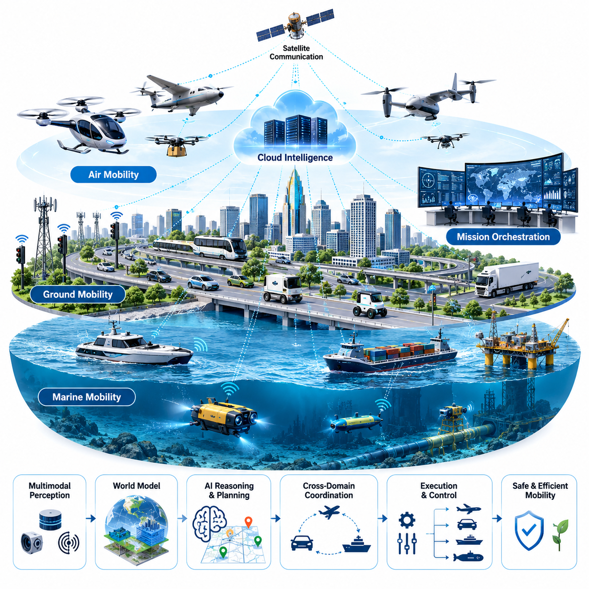{width="7.268055555555556in" height="7.268055555555556in"}

Future mobility represents the convergence of autonomous transportation, intelligent robotics, and interconnected infrastructure into a unified physical intelligence ecosystem. Rather than treating aircraft, ground vehicles, and marine robots as isolated machines, this ecosystem coordinates their capabilities through shared artificial intelligence, distributed computing, and adaptive mission management. Its objective is to move people, materials, and information safely across different environments.

Physical AI extends conventional artificial intelligence by enabling machines to perceive physical environments, reason about dynamic conditions, and execute actions through sensors and actuators. In future mobility systems, this intelligence connects perception, prediction, planning, and control into continuous operational loops. Autonomous platforms must understand terrain, weather, obstacles, traffic, and mission constraints while responding to unpredictable environmental changes.

The air mobility domain includes unmanned aerial vehicles, autonomous cargo aircraft, urban air mobility platforms, and specialized inspection drones. These systems provide rapid transportation across geographical barriers and support missions that are difficult for conventional ground vehicles. Their operational intelligence integrates flight dynamics, three-dimensional navigation, collision avoidance, energy management, and airspace coordination while maintaining strict safety and regulatory requirements.

Ground mobility encompasses autonomous passenger vehicles, delivery robots, industrial mobile robots, and intelligent transportation infrastructure. Unlike aerial platforms, ground robots operate under complex interactions involving road geometry, pedestrian behavior, friction, traffic regulations, and physical obstacles. Their autonomy depends on reliable localization, semantic environment understanding, trajectory planning, and real-time motion control supported by continuous sensor feedback.

Marine mobility introduces autonomous surface vessels and underwater robotic platforms capable of transportation, environmental monitoring, infrastructure inspection, and scientific exploration. These systems encounter hydrodynamic disturbances, changing currents, limited visibility, and intermittent communication. Surface vessels can combine satellite positioning with radar and optical perception, whereas underwater robots increasingly depend on acoustic sensing, inertial navigation, and adaptive mission execution.

A unified mobility ecosystem must recognize that air, ground, and sea robots operate under fundamentally different physical constraints. Aircraft require aerodynamic stability and flight-envelope protection, ground vehicles depend on tire-ground or leg-ground interactions, and marine robots must manage buoyancy and hydrodynamic forces. Consequently, shared intelligence should operate above specialized control layers rather than replacing the domain-specific physics and safety mechanisms of each platform.

The architectural foundation of cross-domain mobility consists of perception services, environment representations, mission planning, communication interfaces, and platform-specific execution systems. Shared software components can describe objectives, geographic constraints, operational status, and task dependencies through standardized data models. Hardware abstraction allows higher-level autonomy services to coordinate heterogeneous robots without directly controlling every actuator or sensor.

Multimodal perception provides the environmental awareness necessary for coordinated autonomous mobility. Cameras, LiDAR, radar, inertial sensors, satellite navigation, and acoustic instruments generate complementary observations across different operational domains. Sensor fusion converts these observations into consistent estimates of position, motion, obstacles, and environmental conditions, while uncertainty modeling prevents unreliable measurements from being treated as definitive physical facts.

World models provide a potential common reasoning framework for future mobility intelligence. A world model represents environmental states, physical interactions, and possible future outcomes, allowing autonomous systems to evaluate alternative actions before execution. Cross-domain models may share semantic knowledge about infrastructure, destinations, and hazards while preserving specialized representations for aerodynamic, terrestrial, and hydrodynamic behavior.

Vision-language-action models introduce another mechanism for coordinating heterogeneous robotic platforms. Human operators may describe transportation objectives using natural language, while intelligent agents translate these objectives into structured tasks and executable plans. However, language-generated instructions must pass through platform-specific feasibility checks, authorization mechanisms, and independent safety constraints before reaching physical control systems.

Cross-domain mission orchestration becomes especially valuable when transportation requires multiple autonomous platforms. A cargo shipment might travel by autonomous aircraft to a regional transfer facility, continue through a ground delivery robot, and eventually reach an offshore destination using an autonomous vessel. Coordinated scheduling must account for transfer interfaces, payload compatibility, energy reserves, infrastructure availability, and the operational limitations of each transportation mode.

Distributed intelligence enables individual robots to cooperate without depending entirely on centralized decision-making. Edge computing handles time-critical perception and control, while cloud platforms support large-scale optimization, historical analysis, and shared knowledge management. This architecture can improve fleet coordination and computational efficiency, provided that essential safety functions remain operational during communication interruptions or cloud service failures.

Communication infrastructure connects autonomous platforms, transportation facilities, and supervisory systems through wireless networks, satellite links, and terrestrial communication services. Because connectivity quality varies significantly between urban roads, open airspace, and underwater environments, communication-aware autonomy is essential. Robots must adapt their operational behavior to latency, bandwidth limitations, packet loss, and temporary disconnection while maintaining safe local decision-making.

Digital twins provide a virtual environment for designing, monitoring, and validating integrated mobility operations. By combining robot models, infrastructure descriptions, environmental data, and operational histories, digital twins can simulate complex transportation scenarios before physical deployment. Their predictive usefulness depends on model fidelity, synchronization accuracy, and the ability to represent uncertainty, unexpected disturbances, and interactions between heterogeneous autonomous systems.

Energy management represents a major systems-level challenge because mobility platforms have different propulsion characteristics and operating requirements. Electric ground robots depend on charging availability and battery health, aerial robots face stringent mass and energy constraints, and marine systems may require extended endurance. Integrated planning should optimize energy consumption alongside delivery time, mission reliability, infrastructure utilization, and environmental impact.

Safety engineering must distinguish intelligent mission coordination from safety-critical vehicle control. High-level AI may propose routes, schedules, and operational adjustments, but verified protection mechanisms must enforce collision constraints, operational boundaries, emergency responses, and platform stability. Runtime monitoring, redundant sensing, fault detection, and controlled fallback behaviors are necessary to prevent reasoning errors from producing unacceptable physical consequences.

Cybersecurity becomes increasingly important as autonomous mobility systems exchange operational commands, sensor information, and infrastructure data. Compromised communication channels or manipulated perception inputs could affect several transportation domains simultaneously. Secure identities, authenticated commands, encrypted communication, software integrity verification, and network segmentation help establish trustworthy interactions between autonomous platforms and their supporting infrastructure.

Interoperability requires common semantic definitions for missions, locations, operational capabilities, and safety states. Existing robotics middleware and transportation communication standards provide useful foundations, but no single protocol currently guarantees universal compatibility across all mobility domains. Future architectures should therefore emphasize modular interfaces, explicit capability descriptions, version management, and carefully validated translation between domain-specific communication systems.

Human supervision remains essential even as mobility systems acquire increasingly sophisticated autonomous capabilities. Operators must understand system intentions, monitor operational risk, and intervene when automated decision-making exceeds approved boundaries. Human-machine interfaces should communicate mission status, uncertainty, predicted conflicts, and intervention options without overwhelming supervisors with unnecessary information. Accountability must remain clearly assigned throughout autonomous operations.

The economic value of integrated mobility emerges from coordinated utilization rather than the performance of individual robots alone. Shared infrastructure, optimized fleet allocation, predictive maintenance, and automated transfer operations can reduce operational inefficiencies. Nevertheless, practical deployment must account for capital investment, regulatory compliance, insurance, maintenance, cybersecurity, and the cost of integrating autonomous platforms with existing transportation networks.

Environmental sustainability provides another motivation for developing coordinated physical AI mobility systems. Intelligent routing, load consolidation, energy-aware scheduling, and efficient infrastructure utilization may reduce unnecessary travel and energy consumption. These benefits are not automatic, because additional computing demand, battery production, empty vehicle movements, and infrastructure expansion also create environmental costs. Lifecycle assessment is therefore necessary to evaluate genuine sustainability improvements.

Future mobility ecosystems will evolve through progressive integration of autonomous capabilities rather than an immediate transition to universal autonomy. Early deployments will likely emphasize controlled environments, defined routes, supervised operations, and specialized logistics applications. As validation methods, infrastructure interoperability, and regulatory frameworks mature, increasingly complex air-ground-sea coordination may become practical across broader transportation networks.

The long-term significance of physical AI lies in transforming mobility from a collection of independently automated vehicles into an adaptive network of intelligent physical agents. Such a network can allocate tasks according to environmental conditions, platform capabilities, and societal priorities while continuously evaluating operational risks. Achieving this vision requires advances in generalizable intelligence, dependable engineering, interoperable infrastructure, and human-centered governance.

미래 모빌리티(Future Mobility)는 자율 운송(Autonomous Transportation), 지능형 로봇(Intelligent Robotics), 상호 연결된 인프라(Interconnected Infrastructure)가 통합된 물리적 지능 생태계(Physical Intelligence Ecosystem)를 의미한다. 이 생태계는 항공기, 지상 차량, 해양 로봇을 독립적인 기계로 취급하는 대신 공유 인공지능(Shared Artificial Intelligence), 분산 컴퓨팅(Distributed Computing), 적응형 임무 관리(Adaptive Mission Management)를 통해 통합적으로 조정한다. 궁극적인 목표는 서로 다른 환경에서 사람, 물자, 정보를 안전하게 이동시키는 것이다.

피지컬 AI(Physical AI)는 기계가 센서(Sensor)와 액추에이터(Actuator)를 통해 물리적 환경을 인식하고, 동적인 상황을 추론하며, 실제 행동을 수행하도록 함으로써 기존 인공지능의 기능을 확장한다. 미래 모빌리티 시스템에서는 이러한 지능이 인식(Perception), 예측(Prediction), 계획(Planning), 제어(Control)를 연속적인 운영 순환 구조로 연결한다. 자율 플랫폼(Autonomous Platform)은 지형, 기상, 장애물, 교통 상황, 임무 제약조건을 이해하면서 예측하기 어려운 환경 변화에도 대응할 수 있어야 한다.

항공 모빌리티(Air Mobility) 영역에는 무인항공기(Unmanned Aerial Vehicle), 자율 화물 항공기(Autonomous Cargo Aircraft), 도심 항공 모빌리티(Urban Air Mobility), 특수 목적 점검 드론(Inspection Drone)이 포함된다. 이러한 시스템은 지리적 장애물을 넘어 신속한 운송을 제공하며 기존 지상 차량으로 수행하기 어려운 임무를 지원한다. 항공 운용 지능은 비행 역학(Flight Dynamics), 3차원 항법(Three-Dimensional Navigation), 충돌 회피(Collision Avoidance), 에너지 관리(Energy Management), 공역 조정(Airspace Coordination)을 통합하면서 엄격한 안전 및 규제 요구사항을 충족해야 한다.

지상 모빌리티(Ground Mobility)는 자율주행 승용차(Autonomous Passenger Vehicle), 배송 로봇(Delivery Robot), 산업용 이동 로봇(Industrial Mobile Robot), 지능형 교통 인프라(Intelligent Transportation Infrastructure)를 포함한다. 항공 플랫폼과 달리 지상 로봇은 도로 형상, 보행자 행동, 마찰, 교통 규정, 물리적 장애물이 복잡하게 상호작용하는 환경에서 운용된다. 자율성(Autonomy)은 신뢰할 수 있는 위치 추정(Localization), 의미 기반 환경 이해(Semantic Environment Understanding), 궤적 계획(Trajectory Planning), 실시간 운동 제어(Real-Time Motion Control), 지속적인 센서 피드백(Sensor Feedback)에 의존한다.

해양 모빌리티(Marine Mobility)는 운송, 환경 모니터링(Environmental Monitoring), 인프라 점검(Infrastructure Inspection), 과학 탐사(Scientific Exploration)를 수행하는 자율 수상 선박(Autonomous Surface Vessel)과 수중 로봇(Underwater Robot)을 포함한다. 이러한 시스템은 유체역학적 교란(Hydrodynamic Disturbance), 변화하는 해류, 제한된 가시성, 간헐적인 통신 문제에 직면한다. 수상 선박은 위성 위치 추정과 레이더 및 광학 인식을 결합할 수 있으며, 수중 로봇은 음향 센싱(Acoustic Sensing), 관성 항법(Inertial Navigation), 적응형 임무 수행(Adaptive Mission Execution)에 점차 의존하고 있다.

통합 모빌리티 생태계(Unified Mobility Ecosystem)는 항공, 지상, 해양 로봇이 근본적으로 서로 다른 물리적 제약조건(Physical Constraints)에서 작동한다는 사실을 고려해야 한다. 항공기는 공기역학적 안정성(Aerodynamic Stability)과 비행 영역 보호(Flight Envelope Protection)가 필요하고, 지상 차량은 타이어와 지면 또는 다리와 지면의 상호작용에 의존하며, 해양 로봇은 부력(Buoyancy)과 유체역학적 힘(Hydrodynamic Force)을 관리해야 한다. 따라서 공유 지능(Shared Intelligence)은 각 플랫폼의 물리 모델과 안전 메커니즘을 대체하는 것이 아니라 특화된 제어 계층 상위에서 작동해야 한다.

교차 영역 모빌리티(Cross-Domain Mobility)의 아키텍처(Architecture)는 인식 서비스(Perception Service), 환경 표현(Environment Representation), 임무 계획(Mission Planning), 통신 인터페이스(Communication Interface), 플랫폼별 실행 시스템(Platform-Specific Execution System)으로 구성된다. 공유 소프트웨어 구성요소(Shared Software Component)는 표준화된 데이터 모델(Standardized Data Model)을 통해 목표, 지리적 제약조건, 운영 상태, 작업 의존성을 표현할 수 있다. 하드웨어 추상화(Hardware Abstraction)는 상위 자율 서비스가 개별 액추에이터나 센서를 직접 제어하지 않고도 이기종 로봇(Heterogeneous Robot)을 조정하도록 지원한다.

다중모달 인식(Multimodal Perception)은 자율 모빌리티의 협력 운용에 필요한 환경 인식 능력을 제공한다. 카메라(Camera), 라이다(LiDAR), 레이더(Radar), 관성 센서(Inertial Sensor), 위성 항법(Satellite Navigation), 음향 장비(Acoustic Instrument)는 서로 다른 운용 영역에서 상호 보완적인 관측 정보를 생성한다. 센서 융합(Sensor Fusion)은 이러한 관측값을 위치, 운동, 장애물, 환경 조건에 대한 일관된 추정값으로 변환하며, 불확실성 모델링(Uncertainty Modeling)은 신뢰성이 낮은 측정값이 확정적인 물리적 사실로 처리되는 것을 방지한다.

월드 모델(World Model)은 미래 모빌리티 지능을 위한 공통 추론 프레임워크(Common Reasoning Framework)를 제공할 수 있다. 월드 모델은 환경 상태(Environmental State), 물리적 상호작용(Physical Interaction), 가능한 미래 결과(Future Outcome)를 표현하여 자율 시스템이 실제 행동을 수행하기 전에 대안을 평가하도록 지원한다. 교차 영역 월드 모델은 인프라, 목적지, 위험 요소에 관한 의미적 지식(Semantic Knowledge)을 공유하면서 공기역학, 지상 운동, 유체역학에 특화된 표현을 유지할 수 있다.

비전-언어-행동 모델(Vision-Language-Action Model, VLA)은 이기종 로봇 플랫폼을 조정하는 또 다른 메커니즘을 제공한다. 인간 운영자는 자연어(Natural Language)로 운송 목표를 설명할 수 있으며, 지능형 에이전트(Intelligent Agent)는 이러한 목표를 구조화된 작업과 실행 가능한 계획으로 변환한다. 그러나 언어 기반으로 생성된 명령은 실제 물리적 제어 시스템에 전달되기 전에 플랫폼별 실행 가능성 검증(Feasibility Check), 권한 확인(Authorization), 독립적인 안전 제약조건(Safety Constraint)을 반드시 통과해야 한다.

교차 영역 임무 오케스트레이션(Cross-Domain Mission Orchestration)은 여러 자율 플랫폼이 필요한 운송 과정에서 특히 높은 가치를 제공한다. 화물은 자율 항공기를 통해 지역 환적 시설로 이동한 다음 지상 배송 로봇을 거쳐 최종적으로 자율 선박을 통해 해상 목적지에 도착할 수 있다. 이러한 협력 일정 관리(Coordinated Scheduling)는 환적 인터페이스(Transfer Interface), 적재물 호환성(Payload Compatibility), 에너지 잔량(Energy Reserve), 인프라 가용성(Infrastructure Availability), 각 운송 수단의 운용 한계를 함께 고려해야 한다.

분산 지능(Distributed Intelligence)은 개별 로봇이 중앙집중식 의사결정(Centralized Decision-Making)에 전적으로 의존하지 않고 협력하도록 지원한다. 엣지 컴퓨팅(Edge Computing)은 시간 제약이 엄격한 인식과 제어를 처리하며, 클라우드 플랫폼(Cloud Platform)은 대규모 최적화, 이력 분석, 공유 지식 관리를 지원한다. 이러한 아키텍처는 필수 안전 기능이 통신 중단이나 클라우드 서비스 장애 상황에서도 정상적으로 작동한다는 조건에서 군집 조정(Fleet Coordination)과 계산 효율성을 향상시킬 수 있다.

통신 인프라(Communication Infrastructure)는 무선 네트워크(Wireless Network), 위성 링크(Satellite Link), 지상 통신 서비스(Terrestrial Communication Service)를 통해 자율 플랫폼, 운송 시설, 감독 시스템을 연결한다. 연결 품질은 도시 도로, 개방 공역, 수중 환경에서 크게 달라지므로 통신 인지형 자율성(Communication-Aware Autonomy)이 필수적이다. 로봇은 안전한 로컬 의사결정(Local Decision-Making)을 유지하면서 지연시간(Latency), 대역폭 제한(Bandwidth Limitation), 패킷 손실(Packet Loss), 일시적인 연결 중단에 맞추어 운용 행동을 조정해야 한다.

디지털 트윈(Digital Twin)은 통합 모빌리티 운영을 설계하고 모니터링하며 검증하기 위한 가상 환경(Virtual Environment)을 제공한다. 로봇 모델(Robot Model), 인프라 설명(Infrastructure Description), 환경 데이터(Environmental Data), 운영 이력(Operational History)을 결합하면 실제 배치 전에 복잡한 운송 시나리오를 시뮬레이션할 수 있다. 예측의 유용성은 모델 충실도(Model Fidelity), 동기화 정확도(Synchronization Accuracy), 불확실성과 예상하지 못한 교란 및 이기종 자율 시스템 간 상호작용을 표현하는 능력에 따라 결정된다.

에너지 관리(Energy Management)는 모빌리티 플랫폼마다 추진 특성과 운용 요구사항이 다르기 때문에 중요한 시스템 수준의 과제이다. 전기 지상 로봇은 충전 인프라 가용성과 배터리 상태(Battery Health)에 의존하며, 항공 로봇은 엄격한 질량 및 에너지 제약조건을 갖고, 해양 시스템은 장시간 운용 능력(Extended Endurance)을 요구할 수 있다. 통합 계획(Integrated Planning)은 배송 시간, 임무 신뢰성(Mission Reliability), 인프라 활용률(Infrastructure Utilization), 환경 영향과 함께 에너지 소비를 최적화해야 한다.

안전 공학(Safety Engineering)은 지능형 임무 조정(Intelligent Mission Coordination)과 안전 필수 차량 제어(Safety-Critical Vehicle Control)를 명확하게 구분해야 한다. 상위 수준 인공지능은 경로, 일정, 운용 조정을 제안할 수 있지만, 검증된 보호 메커니즘(Verified Protection Mechanism)은 충돌 제약조건, 운용 경계, 비상 대응, 플랫폼 안정성을 강제해야 한다. 실행시간 모니터링(Runtime Monitoring), 중복 센싱(Redundant Sensing), 결함 탐지(Fault Detection), 통제된 대체 동작(Fallback Behavior)은 추론 오류가 허용할 수 없는 물리적 결과로 이어지는 것을 방지하는 데 필요하다.

사이버보안(Cybersecurity)은 자율 모빌리티 시스템이 운용 명령, 센서 정보, 인프라 데이터를 교환하면서 더욱 중요해진다. 통신 채널 침해(Communication Channel Compromise)나 조작된 인식 입력(Manipulated Perception Input)은 여러 운송 영역에 동시에 영향을 줄 수 있다. 보안 신원(Secure Identity), 인증된 명령(Authenticated Command), 암호화 통신(Encrypted Communication), 소프트웨어 무결성 검증(Software Integrity Verification), 네트워크 분할(Network Segmentation)은 자율 플랫폼과 지원 인프라 사이의 신뢰할 수 있는 상호작용을 구축하는 데 기여한다.

상호운용성(Interoperability)은 임무, 위치, 운용 능력, 안전 상태에 대한 공통 의미 정의(Common Semantic Definition)를 요구한다. 기존 로봇 미들웨어(Robotics Middleware)와 운송 통신 표준(Transportation Communication Standard)은 유용한 기반을 제공하지만, 현재 단일 프로토콜만으로 모든 모빌리티 영역의 보편적인 호환성을 보장할 수는 없다. 따라서 미래 아키텍처는 모듈형 인터페이스(Modular Interface), 명시적인 능력 기술(Capability Description), 버전 관리(Version Management), 영역별 통신 시스템 사이의 검증된 변환 기능을 강조해야 한다.

인간 감독(Human Supervision)은 모빌리티 시스템이 더욱 정교한 자율 능력을 확보하더라도 필수적인 요소로 남는다. 운영자는 시스템의 의도(System Intention)를 이해하고 운용 위험(Operational Risk)을 감시하며, 자동화된 의사결정이 승인된 경계를 벗어날 때 개입해야 한다. 인간-기계 인터페이스(Human-Machine Interface)는 불필요한 정보로 감독자에게 부담을 주지 않으면서 임무 상태, 불확실성, 예상 충돌, 개입 선택지를 전달해야 한다. 자율 운용의 전 과정에서 책임 소재(Accountability)는 명확하게 지정되어야 한다.

통합 모빌리티의 경제적 가치(Economic Value)는 개별 로봇의 성능만이 아니라 협력적인 자원 활용(Coordinated Utilization)에서 발생한다. 공유 인프라(Shared Infrastructure), 최적화된 군집 할당(Optimized Fleet Allocation), 예지보전(Predictive Maintenance), 자동화된 환적 운영(Automated Transfer Operation)은 운영 비효율성을 줄일 수 있다. 그러나 실제 배치에서는 자본 투자(Capital Investment), 규제 준수(Regulatory Compliance), 보험(Insurance), 유지보수(Maintenance), 사이버보안, 기존 운송 네트워크와의 통합 비용을 함께 고려해야 한다.

환경적 지속가능성(Environmental Sustainability)은 협력형 피지컬 AI 모빌리티 시스템을 개발하는 또 다른 동기이다. 지능형 경로 설정(Intelligent Routing), 화물 통합(Load Consolidation), 에너지 인지형 일정 관리(Energy-Aware Scheduling), 효율적인 인프라 활용은 불필요한 이동과 에너지 소비를 줄일 수 있다. 그러나 추가적인 컴퓨팅 수요, 배터리 생산, 공차 운행(Empty Vehicle Movement), 인프라 확장 역시 환경 비용을 발생시키므로 이러한 이점이 자동으로 보장되는 것은 아니다. 실제 지속가능성 개선을 평가하려면 전과정 평가(Lifecycle Assessment)가 필요하다.

미래 모빌리티 생태계는 보편적 자율성(Universal Autonomy)으로 즉시 전환되기보다는 자율 기능을 단계적으로 통합하면서 발전할 것이다. 초기 배치는 통제된 환경(Controlled Environment), 지정된 경로(Defined Route), 감독하의 운용(Supervised Operation), 특수 물류 응용(Specialized Logistics Application)에 집중할 가능성이 높다. 검증 방법(Validation Method), 인프라 상호운용성, 규제 프레임워크(Regulatory Framework)가 성숙함에 따라 더욱 복잡한 항공-지상-해양 협력 운용이 광범위한 운송 네트워크에서 실현될 수 있다.

피지컬 AI의 장기적인 중요성은 모빌리티를 독립적으로 자동화된 차량들의 집합에서 지능형 물리 에이전트(Intelligent Physical Agent)로 구성된 적응형 네트워크(Adaptive Network)로 전환하는 데 있다. 이러한 네트워크는 환경 조건, 플랫폼 능력, 사회적 우선순위에 따라 작업을 할당하면서 운용 위험을 지속적으로 평가할 수 있다. 이 비전을 실현하려면 범용화 가능한 지능(Generalizable Intelligence), 신뢰할 수 있는 공학(Dependable Engineering), 상호운용 가능한 인프라(Interoperable Infrastructure), 인간 중심 거버넌스(Human-Centered Governance)의 발전이 필요하다.

##  

## 09.02. Unified Autonomy Stack Across Platforms [w/Code]

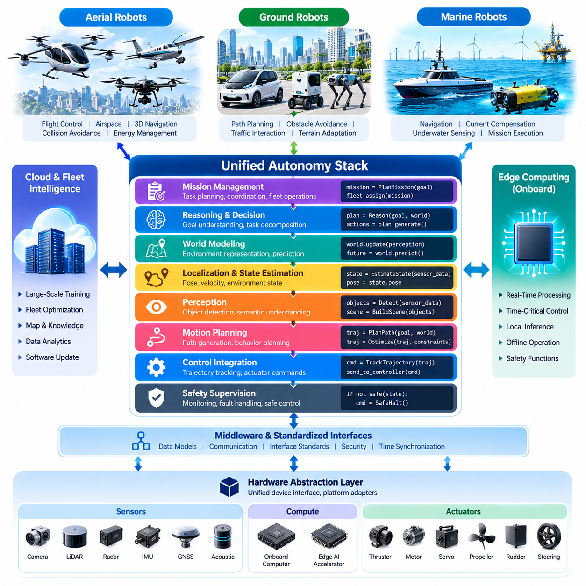{width="7.268055555555556in" height="7.268055555555556in"}

A unified autonomy stack provides a common software architecture for intelligent robots operating across air, ground, and marine environments. Its purpose is to reuse perception, reasoning, planning, and mission management capabilities while preserving platform-specific control requirements. This approach reduces duplicated engineering effort, improves interoperability, and enables heterogeneous robotic systems to cooperate through consistent operational interfaces.

Traditional autonomy architectures are usually developed around individual vehicle categories. Autonomous aircraft prioritize flight stability and airspace navigation, ground robots emphasize obstacle avoidance and terrain interaction, and marine vehicles address hydrodynamic disturbances and navigation uncertainty. A unified stack separates reusable intelligence from specialized physical control, allowing common autonomy services to operate across different robotic embodiments.

The architectural foundation consists of hardware abstraction, perception, localization, world modeling, decision-making, planning, control integration, and safety supervision. These components communicate through explicitly defined interfaces and shared data representations. Each layer provides services to higher-level functions while maintaining clear responsibility boundaries, enabling developers to replace individual algorithms without redesigning the entire autonomous system.

Hardware abstraction establishes a standardized interface between physical devices and autonomy software. Cameras, LiDAR sensors, radar units, inertial measurement devices, navigation receivers, and propulsion controllers expose capabilities through consistent software contracts. Platform adapters translate generic requests into device-specific operations while preserving information about measurement accuracy, actuator limits, communication timing, and hardware availability.

The perception layer transforms raw sensor observations into meaningful representations of the surrounding environment. Object detection, semantic segmentation, motion estimation, and obstacle classification provide information needed for autonomous decision-making. Although sensing configurations differ between aerial, terrestrial, and underwater robots, common perception interfaces can represent detected objects, environmental features, confidence estimates, and spatial relationships.

Localization and state estimation determine the robot\'s position, orientation, velocity, and relevant operating conditions. Ground robots may combine LiDAR localization with wheel odometry, aircraft integrate satellite navigation and inertial measurements, and underwater vehicles often depend on acoustic positioning and inertial navigation. A unified state representation allows planning systems to consume consistent motion estimates while accommodating platform-dependent uncertainty and coordinate conventions.

World modeling integrates perception, localization, and environmental knowledge into a structured representation of the operational domain. Geometric maps describe physical boundaries, semantic maps identify meaningful objects, and dynamic models estimate future environmental changes. A shared world-model interface can support multiple robot types, but each platform must retain specialized representations for airspace constraints, traversable terrain, or marine navigation conditions.

The reasoning layer interprets mission objectives and evaluates available actions against operational constraints. Foundation models and vision-language-action architectures may assist with semantic understanding, task decomposition, and contextual decision-making. However, generated decisions must be checked against verified capabilities, physical feasibility, and authorization policies before execution. High-level intelligence therefore remains separated from safety-critical control authority.

Mission planning converts operational objectives into coordinated sequences of tasks. A transportation mission may require collecting cargo, navigating to a transfer facility, exchanging payloads, and completing delivery through another vehicle. The unified stack represents these activities through common task descriptions, dependencies, priorities, and completion conditions while allowing individual platforms to determine how each assigned task should be executed.

Motion planning bridges mission-level decisions and physical vehicle behavior. Aerial robots generate trajectories within flight envelopes, ground vehicles calculate collision-free paths under steering and traction constraints, and marine robots account for currents and maneuverability. Shared planning interfaces can describe objectives and constraints, while specialized planners enforce the kinematic, dynamic, and environmental requirements of each robotic platform.

Control integration translates planned trajectories and behaviors into commands suitable for the underlying vehicle. Flight controllers regulate attitude and propulsion, ground controllers manage steering and wheel torque, and marine controllers coordinate thrust and rudder actions. The unified autonomy stack should not replace validated low-level controllers. Instead, it communicates bounded references and monitors execution through well-defined interfaces.

Real-time execution requirements strongly influence the separation between autonomy layers. High-level reasoning may tolerate variable processing delays, whereas stabilization and collision prevention require predictable response times. Time-critical functions should execute on suitable onboard computing resources with bounded scheduling behavior. Cloud connectivity may enhance optimization and learning, but essential vehicle safety must not depend on continuous network availability.

Middleware provides the communication infrastructure connecting autonomy components and heterogeneous platforms. Publish-subscribe messaging, request-response services, and asynchronous actions support different interaction patterns. ROS 2 and DDS offer useful architectural foundations, although deployment-specific configurations must address timing guarantees, quality of service, security, and compatibility with certified or otherwise independently validated control systems.

A unified data model establishes common definitions for position, velocity, acceleration, mission status, environmental observations, and system health. Consistent coordinate frames, measurement units, timestamps, and uncertainty representations are essential for reliable interoperability. Schema versioning and interface validation prevent subtle integration failures when robots from different manufacturers or software generations exchange operational information.

Capability-based abstraction enables the stack to support robots with different physical configurations. Instead of assuming that every platform can perform identical actions, the system describes available functions such as navigation, manipulation, payload transport, docking, and inspection. Mission planners match task requirements against declared capabilities, operational limits, and current system conditions before assigning responsibilities to individual robots.

Safety supervision operates across the entire autonomy architecture rather than appearing as an isolated final processing stage. Independent monitors evaluate operational boundaries, collision risks, system faults, and command validity. When unsafe conditions emerge, supervisory mechanisms can restrict actions, request controlled recovery, or activate platform-specific emergency procedures. Safety authority must remain effective even when high-level AI components fail.

Fault tolerance requires explicit handling of sensor degradation, actuator malfunction, communication loss, and computational overload. The unified stack should expose health information through standardized diagnostic interfaces while supporting platform-specific recovery strategies. An aircraft may require immediate contingency navigation, whereas a ground robot may safely stop. Recovery behavior must therefore reflect physical consequences rather than applying one universal response.

Cybersecurity protects the integrity of shared autonomy services and cross-platform communication. Device authentication, encrypted channels, access control, signed software updates, and runtime integrity monitoring reduce opportunities for unauthorized manipulation. Security policies should distinguish observation privileges from command authority, especially when cloud services or external AI agents interact with safety-sensitive robotic systems.

Simulation provides a practical environment for developing reusable autonomy components before deployment. Shared mission logic can be evaluated across aerial, ground, and marine simulations, while specialized physics engines represent domain-specific dynamics. Software-in-the-loop and hardware-in-the-loop testing help identify interface incompatibilities, timing problems, and unexpected interactions before integrated field operations begin.

Continuous integration and deployment pipelines improve the maintainability of a unified autonomy stack. Automated tests can verify interface contracts, algorithm performance, configuration compatibility, and regression behavior across supported platforms. Model updates and software releases require controlled validation because improvements demonstrated on one robot type may introduce failures on another. Deployment decisions should therefore remain platform-specific.

Fleet-level orchestration extends the unified stack beyond individual robots. A coordination service can allocate missions, monitor resources, manage transfer points, and resolve scheduling conflicts across transportation domains. Shared operational intelligence improves overall system utilization while preserving local autonomy. Each robot must retain sufficient decision-making capability to respond safely when centralized coordination becomes delayed or unavailable.

The long-term objective is a modular autonomy ecosystem in which intelligence can be reused without assuming that all robots share identical physical behavior. Standardized interfaces, capability-aware planning, independent safety supervision, and rigorous validation establish the foundation for scalable cross-platform deployment. As foundation models and world models advance, this architecture can support increasingly adaptive cooperation among air, ground, and marine robots.

통합 자율성 스택(Unified Autonomy Stack)은 항공, 지상, 해양 환경에서 운용되는 지능형 로봇을 위한 공통 소프트웨어 아키텍처(Common Software Architecture)를 제공한다. 이 구조의 목적은 플랫폼별 제어 요구사항(Platform-Specific Control Requirements)을 유지하면서 인식(Perception), 추론(Reasoning), 계획(Planning), 임무 관리(Mission Management) 기능을 재사용하는 것이다. 이러한 접근 방식은 중복된 엔지니어링 작업을 줄이고 상호운용성(Interoperability)을 향상시키며, 이기종 로봇 시스템(Heterogeneous Robotic Systems)이 일관된 운영 인터페이스(Operational Interface)를 통해 협력할 수 있도록 지원한다.

기존 자율성 아키텍처(Autonomy Architecture)는 일반적으로 개별 차량 유형을 중심으로 개발된다. 자율 항공기(Autonomous Aircraft)는 비행 안정성(Flight Stability)과 공역 항법(Airspace Navigation)을 우선시하고, 지상 로봇(Ground Robot)은 장애물 회피(Obstacle Avoidance)와 지형 상호작용(Terrain Interaction)을 강조하며, 해양 차량(Marine Vehicle)은 유체역학적 교란(Hydrodynamic Disturbance)과 항법 불확실성(Navigation Uncertainty)에 대응한다. 통합 스택은 재사용 가능한 지능(Reusable Intelligence)과 특화된 물리적 제어(Specialized Physical Control)를 분리하여 공통 자율 서비스가 서로 다른 로봇 형태(Robotic Embodiment)에서 작동하도록 한다.

아키텍처의 기반은 하드웨어 추상화(Hardware Abstraction), 인식(Perception), 위치 추정(Localization), 월드 모델링(World Modeling), 의사결정(Decision-Making), 계획(Planning), 제어 통합(Control Integration), 안전 감독(Safety Supervision)으로 구성된다. 이러한 구성요소는 명확하게 정의된 인터페이스(Interface)와 공유 데이터 표현(Shared Data Representation)을 통해 통신한다. 각 계층(Layer)은 명확한 책임 경계(Responsibility Boundary)를 유지하면서 상위 기능에 서비스를 제공하므로, 개발자는 전체 자율 시스템을 재설계하지 않고도 개별 알고리즘을 교체할 수 있다.

하드웨어 추상화(Hardware Abstraction)는 물리적 장치와 자율 소프트웨어 사이에 표준화된 인터페이스(Standardized Interface)를 구축한다. 카메라(Camera), 라이다(LiDAR), 레이더(Radar), 관성 측정 장치(Inertial Measurement Device), 항법 수신기(Navigation Receiver), 추진 제어기(Propulsion Controller)는 일관된 소프트웨어 계약(Software Contract)을 통해 기능을 제공한다. 플랫폼 어댑터(Platform Adapter)는 일반적인 요청을 장치별 동작으로 변환하면서 측정 정확도(Measurement Accuracy), 액추에이터 한계(Actuator Limit), 통신 타이밍(Communication Timing), 하드웨어 가용성(Hardware Availability)에 관한 정보를 유지한다.

인식 계층(Perception Layer)은 원시 센서 관측값(Raw Sensor Observation)을 주변 환경에 대한 의미 있는 표현으로 변환한다. 객체 탐지(Object Detection), 의미적 분할(Semantic Segmentation), 운동 추정(Motion Estimation), 장애물 분류(Obstacle Classification)는 자율 의사결정에 필요한 정보를 제공한다. 항공, 지상, 수중 로봇의 센서 구성이 서로 다르더라도 공통 인식 인터페이스(Common Perception Interface)는 탐지된 객체, 환경 특징(Environmental Feature), 신뢰도 추정값(Confidence Estimate), 공간적 관계(Spatial Relationship)를 표현할 수 있다.

위치 추정(Localization)과 상태 추정(State Estimation)은 로봇의 위치(Position), 자세(Orientation), 속도(Velocity), 관련 운용 상태(Operating Condition)를 결정한다. 지상 로봇은 라이다 기반 위치 추정과 바퀴 주행거리 측정(Wheel Odometry)을 결합할 수 있고, 항공기는 위성 항법(Satellite Navigation)과 관성 측정(Inertial Measurement)을 통합하며, 수중 차량은 음향 위치 추정(Acoustic Positioning)과 관성 항법(Inertial Navigation)에 의존하는 경우가 많다. 통합 상태 표현(Unified State Representation)은 플랫폼별 불확실성과 좌표계 규약(Coordinate Convention)을 수용하면서 계획 시스템에 일관된 운동 추정값을 제공한다.

월드 모델링(World Modeling)은 인식, 위치 추정, 환경 지식을 통합하여 운용 영역에 대한 구조화된 표현(Structured Representation)을 생성한다. 기하학적 지도(Geometric Map)는 물리적 경계를 설명하고, 의미 지도(Semantic Map)는 의미 있는 객체를 식별하며, 동적 모델(Dynamic Model)은 미래 환경 변화를 추정한다. 공유 월드 모델 인터페이스(Shared World-Model Interface)는 여러 로봇 유형을 지원할 수 있지만, 각 플랫폼은 공역 제약조건(Airspace Constraint), 주행 가능 지형(Traversable Terrain), 해양 항법 조건(Marine Navigation Condition)에 대한 특화된 표현을 유지해야 한다.

추론 계층(Reasoning Layer)은 임무 목표(Mission Objective)를 해석하고 운용 제약조건(Operational Constraint)에 따라 가능한 행동을 평가한다. 파운데이션 모델(Foundation Model)과 비전-언어-행동 아키텍처(Vision-Language-Action Architecture)는 의미 이해(Semantic Understanding), 작업 분해(Task Decomposition), 상황 기반 의사결정(Contextual Decision-Making)을 지원할 수 있다. 그러나 생성된 결정은 실행 전에 검증된 능력(Verified Capability), 물리적 실행 가능성(Physical Feasibility), 권한 정책(Authorization Policy)에 따라 확인되어야 한다. 따라서 상위 지능(High-Level Intelligence)은 안전 필수 제어 권한(Safety-Critical Control Authority)과 분리된 상태를 유지한다.

임무 계획(Mission Planning)은 운용 목표를 조정된 작업 순서(Coordinated Task Sequence)로 변환한다. 운송 임무에는 화물 수거, 환적 시설로의 이동, 적재물 교환, 다른 차량을 통한 최종 배송이 포함될 수 있다. 통합 스택은 이러한 활동을 공통 작업 기술(Common Task Description), 의존성(Dependency), 우선순위(Priority), 완료 조건(Completion Condition)을 통해 표현하면서 각 플랫폼이 할당된 작업을 수행하는 구체적인 방법을 자체적으로 결정하도록 한다.

운동 계획(Motion Planning)은 임무 수준의 결정(Mission-Level Decision)과 실제 차량 동작(Physical Vehicle Behavior)을 연결한다. 항공 로봇은 비행 영역(Flight Envelope) 내에서 궤적(Trajectory)을 생성하고, 지상 차량은 조향(Steering)과 접지력(Traction) 제약조건을 고려하여 충돌 없는 경로를 계산하며, 해양 로봇은 해류(Current)와 기동성(Maneuverability)을 고려한다. 공유 계획 인터페이스(Shared Planning Interface)는 목표와 제약조건을 기술할 수 있으며, 특화된 계획기(Specialized Planner)는 각 플랫폼의 운동학적(Kinematic), 동역학적(Dynamic), 환경적 요구사항을 강제한다.

제어 통합(Control Integration)은 계획된 궤적과 행동을 하위 차량에 적합한 명령으로 변환한다. 비행 제어기(Flight Controller)는 자세(Attitude)와 추진력(Propulsion)을 조절하고, 지상 제어기(Ground Controller)는 조향과 바퀴 토크(Wheel Torque)를 관리하며, 해양 제어기(Marine Controller)는 추력(Thrust)과 방향타(Rudder) 동작을 조정한다. 통합 자율성 스택은 검증된 저수준 제어기(Validated Low-Level Controller)를 대체해서는 안 된다. 대신 명확하게 정의된 인터페이스를 통해 제한된 참조 명령(Bounded Reference)을 전달하고 실행 상태를 모니터링해야 한다.

실시간 실행 요구사항(Real-Time Execution Requirements)은 자율성 계층 간 분리 구조에 큰 영향을 미친다. 상위 수준의 추론은 가변적인 처리 지연(Processing Delay)을 허용할 수 있지만, 안정화(Stabilization)와 충돌 방지(Collision Prevention)는 예측 가능한 응답시간(Response Time)을 요구한다. 시간 제약이 엄격한 기능은 실행시간의 상한을 고려한 스케줄링(Bounded Scheduling Behavior)을 갖춘 적절한 온보드 컴퓨팅 자원(Onboard Computing Resource)에서 실행되어야 한다. 클라우드 연결(Cloud Connectivity)은 최적화와 학습을 향상시킬 수 있지만, 필수 차량 안전 기능이 지속적인 네트워크 가용성에 의존해서는 안 된다.

미들웨어(Middleware)는 자율성 구성요소와 이기종 플랫폼을 연결하는 통신 인프라(Communication Infrastructure)를 제공한다. 발행-구독 메시징(Publish-Subscribe Messaging), 요청-응답 서비스(Request-Response Service), 비동기 액션(Asynchronous Action)은 서로 다른 상호작용 패턴(Interaction Pattern)을 지원한다. ROS 2와 DDS는 유용한 아키텍처 기반을 제공하지만, 실제 배치 환경에 맞는 구성(Deployment-Specific Configuration)에서는 타이밍 보장(Timing Guarantee), 서비스 품질(Quality of Service), 보안(Security), 인증되었거나 독립적으로 검증된 제어 시스템과의 호환성을 고려해야 한다.

통합 데이터 모델(Unified Data Model)은 위치, 속도, 가속도(Acceleration), 임무 상태(Mission Status), 환경 관측값(Environmental Observation), 시스템 건전성(System Health)에 대한 공통 정의를 구축한다. 일관된 좌표계(Coordinate Frame), 측정 단위(Measurement Unit), 타임스탬프(Timestamp), 불확실성 표현(Uncertainty Representation)은 신뢰할 수 있는 상호운용성을 위해 필수적이다. 스키마 버전 관리(Schema Versioning)와 인터페이스 검증(Interface Validation)은 서로 다른 제조업체나 소프트웨어 세대의 로봇이 운용 정보를 교환할 때 발생할 수 있는 미묘한 통합 오류를 방지한다.

능력 기반 추상화(Capability-Based Abstraction)는 통합 스택이 서로 다른 물리적 구성을 가진 로봇을 지원하도록 한다. 모든 플랫폼이 동일한 행동을 수행할 수 있다고 가정하는 대신, 시스템은 항법(Navigation), 조작(Manipulation), 적재물 운송(Payload Transport), 도킹(Docking), 점검(Inspection)과 같은 사용 가능한 기능을 기술한다. 임무 계획기는 개별 로봇에 책임을 할당하기 전에 작업 요구사항(Task Requirement)을 선언된 능력(Declared Capability), 운용 한계(Operational Limit), 현재 시스템 상태(Current System Condition)와 비교한다.

안전 감독(Safety Supervision)은 자율성 아키텍처의 마지막 처리 단계에 고립된 기능이 아니라 전체 구조에 걸쳐 작동한다. 독립적인 모니터(Independent Monitor)는 운용 경계(Operational Boundary), 충돌 위험(Collision Risk), 시스템 결함(System Fault), 명령 유효성(Command Validity)을 평가한다. 안전하지 않은 조건이 발생하면 감독 메커니즘(Supervisory Mechanism)은 행동을 제한하거나 통제된 복구(Controlled Recovery)를 요청하거나 플랫폼별 비상 절차(Emergency Procedure)를 활성화할 수 있다. 안전 권한(Safety Authority)은 상위 인공지능 구성요소가 실패하더라도 유효하게 유지되어야 한다.

결함 허용성(Fault Tolerance)은 센서 성능 저하(Sensor Degradation), 액추에이터 오작동(Actuator Malfunction), 통신 손실(Communication Loss), 계산 과부하(Computational Overload)를 명시적으로 처리해야 한다. 통합 스택은 표준화된 진단 인터페이스(Standardized Diagnostic Interface)를 통해 상태 정보를 제공하면서 플랫폼별 복구 전략(Recovery Strategy)을 지원해야 한다. 항공기는 즉각적인 비상 항법(Contingency Navigation)이 필요할 수 있지만, 지상 로봇은 안전하게 정지할 수 있다. 따라서 복구 행동은 하나의 보편적인 대응 방식을 적용하기보다 실제 물리적 결과(Physical Consequence)를 반영해야 한다.

사이버보안(Cybersecurity)은 공유 자율 서비스(Shared Autonomy Service)와 플랫폼 간 통신(Cross-Platform Communication)의 무결성(Integrity)을 보호한다. 장치 인증(Device Authentication), 암호화 채널(Encrypted Channel), 접근 제어(Access Control), 서명된 소프트웨어 업데이트(Signed Software Update), 실행시간 무결성 모니터링(Runtime Integrity Monitoring)은 무단 조작 가능성을 줄인다. 특히 클라우드 서비스나 외부 인공지능 에이전트가 안전에 민감한 로봇 시스템과 상호작용할 때 보안 정책(Security Policy)은 관측 권한(Observation Privilege)과 명령 권한(Command Authority)을 구분해야 한다.

시뮬레이션(Simulation)은 실제 배치 전에 재사용 가능한 자율성 구성요소를 개발하기 위한 실용적인 환경을 제공한다. 공유 임무 로직(Shared Mission Logic)은 항공, 지상, 해양 시뮬레이션 전반에서 평가할 수 있으며, 특화된 물리 엔진(Physics Engine)은 영역별 동역학(Domain-Specific Dynamics)을 표현한다. 소프트웨어 인 더 루프 시험(Software-in-the-Loop Testing)과 하드웨어 인 더 루프 시험(Hardware-in-the-Loop Testing)은 통합 현장 운용 전에 인터페이스 비호환성(Interface Incompatibility), 타이밍 문제(Timing Problem), 예상하지 못한 상호작용을 식별하는 데 도움을 준다.

지속적 통합 및 배포 파이프라인(Continuous Integration and Deployment Pipeline)은 통합 자율성 스택의 유지보수성(Maintainability)을 향상시킨다. 자동화 시험(Automated Testing)은 지원되는 플랫폼 전반에서 인터페이스 계약(Interface Contract), 알고리즘 성능(Algorithm Performance), 구성 호환성(Configuration Compatibility), 회귀 동작(Regression Behavior)을 검증할 수 있다. 특정 로봇 유형에서 확인된 개선이 다른 로봇에서는 오류를 유발할 수 있으므로 모델 업데이트(Model Update)와 소프트웨어 릴리스(Software Release)에는 통제된 검증(Controlled Validation)이 필요하다. 따라서 배포 결정은 플랫폼별로 이루어져야 한다.

군집 수준 오케스트레이션(Fleet-Level Orchestration)은 통합 스택을 개별 로봇의 범위를 넘어 확장한다. 조정 서비스(Coordination Service)는 여러 운송 영역에서 임무를 할당하고, 자원을 모니터링하며, 환적 지점을 관리하고, 일정 충돌(Scheduling Conflict)을 해결할 수 있다. 공유 운영 지능(Shared Operational Intelligence)은 로컬 자율성(Local Autonomy)을 유지하면서 전체 시스템 활용률(System Utilization)을 향상시킨다. 각 로봇은 중앙집중식 조정(Centralized Coordination)이 지연되거나 사용할 수 없는 상황에서도 안전하게 대응할 수 있는 충분한 의사결정 능력을 유지해야 한다.

장기적인 목표는 모든 로봇이 동일한 물리적 행동을 수행한다고 가정하지 않으면서 지능을 재사용할 수 있는 모듈형 자율성 생태계(Modular Autonomy Ecosystem)를 구축하는 것이다. 표준화된 인터페이스(Standardized Interface), 능력 인지형 계획(Capability-Aware Planning), 독립적인 안전 감독(Independent Safety Supervision), 엄격한 검증(Rigorous Validation)은 확장 가능한 교차 플랫폼 배치(Scalable Cross-Platform Deployment)의 기반을 형성한다. 파운데이션 모델(Foundation Model)과 월드 모델(World Model)이 발전함에 따라 이러한 아키텍처는 항공, 지상, 해양 로봇 사이에서 점점 더 적응적인 협력(Adaptive Cooperation)을 지원할 수 있다.

##  

## 09.03. Urban Air Mobility and Ground Robot Integration

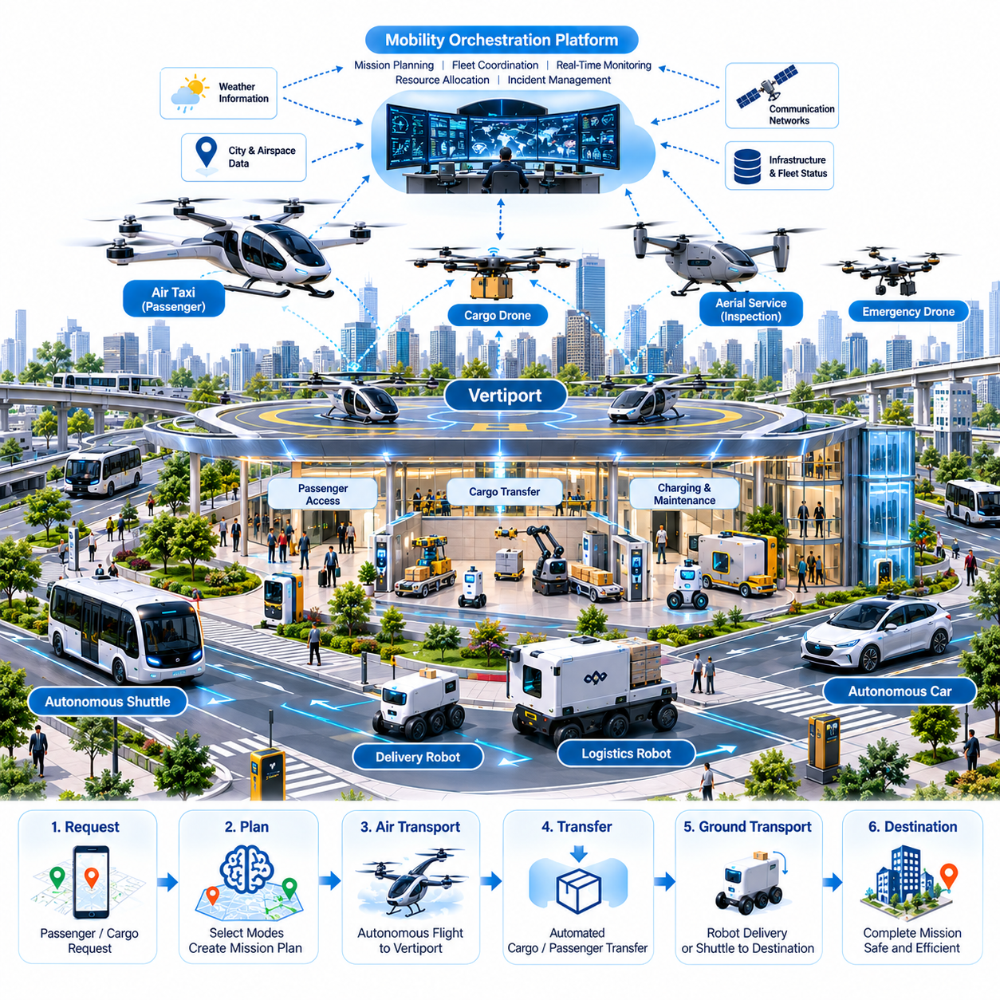{width="7.268055555555556in" height="7.268055555555556in"}

Urban air mobility represents an emerging transportation architecture that combines autonomous aerial vehicles, ground robots, and intelligent urban infrastructure. Its objective is to connect aerial transportation with terrestrial mobility through coordinated scheduling, shared information, and automated transfer operations. Physical AI enables these systems to perceive changing environments, interpret operational constraints, and cooperate across transportation domains.

Urban air mobility platforms include electric vertical takeoff and landing aircraft, cargo drones, and specialized aerial service vehicles. Ground systems include autonomous shuttles, delivery robots, mobile manipulators, and automated logistics vehicles. Their integration requires more than synchronized navigation because aircraft and ground robots operate under different physical constraints, regulatory frameworks, and infrastructure requirements.

A typical integrated mobility mission begins when a transportation request enters a centralized or distributed orchestration platform. The system evaluates passenger or cargo requirements, available vehicles, weather conditions, energy reserves, and infrastructure capacity. It then selects suitable transportation modes and generates a coordinated mission plan that connects aerial movement with ground pickup, transfer, and final delivery.

Vertiports serve as critical interfaces between aerial and terrestrial transportation networks. These facilities provide landing areas, passenger access, cargo handling, charging infrastructure, and vehicle servicing capabilities. Ground robots can support automated baggage movement, cargo transfer, inspection, and facility logistics. Effective integration requires synchronized arrival schedules, controlled movement zones, and reliable communication between aircraft and facility automation.

The autonomy architecture must separate shared mission intelligence from platform-specific control systems. Aerial vehicles require flight stabilization, airspace navigation, and contingency management, while ground robots require obstacle avoidance, localization, and terrain-aware motion planning. Shared services can coordinate mission objectives and resource allocation without directly replacing independently validated flight controllers or ground motion controllers.

Perception systems provide situational awareness around landing facilities, transfer corridors, and ground transportation routes. Cameras, LiDAR, radar, and positioning sensors identify obstacles, moving vehicles, pedestrians, and infrastructure conditions. Sensor fusion improves environmental understanding, while uncertainty estimates help prevent unreliable observations from producing unsafe decisions during aircraft arrival, cargo transfer, or robot movement.

A shared operational world model can represent aircraft locations, ground robot positions, facility occupancy, restricted zones, and predicted traffic conditions. This representation supports coordinated decision-making across different transportation platforms. However, detailed flight dynamics and ground vehicle motion remain within specialized models, ensuring that high-level coordination does not overlook the physical limitations of individual systems.

Mission orchestration coordinates the timing and dependencies of aerial and ground activities. For example, a delivery robot should approach a cargo transfer station only after the aircraft has landed, completed required safety procedures, and received transfer authorization. Task dependencies, resource reservations, and operational state transitions prevent conflicting activities and reduce unnecessary waiting between transportation stages.

Time synchronization is essential because delays in one transportation mode can propagate through the entire mobility network. Aircraft arrival uncertainty may affect ground vehicle dispatch, charging schedules, and cargo processing capacity. Predictive scheduling algorithms can continuously update estimated arrival times and reassign resources when conditions change, improving throughput while preserving operational safety margins.

Airspace management introduces requirements that differ significantly from conventional ground fleet coordination. Urban aircraft must comply with applicable aviation rules, operational approvals, separation requirements, and airspace restrictions. Uncrewed aircraft traffic management services may support flight coordination where available. Integration platforms must distinguish strategic mission scheduling from authorized air traffic functions and certified flight safety responsibilities.

Ground robot navigation around vertiports requires careful consideration of pedestrian movement, aircraft operations, service vehicles, and restricted access areas. Autonomous robots must operate within approved routes and maintain safe separation from active landing zones. Dynamic geofencing, traffic coordination, and facility-level permissions can prevent ground vehicles from entering hazardous areas during aircraft approach, departure, or maintenance operations.

Automated cargo transfer requires mechanical and informational compatibility between transportation platforms. Standardized containers, docking interfaces, payload identification, and robotic handling systems can reduce manual intervention. Transfer controllers should verify vehicle identity, payload mass, secure attachment, and receiving capacity before releasing cargo. Physical interlocks and independent safety checks remain necessary even when AI coordinates the transfer sequence.

Communication infrastructure connects aircraft, ground robots, vertiports, and fleet management services. Cellular networks, local wireless systems, and aviation communication channels may support different operational functions. Because network performance can deteriorate or become unavailable, safety-critical actions must not depend solely on remote communication. Local controllers should maintain safe behavior during connectivity interruptions.

Edge computing provides low-latency processing for local perception, facility coordination, and robotic execution. Cloud computing supports fleet optimization, demand forecasting, historical analysis, and long-term operational planning. A hybrid architecture distributes computation according to timing, reliability, and security requirements. Critical control remains onboard or within suitably assured local systems, while cloud services enhance broader coordination.

Energy management must coordinate aircraft charging requirements with ground robot availability and facility power capacity. Electric aircraft can impose substantial charging demands, particularly during concentrated arrival and departure periods. Scheduling algorithms should consider battery state, charging duration, thermal limitations, and electricity availability. Ground vehicle charging must also be coordinated to avoid reducing logistics capacity during peak operations.

Safety engineering requires explicit boundaries between transportation orchestration, autonomous navigation, and vehicle protection systems. Independent monitoring mechanisms should detect unsafe proximity, unauthorized movement, equipment faults, and operational conflicts. Emergency procedures must account for aircraft contingencies, ground robot failures, cargo handling incidents, and facility evacuation. Human supervisors retain authority over defined exceptional situations.

Cybersecurity becomes a system-level concern when transportation platforms share mission instructions, location data, and infrastructure access permissions. Compromised commands could disrupt aircraft scheduling or direct ground robots into restricted areas. Secure authentication, encrypted communication, role-based authorization, and software integrity verification help protect coordinated operations. Security monitoring should also detect unusual behavior across interconnected systems.

Digital twins provide a simulation environment for evaluating integrated urban mobility operations before deployment. Models of vertiports, aerial corridors, ground routes, charging stations, and robotic transfer equipment allow engineers to examine congestion and operational conflicts. Scenario-based testing can assess weather disruptions, communication failures, equipment faults, and unexpected demand while identifying weaknesses in coordination policies.

Operational performance should be measured across the complete transportation chain rather than evaluating aircraft and ground robots independently. Relevant indicators include end-to-end delivery time, transfer latency, mission completion rate, infrastructure utilization, energy consumption, and safety-related events. These metrics reveal whether integration produces measurable improvements and help identify bottlenecks between aerial transportation and terrestrial logistics.

Deployment must proceed through controlled operational environments with clearly defined responsibilities and validated interfaces. Early applications may emphasize cargo logistics, medical supply transportation, and restricted-area facility services before expanding toward more complex passenger operations. Regulatory approval, public acceptance, infrastructure investment, and demonstrated safety performance will determine the practical pace of broader adoption.

The long-term vision is an intelligent urban mobility network in which aerial and ground platforms cooperate as components of a coordinated transportation service. Physical AI can support adaptive scheduling, contextual perception, predictive resource allocation, and automated transfer operations. Achieving reliable integration requires interoperable software, specialized vehicle control, resilient infrastructure, rigorous validation, and transparent human oversight.

도심 항공 모빌리티(Urban Air Mobility, UAM)는 자율 항공기(Autonomous Aerial Vehicle), 지상 로봇(Ground Robot), 지능형 도시 인프라(Intelligent Urban Infrastructure)를 결합하는 새로운 운송 아키텍처(Transportation Architecture)를 의미한다. 그 목적은 협력 일정 관리(Coordinated Scheduling), 정보 공유(Shared Information), 자동화된 환적 운영(Automated Transfer Operations)을 통해 항공 운송과 지상 모빌리티를 연결하는 것이다. 피지컬 AI(Physical AI)는 이러한 시스템이 변화하는 환경을 인식하고, 운용 제약조건(Operational Constraints)을 해석하며, 서로 다른 운송 영역에서 협력하도록 지원한다.

도심 항공 모빌리티 플랫폼에는 전기 수직이착륙 항공기(Electric Vertical Takeoff and Landing Aircraft, eVTOL), 화물 드론(Cargo Drone), 특수 목적 항공 서비스 차량(Specialized Aerial Service Vehicle)이 포함된다. 지상 시스템에는 자율주행 셔틀(Autonomous Shuttle), 배송 로봇(Delivery Robot), 이동형 매니퓰레이터(Mobile Manipulator), 자동화 물류 차량(Automated Logistics Vehicle)이 포함된다. 항공기와 지상 로봇은 서로 다른 물리적 제약조건, 규제 체계(Regulatory Framework), 인프라 요구사항을 갖기 때문에 이들을 통합하려면 단순한 항법 동기화(Navigation Synchronization) 이상의 기술이 필요하다.

일반적인 통합 모빌리티 임무(Integrated Mobility Mission)는 운송 요청(Transportation Request)이 중앙집중식 또는 분산형 오케스트레이션 플랫폼(Centralized or Distributed Orchestration Platform)에 입력되면서 시작된다. 시스템은 승객 또는 화물 요구사항, 이용 가능한 차량, 기상 조건, 에너지 잔량(Energy Reserve), 인프라 수용 능력(Infrastructure Capacity)을 평가한다. 이후 적절한 운송 수단을 선택하고 항공 이동과 지상 픽업(Ground Pickup), 환적(Transfer), 최종 배송(Final Delivery)을 연결하는 협력 임무 계획(Coordinated Mission Plan)을 생성한다.

버티포트(Vertiport)는 항공 운송망과 지상 운송망을 연결하는 핵심 인터페이스(Critical Interface) 역할을 수행한다. 이러한 시설은 착륙 구역(Landing Area), 승객 접근 시설(Passenger Access), 화물 처리(Cargo Handling), 충전 인프라(Charging Infrastructure), 차량 정비 기능(Vehicle Servicing Capability)을 제공한다. 지상 로봇은 자동화된 수하물 이동, 화물 환적, 점검, 시설 물류를 지원할 수 있다. 효과적인 통합을 위해서는 도착 일정 동기화(Synchronized Arrival Schedule), 통제된 이동 구역(Controlled Movement Zone), 항공기와 시설 자동화 시스템 사이의 신뢰할 수 있는 통신이 필요하다.

자율성 아키텍처(Autonomy Architecture)는 공유 임무 지능(Shared Mission Intelligence)과 플랫폼별 제어 시스템(Platform-Specific Control System)을 분리해야 한다. 항공기는 비행 안정화(Flight Stabilization), 공역 항법(Airspace Navigation), 비상 상황 관리(Contingency Management)가 필요하며, 지상 로봇은 장애물 회피(Obstacle Avoidance), 위치 추정(Localization), 지형 인지형 운동 계획(Terrain-Aware Motion Planning)이 필요하다. 공유 서비스(Shared Service)는 독립적으로 검증된 비행 제어기(Flight Controller)나 지상 운동 제어기(Ground Motion Controller)를 직접 대체하지 않으면서 임무 목표와 자원 할당을 조정할 수 있다.

인식 시스템(Perception System)은 착륙 시설, 환적 통로(Transfer Corridor), 지상 운송 경로 주변의 상황 인식(Situational Awareness)을 제공한다. 카메라(Camera), 라이다(LiDAR), 레이더(Radar), 위치 측정 센서(Positioning Sensor)는 장애물, 이동 차량, 보행자, 인프라 상태를 식별한다. 센서 융합(Sensor Fusion)은 환경 이해(Environmental Understanding)를 향상시키며, 불확실성 추정(Uncertainty Estimation)은 항공기 도착, 화물 환적, 로봇 이동 과정에서 신뢰성이 낮은 관측값이 위험한 의사결정으로 이어지는 것을 방지하도록 지원한다.

공유 운영 월드 모델(Shared Operational World Model)은 항공기 위치, 지상 로봇 위치, 시설 점유 상태(Facility Occupancy), 제한 구역(Restricted Zone), 예측된 교통 상황(Predicted Traffic Condition)을 표현할 수 있다. 이러한 표현은 서로 다른 운송 플랫폼 사이의 협력 의사결정(Coordinated Decision-Making)을 지원한다. 그러나 상세한 비행 동역학(Flight Dynamics)과 지상 차량 운동(Ground Vehicle Motion)은 특화된 모델(Specialized Model) 내에서 유지되어야 하며, 이를 통해 상위 수준의 조정 과정에서 개별 시스템의 물리적 한계가 간과되지 않도록 해야 한다.

임무 오케스트레이션(Mission Orchestration)은 항공 및 지상 활동의 실행 시점과 작업 의존성(Task Dependency)을 조정한다. 예를 들어 배송 로봇(Delivery Robot)은 항공기가 착륙하고 필수 안전 절차를 완료한 뒤 환적 승인(Transfer Authorization)을 받은 경우에만 화물 환적 스테이션(Cargo Transfer Station)에 접근해야 한다. 작업 의존성, 자원 예약(Resource Reservation), 운영 상태 전이(Operational State Transition)는 서로 충돌하는 활동을 방지하고 운송 단계 사이에서 발생하는 불필요한 대기시간을 줄인다.

시간 동기화(Time Synchronization)는 하나의 운송 수단에서 발생한 지연이 전체 모빌리티 네트워크로 전파될 수 있기 때문에 필수적이다. 항공기 도착 시간의 불확실성(Arrival Uncertainty)은 지상 차량 배차(Ground Vehicle Dispatch), 충전 일정(Charging Schedule), 화물 처리 용량(Cargo Processing Capacity)에 영향을 줄 수 있다. 예측 일정 관리 알고리즘(Predictive Scheduling Algorithm)은 상황 변화에 따라 예상 도착시간(Estimated Arrival Time)을 지속적으로 갱신하고 자원을 재할당하여 운용 안전 여유(Safety Margin)를 유지하면서 처리량(Throughput)을 향상시킬 수 있다.

공역 관리(Airspace Management)는 기존 지상 로봇 군집 조정(Ground Fleet Coordination)과 상당히 다른 요구사항을 갖는다. 도심 항공기는 적용 가능한 항공 규정(Aviation Regulation), 운항 승인(Operational Approval), 분리 기준(Separation Requirement), 공역 제한(Airspace Restriction)을 준수해야 한다. 무인항공기 교통관리 서비스(Uncrewed Aircraft Traffic Management Service)는 이용 가능한 환경에서 비행 조정을 지원할 수 있다. 통합 플랫폼은 전략적 임무 일정 관리(Strategic Mission Scheduling)를 승인된 항공 교통 기능(Authorized Air Traffic Function) 및 인증된 비행 안전 책임(Certified Flight Safety Responsibility)과 명확하게 구분해야 한다.

버티포트 주변의 지상 로봇 항법(Ground Robot Navigation)은 보행자 이동(Pedestrian Movement), 항공기 운항(Aircraft Operation), 서비스 차량(Service Vehicle), 출입 제한 구역(Restricted Access Area)을 신중하게 고려해야 한다. 자율 로봇은 승인된 경로(Approved Route) 내에서 운용되고 활성 착륙 구역(Active Landing Zone)과 안전한 분리 거리를 유지해야 한다. 동적 지오펜싱(Dynamic Geofencing), 교통 조정(Traffic Coordination), 시설 수준 접근 권한(Facility-Level Permission)은 항공기의 접근, 출발, 정비 과정에서 지상 차량이 위험 구역에 진입하는 것을 방지할 수 있다.

자동화된 화물 환적(Automated Cargo Transfer)은 운송 플랫폼 사이의 기계적 호환성(Mechanical Compatibility)과 정보 호환성(Informational Compatibility)을 요구한다. 표준화된 컨테이너(Standardized Container), 도킹 인터페이스(Docking Interface), 적재물 식별(Payload Identification), 로봇 취급 시스템(Robotic Handling System)은 수작업 개입을 줄일 수 있다. 환적 제어기(Transfer Controller)는 화물을 해제하기 전에 차량 식별 정보(Vehicle Identity), 적재물 질량(Payload Mass), 체결 상태(Secure Attachment), 수령 측 수용 능력(Receiving Capacity)을 검증해야 한다. AI가 환적 순서를 조정하더라도 물리적 인터록(Physical Interlock)과 독립적인 안전 검증(Independent Safety Check)은 여전히 필요하다.

통신 인프라(Communication Infrastructure)는 항공기, 지상 로봇, 버티포트, 군집 관리 서비스(Fleet Management Service)를 연결한다. 셀룰러 네트워크(Cellular Network), 로컬 무선 시스템(Local Wireless System), 항공 통신 채널(Aviation Communication Channel)은 서로 다른 운용 기능을 지원할 수 있다. 네트워크 성능(Network Performance)이 저하되거나 연결이 끊어질 수 있으므로 안전 필수 동작(Safety-Critical Action)이 원격 통신에만 의존해서는 안 된다. 로컬 제어기(Local Controller)는 연결이 중단된 상황에서도 안전한 동작을 유지해야 한다.

엣지 컴퓨팅(Edge Computing)은 로컬 인식(Local Perception), 시설 조정(Facility Coordination), 로봇 실행(Robotic Execution)을 위한 저지연 처리(Low-Latency Processing)를 제공한다. 클라우드 컴퓨팅(Cloud Computing)은 군집 최적화(Fleet Optimization), 수요 예측(Demand Forecasting), 이력 분석(Historical Analysis), 장기 운영 계획(Long-Term Operational Planning)을 지원한다. 하이브리드 아키텍처(Hybrid Architecture)는 시간 제약, 신뢰성, 보안 요구사항에 따라 계산 작업을 분산한다. 핵심 제어(Critical Control)는 온보드 시스템(Onboard System) 또는 적절하게 안전성이 보장된 로컬 시스템에 유지되며, 클라우드 서비스는 광범위한 협력 운영을 향상시키는 역할을 수행한다.

에너지 관리(Energy Management)는 항공기 충전 요구사항(Aircraft Charging Requirement), 지상 로봇 가용성(Ground Robot Availability), 시설 전력 용량(Facility Power Capacity)을 통합적으로 조정해야 한다. 전기 항공기(Electric Aircraft)는 특히 도착과 출발이 집중되는 시간대에 상당한 충전 전력 수요(Charging Power Demand)를 발생시킬 수 있다. 일정 관리 알고리즘(Scheduling Algorithm)은 배터리 상태(Battery State), 충전 시간(Charging Duration), 열적 한계(Thermal Limitation), 전력 가용성(Electricity Availability)을 고려해야 한다. 또한 지상 차량의 충전 일정도 조정하여 최대 운영 시간대(Peak Operation Period)에 물류 처리 능력이 감소하지 않도록 해야 한다.

안전 공학(Safety Engineering)은 운송 오케스트레이션(Transportation Orchestration), 자율 항법(Autonomous Navigation), 차량 보호 시스템(Vehicle Protection System) 사이의 명확한 경계를 요구한다. 독립적인 모니터링 메커니즘(Independent Monitoring Mechanism)은 위험한 근접 상황(Unsafe Proximity), 승인되지 않은 이동(Unauthorized Movement), 장비 결함(Equipment Fault), 운용 충돌(Operational Conflict)을 탐지해야 한다. 비상 절차(Emergency Procedure)는 항공기 비상 상황(Aircraft Contingency), 지상 로봇 고장(Ground Robot Failure), 화물 취급 사고(Cargo Handling Incident), 시설 대피(Facility Evacuation)를 고려해야 한다. 인간 감독자(Human Supervisor)는 정의된 예외 상황에 대한 통제 권한을 유지한다.

사이버보안(Cybersecurity)은 운송 플랫폼이 임무 명령(Mission Instruction), 위치 데이터(Location Data), 인프라 접근 권한(Infrastructure Access Permission)을 공유할 때 시스템 수준의 중요한 과제가 된다. 침해된 명령(Compromised Command)은 항공기 일정 관리를 방해하거나 지상 로봇을 제한 구역으로 이동시킬 수 있다. 보안 인증(Secure Authentication), 암호화 통신(Encrypted Communication), 역할 기반 권한 부여(Role-Based Authorization), 소프트웨어 무결성 검증(Software Integrity Verification)은 협력 운용을 보호하는 데 기여한다. 보안 모니터링(Security Monitoring)은 상호 연결된 시스템 전반에서 발생하는 비정상적인 행동도 탐지해야 한다.

디지털 트윈(Digital Twin)은 실제 배치 전에 통합 도심 모빌리티 운영(Integrated Urban Mobility Operation)을 평가하기 위한 시뮬레이션 환경(Simulation Environment)을 제공한다. 버티포트, 항공 회랑(Aerial Corridor), 지상 경로(Ground Route), 충전소(Charging Station), 로봇 환적 장비(Robotic Transfer Equipment)의 모델을 활용하면 엔지니어가 혼잡(Congestion)과 운용 충돌을 분석할 수 있다. 시나리오 기반 시험(Scenario-Based Testing)은 기상 악화(Weather Disruption), 통신 장애(Communication Failure), 장비 결함, 예상하지 못한 수요를 평가하고 협력 정책(Coordination Policy)의 취약점을 식별할 수 있다.

운영 성능(Operational Performance)은 항공기와 지상 로봇을 독립적으로 평가하기보다 전체 운송 과정(Complete Transportation Chain)을 기준으로 측정해야 한다. 주요 성능 지표(Performance Indicator)에는 종단 간 배송 시간(End-to-End Delivery Time), 환적 지연시간(Transfer Latency), 임무 완료율(Mission Completion Rate), 인프라 활용률(Infrastructure Utilization), 에너지 소비(Energy Consumption), 안전 관련 사건(Safety-Related Event)이 포함된다. 이러한 지표는 시스템 통합이 측정 가능한 개선 효과를 제공하는지 확인하고 항공 운송과 지상 물류 사이의 병목 현상(Bottleneck)을 식별하는 데 도움을 준다.

시스템 배치(Deployment)는 책임 범위(Responsibility)가 명확하게 정의되고 인터페이스가 검증된 통제된 운용 환경(Controlled Operational Environment)에서 단계적으로 진행되어야 한다. 초기 응용 분야는 복잡한 승객 운송(Passenger Operation)으로 확대되기 전에 화물 물류(Cargo Logistics), 의료 물품 운송(Medical Supply Transportation), 제한 구역 시설 서비스(Restricted-Area Facility Service)에 집중할 수 있다. 규제 승인(Regulatory Approval), 사회적 수용성(Public Acceptance), 인프라 투자(Infrastructure Investment), 입증된 안전 성능(Demonstrated Safety Performance)은 광범위한 도입 속도를 결정하는 핵심 요소가 된다.

장기적인 비전(Long-Term Vision)은 항공 플랫폼과 지상 플랫폼이 통합된 운송 서비스(Coordinated Transportation Service)의 구성요소로 협력하는 지능형 도심 모빌리티 네트워크(Intelligent Urban Mobility Network)를 구축하는 것이다. 피지컬 AI(Physical AI)는 적응형 일정 관리(Adaptive Scheduling), 상황 인지형 인식(Contextual Perception), 예측 기반 자원 할당(Predictive Resource Allocation), 자동화된 환적 운영(Automated Transfer Operations)을 지원할 수 있다. 신뢰할 수 있는 통합을 실현하려면 상호운용 가능한 소프트웨어(Interoperable Software), 특화된 차량 제어(Specialized Vehicle Control), 복원력 있는 인프라(Resilient Infrastructure), 엄격한 검증(Rigorous Validation), 투명한 인간 감독(Transparent Human Oversight)이 필요하다.

##  

## 09.04. Autonomous Supply Chain End to End Robot

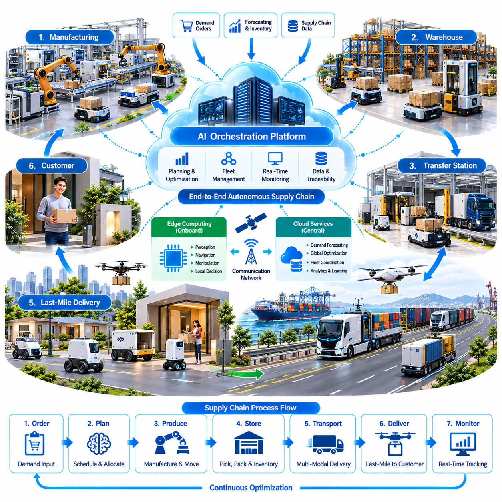{width="7.268055555555556in" height="7.268055555555556in"}

An autonomous supply chain integrates intelligent robots, transportation platforms, logistics facilities, and digital coordination systems into a continuous operational network. Its objective is to automate material movement from production and storage to transportation and final delivery. Physical AI enables robots to perceive changing conditions, execute physical tasks, and coordinate decisions across facilities while maintaining operational safety and traceability.

Traditional supply chains rely on separate automation systems for manufacturing, warehousing, transportation, and distribution. These systems frequently exchange information through disconnected interfaces and require manual intervention during material transfers. End-to-end robotic integration connects these operational stages through shared data models, interoperable software, and coordinated mission execution, reducing delays between logistics activities.

The autonomous supply chain begins with digital demand signals generated by customer orders, production schedules, or inventory replenishment requirements. Planning services translate these signals into transportation and handling tasks. AI-based orchestration evaluates available inventory, robot capabilities, delivery priorities, and resource constraints before generating executable workflows that connect multiple robotic systems.

Within manufacturing facilities, industrial manipulators and autonomous mobile robots cooperate to transport components, replenish workstations, and transfer finished products. Manipulators perform loading, sorting, and assembly-related handling, while mobile robots move materials between production zones. Shared task management coordinates these activities with manufacturing execution systems and ensures that physical material movements correspond to production requirements.

Warehouse automation extends robotic coordination into storage, retrieval, picking, and packaging operations. Autonomous mobile robots navigate warehouse aisles, robotic arms manipulate products, and automated storage systems manage inventory locations. Perception models identify objects and verify handling conditions, while warehouse management software maintains inventory records and assigns tasks according to order priorities and equipment availability.

A unified logistics data architecture connects physical robot actions with digital supply chain records. Each shipment can be represented through identifiers, location histories, handling requirements, and delivery status. Event-driven communication updates these records when robots collect, transfer, inspect, or release cargo. Consistent timestamps, identity verification, and transaction integrity help maintain traceability across independently operated facilities.

Cross-platform interoperability becomes essential when shipments move between different robot types and transportation environments. Ground robots may transfer cargo to autonomous trucks, aerial vehicles, or marine transport systems. Standardized payload descriptions, docking interfaces, communication protocols, and mission states allow heterogeneous platforms to exchange responsibilities without requiring identical mechanical designs or control architectures.

Autonomous transportation planning considers delivery deadlines, vehicle capacity, route availability, energy consumption, and operational restrictions. Optimization services assign shipments to suitable transportation modes and determine transfer locations. Dynamic planning updates routes when congestion, weather, equipment failures, or demand changes affect the original schedule, while local vehicle controllers remain responsible for safe physical execution.

Physical AI supports intelligent cargo handling by combining visual perception, geometric reasoning, and manipulation control. Robots must recognize package dimensions, estimate object poses, select grasping strategies, and verify secure placement. Handling policies should account for fragile materials, irregular shapes, payload mass, and packaging constraints. Force sensing and visual feedback help detect unsuccessful grasps or unsafe transfer conditions.

Transfer stations form critical interfaces between warehouses, transportation vehicles, and last-mile delivery systems. Automated docking, robotic loading, payload identification, and secure release mechanisms reduce dependence on manual handling. Each transfer requires confirmation that the receiving platform is correctly positioned, authorized, and capable of accepting the shipment. Physical interlocks prevent cargo release before required safety conditions are satisfied.

Fleet orchestration coordinates large populations of robots across geographically distributed facilities. Centralized services optimize task allocation, transportation schedules, and resource utilization, while local controllers handle navigation and immediate operational decisions. Hierarchical coordination allows supply chain networks to maintain global visibility without requiring every robot to depend continuously on remote decision-making services.

Cloud and edge computing provide complementary capabilities within autonomous logistics infrastructure. Cloud platforms support demand forecasting, network optimization, historical analytics, and fleet-wide learning. Edge systems execute latency-sensitive perception, navigation, and manipulation functions. This distribution reduces communication dependency and enables robots to continue essential operations safely when network connections become degraded or unavailable.

Predictive inventory management links robotic operations with changing supply and demand conditions. AI models analyze order histories, production rates, transportation delays, and inventory movements to estimate future requirements. These predictions can trigger replenishment missions and adjust warehouse resource allocation. Forecast uncertainty must remain visible because inaccurate demand estimates can produce unnecessary transportation or inventory shortages.

Digital twins provide virtual representations of factories, warehouses, transportation networks, and robotic resources. Engineers can simulate material flows, robot congestion, equipment utilization, and transfer operations before modifying physical infrastructure. Scenario analysis helps evaluate alternative scheduling strategies and operational disturbances. Model accuracy and continuous synchronization determine whether simulation results remain useful for real-world decisions.

Energy-aware logistics planning becomes increasingly important as autonomous supply chains incorporate battery-powered mobile robots, electric trucks, and aerial delivery platforms. Scheduling systems must consider charging availability, battery health, payload-dependent energy consumption, and transportation distance. Coordinated charging reduces operational interruptions, while energy optimization must remain subordinate to safety constraints and delivery feasibility.

Operational resilience requires autonomous systems to detect disruptions and adapt without creating additional hazards. Robot failures, blocked routes, communication interruptions, and unexpected inventory conditions may require task reassignment or controlled recovery. A resilient architecture maintains alternative execution paths and clearly defined fallback procedures. Human operators should receive actionable information when automated recovery exceeds approved operating boundaries.

Safety management extends across manufacturing equipment, warehouse robots, transportation vehicles, and cargo transfer infrastructure. Independent safety mechanisms monitor collision risks, restricted zones, payload stability, and equipment faults. High-level AI may optimize workflows, but verified controllers enforce physical safety limits. Safety responsibilities must remain explicit when operations cross organizational or technological boundaries.

Cybersecurity protects the integrity of logistics instructions, shipment identities, inventory records, and robotic control interfaces. Unauthorized modification of routing commands or cargo information could disrupt operations across multiple facilities. Authentication, encrypted communication, access control, software integrity verification, and audit logging support trustworthy coordination. Security architecture should separate business-level scheduling privileges from safety-sensitive robot command authority.

Supply chain performance should be evaluated through end-to-end operational metrics rather than isolated robot productivity. Relevant indicators include order fulfillment time, shipment traceability, transfer latency, inventory accuracy, equipment utilization, and mission completion rate. Energy consumption, exception frequency, and safety events provide additional measures. These metrics reveal whether robotic integration improves the complete logistics process.

Economic feasibility depends on balancing automation investment against operational improvements and lifecycle costs. Robot acquisition, facility modifications, software integration, maintenance, cybersecurity, and workforce training contribute to total ownership cost. Benefits may include reduced handling delays, improved inventory visibility, and more consistent operations. Deployment decisions should rely on measured performance rather than assumptions that maximum automation always produces maximum efficiency.

The evolution toward fully autonomous supply chains will proceed through progressive integration of verified robotic capabilities. Early deployments can connect automated warehouses with controlled transportation corridors and supervised transfer stations. More advanced systems may coordinate manufacturing, multimodal transportation, and final delivery through adaptive mission planning. Reliable expansion requires interoperability, operational evidence, regulatory compliance, and human oversight.

The long-term vision is a self-coordinating logistics ecosystem in which physical goods move through intelligent robotic networks with minimal unnecessary intervention. Physical AI can combine predictive planning, contextual perception, adaptive manipulation, and fleet-level optimization to improve responsiveness. Achieving this vision requires dependable robotics, standardized interfaces, resilient infrastructure, secure information exchange, and continuous validation of real-world performance.

자율 공급망(Autonomous Supply Chain)은 지능형 로봇(Intelligent Robot), 운송 플랫폼(Transportation Platform), 물류 시설(Logistics Facility), 디지털 조정 시스템(Digital Coordination System)을 하나의 연속적인 운영 네트워크(Operational Network)로 통합한다. 그 목적은 생산과 보관에서 운송 및 최종 배송에 이르는 물자 이동(Material Movement)을 자동화하는 것이다. 피지컬 AI(Physical AI)는 로봇이 변화하는 환경을 인식하고, 물리적 작업(Physical Task)을 수행하며, 운영 안전성(Operational Safety)과 추적성(Traceability)을 유지하면서 여러 시설에 걸친 의사결정을 조정하도록 지원한다.

기존 공급망(Traditional Supply Chain)은 제조(Manufacturing), 창고 관리(Warehousing), 운송(Transportation), 유통(Distribution)을 위해 분리된 자동화 시스템(Automation System)에 의존한다. 이러한 시스템은 단절된 인터페이스(Disconnected Interface)를 통해 정보를 교환하는 경우가 많으며, 물자 환적(Material Transfer) 과정에서 수작업 개입(Manual Intervention)이 필요하다. 종단 간 로봇 통합(End-to-End Robotic Integration)은 공유 데이터 모델(Shared Data Model), 상호운용 가능한 소프트웨어(Interoperable Software), 협력 임무 실행(Coordinated Mission Execution)을 통해 이러한 운영 단계를 연결하여 물류 활동 사이의 지연을 줄인다.

자율 공급망은 고객 주문(Customer Order), 생산 일정(Production Schedule), 재고 보충 요구사항(Inventory Replenishment Requirement)에서 생성되는 디지털 수요 신호(Digital Demand Signal)로 시작된다. 계획 서비스(Planning Service)는 이러한 신호를 운송 및 취급 작업(Transportation and Handling Task)으로 변환한다. AI 기반 오케스트레이션(AI-Based Orchestration)은 여러 로봇 시스템을 연결하는 실행 가능한 워크플로(Executable Workflow)를 생성하기 전에 가용 재고(Available Inventory), 로봇 능력(Robot Capability), 배송 우선순위(Delivery Priority), 자원 제약조건(Resource Constraint)을 평가한다.

제조 시설(Manufacturing Facility)에서는 산업용 매니퓰레이터(Industrial Manipulator)와 자율 이동 로봇(Autonomous Mobile Robot, AMR)이 협력하여 부품 운송, 작업장 자재 보충, 완제품 이송을 수행한다. 매니퓰레이터는 적재(Loading), 분류(Sorting), 조립 관련 취급(Assembly-Related Handling)을 수행하고, 이동 로봇은 생산 구역 사이에서 자재를 운반한다. 공유 작업 관리(Shared Task Management)는 이러한 활동을 제조 실행 시스템(Manufacturing Execution System, MES)과 조정하여 실제 물자 이동이 생산 요구사항(Production Requirement)에 부합하도록 보장한다.

창고 자동화(Warehouse Automation)는 로봇 협력을 보관(Storage), 출고(Retrieval), 피킹(Picking), 포장(Packaging) 작업으로 확장한다. 자율 이동 로봇은 창고 통로를 주행하고, 로봇 팔(Robotic Arm)은 제품을 조작하며, 자동 보관 시스템(Automated Storage System)은 재고 위치(Inventory Location)를 관리한다. 인식 모델(Perception Model)은 객체를 식별하고 취급 조건(Handling Condition)을 검증하며, 창고 관리 소프트웨어(Warehouse Management Software)는 재고 기록(Inventory Record)을 유지하고 주문 우선순위와 장비 가용성(Equipment Availability)에 따라 작업을 할당한다.

통합 물류 데이터 아키텍처(Unified Logistics Data Architecture)는 로봇의 물리적 행동(Physical Robot Action)과 디지털 공급망 기록(Digital Supply Chain Record)을 연결한다. 각 화물(Shipment)은 식별자(Identifier), 위치 이력(Location History), 취급 요구사항(Handling Requirement), 배송 상태(Delivery Status)를 통해 표현할 수 있다. 이벤트 기반 통신(Event-Driven Communication)은 로봇이 화물을 수거, 환적, 검사 또는 인도할 때 이러한 기록을 갱신한다. 일관된 타임스탬프(Timestamp), 신원 검증(Identity Verification), 트랜잭션 무결성(Transaction Integrity)은 독립적으로 운영되는 시설 사이에서 추적성을 유지하도록 지원한다.

플랫폼 간 상호운용성(Cross-Platform Interoperability)은 화물이 서로 다른 로봇 유형과 운송 환경 사이를 이동할 때 필수적이다. 지상 로봇은 화물을 자율주행 트럭(Autonomous Truck), 항공 운송체(Aerial Vehicle), 해상 운송 시스템(Marine Transport System)으로 전달할 수 있다. 표준화된 적재물 기술(Standardized Payload Description), 도킹 인터페이스(Docking Interface), 통신 프로토콜(Communication Protocol), 임무 상태(Mission State)는 이기종 플랫폼(Heterogeneous Platform)이 동일한 기계적 설계나 제어 아키텍처를 사용하지 않더라도 작업 책임을 인계할 수 있도록 한다.

자율 운송 계획(Autonomous Transportation Planning)은 배송 기한(Delivery Deadline), 차량 적재 용량(Vehicle Capacity), 경로 가용성(Route Availability), 에너지 소비(Energy Consumption), 운용 제한사항(Operational Restriction)을 고려한다. 최적화 서비스(Optimization Service)는 화물을 적절한 운송 수단에 할당하고 환적 위치(Transfer Location)를 결정한다. 동적 계획(Dynamic Planning)은 교통 혼잡, 기상 조건, 장비 고장, 수요 변화가 기존 일정에 영향을 미칠 때 경로를 갱신하며, 로컬 차량 제어기(Local Vehicle Controller)는 안전한 물리적 실행에 대한 책임을 유지한다.

피지컬 AI(Physical AI)는 시각 인식(Visual Perception), 기하학적 추론(Geometric Reasoning), 조작 제어(Manipulation Control)를 결합하여 지능형 화물 취급(Intelligent Cargo Handling)을 지원한다. 로봇은 포장물의 크기를 인식하고, 객체 자세(Object Pose)를 추정하며, 파지 전략(Grasping Strategy)을 선택하고, 안전한 배치(Secure Placement)를 검증해야 한다. 취급 정책(Handling Policy)은 파손되기 쉬운 물품(Fragile Material), 불규칙한 형상(Irregular Shape), 적재물 질량(Payload Mass), 포장 제약조건(Packaging Constraint)을 고려해야 한다. 힘 감지(Force Sensing)와 시각 피드백(Visual Feedback)은 파지 실패나 위험한 환적 상태를 탐지하는 데 도움을 준다.

환적 스테이션(Transfer Station)은 창고, 운송 차량, 라스트마일 배송 시스템(Last-Mile Delivery System)을 연결하는 핵심 인터페이스(Critical Interface)를 형성한다. 자동 도킹(Automated Docking), 로봇 적재(Robotic Loading), 적재물 식별(Payload Identification), 안전 해제 메커니즘(Secure Release Mechanism)은 수작업 취급에 대한 의존도를 줄인다. 각 환적 과정에서는 수령 플랫폼(Receiving Platform)이 올바르게 위치하고, 적절한 권한을 보유하며, 화물을 수용할 수 있는지 확인해야 한다. 물리적 인터록(Physical Interlock)은 필수 안전 조건이 충족되기 전에 화물이 해제되는 것을 방지한다.

군집 오케스트레이션(Fleet Orchestration)은 지리적으로 분산된 시설 전반에서 대규모 로봇 집단을 조정한다. 중앙집중식 서비스(Centralized Service)는 작업 할당(Task Allocation), 운송 일정(Transportation Schedule), 자원 활용률(Resource Utilization)을 최적화하고, 로컬 제어기(Local Controller)는 항법(Navigation)과 즉각적인 운용 의사결정을 처리한다. 계층적 조정(Hierarchical Coordination)은 모든 로봇이 원격 의사결정 서비스(Remote Decision-Making Service)에 지속적으로 의존하지 않으면서도 공급망 네트워크가 전체적인 가시성(Global Visibility)을 유지하도록 한다.

클라우드 컴퓨팅(Cloud Computing)과 엣지 컴퓨팅(Edge Computing)은 자율 물류 인프라(Autonomous Logistics Infrastructure)에서 상호보완적인 기능을 제공한다. 클라우드 플랫폼(Cloud Platform)은 수요 예측(Demand Forecasting), 네트워크 최적화(Network Optimization), 이력 분석(Historical Analytics), 군집 전체 학습(Fleet-Wide Learning)을 지원한다. 엣지 시스템(Edge System)은 지연시간에 민감한 인식, 항법, 조작 기능을 실행한다. 이러한 분산 구조는 통신 의존성(Communication Dependency)을 줄이고 네트워크 연결이 저하되거나 끊어져도 로봇이 필수 작업을 안전하게 지속할 수 있도록 한다.

예측 재고 관리(Predictive Inventory Management)는 로봇 운영을 변화하는 공급 및 수요 조건(Supply and Demand Condition)과 연결한다. AI 모델(AI Model)은 주문 이력(Order History), 생산 속도(Production Rate), 운송 지연(Transportation Delay), 재고 이동(Inventory Movement)을 분석하여 미래 요구사항을 추정한다. 이러한 예측은 재고 보충 임무(Replenishment Mission)를 시작하고 창고 자원 할당(Warehouse Resource Allocation)을 조정하는 데 활용될 수 있다. 부정확한 수요 추정은 불필요한 운송이나 재고 부족(Inventory Shortage)을 발생시킬 수 있으므로 예측 불확실성(Forecast Uncertainty)을 명확하게 관리해야 한다.

디지털 트윈(Digital Twin)은 공장, 창고, 운송 네트워크, 로봇 자원(Robotic Resource)에 대한 가상 표현(Virtual Representation)을 제공한다. 엔지니어는 실제 인프라를 변경하기 전에 물자 흐름(Material Flow), 로봇 혼잡(Robot Congestion), 장비 활용률(Equipment Utilization), 환적 작업(Transfer Operation)을 시뮬레이션할 수 있다. 시나리오 분석(Scenario Analysis)은 대체 일정 관리 전략(Alternative Scheduling Strategy)과 운용 교란(Operational Disturbance)을 평가하는 데 도움을 준다. 모델 정확도(Model Accuracy)와 지속적인 동기화(Continuous Synchronization)는 시뮬레이션 결과가 실제 의사결정에 유용하게 유지되는지를 결정한다.

에너지 인지형 물류 계획(Energy-Aware Logistics Planning)은 자율 공급망에 배터리 구동 이동 로봇(Battery-Powered Mobile Robot), 전기 트럭(Electric Truck), 항공 배송 플랫폼(Aerial Delivery Platform)이 도입되면서 더욱 중요해지고 있다. 일정 관리 시스템(Scheduling System)은 충전 가용성(Charging Availability), 배터리 건전성(Battery Health), 적재물에 따른 에너지 소비(Payload-Dependent Energy Consumption), 운송 거리(Transportation Distance)를 고려해야 한다. 협력 충전(Coordinated Charging)은 운영 중단을 줄이지만, 에너지 최적화(Energy Optimization)는 항상 안전 제약조건(Safety Constraint)과 배송 실행 가능성(Delivery Feasibility)보다 낮은 우선순위를 가져야 한다.

운영 복원력(Operational Resilience)은 자율 시스템이 추가적인 위험을 발생시키지 않으면서 장애를 탐지하고 적응할 수 있도록 요구한다. 로봇 고장(Robot Failure), 경로 차단(Blocked Route), 통신 중단(Communication Interruption), 예상하지 못한 재고 상태(Unexpected Inventory Condition)는 작업 재할당(Task Reassignment)이나 통제된 복구(Controlled Recovery)를 필요로 할 수 있다. 복원력 있는 아키텍처(Resilient Architecture)는 대체 실행 경로(Alternative Execution Path)와 명확하게 정의된 대체 절차(Fallback Procedure)를 유지한다. 자동 복구(Automated Recovery)가 승인된 운용 경계(Approved Operating Boundary)를 초과하면 인간 운영자(Human Operator)에게 실행 가능한 정보를 제공해야 한다.

안전 관리(Safety Management)는 제조 장비(Manufacturing Equipment), 창고 로봇(Warehouse Robot), 운송 차량(Transportation Vehicle), 화물 환적 인프라(Cargo Transfer Infrastructure) 전반에 적용된다. 독립적인 안전 메커니즘(Independent Safety Mechanism)은 충돌 위험(Collision Risk), 제한 구역(Restricted Zone), 적재물 안정성(Payload Stability), 장비 결함(Equipment Fault)을 감시한다. 상위 수준 AI(High-Level AI)는 워크플로를 최적화할 수 있지만, 검증된 제어기(Verified Controller)는 물리적 안전 한계(Physical Safety Limit)를 강제한다. 운영이 조직적 또는 기술적 경계를 넘어설 때에도 안전 책임(Safety Responsibility)은 명확하게 유지되어야 한다.

사이버보안(Cybersecurity)은 물류 명령(Logistics Instruction), 화물 식별 정보(Shipment Identity), 재고 기록(Inventory Record), 로봇 제어 인터페이스(Robotic Control Interface)의 무결성(Integrity)을 보호한다. 경로 명령(Routing Command)이나 화물 정보(Cargo Information)가 무단으로 변경되면 여러 시설에 걸친 운영이 중단될 수 있다. 인증(Authentication), 암호화 통신(Encrypted Communication), 접근 제어(Access Control), 소프트웨어 무결성 검증(Software Integrity Verification), 감사 로그(Audit Logging)는 신뢰할 수 있는 협력 운영을 지원한다. 보안 아키텍처(Security Architecture)는 비즈니스 수준의 일정 관리 권한(Business-Level Scheduling Privilege)과 안전에 민감한 로봇 명령 권한(Safety-Sensitive Robot Command Authority)을 분리해야 한다.

공급망 성능(Supply Chain Performance)은 개별 로봇 생산성(Isolated Robot Productivity)이 아니라 종단 간 운영 지표(End-to-End Operational Metric)를 통해 평가해야 한다. 관련 지표에는 주문 이행 시간(Order Fulfillment Time), 화물 추적성(Shipment Traceability), 환적 지연시간(Transfer Latency), 재고 정확도(Inventory Accuracy), 장비 활용률(Equipment Utilization), 임무 완료율(Mission Completion Rate)이 포함된다. 에너지 소비, 예외 발생 빈도(Exception Frequency), 안전 사고(Safety Event)는 추가적인 평가 기준을 제공한다. 이러한 지표는 로봇 통합이 전체 물류 프로세스를 개선하는지 판단하는 데 도움을 준다.

경제적 타당성(Economic Feasibility)은 자동화 투자(Automation Investment)와 운영 개선 효과(Operational Improvement), 수명주기 비용(Lifecycle Cost) 사이의 균형에 따라 결정된다. 로봇 도입(Robot Acquisition), 시설 개조(Facility Modification), 소프트웨어 통합(Software Integration), 유지보수(Maintenance), 사이버보안, 인력 교육(Workforce Training)은 총소유비용(Total Cost of Ownership)에 포함된다. 기대 효과에는 취급 지연 감소(Reduced Handling Delay), 재고 가시성 향상(Improved Inventory Visibility), 운영 일관성 향상(More Consistent Operations)이 포함될 수 있다. 배치 결정(Deployment Decision)은 최대 자동화가 항상 최대 효율을 제공한다는 가정보다 측정된 성능에 근거해야 한다.

완전 자율 공급망(Fully Autonomous Supply Chain)으로의 발전은 검증된 로봇 능력(Verified Robotic Capability)을 점진적으로 통합하는 방식으로 진행될 것이다. 초기 배치(Early Deployment)는 자동화 창고(Automated Warehouse)를 통제된 운송 회랑(Controlled Transportation Corridor) 및 감독형 환적 스테이션(Supervised Transfer Station)과 연결할 수 있다. 더욱 발전된 시스템은 적응형 임무 계획(Adaptive Mission Planning)을 통해 제조, 복합 운송(Multimodal Transportation), 최종 배송을 조정할 수 있다. 신뢰할 수 있는 확장을 위해서는 상호운용성(Interoperability), 운영 증거(Operational Evidence), 규제 준수(Regulatory Compliance), 인간 감독(Human Oversight)이 필요하다.

장기적인 비전(Long-Term Vision)은 불필요한 개입을 최소화하면서 물리적 상품(Physical Goods)이 지능형 로봇 네트워크(Intelligent Robotic Network)를 통해 이동하는 자기 조정형 물류 생태계(Self-Coordinating Logistics Ecosystem)를 구축하는 것이다. 피지컬 AI(Physical AI)는 예측 계획(Predictive Planning), 상황 인지형 인식(Contextual Perception), 적응형 조작(Adaptive Manipulation), 군집 수준 최적화(Fleet-Level Optimization)를 결합하여 대응성(Responsiveness)을 향상시킬 수 있다. 이러한 비전을 실현하려면 신뢰할 수 있는 로봇 기술(Dependable Robotics), 표준화된 인터페이스(Standardized Interface), 복원력 있는 인프라(Resilient Infrastructure), 안전한 정보 교환(Secure Information Exchange), 실제 운영 성능에 대한 지속적인 검증(Continuous Validation)이 필요하다.

##  

## 09.05. Physical AI for Climate and Sustainability

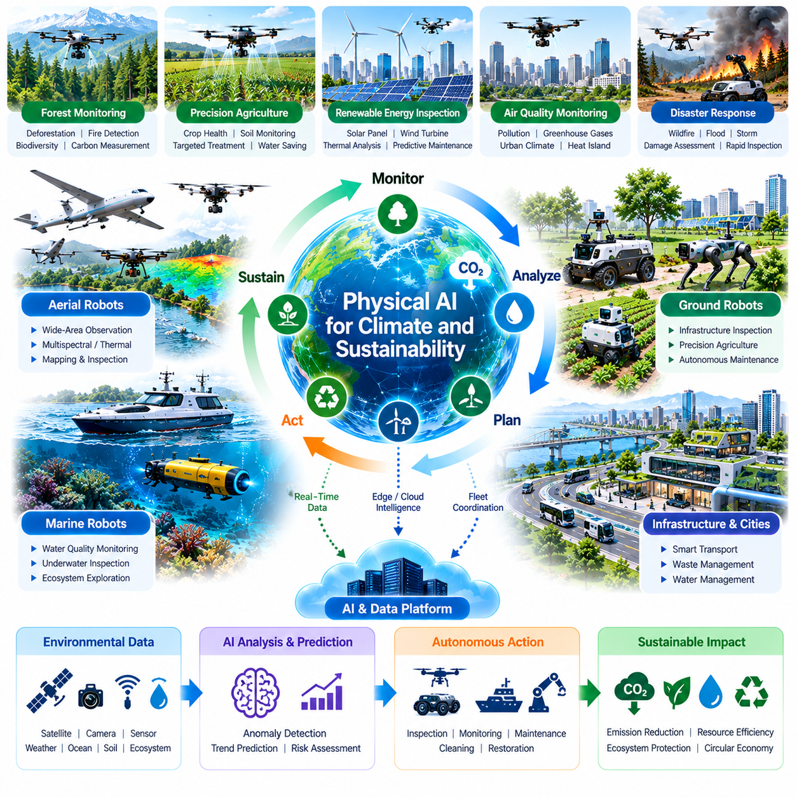{width="7.268055555555556in" height="7.268055555555556in"}

Physical AI provides a technological foundation for addressing climate change and sustainability challenges through intelligent interaction with the physical environment. Autonomous robots can monitor ecosystems, optimize resource consumption, maintain infrastructure, and support environmental restoration. Their value depends on combining perception, predictive modeling, and physical action with measurable environmental outcomes rather than deploying automation for its own sake.

Climate-oriented robotics integrates environmental sensors, autonomous mobility, machine learning, and decision-making systems. Aerial drones observe large geographic regions, ground robots inspect infrastructure and vegetation, and marine platforms monitor aquatic ecosystems. These systems transform environmental observations into actionable information while extending monitoring capabilities into locations that are difficult, dangerous, or expensive for humans to access.

Environmental monitoring requires reliable measurements of temperature, humidity, air quality, soil conditions, water chemistry, and ecosystem health. Robots equipped with calibrated sensors collect spatially distributed observations and associate them with precise locations and timestamps. AI models analyze these measurements to identify abnormal patterns, estimate environmental trends, and prioritize locations requiring further inspection or intervention.

Autonomous aerial systems support climate observation through multispectral imaging, thermal sensing, and geographic mapping. Drones can inspect forests, agricultural regions, coastlines, and renewable energy facilities with flexible deployment schedules. Their observations help identify vegetation stress, surface temperature anomalies, erosion, and infrastructure defects. Satellite information can complement aerial measurements by providing broader geographic and temporal context.

Ground robots contribute to sustainability through precision agriculture, ecological inspection, and infrastructure maintenance. Autonomous platforms can examine crop conditions, identify weeds, estimate soil moisture, and perform localized interventions. Targeted irrigation and selective treatment may reduce unnecessary resource use when supported by reliable sensing and agronomic validation. Environmental benefits must be verified against energy consumption and operational costs.

Marine robotics extends environmental intelligence into rivers, lakes, coastal waters, and deep-sea ecosystems. Autonomous surface vessels and underwater vehicles can measure water temperature, salinity, dissolved oxygen, and pollutant concentrations. AI-based navigation and adaptive sampling help concentrate observations in regions exhibiting unusual conditions. These capabilities support environmental research while reducing dependence on continuously crewed survey operations.

Renewable energy infrastructure presents important opportunities for Physical AI deployment. Robots can inspect photovoltaic panels, wind turbine components, electrical connections, and supporting structures. Computer vision and thermal analysis help detect damage, contamination, and abnormal heating. Predictive maintenance systems use inspection histories to prioritize repairs, potentially improving equipment availability and reducing avoidable maintenance activities.

Energy-efficient robot design is essential because environmental applications do not automatically produce sustainable outcomes. Autonomous systems consume electricity, require manufactured components, and generate lifecycle emissions. Engineers must evaluate propulsion efficiency, computing power, battery degradation, and maintenance requirements. Energy-aware planning can reduce unnecessary movement and computation while preserving mission reliability and safety.

Carbon accounting provides a quantitative basis for evaluating the environmental contribution of robotic systems. Lifecycle assessment considers manufacturing, transportation, deployment, electricity consumption, maintenance, and disposal. Avoided emissions from improved operations should be compared against emissions generated by the automation itself. Transparent assumptions and consistent system boundaries are necessary to prevent misleading sustainability claims.

Physical AI can improve waste management through automated identification, sorting, and material recovery. Vision systems classify recyclable materials, while robotic manipulators separate selected objects from mixed waste streams. Sensor feedback helps manage variations in shape, contamination, and material composition. Successful deployment requires reliable handling, worker safety, and verification that recovered materials can enter effective recycling processes.

Water resource management benefits from autonomous inspection and adaptive control. Robots can examine pipelines, reservoirs, irrigation channels, and treatment facilities for leaks, structural deterioration, or abnormal operating conditions. AI models combine sensor measurements with infrastructure data to prioritize maintenance. Automated interventions may reduce water losses, but critical control actions require validated safeguards and human authorization where appropriate.

Climate adaptation increasingly requires robotic systems capable of operating under extreme environmental conditions. Heat waves, flooding, drought, and severe storms can disrupt infrastructure and threaten ecosystems. Autonomous platforms may provide rapid inspection, environmental mapping, and damage assessment when conventional access is restricted. Their operational envelopes must account for hazardous weather, communication limitations, and uncertain terrain conditions.

Wildfire management illustrates the potential and limitations of environmental robotics. Aerial and ground platforms can monitor vegetation conditions, detect thermal anomalies, and support post-fire damage assessment. AI models may assist with risk mapping and resource prioritization. However, wildfire prediction remains uncertain, and autonomous observations must complement established emergency procedures rather than substitute for authorized incident command.

Ecosystem restoration introduces robotic applications involving reforestation, habitat monitoring, and biodiversity assessment. Robots can map degraded areas, identify suitable planting locations, and document vegetation recovery. Autonomous planting systems may improve operational reach in selected environments, but ecological outcomes depend on species selection, soil conditions, survival rates, and long-term stewardship rather than planting quantity alone.

Digital twins connect environmental measurements with simulation and predictive analysis. Models of watersheds, agricultural systems, energy facilities, and ecological regions can evaluate possible interventions before physical deployment. Robotics supplies updated observations that improve model relevance. Uncertainty quantification remains essential because environmental systems contain complex interactions that cannot be represented perfectly through simulation.

Multi-robot coordination enables environmental missions to cover larger regions and combine complementary sensing capabilities. Aerial robots may identify areas requiring investigation, while ground or marine robots collect detailed measurements and perform localized tasks. Shared maps, mission priorities, and communication protocols support coordinated execution. Distributed autonomy also reduces dependence on uninterrupted connectivity in remote environments.

Sustainable robotics requires careful management of materials, batteries, electronics, and equipment replacement cycles. Modular hardware, repairable components, software updates, and responsible recycling can reduce unnecessary waste. Design decisions should consider durability, maintainability, and component availability. A robot that performs environmental tasks efficiently but requires frequent replacement may deliver limited net sustainability benefits.

Safety and governance remain essential when autonomous systems interact with natural ecosystems and public infrastructure. Environmental robots must avoid disturbing wildlife, damaging habitats, or introducing hazardous materials. Operational permissions, geographic restrictions, and independent safety mechanisms establish acceptable boundaries. Data governance must also address sensitive environmental information and observations involving nearby communities or private property.

Performance evaluation should connect robotic capabilities to verified sustainability indicators. Relevant measurements include energy saved, water conserved, emissions avoided, waste recovered, inspection coverage, and ecosystem recovery rates. Operational metrics such as mission completion and sensing accuracy remain important but cannot independently establish environmental benefit. Longitudinal monitoring is necessary to distinguish temporary improvements from lasting outcomes.

Economic feasibility influences whether climate-oriented robotics can scale beyond experimental deployments. Acquisition costs, maintenance, operator training, communication infrastructure, and environmental verification contribute to total deployment expenses. Shared robotic services and standardized interfaces may improve accessibility for smaller organizations. Investment decisions should consider environmental impact, operational resilience, and lifecycle economics together.

The long-term vision is an interconnected environmental intelligence network in which robots continuously observe physical conditions and support responsible interventions. Physical AI can combine adaptive sensing, predictive world models, energy-aware planning, and coordinated robotic action. Its contribution to climate resilience and sustainability will depend on scientifically validated outcomes, transparent governance, and systems designed to minimize their own environmental footprint.

피지컬 AI(Physical AI)는 물리적 환경(Physical Environment)과의 지능적인 상호작용을 통해 기후 변화(Climate Change)와 지속가능성(Sustainability) 문제를 해결하기 위한 기술적 기반을 제공한다. 자율 로봇(Autonomous Robot)은 생태계(Ecosystem)를 모니터링하고, 자원 소비(Resource Consumption)를 최적화하며, 인프라(Infrastructure)를 유지보수하고, 환경 복원(Environmental Restoration)을 지원할 수 있다. 이러한 기술의 가치는 자동화 자체를 목적으로 도입하는 것이 아니라 인식(Perception), 예측 모델링(Predictive Modeling), 물리적 행동(Physical Action)을 측정 가능한 환경적 성과(Measurable Environmental Outcome)와 결합하는 데 달려 있다.

기후 대응 로봇 기술(Climate-Oriented Robotics)은 환경 센서(Environmental Sensor), 자율 이동(Autonomous Mobility), 기계학습(Machine Learning), 의사결정 시스템(Decision-Making System)을 통합한다. 항공 드론(Aerial Drone)은 광범위한 지리적 영역을 관측하고, 지상 로봇(Ground Robot)은 인프라와 식생(Vegetation)을 점검하며, 해양 플랫폼(Marine Platform)은 수생 생태계(Aquatic Ecosystem)를 모니터링한다. 이러한 시스템은 환경 관측값(Environmental Observation)을 실행 가능한 정보(Actionable Information)로 변환하면서 인간이 접근하기 어렵거나 위험하거나 비용이 많이 드는 지역까지 모니터링 능력을 확장한다.

환경 모니터링(Environmental Monitoring)에는 온도(Temperature), 습도(Humidity), 대기질(Air Quality), 토양 상태(Soil Condition), 수질 화학 특성(Water Chemistry), 생태계 건전성(Ecosystem Health)에 대한 신뢰할 수 있는 측정이 필요하다. 보정된 센서(Calibrated Sensor)를 장착한 로봇은 공간적으로 분산된 관측값(Spatially Distributed Observation)을 수집하고 정확한 위치 및 타임스탬프(Timestamp)와 연결한다. AI 모델(AI Model)은 이러한 측정값을 분석하여 비정상 패턴(Abnormal Pattern)을 식별하고, 환경 변화 추세(Environmental Trend)를 추정하며, 추가 점검이나 개입(Intervention)이 필요한 위치의 우선순위를 결정한다.

자율 항공 시스템(Autonomous Aerial System)은 다중분광 영상(Multispectral Imaging), 열 감지(Thermal Sensing), 지리적 지도 작성(Geographic Mapping)을 통해 기후 관측(Climate Observation)을 지원한다. 드론(Drone)은 유연한 운용 일정(Flexible Deployment Schedule)에 따라 산림, 농업 지역, 해안선, 재생에너지 시설(Renewable Energy Facility)을 점검할 수 있다. 이러한 관측은 식생 스트레스(Vegetation Stress), 지표면 온도 이상(Surface Temperature Anomaly), 침식(Erosion), 인프라 결함(Infrastructure Defect)을 식별하는 데 도움을 준다. 위성 정보(Satellite Information)는 더욱 넓은 지리적 범위와 시간적 맥락(Temporal Context)을 제공하여 항공 관측을 보완할 수 있다.

지상 로봇(Ground Robot)은 정밀 농업(Precision Agriculture), 생태학적 점검(Ecological Inspection), 인프라 유지보수(Infrastructure Maintenance)를 통해 지속가능성에 기여한다. 자율 플랫폼(Autonomous Platform)은 작물 상태(Crop Condition)를 조사하고, 잡초(Weed)를 식별하며, 토양 수분(Soil Moisture)을 추정하고, 국소적인 개입(Localized Intervention)을 수행할 수 있다. 신뢰할 수 있는 센싱(Sensing)과 농업학적 검증(Agronomic Validation)이 뒷받침되면 표적 관개(Targeted Irrigation)와 선택적 처리(Selective Treatment)는 불필요한 자원 사용을 줄일 수 있다. 환경적 이점(Environmental Benefit)은 에너지 소비와 운영 비용을 함께 고려하여 검증해야 한다.

해양 로봇 기술(Marine Robotics)은 환경 지능(Environmental Intelligence)을 강, 호수, 연안 해역(Coastal Water), 심해 생태계(Deep-Sea Ecosystem)로 확장한다. 자율 수상정(Autonomous Surface Vessel)과 수중 이동체(Underwater Vehicle)는 수온(Water Temperature), 염분(Salinity), 용존 산소(Dissolved Oxygen), 오염물질 농도(Pollutant Concentration)를 측정할 수 있다. AI 기반 항법(AI-Based Navigation)과 적응형 샘플링(Adaptive Sampling)은 비정상적인 상태를 나타내는 지역에 관측을 집중하도록 지원한다. 이러한 기능은 유인 조사선(Crewed Survey Vessel)에 대한 지속적인 의존도를 줄이면서 환경 연구(Environmental Research)를 지원한다.

재생에너지 인프라(Renewable Energy Infrastructure)는 피지컬 AI를 적용할 수 있는 중요한 기회를 제공한다. 로봇은 태양광 패널(Photovoltaic Panel), 풍력 터빈 구성요소(Wind Turbine Component), 전기 연결부(Electrical Connection), 지지 구조물(Supporting Structure)을 점검할 수 있다. 컴퓨터 비전(Computer Vision)과 열 분석(Thermal Analysis)은 손상(Damage), 오염(Contamination), 비정상적인 발열(Abnormal Heating)을 탐지하는 데 도움을 준다. 예측 유지보수 시스템(Predictive Maintenance System)은 점검 이력(Inspection History)을 활용하여 수리 우선순위를 결정하고, 장비 가용성(Equipment Availability)을 향상시키며 불필요한 유지보수 작업을 줄일 수 있다.

에너지 효율적인 로봇 설계(Energy-Efficient Robot Design)는 환경 분야에 적용되는 기술이 자동으로 지속가능한 성과를 창출하는 것은 아니기 때문에 필수적이다. 자율 시스템(Autonomous System)은 전기를 소비하고, 제조된 부품을 필요로 하며, 수명주기 배출량(Lifecycle Emissions)을 발생시킨다. 엔지니어는 추진 효율(Propulsion Efficiency), 컴퓨팅 전력(Computing Power), 배터리 열화(Battery Degradation), 유지보수 요구사항(Maintenance Requirement)을 평가해야 한다. 에너지 인지형 계획(Energy-Aware Planning)은 임무 신뢰성(Mission Reliability)과 안전성을 유지하면서 불필요한 이동과 연산을 줄일 수 있다.

탄소 회계(Carbon Accounting)는 로봇 시스템의 환경적 기여(Environmental Contribution)를 평가하기 위한 정량적 기반(Quantitative Basis)을 제공한다. 수명주기 평가(Lifecycle Assessment, LCA)는 제조(Manufacturing), 운송(Transportation), 배치(Deployment), 전력 소비(Electricity Consumption), 유지보수(Maintenance), 폐기(Disposal)를 고려한다. 운영 개선으로 회피한 배출량(Avoided Emissions)은 자동화 자체에서 발생한 배출량과 비교해야 한다. 오해를 유발하는 지속가능성 주장(Sustainability Claim)을 방지하려면 투명한 가정(Transparent Assumption)과 일관된 시스템 경계(System Boundary)가 필요하다.

피지컬 AI(Physical AI)는 자동화된 식별(Automated Identification), 분류(Sorting), 자원 회수(Material Recovery)를 통해 폐기물 관리(Waste Management)를 개선할 수 있다. 비전 시스템(Vision System)은 재활용 가능한 물질(Recyclable Material)을 분류하고, 로봇 매니퓰레이터(Robotic Manipulator)는 혼합 폐기물 흐름(Mixed Waste Stream)에서 선택된 객체를 분리한다. 센서 피드백(Sensor Feedback)은 형상, 오염 정도, 재료 구성(Material Composition)의 변동을 처리하도록 지원한다. 성공적인 배치를 위해서는 신뢰할 수 있는 취급(Reliable Handling), 작업자 안전(Worker Safety), 회수된 재료가 효과적인 재활용 공정(Recycling Process)에 투입될 수 있는지에 대한 검증이 필요하다.

수자원 관리(Water Resource Management)는 자율 점검(Autonomous Inspection)과 적응형 제어(Adaptive Control)를 통해 개선될 수 있다. 로봇은 배관(Pipeline), 저수지(Reservoir), 관개 수로(Irrigation Channel), 수처리 시설(Water Treatment Facility)에서 누수(Leak), 구조적 열화(Structural Deterioration), 비정상 운용 상태(Abnormal Operating Condition)를 조사할 수 있다. AI 모델은 센서 측정값과 인프라 데이터를 결합하여 유지보수 우선순위를 결정한다. 자동화된 개입(Automated Intervention)은 수자원 손실(Water Loss)을 줄일 수 있지만, 핵심 제어 동작(Critical Control Action)에는 검증된 안전장치(Validated Safeguard)와 필요한 경우 인간의 승인(Human Authorization)이 요구된다.

기후 적응(Climate Adaptation)은 극한 환경 조건(Extreme Environmental Condition)에서 작동할 수 있는 로봇 시스템을 점점 더 필요로 한다. 폭염(Heat Wave), 홍수(Flooding), 가뭄(Drought), 심한 폭풍(Severe Storm)은 인프라를 마비시키고 생태계를 위협할 수 있다. 자율 플랫폼(Autonomous Platform)은 기존 접근 방식이 제한되는 상황에서 신속한 점검(Rapid Inspection), 환경 지도 작성(Environmental Mapping), 피해 평가(Damage Assessment)를 제공할 수 있다. 로봇의 운용 가능 범위(Operational Envelope)는 위험한 기상 조건, 통신 제약(Communication Limitation), 불확실한 지형 상태(Uncertain Terrain Condition)를 고려해야 한다.

산불 관리(Wildfire Management)는 환경 로봇 기술(Environmental Robotics)의 가능성과 한계를 보여주는 사례이다. 항공 및 지상 플랫폼은 식생 상태(Vegetation Condition)를 모니터링하고, 열 이상(Thermal Anomaly)을 탐지하며, 화재 이후 피해 평가(Post-Fire Damage Assessment)를 지원할 수 있다. AI 모델은 위험 지도 작성(Risk Mapping)과 자원 우선순위 결정(Resource Prioritization)을 보조할 수 있다. 그러나 산불 예측(Wildfire Prediction)에는 여전히 불확실성이 존재하므로 자율 관측(Autonomous Observation)은 기존 비상 대응 절차(Emergency Procedure)를 보완해야 하며, 승인된 사고 지휘 체계(Authorized Incident Command)를 대체해서는 안 된다.

생태계 복원(Ecosystem Restoration)은 재조림(Reforestation), 서식지 모니터링(Habitat Monitoring), 생물다양성 평가(Biodiversity Assessment)와 관련된 로봇 응용 분야를 포함한다. 로봇은 훼손된 지역(Degraded Area)의 지도를 작성하고, 적절한 식재 위치(Planting Location)를 식별하며, 식생 회복(Vegetation Recovery)을 기록할 수 있다. 자율 식재 시스템(Autonomous Planting System)은 특정 환경에서 작업 범위를 확장할 수 있지만, 생태학적 성과(Ecological Outcome)는 단순한 식재 수량보다 수종 선택(Species Selection), 토양 조건(Soil Condition), 생존율(Survival Rate), 장기적인 관리(Long-Term Stewardship)에 달려 있다.

디지털 트윈(Digital Twin)은 환경 측정(Environmental Measurement)을 시뮬레이션(Simulation) 및 예측 분석(Predictive Analysis)과 연결한다. 유역(Watershed), 농업 시스템(Agricultural System), 에너지 시설(Energy Facility), 생태 지역(Ecological Region)의 모델은 실제 개입 전에 가능한 대응 방안을 평가할 수 있다. 로봇 기술은 갱신된 관측값을 제공하여 모델의 현실 적합성(Model Relevance)을 향상시킨다. 환경 시스템(Environmental System)은 시뮬레이션으로 완벽하게 표현할 수 없는 복잡한 상호작용(Complex Interaction)을 포함하므로 불확실성 정량화(Uncertainty Quantification)는 필수적이다.

다중 로봇 협력(Multi-Robot Coordination)은 환경 임무(Environmental Mission)가 더 넓은 지역을 대상으로 하고 상호보완적인 센싱 능력(Complementary Sensing Capability)을 결합하도록 한다. 항공 로봇(Aerial Robot)은 추가 조사가 필요한 지역을 식별하고, 지상 또는 해양 로봇은 상세한 측정값을 수집하거나 국소적인 작업을 수행할 수 있다. 공유 지도(Shared Map), 임무 우선순위(Mission Priority), 통신 프로토콜(Communication Protocol)은 협력 실행(Coordinated Execution)을 지원한다. 분산 자율성(Distributed Autonomy)은 원격 환경에서 중단 없는 통신 연결에 대한 의존도도 줄인다.

지속가능한 로봇 기술(Sustainable Robotics)은 재료(Material), 배터리(Battery), 전자장치(Electronics), 장비 교체 주기(Equipment Replacement Cycle)를 신중하게 관리해야 한다. 모듈형 하드웨어(Modular Hardware), 수리 가능한 구성요소(Repairable Component), 소프트웨어 업데이트(Software Update), 책임 있는 재활용(Responsible Recycling)은 불필요한 폐기물을 줄일 수 있다. 설계 결정(Design Decision)은 내구성(Durability), 유지보수성(Maintainability), 부품 가용성(Component Availability)을 고려해야 한다. 환경 작업을 효율적으로 수행하더라도 빈번한 교체가 필요한 로봇은 순 지속가능성 편익(Net Sustainability Benefit)이 제한적일 수 있다.

안전(Safety)과 거버넌스(Governance)는 자율 시스템이 자연 생태계(Natural Ecosystem) 및 공공 인프라(Public Infrastructure)와 상호작용할 때 필수적이다. 환경 로봇(Environmental Robot)은 야생동물(Wildlife)을 방해하거나 서식지(Habitat)를 훼손하거나 유해 물질(Hazardous Material)을 유입시키지 않아야 한다. 운용 허가(Operational Permission), 지리적 제한(Geographic Restriction), 독립적인 안전 메커니즘(Independent Safety Mechanism)은 허용 가능한 운용 경계(Operational Boundary)를 설정한다. 데이터 거버넌스(Data Governance)는 민감한 환경 정보(Sensitive Environmental Information)와 인근 지역사회 또는 사유지(Private Property)에 관한 관측 정보도 고려해야 한다.

성능 평가(Performance Evaluation)는 로봇의 기능을 검증된 지속가능성 지표(Verified Sustainability Indicator)와 연결해야 한다. 관련 측정 항목에는 에너지 절감량(Energy Saved), 물 절약량(Water Conserved), 회피된 배출량(Emissions Avoided), 회수된 폐기물(Waste Recovered), 점검 범위(Inspection Coverage), 생태계 회복률(Ecosystem Recovery Rate)이 포함된다. 임무 완료율(Mission Completion Rate)과 센싱 정확도(Sensing Accuracy) 같은 운영 지표(Operational Metric)도 중요하지만, 이것만으로 환경적 편익(Environmental Benefit)을 입증할 수는 없다. 일시적인 개선과 지속적인 성과를 구분하려면 장기 모니터링(Longitudinal Monitoring)이 필요하다.

경제적 타당성(Economic Feasibility)은 기후 대응 로봇 기술(Climate-Oriented Robotics)이 실험적 배치(Experimental Deployment)를 넘어 확장될 수 있는지를 결정하는 중요한 요소이다. 도입 비용(Acquisition Cost), 유지보수(Maintenance), 운영자 교육(Operator Training), 통신 인프라(Communication Infrastructure), 환경적 검증(Environmental Verification)은 전체 배치 비용(Total Deployment Expense)에 포함된다. 공유 로봇 서비스(Shared Robotic Service)와 표준화된 인터페이스(Standardized Interface)는 소규모 조직(Smaller Organization)의 접근성을 향상시킬 수 있다. 투자 결정(Investment Decision)은 환경 영향(Environmental Impact), 운영 복원력(Operational Resilience), 수명주기 경제성(Lifecycle Economics)을 종합적으로 고려해야 한다.

장기적인 비전(Long-Term Vision)은 로봇이 물리적 환경 상태(Physical Environmental Condition)를 지속적으로 관측하고 책임 있는 개입(Responsible Intervention)을 지원하는 상호 연결된 환경 지능 네트워크(Interconnected Environmental Intelligence Network)를 구축하는 것이다. 피지컬 AI(Physical AI)는 적응형 센싱(Adaptive Sensing), 예측 월드 모델(Predictive World Model), 에너지 인지형 계획(Energy-Aware Planning), 협력 로봇 행동(Coordinated Robotic Action)을 결합할 수 있다. 기후 회복력(Climate Resilience)과 지속가능성에 대한 실질적인 기여는 과학적으로 검증된 성과(Scientifically Validated Outcome), 투명한 거버넌스(Transparent Governance), 로봇 시스템 자체의 환경 발자국(Environmental Footprint)을 최소화하도록 설계된 시스템에 달려 있다.

##  

## 09.06. Robot as First Responder Disaster Emergency

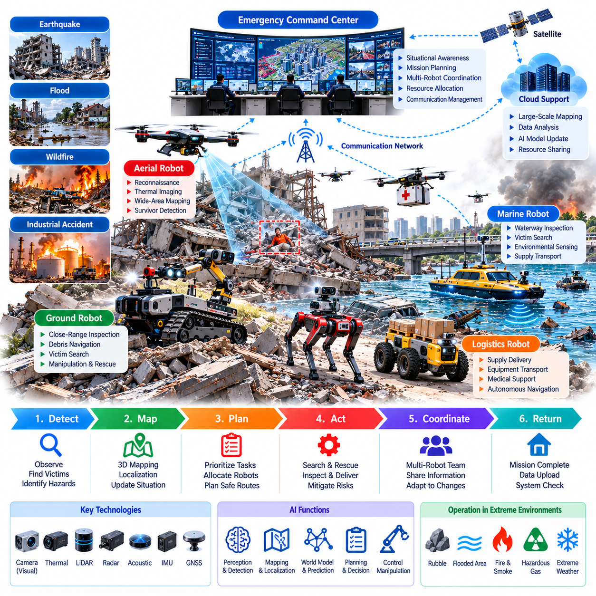{width="7.268055555555556in" height="7.268055555555556in"}

Robots acting as first responders provide critical support during disasters and emergencies by entering hazardous environments before human rescue teams. Autonomous aerial, ground, and marine platforms can perform reconnaissance, locate survivors, assess infrastructure damage, and deliver essential supplies. Physical AI combines perception, reasoning, mobility, and coordinated action to improve situational awareness while reducing responder exposure to immediate danger.

Disaster environments present extreme uncertainty because terrain, infrastructure, communication networks, and environmental conditions can change rapidly. Earthquakes create unstable debris, floods alter transportation routes, and industrial accidents introduce hazardous substances. Emergency robots must operate with incomplete information while recognizing that incorrect navigation or manipulation decisions can endanger survivors and rescue personnel.

A first-responder robotic architecture integrates environmental sensing, localization, mapping, mission planning, mobility control, and safety supervision. These functions operate through modular interfaces that support different robotic platforms. Shared autonomy services interpret emergency objectives, while platform-specific controllers maintain physical stability and enforce operating limits under damaged or unpredictable environmental conditions.

Aerial robots provide rapid reconnaissance over disaster zones that are inaccessible or dangerous for ground teams. Multispectral cameras, thermal sensors, and LiDAR systems can identify structural damage, blocked roads, flood boundaries, and possible survivor locations. AI-assisted mapping converts observations into georeferenced information, enabling emergency coordinators to prioritize search areas and identify potential access routes.

Ground robots support close-range inspection and search operations inside collapsed buildings, tunnels, industrial facilities, and unstable structures. Tracked platforms, legged robots, and mobile manipulators offer different mobility capabilities. Their autonomy systems must estimate traversability, detect obstacles, and manage uncertain contact conditions. Remote operation remains essential when autonomous navigation confidence becomes insufficient.

Marine robots extend emergency response capabilities into flooded urban areas, coastal disasters, and maritime accidents. Autonomous surface vessels can survey waterways, transport selected supplies, and collect environmental measurements. Underwater vehicles may inspect submerged infrastructure or locate hazardous objects. Mission planning must account for currents, debris, visibility limitations, and the possibility of sudden environmental changes.

Survivor detection combines thermal imaging, visual recognition, acoustic sensing, and other appropriate measurements to identify potential human presence. Sensor fusion can improve detection confidence, but environmental interference and sensor limitations create false positives and missed detections. AI-generated findings should include location uncertainty and supporting evidence so trained responders can determine appropriate verification and rescue actions.

Simultaneous localization and mapping becomes especially challenging when familiar landmarks disappear after structural collapse or flooding. Visual-inertial odometry, LiDAR mapping, and cooperative localization can help robots navigate partially unknown environments. Maps must represent uncertainty and changing obstacles rather than assuming static conditions. Reliable localization supports safe movement, survivor reporting, and coordinated team deployment.

World models provide structured representations of disaster conditions, including damaged infrastructure, hazardous regions, accessible corridors, and estimated survivor locations. These models combine observations from multiple robots and available geographic information. Predictive reasoning can evaluate possible environmental changes, but uncertain forecasts must not be treated as verified facts when determining rescue priorities or safe access routes.

Mission planning converts emergency objectives into executable robotic tasks such as reconnaissance, victim search, hazard assessment, and supply delivery. Priorities change as new information becomes available and incident commanders revise operational goals. Autonomous planning systems should support rapid task reassignment while respecting geographic restrictions, resource limitations, and explicit authorization requirements established by emergency personnel.

Multi-robot coordination enables aerial, ground, and marine platforms to share complementary capabilities during complex emergencies. Aerial drones may identify damaged structures, ground robots investigate accessible entrances, and marine platforms assess flooded access routes. Shared maps and standardized mission messages reduce duplicated effort. Coordination mechanisms must tolerate communication interruptions and inconsistent observations across participating robots.

Communication resilience is essential because disasters frequently damage cellular infrastructure, power distribution, and network equipment. Emergency robots may use local wireless links, mesh networking, relay platforms, or other approved communication channels. Systems should prioritize essential telemetry and command messages under limited bandwidth. Loss of connectivity must trigger predefined safe behaviors rather than uncontrolled autonomous actions.

Edge computing supports immediate perception, navigation, and hazard detection when remote computing services are unavailable. Onboard processors can execute essential autonomy functions independently of cloud connectivity. Cloud infrastructure may assist with large-scale mapping and mission analysis when communication permits. This separation preserves local operational safety while allowing broader coordination services to improve response efficiency.

Human-robot teaming establishes clear responsibility boundaries between autonomous systems and emergency responders. Robots can recommend search routes, highlight potential hazards, and provide situational updates, but incident commanders retain authority over operational priorities. Interfaces should communicate uncertainty, robot status, and mission limitations without overwhelming operators. Effective collaboration requires predictable robot behavior and transparent decision support.

Safety engineering must address unstable terrain, falling debris, fire, toxic substances, electrical hazards, and interaction with vulnerable people. Independent safety monitors can enforce motion limits, restricted zones, and emergency stop conditions. Robots should avoid disturbing unstable structures or obstructing rescue personnel. Hazard-specific operating procedures and validated fallback behaviors remain necessary even when advanced AI planning is available.

Manipulation capabilities allow selected emergency robots to open access points, move lightweight obstacles, position sensors, and deliver medical supplies. These actions require force sensing, geometric reasoning, and careful contact control. Physical intervention can worsen structural instability or injure trapped survivors if performed incorrectly. High-risk manipulation therefore requires appropriate authorization, validated safeguards, and direct human supervision.

Emergency logistics robots can transport communication devices, protective equipment, water, medical supplies, and other essential resources through disrupted transportation networks. Task allocation must consider payload limits, route accessibility, energy reserves, and delivery urgency. Autonomous delivery should complement established emergency logistics procedures. Robots must verify destination identity and safe handover conditions before releasing critical supplies.

Digital twins and simulation environments support emergency robot development through realistic representations of damaged buildings, flooded streets, industrial accidents, and communication failures. Scenario-based testing evaluates perception degradation, navigation uncertainty, and coordination breakdowns. Simulation cannot reproduce every disaster condition, so controlled field exercises and operational validation remain essential before deployment in real emergencies.

Operational readiness requires maintenance, battery management, communication checks, software configuration control, and recurring responder training. Robots stored for emergency use must remain functional after long periods of inactivity. Standard operating procedures should define deployment authority, mission preparation, operator responsibilities, and recovery processes. Regular exercises reveal integration weaknesses that may remain hidden during laboratory testing.

Performance evaluation should emphasize verified emergency outcomes rather than robot autonomy alone. Relevant indicators include deployment time, search coverage, survivor localization accuracy, communication availability, mission completion, and responder exposure reduction. False detections, unsafe interventions, and recovery failures must also be recorded. Evidence-based assessment helps determine which robotic capabilities provide practical value under operational constraints.

The long-term vision is a coordinated emergency response ecosystem in which intelligent robots provide rapid environmental awareness and controlled physical assistance. Physical AI can integrate adaptive perception, predictive world models, resilient autonomy, and multi-platform coordination. Reliable first-responder robotics will depend on rigorous safety validation, interoperability, human command authority, and continuous learning from realistic emergency exercises.

최초 대응 로봇(First Responder Robot)은 인간 구조대보다 먼저 위험한 환경에 진입하여 재난 및 비상 상황(Disaster and Emergency Situation)에서 핵심적인 지원을 제공한다. 자율 항공 플랫폼(Autonomous Aerial Platform), 지상 플랫폼(Ground Platform), 해양 플랫폼(Marine Platform)은 정찰(Reconnaissance), 생존자 탐색(Survivor Detection), 인프라 피해 평가(Infrastructure Damage Assessment), 필수 물품 전달(Essential Supply Delivery)을 수행할 수 있다. 피지컬 AI(Physical AI)는 인식(Perception), 추론(Reasoning), 이동성(Mobility), 협력 행동(Coordinated Action)을 결합하여 상황 인식(Situational Awareness)을 향상시키고 구조대원의 직접적인 위험 노출을 줄인다.

재난 환경(Disaster Environment)은 지형(Terrain), 인프라(Infrastructure), 통신 네트워크(Communication Network), 환경 조건(Environmental Condition)이 급격하게 변화할 수 있기 때문에 극심한 불확실성(Uncertainty)을 나타낸다. 지진(Earthquake)은 불안정한 잔해(Unstable Debris)를 발생시키고, 홍수(Flood)는 운송 경로를 변경하며, 산업 사고(Industrial Accident)는 유해 물질(Hazardous Substance)을 유입시킨다. 비상 대응 로봇(Emergency Response Robot)은 불완전한 정보(Incomplete Information)를 바탕으로 작동하면서 잘못된 항법(Navigation)이나 조작(Manipulation) 결정이 생존자와 구조대원을 위험에 빠뜨릴 수 있음을 인식해야 한다.

최초 대응 로봇 아키텍처(First-Responder Robotic Architecture)는 환경 센싱(Environmental Sensing), 위치 추정(Localization), 지도 작성(Mapping), 임무 계획(Mission Planning), 이동 제어(Mobility Control), 안전 감독(Safety Supervision)을 통합한다. 이러한 기능은 다양한 로봇 플랫폼을 지원하는 모듈형 인터페이스(Modular Interface)를 통해 작동한다. 공유 자율성 서비스(Shared Autonomy Service)는 비상 임무 목표(Emergency Objective)를 해석하고, 플랫폼별 제어기(Platform-Specific Controller)는 손상되거나 예측하기 어려운 환경에서 물리적 안정성(Physical Stability)을 유지하고 운용 한계(Operating Limit)를 강제한다.

항공 로봇(Aerial Robot)은 지상 구조대가 접근하기 어렵거나 위험한 재난 지역(Disaster Zone)에 대한 신속한 정찰(Rapid Reconnaissance)을 제공한다. 다중분광 카메라(Multispectral Camera), 열 센서(Thermal Sensor), 라이다(LiDAR)는 구조물 손상(Structural Damage), 차단된 도로(Blocked Road), 침수 경계(Flood Boundary), 잠재적인 생존자 위치(Possible Survivor Location)를 식별할 수 있다. AI 지원 지도 작성(AI-Assisted Mapping)은 관측값을 지리 참조 정보(Georeferenced Information)로 변환하여 비상 대응 지휘관(Emergency Coordinator)이 수색 지역(Search Area)의 우선순위를 결정하고 가능한 접근 경로(Access Route)를 식별하도록 지원한다.

지상 로봇(Ground Robot)은 붕괴된 건물(Collapsed Building), 터널(Tunnel), 산업 시설(Industrial Facility), 불안정한 구조물(Unstable Structure) 내부에서 근거리 점검(Close-Range Inspection)과 수색 작업(Search Operation)을 지원한다. 궤도형 플랫폼(Tracked Platform), 다족 보행 로봇(Legged Robot), 이동형 매니퓰레이터(Mobile Manipulator)는 서로 다른 이동 능력(Mobility Capability)을 제공한다. 자율 시스템(Autonomy System)은 주행 가능성(Traversability)을 추정하고 장애물을 탐지하며 불확실한 접촉 조건(Uncertain Contact Condition)을 관리해야 한다. 자율 항법 신뢰도(Autonomous Navigation Confidence)가 충분하지 않은 경우 원격 조작(Remote Operation)은 필수적이다.

해양 로봇(Marine Robot)은 침수된 도시 지역(Flooded Urban Area), 연안 재난(Coastal Disaster), 해상 사고(Maritime Accident)로 비상 대응 능력(Emergency Response Capability)을 확장한다. 자율 수상정(Autonomous Surface Vessel)은 수로(Waterway)를 조사하고, 일부 필수 물품을 운송하며, 환경 측정값(Environmental Measurement)을 수집할 수 있다. 수중 이동체(Underwater Vehicle)는 침수된 인프라(Submerged Infrastructure)를 점검하거나 위험 물체(Hazardous Object)를 탐색할 수 있다. 임무 계획(Mission Planning)은 해류(Current), 잔해(Debris), 가시성 제한(Visibility Limitation), 급격한 환경 변화 가능성을 고려해야 한다.

생존자 탐지(Survivor Detection)는 열 영상(Thermal Imaging), 시각 인식(Visual Recognition), 음향 센싱(Acoustic Sensing), 기타 적절한 측정 방법을 결합하여 잠재적인 인간 존재(Potential Human Presence)를 식별한다. 센서 융합(Sensor Fusion)은 탐지 신뢰도(Detection Confidence)를 향상시킬 수 있지만, 환경 간섭(Environmental Interference)과 센서 한계(Sensor Limitation)는 오탐(False Positive)과 미탐(False Negative)을 발생시킨다. AI가 생성한 탐지 결과에는 위치 불확실성(Location Uncertainty)과 근거 정보(Supporting Evidence)가 포함되어야 하며, 이를 통해 숙련된 구조대원이 적절한 검증 및 구조 행동을 결정할 수 있어야 한다.

동시적 위치 추정 및 지도 작성(Simultaneous Localization and Mapping, SLAM)은 구조물 붕괴나 침수 이후 기존의 지형지물(Landmark)이 사라지는 상황에서 특히 어려워진다. 시각-관성 주행거리 추정(Visual-Inertial Odometry), 라이다 지도 작성(LiDAR Mapping), 협력 위치 추정(Cooperative Localization)은 로봇이 부분적으로 알려지지 않은 환경(Partially Unknown Environment)을 탐색하도록 지원한다. 지도(Map)는 정적인 환경을 가정하기보다 불확실성과 변화하는 장애물(Changing Obstacle)을 표현해야 한다. 신뢰할 수 있는 위치 추정은 안전한 이동, 생존자 위치 보고(Survivor Reporting), 협력 구조대 배치(Coordinated Team Deployment)를 지원한다.

월드 모델(World Model)은 손상된 인프라(Damaged Infrastructure), 위험 지역(Hazardous Region), 접근 가능한 통로(Accessible Corridor), 추정된 생존자 위치(Estimated Survivor Location)를 포함한 재난 상황의 구조화된 표현(Structured Representation)을 제공한다. 이러한 모델은 여러 로봇의 관측값과 이용 가능한 지리 정보(Geographic Information)를 결합한다. 예측 추론(Predictive Reasoning)은 가능한 환경 변화를 평가할 수 있지만, 불확실한 예측(Uncertain Forecast)을 구조 우선순위(Rescue Priority)나 안전한 접근 경로를 결정할 때 검증된 사실(Verified Fact)로 취급해서는 안 된다.

임무 계획(Mission Planning)은 비상 대응 목표(Emergency Objective)를 정찰(Reconnaissance), 피해자 수색(Victim Search), 위험 평가(Hazard Assessment), 물품 전달(Supply Delivery)과 같은 실행 가능한 로봇 작업(Executable Robotic Task)으로 변환한다. 새로운 정보가 확보되고 사고 지휘관(Incident Commander)이 운영 목표(Operational Goal)를 수정함에 따라 우선순위(Priority)가 변경된다. 자율 계획 시스템(Autonomous Planning System)은 비상 대응 인력이 설정한 지리적 제한(Geographic Restriction), 자원 한계(Resource Limitation), 명시적인 승인 요구사항(Authorization Requirement)을 준수하면서 신속한 작업 재할당(Task Reassignment)을 지원해야 한다.

다중 로봇 협력(Multi-Robot Coordination)은 항공, 지상, 해양 플랫폼이 복잡한 비상 상황에서 상호보완적인 능력(Complementary Capability)을 공유하도록 한다. 항공 드론(Aerial Drone)은 손상된 구조물을 식별하고, 지상 로봇은 접근 가능한 출입구(Accessible Entrance)를 조사하며, 해양 플랫폼은 침수된 접근 경로(Flooded Access Route)를 평가할 수 있다. 공유 지도(Shared Map)와 표준화된 임무 메시지(Standardized Mission Message)는 중복 작업(Duplicated Effort)을 줄인다. 협력 메커니즘(Coordination Mechanism)은 참여 로봇 사이의 통신 중단(Communication Interruption)과 일치하지 않는 관측값(Inconsistent Observation)을 허용할 수 있어야 한다.

통신 복원력(Communication Resilience)은 재난이 셀룰러 인프라(Cellular Infrastructure), 전력 공급망(Power Distribution), 네트워크 장비(Network Equipment)를 손상시키는 경우가 많기 때문에 필수적이다. 비상 대응 로봇은 로컬 무선 링크(Local Wireless Link), 메시 네트워킹(Mesh Networking), 중계 플랫폼(Relay Platform), 기타 승인된 통신 채널(Approved Communication Channel)을 사용할 수 있다. 시스템은 제한된 대역폭(Limited Bandwidth)에서 필수 원격 측정 정보(Essential Telemetry)와 명령 메시지(Command Message)를 우선적으로 처리해야 한다. 연결이 끊어지면 통제되지 않은 자율 행동이 아니라 사전에 정의된 안전 동작(Predefined Safe Behavior)이 실행되어야 한다.

엣지 컴퓨팅(Edge Computing)은 원격 컴퓨팅 서비스(Remote Computing Service)를 사용할 수 없는 상황에서 즉각적인 인식(Perception), 항법(Navigation), 위험 탐지(Hazard Detection)를 지원한다. 온보드 프로세서(Onboard Processor)는 클라우드 연결(Cloud Connectivity)과 독립적으로 필수 자율 기능(Essential Autonomy Function)을 실행할 수 있다. 통신이 가능한 경우 클라우드 인프라(Cloud Infrastructure)는 대규모 지도 작성(Large-Scale Mapping)과 임무 분석(Mission Analysis)을 지원할 수 있다. 이러한 분리 구조는 로컬 운영 안전성(Local Operational Safety)을 유지하면서 광범위한 협력 서비스가 대응 효율(Response Efficiency)을 향상시키도록 한다.

인간-로봇 협력(Human-Robot Teaming)은 자율 시스템(Autonomous System)과 비상 대응 인력(Emergency Responder) 사이의 명확한 책임 경계(Responsibility Boundary)를 설정한다. 로봇은 수색 경로(Search Route)를 추천하고, 잠재적인 위험(Potential Hazard)을 강조하며, 상황 갱신 정보(Situational Update)를 제공할 수 있지만, 사고 지휘관(Incident Commander)은 운영 우선순위(Operational Priority)에 대한 권한을 유지한다. 인터페이스(Interface)는 운영자(Operator)에게 과도한 부담을 주지 않으면서 불확실성(Uncertainty), 로봇 상태(Robot Status), 임무 한계(Mission Limitation)를 전달해야 한다. 효과적인 협력에는 예측 가능한 로봇 행동(Predictable Robot Behavior)과 투명한 의사결정 지원(Transparent Decision Support)이 필요하다.

안전 공학(Safety Engineering)은 불안정한 지형(Unstable Terrain), 낙하 잔해(Falling Debris), 화재(Fire), 독성 물질(Toxic Substance), 전기적 위험(Electrical Hazard), 취약한 사람들과의 상호작용(Interaction with Vulnerable People)을 고려해야 한다. 독립적인 안전 모니터(Independent Safety Monitor)는 이동 한계(Motion Limit), 제한 구역(Restricted Zone), 비상 정지 조건(Emergency Stop Condition)을 강제할 수 있다. 로봇은 불안정한 구조물을 교란하거나 구조대원의 활동을 방해하지 않아야 한다. 고급 AI 계획(Advanced AI Planning)이 가능하더라도 위험 유형별 운용 절차(Hazard-Specific Operating Procedure)와 검증된 대체 동작(Validated Fallback Behavior)은 여전히 필요하다.

조작 능력(Manipulation Capability)을 갖춘 일부 비상 대응 로봇은 접근 지점(Access Point)을 개방하고, 가벼운 장애물(Lightweight Obstacle)을 이동시키며, 센서를 배치하고, 의료 물품(Medical Supply)을 전달할 수 있다. 이러한 행동에는 힘 감지(Force Sensing), 기하학적 추론(Geometric Reasoning), 정밀한 접촉 제어(Contact Control)가 필요하다. 물리적 개입(Physical Intervention)을 잘못 수행하면 구조적 불안정성(Structural Instability)이 악화되거나 갇힌 생존자(Trapped Survivor)가 부상을 입을 수 있다. 따라서 고위험 조작(High-Risk Manipulation)에는 적절한 승인(Authorization), 검증된 안전장치(Validated Safeguard), 직접적인 인간 감독(Direct Human Supervision)이 요구된다.

비상 물류 로봇(Emergency Logistics Robot)은 통신 장비(Communication Device), 보호 장비(Protective Equipment), 식수(Water), 의료 물품(Medical Supply), 기타 필수 자원(Essential Resource)을 손상된 운송 네트워크(Disrupted Transportation Network)를 통해 운반할 수 있다. 작업 할당(Task Allocation)은 적재물 한계(Payload Limit), 경로 접근성(Route Accessibility), 에너지 잔량(Energy Reserve), 배송 긴급성(Delivery Urgency)을 고려해야 한다. 자율 배송(Autonomous Delivery)은 기존 비상 물류 절차(Emergency Logistics Procedure)를 보완해야 한다. 로봇은 중요한 물품을 인도하기 전에 목적지 식별(Destination Identity)과 안전한 인계 조건(Safe Handover Condition)을 검증해야 한다.

디지털 트윈(Digital Twin)과 시뮬레이션 환경(Simulation Environment)은 손상된 건물(Damaged Building), 침수된 도로(Flooded Street), 산업 사고(Industrial Accident), 통신 장애(Communication Failure)를 현실적으로 표현하여 비상 대응 로봇 개발을 지원한다. 시나리오 기반 시험(Scenario-Based Testing)은 인식 성능 저하(Perception Degradation), 항법 불확실성(Navigation Uncertainty), 협력 기능 장애(Coordination Breakdown)를 평가한다. 시뮬레이션은 모든 재난 조건을 재현할 수 없으므로 실제 비상 상황에 배치하기 전에 통제된 현장 훈련(Controlled Field Exercise)과 운영 검증(Operational Validation)이 필수적이다.

운용 준비태세(Operational Readiness)를 유지하려면 유지보수(Maintenance), 배터리 관리(Battery Management), 통신 점검(Communication Check), 소프트웨어 구성 관리(Software Configuration Control), 정기적인 대응 인력 교육(Recurring Responder Training)이 필요하다. 비상 대응을 위해 보관된 로봇은 장기간 사용하지 않은 이후에도 정상적으로 작동해야 한다. 표준 운영 절차(Standard Operating Procedure, SOP)는 배치 권한(Deployment Authority), 임무 준비(Mission Preparation), 운영자 책임(Operator Responsibility), 복구 절차(Recovery Process)를 정의해야 한다. 정기 훈련(Regular Exercise)은 실험실 시험(Laboratory Testing)에서 발견되지 않을 수 있는 시스템 통합 취약점(Integration Weakness)을 드러낸다.

성능 평가(Performance Evaluation)는 로봇의 자율성(Autonomy) 자체보다 검증된 비상 대응 성과(Verified Emergency Outcome)를 강조해야 한다. 관련 지표에는 배치 시간(Deployment Time), 수색 범위(Search Coverage), 생존자 위치 추정 정확도(Survivor Localization Accuracy), 통신 가용성(Communication Availability), 임무 완료율(Mission Completion Rate), 구조대원 위험 노출 감소(Responder Exposure Reduction)가 포함된다. 오탐(False Detection), 위험한 개입(Unsafe Intervention), 복구 실패(Recovery Failure)도 기록해야 한다. 증거 기반 평가(Evidence-Based Assessment)는 실제 운용 제약조건에서 어떤 로봇 기능이 실질적인 가치를 제공하는지 판단하는 데 도움을 준다.

장기적인 비전(Long-Term Vision)은 지능형 로봇(Intelligent Robot)이 신속한 환경 상황 인식(Environmental Awareness)과 통제된 물리적 지원(Controlled Physical Assistance)을 제공하는 협력형 비상 대응 생태계(Coordinated Emergency Response Ecosystem)를 구축하는 것이다. 피지컬 AI(Physical AI)는 적응형 인식(Adaptive Perception), 예측 월드 모델(Predictive World Model), 복원력 있는 자율성(Resilient Autonomy), 다중 플랫폼 협력(Multi-Platform Coordination)을 통합할 수 있다. 신뢰할 수 있는 최초 대응 로봇 기술(First-Responder Robotics)을 실현하려면 엄격한 안전 검증(Rigorous Safety Validation), 상호운용성(Interoperability), 인간 지휘 권한(Human Command Authority), 현실적인 비상 대응 훈련을 통한 지속적인 학습(Continuous Learning)이 필요하다.

##  

## 09.07. Space Robotics and Planetary Exploration AI [w/Code]

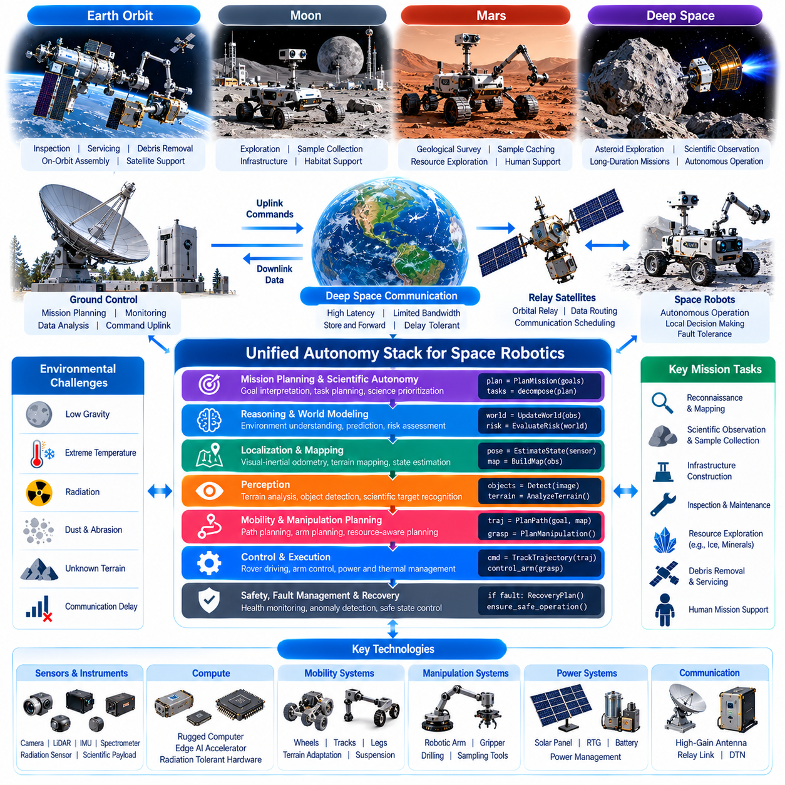{width="7.268055555555556in" height="7.268055555555556in"}

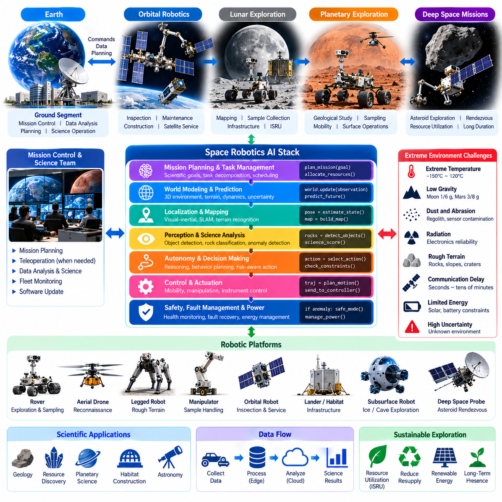{width="7.268055555555556in" height="7.268055555555556in"}

Space robotics extends autonomous intelligence beyond Earth into orbital environments, lunar surfaces, planetary terrain, and deep-space missions. Robots must perform exploration, inspection, scientific observation, and infrastructure support under severe environmental constraints. Physical AI combines perception, reasoning, planning, and physical interaction to enable meaningful autonomy where direct human intervention is delayed, expensive, or impossible.

Planetary exploration introduces challenges that differ fundamentally from terrestrial robotics. Low gravity, abrasive dust, extreme temperatures, radiation, and uncertain terrain affect sensors, actuators, and computing hardware. Communication delays prevent continuous remote control during distant missions. Autonomous systems must therefore interpret local conditions, make bounded decisions, and maintain safe behavior without immediate assistance from mission operators.

A planetary robotic architecture integrates sensing, localization, mapping, world modeling, mission planning, mobility control, and fault management. These functions operate through modular software interfaces while respecting spacecraft resource limitations. High-level AI interprets scientific objectives and evaluates possible actions, whereas validated control systems enforce mobility constraints, thermal limits, power restrictions, and operational safety requirements.

Planetary perception relies on cameras, depth estimation, inertial sensors, and specialized scientific instruments to understand unfamiliar environments. Visual models identify rocks, slopes, craters, surface textures, and potential hazards. Sensor fusion improves environmental interpretation, but illumination changes, dust accumulation, and limited calibration references can degrade performance. Reliable autonomy must explicitly represent perception uncertainty.

Localization and navigation become difficult when satellite positioning systems are unavailable. Planetary rovers use visual odometry, inertial measurements, terrain matching, and onboard mapping to estimate their movement. Accumulated positioning errors require periodic correction through recognizable landmarks or external references. Navigation algorithms must account for uncertain terrain geometry and avoid assuming that previously observed surfaces remain safely traversable.

World models provide structured representations of planetary terrain, environmental hazards, scientific targets, and robot operating conditions. Geometric maps describe obstacles and elevation, while semantic models classify potentially interesting geological features. Predictive models estimate traversability and future vehicle states. These representations support planning, but uncertainty must remain visible because incomplete observations can produce incorrect environmental assumptions.

Autonomous mobility planning balances scientific value against physical risk and limited resources. A rover may need to reach a geological target while avoiding steep slopes, loose regolith, and wheel entrapment. Planning algorithms evaluate alternative routes using terrain geometry, traction estimates, energy consumption, and mission priorities. Local controllers execute bounded trajectories while monitoring deviations between predicted and observed vehicle behavior.

Scientific autonomy allows robots to prioritize observations without requiring detailed instructions for every measurement. AI models can identify unusual geological patterns, classify surface materials, and recommend sampling locations. Mission policies define which discoveries justify additional investigation. Scientific recommendations must remain distinguishable from verified measurements, and consequential sampling decisions should respect mission authorization and instrument limitations.

Robotic manipulation supports sample collection, drilling, instrument placement, and infrastructure assembly. Manipulators must operate with uncertain contact forces, variable material properties, and limited sensory feedback. Force estimation and visual monitoring help verify tool engagement and sample acquisition. Because mechanical failures may be irreversible, manipulation sequences require conservative motion limits, fault detection, and carefully validated recovery procedures.

Energy management is central to planetary autonomy because solar availability, battery capacity, thermal conditions, and communication activities constrain mission duration. Robots must schedule mobility, computation, scientific measurements, and charging or power generation. Energy-aware planning evaluates whether proposed actions preserve sufficient reserves for safe recovery. Long-term missions also require consideration of battery aging and seasonal environmental variation.

Thermal and radiation conditions influence both hardware reliability and software execution. Extreme temperatures can restrict actuator operation, sensor accuracy, and battery performance, while radiation may produce transient computing errors or permanent component degradation. Fault-tolerant architectures use monitoring, error detection, redundancy where practical, and controlled recovery. AI workloads must operate within validated computing and environmental limits.

Communication architecture must accommodate intermittent connectivity, limited bandwidth, and significant signal propagation delays. Planetary robots exchange commands, telemetry, scientific data, and health information through scheduled communication opportunities. Onboard autonomy handles immediate decisions when Earth-based guidance is unavailable. Data prioritization and store-and-forward mechanisms help preserve essential information during communication interruptions.

Edge intelligence is especially important because transmitting all sensor observations to Earth for processing is often impractical. Onboard processors perform perception, navigation, hazard detection, and selected scientific analysis. Compact models and resource-aware inference reduce memory and power requirements. However, model complexity must be balanced against reliability, explainability, and the computational constraints of space-qualified hardware.

Multi-robot exploration can combine orbiters, aerial scouts, surface rovers, and stationary scientific instruments. An aerial platform may survey difficult terrain while a rover performs detailed inspection and sampling. Shared maps and mission descriptions support complementary operations. Coordination must tolerate asynchronous communication, different mobility capabilities, and independent safety constraints rather than assuming continuous centralized control.

Lunar infrastructure development introduces applications beyond scientific exploration. Autonomous robots may inspect landing facilities, transport materials, deploy instruments, and assist with surface construction. Dust management, terrain preparation, and equipment maintenance become important operational tasks. Shared autonomy interfaces can support heterogeneous machines, but specialized control remains necessary for excavation, manipulation, and low-gravity mobility.

Orbital robotics presents a different operating environment involving microgravity, relative motion, and spacecraft proximity operations. Robotic arms and free-flying inspection vehicles may support maintenance, assembly, and observation tasks. Autonomous planning must consider momentum exchange, collision avoidance, and strict approach constraints. Independent safety mechanisms are essential because unexpected contact can threaten valuable spacecraft infrastructure.

Simulation and digital twins support the development of planetary autonomy before launch. Engineers model terrain interaction, vehicle dynamics, sensor behavior, communication delays, and environmental disturbances. Software-in-the-loop and hardware-in-the-loop testing reveal interface faults and timing problems. Because simulation cannot reproduce every extraterrestrial condition, field analog testing and conservative operational margins remain necessary.

Verification and validation are particularly demanding because software updates and physical repairs may be difficult after deployment. Testing must cover nominal operations, sensor degradation, navigation failures, resource shortages, and unexpected environmental conditions. AI-based functions require defined operating boundaries and measurable performance criteria. Safety-critical control authority should remain separated from experimental or insufficiently validated learning components.

Mission performance should be evaluated through scientific return, operational reliability, resource efficiency, and risk exposure. Relevant measures include successful observations, navigation accuracy, terrain coverage, sample acquisition success, energy consumption, and fault recovery effectiveness. Autonomy is valuable when it improves mission outcomes within acceptable safety limits, not simply when robots execute more decisions without human involvement.

Future planetary exploration may employ foundation models, learned world models, and adaptive planning to interpret unfamiliar environments and generate flexible task strategies. These technologies could improve scientific discovery and reduce detailed command requirements. Nevertheless, uncertainty estimation, computational efficiency, and verified action constraints remain essential. Continuous learning must be carefully controlled to prevent unvalidated behavior changes during missions.

The long-term vision is a distributed space robotics ecosystem supporting scientific discovery, planetary infrastructure, and sustained human exploration. Intelligent machines could cooperate across orbital, aerial, and surface environments while sharing observations and operational knowledge. Achieving this capability requires resilient autonomy, efficient computation, reliable hardware, rigorous validation, and mission architectures that preserve human oversight despite communication delays.

우주 로봇 기술(Space Robotics)은 자율 지능(Autonomous Intelligence)을 지구 너머의 궤도 환경(Orbital Environment), 달 표면(Lunar Surface), 행성 지형(Planetary Terrain), 심우주 임무(Deep-Space Mission)로 확장한다. 로봇은 극심한 환경적 제약조건(Environmental Constraint)에서 탐사(Exploration), 점검(Inspection), 과학적 관측(Scientific Observation), 인프라 지원(Infrastructure Support)을 수행해야 한다. 피지컬 AI(Physical AI)는 인식(Perception), 추론(Reasoning), 계획(Planning), 물리적 상호작용(Physical Interaction)을 결합하여 인간의 직접적인 개입이 지연되거나 비용이 많이 들거나 불가능한 환경에서도 실질적인 자율성(Autonomy)을 구현한다.

행성 탐사(Planetary Exploration)는 지상 로봇 기술(Terrestrial Robotics)과 근본적으로 다른 과제를 제시한다. 저중력(Low Gravity), 마모성 먼지(Abrasive Dust), 극한 온도(Extreme Temperature), 방사선(Radiation), 불확실한 지형(Uncertain Terrain)은 센서(Sensor), 액추에이터(Actuator), 컴퓨팅 하드웨어(Computing Hardware)에 영향을 미친다. 통신 지연(Communication Delay)은 원거리 임무에서 지속적인 원격 제어(Remote Control)를 불가능하게 한다. 따라서 자율 시스템(Autonomous System)은 현지 조건을 해석하고, 제한된 범위의 의사결정(Bounded Decision)을 수행하며, 임무 운영자(Mission Operator)의 즉각적인 지원 없이도 안전한 동작을 유지해야 한다.

행성 로봇 아키텍처(Planetary Robotic Architecture)는 센싱(Sensing), 위치 추정(Localization), 지도 작성(Mapping), 월드 모델링(World Modeling), 임무 계획(Mission Planning), 이동 제어(Mobility Control), 결함 관리(Fault Management)를 통합한다. 이러한 기능은 우주선 자원 제약조건(Spacecraft Resource Limitation)을 준수하면서 모듈형 소프트웨어 인터페이스(Modular Software Interface)를 통해 작동한다. 상위 수준 AI(High-Level AI)는 과학적 목표(Scientific Objective)를 해석하고 가능한 행동을 평가하며, 검증된 제어 시스템(Validated Control System)은 이동 제약조건(Mobility Constraint), 열적 한계(Thermal Limit), 전력 제한(Power Restriction), 운용 안전 요구사항(Operational Safety Requirement)을 강제한다.

행성 인식(Planetary Perception)은 카메라(Camera), 깊이 추정(Depth Estimation), 관성 센서(Inertial Sensor), 특수 과학 관측 장비(Specialized Scientific Instrument)를 활용하여 익숙하지 않은 환경을 이해한다. 시각 모델(Visual Model)은 암석(Rock), 경사면(Slope), 분화구(Crater), 표면 질감(Surface Texture), 잠재적 위험요소(Potential Hazard)를 식별한다. 센서 융합(Sensor Fusion)은 환경 해석(Environmental Interpretation)을 향상시키지만, 조명 변화(Illumination Change), 먼지 축적(Dust Accumulation), 제한된 보정 기준(Limited Calibration Reference)은 성능을 저하시킬 수 있다. 신뢰할 수 있는 자율성은 인식 불확실성(Perception Uncertainty)을 명시적으로 표현해야 한다.

위성 위치 측위 시스템(Satellite Positioning System)을 사용할 수 없는 환경에서는 위치 추정(Localization)과 항법(Navigation)이 어려워진다. 행성 탐사 로버(Planetary Rover)는 시각 주행거리 추정(Visual Odometry), 관성 측정(Inertial Measurement), 지형 정합(Terrain Matching), 온보드 지도 작성(Onboard Mapping)을 활용하여 이동 상태를 추정한다. 누적된 위치 오차(Accumulated Positioning Error)는 식별 가능한 지형지물(Recognizable Landmark)이나 외부 기준(External Reference)을 통해 주기적으로 보정해야 한다. 항법 알고리즘(Navigation Algorithm)은 불확실한 지형 형상(Terrain Geometry)을 고려해야 하며, 이전에 관측한 표면이 계속 안전하게 주행 가능하다고 가정해서는 안 된다.

월드 모델(World Model)은 행성 지형(Planetary Terrain), 환경 위험요소(Environmental Hazard), 과학적 탐사 대상(Scientific Target), 로봇 운용 상태(Robot Operating Condition)에 대한 구조화된 표현(Structured Representation)을 제공한다. 기하학적 지도(Geometric Map)는 장애물(Obstacle)과 고도(Elevation)를 표현하고, 의미 모델(Semantic Model)은 과학적으로 중요한 지질학적 특징(Geological Feature)을 분류한다. 예측 모델(Predictive Model)은 주행 가능성(Traversability)과 미래 차량 상태(Future Vehicle State)를 추정한다. 이러한 표현은 계획을 지원하지만, 불완전한 관측이 잘못된 환경적 가정으로 이어질 수 있으므로 불확실성을 명확하게 유지해야 한다.

자율 이동 계획(Autonomous Mobility Planning)은 과학적 가치(Scientific Value)와 물리적 위험(Physical Risk), 제한된 자원(Limited Resource) 사이의 균형을 유지한다. 로버(Rover)는 급경사(Steep Slope), 느슨한 표토(Loose Regolith), 바퀴 매몰(Wheel Entrapment)을 피하면서 지질학적 탐사 대상(Geological Target)에 도달해야 할 수 있다. 계획 알고리즘(Planning Algorithm)은 지형 형상(Terrain Geometry), 접지력 추정(Traction Estimate), 에너지 소비(Energy Consumption), 임무 우선순위(Mission Priority)를 활용하여 대체 경로(Alternative Route)를 평가한다. 로컬 제어기(Local Controller)는 제한된 궤적(Bounded Trajectory)을 실행하면서 예측된 차량 동작과 실제 관측된 차량 동작 사이의 편차(Deviation)를 모니터링한다.

과학적 자율성(Scientific Autonomy)은 로봇이 모든 측정에 대한 상세한 명령을 받지 않고도 관측 우선순위를 결정하도록 한다. AI 모델(AI Model)은 비정상적인 지질학적 패턴(Unusual Geological Pattern)을 식별하고, 표면 물질(Surface Material)을 분류하며, 시료 채취 위치(Sampling Location)를 추천할 수 있다. 임무 정책(Mission Policy)은 어떤 발견이 추가 조사를 정당화하는지 정의한다. 과학적 추천(Scientific Recommendation)은 검증된 측정값(Verified Measurement)과 명확하게 구분되어야 하며, 중요한 시료 채취 결정은 임무 승인(Mission Authorization)과 관측 장비의 한계(Instrument Limitation)를 준수해야 한다.

로봇 조작(Robotic Manipulation)은 시료 수집(Sample Collection), 시추(Drilling), 관측 장비 배치(Instrument Placement), 인프라 조립(Infrastructure Assembly)을 지원한다. 매니퓰레이터(Manipulator)는 불확실한 접촉력(Uncertain Contact Force), 다양한 재료 특성(Variable Material Property), 제한된 감각 피드백(Limited Sensory Feedback) 환경에서 작동해야 한다. 힘 추정(Force Estimation)과 시각 모니터링(Visual Monitoring)은 도구 접촉 상태(Tool Engagement)와 시료 획득(Sample Acquisition)을 검증하는 데 도움을 준다. 기계적 고장(Mechanical Failure)은 복구 불가능할 수 있으므로 조작 순서(Manipulation Sequence)에는 보수적인 운동 한계(Conservative Motion Limit), 결함 탐지(Fault Detection), 신중하게 검증된 복구 절차(Recovery Procedure)가 필요하다.

에너지 관리(Energy Management)는 태양광 가용성(Solar Availability), 배터리 용량(Battery Capacity), 열적 조건(Thermal Condition), 통신 활동(Communication Activity)이 임무 지속시간(Mission Duration)을 제한하기 때문에 행성 자율성(Planetary Autonomy)의 핵심 요소이다. 로봇은 이동(Mobility), 연산(Computation), 과학적 측정(Scientific Measurement), 충전 또는 발전(Charging or Power Generation)의 일정을 조정해야 한다. 에너지 인지형 계획(Energy-Aware Planning)은 제안된 행동이 안전한 복구를 위한 충분한 에너지 잔량(Energy Reserve)을 보존하는지 평가한다. 장기 임무(Long-Term Mission)에서는 배터리 노화(Battery Aging)와 계절적 환경 변화(Seasonal Environmental Variation)도 고려해야 한다.

열적 조건(Thermal Condition)과 방사선 환경(Radiation Environment)은 하드웨어 신뢰성(Hardware Reliability)과 소프트웨어 실행(Software Execution)에 영향을 미친다. 극한 온도는 액추에이터 작동(Actuator Operation), 센서 정확도(Sensor Accuracy), 배터리 성능(Battery Performance)을 제한할 수 있으며, 방사선은 일시적인 연산 오류(Transient Computing Error)나 영구적인 부품 열화(Permanent Component Degradation)를 발생시킬 수 있다. 결함 허용 아키텍처(Fault-Tolerant Architecture)는 모니터링(Monitoring), 오류 탐지(Error Detection), 가능한 범위의 이중화(Redundancy), 통제된 복구(Controlled Recovery)를 활용한다. AI 작업부하(AI Workload)는 검증된 컴퓨팅 및 환경적 한계 내에서 실행되어야 한다.

통신 아키텍처(Communication Architecture)는 간헐적인 연결(Intermittent Connectivity), 제한된 대역폭(Limited Bandwidth), 상당한 신호 전파 지연(Signal Propagation Delay)을 수용해야 한다. 행성 로봇(Planetary Robot)은 예정된 통신 기회(Scheduled Communication Opportunity)를 통해 명령(Command), 원격 측정 정보(Telemetry), 과학 데이터(Scientific Data), 상태 정보(Health Information)를 교환한다. 온보드 자율성(Onboard Autonomy)은 지구 기반 지침(Earth-Based Guidance)을 사용할 수 없는 상황에서 즉각적인 의사결정을 처리한다. 데이터 우선순위 관리(Data Prioritization)와 저장 후 전달 메커니즘(Store-and-Forward Mechanism)은 통신 중단 중에도 필수 정보를 보존하도록 지원한다.

엣지 지능(Edge Intelligence)은 모든 센서 관측값을 지구로 전송하여 처리하는 것이 비현실적인 경우가 많기 때문에 특히 중요하다. 온보드 프로세서(Onboard Processor)는 인식(Perception), 항법(Navigation), 위험 탐지(Hazard Detection), 일부 과학적 분석(Scientific Analysis)을 수행한다. 경량 모델(Compact Model)과 자원 인지형 추론(Resource-Aware Inference)은 메모리 및 전력 요구사항을 줄인다. 그러나 모델 복잡도(Model Complexity)는 신뢰성(Reliability), 설명 가능성(Explainability), 우주 환경 적합 하드웨어(Space-Qualified Hardware)의 계산 제약조건(Computational Constraint)과 균형을 이루어야 한다.

다중 로봇 탐사(Multi-Robot Exploration)는 궤도선(Orbiter), 항공 정찰 로봇(Aerial Scout), 표면 탐사 로버(Surface Rover), 고정형 과학 관측 장비(Stationary Scientific Instrument)를 결합할 수 있다. 항공 플랫폼(Aerial Platform)은 접근하기 어려운 지형을 조사하고, 로버는 상세한 점검과 시료 채취(Sampling)를 수행할 수 있다. 공유 지도(Shared Map)와 임무 기술(Mission Description)은 상호보완적인 작업을 지원한다. 협력 시스템(Coordination System)은 지속적인 중앙집중식 제어(Continuous Centralized Control)를 가정하기보다 비동기 통신(Asynchronous Communication), 서로 다른 이동 능력(Mobility Capability), 독립적인 안전 제약조건(Independent Safety Constraint)을 수용해야 한다.

달 인프라 개발(Lunar Infrastructure Development)은 과학 탐사를 넘어서는 응용 분야를 제시한다. 자율 로봇(Autonomous Robot)은 착륙 시설(Landing Facility)을 점검하고, 자재(Material)를 운송하며, 관측 장비(Instrument)를 설치하고, 표면 건설(Surface Construction)을 지원할 수 있다. 먼지 관리(Dust Management), 지형 정비(Terrain Preparation), 장비 유지보수(Equipment Maintenance)는 중요한 운영 작업이 된다. 공유 자율성 인터페이스(Shared Autonomy Interface)는 이기종 기계(Heterogeneous Machine)를 지원할 수 있지만, 굴착(Excavation), 조작(Manipulation), 저중력 이동(Low-Gravity Mobility)에는 여전히 특화된 제어(Specialized Control)가 필요하다.

궤도 로봇 기술(Orbital Robotics)은 미세중력(Microgravity), 상대 운동(Relative Motion), 우주선 근접 운용(Spacecraft Proximity Operation)을 포함하는 서로 다른 운용 환경을 갖는다. 로봇 팔(Robotic Arm)과 자유 비행 점검 차량(Free-Flying Inspection Vehicle)은 유지보수(Maintenance), 조립(Assembly), 관측(Observation) 작업을 지원할 수 있다. 자율 계획(Autonomous Planning)은 운동량 교환(Momentum Exchange), 충돌 회피(Collision Avoidance), 엄격한 접근 제약조건(Strict Approach Constraint)을 고려해야 한다. 예상하지 못한 접촉(Unexpected Contact)은 중요한 우주 인프라(Spacecraft Infrastructure)를 위협할 수 있으므로 독립적인 안전 메커니즘(Independent Safety Mechanism)이 필수적이다.

시뮬레이션(Simulation)과 디지털 트윈(Digital Twin)은 발사 전에 행성 자율성(Planetary Autonomy)을 개발하도록 지원한다. 엔지니어는 지형 상호작용(Terrain Interaction), 차량 동역학(Vehicle Dynamics), 센서 동작(Sensor Behavior), 통신 지연(Communication Delay), 환경 교란(Environmental Disturbance)을 모델링한다. 소프트웨어 인 더 루프 시험(Software-in-the-Loop Testing)과 하드웨어 인 더 루프 시험(Hardware-in-the-Loop Testing)은 인터페이스 결함(Interface Fault)과 타이밍 문제(Timing Problem)를 식별한다. 시뮬레이션은 모든 외계 환경 조건(Extraterrestrial Condition)을 재현할 수 없으므로 유사 환경 현장 시험(Field Analog Testing)과 보수적인 운용 여유(Conservative Operational Margin)가 필요하다.

검증 및 유효성 확인(Verification and Validation)은 배치 이후 소프트웨어 업데이트(Software Update)와 물리적 수리(Physical Repair)가 어려울 수 있기 때문에 특히 까다롭다. 시험(Testing)은 정상 운용(Nominal Operation), 센서 성능 저하(Sensor Degradation), 항법 실패(Navigation Failure), 자원 부족(Resource Shortage), 예상하지 못한 환경 조건(Unexpected Environmental Condition)을 포함해야 한다. AI 기반 기능(AI-Based Function)에는 정의된 운용 경계(Operating Boundary)와 측정 가능한 성능 기준(Measurable Performance Criteria)이 필요하다. 안전 필수 제어 권한(Safety-Critical Control Authority)은 실험적이거나 충분히 검증되지 않은 학습 구성요소(Learning Component)와 분리되어야 한다.

임무 성능(Mission Performance)은 과학적 성과(Scientific Return), 운영 신뢰성(Operational Reliability), 자원 효율성(Resource Efficiency), 위험 노출(Risk Exposure)을 통해 평가해야 한다. 관련 지표에는 성공적인 관측(Successful Observation), 항법 정확도(Navigation Accuracy), 지형 탐사 범위(Terrain Coverage), 시료 획득 성공률(Sample Acquisition Success), 에너지 소비(Energy Consumption), 결함 복구 효과(Fault Recovery Effectiveness)가 포함된다. 자율성(Autonomy)은 단순히 인간의 개입 없이 더 많은 결정을 수행할 때가 아니라 허용 가능한 안전 한계(Acceptable Safety Limit) 내에서 임무 성과를 향상시킬 때 가치가 있다.

미래의 행성 탐사(Future Planetary Exploration)는 파운데이션 모델(Foundation Model), 학습 기반 월드 모델(Learned World Model), 적응형 계획(Adaptive Planning)을 활용하여 익숙하지 않은 환경을 해석하고 유연한 작업 전략(Flexible Task Strategy)을 생성할 수 있다. 이러한 기술은 과학적 발견(Scientific Discovery)을 향상시키고 상세한 명령 요구사항(Detailed Command Requirement)을 줄일 수 있다. 그러나 불확실성 추정(Uncertainty Estimation), 계산 효율성(Computational Efficiency), 검증된 행동 제약조건(Verified Action Constraint)은 여전히 필수적이다. 지속적 학습(Continuous Learning)은 임무 수행 중 검증되지 않은 행동 변화(Unvalidated Behavior Change)를 방지하도록 신중하게 통제되어야 한다.

장기적인 비전(Long-Term Vision)은 과학적 발견(Scientific Discovery), 행성 인프라(Planetary Infrastructure), 지속적인 인간 탐사(Sustained Human Exploration)를 지원하는 분산형 우주 로봇 생태계(Distributed Space Robotics Ecosystem)를 구축하는 것이다. 지능형 기계(Intelligent Machine)는 궤도(Orbital), 항공(Aerial), 표면(Surface) 환경 전반에서 협력하면서 관측값과 운영 지식(Operational Knowledge)을 공유할 수 있다. 이러한 능력을 실현하려면 복원력 있는 자율성(Resilient Autonomy), 효율적인 연산(Efficient Computation), 신뢰할 수 있는 하드웨어(Reliable Hardware), 엄격한 검증(Rigorous Validation), 통신 지연에도 인간 감독(Human Oversight)을 유지하는 임무 아키텍처(Mission Architecture)가 필요하다.

##  

## 09.08. Underwater and Deep-Sea Robot AI [w/Code]

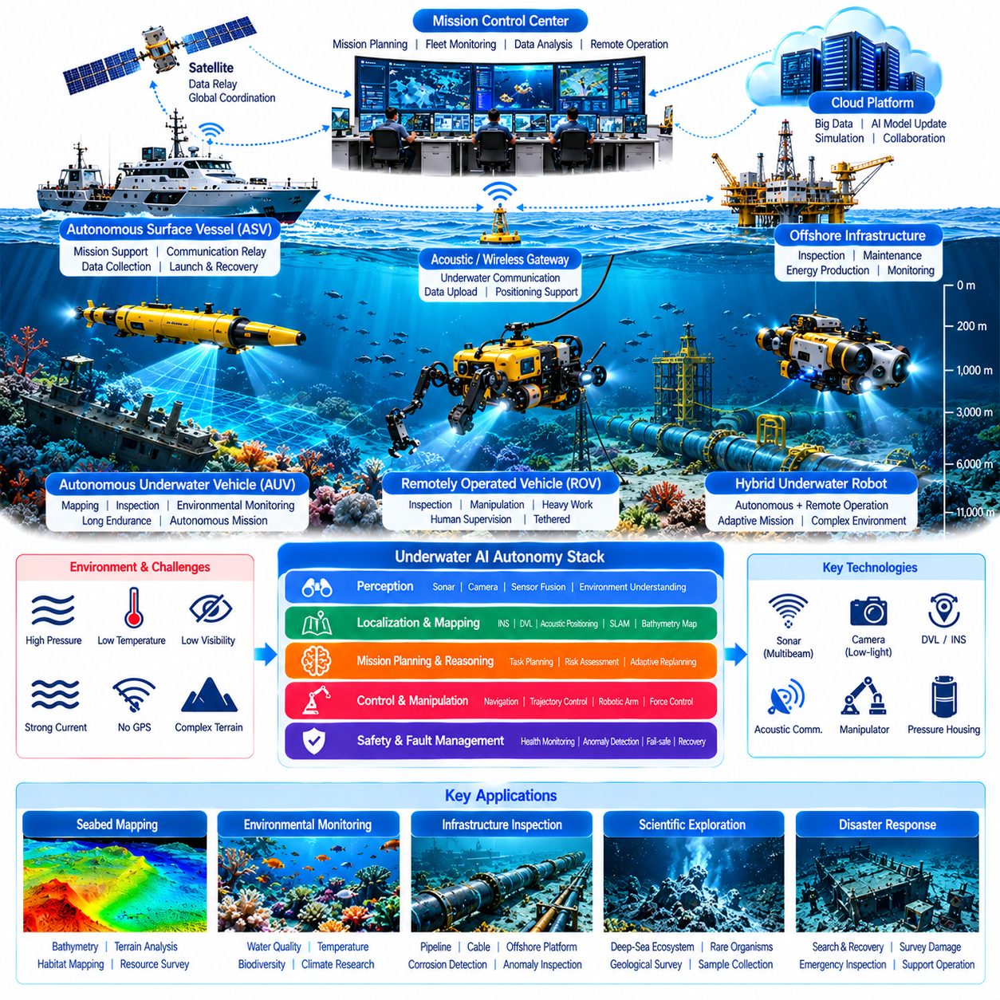{width="7.268055555555556in" height="7.268055555555556in"}

Underwater and deep-sea robotics extends Physical AI into environments characterized by extreme pressure, limited visibility, uncertain currents, and restricted communication. Autonomous underwater vehicles and remotely operated systems perform exploration, inspection, environmental monitoring, and infrastructure maintenance. Intelligent autonomy enables these platforms to interpret complex surroundings and execute missions where continuous human control is impractical.

Underwater environments impose constraints fundamentally different from terrestrial and aerial robotics. Electromagnetic signals attenuate rapidly in seawater, satellite positioning becomes unavailable below the surface, and optical sensing is affected by turbidity and illumination. Increasing depth introduces substantial hydrostatic pressure. Robot architectures must therefore combine specialized sensing, robust mechanical design, and autonomous decision-making.

Underwater robotic platforms include autonomous underwater vehicles, remotely operated vehicles, autonomous surface vessels, and hybrid systems. Autonomous vehicles execute programmed missions with onboard intelligence, while remotely operated vehicles receive commands through communication links. Hybrid architectures combine supervised operation with local autonomy. Platform selection depends on mission depth, endurance, payload, communication requirements, and acceptable operational risk.

Perception systems integrate sonar, underwater cameras, inertial sensors, depth measurements, and environmental instruments. Multibeam sonar supports bathymetric mapping, while imaging sonar detects obstacles under poor visibility. Optical cameras provide detailed observations when water clarity permits. Sensor fusion combines complementary measurements, but perception algorithms must represent uncertainty caused by acoustic interference, suspended particles, and environmental variability.

Underwater localization requires alternatives to conventional satellite navigation. Inertial navigation systems estimate vehicle motion, while Doppler velocity logs measure velocity relative to the seabed or water mass. Acoustic positioning systems provide external references when suitable infrastructure is available. Navigation filters combine these measurements to reduce accumulated drift, although localization accuracy depends strongly on sensor quality and operating conditions.

Simultaneous localization and mapping enables underwater robots to construct spatial representations while estimating their own positions. Sonar-based mapping is particularly useful where optical visibility is insufficient. Feature association becomes difficult when seabed textures are repetitive or acoustic returns are ambiguous. Robust mapping systems maintain confidence estimates and update environmental representations as new observations become available.

Ocean currents introduce disturbances that affect trajectory tracking, energy consumption, and mission duration. Hydrodynamic models estimate vehicle response to propulsion commands and environmental forces. Adaptive controllers compensate for changing conditions within validated operating limits. AI-based prediction can improve route planning, but uncertainty in current forecasts requires conservative energy reserves and reliable recovery strategies.

Deep-sea missions require pressure-resistant housings, corrosion protection, reliable seals, and carefully selected materials. Increasing hydrostatic pressure affects structural integrity, electrical connections, and sensor packaging. Thermal conditions and seawater conductivity create additional engineering challenges. Intelligent fault monitoring can detect abnormal operating patterns, but physical reliability remains the foundation of safe underwater autonomy.

Autonomous mission planning coordinates navigation, observation, sampling, and inspection objectives under limited resources. A robot may survey a seabed region, investigate unusual acoustic signatures, and return to a designated recovery location. Planning algorithms evaluate scientific value, travel distance, current conditions, battery reserves, and operational constraints. Mission execution must support safe replanning when unexpected obstacles or equipment faults occur.

Underwater manipulation enables sampling, valve operation, cable inspection, and intervention around subsea structures. Robotic arms require precise positioning despite vehicle motion and uncertain contact forces. Visual and force feedback help estimate object geometry and interaction conditions. Manipulation tasks near fragile ecosystems or critical infrastructure require bounded control actions, verified safeguards, and appropriate human supervision.

Marine infrastructure inspection represents an important application of underwater Physical AI. Robots can examine pipelines, offshore foundations, subsea cables, and underwater energy installations. Sonar and visual analysis identify possible corrosion, deformation, sediment accumulation, and structural anomalies. AI-assisted inspection prioritizes suspicious regions, while qualified engineers determine whether observations indicate actionable defects.

Environmental monitoring applications include ocean temperature measurement, salinity profiling, dissolved oxygen analysis, and pollutant detection. Autonomous vehicles collect observations across depth and geographic regions that are difficult to survey continuously. Adaptive sampling concentrates measurements around unusual environmental patterns. Scientific interpretation requires calibrated instruments, reliable metadata, and validation against independent observations.

Deep-sea ecological exploration benefits from robotic platforms capable of observing sensitive habitats with limited disturbance. AI models can assist in identifying organisms, mapping benthic communities, and documenting environmental changes. However, biological classification may be uncertain when training data poorly represents unfamiliar species. Mission policies should minimize unnecessary lighting, physical contact, and disruption of vulnerable ecosystems.

Communication limitations strongly influence underwater autonomy. Acoustic modems provide long-range communication at relatively low data rates, while optical links may support faster exchange over short distances under favorable conditions. Communication delays and interruptions prevent continuous high-bandwidth control. Robots must prioritize essential telemetry, preserve mission data locally, and execute predefined safe behaviors when communication is unavailable.

Edge AI allows underwater robots to process sensor information without transmitting every observation to surface operators. Onboard inference supports obstacle detection, terrain classification, adaptive sampling, and anomaly recognition. Efficient models reduce power consumption and computing demands. Critical navigation and safety functions must remain dependable even when learned models encounter unfamiliar environmental conditions.

Multi-robot underwater operations combine autonomous surface vessels, underwater vehicles, and stationary sensor networks. Surface platforms may provide navigation references, communication relays, or recovery support while underwater robots conduct detailed surveys. Cooperative mapping and distributed task allocation improve coverage. Coordination protocols must accommodate intermittent acoustic links, uncertain positioning, and different vehicle capabilities.

Digital twins and simulation environments support underwater robot development by modeling hydrodynamics, acoustic propagation, sensor behavior, and seabed interaction. Engineers can evaluate navigation algorithms, mission planning, and fault responses before deployment. Simulation accuracy remains limited by uncertain ocean conditions. Tank testing, controlled coastal trials, and progressively deeper field validation are necessary to establish operational confidence.

Safety engineering addresses pressure failures, propulsion faults, entanglement, communication loss, and unsuccessful recovery. Independent monitoring systems can detect abnormal depth, energy depletion, or navigation divergence. Emergency behaviors may include stopping hazardous actions, releasing designated safety devices, or initiating controlled ascent when appropriate. Recovery strategies must respect depth, traffic, environmental, and platform-specific constraints.

Operational performance should be measured through survey coverage, localization accuracy, inspection quality, endurance, energy efficiency, and mission recovery success. Environmental applications additionally require scientifically valid measurements and minimal ecological disturbance. Autonomy metrics alone cannot establish mission effectiveness. Long-term reliability, maintenance requirements, and total operational cost determine whether underwater robotic systems can scale sustainably.

Future underwater robotics may integrate foundation models, predictive world models, and adaptive multi-robot planning to improve exploration in unfamiliar environments. Learning-based perception could support more flexible interpretation of acoustic and visual data. Nevertheless, limited training coverage and environmental uncertainty demand explicit confidence estimates. Verified control boundaries and human oversight remain essential for consequential physical interventions.

The long-term vision is an interconnected ocean intelligence ecosystem linking surface, underwater, and deep-sea robotic platforms. These systems could continuously monitor marine environments, maintain critical infrastructure, and expand scientific understanding of unexplored regions. Achieving reliable ocean autonomy requires robust hardware, efficient edge intelligence, resilient communication, environmental responsibility, and rigorous validation across diverse operating conditions.

수중 및 심해 로봇 기술(Underwater and Deep-Sea Robotics)은 극한 압력(Extreme Pressure), 제한된 가시성(Limited Visibility), 불확실한 해류(Uncertain Current), 제한적인 통신(Restricted Communication)이 특징인 환경으로 피지컬 AI(Physical AI)를 확장한다. 자율 수중 이동체(Autonomous Underwater Vehicle)와 원격 조종 시스템(Remotely Operated System)은 탐사(Exploration), 점검(Inspection), 환경 모니터링(Environmental Monitoring), 인프라 유지보수(Infrastructure Maintenance)를 수행한다. 지능형 자율성(Intelligent Autonomy)은 이러한 플랫폼이 복잡한 주변 환경을 해석하고 지속적인 인간 제어가 어려운 상황에서도 임무를 수행하도록 지원한다.

수중 환경(Underwater Environment)은 지상 및 항공 로봇 기술(Terrestrial and Aerial Robotics)과 근본적으로 다른 제약조건을 부과한다. 전자기 신호(Electromagnetic Signal)는 해수(Seawater)에서 빠르게 감쇠하고, 위성 위치 측위(Satellite Positioning)는 수면 아래에서 사용할 수 없으며, 광학 센싱(Optical Sensing)은 탁도(Turbidity)와 조명(Illumination)의 영향을 받는다. 수심이 깊어질수록 상당한 정수압(Hydrostatic Pressure)이 발생한다. 따라서 로봇 아키텍처(Robot Architecture)는 특수 센싱(Specialized Sensing), 견고한 기계 설계(Robust Mechanical Design), 자율 의사결정(Autonomous Decision-Making)을 결합해야 한다.

수중 로봇 플랫폼(Underwater Robotic Platform)에는 자율 수중 이동체(Autonomous Underwater Vehicle, AUV), 원격 조종 수중 로봇(Remotely Operated Vehicle, ROV), 자율 수상정(Autonomous Surface Vessel, ASV), 하이브리드 시스템(Hybrid System)이 포함된다. 자율 이동체(Autonomous Vehicle)는 온보드 지능(Onboard Intelligence)을 활용하여 사전에 계획된 임무를 수행하고, 원격 조종 이동체(Remotely Operated Vehicle)는 통신 링크(Communication Link)를 통해 명령을 수신한다. 하이브리드 아키텍처(Hybrid Architecture)는 감독형 운용(Supervised Operation)과 로컬 자율성(Local Autonomy)을 결합한다. 플랫폼 선정은 임무 수심(Mission Depth), 지속 운용 시간(Endurance), 탑재 하중(Payload), 통신 요구사항(Communication Requirement), 허용 가능한 운영 위험(Operational Risk)에 따라 결정된다.

인식 시스템(Perception System)은 소나(Sonar), 수중 카메라(Underwater Camera), 관성 센서(Inertial Sensor), 수심 측정(Depth Measurement), 환경 계측 장비(Environmental Instrument)를 통합한다. 다중빔 소나(Multibeam Sonar)는 수심 지형도 작성(Bathymetric Mapping)을 지원하고, 영상 소나(Imaging Sonar)는 가시성이 낮은 환경에서 장애물을 탐지한다. 광학 카메라(Optical Camera)는 수중 투명도(Water Clarity)가 허용되는 경우 상세한 관측 정보를 제공한다. 센서 융합(Sensor Fusion)은 상호보완적인 측정값을 결합하지만, 인식 알고리즘(Perception Algorithm)은 음향 간섭(Acoustic Interference), 부유 입자(Suspended Particle), 환경 변동성(Environmental Variability)으로 발생하는 불확실성을 표현해야 한다.

수중 위치 추정(Underwater Localization)에는 기존 위성 항법(Conventional Satellite Navigation)을 대체하는 방법이 필요하다. 관성 항법 시스템(Inertial Navigation System, INS)은 이동체의 운동을 추정하고, 도플러 속도 로그(Doppler Velocity Log, DVL)는 해저면 또는 수괴(Water Mass)에 대한 상대 속도를 측정한다. 음향 위치 측위 시스템(Acoustic Positioning System)은 적절한 인프라를 사용할 수 있을 때 외부 기준(External Reference)을 제공한다. 항법 필터(Navigation Filter)는 이러한 측정값을 결합하여 누적 표류 오차(Accumulated Drift)를 줄이지만, 위치 추정 정확도(Localization Accuracy)는 센서 품질(Sensor Quality)과 운용 조건(Operating Condition)에 크게 좌우된다.

동시적 위치 추정 및 지도 작성(Simultaneous Localization and Mapping, SLAM)은 수중 로봇이 자신의 위치를 추정하면서 공간적 표현(Spatial Representation)을 구축하도록 한다. 소나 기반 지도 작성(Sonar-Based Mapping)은 광학적 가시성(Optical Visibility)이 부족한 환경에서 특히 유용하다. 해저면 질감(Seabed Texture)이 반복적이거나 음향 반사 신호(Acoustic Return)가 모호한 경우 특징점 연관(Feature Association)이 어려워진다. 견고한 지도 작성 시스템(Robust Mapping System)은 신뢰도 추정값(Confidence Estimate)을 유지하고 새로운 관측값이 확보됨에 따라 환경 표현(Environmental Representation)을 갱신한다.

해류(Ocean Current)는 궤적 추종(Trajectory Tracking), 에너지 소비(Energy Consumption), 임무 지속시간(Mission Duration)에 영향을 미치는 외란(Disturbance)을 발생시킨다. 유체역학 모델(Hydrodynamic Model)은 추진 명령(Propulsion Command)과 환경력(Environmental Force)에 대한 이동체의 응답을 추정한다. 적응형 제어기(Adaptive Controller)는 검증된 운용 한계(Validated Operating Limit) 내에서 변화하는 조건을 보상한다. AI 기반 예측(AI-Based Prediction)은 경로 계획(Route Planning)을 개선할 수 있지만, 해류 예측(Current Forecast)의 불확실성으로 인해 보수적인 에너지 예비량(Conservative Energy Reserve)과 신뢰할 수 있는 복구 전략(Recovery Strategy)이 필요하다.

심해 임무(Deep-Sea Mission)에는 내압 하우징(Pressure-Resistant Housing), 부식 방지(Corrosion Protection), 신뢰할 수 있는 밀봉 장치(Reliable Seal), 신중하게 선정된 재료(Material)가 필요하다. 증가하는 정수압(Hydrostatic Pressure)은 구조적 건전성(Structural Integrity), 전기 연결부(Electrical Connection), 센서 패키징(Sensor Packaging)에 영향을 미친다. 열적 조건(Thermal Condition)과 해수 전도도(Seawater Conductivity)는 추가적인 공학적 과제를 발생시킨다. 지능형 결함 모니터링(Intelligent Fault Monitoring)은 비정상적인 운용 패턴(Abnormal Operating Pattern)을 탐지할 수 있지만, 물리적 신뢰성(Physical Reliability)은 안전한 수중 자율성(Underwater Autonomy)의 기반으로 유지되어야 한다.

자율 임무 계획(Autonomous Mission Planning)은 제한된 자원(Limited Resource) 내에서 항법(Navigation), 관측(Observation), 시료 채취(Sampling), 점검(Inspection) 목표를 조정한다. 로봇은 해저 지역(Seabed Region)을 조사하고, 비정상적인 음향 신호(Unusual Acoustic Signature)를 분석하며, 지정된 회수 위치(Designated Recovery Location)로 복귀할 수 있다. 계획 알고리즘(Planning Algorithm)은 과학적 가치(Scientific Value), 이동 거리(Travel Distance), 해류 조건(Current Condition), 배터리 잔량(Battery Reserve), 운용 제약조건(Operational Constraint)을 평가한다. 임무 실행(Mission Execution)은 예상하지 못한 장애물이나 장비 결함(Equipment Fault)이 발생했을 때 안전한 재계획(Safe Replanning)을 지원해야 한다.

수중 조작(Underwater Manipulation)은 시료 채취(Sampling), 밸브 조작(Valve Operation), 케이블 점검(Cable Inspection), 해저 구조물(Subsea Structure) 주변의 물리적 개입(Physical Intervention)을 가능하게 한다. 로봇 팔(Robotic Arm)은 이동체의 움직임과 불확실한 접촉력(Uncertain Contact Force)에도 불구하고 정밀한 위치 제어(Precise Positioning)를 수행해야 한다. 시각 및 힘 피드백(Visual and Force Feedback)은 객체 형상(Object Geometry)과 상호작용 조건(Interaction Condition)을 추정하도록 지원한다. 취약한 생태계(Fragile Ecosystem)나 핵심 인프라(Critical Infrastructure) 주변의 조작 작업에는 제한된 제어 동작(Bounded Control Action), 검증된 안전장치(Verified Safeguard), 적절한 인간 감독(Human Supervision)이 필요하다.

해양 인프라 점검(Marine Infrastructure Inspection)은 수중 피지컬 AI(Underwater Physical AI)의 중요한 응용 분야이다. 로봇은 파이프라인(Pipeline), 해상 기초 구조물(Offshore Foundation), 해저 케이블(Subsea Cable), 수중 에너지 설비(Underwater Energy Installation)를 조사할 수 있다. 소나 및 시각 분석(Sonar and Visual Analysis)은 잠재적인 부식(Corrosion), 변형(Deformation), 퇴적물 축적(Sediment Accumulation), 구조적 이상(Structural Anomaly)을 식별한다. AI 지원 점검(AI-Assisted Inspection)은 의심 지역(Suspicious Region)의 우선순위를 결정하며, 자격을 갖춘 엔지니어(Qualified Engineer)는 관측 결과가 실제 조치가 필요한 결함(Actionable Defect)을 나타내는지 판단한다.

환경 모니터링(Environmental Monitoring)의 응용 분야에는 해양 온도 측정(Ocean Temperature Measurement), 염분 프로파일링(Salinity Profiling), 용존 산소 분석(Dissolved Oxygen Analysis), 오염물질 탐지(Pollutant Detection)가 포함된다. 자율 이동체(Autonomous Vehicle)는 지속적인 조사가 어려운 수심 및 지리적 영역에서 관측값을 수집한다. 적응형 샘플링(Adaptive Sampling)은 비정상적인 환경 패턴(Unusual Environmental Pattern) 주변에 측정을 집중한다. 과학적 해석(Scientific Interpretation)에는 보정된 계측 장비(Calibrated Instrument), 신뢰할 수 있는 메타데이터(Reliable Metadata), 독립적인 관측값(Independent Observation)을 통한 검증이 필요하다.

심해 생태 탐사(Deep-Sea Ecological Exploration)는 민감한 서식지(Sensitive Habitat)를 최소한의 교란(Minimal Disturbance)으로 관측할 수 있는 로봇 플랫폼의 도움을 받는다. AI 모델(AI Model)은 생물체 식별(Organism Identification), 저서 생물 군집 지도 작성(Benthic Community Mapping), 환경 변화 기록(Environmental Change Documentation)을 지원할 수 있다. 그러나 학습 데이터(Training Data)가 익숙하지 않은 생물종(Unfamiliar Species)을 충분히 대표하지 못하는 경우 생물학적 분류(Biological Classification)에 불확실성이 발생할 수 있다. 임무 정책(Mission Policy)은 불필요한 조명(Lighting), 물리적 접촉(Physical Contact), 취약한 생태계(Vulnerable Ecosystem)의 교란을 최소화해야 한다.

통신 제약조건(Communication Limitation)은 수중 자율성(Underwater Autonomy)에 큰 영향을 미친다. 음향 모뎀(Acoustic Modem)은 비교적 낮은 데이터 전송률(Data Rate)로 장거리 통신(Long-Range Communication)을 제공하며, 광통신 링크(Optical Link)는 유리한 조건에서 단거리 고속 데이터 교환을 지원할 수 있다. 통신 지연(Communication Delay)과 통신 중단(Communication Interruption)은 지속적인 고대역폭 제어(High-Bandwidth Control)를 어렵게 한다. 로봇은 필수 원격 측정 정보(Essential Telemetry)의 우선순위를 높이고, 임무 데이터(Mission Data)를 로컬에 보존하며, 통신이 불가능할 때 사전에 정의된 안전 동작(Predefined Safe Behavior)을 실행해야 한다.

엣지 AI(Edge AI)는 수중 로봇이 모든 관측값을 수상 운영자(Surface Operator)에게 전송하지 않고도 센서 정보(Sensor Information)를 처리하도록 한다. 온보드 추론(Onboard Inference)은 장애물 탐지(Obstacle Detection), 지형 분류(Terrain Classification), 적응형 샘플링(Adaptive Sampling), 이상 인식(Anomaly Recognition)을 지원한다. 효율적인 모델(Efficient Model)은 전력 소비(Power Consumption)와 연산 요구량(Computing Demand)을 줄인다. 핵심 항법 및 안전 기능(Critical Navigation and Safety Function)은 학습 모델(Learned Model)이 익숙하지 않은 환경 조건을 접하더라도 신뢰할 수 있는 동작을 유지해야 한다.

다중 로봇 수중 운용(Multi-Robot Underwater Operation)은 자율 수상정(Autonomous Surface Vessel), 수중 이동체(Underwater Vehicle), 고정형 센서 네트워크(Stationary Sensor Network)를 결합한다. 수상 플랫폼(Surface Platform)은 항법 기준(Navigation Reference), 통신 중계(Communication Relay), 회수 지원(Recovery Support)을 제공하고, 수중 로봇은 상세한 조사를 수행할 수 있다. 협력 지도 작성(Cooperative Mapping)과 분산 작업 할당(Distributed Task Allocation)은 조사 범위(Coverage)를 향상시킨다. 협력 프로토콜(Coordination Protocol)은 간헐적인 음향 링크(Intermittent Acoustic Link), 불확실한 위치 추정(Uncertain Positioning), 서로 다른 이동체 능력(Vehicle Capability)을 수용해야 한다.

디지털 트윈(Digital Twin)과 시뮬레이션 환경(Simulation Environment)은 유체역학(Hydrodynamics), 음향 전파(Acoustic Propagation), 센서 동작(Sensor Behavior), 해저면 상호작용(Seabed Interaction)을 모델링하여 수중 로봇 개발을 지원한다. 엔지니어는 실제 배치 전에 항법 알고리즘(Navigation Algorithm), 임무 계획(Mission Planning), 결함 대응(Fault Response)을 평가할 수 있다. 시뮬레이션 정확도(Simulation Accuracy)는 불확실한 해양 조건(Ocean Condition)으로 인해 제한된다. 운용 신뢰도(Operational Confidence)를 확보하려면 수조 시험(Tank Testing), 통제된 연안 시험(Controlled Coastal Trial), 단계적으로 수심을 증가시키는 현장 검증(Progressively Deeper Field Validation)이 필요하다.

안전 공학(Safety Engineering)은 압력으로 인한 파손(Pressure Failure), 추진 장치 결함(Propulsion Fault), 얽힘(Entanglement), 통신 손실(Communication Loss), 회수 실패(Unsuccessful Recovery)를 다룬다. 독립적인 모니터링 시스템(Independent Monitoring System)은 비정상 수심(Abnormal Depth), 에너지 고갈(Energy Depletion), 항법 편차(Navigation Divergence)를 탐지할 수 있다. 비상 동작(Emergency Behavior)에는 위험한 행동의 중단, 지정된 안전장치(Safety Device)의 작동, 적절한 경우 통제된 상승(Controlled Ascent)의 시작이 포함될 수 있다. 복구 전략(Recovery Strategy)은 수심(Depth), 해상 교통(Marine Traffic), 환경 조건(Environmental Condition), 플랫폼별 제약조건(Platform-Specific Constraint)을 준수해야 한다.

운영 성능(Operational Performance)은 조사 범위(Survey Coverage), 위치 추정 정확도(Localization Accuracy), 점검 품질(Inspection Quality), 지속 운용 시간(Endurance), 에너지 효율(Energy Efficiency), 임무 후 회수 성공률(Mission Recovery Success)을 통해 측정해야 한다. 환경 응용 분야(Environmental Application)에서는 과학적으로 유효한 측정값(Scientifically Valid Measurement)과 최소한의 생태학적 교란(Minimal Ecological Disturbance)도 필요하다. 자율성 지표(Autonomy Metric)만으로는 임무 효과성(Mission Effectiveness)을 입증할 수 없다. 장기 신뢰성(Long-Term Reliability), 유지보수 요구사항(Maintenance Requirement), 총 운영 비용(Total Operational Cost)은 수중 로봇 시스템이 지속가능하게 확장될 수 있는지를 결정한다.

미래의 수중 로봇 기술(Future Underwater Robotics)은 파운데이션 모델(Foundation Model), 예측 월드 모델(Predictive World Model), 적응형 다중 로봇 계획(Adaptive Multi-Robot Planning)을 통합하여 익숙하지 않은 환경에서 탐사 능력을 향상시킬 수 있다. 학습 기반 인식(Learning-Based Perception)은 음향 및 시각 데이터(Acoustic and Visual Data)를 더욱 유연하게 해석하도록 지원할 수 있다. 그러나 제한된 학습 데이터 범위(Limited Training Coverage)와 환경 불확실성(Environmental Uncertainty)으로 인해 명시적인 신뢰도 추정(Explicit Confidence Estimate)이 필요하다. 중요한 물리적 개입(Consequential Physical Intervention)에는 검증된 제어 경계(Verified Control Boundary)와 인간 감독(Human Oversight)이 여전히 필수적이다.

장기적인 비전(Long-Term Vision)은 수상(Surface), 수중(Underwater), 심해(Deep-Sea) 로봇 플랫폼을 연결하는 상호 연결된 해양 지능 생태계(Interconnected Ocean Intelligence Ecosystem)를 구축하는 것이다. 이러한 시스템은 해양 환경(Marine Environment)을 지속적으로 모니터링하고, 핵심 인프라(Critical Infrastructure)를 유지보수하며, 미탐사 지역(Unexplored Region)에 대한 과학적 이해(Scientific Understanding)를 확장할 수 있다. 신뢰할 수 있는 해양 자율성(Ocean Autonomy)을 실현하려면 견고한 하드웨어(Robust Hardware), 효율적인 엣지 지능(Efficient Edge Intelligence), 복원력 있는 통신(Resilient Communication), 환경적 책임(Environmental Responsibility), 다양한 운용 조건(Operating Condition)에 대한 엄격한 검증(Rigorous Validation)이 필요하다.

##  

## 09.09. Nano and Micro Robot AI Medical Intra body

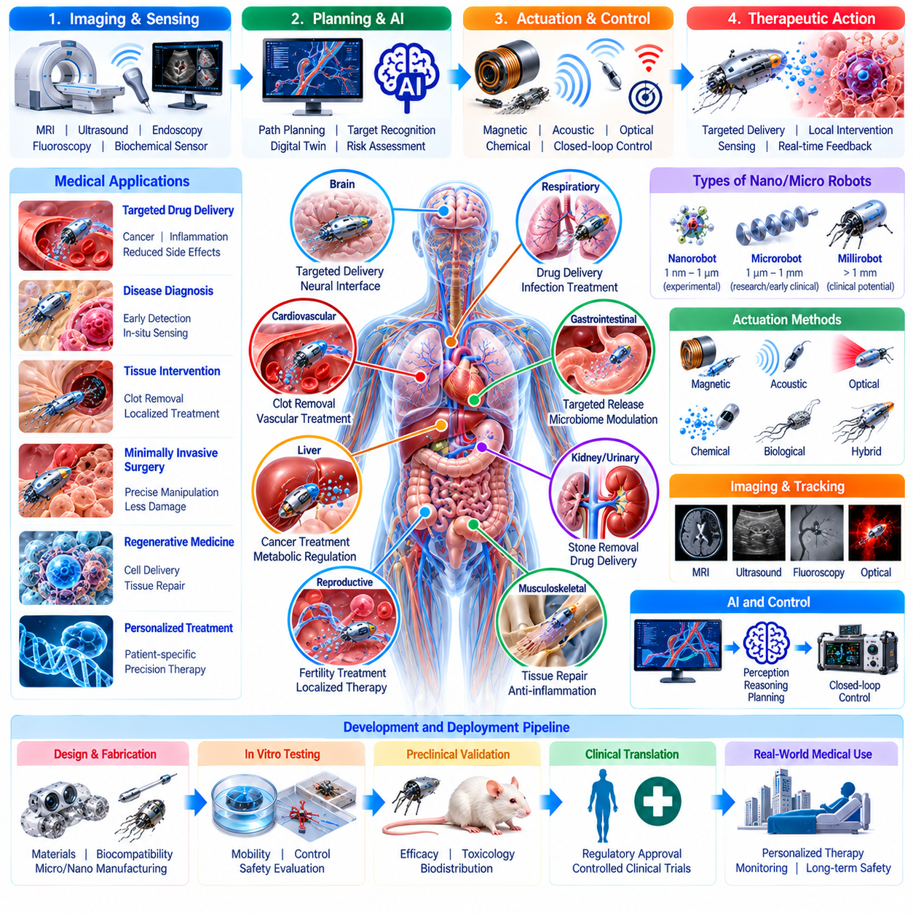{width="7.268055555555556in" height="7.268055555555556in"}

Nano- and micro-robotics extends Physical AI into the human body, where miniature engineered systems may support targeted drug delivery, localized diagnosis, tissue intervention, and minimally invasive treatment. Unlike conventional robots, these devices operate under severe constraints involving size, energy, sensing, and biological compatibility. Their development combines microrobotics, materials science, biomedical engineering, and carefully controlled intelligence.

Medical microrobots range from millimeter-scale devices to microscopic structures, while nanorobotic concepts involve components approaching molecular dimensions. These categories differ significantly in fabrication, actuation, sensing, and clinical maturity. Many proposed nanorobots remain experimental rather than autonomous machines with onboard computation. Accurate system descriptions must distinguish demonstrated capabilities from speculative future applications.

The human body creates a complex operating environment involving blood flow, tissue elasticity, immune responses, chemical gradients, and continuously changing biological conditions. Robots must interact with living structures without causing unacceptable injury or inflammation. Navigation strategies depend on the intended anatomical location, including blood vessels, gastrointestinal pathways, urinary systems, and accessible tissue cavities.

Actuation represents a fundamental challenge because conventional motors and batteries cannot be scaled indefinitely. Magnetic fields can guide responsive microstructures, while acoustic, optical, chemical, and biological mechanisms offer alternative propulsion methods. Each approach introduces limitations involving penetration depth, controllability, heating, or biocompatibility. External actuation often provides a more realistic architecture than fully self-powered microscopic robots.

Magnetic microrobotics uses externally generated magnetic fields and field gradients to produce motion or orientation changes. Helical swimmers, flexible structures, and magnetic particles demonstrate different locomotion principles. Control algorithms must consider fluid resistance, anatomical boundaries, and magnetic field limitations. Magnetic navigation does not automatically guarantee precise positioning within complex biological environments.

Microscale fluid dynamics differs substantially from the motion of conventional mobile robots. Viscous forces often dominate inertia, making propulsion mechanisms dependent on nonreciprocal motion or external forcing. Blood flow and mucus introduce additional disturbances. Physical AI models must incorporate scale-dependent hydrodynamics, surface interactions, and uncertain material properties when predicting robot movement.

Localization inside the body requires imaging and sensing technologies capable of detecting extremely small devices. Magnetic resonance imaging, ultrasound, fluoroscopy, and magnetic tracking offer different possibilities depending on materials and anatomical conditions. Each method involves tradeoffs in resolution, penetration, exposure, and real-time availability. Reliable localization must be validated for the intended procedure.

Closed-loop control connects observed microrobot motion with adjustments to external actuation systems. A controller estimates position, evaluates deviation from a target, and modifies magnetic or acoustic inputs. AI-based methods may improve motion prediction and disturbance compensation. However, measurement delays and localization uncertainty require conservative control limits and independent safety mechanisms.

Targeted drug delivery is a prominent application of medical microrobotics. Engineered carriers may transport therapeutic compounds toward selected tissues and release them through environmental triggers or externally controlled mechanisms. Potential benefits include localized exposure and reduced systemic distribution. Clinical effectiveness depends on delivery efficiency, pharmacokinetics, toxicity, and demonstrated therapeutic outcomes.

Micro-robotic intervention may eventually support localized tissue sampling, clot-related procedures, and precise delivery within difficult anatomical regions. These applications require careful distinctions between laboratory demonstrations and validated clinical procedures. Mechanical interaction with vessels or tissues creates risks of obstruction, perforation, and inflammation. High-risk interventions demand extensive preclinical evidence and controlled medical oversight.

Biocompatibility determines whether microscopic robotic systems can safely interact with living tissue. Material composition, surface chemistry, particle geometry, and degradation products influence biological responses. Immune activation, thrombosis, unintended accumulation, and long-term toxicity must be evaluated. Biodegradable materials may reduce persistence risks, but degradation behavior and resulting compounds require independent validation.

Power and computation limitations constrain the practical meaning of onboard intelligence at microscopic scales. Many microrobotic systems rely on external imaging, computing, and actuation rather than embedded AI processors. Intelligence therefore resides primarily in the surrounding control architecture. This distinction is essential when evaluating claims about autonomous nanorobots capable of sensing, reasoning, and acting independently inside the body.

Digital twins and computational models can represent fluid transport, magnetic fields, tissue geometry, and device interactions. Patient-specific anatomical information may improve planning for selected procedures. Simulation supports controller development and preliminary risk assessment, but biological variability limits predictive accuracy. Experimental validation remains necessary because simplified models cannot capture every physiological interaction.

Swarm microrobotics investigates how multiple microscopic agents might collectively transport materials, generate local effects, or cover larger treatment regions. External fields and local interactions can influence collective behavior. Coordinating individual agents remains difficult when sensing resolution is limited. Swarm safety requires evaluating aggregation, unintended blockage, dispersal, and the ability to terminate or reverse collective activity.

Medical AI can support treatment planning, image interpretation, motion estimation, and adaptive control of microrobotic systems. Learning-based algorithms may identify anatomical pathways and predict responses to external actuation. Their reliability depends on representative training data and validated operating conditions. Clinical decision authority must remain with qualified professionals, particularly when uncertainty affects patient safety.

Manufacturing and quality control introduce substantial challenges for medical microrobots. Microfabrication processes must achieve reproducible geometry, material composition, magnetic properties, and therapeutic loading. Sterilization and storage can alter device behavior. Scalable production requires documented specifications, contamination control, batch consistency, and traceability throughout the manufacturing lifecycle.

Verification and validation must address mechanical performance, biological safety, imaging accuracy, control reliability, and treatment effectiveness. Laboratory testing, tissue models, and appropriate animal studies may precede carefully authorized human investigations. Performance claims should distinguish in vitro results from in vivo evidence. Regulatory evaluation depends on intended medical use, device characteristics, and associated therapeutic components.

Cybersecurity and data governance become relevant when external controllers, imaging systems, and networked medical equipment coordinate robotic interventions. Unauthorized commands, corrupted measurements, or software faults could create physical hazards. Secure communication, access control, audit records, and validated fallback procedures support system integrity. Patient information must be protected throughout planning, operation, and follow-up monitoring.

Clinical performance should be evaluated through treatment benefit, targeting accuracy, procedural safety, device clearance, and long-term patient outcomes. Technical demonstrations of movement or manipulation do not independently establish medical usefulness. Comparative studies must determine whether microrobotic approaches improve upon established treatments. Economic feasibility also depends on manufacturing cost, specialized equipment, and clinical workflow integration.

Future research may combine responsive biomaterials, advanced imaging, AI-assisted external control, and biodegradable microstructures into increasingly capable therapeutic platforms. Progress will likely occur through narrowly defined medical applications before broadly autonomous intrabody robots become feasible. Scientific uncertainty, limited clinical evidence, and unresolved engineering constraints require cautious interpretation of technological forecasts.

The long-term vision is a medical Physical AI ecosystem in which miniature robotic systems provide precise, minimally invasive interventions under continuous clinical supervision. Intelligent imaging, predictive modeling, external actuation, and controlled therapeutic delivery could operate as an integrated platform. Realizing this vision requires rigorous biological validation, reproducible manufacturing, transparent regulation, and demonstrated improvements in patient outcomes.

나노 및 마이크로 로봇 기술(Nano- and Micro-Robotics)은 피지컬 AI(Physical AI)를 인체 내부로 확장하여 초소형 공학 시스템(Miniature Engineered System)이 표적 약물 전달(Targeted Drug Delivery), 국소 진단(Localized Diagnosis), 조직 개입(Tissue Intervention), 최소 침습 치료(Minimally Invasive Treatment)를 지원할 수 있도록 한다. 기존 로봇과 달리 이러한 장치는 크기(Size), 에너지(Energy), 센싱(Sensing), 생체적합성(Biocompatibility)과 관련된 극심한 제약조건에서 작동한다. 이러한 기술의 개발은 마이크로 로봇공학(Microrobotics), 재료과학(Materials Science), 생체의공학(Biomedical Engineering), 정밀하게 제어되는 지능 기술(Controlled Intelligence)을 결합한다.

의료용 마이크로 로봇(Medical Microrobot)은 밀리미터 규모(Millimeter Scale)의 장치부터 미세 구조물(Microscopic Structure)까지 포함하며, 나노 로봇 개념(Nanorobotic Concept)은 분자 수준(Molecular Dimension)에 접근하는 구성요소를 포함한다. 이러한 범주는 제작(Fabrication), 구동(Actuation), 센싱(Sensing), 임상적 성숙도(Clinical Maturity)에서 상당한 차이를 나타낸다. 제안된 많은 나노 로봇은 온보드 연산(Onboard Computation)을 수행하는 자율 기계(Autonomous Machine)가 아니라 실험 단계(Experimental Stage)에 머물러 있다. 정확한 시스템 설명(System Description)을 위해서는 실증된 기능(Demonstrated Capability)과 미래의 추정적 응용(Speculative Future Application)을 구분해야 한다.

인체(Human Body)는 혈류(Blood Flow), 조직 탄성(Tissue Elasticity), 면역 반응(Immune Response), 화학적 농도 구배(Chemical Gradient), 지속적으로 변화하는 생물학적 조건(Biological Condition)이 결합된 복잡한 운용 환경(Operating Environment)을 형성한다. 로봇은 허용할 수 없는 손상(Injury)이나 염증(Inflammation)을 유발하지 않으면서 살아 있는 조직(Living Tissue)과 상호작용해야 한다. 항법 전략(Navigation Strategy)은 혈관(Blood Vessel), 위장관 경로(Gastrointestinal Pathway), 비뇨기계(Urinary System), 접근 가능한 조직 내강(Accessible Tissue Cavity) 등 목표 해부학적 위치(Anatomical Location)에 따라 달라진다.

구동(Actuation)은 기존 모터(Conventional Motor)와 배터리(Battery)를 무한정 소형화할 수 없기 때문에 근본적인 기술적 과제를 나타낸다. 자기장(Magnetic Field)은 자기 반응성 미세 구조물(Magnetically Responsive Microstructure)을 유도할 수 있으며, 음향(Acoustic), 광학(Optical), 화학적(Chemical), 생물학적(Biological) 메커니즘은 대체 추진 방식(Alternative Propulsion Method)을 제공한다. 각 방식에는 침투 깊이(Penetration Depth), 제어 가능성(Controllability), 발열(Heating), 생체적합성(Biocompatibility)과 관련된 한계가 존재한다. 외부 구동(External Actuation)은 완전히 자체 동력으로 작동하는 미세 로봇(Fully Self-Powered Microscopic Robot)보다 현실적인 아키텍처를 제공하는 경우가 많다.

자기 구동 마이크로 로봇 기술(Magnetic Microrobotics)은 외부에서 생성된 자기장(Magnetic Field)과 자기장 구배(Field Gradient)를 활용하여 이동(Motion)이나 방향 변화(Orientation Change)를 발생시킨다. 나선형 유영체(Helical Swimmer), 유연 구조물(Flexible Structure), 자성 입자(Magnetic Particle)는 서로 다른 이동 원리(Locomotion Principle)를 보여준다. 제어 알고리즘(Control Algorithm)은 유체 저항(Fluid Resistance), 해부학적 경계(Anatomical Boundary), 자기장 한계(Magnetic Field Limitation)를 고려해야 한다. 자기 항법(Magnetic Navigation)이 복잡한 생물학적 환경(Biological Environment)에서 자동으로 정밀한 위치 제어(Precise Positioning)를 보장하는 것은 아니다.

마이크로 규모 유체역학(Microscale Fluid Dynamics)은 기존 이동 로봇(Conventional Mobile Robot)의 운동과 상당히 다르다. 점성력(Viscous Force)이 관성(Inertia)보다 지배적인 경우가 많아 추진 메커니즘(Propulsion Mechanism)은 비상호적 운동(Nonreciprocal Motion)이나 외부 구동력(External Forcing)에 의존한다. 혈류(Blood Flow)와 점액(Mucus)은 추가적인 외란(Disturbance)을 발생시킨다. 피지컬 AI 모델(Physical AI Model)은 로봇의 이동을 예측할 때 크기에 따른 유체역학(Scale-Dependent Hydrodynamics), 표면 상호작용(Surface Interaction), 불확실한 재료 특성(Uncertain Material Property)을 반영해야 한다.

체내 위치 추정(In-Body Localization)에는 극도로 작은 장치를 탐지할 수 있는 영상 및 센싱 기술(Imaging and Sensing Technology)이 필요하다. 자기공명영상(Magnetic Resonance Imaging, MRI), 초음파(Ultrasound), 투시 영상(Fluoroscopy), 자기 추적(Magnetic Tracking)은 재료 특성과 해부학적 조건에 따라 서로 다른 가능성을 제공한다. 각 방법에는 해상도(Resolution), 침투 깊이(Penetration), 노출(Exposure), 실시간 가용성(Real-Time Availability) 측면의 상충관계(Tradeoff)가 존재한다. 신뢰할 수 있는 위치 추정(Localization)은 의도된 의료 시술(Intended Procedure)에 대해 검증되어야 한다.

폐루프 제어(Closed-Loop Control)는 관측된 마이크로 로봇의 움직임(Microrobot Motion)을 외부 구동 시스템(External Actuation System)의 조정과 연결한다. 제어기(Controller)는 위치(Position)를 추정하고 목표 지점(Target)과의 편차(Deviation)를 평가한 다음 자기 또는 음향 입력(Magnetic or Acoustic Input)을 수정한다. AI 기반 방법(AI-Based Method)은 운동 예측(Motion Prediction)과 외란 보상(Disturbance Compensation)을 개선할 수 있다. 그러나 측정 지연(Measurement Delay)과 위치 추정 불확실성(Localization Uncertainty)으로 인해 보수적인 제어 한계(Conservative Control Limit)와 독립적인 안전 메커니즘(Independent Safety Mechanism)이 필요하다.

표적 약물 전달(Targeted Drug Delivery)은 의료용 마이크로 로봇 기술(Medical Microrobotics)의 대표적인 응용 분야이다. 공학적으로 설계된 운반체(Engineered Carrier)는 치료 물질(Therapeutic Compound)을 선택된 조직(Selected Tissue)으로 운반하고 환경적 자극(Environmental Trigger)이나 외부 제어 메커니즘(Externally Controlled Mechanism)을 통해 방출할 수 있다. 잠재적인 이점에는 국소 노출(Localized Exposure)과 전신 분포(Systemic Distribution)의 감소가 포함된다. 임상적 효과(Clinical Effectiveness)는 전달 효율(Delivery Efficiency), 약동학(Pharmacokinetics), 독성(Toxicity), 입증된 치료 성과(Demonstrated Therapeutic Outcome)에 달려 있다.

마이크로 로봇 개입(Micro-Robotic Intervention)은 향후 국소 조직 채취(Localized Tissue Sampling), 혈전 관련 시술(Clot-Related Procedure), 접근하기 어려운 해부학적 영역(Anatomical Region)에서의 정밀 전달(Precise Delivery)을 지원할 수 있다. 이러한 응용에서는 실험실 실증(Laboratory Demonstration)과 검증된 임상 시술(Validated Clinical Procedure)을 신중하게 구분해야 한다. 혈관이나 조직과의 기계적 상호작용(Mechanical Interaction)은 폐색(Obstruction), 천공(Perforation), 염증(Inflammation)의 위험을 발생시킨다. 고위험 개입(High-Risk Intervention)에는 광범위한 전임상 근거(Preclinical Evidence)와 통제된 의료 감독(Medical Oversight)이 요구된다.

생체적합성(Biocompatibility)은 미세 로봇 시스템(Microscopic Robotic System)이 살아 있는 조직과 안전하게 상호작용할 수 있는지를 결정한다. 재료 구성(Material Composition), 표면 화학(Surface Chemistry), 입자 형상(Particle Geometry), 분해 생성물(Degradation Product)은 생물학적 반응(Biological Response)에 영향을 미친다. 면역 활성화(Immune Activation), 혈전증(Thrombosis), 의도하지 않은 축적(Unintended Accumulation), 장기 독성(Long-Term Toxicity)을 평가해야 한다. 생분해성 재료(Biodegradable Material)는 체내 잔류 위험(Persistence Risk)을 줄일 수 있지만, 분해 거동(Degradation Behavior)과 생성되는 화합물(Resulting Compound)에 대한 독립적인 검증(Independent Validation)이 필요하다.

전력 및 연산 제약조건(Power and Computation Limitation)은 미세 규모에서 온보드 지능(Onboard Intelligence)이 갖는 실질적인 의미를 제한한다. 많은 마이크로 로봇 시스템(Microrobotic System)은 내장형 AI 프로세서(Embedded AI Processor)보다 외부 영상 시스템(External Imaging System), 컴퓨팅 시스템(Computing System), 구동 시스템(Actuation System)에 의존한다. 따라서 지능(Intelligence)은 주로 주변 제어 아키텍처(Surrounding Control Architecture)에 존재한다. 이러한 구분은 인체 내부에서 독립적으로 센싱(Sensing), 추론(Reasoning), 행동(Acting)을 수행하는 자율 나노 로봇(Autonomous Nanorobot)에 관한 주장을 평가할 때 필수적이다.

디지털 트윈(Digital Twin)과 계산 모델(Computational Model)은 유체 수송(Fluid Transport), 자기장(Magnetic Field), 조직 형상(Tissue Geometry), 장치 상호작용(Device Interaction)을 표현할 수 있다. 환자별 해부학적 정보(Patient-Specific Anatomical Information)는 일부 시술의 계획(Planning)을 개선할 수 있다. 시뮬레이션(Simulation)은 제어기 개발(Controller Development)과 예비 위험 평가(Preliminary Risk Assessment)를 지원하지만, 생물학적 변동성(Biological Variability)은 예측 정확도(Predictive Accuracy)를 제한한다. 단순화된 모델(Simplified Model)은 모든 생리학적 상호작용(Physiological Interaction)을 재현할 수 없으므로 실험적 검증(Experimental Validation)이 필요하다.

군집 마이크로 로봇 기술(Swarm Microrobotics)은 여러 미세 에이전트(Microscopic Agent)가 집단적으로 물질을 운반하거나, 국소적인 효과(Local Effect)를 발생시키거나, 더 넓은 치료 영역(Treatment Region)을 담당하는 방법을 연구한다. 외부장(External Field)과 국소 상호작용(Local Interaction)은 집단 행동(Collective Behavior)에 영향을 미칠 수 있다. 센싱 해상도(Sensing Resolution)가 제한된 경우 개별 에이전트(Individual Agent)를 조정하기는 어렵다. 군집 안전성(Swarm Safety)을 확보하려면 응집(Aggregation), 의도하지 않은 폐색(Unintended Blockage), 분산(Dispersal), 집단 활동(Collective Activity)을 종료하거나 되돌릴 수 있는 능력을 평가해야 한다.

의료 AI(Medical AI)는 마이크로 로봇 시스템(Microrobotic System)의 치료 계획(Treatment Planning), 영상 해석(Image Interpretation), 운동 추정(Motion Estimation), 적응형 제어(Adaptive Control)를 지원할 수 있다. 학습 기반 알고리즘(Learning-Based Algorithm)은 해부학적 경로(Anatomical Pathway)를 식별하고 외부 구동(External Actuation)에 대한 반응을 예측할 수 있다. 이러한 알고리즘의 신뢰성(Reliability)은 대표성 있는 학습 데이터(Representative Training Data)와 검증된 운용 조건(Validated Operating Condition)에 달려 있다. 특히 불확실성이 환자 안전(Patient Safety)에 영향을 미치는 경우 임상 의사결정 권한(Clinical Decision Authority)은 자격을 갖춘 의료 전문가(Qualified Medical Professional)에게 유지되어야 한다.

제조 및 품질 관리(Manufacturing and Quality Control)는 의료용 마이크로 로봇(Medical Microrobot)에 상당한 과제를 제시한다. 미세 제작 공정(Microfabrication Process)은 재현 가능한 형상(Reproducible Geometry), 재료 구성(Material Composition), 자기적 특성(Magnetic Property), 치료 물질 탑재량(Therapeutic Loading)을 확보해야 한다. 멸균(Sterilization)과 보관(Storage)은 장치의 동작 특성(Device Behavior)을 변화시킬 수 있다. 확장 가능한 생산(Scalable Production)에는 문서화된 사양(Documented Specification), 오염 관리(Contamination Control), 배치 일관성(Batch Consistency), 제조 수명주기(Manufacturing Lifecycle) 전반의 추적성(Traceability)이 필요하다.

검증 및 유효성 확인(Verification and Validation)은 기계적 성능(Mechanical Performance), 생물학적 안전성(Biological Safety), 영상 정확도(Imaging Accuracy), 제어 신뢰성(Control Reliability), 치료 효과(Treatment Effectiveness)를 다루어야 한다. 실험실 시험(Laboratory Testing), 조직 모델(Tissue Model), 적절한 동물 연구(Animal Study)는 신중하게 승인된 인간 대상 연구(Human Investigation)에 앞서 수행될 수 있다. 성능 주장(Performance Claim)은 시험관 내 결과(In Vitro Result)와 생체 내 근거(In Vivo Evidence)를 구분해야 한다. 규제 평가(Regulatory Evaluation)는 의도된 의료 용도(Intended Medical Use), 장치 특성(Device Characteristic), 관련 치료 구성요소(Therapeutic Component)에 따라 달라진다.

사이버보안(Cybersecurity)과 데이터 거버넌스(Data Governance)는 외부 제어기(External Controller), 영상 시스템(Imaging System), 네트워크 연결 의료 장비(Networked Medical Equipment)가 로봇 개입(Robotic Intervention)을 조정할 때 중요해진다. 승인되지 않은 명령(Unauthorized Command), 손상된 측정값(Corrupted Measurement), 소프트웨어 결함(Software Fault)은 물리적 위험(Physical Hazard)을 발생시킬 수 있다. 보안 통신(Secure Communication), 접근 제어(Access Control), 감사 기록(Audit Record), 검증된 대체 절차(Validated Fallback Procedure)는 시스템 무결성(System Integrity)을 지원한다. 환자 정보(Patient Information)는 계획(Planning), 운용(Operation), 후속 모니터링(Follow-Up Monitoring) 전 과정에서 보호되어야 한다.

임상 성능(Clinical Performance)은 치료 편익(Treatment Benefit), 표적 도달 정확도(Targeting Accuracy), 시술 안전성(Procedural Safety), 장치 제거 및 배출(Device Clearance), 장기 환자 성과(Long-Term Patient Outcome)를 통해 평가해야 한다. 이동(Motion)이나 조작(Manipulation)에 대한 기술적 실증(Technical Demonstration)만으로 의료적 유용성(Medical Usefulness)을 입증할 수는 없다. 비교 연구(Comparative Study)는 마이크로 로봇 접근법(Microrobotic Approach)이 기존 치료법(Established Treatment)보다 개선된 결과를 제공하는지 판단해야 한다. 경제적 타당성(Economic Feasibility) 역시 제조 비용(Manufacturing Cost), 특수 장비(Specialized Equipment), 임상 업무 흐름 통합(Clinical Workflow Integration)에 달려 있다.

미래 연구(Future Research)는 반응형 생체재료(Responsive Biomaterial), 첨단 영상 기술(Advanced Imaging), AI 지원 외부 제어(AI-Assisted External Control), 생분해성 미세 구조물(Biodegradable Microstructure)을 결합하여 점차 고도화된 치료 플랫폼(Therapeutic Platform)을 개발할 수 있다. 광범위한 자율 체내 로봇(Broadly Autonomous Intrabody Robot)이 실현되기 전에 명확하게 정의된 의료 응용 분야(Narrowly Defined Medical Application)를 중심으로 기술 발전이 이루어질 가능성이 높다. 과학적 불확실성(Scientific Uncertainty), 제한된 임상 근거(Limited Clinical Evidence), 해결되지 않은 공학적 제약조건(Unresolved Engineering Constraint)으로 인해 기술 전망(Technological Forecast)은 신중하게 해석해야 한다.

장기적인 비전(Long-Term Vision)은 초소형 로봇 시스템(Miniature Robotic System)이 지속적인 임상 감독(Continuous Clinical Supervision) 아래 정밀하고 최소 침습적인 개입(Precise, Minimally Invasive Intervention)을 제공하는 의료 피지컬 AI 생태계(Medical Physical AI Ecosystem)를 구축하는 것이다. 지능형 영상 기술(Intelligent Imaging), 예측 모델링(Predictive Modeling), 외부 구동(External Actuation), 제어된 치료 물질 전달(Controlled Therapeutic Delivery)은 하나의 통합 플랫폼(Integrated Platform)으로 작동할 수 있다. 이러한 비전을 실현하려면 엄격한 생물학적 검증(Rigorous Biological Validation), 재현 가능한 제조(Reproducible Manufacturing), 투명한 규제(Transparent Regulation), 입증된 환자 치료 성과 개선(Demonstrated Improvement in Patient Outcomes)이 필요하다.

##  

## 09.10. Physical AI 2035 Grand Vision Scenarios

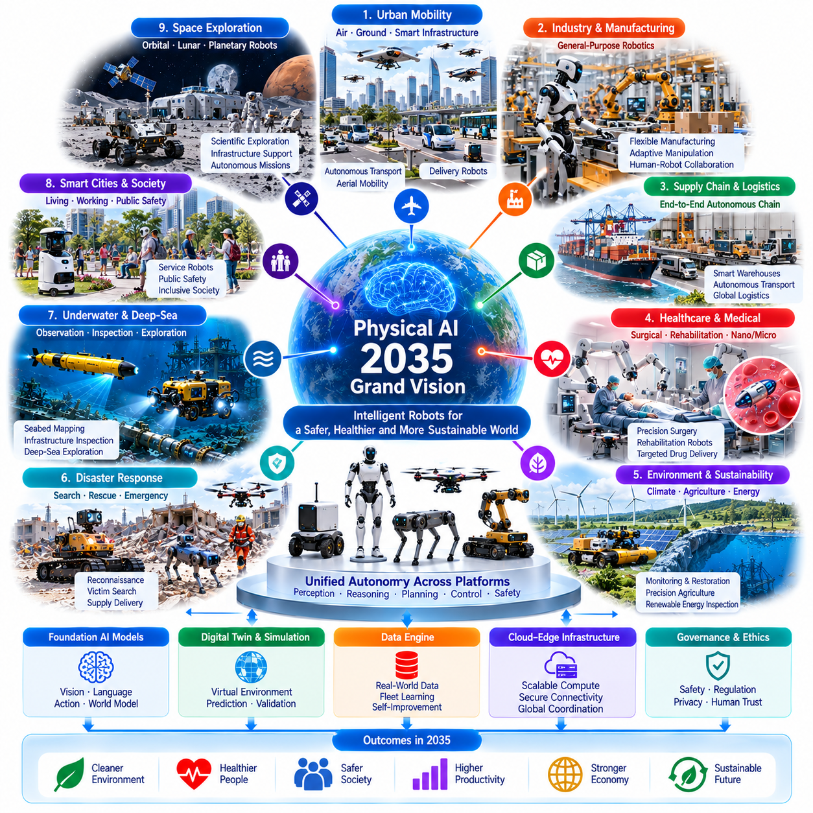{width="7.268055555555556in" height="7.268055555555556in"}

The Physical AI vision for 2035 describes a future in which intelligent machines interact with the physical world through perception, reasoning, planning, and autonomous action. Robots may evolve from specialized automation devices into adaptable systems operating across transportation, industry, healthcare, and environmental services. This vision represents a set of plausible scenarios rather than a guaranteed technological forecast.

A central scenario involves a unified autonomy architecture connecting aerial, ground, marine, and specialized robotic platforms. Shared perception models, world representations, and planning services could support transferable intelligence across different machines. Platform-specific controllers would preserve mechanical stability and operational safety. Common interfaces could reduce integration complexity without eliminating differences in physical capabilities.

Urban mobility in 2035 may combine autonomous vehicles, delivery robots, aerial transport, and intelligent infrastructure into coordinated transportation ecosystems. AI systems could optimize routing, resource allocation, and traffic interactions across multiple mobility domains. Such integration requires reliable communication, standardized operating rules, and validated safety boundaries. Public acceptance and regulatory approval will remain decisive constraints.

Industrial environments may increasingly deploy general-purpose robotic systems capable of performing multiple tasks without extensive mechanical reconfiguration. Foundation models could interpret instructions, recognize unfamiliar objects, and generate adaptable manipulation strategies. However, high-level reasoning must remain connected to deterministic safety controls. Productivity improvements will depend on task reliability, deployment economics, and maintainability.

A future autonomous supply chain could connect manufacturing facilities, warehouses, ports, and distribution networks through coordinated robotic operations. Mobile manipulators, automated transport systems, and intelligent scheduling platforms may exchange operational information. Predictive models could anticipate disruptions and recommend alternative logistics strategies. Human supervisors would retain responsibility for critical decisions and exceptional situations.

Healthcare robotics may progress toward more precise surgical assistance, rehabilitation systems, and targeted therapeutic technologies. Physical AI could combine medical imaging, motion planning, and controlled physical interaction to support clinical procedures. Miniature robotic systems may eventually enable selected localized interventions. Clinical adoption will depend on demonstrated safety, treatment effectiveness, regulatory evaluation, and professional oversight.

Environmental robotics could establish persistent monitoring networks across forests, agricultural regions, oceans, and energy infrastructure. Autonomous platforms may identify environmental anomalies and support targeted restoration or maintenance. Predictive world models could connect observations with climate adaptation planning. Sustainability claims must be evaluated through lifecycle emissions, resource efficiency, and verified ecological outcomes.

Disaster response represents another important scenario in which aerial, ground, and marine robots cooperate during emergencies. Autonomous systems may inspect damaged infrastructure, locate possible survivors, and deliver essential supplies. Shared situational models could help incident commanders allocate resources more effectively. Safety-critical decisions must remain governed by authorized responders, validated procedures, and transparent uncertainty reporting.

Space exploration may benefit from intelligent robotic teams operating across orbital, lunar, and planetary environments. Autonomous rovers, aerial scouts, and robotic manipulators could conduct scientific investigations and support infrastructure development. Communication delays make local decision-making essential. Reliable operation will require energy-aware planning, fault tolerance, and strict separation between experimental AI functions and safety-critical control.

Underwater Physical AI may enable coordinated ocean observation, subsea infrastructure inspection, and deep-sea exploration. Surface vessels and underwater robots could exchange mission information despite intermittent communication. Adaptive sensing could improve scientific coverage while reducing unnecessary energy expenditure. Pressure resistance, localization uncertainty, environmental protection, and recovery reliability will remain fundamental engineering requirements.

The evolution of robotic intelligence may increasingly rely on foundation models that integrate language, vision, action, and physical reasoning. These systems could transfer knowledge between tasks and support rapid adaptation to new environments. Yet generalization remains difficult when physical conditions differ from training data. Reliable deployment requires uncertainty estimation, controlled adaptation, and systematic evaluation of out-of-distribution behavior.

World models may become a central component of Physical AI by representing environmental structure, object dynamics, and predicted consequences of actions. Robots could simulate candidate behaviors before execution and revise plans as observations change. Digital twins may connect physical systems with predictive simulations. Model errors and incomplete observations will require continuous validation against real-world measurements.

Self-improving robotic systems could use operational data to refine perception, planning, and task execution. Fleet-level learning may identify recurring failures and distribute validated improvements across compatible platforms. However, autonomous software modification creates risks involving regression, unexpected behavior, and certification integrity. Updates must pass controlled testing, traceability checks, and authorization before safety-relevant deployment.

Cloud and edge intelligence may form a distributed computing architecture for large robotic ecosystems. Edge processors would handle immediate sensing, motion control, and hazard response, while cloud services could support large-scale training and fleet optimization. Communication interruptions must not compromise local safety. Secure model distribution, access control, and privacy-preserving data management will become essential operational capabilities.

Human-robot collaboration in 2035 may involve robots functioning as adaptable assistants rather than isolated automation equipment. Workers could assign objectives through natural language, demonstrations, or structured task interfaces. Robots would interpret goals while communicating uncertainty and requesting clarification when necessary. Effective collaboration requires ergonomic design, predictable behavior, appropriate training, and clearly defined human authority.

Neuromorphic computing and energy-efficient AI hardware may expand the capabilities of robots operating under strict power constraints. Event-driven sensing and specialized accelerators could reduce computation costs for selected perception and control workloads. Quantum computing may contribute to certain optimization or simulation tasks if practical advantages are demonstrated. Neither technology should be assumed to replace established computing architectures universally.

Physical AI ecosystems will also require robust cybersecurity and safety governance. Networked robots introduce attack surfaces involving sensors, communication links, software updates, and shared autonomy services. Zero-trust principles, authenticated commands, and independent safety mechanisms can reduce operational risks. Governance frameworks must establish accountability, auditability, incident response, and acceptable limits on autonomous decision-making.

Economic scenarios for 2035 range from gradual adoption in structured environments to broader deployment across public services and infrastructure. Hardware costs, integration complexity, workforce preparation, and maintenance requirements will influence adoption rates. Robotics-as-a-Service models may lower initial investment barriers. However, economic value must be assessed through verified productivity, lifecycle costs, reliability, and social consequences.

Scenario planning should distinguish optimistic, moderate, and constrained development pathways. An optimistic pathway assumes rapid improvements in generalization, affordable hardware, and regulatory interoperability. A moderate pathway emphasizes domain-specific autonomy and gradual integration. A constrained pathway reflects unresolved safety challenges, limited investment, fragmented standards, and public resistance. These scenarios provide planning tools rather than precise predictions.

A responsible roadmap toward 2035 requires measurable milestones covering autonomy performance, energy efficiency, safety assurance, interoperability, and real-world deployment. Evaluation should include unfamiliar environments, degraded sensors, communication failures, and human interaction. Independent validation and transparent reporting are necessary to distinguish laboratory demonstrations from operational readiness. Progress should be measured through dependable outcomes rather than promotional claims.

The grand vision for Physical AI in 2035 is an interconnected world of intelligent machines that extend human capabilities while remaining accountable to human objectives. Robots could support mobility, production, healthcare, environmental resilience, disaster response, and scientific discovery through shared intelligence and specialized embodiment. Realizing this vision depends on engineering discipline, trustworthy autonomy, sustainable economics, and governance that places human safety and societal benefit at the center.

2035년 피지컬 AI 비전(Physical AI Vision for 2035)은 지능형 기계(Intelligent Machine)가 인식(Perception), 추론(Reasoning), 계획(Planning), 자율 행동(Autonomous Action)을 통해 물리적 세계(Physical World)와 상호작용하는 미래를 설명한다. 로봇은 특정 작업에 특화된 자동화 장치(Specialized Automation Device)에서 교통(Transportation), 산업(Industry), 의료(Healthcare), 환경 서비스(Environmental Service) 전반에 걸쳐 작동하는 적응형 시스템(Adaptable System)으로 발전할 수 있다. 이러한 비전은 기술 발전이 반드시 실현된다는 확정적 예측이 아니라 실현 가능한 미래 시나리오(Plausible Future Scenario)의 집합을 의미한다.

핵심 시나리오(Central Scenario) 중 하나는 항공(Aerial), 지상(Ground), 해양(Marine), 특수 목적 로봇 플랫폼(Specialized Robotic Platform)을 연결하는 통합 자율성 아키텍처(Unified Autonomy Architecture)이다. 공유 인식 모델(Shared Perception Model), 월드 표현(World Representation), 계획 서비스(Planning Service)는 서로 다른 기계 사이에서 전이 가능한 지능(Transferable Intelligence)을 지원할 수 있다. 플랫폼별 제어기(Platform-Specific Controller)는 기계적 안정성(Mechanical Stability)과 운용 안전성(Operational Safety)을 유지한다. 공통 인터페이스(Common Interface)는 물리적 능력(Physical Capability)의 차이를 제거하지 않으면서 시스템 통합 복잡성(Integration Complexity)을 줄일 수 있다.

2035년의 도시 모빌리티(Urban Mobility)는 자율주행 차량(Autonomous Vehicle), 배송 로봇(Delivery Robot), 항공 운송(Aerial Transport), 지능형 인프라(Intelligent Infrastructure)를 통합한 협력형 교통 생태계(Coordinated Transportation Ecosystem)로 발전할 수 있다. AI 시스템(AI System)은 여러 모빌리티 영역(Mobility Domain)에 걸쳐 경로 설정(Routing), 자원 할당(Resource Allocation), 교통 상호작용(Traffic Interaction)을 최적화할 수 있다. 이러한 통합에는 신뢰할 수 있는 통신(Reliable Communication), 표준화된 운용 규칙(Standardized Operating Rule), 검증된 안전 경계(Validated Safety Boundary)가 필요하다. 사회적 수용성(Public Acceptance)과 규제 승인(Regulatory Approval)은 여전히 결정적인 제약조건으로 작용할 것이다.

산업 환경(Industrial Environment)에서는 광범위한 기계적 재구성(Mechanical Reconfiguration) 없이 여러 작업을 수행할 수 있는 범용 로봇 시스템(General-Purpose Robotic System)의 도입이 증가할 수 있다. 파운데이션 모델(Foundation Model)은 명령(Instruction)을 해석하고, 익숙하지 않은 객체(Unfamiliar Object)를 인식하며, 적응형 조작 전략(Adaptable Manipulation Strategy)을 생성할 수 있다. 그러나 상위 수준 추론(High-Level Reasoning)은 결정론적 안전 제어(Deterministic Safety Control)와 연결되어야 한다. 생산성 향상(Productivity Improvement)은 작업 신뢰성(Task Reliability), 배치 경제성(Deployment Economics), 유지보수성(Maintainability)에 달려 있다.

미래의 자율 공급망(Autonomous Supply Chain)은 협력 로봇 운용(Coordinated Robotic Operation)을 통해 제조 시설(Manufacturing Facility), 창고(Warehouse), 항만(Port), 유통 네트워크(Distribution Network)를 연결할 수 있다. 이동형 매니퓰레이터(Mobile Manipulator), 자동 운송 시스템(Automated Transport System), 지능형 일정 관리 플랫폼(Intelligent Scheduling Platform)은 운영 정보(Operational Information)를 교환할 수 있다. 예측 모델(Predictive Model)은 공급망 중단(Disruption)을 예상하고 대체 물류 전략(Alternative Logistics Strategy)을 추천할 수 있다. 인간 감독자(Human Supervisor)는 핵심 의사결정(Critical Decision)과 예외 상황(Exceptional Situation)에 대한 책임을 유지한다.

의료 로봇 기술(Healthcare Robotics)은 더욱 정밀한 수술 보조(Surgical Assistance), 재활 시스템(Rehabilitation System), 표적 치료 기술(Targeted Therapeutic Technology)로 발전할 수 있다. 피지컬 AI(Physical AI)는 의료 영상(Medical Imaging), 운동 계획(Motion Planning), 제어된 물리적 상호작용(Controlled Physical Interaction)을 결합하여 임상 시술(Clinical Procedure)을 지원할 수 있다. 초소형 로봇 시스템(Miniature Robotic System)은 궁극적으로 특정 국소 개입(Localized Intervention)을 가능하게 할 수 있다. 임상 도입(Clinical Adoption)은 입증된 안전성(Demonstrated Safety), 치료 효과(Treatment Effectiveness), 규제 평가(Regulatory Evaluation), 전문가 감독(Professional Oversight)에 달려 있다.

환경 로봇 기술(Environmental Robotics)은 산림(Forest), 농업 지역(Agricultural Region), 해양(Ocean), 에너지 인프라(Energy Infrastructure) 전반에 걸쳐 지속적인 모니터링 네트워크(Persistent Monitoring Network)를 구축할 수 있다. 자율 플랫폼(Autonomous Platform)은 환경 이상(Environmental Anomaly)을 식별하고 표적 복원(Targeted Restoration)이나 유지보수(Maintenance)를 지원할 수 있다. 예측 월드 모델(Predictive World Model)은 관측값(Observation)을 기후 적응 계획(Climate Adaptation Planning)과 연결할 수 있다. 지속가능성 주장(Sustainability Claim)은 수명주기 배출량(Lifecycle Emissions), 자원 효율성(Resource Efficiency), 검증된 생태학적 성과(Verified Ecological Outcome)를 통해 평가해야 한다.

재난 대응(Disaster Response)은 항공, 지상, 해양 로봇이 비상 상황(Emergency Situation)에서 협력하는 또 다른 중요한 시나리오이다. 자율 시스템(Autonomous System)은 손상된 인프라(Damaged Infrastructure)를 점검하고, 잠재적인 생존자(Possible Survivor)를 탐색하며, 필수 물품(Essential Supply)을 전달할 수 있다. 공유 상황 모델(Shared Situational Model)은 사고 지휘관(Incident Commander)이 자원을 더욱 효과적으로 배분하도록 지원할 수 있다. 안전 필수 의사결정(Safety-Critical Decision)은 승인된 대응 인력(Authorized Responder), 검증된 절차(Validated Procedure), 투명한 불확실성 보고(Transparent Uncertainty Reporting)에 따라 관리되어야 한다.

우주 탐사(Space Exploration)는 궤도(Orbital), 달(Lunar), 행성(Planetary) 환경에서 작동하는 지능형 로봇 팀(Intelligent Robotic Team)의 도움을 받을 수 있다. 자율 탐사 로버(Autonomous Rover), 항공 정찰 로봇(Aerial Scout), 로봇 매니퓰레이터(Robotic Manipulator)는 과학적 조사(Scientific Investigation)를 수행하고 인프라 개발(Infrastructure Development)을 지원할 수 있다. 통신 지연(Communication Delay)으로 인해 로컬 의사결정(Local Decision-Making)은 필수적이다. 신뢰할 수 있는 운용을 위해서는 에너지 인지형 계획(Energy-Aware Planning), 결함 허용성(Fault Tolerance), 실험적 AI 기능(Experimental AI Function)과 안전 필수 제어(Safety-Critical Control) 사이의 엄격한 분리가 필요하다.

수중 피지컬 AI(Underwater Physical AI)는 협력형 해양 관측(Coordinated Ocean Observation), 해저 인프라 점검(Subsea Infrastructure Inspection), 심해 탐사(Deep-Sea Exploration)를 가능하게 할 수 있다. 수상정(Surface Vessel)과 수중 로봇(Underwater Robot)은 간헐적인 통신(Intermittent Communication)에도 불구하고 임무 정보(Mission Information)를 교환할 수 있다. 적응형 센싱(Adaptive Sensing)은 불필요한 에너지 소비(Energy Expenditure)를 줄이면서 과학적 관측 범위(Scientific Coverage)를 향상시킬 수 있다. 내압 성능(Pressure Resistance), 위치 추정 불확실성(Localization Uncertainty), 환경 보호(Environmental Protection), 회수 신뢰성(Recovery Reliability)은 여전히 핵심적인 공학적 요구사항으로 유지될 것이다.

로봇 지능(Robotic Intelligence)의 발전은 언어(Language), 비전(Vision), 행동(Action), 물리적 추론(Physical Reasoning)을 통합하는 파운데이션 모델(Foundation Model)에 점점 더 의존할 수 있다. 이러한 시스템은 작업 간 지식 전이(Knowledge Transfer)를 수행하고 새로운 환경에 대한 신속한 적응(Rapid Adaptation)을 지원할 수 있다. 그러나 물리적 조건(Physical Condition)이 학습 데이터(Training Data)와 다를 경우 일반화(Generalization)는 여전히 어렵다. 신뢰할 수 있는 배치(Reliable Deployment)를 위해서는 불확실성 추정(Uncertainty Estimation), 통제된 적응(Controlled Adaptation), 분포 외 행동(Out-of-Distribution Behavior)에 대한 체계적인 평가(Systematic Evaluation)가 필요하다.

월드 모델(World Model)은 환경 구조(Environmental Structure), 객체 동역학(Object Dynamics), 행동의 예상 결과(Predicted Consequence of Action)를 표현함으로써 피지컬 AI의 핵심 구성요소(Central Component)가 될 수 있다. 로봇은 실행 전에 후보 행동(Candidate Behavior)을 시뮬레이션하고 관측값이 변화함에 따라 계획을 수정할 수 있다. 디지털 트윈(Digital Twin)은 물리 시스템(Physical System)을 예측 시뮬레이션(Predictive Simulation)과 연결할 수 있다. 모델 오류(Model Error)와 불완전한 관측(Incomplete Observation)으로 인해 실제 측정값(Real-World Measurement)을 통한 지속적인 검증(Continuous Validation)이 필요하다.

자기 개선 로봇 시스템(Self-Improving Robotic System)은 운영 데이터(Operational Data)를 활용하여 인식(Perception), 계획(Planning), 작업 실행(Task Execution)을 개선할 수 있다. 플릿 수준 학습(Fleet-Level Learning)은 반복적으로 발생하는 고장(Recurring Failure)을 식별하고 검증된 개선 사항(Validated Improvement)을 호환 가능한 플랫폼(Compatible Platform)에 배포할 수 있다. 그러나 자율 소프트웨어 수정(Autonomous Software Modification)은 회귀 오류(Regression), 예상하지 못한 행동(Unexpected Behavior), 인증 무결성(Certification Integrity)과 관련된 위험을 발생시킨다. 업데이트(Update)는 안전 관련 배치(Safety-Relevant Deployment) 전에 통제된 시험(Controlled Testing), 추적성 검사(Traceability Check), 승인(Authorization)을 통과해야 한다.

클라우드 및 엣지 지능(Cloud and Edge Intelligence)은 대규모 로봇 생태계(Large Robotic Ecosystem)를 위한 분산 컴퓨팅 아키텍처(Distributed Computing Architecture)를 형성할 수 있다. 엣지 프로세서(Edge Processor)는 즉각적인 센싱(Sensing), 운동 제어(Motion Control), 위험 대응(Hazard Response)을 처리하고, 클라우드 서비스(Cloud Service)는 대규모 학습(Large-Scale Training)과 플릿 최적화(Fleet Optimization)를 지원할 수 있다. 통신 중단(Communication Interruption)이 로컬 안전성(Local Safety)을 훼손해서는 안 된다. 안전한 모델 배포(Secure Model Distribution), 접근 제어(Access Control), 개인정보 보호형 데이터 관리(Privacy-Preserving Data Management)는 필수적인 운영 능력이 될 것이다.

2035년의 인간-로봇 협력(Human-Robot Collaboration)은 로봇이 독립적인 자동화 장비(Isolated Automation Equipment)가 아니라 적응형 보조자(Adaptable Assistant)로 기능하는 형태가 될 수 있다. 작업자는 자연어(Natural Language), 시연(Demonstration), 구조화된 작업 인터페이스(Structured Task Interface)를 통해 목표를 할당할 수 있다. 로봇은 목표(Goal)를 해석하면서 불확실성(Uncertainty)을 전달하고 필요한 경우 추가 설명(Clarification)을 요청할 것이다. 효과적인 협력에는 인간공학적 설계(Ergonomic Design), 예측 가능한 행동(Predictable Behavior), 적절한 교육(Appropriate Training), 명확하게 정의된 인간 권한(Human Authority)이 필요하다.

뉴로모픽 컴퓨팅(Neuromorphic Computing)과 에너지 효율적인 AI 하드웨어(Energy-Efficient AI Hardware)는 엄격한 전력 제약조건(Power Constraint)에서 작동하는 로봇의 능력을 확장할 수 있다. 이벤트 기반 센싱(Event-Driven Sensing)과 특수 가속기(Specialized Accelerator)는 일부 인식 및 제어 작업부하(Perception and Control Workload)의 연산 비용(Computation Cost)을 줄일 수 있다. 양자 컴퓨팅(Quantum Computing)은 실질적인 이점(Practical Advantage)이 입증될 경우 특정 최적화(Optimization)나 시뮬레이션(Simulation) 작업에 기여할 수 있다. 그러나 어느 기술도 기존 컴퓨팅 아키텍처(Established Computing Architecture)를 보편적으로 대체할 것으로 가정해서는 안 된다.

피지컬 AI 생태계(Physical AI Ecosystem)에는 견고한 사이버보안(Cybersecurity)과 안전 거버넌스(Safety Governance)도 필요하다. 네트워크 연결 로봇(Networked Robot)은 센서(Sensor), 통신 링크(Communication Link), 소프트웨어 업데이트(Software Update), 공유 자율성 서비스(Shared Autonomy Service)와 관련된 공격 표면(Attack Surface)을 발생시킨다. 제로 트러스트 원칙(Zero-Trust Principle), 인증된 명령(Authenticated Command), 독립적인 안전 메커니즘(Independent Safety Mechanism)은 운영 위험(Operational Risk)을 줄일 수 있다. 거버넌스 프레임워크(Governance Framework)는 책임성(Accountability), 감사 가능성(Auditability), 사고 대응(Incident Response), 자율 의사결정(Autonomous Decision-Making)의 허용 가능한 한계를 설정해야 한다.

2035년의 경제적 시나리오(Economic Scenario)는 구조화된 환경(Structured Environment)에서의 점진적인 도입(Gradual Adoption)부터 공공 서비스(Public Service)와 인프라 전반에 걸친 광범위한 배치(Broader Deployment)까지 다양하다. 하드웨어 비용(Hardware Cost), 통합 복잡성(Integration Complexity), 인력 준비(Workforce Preparation), 유지보수 요구사항(Maintenance Requirement)은 도입 속도(Adoption Rate)에 영향을 미칠 것이다. 서비스형 로봇(Robotics-as-a-Service, RaaS) 모델은 초기 투자 장벽(Initial Investment Barrier)을 낮출 수 있다. 그러나 경제적 가치(Economic Value)는 검증된 생산성(Verified Productivity), 수명주기 비용(Lifecycle Cost), 신뢰성(Reliability), 사회적 영향(Social Consequence)을 통해 평가해야 한다.

시나리오 계획(Scenario Planning)은 낙관적 발전 경로(Optimistic Development Pathway), 중간 수준 발전 경로(Moderate Development Pathway), 제약적 발전 경로(Constrained Development Pathway)를 구분해야 한다. 낙관적 경로(Optimistic Pathway)는 일반화 성능(Generalization)의 빠른 향상, 저렴한 하드웨어(Affordable Hardware), 규제 상호운용성(Regulatory Interoperability)을 가정한다. 중간 수준 경로(Moderate Pathway)는 특정 영역에 특화된 자율성(Domain-Specific Autonomy)과 점진적인 통합(Gradual Integration)을 강조한다. 제약적 경로(Constrained Pathway)는 해결되지 않은 안전 문제(Safety Challenge), 제한된 투자(Limited Investment), 분절된 표준(Fragmented Standard), 사회적 저항(Public Resistance)을 반영한다. 이러한 시나리오는 정확한 미래 예측이 아니라 계획 수립 도구(Planning Tool)를 제공한다.

2035년을 향한 책임 있는 로드맵(Responsible Roadmap)에는 자율성 성능(Autonomy Performance), 에너지 효율(Energy Efficiency), 안전 보증(Safety Assurance), 상호운용성(Interoperability), 실제 환경 배치(Real-World Deployment)를 포함하는 측정 가능한 이정표(Measurable Milestone)가 필요하다. 평가(Evaluation)는 익숙하지 않은 환경(Unfamiliar Environment), 성능이 저하된 센서(Degraded Sensor), 통신 장애(Communication Failure), 인간과의 상호작용(Human Interaction)을 포함해야 한다. 실험실 실증(Laboratory Demonstration)과 실제 운용 준비도(Operational Readiness)를 구분하려면 독립적인 검증(Independent Validation)과 투명한 보고(Transparent Reporting)가 필요하다. 발전 수준(Progress)은 홍보성 주장(Promotional Claim)이 아니라 신뢰할 수 있는 성과(Dependable Outcome)를 통해 측정해야 한다.

2035년 피지컬 AI의 거대 비전(Grand Vision for Physical AI in 2035)은 인간의 목표(Human Objective)에 대한 책임성을 유지하면서 인간의 능력(Human Capability)을 확장하는 지능형 기계(Intelligent Machine)가 상호 연결된 세계를 구축하는 것이다. 로봇은 공유 지능(Shared Intelligence)과 특화된 물리적 구현(Specialized Embodiment)을 통해 모빌리티(Mobility), 생산(Production), 의료(Healthcare), 환경 회복력(Environmental Resilience), 재난 대응(Disaster Response), 과학적 발견(Scientific Discovery)을 지원할 수 있다. 이러한 비전의 실현은 공학적 엄격성(Engineering Discipline), 신뢰할 수 있는 자율성(Trustworthy Autonomy), 지속가능한 경제성(Sustainable Economics), 인간 안전(Human Safety)과 사회적 편익(Societal Benefit)을 중심에 두는 거버넌스(Governance)에 달려 있다.
