**Volume 27. Future AI Native Robotics**

# Chapter 10. Neuromorphic and Analog AI

## 10.01. Neuromorphic Computing Principles and Motivation

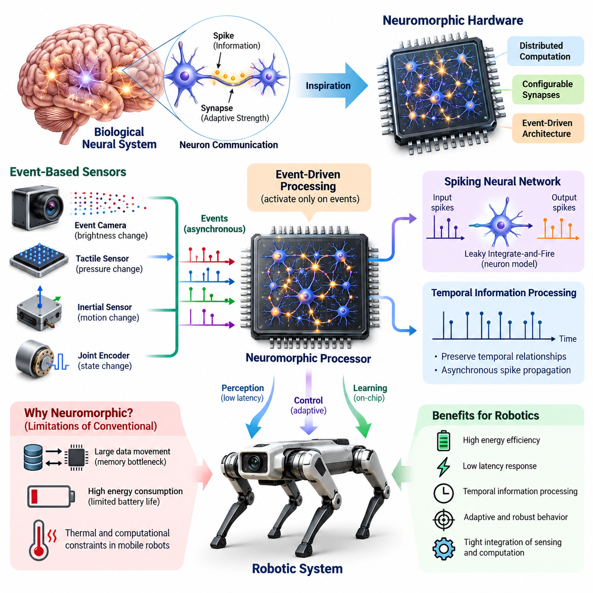{width="7.268055555555556in" height="7.268055555555556in"}

Neuromorphic computing represents an alternative computing paradigm inspired by the structural organization and information-processing mechanisms of biological nervous systems. Unlike conventional processors that execute sequential instructions through separated computing and memory units, neuromorphic architectures distribute computation across interconnected processing elements. This approach seeks to achieve efficient, adaptive, and responsive intelligence suitable for autonomous robotic systems operating under strict energy and latency constraints.

The motivation for neuromorphic computing originates partly from the limitations of conventional von Neumann architectures. Modern artificial intelligence workloads require frequent movement of large volumes of data between processors and memory, creating bandwidth bottlenecks and substantial energy consumption. In mobile robots, these limitations directly affect battery endurance, thermal management, and onboard computational capacity. Neuromorphic systems investigate alternative architectures that reduce unnecessary data movement and exploit local computation.

Biological neural networks provide the conceptual foundation for neuromorphic engineering. Neurons communicate through electrical impulses called spikes, while synapses regulate the strength and timing of information transmission. Computation emerges from distributed interactions among many neurons rather than from a centralized instruction sequence. Neuromorphic hardware approximates selected characteristics of these mechanisms using electronic circuits, configurable synapses, and event-driven communication structures.

A fundamental principle of neuromorphic computing is event-driven processing. Conventional digital neural networks typically evaluate numerical operations across predefined processing intervals, even when input information changes only slightly. Event-driven systems instead activate computational resources when meaningful events occur. This sparse activity can reduce switching operations and communication overhead, particularly in robotic perception systems where environmental changes are intermittent or localized.

Spiking neural networks provide a computational model closely associated with neuromorphic architectures. Individual neurons integrate incoming signals over time and generate output spikes when internal conditions satisfy activation criteria. Information can be represented through spike timing, frequency, population activity, or combinations of these mechanisms. Such temporal representations allow neural computation to incorporate dynamic information directly, making spiking models attractive for sensory processing and reactive robot behavior.

The leaky integrate-and-fire neuron illustrates a basic computational mechanism. Its membrane potential accumulates incoming synaptic currents while gradually decaying toward a resting state. When the potential reaches a threshold, the neuron emits a spike and undergoes a reset or refractory process. Although this model simplifies biological physiology, it provides an efficient mathematical abstraction for implementing large networks of event-driven computational units in specialized hardware.

Temporal dynamics distinguish neuromorphic processing from many conventional artificial neural network implementations. Robotic environments evolve continuously, and critical information frequently depends on the order and timing of observations. Neuromorphic architectures can preserve temporal relationships through internal neural states and asynchronous spike propagation. This capability supports research into motion detection, tactile event interpretation, sensorimotor coordination, and rapid responses to environmental disturbances.

Energy efficiency constitutes one of the strongest motivations for neuromorphic robotics. Battery-powered autonomous mobile robots, aerial vehicles, and wearable robotic systems must balance computational performance against limited stored energy. By activating only relevant processing elements, neuromorphic hardware may reduce energy consumption for appropriately sparse workloads. However, actual efficiency depends on hardware implementation, network activity, memory organization, and the energy required for communication and data conversion.

Neuromorphic architectures also encourage tighter integration between sensing and computation. Conventional robotic perception pipelines often convert sensor measurements into regularly sampled digital frames before applying computationally intensive algorithms. Event-based sensors can instead report changes in visual intensity, pressure, or other physical quantities. When connected to compatible event-driven processors, these sensors can reduce redundant information processing and support low-latency perception under suitable operating conditions.

Event cameras demonstrate the potential of this sensing philosophy. Rather than capturing complete images at fixed intervals, individual pixels asynchronously generate events when local brightness changes exceed specified thresholds. The resulting event stream contains spatial coordinates, timestamps, and polarity information. This representation can provide high temporal resolution and reduced motion blur, making it valuable for investigating fast robotic navigation, object tracking, and dynamic obstacle avoidance.

The relationship between neuromorphic computing and conventional artificial intelligence is complementary rather than strictly competitive. Graphics processing units remain highly effective for training large neural networks and executing dense matrix operations. Neuromorphic processors target computational characteristics such as sparse activation, asynchronous execution, and local state retention. Hybrid robotic architectures can therefore allocate computational tasks according to their mathematical structure, timing requirements, and energy characteristics.

Learning mechanisms represent another important research dimension. Biological neural systems modify synaptic connections according to activity and experience, motivating algorithms such as spike-timing-dependent plasticity. These approaches adjust connection strengths using relationships between presynaptic and postsynaptic events. Although biologically inspired local learning can support adaptation, its effectiveness for complex robotic tasks remains application-dependent, and conventional gradient-based training often provides stronger performance for established benchmarks.

Neuromorphic computing also introduces architectural challenges that extend beyond algorithm design. Hardware platforms differ in neuron models, synaptic precision, communication protocols, programmability, and supported learning mechanisms. These differences complicate software portability and reproducible evaluation. Developers must understand how numerical representations, spike-routing congestion, hardware resource limitations, and synchronization requirements influence the behavior of deployed neural networks.

Analog computing provides a related but distinct direction for energy-efficient artificial intelligence. Analog circuits represent and manipulate information through continuous electrical quantities such as voltage, current, or stored charge. Certain architectures perform multiply-accumulate operations directly within memory structures, potentially reducing repeated transfers between memory and arithmetic units. However, analog computation does not necessarily require spiking neurons, and neuromorphic systems may use digital, analog, or mixed-signal implementations.

The practical limitations of analog and neuromorphic hardware require careful engineering consideration. Device variability, thermal drift, electrical noise, limited numerical precision, and component aging can influence computational accuracy. Mixed-signal systems may also incur significant overhead from analog-to-digital and digital-to-analog conversion. Consequently, theoretical efficiency advantages must be evaluated against complete system behavior rather than inferred solely from individual circuit operations.

Robotic control applications introduce additional constraints because computational outputs directly influence physical actuators. A neuromorphic controller must satisfy requirements for response latency, stability, robustness, and predictable operation. Bio-inspired neural circuits may be suitable for adaptive locomotion, reflex-like responses, and sensorimotor coordination, but their integration requires careful analysis of timing behavior and closed-loop dynamics. Safety-critical control functions may still require independent deterministic supervision.

Neuromorphic perception and control can be organized within a hierarchical robot intelligence architecture. Event-driven processors may handle rapid sensory changes and localized reactive behavior, while conventional processors execute geometric reasoning, mission planning, and complex foundation-model inference. Communication between these computational domains requires explicit timing, data representation, and fault-handling interfaces. Such hybrid designs provide a practical path for investigating neuromorphic capabilities without replacing the entire robotic software stack.

Evaluating neuromorphic computing requires metrics beyond conventional inference accuracy. Energy per inference, energy per event, response latency, throughput, memory utilization, and sustained operating power provide important architectural measurements. For robotics, these measurements should be connected to task completion, navigation reliability, control stability, and battery endurance. Fair comparisons must include sensor interfaces, preprocessing, communication overhead, and all relevant computing components under equivalent operating conditions.

The long-term significance of neuromorphic computing lies in its potential to support intelligence that operates continuously within the physical world. Future autonomous robots may require computational architectures that process asynchronous sensory information, adapt to changing environments, and conserve energy during extended operation. Neuromorphic and analog AI offer promising research pathways toward these capabilities, although their widespread adoption depends on demonstrable system-level advantages, mature development tools, and reliable integration with established robotic technologies.

뉴로모픽 컴퓨팅(Neuromorphic Computing)은 생물학적 신경계(Biological Nervous System)의 구조적 조직과 정보 처리 메커니즘에서 영감을 얻은 대안적 컴퓨팅 패러다임(Computing Paradigm)이다. 기존 프로세서가 연산 장치와 메모리 장치를 분리하여 순차적으로 명령을 실행하는 것과 달리, 뉴로모픽 아키텍처(Neuromorphic Architecture)는 상호 연결된 처리 요소에 연산을 분산한다. 이러한 접근 방식은 엄격한 에너지 및 지연시간 제약 조건에서 작동하는 자율 로봇 시스템(Autonomous Robotic System)에 적합한 효율적이고 적응적이며 반응성이 높은 지능 구현을 목표로 한다.

뉴로모픽 컴퓨팅의 개발 동기는 부분적으로 기존 폰 노이만 아키텍처(Von Neumann Architecture)의 한계에서 비롯된다. 현대 인공지능(AI) 작업 부하는 프로세서와 메모리 사이에서 대량의 데이터를 빈번하게 이동시켜야 하므로 대역폭 병목현상(Bandwidth Bottleneck)과 상당한 에너지 소비가 발생한다. 이동 로봇(Mobile Robot)에서는 이러한 제약이 배터리 지속시간(Battery Endurance), 열 관리(Thermal Management), 온보드 연산 능력(Onboard Computational Capacity)에 직접적인 영향을 미친다. 뉴로모픽 시스템은 불필요한 데이터 이동을 줄이고 지역적 연산(Local Computation)을 활용하는 대안적 아키텍처를 연구한다.

생물학적 신경망(Biological Neural Network)은 뉴로모픽 공학(Neuromorphic Engineering)의 개념적 기반을 제공한다. 뉴런(Neuron)은 스파이크(Spike)라고 불리는 전기적 충격을 통해 정보를 전달하며, 시냅스(Synapse)는 정보 전달의 강도와 시점을 조절한다. 연산은 중앙집중식 명령 실행이 아니라 다수 뉴런 사이의 분산된 상호작용을 통해 발생한다. 뉴로모픽 하드웨어(Neuromorphic Hardware)는 전자회로(Electronic Circuit), 구성 가능한 시냅스(Configurable Synapse), 이벤트 기반 통신 구조(Event-Driven Communication Structure)를 이용하여 이러한 메커니즘의 일부 특성을 근사적으로 구현한다.

뉴로모픽 컴퓨팅의 핵심 원리 중 하나는 이벤트 기반 처리(Event-Driven Processing)이다. 기존 디지털 신경망(Digital Neural Network)은 입력 정보의 변화가 미미한 경우에도 일반적으로 사전에 정의된 처리 주기에 따라 수치 연산을 수행한다. 반면 이벤트 기반 시스템(Event-Driven System)은 의미 있는 이벤트가 발생할 때 연산 자원을 활성화한다. 이러한 희소 활성화(Sparse Activation)는 특히 환경 변화가 간헐적이거나 특정 영역에 국한되는 로봇 인지 시스템(Robot Perception System)에서 스위칭 연산(Switching Operation)과 통신 오버헤드(Communication Overhead)를 줄일 수 있다.

스파이킹 신경망(Spiking Neural Network, SNN)은 뉴로모픽 아키텍처와 밀접하게 연관된 계산 모델(Computational Model)을 제공한다. 개별 뉴런은 시간에 따라 입력 신호를 통합하고 내부 상태가 활성화 조건을 만족하면 출력 스파이크를 생성한다. 정보는 스파이크 발생 시점(Spike Timing), 발생 빈도(Spike Frequency), 뉴런 집단의 활성 상태(Population Activity) 또는 이러한 메커니즘의 조합으로 표현할 수 있다. 이러한 시간적 표현(Temporal Representation)은 신경망 연산에 동적 정보를 직접 반영할 수 있어 감각 처리(Sensory Processing)와 반응형 로봇 행동(Reactive Robot Behavior)에 적합하다.

누설 적분 발화 뉴런(Leaky Integrate-and-Fire Neuron)은 기본적인 계산 메커니즘을 설명한다. 뉴런의 막전위(Membrane Potential)는 입력되는 시냅스 전류(Synaptic Current)를 누적하면서 점진적으로 휴지 상태(Resting State)를 향해 감소한다. 막전위가 임계값(Threshold)에 도달하면 뉴런은 스파이크를 발생시키고 초기화(Reset) 또는 불응기(Refractory Period) 과정을 거친다. 이 모델은 생물학적 생리 현상을 단순화하지만, 특수 하드웨어에서 대규모 이벤트 기반 연산 요소를 구현하기 위한 효율적인 수학적 추상화(Mathematical Abstraction)를 제공한다.

시간적 동역학(Temporal Dynamics)은 뉴로모픽 처리를 기존 인공신경망(Artificial Neural Network)의 여러 구현 방식과 구별하는 중요한 특징이다. 로봇 환경은 지속적으로 변화하며 핵심 정보는 관측 순서와 시점에 따라 달라지는 경우가 많다. 뉴로모픽 아키텍처는 내부 신경 상태(Internal Neural State)와 비동기 스파이크 전파(Asynchronous Spike Propagation)를 통해 시간적 관계를 유지할 수 있다. 이러한 특성은 움직임 감지(Motion Detection), 촉각 이벤트 해석(Tactile Event Interpretation), 감각운동 협응(Sensorimotor Coordination), 환경 교란에 대한 신속한 반응 연구를 지원한다.

에너지 효율성(Energy Efficiency)은 뉴로모픽 로보틱스(Neuromorphic Robotics)의 가장 중요한 개발 동기 중 하나이다. 배터리 기반 자율이동로봇(Autonomous Mobile Robot), 무인항공기(Unmanned Aerial Vehicle), 착용형 로봇(Wearable Robot)은 제한된 저장 에너지와 연산 성능 사이의 균형을 유지해야 한다. 뉴로모픽 하드웨어는 필요한 처리 요소만 활성화하여 적절한 희소 작업 부하(Sparse Workload)에서 에너지 소비를 줄일 수 있다. 그러나 실제 효율은 하드웨어 구현, 신경망 활성도, 메모리 구성, 통신 및 데이터 변환에 필요한 에너지에 따라 달라진다.

뉴로모픽 아키텍처는 센싱(Sensing)과 연산(Computation)의 긴밀한 통합도 촉진한다. 기존 로봇 인지 파이프라인(Robot Perception Pipeline)은 센서 측정값을 일정한 주기로 샘플링된 디지털 프레임(Digital Frame)으로 변환한 후 연산량이 많은 알고리즘을 적용하는 경우가 많다. 반면 이벤트 기반 센서(Event-Based Sensor)는 시각적 밝기, 압력 또는 기타 물리량의 변화만 보고할 수 있다. 이러한 센서를 호환되는 이벤트 기반 프로세서(Event-Driven Processor)에 연결하면 중복 정보 처리를 줄이고 적절한 운용 조건에서 낮은 지연시간의 인지 기능을 지원할 수 있다.

이벤트 카메라(Event Camera)는 이러한 센싱 방식의 가능성을 보여준다. 고정된 시간 간격으로 전체 이미지를 획득하는 대신 개별 픽셀(Pixel)은 국소 밝기 변화가 지정된 임계값을 초과하면 비동기적으로 이벤트를 생성한다. 생성된 이벤트 스트림(Event Stream)에는 공간 좌표(Spatial Coordinate), 타임스탬프(Timestamp), 극성 정보(Polarity Information)가 포함된다. 이러한 표현 방식은 높은 시간 해상도(Temporal Resolution)와 감소된 움직임 흐림(Motion Blur)을 제공할 수 있어 고속 로봇 내비게이션, 객체 추적(Object Tracking), 동적 장애물 회피(Dynamic Obstacle Avoidance) 연구에 유용하다.

뉴로모픽 컴퓨팅과 기존 인공지능의 관계는 엄격한 경쟁 관계라기보다 상호보완적 관계(Complementary Relationship)에 가깝다. 그래픽 처리 장치(Graphics Processing Unit, GPU)는 대규모 신경망 학습과 밀집 행렬 연산(Dense Matrix Operation)에 여전히 높은 효율성을 제공한다. 반면 뉴로모픽 프로세서(Neuromorphic Processor)는 희소 활성화, 비동기 실행(Asynchronous Execution), 지역 상태 유지(Local State Retention)와 같은 계산 특성을 목표로 한다. 따라서 하이브리드 로봇 아키텍처(Hybrid Robot Architecture)는 작업의 수학적 구조, 시간 요구사항, 에너지 특성에 따라 연산을 적절하게 배분할 수 있다.

학습 메커니즘(Learning Mechanism)은 또 다른 중요한 연구 영역이다. 생물학적 신경계는 활동과 경험에 따라 시냅스 연결을 변경하며, 이러한 특성은 스파이크 시점 의존 가소성(Spike-Timing-Dependent Plasticity, STDP)과 같은 알고리즘에 영감을 제공한다. 이러한 접근 방식은 시냅스 전후 뉴런의 이벤트 발생 관계를 이용하여 연결 강도를 조정한다. 생물학적으로 영감을 얻은 지역 학습(Local Learning)은 적응 기능을 지원할 수 있지만 복잡한 로봇 작업에서의 효과는 응용 분야에 따라 달라지며, 기존 경사 기반 학습(Gradient-Based Training)이 확립된 벤치마크에서 더 높은 성능을 제공하는 경우도 많다.

뉴로모픽 컴퓨팅은 알고리즘 설계를 넘어서는 아키텍처상의 과제도 제기한다. 하드웨어 플랫폼(Hardware Platform)은 뉴런 모델, 시냅스 정밀도(Synaptic Precision), 통신 프로토콜(Communication Protocol), 프로그래밍 가능성(Programmability), 지원되는 학습 메커니즘에서 서로 차이를 보인다. 이러한 차이는 소프트웨어 이식성(Software Portability)과 재현 가능한 평가(Reproducible Evaluation)를 어렵게 만든다. 개발자는 수치 표현(Numerical Representation), 스파이크 라우팅 혼잡(Spike-Routing Congestion), 하드웨어 자원 제약, 동기화 요구사항이 배포된 신경망의 동작에 미치는 영향을 이해해야 한다.

아날로그 컴퓨팅(Analog Computing)은 에너지 효율적인 인공지능을 위한 관련성이 있지만 구별되는 기술 방향이다. 아날로그 회로(Analog Circuit)는 전압(Voltage), 전류(Current), 저장 전하(Stored Charge)와 같은 연속적인 전기량을 통해 정보를 표현하고 처리한다. 일부 아키텍처는 메모리 구조 내부에서 곱셈-누산 연산(Multiply-Accumulate Operation)을 직접 수행하여 메모리와 산술 연산 장치 사이의 반복적인 데이터 전송을 줄일 수 있다. 그러나 아날로그 연산에 반드시 스파이킹 뉴런이 필요한 것은 아니며, 뉴로모픽 시스템은 디지털(Digital), 아날로그(Analog), 혼합 신호(Mixed-Signal) 구현 방식을 모두 사용할 수 있다.

아날로그 및 뉴로모픽 하드웨어의 실질적인 한계는 신중한 공학적 검토를 요구한다. 소자 변동성(Device Variability), 열적 드리프트(Thermal Drift), 전기적 잡음(Electrical Noise), 제한된 수치 정밀도(Numerical Precision), 부품 노화(Component Aging)는 연산 정확도에 영향을 미칠 수 있다. 혼합 신호 시스템에서는 아날로그-디지털 변환(Analog-to-Digital Conversion)과 디지털-아날로그 변환(Digital-to-Analog Conversion)으로 상당한 오버헤드가 발생할 수도 있다. 따라서 이론적인 효율 향상은 개별 회로 연산만을 기준으로 판단하기보다 전체 시스템 동작을 통해 평가해야 한다.

로봇 제어 응용(Robotic Control Application)은 연산 출력이 물리적 액추에이터(Physical Actuator)에 직접 영향을 미치므로 추가적인 제약 조건을 갖는다. 뉴로모픽 제어기(Neuromorphic Controller)는 응답 지연시간(Response Latency), 안정성(Stability), 강건성(Robustness), 예측 가능한 동작(Predictable Operation)에 대한 요구사항을 충족해야 한다. 생체모방 신경회로(Bio-Inspired Neural Circuit)는 적응형 보행(Adaptive Locomotion), 반사형 반응(Reflex-Like Response), 감각운동 협응에 적합할 수 있지만, 통합 과정에서는 시간적 동작과 폐루프 동역학(Closed-Loop Dynamics)을 신중하게 분석해야 한다. 안전 필수 제어 기능(Safety-Critical Control Function)에는 여전히 독립적인 결정론적 감독(Deterministic Supervision)이 필요할 수 있다.

뉴로모픽 인지 및 제어 기능은 계층형 로봇 지능 아키텍처(Hierarchical Robot Intelligence Architecture) 내에서 구성할 수 있다. 이벤트 기반 프로세서는 빠른 감각 변화와 국소적인 반응 행동을 처리하고, 기존 프로세서는 기하학적 추론(Geometric Reasoning), 임무 계획(Mission Planning), 복잡한 파운데이션 모델 추론(Foundation Model Inference)을 수행할 수 있다. 이러한 연산 영역 사이의 통신에는 명확한 타이밍(Timing), 데이터 표현(Data Representation), 결함 처리 인터페이스(Fault-Handling Interface)가 필요하다. 이러한 하이브리드 설계는 로봇 소프트웨어 스택(Robotic Software Stack) 전체를 교체하지 않고도 뉴로모픽 기능을 검토할 수 있는 실용적인 접근 경로를 제공한다.

뉴로모픽 컴퓨팅의 평가는 기존 추론 정확도(Inference Accuracy)를 넘어서는 지표를 필요로 한다. 추론당 에너지(Energy per Inference), 이벤트당 에너지(Energy per Event), 응답 지연시간, 처리량(Throughput), 메모리 활용률(Memory Utilization), 지속 운용 전력(Sustained Operating Power)은 중요한 아키텍처 평가 지표이다. 로보틱스에서는 이러한 측정값을 작업 완료율(Task Completion Rate), 내비게이션 신뢰성(Navigation Reliability), 제어 안정성(Control Stability), 배터리 지속시간과 연계해야 한다. 공정한 비교를 위해서는 동등한 운용 조건에서 센서 인터페이스, 전처리(Preprocessing), 통신 오버헤드 및 모든 관련 연산 구성요소를 포함해야 한다.

뉴로모픽 컴퓨팅의 장기적인 중요성은 물리적 세계에서 지속적으로 작동하는 지능을 지원할 수 있다는 잠재력에 있다. 미래의 자율 로봇은 비동기 감각 정보(Asynchronous Sensory Information)를 처리하고 변화하는 환경에 적응하며 장시간 운용 중 에너지를 절약할 수 있는 연산 아키텍처를 필요로 할 수 있다. 뉴로모픽 및 아날로그 인공지능(Neuromorphic and Analog AI)은 이러한 능력을 실현하기 위한 유망한 연구 방향을 제공한다. 그러나 광범위한 도입을 위해서는 검증 가능한 시스템 수준의 이점(System-Level Advantage), 성숙한 개발 도구(Development Tool), 기존 로봇 기술과의 신뢰성 높은 통합(Reliable Integration)이 확보되어야 한다.

## 10.02. Spiking Neural Networks SNN for Robotics [w/Code]

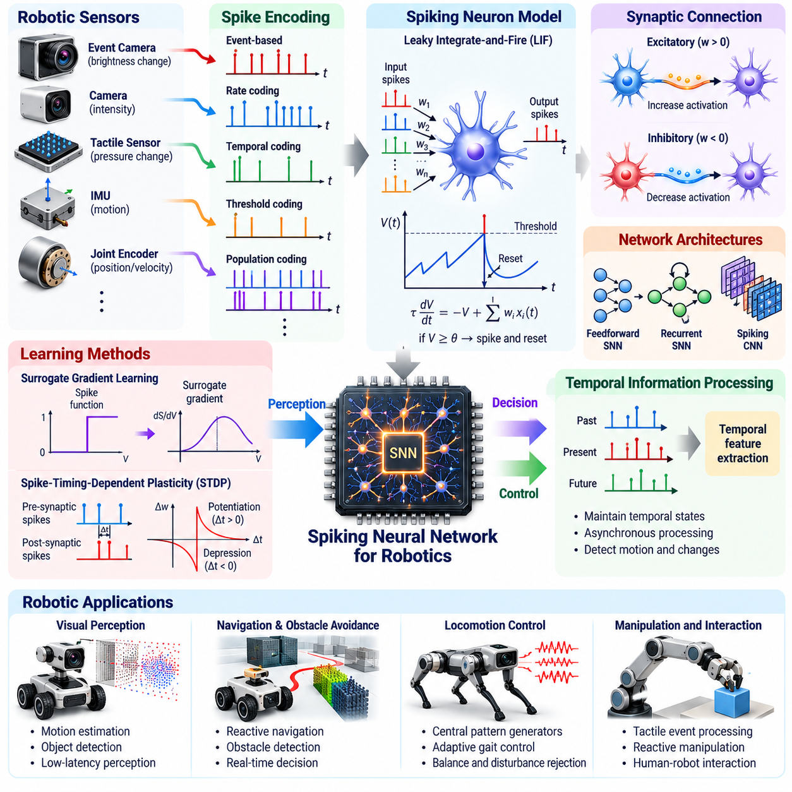{width="7.268055555555556in" height="7.268055555555556in"}

Spiking neural networks (SNNs) represent a class of artificial neural networks that communicate through discrete electrical events called spikes. Unlike conventional neural networks that continuously propagate numerical activation values, SNNs process information through temporally distributed spike sequences. This event-driven computation provides a biologically inspired framework for robotic intelligence, particularly where low power consumption, temporal sensitivity, and rapid sensorimotor responses are important.

The fundamental computational element of an SNN is the spiking neuron, which integrates incoming synaptic signals and generates an output spike when its internal membrane potential reaches a threshold. The leaky integrate-and-fire model describes this behavior through membrane potential accumulation, gradual voltage decay, threshold detection, and reset operations. These dynamics introduce an internal temporal state that allows neural networks to respond to both the magnitude and timing of sensory information.

Information encoding determines how continuous robotic sensor measurements are converted into spike-based representations. Rate coding represents signal intensity through spike frequency, while temporal coding uses the precise timing of individual spikes. Population coding distributes information across groups of neurons, providing additional representational flexibility. The selected encoding strategy influences information fidelity, computational latency, spike sparsity, and overall energy efficiency.

Robotic sensors generate diverse data streams that require different spike encoding mechanisms. Camera intensity measurements can be converted into rate-coded spike trains, while event cameras naturally produce asynchronous brightness-change events. Tactile sensors may generate spikes when contact pressure changes, and inertial measurements can be encoded through threshold-crossing events. These approaches allow SNNs to process heterogeneous sensory information within a common event-driven computational framework.

Synaptic connections determine how spikes propagate through an SNN and influence downstream neural activity. Each synapse maintains a connection weight that modifies the contribution of incoming spikes to the receiving neuron\'s membrane potential. Excitatory connections increase neural activation, while inhibitory connections suppress it. Network behavior emerges from the interaction between synaptic weights, membrane dynamics, transmission delays, and recurrent connectivity.

The temporal structure of SNNs makes them particularly relevant to dynamic robotic environments. Motion estimation, obstacle detection, and balance control depend on recognizing changes over time rather than interpreting isolated observations. Spiking neurons can maintain short-term information through their internal states and recurrent connections. This enables temporal feature extraction without necessarily requiring the explicit frame-by-frame processing used in conventional perception pipelines.

Training SNNs presents challenges because discrete spike generation is not directly differentiable at the firing threshold. Conventional backpropagation therefore cannot be applied without modification. Surrogate gradient learning addresses this limitation by approximating spike derivatives during training while preserving discrete spike behavior during forward computation. This technique enables gradient-based optimization of spiking networks for classification, temporal prediction, and robotic perception tasks.

Another learning mechanism is spike-timing-dependent plasticity (STDP), which modifies synaptic strengths according to the relative timing of presynaptic and postsynaptic spikes. Depending on the learning rule, closely timed neural events may strengthen or weaken connections. STDP provides a biologically inspired approach to local adaptation and unsupervised feature learning. However, complex robotic applications often require additional objectives or supervisory mechanisms to achieve reliable task-level performance.

SNN architectures can be organized as feedforward, recurrent, convolutional, or hybrid neural networks. Feedforward structures support relatively simple event classification, while recurrent networks maintain temporal dependencies through feedback connections. Spiking convolutional networks extract spatial features from event-based sensory data. Hybrid architectures combine spiking layers with conventional artificial neural networks, allowing developers to balance temporal processing capabilities against training complexity and computational efficiency.

Robotic visual perception is a promising application of spiking neural networks, especially when combined with event-based cameras. These cameras report asynchronous brightness changes rather than transmitting complete image frames at fixed intervals. SNNs can process the resulting event streams to estimate motion, detect moving objects, and recognize temporal patterns. Their event-driven structure can support low-latency responses, although performance depends on sensor characteristics, network architecture, and environmental conditions.

Autonomous mobile robots can use SNNs for reactive navigation and obstacle avoidance. Event-based visual measurements or proximity sensor events are transformed into spike patterns representing environmental changes. A spiking network can associate these patterns with steering or velocity adjustments, providing a computational pathway from perception to action. Practical deployment requires integration with localization, trajectory planning, and safety supervision to maintain predictable navigation behavior.

Spiking neural networks are also relevant to bio-inspired locomotion control. Central pattern generators can be implemented through interconnected neural oscillators that produce rhythmic activation patterns for robotic limbs. Spiking implementations can coordinate temporal motor commands and respond to sensory feedback. Such systems are investigated for quadruped robots, humanoids, and other legged platforms, although stable locomotion still depends on mechanical dynamics, actuator constraints, and appropriate feedback control.

Manipulation tasks provide another opportunity for event-driven neural processing. Robotic grippers equipped with tactile sensors can detect contact onset, pressure variation, and slip-related vibration through temporal events. SNNs can interpret these patterns and generate rapid grip-adjustment signals. This approach may improve responsiveness during delicate object handling, but reliable manipulation requires calibration, force limits, and coordination with conventional motion-control systems.

The energy efficiency of SNNs depends strongly on their execution hardware and activity patterns. Sparse spike generation can reduce unnecessary computation when implemented on processors designed for event-driven operation. Neuromorphic chips exploit this property through distributed neuron processing and localized synaptic storage. However, SNN execution on conventional GPUs or CPUs does not automatically provide energy savings, particularly when dense time-step simulations introduce substantial computational overhead.

Hardware-software integration is essential for deploying SNNs in autonomous robots. A practical architecture includes sensor event acquisition, spike encoding, neural inference, output decoding, and communication with robot control software. Interfaces must translate neural events into actuator commands or higher-level perception results. Developers must also account for timestamp accuracy, communication delays, processor scheduling, and synchronization between event-driven and periodic control components.

The selection of simulation time resolution influences both computational cost and numerical behavior. Fine temporal resolution can capture detailed spike timing but increases the number of processing steps required during training and inference. Coarser resolution reduces computational workload while potentially losing important temporal information. Event-driven simulation methods can avoid unnecessary updates, although their advantages depend on network connectivity, spike density, and implementation characteristics.

SNN evaluation requires metrics that reflect temporal processing and robotic performance. Classification accuracy alone is insufficient for determining whether a network is suitable for real-world deployment. Important measurements include detection latency, spike count, energy per inference, memory utilization, robustness to sensor noise, and response consistency. For closed-loop robotic applications, these measurements must be connected to navigation success, control stability, task completion, and operational safety.

Robustness remains a significant concern because spike-based representations can be sensitive to sensor noise, timing jitter, missing events, and changes in environmental conditions. Event cameras may generate unwanted activity under challenging illumination, while tactile event streams can be affected by mechanical vibration. Training with realistic disturbances and evaluating behavior across operating conditions are necessary for dependable performance. Safety-critical robotic functions should retain independent monitoring and fallback mechanisms.

A practical development strategy begins with identifying tasks that benefit from sparse temporal processing rather than converting an entire robotic intelligence stack into an SNN. Event-based obstacle detection, tactile slip recognition, and reactive motor control provide focused opportunities for experimentation. Developers can compare SNN implementations against conventional neural networks using equivalent datasets, hardware measurements, and operational scenarios before committing to specialized deployment.

The long-term role of spiking neural networks in robotics is likely to involve hybrid intelligence architectures that combine event-driven perception, adaptive sensorimotor processing, and conventional high-level reasoning. SNNs offer promising mechanisms for processing temporal information under constrained energy budgets, but their advantages must be demonstrated through reproducible system-level evaluation. Continued progress in learning algorithms, neuromorphic processors, development tools, and robotic integration will determine their practical significance in future AI-native robots.

스파이킹 신경망(Spiking Neural Network, SNN)은 스파이크(Spike)라고 불리는 불연속적인 전기적 이벤트를 통해 정보를 전달하는 인공신경망(Artificial Neural Network)의 한 종류이다. 기존 신경망이 연속적인 수치 활성화 값(Numerical Activation Value)을 전달하는 것과 달리, SNN은 시간적으로 분산된 스파이크 시퀀스(Spike Sequence)를 통해 정보를 처리한다. 이러한 이벤트 기반 연산(Event-Driven Computation)은 특히 낮은 전력 소비, 시간적 민감성(Temporal Sensitivity), 신속한 감각운동 반응(Sensorimotor Response)이 중요한 로봇 지능(Robotic Intelligence)을 위한 생물학적 영감 기반 프레임워크를 제공한다.

SNN의 기본 연산 요소는 스파이킹 뉴런(Spiking Neuron)으로, 입력되는 시냅스 신호(Synaptic Signal)를 통합하고 내부 막전위(Membrane Potential)가 임계값(Threshold)에 도달하면 출력 스파이크를 생성한다. 누설 적분 발화 모델(Leaky Integrate-and-Fire Model)은 막전위의 누적, 점진적인 전압 감소, 임계값 감지, 초기화 연산(Reset Operation)을 통해 이러한 동작을 설명한다. 이러한 동역학(Dynamics)은 내부 시간 상태(Internal Temporal State)를 형성하여 신경망이 감각 정보의 크기뿐 아니라 발생 시점에도 반응할 수 있도록 한다.

정보 부호화(Information Encoding)는 연속적인 로봇 센서 측정값을 스파이크 기반 표현(Spike-Based Representation)으로 변환하는 방식을 결정한다. 발화율 부호화(Rate Coding)는 스파이크 발생 빈도로 신호 강도를 표현하고, 시간 부호화(Temporal Coding)는 개별 스파이크의 정확한 발생 시점을 활용한다. 집단 부호화(Population Coding)는 여러 뉴런에 정보를 분산하여 표현의 유연성을 높인다. 선택한 부호화 전략(Encoding Strategy)은 정보 충실도(Information Fidelity), 연산 지연시간(Computational Latency), 스파이크 희소성(Spike Sparsity), 전체 에너지 효율성(Energy Efficiency)에 영향을 미친다.

로봇 센서(Robotic Sensor)는 다양한 데이터 스트림(Data Stream)을 생성하므로 서로 다른 스파이크 부호화 메커니즘(Spike Encoding Mechanism)이 필요하다. 카메라의 밝기 측정값은 발화율 기반 스파이크 열(Rate-Coded Spike Train)로 변환할 수 있으며, 이벤트 카메라(Event Camera)는 비동기적인 밝기 변화 이벤트(Asynchronous Brightness-Change Event)를 자연스럽게 생성한다. 촉각 센서(Tactile Sensor)는 접촉 압력이 변화할 때 스파이크를 생성할 수 있고, 관성 측정값(Inertial Measurement)은 임계값 통과 이벤트(Threshold-Crossing Event)로 부호화할 수 있다. 이러한 접근 방식은 SNN이 이질적인 감각 정보를 공통의 이벤트 기반 연산 프레임워크에서 처리하도록 한다.

시냅스 연결(Synaptic Connection)은 스파이크가 SNN 내부에서 전파되는 방식과 후속 뉴런의 활성 상태에 미치는 영향을 결정한다. 각 시냅스는 입력 스파이크가 수신 뉴런의 막전위에 기여하는 정도를 조절하는 연결 가중치(Connection Weight)를 유지한다. 흥분성 연결(Excitatory Connection)은 뉴런 활성화를 증가시키고, 억제성 연결(Inhibitory Connection)은 활성화를 억제한다. 신경망의 동작은 시냅스 가중치(Synaptic Weight), 막전위 동역학(Membrane Dynamics), 전달 지연(Transmission Delay), 순환 연결성(Recurrent Connectivity) 사이의 상호작용을 통해 형성된다.

SNN의 시간적 구조(Temporal Structure)는 동적으로 변화하는 로봇 환경(Dynamic Robotic Environment)에 특히 적합하다. 움직임 추정(Motion Estimation), 장애물 감지(Obstacle Detection), 균형 제어(Balance Control)는 개별 관측값을 해석하는 것보다 시간에 따른 변화를 인식하는 능력에 의존한다. 스파이킹 뉴런은 내부 상태와 순환 연결(Recurrent Connection)을 통해 단기 정보(Short-Term Information)를 유지할 수 있다. 이를 통해 기존 인지 파이프라인(Perception Pipeline)에서 사용하는 명시적인 프레임 단위 처리(Frame-by-Frame Processing)가 반드시 필요하지 않은 시간적 특징 추출(Temporal Feature Extraction)이 가능하다.

SNN 학습(Training)은 불연속적인 스파이크 생성 과정이 발화 임계값에서 직접 미분 가능하지 않기 때문에 어려움이 있다. 따라서 기존 역전파(Backpropagation)를 수정 없이 적용할 수 없다. 대리 기울기 학습(Surrogate Gradient Learning)은 학습 과정에서 스파이크의 미분값을 근사하면서 순전파 연산(Forward Computation)에서는 불연속적인 스파이크 동작을 유지하여 이러한 한계를 해결한다. 이 기법은 분류(Classification), 시간적 예측(Temporal Prediction), 로봇 인지(Robotic Perception) 작업에서 스파이킹 신경망의 기울기 기반 최적화(Gradient-Based Optimization)를 가능하게 한다.

또 다른 학습 메커니즘은 스파이크 시점 의존 가소성(Spike-Timing-Dependent Plasticity, STDP)으로, 시냅스 전 뉴런(Presynaptic Neuron)과 시냅스 후 뉴런(Postsynaptic Neuron)의 상대적인 스파이크 발생 시점에 따라 시냅스 강도를 수정한다. 학습 규칙(Learning Rule)에 따라 시간적으로 가까운 신경 이벤트는 연결을 강화하거나 약화할 수 있다. STDP는 지역적 적응(Local Adaptation)과 비지도 특징 학습(Unsupervised Feature Learning)을 위한 생물학적 영감 기반 접근 방식을 제공한다. 그러나 복잡한 로봇 응용에서는 신뢰성 높은 작업 수준 성능(Task-Level Performance)을 달성하기 위해 추가적인 목표 함수(Objective Function)나 감독 메커니즘(Supervisory Mechanism)이 필요한 경우가 많다.

SNN 아키텍처는 순전파 신경망(Feedforward Neural Network), 순환 신경망(Recurrent Neural Network), 합성곱 신경망(Convolutional Neural Network), 하이브리드 신경망(Hybrid Neural Network)으로 구성할 수 있다. 순전파 구조는 비교적 단순한 이벤트 분류(Event Classification)를 지원하며, 순환 신경망은 피드백 연결(Feedback Connection)을 통해 시간적 의존성(Temporal Dependency)을 유지한다. 스파이킹 합성곱 신경망(Spiking Convolutional Neural Network)은 이벤트 기반 감각 데이터에서 공간적 특징(Spatial Feature)을 추출한다. 하이브리드 아키텍처는 스파이킹 계층(Spiking Layer)과 기존 인공신경망을 결합하여 시간적 처리 능력과 학습 복잡도 및 연산 효율성 사이의 균형을 조절할 수 있다.

로봇 시각 인지(Robotic Visual Perception)는 특히 이벤트 기반 카메라와 결합할 때 스파이킹 신경망의 유망한 응용 분야이다. 이러한 카메라는 고정된 시간 간격으로 전체 이미지 프레임을 전송하는 대신 비동기적인 밝기 변화를 보고한다. SNN은 생성된 이벤트 스트림(Event Stream)을 처리하여 움직임을 추정하고, 이동 객체(Moving Object)를 감지하며, 시간적 패턴(Temporal Pattern)을 인식할 수 있다. 이벤트 기반 구조는 낮은 지연시간의 반응(Low-Latency Response)을 지원할 수 있지만, 실제 성능은 센서 특성, 신경망 아키텍처, 환경 조건에 따라 달라진다.

자율이동로봇(Autonomous Mobile Robot, AMR)은 반응형 내비게이션(Reactive Navigation)과 장애물 회피(Obstacle Avoidance)에 SNN을 활용할 수 있다. 이벤트 기반 시각 측정값 또는 근접 센서 이벤트(Proximity Sensor Event)는 환경 변화를 나타내는 스파이크 패턴(Spike Pattern)으로 변환된다. 스파이킹 신경망은 이러한 패턴을 조향(Steering) 또는 속도 조정(Velocity Adjustment)과 연결하여 인지에서 행동으로 이어지는 연산 경로를 제공할 수 있다. 실제 배포에서는 예측 가능한 내비게이션 동작을 유지하기 위해 위치 추정(Localization), 궤적 계획(Trajectory Planning), 안전 감독(Safety Supervision)과의 통합이 필요하다.

스파이킹 신경망은 생체모방 보행 제어(Bio-Inspired Locomotion Control)에도 관련성이 높다. 중앙 패턴 생성기(Central Pattern Generator, CPG)는 로봇 다리에 대한 리듬성 활성화 패턴(Rhythmic Activation Pattern)을 생성하는 상호 연결된 신경 진동자(Neural Oscillator)를 통해 구현할 수 있다. 스파이킹 기반 구현은 시간적 모터 명령(Temporal Motor Command)을 조정하고 감각 피드백(Sensory Feedback)에 반응할 수 있다. 이러한 시스템은 사족보행 로봇(Quadruped Robot), 휴머노이드(Humanoid), 기타 다족 로봇(Legged Robot)을 대상으로 연구되고 있지만, 안정적인 보행은 여전히 기계적 동역학(Mechanical Dynamics), 액추에이터 제약(Actuator Constraint), 적절한 피드백 제어(Feedback Control)에 의존한다.

조작 작업(Manipulation Task)은 이벤트 기반 신경 처리(Event-Driven Neural Processing)를 활용할 수 있는 또 다른 영역이다. 촉각 센서를 장착한 로봇 그리퍼(Robotic Gripper)는 시간적 이벤트를 통해 접촉 시작(Contact Onset), 압력 변화(Pressure Variation), 미끄러짐 관련 진동(Slip-Related Vibration)을 감지할 수 있다. SNN은 이러한 패턴을 해석하고 신속한 파지력 조정 신호(Grip-Adjustment Signal)를 생성할 수 있다. 이 접근 방식은 섬세한 물체 취급(Delicate Object Handling) 과정에서 반응성을 향상시킬 수 있지만, 신뢰성 높은 조작을 위해서는 보정(Calibration), 힘 제한(Force Limit), 기존 운동 제어 시스템(Motion-Control System)과의 협조가 필요하다.

SNN의 에너지 효율성은 실행 하드웨어(Execution Hardware)와 활성화 패턴(Activity Pattern)에 크게 의존한다. 희소 스파이크 생성(Sparse Spike Generation)은 이벤트 기반 동작을 위해 설계된 프로세서에서 구현될 경우 불필요한 연산을 줄일 수 있다. 뉴로모픽 칩(Neuromorphic Chip)은 분산형 뉴런 처리(Distributed Neuron Processing)와 지역적 시냅스 저장(Local Synaptic Storage)을 통해 이러한 특성을 활용한다. 그러나 기존 그래픽 처리 장치(GPU)나 중앙 처리 장치(CPU)에서 SNN을 실행한다고 해서 자동으로 에너지가 절약되는 것은 아니며, 특히 밀집 시간 단계 시뮬레이션(Dense Time-Step Simulation)은 상당한 연산 오버헤드를 발생시킬 수 있다.

하드웨어-소프트웨어 통합(Hardware-Software Integration)은 자율 로봇에 SNN을 배포하기 위한 필수 요소이다. 실용적인 아키텍처는 센서 이벤트 획득(Sensor Event Acquisition), 스파이크 부호화(Spike Encoding), 신경망 추론(Neural Inference), 출력 디코딩(Output Decoding), 로봇 제어 소프트웨어(Robot Control Software)와의 통신으로 구성된다. 인터페이스(Interface)는 신경 이벤트를 액추에이터 명령(Actuator Command) 또는 상위 수준의 인지 결과(Perception Result)로 변환해야 한다. 개발자는 타임스탬프 정확도(Timestamp Accuracy), 통신 지연(Communication Delay), 프로세서 스케줄링(Processor Scheduling), 이벤트 기반 제어 요소와 주기적 제어 요소 사이의 동기화(Synchronization)도 고려해야 한다.

시뮬레이션 시간 해상도(Simulation Time Resolution)의 선택은 연산 비용과 수치적 동작(Numerical Behavior)에 모두 영향을 미친다. 세밀한 시간 해상도는 정밀한 스파이크 발생 시점을 포착할 수 있지만 학습과 추론에 필요한 처리 단계 수를 증가시킨다. 반면 거친 시간 해상도는 연산 부하를 줄이는 대신 중요한 시간적 정보를 손실할 가능성이 있다. 이벤트 기반 시뮬레이션 방법(Event-Driven Simulation Method)은 불필요한 상태 갱신을 방지할 수 있지만, 그 이점은 신경망 연결 구조(Network Connectivity), 스파이크 밀도(Spike Density), 구현 특성에 따라 달라진다.

SNN 평가(Evaluation)에는 시간적 처리 특성과 로봇 성능을 반영하는 지표가 필요하다. 분류 정확도(Classification Accuracy)만으로는 신경망이 실제 환경에 배포하기에 적합한지 판단하기 어렵다. 중요한 측정 항목에는 감지 지연시간(Detection Latency), 스파이크 수(Spike Count), 추론당 에너지(Energy per Inference), 메모리 활용률(Memory Utilization), 센서 잡음에 대한 강건성(Robustness to Sensor Noise), 응답 일관성(Response Consistency)이 포함된다. 폐루프 로봇 응용(Closed-Loop Robotic Application)에서는 이러한 측정값을 내비게이션 성공률(Navigation Success), 제어 안정성(Control Stability), 작업 완료(Task Completion), 운용 안전성(Operational Safety)과 연결해야 한다.

강건성(Robustness)은 스파이크 기반 표현이 센서 잡음(Sensor Noise), 타이밍 지터(Timing Jitter), 이벤트 누락(Missing Event), 환경 조건 변화에 민감할 수 있기 때문에 중요한 과제로 남아 있다. 이벤트 카메라는 까다로운 조명 조건에서 원하지 않는 이벤트를 생성할 수 있으며, 촉각 이벤트 스트림은 기계적 진동(Mechanical Vibration)의 영향을 받을 수 있다. 신뢰성 높은 성능을 위해서는 현실적인 교란(Realistic Disturbance)을 포함한 학습과 다양한 운용 조건(Operating Condition)에 대한 평가가 필요하다. 안전 필수 로봇 기능(Safety-Critical Robotic Function)은 독립적인 감시 메커니즘(Independent Monitoring Mechanism)과 대체 동작 메커니즘(Fallback Mechanism)을 유지해야 한다.

실용적인 개발 전략(Practical Development Strategy)은 로봇 지능 스택(Robotic Intelligence Stack) 전체를 SNN으로 변환하기보다 희소 시간 처리(Sparse Temporal Processing)의 이점을 얻을 수 있는 작업을 식별하는 것에서 시작한다. 이벤트 기반 장애물 감지(Event-Based Obstacle Detection), 촉각 미끄러짐 인식(Tactile Slip Recognition), 반응형 모터 제어(Reactive Motor Control)는 집중적인 실험을 수행하기에 적합한 영역이다. 개발자는 특수 하드웨어 배포를 결정하기 전에 동등한 데이터셋(Dataset), 하드웨어 측정값(Hardware Measurement), 운용 시나리오(Operational Scenario)를 사용하여 SNN 구현과 기존 신경망을 비교할 수 있다.

로보틱스에서 스파이킹 신경망의 장기적인 역할은 이벤트 기반 인지(Event-Driven Perception), 적응형 감각운동 처리(Adaptive Sensorimotor Processing), 기존 고수준 추론(High-Level Reasoning)을 결합하는 하이브리드 지능 아키텍처(Hybrid Intelligence Architecture)와 관련될 가능성이 높다. SNN은 제한된 에너지 예산(Energy Budget) 내에서 시간적 정보를 처리할 수 있는 유망한 메커니즘을 제공하지만, 그 이점은 재현 가능한 시스템 수준 평가(Reproducible System-Level Evaluation)를 통해 입증되어야 한다. 학습 알고리즘(Learning Algorithm), 뉴로모픽 프로세서(Neuromorphic Processor), 개발 도구(Development Tool), 로봇 통합 기술(Robotic Integration Technology)의 지속적인 발전이 미래 인공지능 네이티브 로봇(AI-Native Robot)에서 SNN의 실질적인 중요성을 결정할 것이다.

## 10.03. Intel Loihi 2 and IBM NorthPole Chips

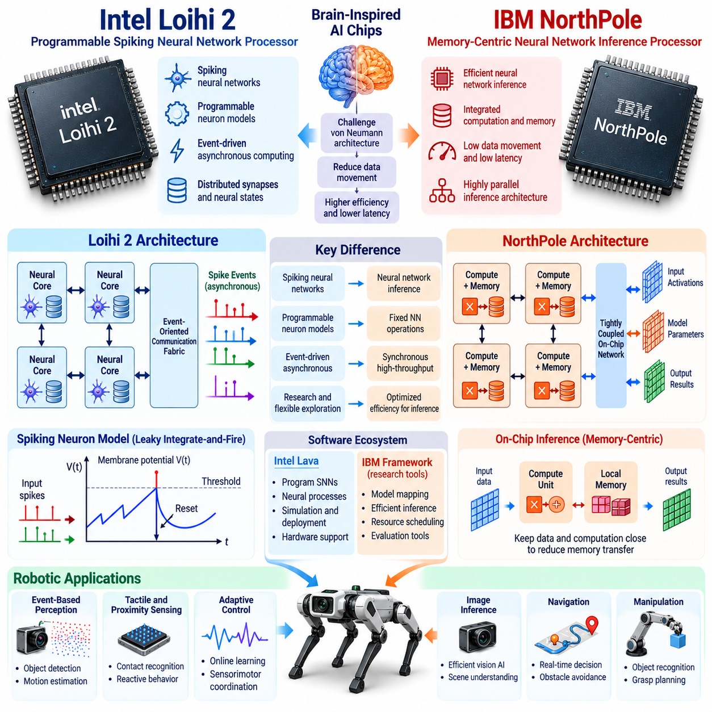{width="7.268055555555556in" height="7.268055555555556in"}

Intel Loihi 2 and IBM NorthPole represent two influential approaches to developing brain-inspired computing hardware for artificial intelligence. Both architectures challenge conventional processor-memory separation, but they emphasize different computational principles. Loihi 2 focuses on programmable spiking neural networks and asynchronous neural dynamics, while NorthPole targets efficient neural network inference through tightly integrated memory and computation.

Intel developed Loihi 2 as a research-oriented neuromorphic processor designed to investigate event-driven computation and biologically inspired learning. Its architecture incorporates programmable neuron models, distributed synaptic resources, and asynchronous communication between neural processing elements. By supporting sparse spike-based activity, Loihi 2 provides a hardware platform for exploring computational mechanisms that differ fundamentally from conventional dense neural network execution.

A defining feature of Loihi 2 is its support for flexible neural dynamics. Rather than restricting computation to a single fixed neuron model, the processor allows researchers to configure different state-update equations and spike-generation behaviors. This programmability supports investigations involving temporal coding, recurrent neural networks, adaptive sensory processing, and biologically inspired control. The flexibility is particularly valuable when developing experimental robotic intelligence algorithms.

Loihi 2 employs distributed neural processing cores connected through an event-oriented communication fabric. Neural activity is represented through messages that communicate spike events between processing elements. Local storage of neural states and synaptic parameters reduces dependence on centralized memory access. This organization supports asynchronous computation and enables different regions of a neural network to operate according to their activity patterns rather than a single global execution schedule.

The Intel Lava software framework provides programming tools for developing and executing neuromorphic applications. Lava introduces abstractions for computational processes, communication channels, and runtime execution across supported hardware and software backends. Developers can construct neural processing pipelines, experiment with spiking network behavior, and evaluate applications before deployment. Hardware compatibility and supported features depend on the particular Lava runtime and processor configuration.

Loihi 2 is particularly relevant to robotic applications involving sparse sensory events and continuous temporal processing. Event cameras, tactile sensors, and asynchronous proximity measurements can generate information suitable for spiking neural networks. Neuromorphic processing may transform these signals into motion estimates, object detections, or reactive control decisions. Such applications seek to exploit low activity-dependent energy consumption and rapid responses to environmental changes.

Adaptive learning represents another important motivation for the Loihi research platform. Neuromorphic architectures can support local state updates and learning mechanisms that operate near the computational elements storing neural information. This capability provides opportunities to investigate online adaptation and activity-dependent plasticity. However, practical learning performance depends on the implemented algorithms, available hardware resources, and the stability requirements of the robotic application.

IBM NorthPole follows a different architectural philosophy by optimizing the physical organization of neural network inference. Developed as an experimental inference processor, NorthPole integrates computational units and distributed memory within a tightly coupled chip architecture. Its design seeks to reduce the energy and latency associated with transferring neural network parameters and intermediate activations between separate memory and processing subsystems.

Unlike Loihi 2, NorthPole is not primarily designed around biological spike timing or programmable spiking neuron dynamics. It targets conventional neural network computations through a highly structured architecture that emphasizes local data availability and efficient execution. This distinction is important because brain-inspired hardware does not necessarily implement spiking neural networks. Architectural inspiration may instead involve distributed organization, memory locality, and parallel information processing.

NorthPole organizes computation through an array of interconnected processing cores with closely associated memory resources. Neural network operations are mapped onto these cores so that computation and data storage remain physically near one another. The architecture uses carefully coordinated data movement and execution scheduling to reduce communication overhead. This approach is particularly relevant to inference workloads whose model parameters and intermediate data can be accommodated within available on-chip resources.

The efficiency of NorthPole depends partly on avoiding repeated transfers to external memory during supported inference workloads. Conventional accelerators often require substantial memory bandwidth when processing neural network layers. By retaining relevant parameters and activations within distributed on-chip memory, NorthPole can reduce some of these transfers. However, model capacity, precision requirements, mapping constraints, and workload characteristics determine whether a particular application benefits from this organization.

NorthPole research has demonstrated the potential of specialized inference architectures for energy-efficient image processing and neural network execution. Its reported performance advantages are associated with specific benchmark conditions and should not be generalized to every artificial intelligence workload. The processor is best understood as a research demonstration of memory-compute integration rather than a universally deployable replacement for graphics processing units or conventional embedded accelerators.

The architectural contrast between Loihi 2 and NorthPole illustrates two distinct interpretations of neuromorphic computing. Loihi 2 emphasizes event-driven neural computation, temporal state, and programmable spike-based communication. NorthPole emphasizes tightly integrated memory and processing for efficient conventional neural inference. Both seek to reduce computational inefficiencies, but they differ in supported neural representations, programming models, execution mechanisms, and application suitability.

For robotics, Loihi 2 may be attractive when the computational workload contains asynchronous events, sparse temporal patterns, or adaptive neural dynamics. Examples include event-based motion perception, tactile event recognition, and experimental sensorimotor control. NorthPole-like architectures may be more suitable for dense perception inference, such as image classification or neural feature extraction, when the supported models fit the hardware\'s memory and execution constraints.

A hybrid robotic computing platform could combine conventional processors, neural inference accelerators, and neuromorphic processors according to workload requirements. A central processor may manage mission logic and communication, while a dense inference accelerator processes camera images and a spiking processor handles rapid sensory events. Such integration requires explicit interfaces for data exchange, timestamp synchronization, scheduling, and error handling across heterogeneous computing resources.

Software development requirements differ substantially between the two architectural approaches. Loihi-oriented development involves spiking network design, neural state configuration, event communication, and neuromorphic execution tools. NorthPole-oriented development depends on supported neural operators, model compilation, memory allocation, and mapping of inference workloads onto the processor architecture. These differences influence development complexity, model portability, and the feasibility of integrating existing robotic artificial intelligence pipelines.

Hardware deployment also introduces practical constraints beyond computational efficiency. Robot designers must consider processor availability, development ecosystem maturity, power delivery, thermal behavior, physical integration, and long-term maintenance. Research processors may not provide the product support, qualification evidence, or deployment flexibility expected from industrial embedded computing platforms. Consequently, experimental performance should be distinguished from readiness for continuous commercial robotic operation.

Benchmarking Loihi 2 and NorthPole requires careful attention to differences in workload representation. A spiking network processing asynchronous sensory events cannot be compared fairly with a dense neural network accelerator using only peak operations per second. Relevant metrics include task accuracy, end-to-end latency, energy per inference, energy per event, memory capacity, and sustained system power. Comparisons must include preprocessing, data conversion, communication overhead, and host processor contributions.

Robotic validation should extend beyond isolated processor benchmarks to closed-loop system behavior. An event-driven perception system must demonstrate reliable detection under changing illumination, motion, and sensor noise. A dense inference accelerator must maintain acceptable accuracy and latency under realistic image distributions and operational loads. Both approaches require evaluation of failure handling, timing consistency, and interaction with safety-critical control systems.

The broader significance of Loihi 2 and NorthPole lies in demonstrating that artificial intelligence hardware can be organized around computational characteristics rather than conventional processor assumptions. Their architectures highlight the importance of memory locality, parallelism, sparse activity, and specialized execution. Continued research may produce more accessible processors and software ecosystems, enabling robot developers to select computing resources based on measurable energy, latency, and adaptability requirements.

Future AI-native robotic systems will likely employ heterogeneous computing architectures rather than depend on a single processor technology. Spiking neuromorphic processors may support continuous event-driven sensing, while memory-centric inference accelerators handle computationally demanding perception models. Conventional processors will remain important for deterministic control, system coordination, and complex software execution. The practical impact of these technologies will depend on reproducible performance advantages, mature tools, and reliable integration into complete robotic platforms.

인텔 로이히 2(Intel Loihi 2)와 IBM 노스폴(IBM NorthPole)은 인공지능(AI)을 위한 뇌 모방 컴퓨팅 하드웨어(Brain-Inspired Computing Hardware)를 개발하는 두 가지 중요한 접근 방식을 대표한다. 두 아키텍처 모두 기존의 프로세서와 메모리 분리 구조(Processor-Memory Separation)에 도전하지만, 서로 다른 연산 원리를 강조한다. 로이히 2는 프로그래밍 가능한 스파이킹 신경망(Spiking Neural Network, SNN)과 비동기 신경 동역학(Asynchronous Neural Dynamics)에 중점을 두는 반면, 노스폴은 메모리와 연산의 긴밀한 통합을 통해 효율적인 신경망 추론(Neural Network Inference)을 구현하는 것을 목표로 한다.

인텔(Intel)은 이벤트 기반 연산(Event-Driven Computation)과 생물학적 영감 기반 학습(Biologically Inspired Learning)을 연구하기 위한 뉴로모픽 프로세서(Neuromorphic Processor)로 로이히 2를 개발하였다. 이 아키텍처는 프로그래밍 가능한 뉴런 모델(Programmable Neuron Model), 분산형 시냅스 자원(Distributed Synaptic Resource), 신경 처리 요소 사이의 비동기 통신(Asynchronous Communication)을 통합한다. 로이히 2는 희소 스파이크 기반 활성화(Sparse Spike-Based Activity)를 지원함으로써 기존의 밀집 신경망 실행(Dense Neural Network Execution)과 근본적으로 다른 연산 메커니즘을 연구할 수 있는 하드웨어 플랫폼을 제공한다.

로이히 2의 대표적인 특징은 유연한 신경 동역학(Flexible Neural Dynamics)을 지원한다는 점이다. 이 프로세서는 연산을 하나의 고정된 뉴런 모델로 제한하지 않고 연구자가 다양한 상태 갱신 방정식(State-Update Equation)과 스파이크 생성 동작(Spike-Generation Behavior)을 구성할 수 있도록 한다. 이러한 프로그래밍 가능성(Programmability)은 시간 부호화(Temporal Coding), 순환 신경망(Recurrent Neural Network), 적응형 감각 처리(Adaptive Sensory Processing), 생체모방 제어(Biologically Inspired Control) 연구를 지원한다. 이러한 유연성은 실험적인 로봇 지능 알고리즘(Robotic Intelligence Algorithm)을 개발할 때 특히 중요하다.

로이히 2는 이벤트 중심 통신 구조(Event-Oriented Communication Fabric)로 연결된 분산형 신경 처리 코어(Distributed Neural Processing Core)를 사용한다. 신경 활성화(Neural Activity)는 처리 요소 사이에서 스파이크 이벤트를 전달하는 메시지(Message)로 표현된다. 신경 상태(Neural State)와 시냅스 매개변수(Synaptic Parameter)를 지역적으로 저장하여 중앙집중식 메모리 접근(Centralized Memory Access)에 대한 의존도를 줄인다. 이러한 구성은 비동기 연산을 지원하며, 신경망의 서로 다른 영역이 단일 전역 실행 일정(Global Execution Schedule)이 아니라 각 영역의 활성화 패턴(Activity Pattern)에 따라 동작하도록 한다.

인텔 라바 소프트웨어 프레임워크(Intel Lava Software Framework)는 뉴로모픽 응용 프로그램(Neuromorphic Application)을 개발하고 실행하기 위한 프로그래밍 도구를 제공한다. 라바(Lava)는 연산 프로세스(Computational Process), 통신 채널(Communication Channel), 지원되는 하드웨어 및 소프트웨어 백엔드(Backend) 전반의 런타임 실행(Runtime Execution)을 위한 추상화(Abstraction)를 제공한다. 개발자는 신경 처리 파이프라인(Neural Processing Pipeline)을 구성하고 스파이킹 신경망 동작을 실험하며 배포 전에 응용 프로그램을 평가할 수 있다. 하드웨어 호환성(Hardware Compatibility)과 지원 기능은 특정 라바 런타임(Lava Runtime) 및 프로세서 구성에 따라 달라진다.

로이히 2는 희소 감각 이벤트(Sparse Sensory Event)와 연속적인 시간 처리(Continuous Temporal Processing)가 필요한 로봇 응용 분야에서 특히 중요하다. 이벤트 카메라(Event Camera), 촉각 센서(Tactile Sensor), 비동기 근접 측정(Asynchronous Proximity Measurement)은 스파이킹 신경망에 적합한 정보를 생성할 수 있다. 뉴로모픽 처리(Neuromorphic Processing)는 이러한 신호를 움직임 추정(Motion Estimation), 객체 감지(Object Detection), 반응형 제어 결정(Reactive Control Decision)으로 변환할 수 있다. 이러한 응용은 활성화 수준에 따라 달라지는 낮은 에너지 소비(Activity-Dependent Energy Consumption)와 환경 변화에 대한 빠른 반응을 활용하는 것을 목표로 한다.

적응형 학습(Adaptive Learning)은 로이히 연구 플랫폼(Loihi Research Platform)의 또 다른 중요한 개발 동기이다. 뉴로모픽 아키텍처는 신경 정보가 저장된 연산 요소 근처에서 수행되는 지역 상태 갱신(Local State Update)과 학습 메커니즘(Learning Mechanism)을 지원할 수 있다. 이러한 기능은 온라인 적응(Online Adaptation)과 활성화 의존 가소성(Activity-Dependent Plasticity)을 연구할 기회를 제공한다. 그러나 실제 학습 성능은 구현된 알고리즘, 사용 가능한 하드웨어 자원, 로봇 응용 프로그램의 안정성 요구사항(Stability Requirement)에 따라 달라진다.

IBM 노스폴(IBM NorthPole)은 신경망 추론의 물리적 구성(Physical Organization)을 최적화하는 다른 아키텍처 철학(Architectural Philosophy)을 따른다. 실험적인 추론 프로세서(Experimental Inference Processor)로 개발된 노스폴은 긴밀하게 결합된 칩 아키텍처(Tightly Coupled Chip Architecture) 내부에 연산 장치(Computational Unit)와 분산 메모리(Distributed Memory)를 통합한다. 이러한 설계는 분리된 메모리와 처리 하위 시스템 사이에서 신경망 매개변수(Neural Network Parameter)와 중간 활성화 값(Intermediate Activation)을 전송할 때 발생하는 에너지 소비와 지연시간을 줄이는 것을 목표로 한다.

로이히 2와 달리 노스폴은 생물학적 스파이크 시점(Biological Spike Timing)이나 프로그래밍 가능한 스파이킹 뉴런 동역학(Programmable Spiking Neuron Dynamics)을 중심으로 설계되지 않았다. 노스폴은 지역적 데이터 가용성(Local Data Availability)과 효율적인 실행을 강조하는 고도로 구조화된 아키텍처를 통해 기존 신경망 연산(Conventional Neural Network Computation)을 처리한다. 이러한 차이는 뇌 모방 하드웨어가 반드시 스파이킹 신경망을 구현하는 것은 아니라는 점에서 중요하다. 아키텍처적 영감은 분산 구조(Distributed Organization), 메모리 지역성(Memory Locality), 병렬 정보 처리(Parallel Information Processing)에서도 얻을 수 있다.

노스폴은 밀접하게 연결된 메모리 자원(Memory Resource)을 갖춘 상호 연결된 처리 코어(Interconnected Processing Core) 배열을 통해 연산을 구성한다. 신경망 연산은 연산과 데이터 저장이 물리적으로 가까운 위치에서 이루어지도록 이러한 코어에 매핑(Mapping)된다. 이 아키텍처는 통신 오버헤드(Communication Overhead)를 줄이기 위해 정교하게 조정된 데이터 이동(Data Movement)과 실행 스케줄링(Execution Scheduling)을 사용한다. 이러한 접근 방식은 모델 매개변수(Model Parameter)와 중간 데이터(Intermediate Data)를 사용 가능한 온칩 자원(On-Chip Resource)에 수용할 수 있는 추론 작업 부하(Inference Workload)에 특히 적합하다.

노스폴의 효율성은 지원되는 추론 작업에서 외부 메모리(External Memory)로의 반복적인 데이터 전송을 방지하는 데 부분적으로 의존한다. 기존 가속기(Conventional Accelerator)는 신경망 계층(Neural Network Layer)을 처리할 때 상당한 메모리 대역폭(Memory Bandwidth)을 요구하는 경우가 많다. 관련 매개변수와 활성화 값을 분산형 온칩 메모리(Distributed On-Chip Memory)에 유지함으로써 노스폴은 이러한 전송의 일부를 줄일 수 있다. 그러나 모델 용량(Model Capacity), 정밀도 요구사항(Precision Requirement), 매핑 제약(Mapping Constraint), 작업 부하 특성(Workload Characteristic)에 따라 특정 응용 프로그램이 이러한 구조의 이점을 얻을 수 있는지가 결정된다.

노스폴 연구는 에너지 효율적인 이미지 처리(Image Processing)와 신경망 실행(Neural Network Execution)을 위한 특수 추론 아키텍처(Specialized Inference Architecture)의 가능성을 보여주었다. 보고된 성능상의 이점(Performance Advantage)은 특정 벤치마크 조건(Benchmark Condition)과 관련되어 있으므로 모든 인공지능 작업에 일반화해서는 안 된다. 이 프로세서는 그래픽 처리 장치(Graphics Processing Unit, GPU)나 기존 임베디드 가속기(Embedded Accelerator)를 보편적으로 대체할 수 있는 장치라기보다 메모리-연산 통합(Memory-Compute Integration)을 보여주는 연구용 실증 사례(Research Demonstration)로 이해하는 것이 적절하다.

로이히 2와 노스폴의 아키텍처적 차이는 뉴로모픽 컴퓨팅(Neuromorphic Computing)에 대한 두 가지 서로 다른 해석을 보여준다. 로이히 2는 이벤트 기반 신경 연산(Event-Driven Neural Computation), 시간적 상태(Temporal State), 프로그래밍 가능한 스파이크 기반 통신(Programmable Spike-Based Communication)을 강조한다. 반면 노스폴은 효율적인 기존 신경망 추론을 위해 메모리와 처리 장치의 긴밀한 통합을 강조한다. 두 기술 모두 연산 비효율성을 줄이는 것을 목표로 하지만, 지원하는 신경 표현(Neural Representation), 프로그래밍 모델(Programming Model), 실행 메커니즘(Execution Mechanism), 응용 적합성(Application Suitability)에서 차이를 보인다.

로보틱스(Robotics) 관점에서 로이히 2는 비동기 이벤트(Asynchronous Event), 희소 시간 패턴(Sparse Temporal Pattern), 적응형 신경 동역학(Adaptive Neural Dynamics)을 포함하는 연산 작업에 적합할 수 있다. 대표적인 예로 이벤트 기반 움직임 인지(Event-Based Motion Perception), 촉각 이벤트 인식(Tactile Event Recognition), 실험적인 감각운동 제어(Sensorimotor Control)가 있다. 반면 노스폴과 유사한 아키텍처(NorthPole-Like Architecture)는 지원되는 모델이 하드웨어의 메모리 및 실행 제약 조건을 충족할 경우 이미지 분류(Image Classification)나 신경 특징 추출(Neural Feature Extraction)과 같은 밀집 인지 추론(Dense Perception Inference)에 더 적합할 수 있다.

하이브리드 로봇 컴퓨팅 플랫폼(Hybrid Robotic Computing Platform)은 작업 부하 요구사항에 따라 기존 프로세서(Conventional Processor), 신경망 추론 가속기(Neural Inference Accelerator), 뉴로모픽 프로세서(Neuromorphic Processor)를 결합할 수 있다. 중앙 프로세서(Central Processor)는 임무 로직(Mission Logic)과 통신을 관리하고, 밀집 추론 가속기(Dense Inference Accelerator)는 카메라 이미지를 처리하며, 스파이킹 프로세서(Spiking Processor)는 빠른 감각 이벤트를 처리할 수 있다. 이러한 통합에는 이기종 연산 자원(Heterogeneous Computing Resource) 사이의 데이터 교환(Data Exchange), 타임스탬프 동기화(Timestamp Synchronization), 스케줄링(Scheduling), 오류 처리(Error Handling)를 위한 명확한 인터페이스가 필요하다.

소프트웨어 개발 요구사항(Software Development Requirement)은 두 아키텍처 접근 방식 사이에서 상당한 차이를 보인다. 로이히 중심 개발(Loihi-Oriented Development)에는 스파이킹 신경망 설계, 신경 상태 구성(Neural State Configuration), 이벤트 통신(Event Communication), 뉴로모픽 실행 도구(Neuromorphic Execution Tool)가 포함된다. 노스폴 중심 개발(NorthPole-Oriented Development)은 지원되는 신경망 연산자(Neural Operator), 모델 컴파일(Model Compilation), 메모리 할당(Memory Allocation), 추론 작업 부하의 프로세서 아키텍처 매핑에 의존한다. 이러한 차이는 개발 복잡도(Development Complexity), 모델 이식성(Model Portability), 기존 로봇 인공지능 파이프라인과의 통합 가능성에 영향을 미친다.

하드웨어 배포(Hardware Deployment)는 연산 효율성을 넘어서는 실질적인 제약 조건도 수반한다. 로봇 설계자는 프로세서 가용성(Processor Availability), 개발 생태계 성숙도(Development Ecosystem Maturity), 전력 공급(Power Delivery), 열적 동작(Thermal Behavior), 물리적 통합(Physical Integration), 장기 유지보수(Long-Term Maintenance)를 고려해야 한다. 연구용 프로세서(Research Processor)는 산업용 임베디드 컴퓨팅 플랫폼(Industrial Embedded Computing Platform)에서 요구되는 제품 지원(Product Support), 인증 근거(Qualification Evidence), 배포 유연성(Deployment Flexibility)을 제공하지 못할 수 있다. 따라서 실험적인 성능과 지속적인 상용 로봇 운용(Commercial Robotic Operation)을 위한 준비 수준은 구별해야 한다.

로이히 2와 노스폴의 벤치마킹(Benchmarking)에서는 작업 부하 표현(Workload Representation)의 차이를 신중하게 고려해야 한다. 비동기 감각 이벤트를 처리하는 스파이킹 신경망과 밀집 신경망 가속기(Dense Neural Network Accelerator)를 초당 최대 연산 횟수(Peak Operations per Second)만으로 공정하게 비교할 수는 없다. 관련 평가 지표에는 작업 정확도(Task Accuracy), 종단 간 지연시간(End-to-End Latency), 추론당 에너지(Energy per Inference), 이벤트당 에너지(Energy per Event), 메모리 용량(Memory Capacity), 지속 시스템 전력(Sustained System Power)이 포함된다. 비교 과정에는 전처리(Preprocessing), 데이터 변환(Data Conversion), 통신 오버헤드, 호스트 프로세서(Host Processor)의 기여도도 포함해야 한다.

로봇 검증(Robotic Validation)은 개별 프로세서 벤치마크를 넘어 폐루프 시스템 동작(Closed-Loop System Behavior)까지 확장되어야 한다. 이벤트 기반 인지 시스템(Event-Driven Perception System)은 변화하는 조명, 움직임, 센서 잡음(Sensor Noise) 조건에서도 신뢰성 높은 감지 성능을 입증해야 한다. 밀집 추론 가속기는 현실적인 이미지 분포(Image Distribution)와 운용 부하(Operational Load)에서 허용 가능한 정확도와 지연시간을 유지해야 한다. 두 접근 방식 모두 고장 처리(Failure Handling), 타이밍 일관성(Timing Consistency), 안전 필수 제어 시스템(Safety-Critical Control System)과의 상호작용에 대한 평가가 필요하다.

로이히 2와 노스폴의 더 넓은 의미는 인공지능 하드웨어가 기존 프로세서의 가정(Conventional Processor Assumption)이 아니라 연산 특성(Computational Characteristic)을 중심으로 구성될 수 있음을 보여준다는 점에 있다. 두 아키텍처는 메모리 지역성(Memory Locality), 병렬성(Parallelism), 희소 활성화(Sparse Activity), 특수 실행(Specialized Execution)의 중요성을 강조한다. 지속적인 연구를 통해 접근성이 높은 프로세서와 소프트웨어 생태계(Software Ecosystem)가 등장할 수 있으며, 이를 통해 로봇 개발자는 측정 가능한 에너지, 지연시간, 적응성(Adaptability) 요구사항을 기준으로 연산 자원을 선택할 수 있을 것이다.

미래의 인공지능 네이티브 로봇 시스템(AI-Native Robotic System)은 단일 프로세서 기술에 의존하기보다 이기종 컴퓨팅 아키텍처(Heterogeneous Computing Architecture)를 활용할 가능성이 높다. 스파이킹 뉴로모픽 프로세서(Spiking Neuromorphic Processor)는 지속적인 이벤트 기반 센싱(Continuous Event-Driven Sensing)을 지원하고, 메모리 중심 추론 가속기(Memory-Centric Inference Accelerator)는 연산 요구량이 높은 인지 모델(Perception Model)을 처리할 수 있다. 기존 프로세서는 결정론적 제어(Deterministic Control), 시스템 조정(System Coordination), 복잡한 소프트웨어 실행(Complex Software Execution)에서 계속 중요한 역할을 담당할 것이다. 이러한 기술의 실질적인 영향력은 재현 가능한 성능상의 이점(Reproducible Performance Advantage), 성숙한 개발 도구, 완전한 로봇 플랫폼(Complete Robotic Platform)으로의 신뢰성 높은 통합에 따라 결정될 것이다.

## 10.04. Event Camera and Neuromorphic Sensor Fusion [w/Code]

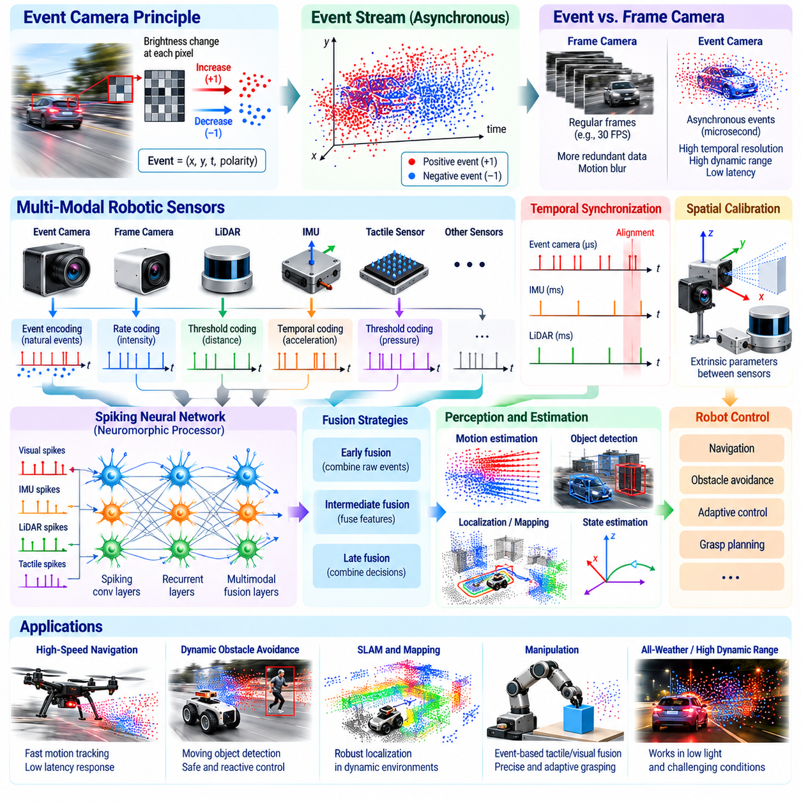{width="7.268055555555556in" height="7.268055555555556in"}

Event cameras represent a fundamental departure from conventional frame-based imaging by capturing changes in visual intensity rather than complete images at fixed intervals. Each pixel independently generates an event when local brightness variation exceeds a predefined threshold. This asynchronous sensing mechanism provides high temporal resolution, reduced redundant data transmission, and potentially low-latency perception, making event cameras attractive for autonomous robots operating in rapidly changing environments.

The operating principle of an event camera is based on detecting changes in logarithmic light intensity. When the brightness at a pixel increases or decreases sufficiently, the sensor generates an event containing pixel coordinates, a timestamp, and polarity indicating the direction of change. The resulting asynchronous event stream represents visual dynamics directly. Unlike conventional cameras, event cameras do not require every pixel to transmit information during each observation cycle.

Event-based vision offers several advantages for robotic perception, including microsecond-scale timestamp resolution, high dynamic range, and reduced motion blur. These properties can support perception during rapid camera movement, sudden illumination changes, and high-speed object motion. However, actual performance depends on sensor design, contrast thresholds, background activity, and environmental conditions. Event cameras also provide limited information about static scenes without relative motion or brightness variation.

Neuromorphic sensor fusion combines event-camera measurements with information from complementary sensors to construct more reliable estimates of the robot\'s environment and internal state. Typical combinations include event cameras, inertial measurement units, conventional cameras, LiDAR, and tactile sensors. Each sensing modality contributes different spatial, temporal, or physical information. Fusion algorithms exploit these complementary characteristics to improve motion estimation, localization, obstacle detection, and robot control.

Integrating event cameras with inertial measurement units provides a particularly useful foundation for high-speed motion estimation. An inertial measurement unit measures angular velocity and linear acceleration at relatively high sampling rates, while an event camera reports asynchronous visual changes. Combining these signals can improve estimates of camera motion and orientation. Accurate temporal alignment, inertial bias estimation, and sensor calibration remain essential for reliable visual-inertial fusion.

Event-based visual odometry estimates camera movement by analyzing the spatial and temporal structure of incoming events. Instead of matching features between complete image frames, algorithms can track event patterns, estimate optical flow, or align events against geometric representations. These techniques may reduce perception latency during rapid motion. However, event sparsity, low-texture environments, and ambiguous motion patterns can make accurate estimation difficult.

Event-camera and LiDAR fusion provides another approach to improving robotic environmental understanding. LiDAR supplies geometric distance measurements, while event cameras capture rapid changes in visual appearance. Their combination can support dynamic object tracking, motion segmentation, and geometric consistency checking. Effective integration requires spatial calibration between sensors and careful handling of differences in measurement timing, field of view, and sensing characteristics.

Neuromorphic sensor fusion can operate through several computational strategies. Early fusion combines sensor measurements before feature extraction, intermediate fusion integrates modality-specific features, and late fusion merges independently generated estimates or decisions. The appropriate strategy depends on sensor bandwidth, synchronization requirements, computational resources, and the intended robotic task. Event-driven architectures may process asynchronous measurements without converting every input into synchronized image frames.

Spiking neural networks provide a natural computational framework for processing asynchronous sensory events. Incoming events can activate neurons associated with spatial locations, motion patterns, or sensory features. Temporal neural dynamics allow the network to accumulate information and respond when relevant activity patterns emerge. When multiple sensor modalities are encoded as spikes, the network can investigate joint temporal representations for perception and sensorimotor coordination.

Converting conventional sensor signals into spike representations requires carefully designed encoding mechanisms. Inertial acceleration, angular velocity, pressure, and distance measurements may be transformed into events using threshold crossings, rate coding, or temporal coding. Encoding parameters influence information loss, spike density, and computational latency. Excessive event generation can eliminate expected efficiency advantages, while overly sparse representations may discard information needed for reliable state estimation.

Temporal synchronization is one of the most important challenges in heterogeneous sensor fusion. Event cameras generate measurements asynchronously, while conventional sensors often operate at fixed sampling frequencies. Timestamp accuracy, clock drift, communication delay, and buffering can introduce alignment errors. Fusion systems therefore require consistent time references and mechanisms for associating measurements collected at different moments without introducing excessive latency.

Spatial calibration is equally important because sensor measurements originate from different coordinate frames. The relative position and orientation between cameras, inertial sensors, and ranging devices must be estimated accurately. Calibration errors can produce inconsistent geometric interpretations and degrade fusion performance. For mobile robots, vibration, temperature variation, and mechanical deformation may also affect calibration stability, requiring periodic verification or online correction.

Event-based optical flow estimation illustrates the value of asynchronous visual processing. Local event patterns can reveal the apparent movement of image structures over short time intervals. These motion estimates can support collision prediction, visual stabilization, and reactive navigation. Spiking neural networks or conventional event-processing algorithms may extract motion features, but performance depends on event density, scene texture, noise characteristics, and the selected temporal integration window.

Autonomous mobile robots can use event-driven fusion to improve responsiveness during navigation through dynamic environments. Event cameras may detect rapid motion near obstacles, while LiDAR and conventional cameras provide geometric and semantic context. Inertial sensors contribute short-term motion information. A fusion architecture can combine these observations to update local environmental estimates and generate timely avoidance decisions under the supervision of established navigation and safety systems.

Aerial robots present another important application because rapid vehicle motion creates demanding perception conditions. Event cameras can capture visual changes during aggressive maneuvers without relying on conventional exposure intervals. Combined with inertial measurements, they may support visual odometry, attitude-related estimation, and obstacle avoidance. Practical flight integration nevertheless requires bounded processing latency, reliable state estimation, and independent safety mechanisms for flight-critical functions.

Robotic manipulation can benefit from integrating event-based vision with tactile sensing. Event cameras observe rapid object movement and changes in contact geometry, while tactile sensors detect pressure variation, vibration, and slip-related signals. Their combined interpretation may enable faster recognition of unstable grasps and more responsive grip adjustments. Reliable deployment requires careful sensor placement, contact calibration, and coordination with force-control and motion-planning systems.

A practical neuromorphic fusion pipeline begins with asynchronous event acquisition and timestamp management. Sensor-specific preprocessing removes invalid measurements, suppresses noise, and prepares data for feature extraction or neural encoding. Fusion modules then combine temporal and spatial information to estimate relevant robot states. The resulting outputs are transferred to navigation, manipulation, or control components through interfaces that preserve timing information and report uncertainty.

Noise management is essential because event cameras can generate unwanted events from sensor leakage, electrical interference, illumination flicker, or threshold variability. Filtering methods may exploit spatial neighborhoods, temporal consistency, or learned activity patterns. However, aggressive filtering can remove genuine events associated with small or rapidly moving objects. Robust fusion therefore requires balancing noise suppression against the preservation of meaningful temporal information.

The computational efficiency of neuromorphic fusion depends on the complete processing architecture rather than the event camera alone. Sparse event streams may reduce data movement and processing requirements, but dense event bursts can occur during rapid motion or widespread illumination changes. Event buffering, neural processing, sensor conversion, and communication all contribute to system energy consumption. Measurements must include these components when evaluating advantages over conventional perception pipelines.

Evaluation should consider estimation accuracy, end-to-end latency, event throughput, energy consumption, synchronization error, and robustness under realistic operating conditions. Representative tests include rapid motion, low illumination, changing contrast, vibration, sensor noise, and partial sensor failure. For robotic applications, perception metrics must also be connected to navigation success, tracking reliability, control stability, and operational safety rather than evaluated independently.

The future of event cameras and neuromorphic sensor fusion lies in combining asynchronous perception with efficient temporal computation and conventional robotic intelligence. Event-driven processors may handle rapid environmental changes, while dense neural accelerators perform semantic understanding and high-level reasoning. Such hybrid architectures offer a practical path toward responsive and energy-aware autonomous robots. Their adoption will depend on mature calibration tools, reliable software integration, and reproducible system-level performance improvements.

이벤트 카메라(Event Camera)는 고정된 시간 간격으로 전체 이미지를 획득하는 대신 시각적 밝기 변화(Visual Intensity Change)를 감지한다는 점에서 기존 프레임 기반 영상 처리(Frame-Based Imaging)와 근본적으로 다른 방식을 사용한다. 각 픽셀(Pixel)은 국소적인 밝기 변화(Local Brightness Variation)가 사전에 정의된 임계값(Threshold)을 초과하면 독립적으로 이벤트(Event)를 생성한다. 이러한 비동기 센싱 메커니즘(Asynchronous Sensing Mechanism)은 높은 시간 해상도(Temporal Resolution), 중복 데이터 전송 감소, 낮은 지연시간의 인지(Low-Latency Perception)를 제공할 수 있어 빠르게 변화하는 환경에서 작동하는 자율 로봇(Autonomous Robot)에 적합하다.

이벤트 카메라의 동작 원리(Operating Principle)는 로그 광도(Logarithmic Light Intensity)의 변화를 감지하는 데 기반한다. 특정 픽셀의 밝기가 충분히 증가하거나 감소하면 센서는 픽셀 좌표(Pixel Coordinate), 타임스탬프(Timestamp), 변화 방향을 나타내는 극성(Polarity)을 포함하는 이벤트를 생성한다. 이렇게 생성된 비동기 이벤트 스트림(Asynchronous Event Stream)은 시각적 동역학(Visual Dynamics)을 직접 표현한다. 기존 카메라와 달리 이벤트 카메라는 매 관측 주기(Observation Cycle)마다 모든 픽셀이 정보를 전송할 필요가 없다.

이벤트 기반 비전(Event-Based Vision)은 마이크로초 수준의 타임스탬프 해상도(Microsecond-Scale Timestamp Resolution), 높은 동적 범위(High Dynamic Range), 모션 블러(Motion Blur) 감소 등 로봇 인지(Robotic Perception)에 여러 장점을 제공한다. 이러한 특성은 빠른 카메라 움직임, 급격한 조명 변화(Sudden Illumination Change), 고속 객체 운동(High-Speed Object Motion) 상황에서 인지 기능을 지원할 수 있다. 그러나 실제 성능은 센서 설계(Sensor Design), 대비 임계값(Contrast Threshold), 배경 이벤트 활성도(Background Activity), 환경 조건(Environmental Condition)에 따라 달라진다. 또한 이벤트 카메라는 상대적인 움직임이나 밝기 변화가 없는 정적 장면(Static Scene)에 대해서는 제한적인 정보만 제공한다.

뉴로모픽 센서 융합(Neuromorphic Sensor Fusion)은 이벤트 카메라 측정값을 상호 보완적인 센서 정보와 결합하여 로봇의 주변 환경과 내부 상태에 대한 더욱 신뢰성 높은 추정값을 생성한다. 대표적인 조합에는 이벤트 카메라, 관성 측정 장치(Inertial Measurement Unit, IMU), 기존 카메라(Conventional Camera), 라이다(LiDAR), 촉각 센서(Tactile Sensor)가 포함된다. 각 센싱 방식(Sensing Modality)은 서로 다른 공간적 정보(Spatial Information), 시간적 정보(Temporal Information), 물리적 정보(Physical Information)를 제공한다. 융합 알고리즘(Fusion Algorithm)은 이러한 상호 보완적 특성을 활용하여 움직임 추정(Motion Estimation), 위치 추정(Localization), 장애물 감지(Obstacle Detection), 로봇 제어(Robot Control)를 개선한다.

이벤트 카메라와 관성 측정 장치의 통합은 고속 움직임 추정(High-Speed Motion Estimation)을 위한 특히 유용한 기반을 제공한다. 관성 측정 장치는 비교적 높은 샘플링 속도(Sampling Rate)로 각속도(Angular Velocity)와 선형 가속도(Linear Acceleration)를 측정하고, 이벤트 카메라는 비동기적인 시각 변화를 보고한다. 이러한 신호를 결합하면 카메라 움직임과 방향(Orientation)에 대한 추정 정확도를 개선할 수 있다. 신뢰성 높은 시각-관성 융합(Visual-Inertial Fusion)을 위해서는 정확한 시간 정렬(Temporal Alignment), 관성 센서 바이어스 추정(Inertial Bias Estimation), 센서 보정(Sensor Calibration)이 필수적이다.

이벤트 기반 시각 주행거리 추정(Event-Based Visual Odometry)은 입력되는 이벤트의 공간적·시간적 구조(Spatial and Temporal Structure)를 분석하여 카메라의 움직임을 추정한다. 전체 이미지 프레임 사이의 특징점(Feature)을 대응시키는 대신, 알고리즘은 이벤트 패턴(Event Pattern)을 추적하거나 광학 흐름(Optical Flow)을 추정하고, 기하학적 표현(Geometric Representation)에 이벤트를 정렬할 수 있다. 이러한 기법은 빠른 움직임 중 인지 지연시간(Perception Latency)을 줄일 수 있다. 그러나 이벤트 희소성(Event Sparsity), 텍스처가 부족한 환경(Low-Texture Environment), 모호한 움직임 패턴(Ambiguous Motion Pattern)은 정확한 추정을 어렵게 만들 수 있다.

이벤트 카메라와 라이다의 융합(Event-Camera and LiDAR Fusion)은 로봇의 환경 이해(Environmental Understanding)를 개선하는 또 다른 접근 방식이다. 라이다는 기하학적 거리 측정값(Geometric Distance Measurement)을 제공하고, 이벤트 카메라는 시각적 외관의 빠른 변화(Rapid Visual Appearance Change)를 포착한다. 두 센서를 결합하면 동적 객체 추적(Dynamic Object Tracking), 움직임 분할(Motion Segmentation), 기하학적 일관성 검사(Geometric Consistency Checking)를 지원할 수 있다. 효과적인 통합을 위해서는 센서 사이의 공간 보정(Spatial Calibration)과 측정 시점(Measurement Timing), 시야각(Field of View), 센싱 특성(Sensing Characteristic)의 차이를 신중하게 처리해야 한다.

뉴로모픽 센서 융합은 여러 연산 전략(Computational Strategy)을 통해 구현할 수 있다. 초기 융합(Early Fusion)은 특징 추출(Feature Extraction) 전에 센서 측정값을 결합하고, 중간 융합(Intermediate Fusion)은 센서 방식별 특징(Modality-Specific Feature)을 통합하며, 후기 융합(Late Fusion)은 독립적으로 생성된 추정값이나 의사결정(Decision)을 병합한다. 적절한 전략은 센서 대역폭(Sensor Bandwidth), 동기화 요구사항(Synchronization Requirement), 연산 자원(Computational Resource), 목표 로봇 작업(Robotic Task)에 따라 달라진다. 이벤트 기반 아키텍처(Event-Driven Architecture)는 모든 입력을 동기화된 이미지 프레임으로 변환하지 않고도 비동기 측정값을 처리할 수 있다.

스파이킹 신경망(Spiking Neural Network, SNN)은 비동기 감각 이벤트(Asynchronous Sensory Event)를 처리하기 위한 자연스러운 연산 프레임워크(Computational Framework)를 제공한다. 입력 이벤트는 공간적 위치(Spatial Location), 움직임 패턴(Motion Pattern), 감각 특징(Sensory Feature)과 연결된 뉴런(Neuron)을 활성화할 수 있다. 시간적 신경 동역학(Temporal Neural Dynamics)은 신경망이 정보를 누적하고 관련 활성화 패턴이 나타날 때 반응하도록 한다. 여러 센서 방식의 정보가 스파이크(Spike)로 부호화되면, 신경망은 인지와 감각운동 협응(Sensorimotor Coordination)을 위한 공동 시간 표현(Joint Temporal Representation)을 학습하거나 탐색할 수 있다.

기존 센서 신호를 스파이크 표현(Spike Representation)으로 변환하려면 신중하게 설계된 부호화 메커니즘(Encoding Mechanism)이 필요하다. 관성 가속도(Inertial Acceleration), 각속도, 압력(Pressure), 거리 측정값(Distance Measurement)은 임계값 통과(Threshold Crossing), 발화율 부호화(Rate Coding), 시간 부호화(Temporal Coding)를 사용하여 이벤트로 변환할 수 있다. 부호화 매개변수(Encoding Parameter)는 정보 손실(Information Loss), 스파이크 밀도(Spike Density), 연산 지연시간(Computational Latency)에 영향을 미친다. 과도한 이벤트 생성은 기대했던 효율성 향상 효과를 없앨 수 있으며, 지나치게 희소한 표현은 신뢰성 높은 상태 추정(State Estimation)에 필요한 정보를 손실할 수 있다.

시간 동기화(Temporal Synchronization)는 이기종 센서 융합(Heterogeneous Sensor Fusion)에서 가장 중요한 과제 중 하나이다. 이벤트 카메라는 비동기적으로 측정값을 생성하지만, 기존 센서는 고정된 샘플링 주파수(Sampling Frequency)로 작동하는 경우가 많다. 타임스탬프 정확도(Timestamp Accuracy), 클록 드리프트(Clock Drift), 통신 지연(Communication Delay), 버퍼링(Buffering)은 시간 정렬 오류(Temporal Alignment Error)를 발생시킬 수 있다. 따라서 융합 시스템은 일관된 시간 기준(Consistent Time Reference)과 과도한 지연을 유발하지 않으면서 서로 다른 시점에 수집된 측정값을 연관시키는 메커니즘이 필요하다.

공간 보정(Spatial Calibration) 역시 중요하다. 센서 측정값이 서로 다른 좌표계(Coordinate Frame)에서 생성되기 때문이다. 카메라, 관성 센서(Inertial Sensor), 거리 측정 장치(Ranging Device) 사이의 상대 위치(Relative Position)와 방향(Relative Orientation)을 정확하게 추정해야 한다. 보정 오류(Calibration Error)는 일관되지 않은 기하학적 해석(Geometric Interpretation)을 발생시키고 융합 성능(Fusion Performance)을 저하시킬 수 있다. 이동 로봇(Mobile Robot)에서는 진동(Vibration), 온도 변화(Temperature Variation), 기계적 변형(Mechanical Deformation)이 보정 안정성(Calibration Stability)에 영향을 줄 수 있으므로 주기적인 검증(Periodic Verification)이나 온라인 보정(Online Correction)이 필요할 수 있다.

이벤트 기반 광학 흐름 추정(Event-Based Optical Flow Estimation)은 비동기 시각 처리(Asynchronous Visual Processing)의 가치를 보여주는 대표적인 사례이다. 국소 이벤트 패턴(Local Event Pattern)은 짧은 시간 간격에서 이미지 구조(Image Structure)의 겉보기 움직임(Apparent Motion)을 나타낼 수 있다. 이러한 움직임 추정값은 충돌 예측(Collision Prediction), 시각적 안정화(Visual Stabilization), 반응형 내비게이션(Reactive Navigation)을 지원할 수 있다. 스파이킹 신경망이나 기존 이벤트 처리 알고리즘(Event-Processing Algorithm)을 사용하여 움직임 특징(Motion Feature)을 추출할 수 있지만, 성능은 이벤트 밀도(Event Density), 장면 텍스처(Scene Texture), 잡음 특성(Noise Characteristic), 선택된 시간 통합 구간(Temporal Integration Window)에 따라 달라진다.

자율이동로봇(Autonomous Mobile Robot, AMR)은 이벤트 기반 융합(Event-Driven Fusion)을 활용하여 동적 환경(Dynamic Environment)에서 주행할 때 반응성을 개선할 수 있다. 이벤트 카메라는 장애물 주변의 빠른 움직임을 감지하고, 라이다와 기존 카메라는 기하학적 맥락(Geometric Context)과 의미론적 맥락(Semantic Context)을 제공할 수 있다. 관성 센서는 단기 움직임 정보(Short-Term Motion Information)를 제공한다. 융합 아키텍처(Fusion Architecture)는 이러한 관측값을 결합하여 국소 환경 추정값(Local Environmental Estimate)을 갱신하고, 검증된 내비게이션 및 안전 시스템(Navigation and Safety System)의 감독하에 적시에 회피 결정(Avoidance Decision)을 생성할 수 있다.

항공 로봇(Aerial Robot)은 빠른 기체 움직임으로 인해 까다로운 인지 조건이 발생하므로 또 다른 중요한 응용 분야이다. 이벤트 카메라는 기존 카메라의 노출 간격(Exposure Interval)에 의존하지 않고 급격한 기동(Aggressive Maneuver) 중 발생하는 시각적 변화를 포착할 수 있다. 관성 측정값과 결합하면 시각 주행거리 추정(Visual Odometry), 자세 관련 상태 추정(Attitude-Related Estimation), 장애물 회피를 지원할 수 있다. 그러나 실제 비행 시스템 통합(Flight System Integration)에는 제한된 처리 지연시간(Bounded Processing Latency), 신뢰성 높은 상태 추정(Reliable State Estimation), 비행 필수 기능(Flight-Critical Function)을 위한 독립적인 안전 메커니즘(Independent Safety Mechanism)이 필요하다.

로봇 조작(Robotic Manipulation)은 이벤트 기반 비전과 촉각 센싱(Tactile Sensing)을 통합함으로써 이점을 얻을 수 있다. 이벤트 카메라는 빠른 물체 움직임(Object Movement)과 접촉 기하학(Contact Geometry)의 변화를 관측하고, 촉각 센서는 압력 변화(Pressure Variation), 진동, 미끄러짐 관련 신호(Slip-Related Signal)를 감지한다. 두 센서의 정보를 결합하여 해석하면 불안정한 파지(Unstable Grasp)를 더 빠르게 인식하고 반응성이 높은 파지력 조정(Grip Adjustment)을 구현할 수 있다. 신뢰성 높은 배포를 위해서는 신중한 센서 배치(Sensor Placement), 접촉 보정(Contact Calibration), 힘 제어 시스템(Force-Control System) 및 운동 계획 시스템(Motion-Planning System)과의 협조가 필요하다.

실용적인 뉴로모픽 융합 파이프라인(Neuromorphic Fusion Pipeline)은 비동기 이벤트 획득(Asynchronous Event Acquisition)과 타임스탬프 관리(Timestamp Management)에서 시작한다. 센서별 전처리(Sensor-Specific Preprocessing)는 유효하지 않은 측정값을 제거하고 잡음을 억제하며 특징 추출이나 신경 부호화(Neural Encoding)를 위한 데이터를 준비한다. 이후 융합 모듈(Fusion Module)은 시간적 정보와 공간적 정보를 결합하여 관련 로봇 상태(Robot State)를 추정한다. 생성된 출력은 시간 정보를 보존하고 불확실성(Uncertainty)을 보고하는 인터페이스를 통해 내비게이션, 조작 또는 제어 구성요소(Control Component)로 전달된다.

잡음 관리(Noise Management)는 이벤트 카메라가 센서 누설(Sensor Leakage), 전기적 간섭(Electrical Interference), 조명 깜박임(Illumination Flicker), 임계값 변동성(Threshold Variability)으로 인해 원하지 않는 이벤트를 생성할 수 있기 때문에 필수적이다. 필터링 방법(Filtering Method)은 공간적 이웃(Spatial Neighborhood), 시간적 일관성(Temporal Consistency), 학습된 활성화 패턴(Learned Activity Pattern)을 활용할 수 있다. 그러나 과도한 필터링(Aggressive Filtering)은 작거나 빠르게 움직이는 객체와 관련된 실제 이벤트까지 제거할 수 있다. 따라서 강건한 융합(Robust Fusion)을 위해서는 잡음 억제(Noise Suppression)와 의미 있는 시간 정보의 보존(Preservation of Temporal Information) 사이에서 균형을 유지해야 한다.

뉴로모픽 융합의 연산 효율성(Computational Efficiency)은 이벤트 카메라 자체가 아니라 전체 처리 아키텍처(Processing Architecture)에 의해 결정된다. 희소 이벤트 스트림(Sparse Event Stream)은 데이터 이동(Data Movement)과 처리 요구량(Processing Requirement)을 줄일 수 있지만, 빠른 움직임이나 광범위한 조명 변화가 발생하면 밀집 이벤트 버스트(Dense Event Burst)가 생성될 수 있다. 이벤트 버퍼링(Event Buffering), 신경망 처리(Neural Processing), 센서 데이터 변환(Sensor Conversion), 통신은 모두 시스템 에너지 소비(System Energy Consumption)에 기여한다. 기존 인지 파이프라인(Conventional Perception Pipeline) 대비 이점을 평가할 때는 이러한 구성요소를 모두 측정에 포함해야 한다.

평가(Evaluation)에서는 추정 정확도(Estimation Accuracy), 종단 간 지연시간(End-to-End Latency), 이벤트 처리량(Event Throughput), 에너지 소비(Energy Consumption), 동기화 오류(Synchronization Error), 실제 운용 조건에서의 강건성(Robustness)을 고려해야 한다. 대표적인 시험 조건(Test Condition)에는 빠른 움직임, 저조도(Low Illumination), 대비 변화(Changing Contrast), 진동, 센서 잡음, 부분적인 센서 고장(Partial Sensor Failure)이 포함된다. 로봇 응용에서는 인지 성능 지표(Perception Metric)를 독립적으로 평가하는 데 그치지 않고 내비게이션 성공률(Navigation Success), 추적 신뢰성(Tracking Reliability), 제어 안정성(Control Stability), 운용 안전성(Operational Safety)과 연결해야 한다.

이벤트 카메라와 뉴로모픽 센서 융합의 미래는 비동기 인지(Asynchronous Perception)를 효율적인 시간적 연산(Temporal Computation) 및 기존 로봇 지능(Robotic Intelligence)과 결합하는 데 있다. 이벤트 기반 프로세서(Event-Driven Processor)는 빠른 환경 변화를 처리하고, 밀집 신경망 가속기(Dense Neural Accelerator)는 의미론적 이해(Semantic Understanding)와 고수준 추론(High-Level Reasoning)을 수행할 수 있다. 이러한 하이브리드 아키텍처(Hybrid Architecture)는 반응성이 높고 에너지 효율을 고려한 자율 로봇(Energy-Aware Autonomous Robot)을 구현하기 위한 실용적인 경로를 제공한다. 실제 도입 여부는 성숙한 보정 도구(Calibration Tool), 신뢰성 높은 소프트웨어 통합(Software Integration), 재현 가능한 시스템 수준 성능 향상(Reproducible System-Level Performance Improvement)에 따라 결정될 것이다.

## 10.05. Neuromorphic SLAM and Navigation [w/Code]

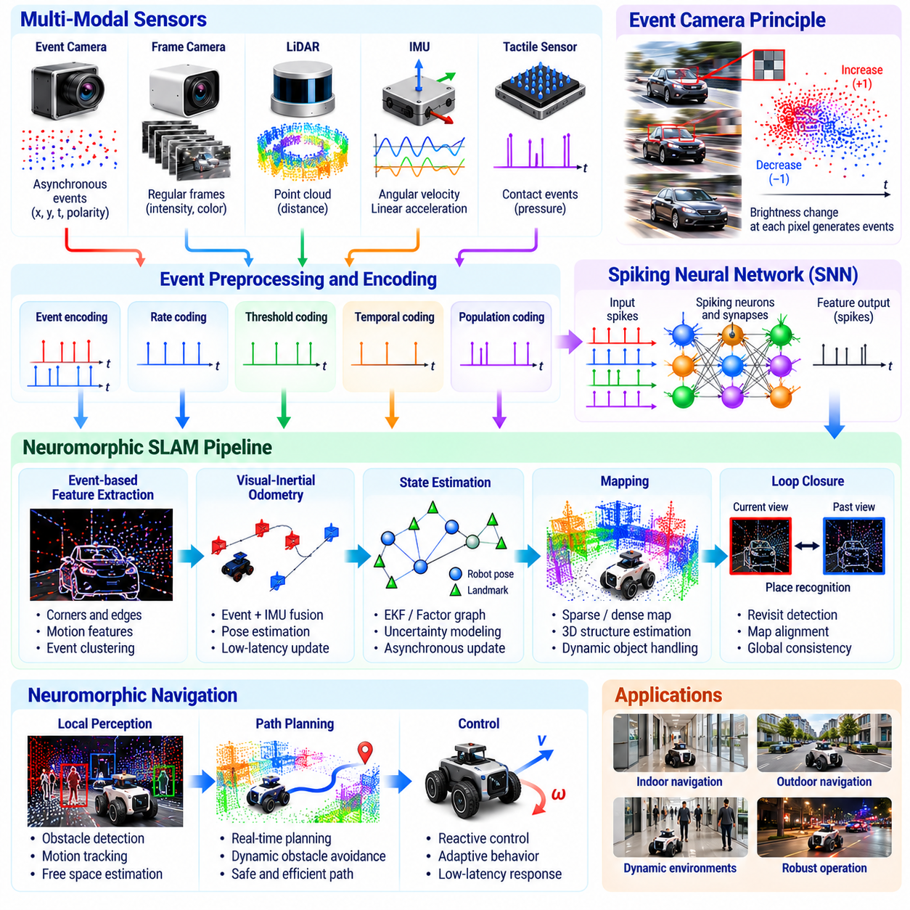{width="7.268055555555556in" height="7.268055555555556in"}

Neuromorphic simultaneous localization and mapping (SLAM) applies event-driven sensing and brain-inspired computation to the problem of estimating robot position while constructing a representation of the surrounding environment. Conventional SLAM systems commonly process camera frames, LiDAR scans, and inertial measurements at defined intervals. Neuromorphic approaches instead exploit asynchronous sensory events and temporal neural dynamics to support responsive navigation under constrained computational and energy budgets.

The fundamental challenge of SLAM is estimating robot motion and environmental structure when neither is completely known. Localization determines the robot\'s position and orientation, while mapping identifies spatial features, obstacles, and geometric relationships. These processes are mutually dependent because accurate motion estimation improves mapping, while reliable environmental representations constrain localization errors. Neuromorphic SLAM seeks to maintain this relationship through efficient temporal information processing.

Event cameras provide an important sensing foundation for neuromorphic SLAM. Each pixel independently reports significant changes in logarithmic brightness, generating events containing spatial coordinates, timestamps, and polarity. Unlike conventional cameras, event sensors do not repeatedly transmit complete image frames. Their asynchronous outputs can preserve rapid visual changes during high-speed movement and reduce redundant measurements in relatively static environments.

Event-based visual odometry estimates camera motion from the spatial and temporal relationships among incoming events. Algorithms may track event features, estimate optical flow, or align events with predicted geometric structures. Because measurements arrive asynchronously, motion estimates can potentially be updated without waiting for complete image frames. However, event sparsity, sensor noise, and insufficient scene texture can reduce estimation accuracy and require complementary sensing information.

Spiking neural networks (SNNs) offer a computational mechanism for interpreting event-camera measurements through discrete neural activity. Spiking neurons integrate incoming events and generate outputs when internal activation reaches defined thresholds. Their temporal dynamics can represent motion patterns, feature persistence, and changing spatial relationships. Such networks may support event-based feature detection and motion estimation, although complete SLAM systems generally require additional geometric estimation components.

Neuromorphic feature extraction focuses on identifying informative structures within asynchronous event streams. Corners, edges, and moving contours can generate characteristic patterns across neighboring pixels and time intervals. Event-based algorithms or spiking neural circuits may detect these structures without reconstructing conventional image frames. Feature quality depends on contrast, relative motion, event density, and temporal filtering, making robust extraction essential for dependable localization.

Temporal integration determines how incoming events contribute to the robot\'s evolving estimate of its surroundings. Short integration windows preserve rapid motion information but may contain insufficient events for reliable geometric interpretation. Longer windows provide richer observations while increasing latency and the risk of motion-induced distortion. Adaptive temporal windows can balance these effects by adjusting integration according to sensor activity, estimated motion, and uncertainty.

Visual-inertial fusion strengthens neuromorphic localization by combining event-camera measurements with inertial measurement units. Gyroscopes provide angular velocity, while accelerometers measure specific force, supporting short-term motion propagation between visual observations. Event information helps correct accumulated inertial drift when sufficient visual structure is available. Accurate calibration, timestamp synchronization, bias estimation, and uncertainty modeling are necessary to maintain consistent state estimates.

State estimation can be implemented through probabilistic filtering, nonlinear optimization, or hybrid computational architectures. Extended Kalman filters propagate robot states and update estimates using incoming measurements, while factor graphs represent relationships among poses, landmarks, and sensor observations. Neuromorphic processing can supply asynchronous features or motion constraints to these estimators. The mathematical consistency of the estimation framework remains critical regardless of the sensing hardware.

Mapping within neuromorphic SLAM may involve sparse landmarks, occupancy grids, local geometric surfaces, or event-based spatial representations. Sparse feature maps reduce storage requirements and support efficient localization, while denser representations provide additional information for obstacle avoidance. Event cameras primarily observe brightness changes rather than direct distance, so geometric reconstruction requires motion constraints, multiple viewpoints, depth sensing, or other supporting information.

Loop closure addresses accumulated localization drift when a robot revisits a previously observed location. Conventional SLAM often identifies revisited places through image descriptors or geometric matching. Event-based systems face additional challenges because event patterns depend strongly on motion direction, speed, and illumination changes. Hybrid approaches may combine reconstructed visual representations, conventional camera images, or geometric landmarks to improve place recognition and global map consistency.

Neuromorphic navigation extends localization and mapping into real-time motion planning and obstacle avoidance. A robot can use asynchronous visual events to identify rapidly approaching obstacles while maintaining a geometric map for longer-horizon planning. Reactive control modules may respond to urgent motion cues, whereas conventional planners evaluate feasible trajectories and mission objectives. This separation allows fast event-driven reactions without abandoning structured navigation and safety constraints.

Event-based optical flow provides useful information for reactive navigation. Apparent motion patterns across the sensor can indicate relative movement between the robot and surrounding objects. Flow divergence may provide cues about approaching surfaces, while spatial flow asymmetry can inform steering adjustments. These measurements require careful interpretation because camera rotation, translation, and independently moving objects can generate overlapping motion patterns.

Spiking neural networks can also support navigation policies that associate sensory activity with steering or velocity commands. Reinforcement learning, surrogate gradient training, and biologically inspired plasticity may be used to develop such policies. However, learned navigation behavior must be evaluated against stability, collision avoidance, and operational constraints. Independent safety supervision remains necessary because neural responses alone do not guarantee predictable behavior in unfamiliar environments.

Energy efficiency is a major motivation for neuromorphic SLAM on battery-powered robots. Sparse event processing can reduce unnecessary computation when the environment produces limited visual changes. Neuromorphic processors may further improve efficiency through localized memory and event-driven neural execution. Nevertheless, rapid motion and widespread illumination changes can generate dense event streams, so system-level energy measurements must include sensing, preprocessing, estimation, communication, and control.

Practical integration requires an architecture that connects event acquisition, timestamp management, neural processing, state estimation, mapping, and navigation control. Sensor events must be delivered with consistent timing information, while estimated robot states should include uncertainty and validity indicators. Interfaces to robotic middleware such as ROS 2 can distribute perception and navigation outputs. Real-time scheduling and bounded buffering are important for preventing excessive delays during event bursts.

Robustness challenges arise from illumination flicker, low-contrast surfaces, sensor noise, and insufficient event generation during stationary operation. Rapid changes in lighting can produce large numbers of events unrelated to meaningful geometric motion. Sensor fusion, adaptive filtering, and confidence-aware estimation can reduce these effects. Systems should detect degraded localization conditions and transition to alternative sensing or conservative navigation behavior when uncertainty becomes unacceptable.

Benchmarking neuromorphic SLAM requires more than measuring trajectory accuracy under favorable laboratory conditions. Relevant metrics include absolute trajectory error, relative pose error, map consistency, update latency, energy consumption, memory utilization, and recovery after tracking loss. Experiments should include rapid motion, dynamic obstacles, low illumination, repeated routes, and sensor disturbances. Comparisons with conventional SLAM must use comparable hardware boundaries and equivalent operational conditions.

A practical development roadmap begins with event-camera calibration and offline evaluation of event-based visual odometry. Subsequent stages introduce inertial fusion, local mapping, loop closure, and integration with robot navigation software. Hardware acceleration and spiking neural processing can then be evaluated against conventional implementations. Each stage should establish measurable accuracy, latency, power, and reliability requirements before progressing toward autonomous field deployment.

The future of neuromorphic SLAM and navigation will likely involve hybrid systems combining asynchronous perception, geometric estimation, learned temporal representations, and conventional motion planning. Event-driven sensing can provide rapid awareness of environmental changes, while probabilistic mapping maintains spatial consistency over longer periods. Progress in neuromorphic hardware, sensor fusion, and robust estimation may enable more responsive and energy-efficient robots, provided that advantages are verified through reproducible real-world testing.

뉴로모픽 동시 위치 추정 및 지도 작성(Neuromorphic Simultaneous Localization and Mapping, Neuromorphic SLAM)은 로봇의 위치를 추정하면서 주변 환경의 표현을 구축하는 문제에 이벤트 기반 센싱(Event-Driven Sensing)과 뇌 모방 연산(Brain-Inspired Computation)을 적용하는 기술이다. 기존 SLAM 시스템은 일반적으로 카메라 프레임(Camera Frame), 라이다 스캔(LiDAR Scan), 관성 측정값(Inertial Measurement)을 정해진 시간 간격으로 처리한다. 반면 뉴로모픽 접근 방식(Neuromorphic Approach)은 비동기 감각 이벤트(Asynchronous Sensory Event)와 시간적 신경 동역학(Temporal Neural Dynamics)을 활용하여 제한된 연산 자원과 에너지 예산(Computational and Energy Budget)에서도 반응성이 높은 내비게이션(Navigation)을 지원한다.

SLAM의 근본적인 과제는 로봇의 움직임과 환경 구조가 모두 완전히 알려지지 않은 상태에서 이를 추정하는 것이다. 위치 추정(Localization)은 로봇의 위치(Position)와 방향(Orientation)을 결정하며, 지도 작성(Mapping)은 공간적 특징(Spatial Feature), 장애물(Obstacle), 기하학적 관계(Geometric Relationship)를 식별한다. 정확한 움직임 추정(Motion Estimation)은 지도 작성의 품질을 높이고, 신뢰성 높은 환경 표현(Environmental Representation)은 위치 추정 오차(Localization Error)를 제한하므로 두 과정은 상호 의존적이다. 뉴로모픽 SLAM은 효율적인 시간 정보 처리(Temporal Information Processing)를 통해 이러한 관계를 유지하는 것을 목표로 한다.

이벤트 카메라(Event Camera)는 뉴로모픽 SLAM을 위한 중요한 센싱 기반(Sensing Foundation)을 제공한다. 각 픽셀(Pixel)은 로그 밝기(Logarithmic Brightness)의 유의미한 변화를 독립적으로 감지하고, 공간 좌표(Spatial Coordinate), 타임스탬프(Timestamp), 극성(Polarity)을 포함하는 이벤트(Event)를 생성한다. 기존 카메라와 달리 이벤트 센서(Event Sensor)는 전체 이미지 프레임(Image Frame)을 반복적으로 전송하지 않는다. 비동기 출력(Asynchronous Output)은 고속 이동 중 발생하는 빠른 시각적 변화를 보존하고, 비교적 정적인 환경에서 중복 측정값(Redundant Measurement)을 줄일 수 있다.

이벤트 기반 시각 주행거리 추정(Event-Based Visual Odometry)은 입력되는 이벤트 사이의 공간적·시간적 관계(Spatial and Temporal Relationship)를 이용하여 카메라 움직임을 추정한다. 알고리즘은 이벤트 특징(Event Feature)을 추적하거나 광학 흐름(Optical Flow)을 추정하고, 예측된 기하학적 구조(Predicted Geometric Structure)에 이벤트를 정렬할 수 있다. 측정값이 비동기적으로 도착하므로 전체 이미지 프레임을 기다리지 않고 움직임 추정값을 갱신할 가능성이 있다. 그러나 이벤트 희소성(Event Sparsity), 센서 잡음(Sensor Noise), 불충분한 장면 텍스처(Scene Texture)는 추정 정확도를 저하시킬 수 있으므로 보완적인 센싱 정보가 필요하다.

스파이킹 신경망(Spiking Neural Network, SNN)은 불연속적인 신경 활성화(Discrete Neural Activity)를 통해 이벤트 카메라 측정값을 해석하는 연산 메커니즘(Computational Mechanism)을 제공한다. 스파이킹 뉴런(Spiking Neuron)은 입력 이벤트를 통합하고 내부 활성화(Internal Activation)가 정의된 임계값(Threshold)에 도달하면 출력을 생성한다. 이러한 시간적 동역학(Temporal Dynamics)은 움직임 패턴(Motion Pattern), 특징 지속성(Feature Persistence), 변화하는 공간적 관계(Spatial Relationship)를 표현할 수 있다. 이러한 신경망은 이벤트 기반 특징 감지(Event-Based Feature Detection)와 움직임 추정을 지원할 수 있지만, 완전한 SLAM 시스템에는 일반적으로 추가적인 기하학적 추정 구성요소(Geometric Estimation Component)가 필요하다.

뉴로모픽 특징 추출(Neuromorphic Feature Extraction)은 비동기 이벤트 스트림(Asynchronous Event Stream)에서 유용한 구조를 식별하는 데 중점을 둔다. 모서리(Corner), 에지(Edge), 움직이는 윤곽선(Moving Contour)은 인접 픽셀과 시간 간격에 걸쳐 특징적인 패턴을 생성할 수 있다. 이벤트 기반 알고리즘(Event-Based Algorithm)이나 스파이킹 신경 회로(Spiking Neural Circuit)는 기존 이미지 프레임을 재구성하지 않고도 이러한 구조를 감지할 수 있다. 특징 품질(Feature Quality)은 대비(Contrast), 상대 운동(Relative Motion), 이벤트 밀도(Event Density), 시간 필터링(Temporal Filtering)에 따라 달라지므로 신뢰성 높은 위치 추정을 위해서는 강건한 특징 추출(Robust Feature Extraction)이 필수적이다.

시간적 통합(Temporal Integration)은 입력 이벤트가 로봇 주변 환경에 대한 지속적으로 변화하는 추정값에 어떻게 기여하는지를 결정한다. 짧은 통합 구간(Short Integration Window)은 빠른 움직임 정보를 보존하지만, 신뢰성 높은 기하학적 해석(Geometric Interpretation)에 필요한 이벤트가 부족할 수 있다. 긴 통합 구간(Long Integration Window)은 더 풍부한 관측값을 제공하는 대신 지연시간(Latency)과 움직임으로 인한 왜곡(Motion-Induced Distortion)의 위험을 증가시킨다. 적응형 시간 구간(Adaptive Temporal Window)은 센서 활성도(Sensor Activity), 추정된 움직임(Estimated Motion), 불확실성(Uncertainty)에 따라 통합 구간을 조절하여 이러한 영향을 균형 있게 관리할 수 있다.

시각-관성 융합(Visual-Inertial Fusion)은 이벤트 카메라 측정값과 관성 측정 장치(Inertial Measurement Unit, IMU)의 정보를 결합하여 뉴로모픽 위치 추정(Neuromorphic Localization)을 강화한다. 자이로스코프(Gyroscope)는 각속도(Angular Velocity)를 제공하고, 가속도계(Accelerometer)는 비력(Specific Force)을 측정하여 시각 관측 사이의 단기 움직임 예측(Short-Term Motion Propagation)을 지원한다. 충분한 시각적 구조가 존재하면 이벤트 정보는 누적된 관성 드리프트(Inertial Drift)를 보정하는 데 도움이 된다. 일관된 상태 추정(State Estimation)을 유지하려면 정확한 보정(Calibration), 타임스탬프 동기화(Timestamp Synchronization), 바이어스 추정(Bias Estimation), 불확실성 모델링(Uncertainty Modeling)이 필요하다.

상태 추정(State Estimation)은 확률적 필터링(Probabilistic Filtering), 비선형 최적화(Nonlinear Optimization), 하이브리드 연산 아키텍처(Hybrid Computational Architecture)를 통해 구현할 수 있다. 확장 칼만 필터(Extended Kalman Filter, EKF)는 로봇 상태를 예측하고 입력 측정값을 사용하여 추정값을 갱신하며, 팩터 그래프(Factor Graph)는 자세(Pose), 랜드마크(Landmark), 센서 관측값(Sensor Observation) 사이의 관계를 표현한다. 뉴로모픽 처리(Neuromorphic Processing)는 이러한 추정기에 비동기 특징(Asynchronous Feature)이나 움직임 제약(Motion Constraint)을 제공할 수 있다. 센싱 하드웨어와 관계없이 추정 프레임워크(Estimation Framework)의 수학적 일관성(Mathematical Consistency)은 여전히 중요하다.

뉴로모픽 SLAM의 지도 작성(Mapping)은 희소 랜드마크(Sparse Landmark), 점유 격자(Occupancy Grid), 국소 기하학적 표면(Local Geometric Surface), 이벤트 기반 공간 표현(Event-Based Spatial Representation)을 포함할 수 있다. 희소 특징 지도(Sparse Feature Map)는 저장 요구량(Storage Requirement)을 줄이고 효율적인 위치 추정을 지원하며, 밀집 표현(Dense Representation)은 장애물 회피(Obstacle Avoidance)에 필요한 추가 정보를 제공한다. 이벤트 카메라는 직접적인 거리 정보가 아니라 주로 밝기 변화를 관측하므로, 기하학적 재구성(Geometric Reconstruction)에는 움직임 제약, 다중 시점(Multiple Viewpoint), 깊이 센싱(Depth Sensing), 기타 보조 정보가 필요하다.

루프 폐쇄(Loop Closure)는 로봇이 이전에 방문한 위치를 다시 통과할 때 누적된 위치 추정 드리프트(Localization Drift)를 해결하는 과정이다. 기존 SLAM은 이미지 기술자(Image Descriptor)나 기하학적 정합(Geometric Matching)을 통해 재방문 장소를 식별하는 경우가 많다. 이벤트 기반 시스템(Event-Based System)은 이벤트 패턴이 움직임 방향(Motion Direction), 속도(Speed), 조명 변화(Illumination Change)에 크게 의존하기 때문에 추가적인 어려움이 있다. 하이브리드 접근 방식(Hybrid Approach)은 재구성된 시각 표현(Reconstructed Visual Representation), 기존 카메라 이미지, 기하학적 랜드마크를 결합하여 장소 인식(Place Recognition)과 전역 지도 일관성(Global Map Consistency)을 개선할 수 있다.

뉴로모픽 내비게이션(Neuromorphic Navigation)은 위치 추정과 지도 작성을 실시간 운동 계획(Real-Time Motion Planning) 및 장애물 회피로 확장한다. 로봇은 비동기 시각 이벤트를 이용하여 빠르게 접근하는 장애물을 식별하면서 장기적인 경로 계획(Long-Horizon Planning)을 위한 기하학적 지도(Geometric Map)를 유지할 수 있다. 반응형 제어 모듈(Reactive Control Module)은 긴급한 움직임 단서(Motion Cue)에 대응하고, 기존 경로 계획기(Conventional Planner)는 실행 가능한 궤적(Feasible Trajectory)과 임무 목표(Mission Objective)를 평가한다. 이러한 역할 분리는 구조화된 내비게이션과 안전 제약(Safety Constraint)을 유지하면서 빠른 이벤트 기반 반응을 가능하게 한다.

이벤트 기반 광학 흐름(Event-Based Optical Flow)은 반응형 내비게이션(Reactive Navigation)에 유용한 정보를 제공한다. 센서 전반에서 관측되는 겉보기 움직임 패턴(Apparent Motion Pattern)은 로봇과 주변 객체 사이의 상대 운동(Relative Motion)을 나타낼 수 있다. 광학 흐름 발산(Flow Divergence)은 접근하는 표면(Approaching Surface)에 대한 단서를 제공하고, 공간적 흐름 비대칭(Spatial Flow Asymmetry)은 조향 조정(Steering Adjustment)에 활용될 수 있다. 그러나 카메라 회전(Camera Rotation), 병진 운동(Translation), 독립적으로 움직이는 객체(Independently Moving Object)가 서로 중첩된 움직임 패턴을 생성할 수 있으므로 신중한 해석이 필요하다.

스파이킹 신경망은 감각 활성화(Sensory Activity)를 조향 명령(Steering Command)이나 속도 명령(Velocity Command)과 연결하는 내비게이션 정책(Navigation Policy)을 지원할 수도 있다. 강화학습(Reinforcement Learning), 대리 기울기 학습(Surrogate Gradient Training), 생물학적 영감 기반 가소성(Biologically Inspired Plasticity)을 사용하여 이러한 정책을 개발할 수 있다. 그러나 학습된 내비게이션 동작(Learned Navigation Behavior)은 안정성(Stability), 충돌 회피(Collision Avoidance), 운용 제약(Operational Constraint)을 기준으로 평가해야 한다. 신경망 반응만으로는 익숙하지 않은 환경에서 예측 가능한 동작을 보장할 수 없으므로 독립적인 안전 감독(Independent Safety Supervision)이 필요하다.

에너지 효율성(Energy Efficiency)은 배터리 구동 로봇(Battery-Powered Robot)에서 뉴로모픽 SLAM을 활용하는 주요 동기이다. 희소 이벤트 처리(Sparse Event Processing)는 환경에서 발생하는 시각적 변화가 제한적일 때 불필요한 연산을 줄일 수 있다. 뉴로모픽 프로세서(Neuromorphic Processor)는 지역적 메모리(Local Memory)와 이벤트 기반 신경망 실행(Event-Driven Neural Execution)을 통해 효율성을 더욱 향상시킬 수 있다. 그러나 빠른 움직임과 광범위한 조명 변화는 밀집 이벤트 스트림(Dense Event Stream)을 생성할 수 있으므로 시스템 수준 에너지 측정(System-Level Energy Measurement)에는 센싱, 전처리(Preprocessing), 추정(Estimation), 통신(Communication), 제어(Control)를 모두 포함해야 한다.

실제 통합(Practical Integration)에는 이벤트 획득(Event Acquisition), 타임스탬프 관리(Timestamp Management), 신경망 처리(Neural Processing), 상태 추정, 지도 작성, 내비게이션 제어(Navigation Control)를 연결하는 아키텍처가 필요하다. 센서 이벤트는 일관된 시간 정보(Consistent Timing Information)와 함께 전달되어야 하며, 추정된 로봇 상태에는 불확실성과 유효성 지표(Validity Indicator)가 포함되어야 한다. ROS 2와 같은 로봇 미들웨어(Robotic Middleware)와의 인터페이스는 인지 및 내비게이션 출력(Perception and Navigation Output)을 배포할 수 있다. 실시간 스케줄링(Real-Time Scheduling)과 제한된 버퍼링(Bounded Buffering)은 이벤트 버스트(Event Burst) 중 과도한 지연을 방지하는 데 중요하다.

강건성 문제(Robustness Challenge)는 조명 깜박임(Illumination Flicker), 낮은 대비(Low Contrast)의 표면, 센서 잡음, 정지 상태에서의 불충분한 이벤트 생성으로 인해 발생한다. 급격한 조명 변화는 의미 있는 기하학적 움직임과 관련 없는 다수의 이벤트를 생성할 수 있다. 센서 융합(Sensor Fusion), 적응형 필터링(Adaptive Filtering), 신뢰도 인식 추정(Confidence-Aware Estimation)은 이러한 영향을 줄일 수 있다. 시스템은 위치 추정 성능이 저하되는 조건(Degraded Localization Condition)을 감지하고, 불확실성이 허용할 수 없는 수준에 도달하면 대체 센싱(Alternative Sensing)이나 보수적인 내비게이션 동작(Conservative Navigation Behavior)으로 전환해야 한다.

뉴로모픽 SLAM의 벤치마킹(Benchmarking)은 유리한 실험실 조건에서 궤적 정확도(Trajectory Accuracy)를 측정하는 것만으로는 충분하지 않다. 관련 평가 지표에는 절대 궤적 오차(Absolute Trajectory Error, ATE), 상대 자세 오차(Relative Pose Error, RPE), 지도 일관성(Map Consistency), 갱신 지연시간(Update Latency), 에너지 소비(Energy Consumption), 메모리 활용률(Memory Utilization), 추적 손실 후 복구(Recovery After Tracking Loss)가 포함된다. 실험에는 빠른 움직임, 동적 장애물(Dynamic Obstacle), 저조도(Low Illumination), 반복 경로(Repeated Route), 센서 교란(Sensor Disturbance)이 포함되어야 한다. 기존 SLAM과의 비교에서는 동등한 하드웨어 측정 범위(Hardware Boundary)와 운용 조건(Operational Condition)을 사용해야 한다.

실용적인 개발 로드맵(Practical Development Roadmap)은 이벤트 카메라 보정(Event-Camera Calibration)과 이벤트 기반 시각 주행거리 추정의 오프라인 평가(Offline Evaluation)에서 시작한다. 이후 단계에서는 관성 융합(Inertial Fusion), 국소 지도 작성(Local Mapping), 루프 폐쇄, 로봇 내비게이션 소프트웨어(Robot Navigation Software)와의 통합을 도입한다. 그다음 하드웨어 가속(Hardware Acceleration)과 스파이킹 신경망 처리(Spiking Neural Processing)를 기존 구현(Conventional Implementation)과 비교하여 평가할 수 있다. 각 단계에서는 자율 현장 배포(Autonomous Field Deployment)로 진행하기 전에 측정 가능한 정확도(Accuracy), 지연시간(Latency), 전력(Power), 신뢰성(Reliability) 요구사항을 확립해야 한다.

뉴로모픽 SLAM과 내비게이션의 미래는 비동기 인지(Asynchronous Perception), 기하학적 추정(Geometric Estimation), 학습된 시간 표현(Learned Temporal Representation), 기존 운동 계획(Conventional Motion Planning)을 결합하는 하이브리드 시스템(Hybrid System)을 중심으로 발전할 가능성이 높다. 이벤트 기반 센싱(Event-Driven Sensing)은 환경 변화에 대한 신속한 인식(Rapid Awareness)을 제공하고, 확률적 지도 작성(Probabilistic Mapping)은 장기간에 걸친 공간적 일관성(Spatial Consistency)을 유지한다. 뉴로모픽 하드웨어(Neuromorphic Hardware), 센서 융합, 강건한 추정(Robust Estimation) 기술의 발전은 더욱 반응성이 높고 에너지 효율적인 로봇(Energy-Efficient Robot)의 구현을 가능하게 할 수 있지만, 이러한 이점은 재현 가능한 실제 환경 시험(Reproducible Real-World Testing)을 통해 검증되어야 한다.

## 10.06. Analog AI In Memory Computing Architecture

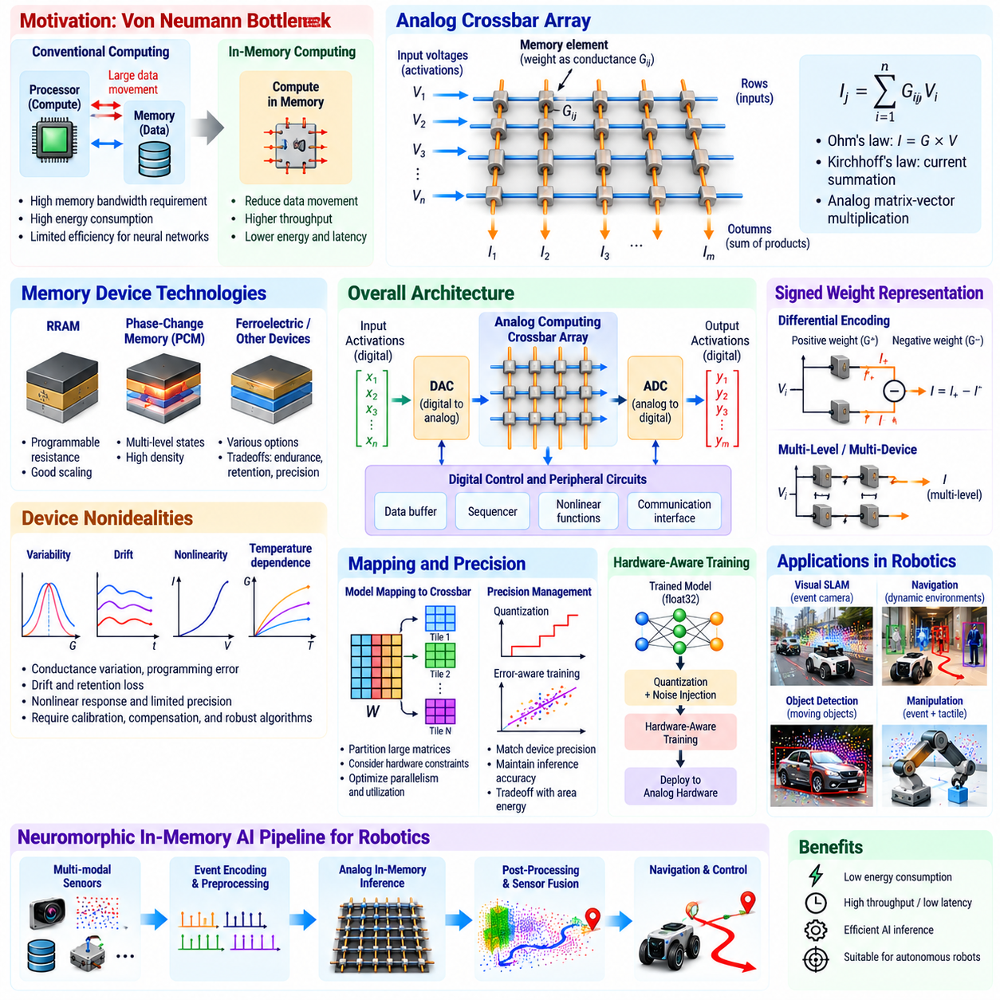{width="7.268055555555556in" height="7.268055555555556in"}

Analog AI in-memory computing represents an architectural approach that performs neural network operations directly within or near memory arrays. Conventional processors repeatedly transfer model parameters and intermediate data between memory and computational units, creating substantial energy and latency overhead. Analog in-memory computing reduces this movement by exploiting the physical properties of memory devices to execute mathematical operations, particularly matrix-vector multiplication.

The motivation for analog in-memory computing originates from the von Neumann bottleneck, where limited data-transfer bandwidth constrains computational efficiency. Modern neural networks require repeated multiply-accumulate operations across large collections of weights and activations. Moving these values can consume considerable energy compared with arithmetic itself. By integrating computation with storage, analog architectures seek to improve throughput, reduce memory traffic, and support energy-efficient artificial intelligence inference.

A fundamental building block is the analog crossbar array, which consists of intersecting conductive rows and columns connected through programmable memory elements. Each element represents a neural network weight through an electrical property such as conductance. Input values are applied as voltage signals along the rows, while resulting currents accumulate along the columns. This physical arrangement enables many multiplication and summation operations to occur simultaneously.

The mathematical foundation of crossbar computation follows Ohm\'s law and Kirchhoff\'s current law. A voltage applied across a memory element produces a current proportional to its conductance, implementing an analog multiplication. Currents from multiple elements combine along a shared conductor, approximating the summation required for matrix-vector multiplication. Nonideal circuit behavior introduces errors, so the resulting computation is an approximation rather than an exact digital arithmetic operation.

Resistive random-access memory, commonly called RRAM, is one candidate technology for analog computing arrays. Its programmable resistance states can encode neural network parameters within compact memory cells. Phase-change memory provides another approach by representing weights through material-dependent conductance states. Other research directions include ferroelectric devices and charge-storage technologies. Each option presents different tradeoffs involving endurance, retention, programming precision, and manufacturing complexity.

Representing signed neural network weights requires additional circuit techniques because physical conductance is inherently nonnegative. Differential encoding can assign positive and negative contributions to separate devices or conductance paths. The resulting currents are subtracted to recover the intended signed computation. This approach increases hardware resource requirements but supports common neural network operations. Alternative encoding strategies balance precision, circuit complexity, and energy consumption.

Analog computation introduces device variability that differs from deterministic digital arithmetic. Memory cells may exhibit conductance drift, programming errors, nonlinear responses, and temperature sensitivity. Repeated updates can also change device characteristics over time. These effects create discrepancies between intended neural network weights and their physical representations. Reliable operation therefore requires device characterization, calibration, compensation mechanisms, and algorithms tolerant of hardware imperfections.

Analog-to-digital converters and digital-to-analog converters form essential interfaces between analog computing arrays and conventional digital systems. Digital input activations must be translated into electrical signals, while accumulated analog outputs must be converted into numerical values. Converter resolution affects computational accuracy, energy consumption, and throughput. In many architectures, peripheral conversion circuits account for a substantial fraction of total power and silicon area.

The overall architecture typically combines analog crossbar arrays with digital control logic, local buffers, peripheral converters, and communication interfaces. Analog arrays accelerate selected matrix operations, while digital components manage nonlinear activation functions, data movement, sequencing, and unsupported operators. This hybrid organization reflects the fact that not every neural network computation maps efficiently onto analog circuits. System design must therefore optimize the division between analog and digital execution.

Neural network mapping determines how model parameters are distributed across physical memory arrays. Large weight matrices may require partitioning into smaller tiles because individual crossbars have limited dimensions and electrical constraints. Intermediate results from multiple arrays must then be combined. Mapping decisions influence parallelism, communication overhead, utilization, and numerical accuracy. Efficient compilation tools are essential for translating trained models into executable hardware configurations.

Precision management is a central challenge because analog memory devices cannot always represent arbitrary weights accurately. Quantization reduces numerical resolution to match available hardware states, while differential encoding and multiple-device representations can improve effective precision. Error-aware training can expose models to simulated hardware disturbances. These methods help preserve inference accuracy, although they introduce tradeoffs involving additional circuitry, computational complexity, and training effort.

Hardware-aware neural network training incorporates analog device limitations into model optimization. During training, simulated conductance noise, nonlinear transfer characteristics, and limited precision can approximate the behavior of the target processor. The resulting model may become less sensitive to physical implementation errors. However, simulation models must reflect actual device measurements, and performance should be validated on hardware rather than inferred solely from software experiments.

Analog in-memory computing is particularly relevant to robotic perception because convolutional and fully connected neural network layers contain extensive matrix operations. Image classification, object recognition, and feature extraction may benefit from reduced data movement when compatible models are deployed. Nevertheless, preprocessing, sensor interfaces, memory transfers, and postprocessing remain important contributors to latency and energy consumption. Accelerator-level improvements do not automatically translate into equivalent robot-level savings.

Autonomous mobile robots may use analog AI accelerators to support energy-efficient visual perception and environmental classification. A compact inference module could process camera features while conventional processors manage localization, navigation, and safety supervision. Such partitioning allows computationally intensive neural operations to benefit from specialized hardware without transferring deterministic control responsibilities to approximate analog circuits. Integration must preserve predictable timing and reliable data exchange.

Robotic manipulation offers another potential application through accelerated visual feature extraction, object classification, and learned grasp evaluation. Analog arrays may efficiently execute supported neural network layers used to interpret camera or tactile measurements. However, precision-sensitive force regulation and safety-critical actuator commands generally require carefully validated control mechanisms. Approximate inference outputs should be monitored for uncertainty and checked against physical operating constraints.

Thermal behavior and environmental reliability are important considerations for deploying analog computing hardware in robots. Conductance states and peripheral circuit characteristics can change with temperature, supply voltage, and device aging. Mobile robots may experience vibration, varying ambient conditions, and intermittent power availability. Calibration strategies and environmental qualification must account for these conditions to maintain acceptable inference accuracy throughout the intended operating lifetime.

Energy efficiency must be evaluated across the complete analog computing subsystem rather than only the memory array. Programming operations, signal conversion, buffering, communication, and digital processing all consume power. Crossbar computation may be highly efficient for suitable matrix operations, but peripheral overhead can reduce benefits for small networks or low-utilization workloads. Meaningful comparisons require consistent accuracy targets, operating conditions, and measurements of energy per completed inference.

Scalability depends on memory density, interconnect organization, device endurance, and the ability to coordinate multiple arrays. Large neural networks may exceed the capacity of a single analog accelerator, requiring tiled execution or transfers between computing modules. These operations introduce latency and energy costs that can diminish the advantages of local computation. Architectural research therefore focuses on efficient data placement, hierarchical communication, and scalable integration of analog processing resources.

Security and functional reliability must also be considered because physical device variations can affect neural inference behavior. Unexpected parameter drift, faulty memory cells, or corrupted calibration settings may alter model outputs without producing conventional software exceptions. Diagnostic mechanisms should monitor output consistency, hardware health, and operating conditions. For safety-related robotic applications, independent protection functions and validated fallback behavior remain necessary regardless of accelerator efficiency.

The future of analog AI in-memory computing lies in combining specialized memory-based acceleration with digital processors and neuromorphic computing elements. Analog arrays may execute dense neural operations efficiently, while event-driven processors handle sparse temporal information and conventional processors coordinate robotic tasks. Advances in device reliability, precision management, compilation tools, and manufacturing integration will determine whether these architectures deliver reproducible energy and latency advantages in practical AI-native robotic systems.

아날로그 인공지능 인메모리 컴퓨팅(Analog AI In-Memory Computing)은 메모리 배열(Memory Array)의 내부 또는 인접한 위치에서 신경망 연산(Neural Network Operation)을 직접 수행하는 아키텍처 접근 방식(Architectural Approach)이다. 기존 프로세서(Conventional Processor)는 모델 매개변수(Model Parameter)와 중간 데이터(Intermediate Data)를 메모리와 연산 장치(Computational Unit) 사이에서 반복적으로 전송하므로 상당한 에너지 소비와 지연시간 오버헤드(Latency Overhead)가 발생한다. 아날로그 인메모리 컴퓨팅은 메모리 소자(Memory Device)의 물리적 특성을 활용하여 수학적 연산, 특히 행렬-벡터 곱셈(Matrix-Vector Multiplication)을 실행함으로써 이러한 데이터 이동을 줄인다.

아날로그 인메모리 컴퓨팅의 개발 동기는 제한된 데이터 전송 대역폭(Data-Transfer Bandwidth)이 연산 효율성(Computational Efficiency)을 제약하는 폰 노이만 병목현상(Von Neumann Bottleneck)에서 비롯된다. 현대 신경망(Modern Neural Network)은 대규모 가중치(Weight)와 활성화 값(Activation)에 대해 반복적인 곱셈-누산 연산(Multiply-Accumulate Operation, MAC)을 수행해야 한다. 이러한 값을 이동하는 데 필요한 에너지는 산술 연산(Arithmetic Operation) 자체보다 상당히 클 수 있다. 아날로그 아키텍처(Analog Architecture)는 연산과 저장을 통합하여 처리량(Throughput)을 높이고, 메모리 트래픽(Memory Traffic)을 줄이며, 에너지 효율적인 인공지능 추론(Energy-Efficient AI Inference)을 지원하는 것을 목표로 한다.

기본 구성요소는 아날로그 크로스바 배열(Analog Crossbar Array)로, 프로그래밍 가능한 메모리 소자(Programmable Memory Element)를 통해 연결된 전도성 행과 열(Conductive Row and Column)의 교차 구조로 이루어진다. 각 소자는 전도도(Conductance)와 같은 전기적 특성(Electrical Property)을 통해 신경망 가중치를 표현한다. 입력값(Input Value)은 행을 따라 전압 신호(Voltage Signal)로 인가되고, 그 결과 발생하는 전류(Current)는 열을 따라 누적된다. 이러한 물리적 배열(Physical Arrangement)은 다수의 곱셈과 합산 연산(Multiplication and Summation Operation)을 동시에 수행할 수 있도록 한다.

크로스바 연산(Crossbar Computation)의 수학적 기반은 옴의 법칙(Ohm\'s Law)과 키르히호프 전류 법칙(Kirchhoff\'s Current Law)에 따른다. 메모리 소자에 인가된 전압은 전도도에 비례하는 전류를 생성하여 아날로그 곱셈(Analog Multiplication)을 구현한다. 여러 소자에서 발생한 전류는 공통 도체(Shared Conductor)를 따라 합산되어 행렬-벡터 곱셈에 필요한 합산 연산을 근사한다. 그러나 비이상적인 회로 동작(Nonideal Circuit Behavior)은 오차를 발생시키므로 결과 연산은 정확한 디지털 산술 연산(Exact Digital Arithmetic Operation)이 아니라 근사 연산(Approximate Computation)에 해당한다.

저항성 랜덤 액세스 메모리(Resistive Random-Access Memory, RRAM)는 아날로그 컴퓨팅 배열(Analog Computing Array)에 활용할 수 있는 후보 기술 중 하나이다. 프로그래밍 가능한 저항 상태(Programmable Resistance State)를 통해 소형 메모리 셀(Compact Memory Cell)에 신경망 매개변수를 부호화할 수 있다. 상변화 메모리(Phase-Change Memory, PCM)는 재료 특성에 따라 달라지는 전도도 상태(Conductance State)를 이용하여 가중치를 표현하는 또 다른 접근 방식이다. 이 밖에도 강유전체 소자(Ferroelectric Device)와 전하 저장 기술(Charge-Storage Technology)이 연구되고 있다. 각 기술은 내구성(Endurance), 데이터 유지 특성(Retention), 프로그래밍 정밀도(Programming Precision), 제조 복잡도(Manufacturing Complexity) 측면에서 서로 다른 장단점을 가진다.

부호가 있는 신경망 가중치(Signed Neural Network Weight)를 표현하려면 물리적 전도도가 본질적으로 음수가 될 수 없기 때문에 추가적인 회로 기술(Circuit Technique)이 필요하다. 차동 부호화(Differential Encoding)는 양의 기여(Positive Contribution)와 음의 기여(Negative Contribution)를 별도의 소자나 전도 경로(Conductance Path)에 할당할 수 있다. 이후 생성된 전류를 서로 차감하여 의도한 부호 연산(Signed Computation)을 복원한다. 이러한 방식은 하드웨어 자원 요구량(Hardware Resource Requirement)을 증가시키지만 일반적인 신경망 연산을 지원한다. 다른 부호화 전략(Encoding Strategy)은 정밀도(Precision), 회로 복잡도(Circuit Complexity), 에너지 소비(Energy Consumption) 사이의 균형을 조절한다.

아날로그 연산(Analog Computation)은 결정론적 디지털 산술 연산(Deterministic Digital Arithmetic)과 다른 형태의 소자 변동성(Device Variability)을 발생시킨다. 메모리 셀(Memory Cell)은 전도도 드리프트(Conductance Drift), 프로그래밍 오류(Programming Error), 비선형 응답(Nonlinear Response), 온도 민감성(Temperature Sensitivity)을 나타낼 수 있다. 반복적인 갱신(Repeated Update)은 시간이 지남에 따라 소자 특성을 변화시킬 수도 있다. 이러한 영향은 의도한 신경망 가중치와 실제 물리적 표현(Physical Representation) 사이의 불일치를 발생시킨다. 따라서 신뢰성 높은 동작을 위해서는 소자 특성 분석(Device Characterization), 보정(Calibration), 보상 메커니즘(Compensation Mechanism), 하드웨어 불완전성(Hardware Imperfection)에 강건한 알고리즘이 필요하다.

아날로그-디지털 변환기(Analog-to-Digital Converter, ADC)와 디지털-아날로그 변환기(Digital-to-Analog Converter, DAC)는 아날로그 컴퓨팅 배열과 기존 디지털 시스템(Digital System) 사이의 필수 인터페이스(Interface)를 구성한다. 디지털 입력 활성화 값(Digital Input Activation)은 전기 신호(Electrical Signal)로 변환되어야 하며, 누적된 아날로그 출력(Analog Output)은 수치 값(Numerical Value)으로 변환되어야 한다. 변환기 해상도(Converter Resolution)는 연산 정확도(Computational Accuracy), 에너지 소비, 처리량에 영향을 미친다. 많은 아키텍처에서 주변 변환 회로(Peripheral Conversion Circuit)는 전체 전력 소비(Total Power Consumption)와 실리콘 면적(Silicon Area)의 상당 부분을 차지한다.

전체 아키텍처는 일반적으로 아날로그 크로스바 배열, 디지털 제어 로직(Digital Control Logic), 지역 버퍼(Local Buffer), 주변 변환기(Peripheral Converter), 통신 인터페이스(Communication Interface)를 결합한다. 아날로그 배열은 선택된 행렬 연산(Matrix Operation)을 가속하고, 디지털 구성요소(Digital Component)는 비선형 활성화 함수(Nonlinear Activation Function), 데이터 이동(Data Movement), 실행 순서 제어(Sequencing), 지원되지 않는 연산자(Unsupported Operator)를 관리한다. 이러한 하이브리드 구성(Hybrid Organization)은 모든 신경망 연산이 아날로그 회로(Analog Circuit)에 효율적으로 매핑되는 것은 아니라는 사실을 반영한다. 따라서 시스템 설계(System Design)에서는 아날로그 실행과 디지털 실행 사이의 역할 분담을 최적화해야 한다.

신경망 매핑(Neural Network Mapping)은 모델 매개변수가 물리적 메모리 배열(Physical Memory Array)에 어떻게 분산되는지를 결정한다. 개별 크로스바(Crossbar)는 크기와 전기적 제약(Electrical Constraint)이 제한되어 있으므로 대규모 가중치 행렬(Weight Matrix)을 작은 타일(Tile)로 분할해야 할 수 있다. 이후 여러 배열에서 생성된 중간 결과(Intermediate Result)를 결합해야 한다. 매핑 결정(Mapping Decision)은 병렬성(Parallelism), 통신 오버헤드(Communication Overhead), 자원 활용률(Utilization), 수치 정확도(Numerical Accuracy)에 영향을 미친다. 학습된 모델을 실행 가능한 하드웨어 구성(Executable Hardware Configuration)으로 변환하기 위해서는 효율적인 컴파일 도구(Compilation Tool)가 필수적이다.

정밀도 관리(Precision Management)는 아날로그 메모리 소자가 임의의 가중치를 항상 정확하게 표현할 수 없기 때문에 핵심적인 과제이다. 양자화(Quantization)는 사용 가능한 하드웨어 상태(Hardware State)에 맞도록 수치 해상도(Numerical Resolution)를 줄이며, 차동 부호화와 다중 소자 표현(Multiple-Device Representation)은 유효 정밀도(Effective Precision)를 향상시킬 수 있다. 오류 인식 학습(Error-Aware Training)은 모델을 시뮬레이션된 하드웨어 교란(Simulated Hardware Disturbance)에 노출할 수 있다. 이러한 방법은 추론 정확도(Inference Accuracy)를 유지하는 데 도움이 되지만 추가 회로, 연산 복잡도(Computational Complexity), 학습 노력(Training Effort) 사이의 절충이 필요하다.

하드웨어 인식 신경망 학습(Hardware-Aware Neural Network Training)은 아날로그 소자의 한계를 모델 최적화(Model Optimization)에 반영한다. 학습 과정에서 시뮬레이션된 전도도 잡음(Conductance Noise), 비선형 전달 특성(Nonlinear Transfer Characteristic), 제한된 정밀도(Limited Precision)를 사용하여 목표 프로세서(Target Processor)의 동작을 근사할 수 있다. 이렇게 학습된 모델은 물리적 구현 오류(Physical Implementation Error)에 덜 민감해질 수 있다. 그러나 시뮬레이션 모델(Simulation Model)은 실제 소자 측정값(Actual Device Measurement)을 반영해야 하며, 성능은 소프트웨어 실험만으로 추론하지 않고 실제 하드웨어에서 검증해야 한다.

아날로그 인메모리 컴퓨팅은 합성곱 신경망 계층(Convolutional Neural Network Layer)과 완전연결 신경망 계층(Fully Connected Neural Network Layer)에 광범위한 행렬 연산이 포함되므로 로봇 인지(Robotic Perception)에 특히 적합하다. 이미지 분류(Image Classification), 객체 인식(Object Recognition), 특징 추출(Feature Extraction)은 호환 가능한 모델(Compatible Model)을 배포할 경우 데이터 이동 감소의 이점을 얻을 수 있다. 그러나 전처리(Preprocessing), 센서 인터페이스(Sensor Interface), 메모리 전송(Memory Transfer), 후처리(Postprocessing)도 지연시간과 에너지 소비에 중요한 영향을 미친다. 가속기 수준의 성능 향상(Accelerator-Level Improvement)이 자동으로 동일한 수준의 로봇 시스템 전체 성능 향상(Robot-Level Improvement)으로 이어지는 것은 아니다.

자율이동로봇(Autonomous Mobile Robot, AMR)은 에너지 효율적인 시각 인지(Visual Perception)와 환경 분류(Environmental Classification)를 지원하기 위해 아날로그 인공지능 가속기(Analog AI Accelerator)를 활용할 수 있다. 소형 추론 모듈(Compact Inference Module)은 카메라 특징(Camera Feature)을 처리하고, 기존 프로세서는 위치 추정(Localization), 내비게이션(Navigation), 안전 감독(Safety Supervision)을 관리할 수 있다. 이러한 역할 분담(Partitioning)은 결정론적 제어(Deterministic Control) 책임을 근사 아날로그 회로(Approximate Analog Circuit)에 이전하지 않으면서 연산 집약적인 신경망 작업(Computationally Intensive Neural Operation)에 특수 하드웨어를 활용할 수 있도록 한다. 통합 과정에서는 예측 가능한 타이밍(Predictable Timing)과 신뢰성 높은 데이터 교환(Reliable Data Exchange)을 유지해야 한다.

로봇 조작(Robotic Manipulation)은 가속화된 시각 특징 추출(Visual Feature Extraction), 객체 분류(Object Classification), 학습 기반 파지 평가(Learned Grasp Evaluation)를 통해 이점을 얻을 수 있는 또 다른 응용 분야이다. 아날로그 배열(Analog Array)은 카메라 또는 촉각 측정값(Tactile Measurement)을 해석하는 데 사용되는 지원 가능한 신경망 계층을 효율적으로 실행할 수 있다. 그러나 정밀도에 민감한 힘 조절(Precision-Sensitive Force Regulation)과 안전 필수 액추에이터 명령(Safety-Critical Actuator Command)에는 일반적으로 신중하게 검증된 제어 메커니즘(Validated Control Mechanism)이 필요하다. 근사 추론 출력(Approximate Inference Output)은 불확실성(Uncertainty)을 감시하고 물리적 운용 제약(Physical Operating Constraint)에 따라 검증해야 한다.

열적 동작(Thermal Behavior)과 환경 신뢰성(Environmental Reliability)은 아날로그 컴퓨팅 하드웨어를 로봇에 배포할 때 중요한 고려사항이다. 전도도 상태와 주변 회로 특성(Peripheral Circuit Characteristic)은 온도(Temperature), 공급 전압(Supply Voltage), 소자 노화(Device Aging)에 따라 변화할 수 있다. 이동 로봇(Mobile Robot)은 진동(Vibration), 변화하는 주변 환경 조건(Ambient Condition), 간헐적인 전력 공급(Intermittent Power Availability)에 노출될 수 있다. 보정 전략(Calibration Strategy)과 환경 적합성 검증(Environmental Qualification)은 의도한 운용 수명(Operating Lifetime) 동안 허용 가능한 추론 정확도를 유지할 수 있도록 이러한 조건을 고려해야 한다.

에너지 효율성은 메모리 배열만이 아니라 전체 아날로그 컴퓨팅 하위 시스템(Analog Computing Subsystem)을 대상으로 평가해야 한다. 프로그래밍 연산(Programming Operation), 신호 변환(Signal Conversion), 버퍼링(Buffering), 통신(Communication), 디지털 처리(Digital Processing)는 모두 전력을 소비한다. 크로스바 연산은 적합한 행렬 연산에서 매우 효율적일 수 있지만, 주변 회로 오버헤드(Peripheral Overhead)는 소규모 신경망(Small Neural Network)이나 낮은 자원 활용률의 작업 부하(Low-Utilization Workload)에서 이점을 감소시킬 수 있다. 의미 있는 비교를 위해서는 일관된 정확도 목표(Accuracy Target), 운용 조건(Operating Condition), 완료된 추론당 에너지(Energy per Completed Inference) 측정이 필요하다.

확장성(Scalability)은 메모리 밀도(Memory Density), 상호연결 구조(Interconnect Organization), 소자 내구성(Device Endurance), 여러 배열을 조정하는 능력에 따라 달라진다. 대규모 신경망(Large Neural Network)은 단일 아날로그 가속기(Analog Accelerator)의 용량을 초과할 수 있으므로 타일 기반 실행(Tiled Execution)이나 연산 모듈(Computing Module) 사이의 데이터 전송이 필요할 수 있다. 이러한 작업은 지연시간과 에너지 비용을 발생시켜 지역 연산(Local Computation)의 장점을 감소시킬 수 있다. 따라서 아키텍처 연구(Architectural Research)는 효율적인 데이터 배치(Data Placement), 계층적 통신(Hierarchical Communication), 아날로그 처리 자원(Analog Processing Resource)의 확장 가능한 통합에 중점을 둔다.

보안(Security)과 기능적 신뢰성(Functional Reliability)도 고려해야 한다. 물리적 소자 변동(Physical Device Variation)이 신경망 추론 동작에 영향을 미칠 수 있기 때문이다. 예상하지 못한 매개변수 드리프트(Parameter Drift), 결함이 있는 메모리 셀(Faulty Memory Cell), 손상된 보정 설정(Corrupted Calibration Setting)은 기존 소프트웨어 예외(Software Exception)를 발생시키지 않으면서 모델 출력(Model Output)을 변화시킬 수 있다. 진단 메커니즘(Diagnostic Mechanism)은 출력 일관성(Output Consistency), 하드웨어 상태(Hardware Health), 운용 조건을 감시해야 한다. 안전 관련 로봇 응용(Safety-Related Robotic Application)에서는 가속기 효율성과 관계없이 독립적인 보호 기능(Independent Protection Function)과 검증된 대체 동작(Validated Fallback Behavior)이 필요하다.

아날로그 인공지능 인메모리 컴퓨팅의 미래는 특수 메모리 기반 가속(Specialized Memory-Based Acceleration)을 디지털 프로세서(Digital Processor) 및 뉴로모픽 컴퓨팅 요소(Neuromorphic Computing Element)와 결합하는 데 있다. 아날로그 배열은 밀집 신경망 연산(Dense Neural Operation)을 효율적으로 실행하고, 이벤트 기반 프로세서(Event-Driven Processor)는 희소 시간 정보(Sparse Temporal Information)를 처리하며, 기존 프로세서는 로봇 작업(Robotic Task)을 조정할 수 있다. 소자 신뢰성(Device Reliability), 정밀도 관리, 컴파일 도구, 제조 통합(Manufacturing Integration)의 발전은 이러한 아키텍처가 실제 인공지능 네이티브 로봇 시스템(AI-Native Robotic System)에서 재현 가능한 에너지 및 지연시간 개선(Reproducible Energy and Latency Improvement)을 제공할 수 있는지를 결정할 것이다.

## 10.07. Ultra Low Power AI for Battery Robots [w/Code]

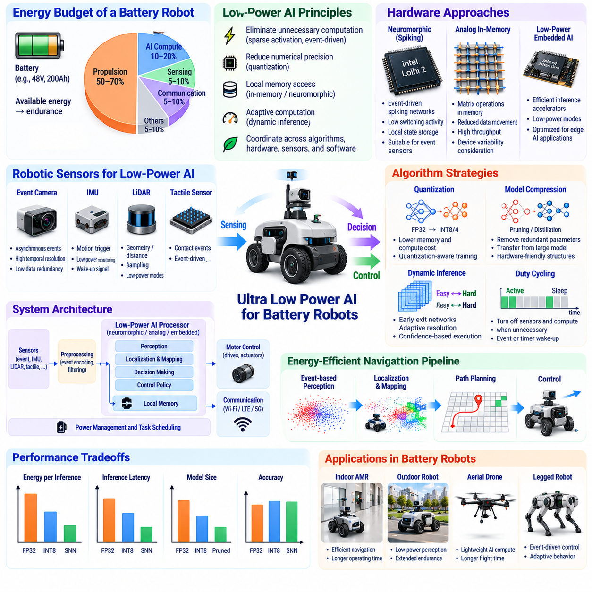{width="7.268055555555556in" height="7.268055555555556in"}

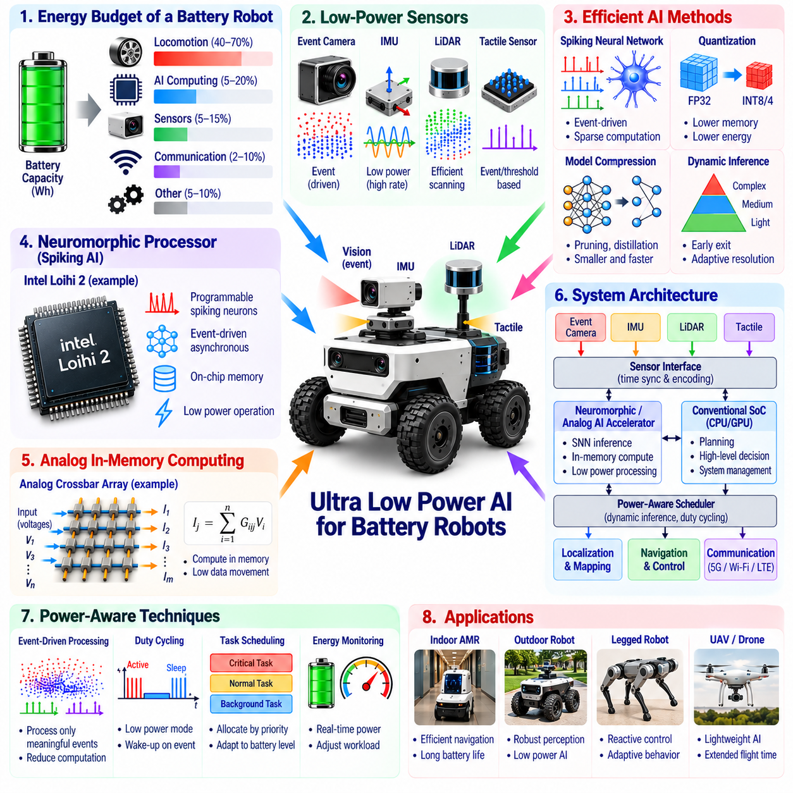{width="7.268055555555556in" height="7.268055555555556in"}

Ultra-low-power artificial intelligence enables battery-powered robots to perform perception, decision-making, and adaptive control while minimizing computational energy consumption. Mobile robots must distribute limited stored energy among propulsion, sensing, communication, and onboard computing. Although mechanical actuation often dominates total power demand, inefficient AI processing can significantly reduce operating endurance. Energy-aware intelligence therefore requires coordinated optimization across algorithms, processors, sensors, and system software.

The energy budget of a battery-powered robot depends on battery capacity, discharge characteristics, conversion losses, and operating conditions. Available energy must support both continuous electrical loads and intermittent computational peaks. AI workloads introduce variable power demands as sensing complexity and inference frequency change. Accurate energy modeling distinguishes average power, peak power, energy per inference, and total mission consumption to prevent unrealistic endurance estimates.

Conventional neural network inference requires repeated arithmetic operations and movement of model parameters between memory and processing units. These operations consume energy even when the surrounding environment changes very little. Ultra-low-power AI seeks to eliminate unnecessary computation through sparse activation, reduced numerical precision, local memory access, and event-driven execution. The objective is to preserve required intelligence performance while minimizing energy consumed per useful decision.

Spiking neural networks provide one approach to energy-efficient robotic intelligence by representing information through discrete neural events. Neurons update their states in response to incoming spikes rather than continuously processing dense activation arrays. When activity remains sparse, compatible neuromorphic processors can reduce switching activity and unnecessary computation. However, energy advantages depend on network design, event density, hardware implementation, and the overhead of converting sensor measurements into spikes.

Event-based cameras complement low-power neural processing by transmitting changes in visual intensity instead of complete image frames. Their asynchronous outputs can reduce redundant data generation in environments with limited motion. When combined with event-driven processing, these sensors may support efficient motion detection, obstacle recognition, and reactive navigation. Rapid movement or widespread illumination changes can nevertheless produce dense event streams that increase processing demand.

Neuromorphic processors integrate neural computation and local state storage to reduce repeated data transfers. Architectures such as Intel Loihi 2 support programmable spiking dynamics and event-oriented communication between processing cores. These features make them useful research platforms for evaluating sparse temporal intelligence. Practical energy savings must be measured against conventional embedded processors under equivalent task accuracy, latency, and complete system power conditions.

Analog in-memory computing offers another pathway toward reduced AI energy consumption. Programmable memory arrays can perform approximate matrix operations through electrical conductance and current accumulation. This approach reduces movement of neural network weights between storage and arithmetic units. However, signal converters, calibration circuits, peripheral logic, and device variability introduce additional costs. Overall efficiency depends on model compatibility and complete accelerator implementation.

Quantization reduces neural network precision to decrease memory requirements and arithmetic complexity. Converting floating-point parameters into lower-bit integer representations can improve execution efficiency on supported hardware. Quantization-aware training helps preserve accuracy by incorporating reduced precision during model optimization. The achievable energy savings depend on processor capabilities, memory access patterns, and the sensitivity of the robotic task to numerical errors.

Model compression further reduces computational requirements through pruning, parameter sharing, and knowledge distillation. Pruning removes selected network connections or channels, while distillation transfers useful behavior from a larger model into a smaller network. Structured compression can provide practical acceleration when hardware supports the resulting architecture. Unstructured sparsity may offer limited benefits without specialized execution mechanisms, making measured performance more important than parameter count alone.

Dynamic inference adjusts computational effort according to task difficulty and environmental conditions. A robot may use lightweight perception during predictable operation and activate more complex models when uncertainty increases. Early-exit networks, adaptive resolution, and selective sensor processing can reduce unnecessary inference. Such mechanisms require reliable confidence estimation because reducing computation during critical situations may compromise detection accuracy and operational safety.

Duty cycling reduces power consumption by placing sensors, processors, and communication interfaces into low-power states when full operation is unnecessary. Wake-up triggers may originate from timers, inertial sensors, proximity detectors, or dedicated low-power monitoring circuits. The system must account for wake-up latency, initialization energy, and lost observations during inactive periods. Safety-related sensing and control functions should remain available whenever required by the robot\'s operating conditions.

Power-aware task scheduling coordinates computational workloads with available energy and mission priorities. Noncritical mapping updates or background learning tasks may be deferred when battery reserves become limited. Time-sensitive obstacle detection and essential control functions receive higher scheduling priority. The scheduler must consider processor utilization, execution deadlines, thermal limits, and battery state rather than minimizing average computational power in isolation.

Dynamic voltage and frequency scaling adjusts processor operating conditions according to workload requirements. Lower clock frequencies and supply voltages can reduce power consumption when computational deadlines permit. However, extending execution time may increase total energy if leakage power or peripheral activity remains significant. Energy optimization therefore requires evaluating the relationship between operating frequency, execution duration, deadline satisfaction, and measured energy per completed task.

Sensor fusion can improve energy efficiency by allocating processing effort among complementary sensing modalities. Low-power inertial or proximity sensors may monitor routine conditions, while cameras and advanced perception models activate when additional information becomes necessary. Event-driven fusion can combine asynchronous observations without forcing every sensor into continuous high-rate operation. Accurate synchronization and uncertainty management remain essential for maintaining reliable environmental awareness.

Communication energy is another important consideration for distributed robotic intelligence. Wireless transmission of images, point clouds, or intermediate neural features may consume substantial energy depending on data volume and radio conditions. Onboard inference can reduce transmission requirements by communicating compact decisions or selected features. Cloud offloading is beneficial only when communication energy, network latency, remote processing costs, and connectivity risks are included in the evaluation.

Battery-aware AI must account for the nonlinear relationship between electrical load and usable battery capacity. High current demand, temperature variation, battery aging, and internal resistance can influence voltage stability and available energy. Battery management systems provide measurements such as state of charge, temperature, and current. AI scheduling policies can use these measurements to adjust workload intensity while preserving essential computing and control functions.

Thermal management is closely connected to low-power AI because processor temperature influences leakage current, reliability, and sustained computational performance. Compact robots often have limited space for cooling hardware, making passive thermal design especially important. Reducing unnecessary computation can lower heat generation and avoid thermal throttling. Nevertheless, thermal behavior must be evaluated together with ambient temperature, enclosure design, actuator heating, and processor utilization.

A practical software architecture separates energy monitoring, workload management, neural inference, and safety supervision. Runtime services collect processor power estimates, battery measurements, inference latency, and system operating states. Energy policies select appropriate models or processing frequencies within predefined constraints. Independent safety mechanisms ensure that computational energy reduction does not disable required monitoring, emergency responses, or deterministic control functions.

Evaluation of ultra-low-power robotic AI requires measurements beyond processor power consumption. Important metrics include energy per inference, end-to-end perception latency, task accuracy, memory usage, thermal stability, and mission endurance. Tests should reproduce representative sensor activity, navigation conditions, communication loads, and battery states. Comparisons must include preprocessing, memory transfers, idle power, and peripheral consumption to establish credible system-level energy improvements.

The future of ultra-low-power AI for battery robots will involve heterogeneous processors, adaptive neural models, event-driven sensors, and coordinated energy management. Neuromorphic and analog accelerators may handle selected workloads, while conventional processors maintain mission coordination and reliable control. Successful deployment will depend on measurable improvements in operational endurance without sacrificing perception quality, responsiveness, or safety. Energy efficiency must ultimately be evaluated as a property of the complete autonomous robotic system.

초저전력 인공지능(Ultra-Low-Power Artificial Intelligence)은 배터리 구동 로봇(Battery-Powered Robot)이 연산 에너지 소비(Computational Energy Consumption)를 최소화하면서 인지(Perception), 의사결정(Decision-Making), 적응형 제어(Adaptive Control)를 수행할 수 있도록 한다. 이동 로봇(Mobile Robot)은 제한된 저장 에너지(Stored Energy)를 추진(Propulsion), 센싱(Sensing), 통신(Communication), 온보드 컴퓨팅(Onboard Computing)에 분배해야 한다. 기계적 구동(Mechanical Actuation)이 전체 전력 수요(Total Power Demand)의 대부분을 차지하는 경우가 많지만, 비효율적인 인공지능 처리(AI Processing)도 운용 지속시간(Operating Endurance)을 크게 감소시킬 수 있다. 따라서 에너지 인식 지능(Energy-Aware Intelligence)은 알고리즘(Algorithm), 프로세서(Processor), 센서(Sensor), 시스템 소프트웨어(System Software) 전반에 걸친 통합 최적화(Coordinated Optimization)를 필요로 한다.

배터리 구동 로봇의 에너지 예산(Energy Budget)은 배터리 용량(Battery Capacity), 방전 특성(Discharge Characteristics), 전력 변환 손실(Conversion Losses), 운용 조건(Operating Conditions)에 따라 결정된다. 사용 가능한 에너지(Available Energy)는 지속적인 전기 부하(Continuous Electrical Load)와 간헐적인 연산 피크(Intermittent Computational Peak)를 모두 지원해야 한다. 인공지능 작업 부하(AI Workload)는 센싱 복잡도(Sensing Complexity)와 추론 빈도(Inference Frequency)가 변화함에 따라 가변적인 전력 수요(Variable Power Demand)를 발생시킨다. 정확한 에너지 모델링(Energy Modeling)은 평균 전력(Average Power), 최대 전력(Peak Power), 추론당 에너지(Energy per Inference), 전체 임무 에너지 소비(Total Mission Energy Consumption)를 구분하여 비현실적인 운용 지속시간 예측(Endurance Estimate)을 방지한다.

기존 신경망 추론(Conventional Neural Network Inference)은 반복적인 산술 연산(Arithmetic Operation)과 메모리 및 처리 장치(Processing Unit) 사이의 모델 매개변수(Model Parameter) 이동을 필요로 한다. 이러한 연산은 주변 환경의 변화가 거의 없는 경우에도 에너지를 소비한다. 초저전력 인공지능은 희소 활성화(Sparse Activation), 낮은 수치 정밀도(Reduced Numerical Precision), 지역 메모리 접근(Local Memory Access), 이벤트 기반 실행(Event-Driven Execution)을 통해 불필요한 연산을 제거하고자 한다. 목표는 요구되는 지능 성능(Intelligence Performance)을 유지하면서 유용한 의사결정당 에너지 소비(Energy per Useful Decision)를 최소화하는 것이다.

스파이킹 신경망(Spiking Neural Network, SNN)은 불연속적인 신경 이벤트(Discrete Neural Event)를 통해 정보를 표현함으로써 에너지 효율적인 로봇 지능(Energy-Efficient Robotic Intelligence)을 구현하는 접근 방식 중 하나이다. 뉴런(Neuron)은 밀집 활성화 배열(Dense Activation Array)을 지속적으로 처리하는 대신 입력 스파이크(Input Spike)에 반응하여 내부 상태(Internal State)를 갱신한다. 신경 활성도(Neural Activity)가 희소하게 유지되면 호환 가능한 뉴로모픽 프로세서(Neuromorphic Processor)는 스위칭 활동(Switching Activity)과 불필요한 연산을 줄일 수 있다. 그러나 에너지 절감 효과는 신경망 설계(Network Design), 이벤트 밀도(Event Density), 하드웨어 구현(Hardware Implementation), 센서 측정값을 스파이크로 변환하는 오버헤드(Conversion Overhead)에 따라 달라진다.

이벤트 기반 카메라(Event-Based Camera)는 전체 이미지 프레임(Image Frame) 대신 시각적 밝기 변화(Visual Intensity Change)를 전송하여 저전력 신경망 처리(Low-Power Neural Processing)를 보완한다. 비동기 출력(Asynchronous Output)은 움직임이 제한적인 환경에서 중복 데이터 생성(Redundant Data Generation)을 줄일 수 있다. 이러한 센서를 이벤트 기반 처리(Event-Driven Processing)와 결합하면 효율적인 움직임 감지(Motion Detection), 장애물 인식(Obstacle Recognition), 반응형 내비게이션(Reactive Navigation)을 지원할 수 있다. 그러나 빠른 움직임이나 광범위한 조명 변화(Widespread Illumination Change)는 밀집 이벤트 스트림(Dense Event Stream)을 생성하여 처리 요구량(Processing Demand)을 증가시킬 수 있다.

뉴로모픽 프로세서(Neuromorphic Processor)는 신경망 연산(Neural Computation)과 지역 상태 저장(Local State Storage)을 통합하여 반복적인 데이터 전송(Repeated Data Transfer)을 줄인다. 인텔 로이히 2(Intel Loihi 2)와 같은 아키텍처는 프로그래밍 가능한 스파이킹 동역학(Programmable Spiking Dynamics)과 처리 코어(Processing Core) 사이의 이벤트 중심 통신(Event-Oriented Communication)을 지원한다. 이러한 특징은 희소 시간 지능(Sparse Temporal Intelligence)을 평가하는 연구 플랫폼(Research Platform)으로 유용하다. 실제 에너지 절감 효과는 동등한 작업 정확도(Task Accuracy), 지연시간(Latency), 전체 시스템 전력 조건(Complete System Power Condition)에서 기존 임베디드 프로세서(Conventional Embedded Processor)와 비교하여 측정해야 한다.

아날로그 인메모리 컴퓨팅(Analog In-Memory Computing)은 인공지능 에너지 소비를 줄이기 위한 또 다른 접근 방식을 제공한다. 프로그래밍 가능한 메모리 배열(Programmable Memory Array)은 전기적 전도도(Electrical Conductance)와 전류 누적(Current Accumulation)을 통해 근사 행렬 연산(Approximate Matrix Operation)을 수행할 수 있다. 이러한 방식은 저장 장치(Storage Unit)와 산술 연산 장치(Arithmetic Unit) 사이의 신경망 가중치(Neural Network Weight) 이동을 줄인다. 그러나 신호 변환기(Signal Converter), 보정 회로(Calibration Circuit), 주변 제어 로직(Peripheral Logic), 소자 변동성(Device Variability)은 추가적인 비용을 발생시킨다. 전체 효율성(Overall Efficiency)은 모델 호환성(Model Compatibility)과 가속기 전체 구현(Complete Accelerator Implementation)에 따라 달라진다.

양자화(Quantization)는 신경망 정밀도(Neural Network Precision)를 낮추어 메모리 요구량(Memory Requirement)과 산술 연산 복잡도(Arithmetic Complexity)를 감소시킨다. 부동소수점 매개변수(Floating-Point Parameter)를 낮은 비트 수의 정수 표현(Lower-Bit Integer Representation)으로 변환하면 이를 지원하는 하드웨어에서 실행 효율성(Execution Efficiency)을 높일 수 있다. 양자화 인식 학습(Quantization-Aware Training)은 모델 최적화(Model Optimization) 과정에 감소된 정밀도를 반영하여 정확도를 유지하는 데 도움이 된다. 달성 가능한 에너지 절감 효과는 프로세서 기능(Processor Capability), 메모리 접근 패턴(Memory Access Pattern), 수치 오차(Numerical Error)에 대한 로봇 작업의 민감도(Task Sensitivity)에 따라 달라진다.

모델 압축(Model Compression)은 가지치기(Pruning), 매개변수 공유(Parameter Sharing), 지식 증류(Knowledge Distillation)를 통해 연산 요구량(Computational Requirement)을 더욱 감소시킨다. 가지치기는 선택된 신경망 연결(Network Connection)이나 채널(Channel)을 제거하며, 지식 증류는 대규모 모델(Large Model)의 유용한 동작을 소규모 신경망(Smaller Neural Network)으로 전달한다. 구조적 압축(Structured Compression)은 하드웨어가 결과 아키텍처(Resulting Architecture)를 지원할 경우 실질적인 가속 효과(Practical Acceleration)를 제공할 수 있다. 비구조적 희소성(Unstructured Sparsity)은 특수 실행 메커니즘(Specialized Execution Mechanism)이 없으면 효과가 제한적일 수 있으므로, 단순한 매개변수 수(Parameter Count)보다 실제 측정 성능(Measured Performance)이 중요하다.

동적 추론(Dynamic Inference)은 작업 난이도(Task Difficulty)와 환경 조건(Environmental Condition)에 따라 연산량(Computational Effort)을 조절한다. 로봇은 예측 가능한 운용 상황(Predictable Operation)에서는 경량 인지(Lightweight Perception)를 사용하고, 불확실성(Uncertainty)이 증가하면 더 복잡한 모델(Complex Model)을 활성화할 수 있다. 조기 종료 신경망(Early-Exit Network), 적응형 해상도(Adaptive Resolution), 선택적 센서 처리(Selective Sensor Processing)는 불필요한 추론을 줄일 수 있다. 그러나 중요한 상황에서 연산량을 감소시키면 감지 정확도(Detection Accuracy)와 운용 안전성(Operational Safety)이 저하될 수 있으므로 신뢰성 높은 신뢰도 추정(Confidence Estimation)이 필요하다.

듀티 사이클링(Duty Cycling)은 전체 동작이 필요하지 않을 때 센서, 프로세서, 통신 인터페이스(Communication Interface)를 저전력 상태(Low-Power State)로 전환하여 전력 소비를 줄인다. 웨이크업 트리거(Wake-Up Trigger)는 타이머(Timer), 관성 센서(Inertial Sensor), 근접 감지기(Proximity Detector), 전용 저전력 감시 회로(Dedicated Low-Power Monitoring Circuit)에서 발생할 수 있다. 시스템은 웨이크업 지연시간(Wake-Up Latency), 초기화 에너지(Initialization Energy), 비활성 구간(Inactive Period)에서 손실되는 관측값(Lost Observation)을 고려해야 한다. 안전 관련 센싱(Safety-Related Sensing)과 제어 기능(Control Function)은 로봇의 운용 조건에서 요구되는 경우 항상 사용 가능한 상태로 유지되어야 한다.

전력 인식 작업 스케줄링(Power-Aware Task Scheduling)은 사용 가능한 에너지(Available Energy)와 임무 우선순위(Mission Priority)에 따라 연산 작업 부하(Computational Workload)를 조정한다. 배터리 잔량(Battery Reserve)이 제한되면 중요도가 낮은 지도 갱신(Mapping Update)이나 백그라운드 학습 작업(Background Learning Task)을 연기할 수 있다. 시간에 민감한 장애물 감지(Time-Sensitive Obstacle Detection)와 필수 제어 기능(Essential Control Function)에는 더 높은 스케줄링 우선순위(Scheduling Priority)가 부여된다. 스케줄러(Scheduler)는 평균 연산 전력(Average Computational Power)만 최소화하는 것이 아니라 프로세서 활용률(Processor Utilization), 실행 마감시간(Execution Deadline), 열적 한계(Thermal Limit), 배터리 상태(Battery State)를 함께 고려해야 한다.

동적 전압 및 주파수 스케일링(Dynamic Voltage and Frequency Scaling, DVFS)은 작업 부하 요구사항(Workload Requirement)에 따라 프로세서의 운용 조건(Processor Operating Condition)을 조절한다. 연산 마감시간(Computational Deadline)이 허용하는 경우 낮은 클록 주파수(Clock Frequency)와 공급 전압(Supply Voltage)을 사용하여 전력 소비를 줄일 수 있다. 그러나 누설 전력(Leakage Power)이나 주변 장치 활성도(Peripheral Activity)가 상당한 수준으로 유지되면 실행시간(Execution Time)이 길어지면서 전체 에너지 소비가 증가할 수 있다. 따라서 에너지 최적화(Energy Optimization)는 동작 주파수(Operating Frequency), 실행시간, 마감시간 충족(Deadline Satisfaction), 완료된 작업당 측정 에너지(Measured Energy per Completed Task) 사이의 관계를 평가해야 한다.

센서 융합(Sensor Fusion)은 상호 보완적인 센싱 방식(Complementary Sensing Modality) 사이에 처리 자원을 배분하여 에너지 효율성을 향상시킬 수 있다. 저전력 관성 센서(Low-Power Inertial Sensor)나 근접 센서(Proximity Sensor)는 일상적인 조건을 감시하고, 추가 정보가 필요한 경우 카메라와 고급 인지 모델(Advanced Perception Model)을 활성화할 수 있다. 이벤트 기반 융합(Event-Driven Fusion)은 모든 센서를 지속적인 고속 동작(Continuous High-Rate Operation)으로 강제하지 않고도 비동기 관측값(Asynchronous Observation)을 결합할 수 있다. 신뢰성 높은 환경 인식(Environmental Awareness)을 유지하기 위해서는 정확한 동기화(Synchronization)와 불확실성 관리(Uncertainty Management)가 필수적이다.

통신 에너지(Communication Energy)는 분산 로봇 지능(Distributed Robotic Intelligence)에서 고려해야 할 또 다른 중요한 요소이다. 이미지(Image), 포인트 클라우드(Point Cloud), 중간 신경망 특징(Intermediate Neural Feature)의 무선 전송(Wireless Transmission)은 데이터 양(Data Volume)과 무선 통신 상태(Radio Condition)에 따라 상당한 에너지를 소비할 수 있다. 온보드 추론(Onboard Inference)은 압축된 의사결정 정보(Compact Decision)나 선택된 특징(Selected Feature)만 전송함으로써 통신 요구량(Transmission Requirement)을 줄일 수 있다. 클라우드 오프로딩(Cloud Offloading)은 통신 에너지, 네트워크 지연시간(Network Latency), 원격 처리 비용(Remote Processing Cost), 연결성 위험(Connectivity Risk)을 평가에 포함할 때에만 실질적인 이점을 판단할 수 있다.

배터리 인식 인공지능(Battery-Aware AI)은 전기 부하(Electrical Load)와 사용 가능한 배터리 용량(Usable Battery Capacity) 사이의 비선형 관계(Nonlinear Relationship)를 고려해야 한다. 높은 전류 수요(High Current Demand), 온도 변화(Temperature Variation), 배터리 노화(Battery Aging), 내부 저항(Internal Resistance)은 전압 안정성(Voltage Stability)과 사용 가능한 에너지에 영향을 미칠 수 있다. 배터리 관리 시스템(Battery Management System, BMS)은 충전 상태(State of Charge, SoC), 온도, 전류(Current) 등의 측정값을 제공한다. 인공지능 스케줄링 정책(AI Scheduling Policy)은 이러한 측정값을 활용하여 필수 연산과 제어 기능을 유지하면서 작업 부하 강도(Workload Intensity)를 조절할 수 있다.

열 관리(Thermal Management)는 프로세서 온도(Processor Temperature)가 누설 전류(Leakage Current), 신뢰성(Reliability), 지속 연산 성능(Sustained Computational Performance)에 영향을 미치므로 저전력 인공지능과 밀접하게 연결된다. 소형 로봇(Compact Robot)은 냉각 하드웨어(Cooling Hardware)를 설치할 공간이 제한적인 경우가 많아 수동 열 설계(Passive Thermal Design)가 특히 중요하다. 불필요한 연산을 줄이면 발열(Heat Generation)을 감소시키고 열 스로틀링(Thermal Throttling)을 방지할 수 있다. 그러나 열적 동작(Thermal Behavior)은 주변 온도(Ambient Temperature), 외함 설계(Enclosure Design), 액추에이터 발열(Actuator Heating), 프로세서 활용률을 함께 고려하여 평가해야 한다.

실용적인 소프트웨어 아키텍처(Practical Software Architecture)는 에너지 모니터링(Energy Monitoring), 작업 부하 관리(Workload Management), 신경망 추론(Neural Inference), 안전 감독(Safety Supervision)을 분리한다. 런타임 서비스(Runtime Service)는 프로세서 전력 추정값(Processor Power Estimate), 배터리 측정값(Battery Measurement), 추론 지연시간(Inference Latency), 시스템 운용 상태(System Operating State)를 수집한다. 에너지 정책(Energy Policy)은 사전에 정의된 제약조건(Predefined Constraint) 내에서 적절한 모델이나 처리 주파수(Processing Frequency)를 선택한다. 독립적인 안전 메커니즘(Independent Safety Mechanism)은 연산 에너지 절감이 필수 감시(Required Monitoring), 비상 대응(Emergency Response), 결정론적 제어(Deterministic Control) 기능을 비활성화하지 않도록 보장해야 한다.

초저전력 로봇 인공지능의 평가(Evaluation)는 프로세서 전력 소비(Processor Power Consumption) 이상의 측정을 필요로 한다. 주요 지표에는 추론당 에너지(Energy per Inference), 종단 간 인지 지연시간(End-to-End Perception Latency), 작업 정확도(Task Accuracy), 메모리 사용량(Memory Usage), 열적 안정성(Thermal Stability), 임무 지속시간(Mission Endurance)이 포함된다. 시험(Test)은 대표적인 센서 활성도(Sensor Activity), 내비게이션 조건(Navigation Condition), 통신 부하(Communication Load), 배터리 상태를 재현해야 한다. 신뢰할 수 있는 시스템 수준 에너지 개선(System-Level Energy Improvement)을 입증하려면 전처리(Preprocessing), 메모리 전송(Memory Transfer), 유휴 전력(Idle Power), 주변 장치 소비 전력(Peripheral Power Consumption)을 비교에 포함해야 한다.

배터리 구동 로봇을 위한 초저전력 인공지능의 미래는 이기종 프로세서(Heterogeneous Processor), 적응형 신경망 모델(Adaptive Neural Model), 이벤트 기반 센서(Event-Driven Sensor), 통합 에너지 관리(Coordinated Energy Management)를 중심으로 발전할 것이다. 뉴로모픽 가속기(Neuromorphic Accelerator)와 아날로그 가속기(Analog Accelerator)는 선택된 작업 부하를 처리하고, 기존 프로세서(Conventional Processor)는 임무 조정(Mission Coordination)과 신뢰성 높은 제어(Reliable Control)를 유지할 수 있다. 성공적인 배포(Successful Deployment)는 인지 품질(Perception Quality), 반응성(Responsiveness), 안전성(Safety)을 희생하지 않으면서 운용 지속시간을 측정 가능하게 개선하는 데 달려 있다. 궁극적으로 에너지 효율성(Energy Efficiency)은 개별 연산 장치가 아니라 전체 자율 로봇 시스템(Complete Autonomous Robotic System)의 특성으로 평가되어야 한다.

## 10.08. Neuromorphic Motor Control Bio Inspired [w/Code]

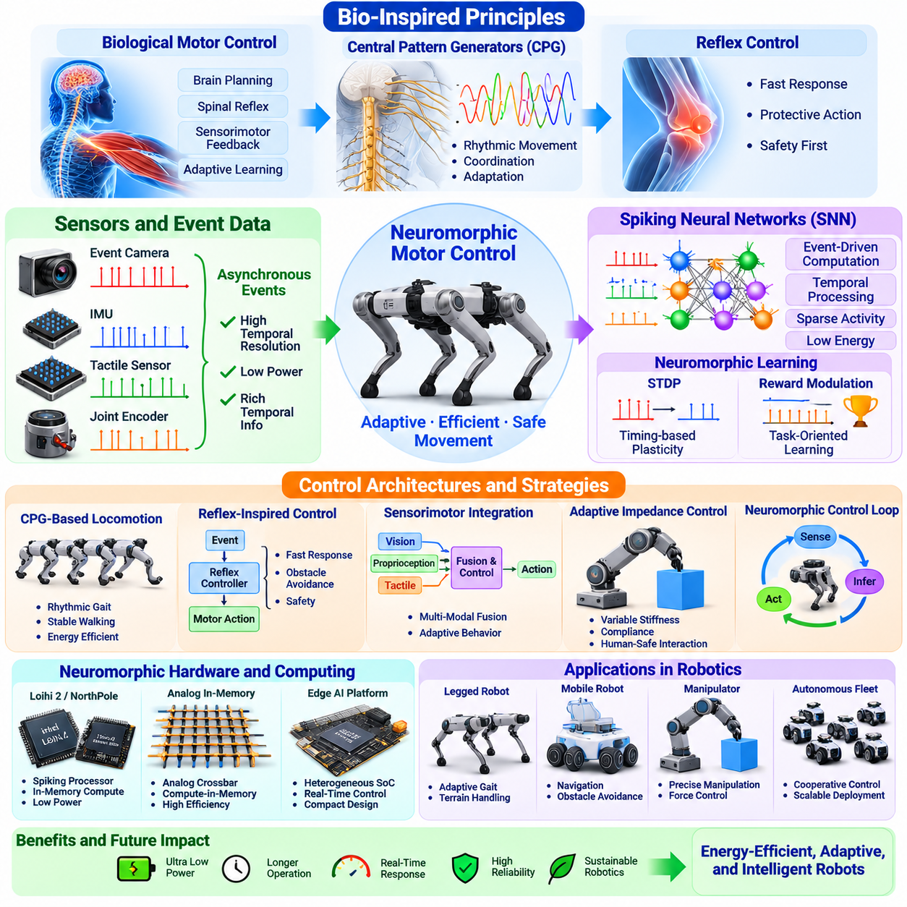{width="7.268055555555556in" height="7.268055555555556in"}

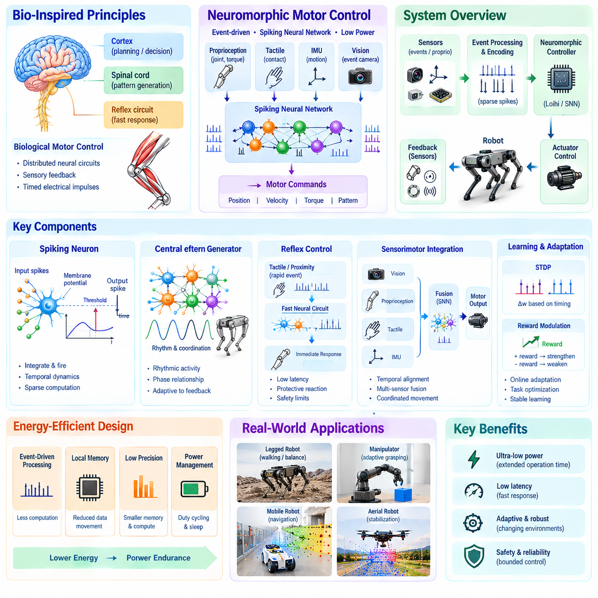{width="7.268055555555556in" height="7.268055555555556in"}

Neuromorphic motor control applies brain-inspired computation to the regulation of robotic movement through event-driven neural processing. Biological nervous systems coordinate muscles using distributed neural circuits, sensory feedback, and precisely timed electrical impulses. Neuromorphic controllers seek to reproduce selected computational principles of these systems while maintaining compatibility with engineered actuators. Their potential advantages include adaptive responses, sparse computation, and reduced control latency.

Conventional robotic motor control typically relies on periodic feedback loops that measure position, velocity, and torque before calculating actuator commands. Proportional-integral-derivative controllers and model-based algorithms provide predictable behavior under defined conditions. Neuromorphic control introduces asynchronous neural processing that responds to meaningful changes in sensory information. This approach can complement conventional control rather than replace the deterministic mechanisms required for safe operation.

Biological motor control provides several architectural principles relevant to robotics. The spinal cord contains circuits that coordinate rhythmic movements and rapid reflexes, while higher neural structures contribute to movement planning and adaptation. Sensory pathways continuously report muscle stretch, force, and body motion. Neuromorphic architectures can approximate this organization through hierarchical neural modules that separate rapid local reactions from slower supervisory decisions.

Spiking neural networks represent motor commands and sensory measurements through sequences of discrete events. Individual neurons integrate incoming spikes and produce outputs according to their membrane dynamics and firing thresholds. Temporal spike patterns can encode movement intensity, direction, or changes in actuator state. These representations enable asynchronous information exchange, although reliable motor control requires carefully designed decoding mechanisms and stable timing behavior.

Central pattern generators are biologically inspired neural circuits capable of producing rhythmic activity without requiring a new command for every movement cycle. In robotics, computational central pattern generators can coordinate repetitive behaviors such as walking, swimming, and crawling. Coupled neural oscillators establish phase relationships among joints or limbs. Sensory feedback modifies these oscillations to accommodate environmental disturbances and changing movement requirements.

Neuromorphic implementations of central pattern generators may use interconnected spiking neurons to generate coordinated actuator references. Excitatory and inhibitory connections establish rhythmic activation patterns, while neural parameters influence frequency, amplitude, and phase. The resulting spike activity must be translated into suitable motor commands. Stable locomotion also requires mechanical feedback because neural rhythm generation alone cannot guarantee balance or ground contact stability.

Reflex-inspired control provides another important application of neuromorphic computation. Biological reflex pathways generate rapid responses to sensory disturbances without requiring extensive centralized processing. Robotic equivalents may use event-driven neural circuits to detect unexpected contact, excessive joint displacement, or rapid load changes. These circuits can request immediate corrective actions, but protective responses must remain bounded by independently enforced actuator and safety limits.

Proprioceptive sensing supplies information about the internal mechanical state of the robot. Joint encoders, torque sensors, inertial measurement units, and tactile sensors can report position, velocity, loading, and contact conditions. Neuromorphic controllers may transform these measurements into spikes using threshold crossings or temporal encoding. Appropriate encoding preserves control-relevant information while avoiding excessive event generation caused by sensor noise.

Sensorimotor integration connects sensory events with neural activity that influences movement. For example, a walking robot can adjust limb timing when contact sensors indicate earlier or later ground engagement than expected. Spiking neural circuits may combine proprioceptive signals with visual motion information to modify movement commands. Such integration requires consistent timing, suitable feedback gains, and careful treatment of uncertain or delayed measurements.

Spike-timing-dependent plasticity is a biologically inspired learning mechanism that modifies synaptic connections according to the relative timing of neural activity. In motor control research, this principle can support adaptation to recurring sensory patterns or changing actuator responses. However, unconstrained online learning may destabilize physical movement. Practical implementations require bounded parameter updates, performance monitoring, and mechanisms for restoring validated controller settings.

Reward-modulated neural plasticity extends timing-based adaptation by incorporating signals associated with task success or failure. A robotic controller may adjust neural connections according to tracking error, energy consumption, or movement efficiency. Reinforcement learning can also optimize spiking control policies through simulated interaction. Because physical robots have limited tolerance for unsafe exploration, training should emphasize simulation, constrained optimization, and carefully supervised deployment.

Neuromorphic motor control can support adaptive impedance regulation, where actuator behavior changes according to interaction conditions. A compliant robot arm may reduce effective stiffness during human contact while maintaining sufficient force for manipulation. Event-driven neural modules can interpret tactile or force changes and recommend adjustments to impedance parameters. The underlying actuator controller must enforce stable interaction dynamics and verified limits on force, velocity, and position.

Humanoid locomotion presents a demanding application because coordinated movement involves many joints, changing contact conditions, and unstable body dynamics. Neuromorphic circuits may contribute rhythmic coordination, sensory adaptation, and rapid disturbance detection. Conventional whole-body control and balance estimation can provide complementary stability mechanisms. A hybrid architecture allows learned neural behavior to influence movement while preserving explicit physical constraints and recovery strategies.

Neuromorphic processors may improve computational efficiency by executing sparse neural activity through localized state updates and event-based communication. Their suitability depends on the relationship between neural firing rates, sensor event density, and required control frequency. Processor efficiency alone does not determine robotic energy savings because motor actuation often dominates power consumption. Evaluation must include the entire sensing, computing, communication, and actuation chain.

Real-time integration requires translating asynchronous neural outputs into commands compatible with motor drives and robotic middleware. A practical architecture may execute spiking neural modules alongside periodic servo loops. Timestamped event queues, bounded communication delays, and synchronized state estimates help maintain predictable behavior. Safety-critical functions should operate independently of experimental neural processing so that missed events or processor faults do not compromise actuator protection.

Simulation provides a controlled environment for developing and evaluating neuromorphic motor controllers. Neural dynamics can be coupled with rigid-body physics, actuator models, contact mechanics, and sensor noise. Researchers can examine how spike timing, synaptic parameters, and communication delays affect movement stability. Hardware-in-the-loop testing then exposes controllers to realistic timing and interface behavior before experiments involving unrestricted physical motion.

Benchmarking should measure movement accuracy, disturbance rejection, response latency, energy consumption, and recovery from unexpected contact. For locomotion, additional metrics include gait stability, speed, terrain adaptability, and cost of transport. Manipulation experiments may evaluate force regulation, trajectory tracking, and interaction safety. Comparisons with conventional controllers must use equivalent mechanical platforms, operating conditions, and performance requirements.

Reliability challenges include variable spike activity, sensor noise, neural parameter drift, and unpredictable responses to unfamiliar disturbances. Event bursts may increase computational demand, while sparse sensory input can leave important states insufficiently observed. Fault detection and confidence monitoring should identify degraded control behavior. When neural outputs become unreliable, the system should transition to a validated conventional controller or another defined safe operating mode.

A practical development roadmap begins with offline evaluation of spiking motor models and their interaction with simulated actuators. Subsequent stages introduce proprioceptive feedback, rhythmic coordination, adaptive learning, and hybrid control integration. Experimental deployment should progress from constrained laboratory mechanisms to increasingly complex robotic systems. Each stage requires documented evidence of stability, timing performance, energy efficiency, and operational safety.

The future of bio-inspired neuromorphic motor control will likely involve hybrid architectures combining spiking neural circuits, adaptive learning, conventional feedback control, and physics-based planning. Neuromorphic modules may provide efficient temporal processing and biologically inspired adaptation, while established control methods maintain predictable actuator behavior. Successful adoption will depend on demonstrating measurable advantages in responsiveness, robustness, and energy efficiency without sacrificing safety or reproducibility.

뉴로모픽 모터 제어(Neuromorphic Motor Control)는 이벤트 기반 신경망 처리(Event-Driven Neural Processing)를 통해 로봇 움직임(Robotic Movement)을 조절하는 데 뇌 모방 연산(Brain-Inspired Computation)을 적용하는 기술이다. 생물학적 신경계(Biological Nervous System)는 분산 신경 회로(Distributed Neural Circuit), 감각 피드백(Sensory Feedback), 정밀하게 조절된 전기적 임펄스(Electrical Impulse)를 이용하여 근육을 협응 제어한다. 뉴로모픽 제어기(Neuromorphic Controller)는 공학적으로 설계된 액추에이터(Engineered Actuator)와의 호환성을 유지하면서 이러한 시스템의 일부 연산 원리(Computational Principle)를 재현하고자 한다. 잠재적인 장점으로는 적응형 반응(Adaptive Response), 희소 연산(Sparse Computation), 제어 지연시간 감소(Reduced Control Latency)가 있다.

기존 로봇 모터 제어(Conventional Robotic Motor Control)는 일반적으로 위치(Position), 속도(Velocity), 토크(Torque)를 측정한 후 액추에이터 명령(Actuator Command)을 계산하는 주기적 피드백 루프(Periodic Feedback Loop)에 의존한다. 비례-적분-미분 제어기(Proportional-Integral-Derivative Controller, PID Controller)와 모델 기반 알고리즘(Model-Based Algorithm)은 정의된 조건에서 예측 가능한 동작(Predictable Behavior)을 제공한다. 뉴로모픽 제어(Neuromorphic Control)는 감각 정보(Sensory Information)의 의미 있는 변화에 반응하는 비동기 신경망 처리(Asynchronous Neural Processing)를 도입한다. 이러한 접근 방식은 안전한 운용에 필요한 결정론적 메커니즘(Deterministic Mechanism)을 대체하기보다는 기존 제어를 보완할 수 있다.

생물학적 운동 제어(Biological Motor Control)는 로봇공학에 적용할 수 있는 여러 아키텍처 원리(Architectural Principle)를 제공한다. 척수(Spinal Cord)에는 리듬 운동(Rhythmic Movement)과 빠른 반사 반응(Rapid Reflex)을 협응하는 회로가 존재하며, 상위 신경 구조(Higher Neural Structure)는 운동 계획(Movement Planning)과 적응(Adaptation)에 기여한다. 감각 경로(Sensory Pathway)는 근육 신장(Muscle Stretch), 힘(Force), 신체 움직임(Body Motion)을 지속적으로 전달한다. 뉴로모픽 아키텍처(Neuromorphic Architecture)는 빠른 국소 반응(Local Reaction)과 상대적으로 느린 상위 감독 의사결정(Supervisory Decision)을 분리하는 계층적 신경망 모듈(Hierarchical Neural Module)을 통해 이러한 구성을 근사할 수 있다.

스파이킹 신경망(Spiking Neural Network, SNN)은 불연속적인 이벤트 시퀀스(Discrete Event Sequence)를 통해 모터 명령(Motor Command)과 감각 측정값(Sensory Measurement)을 표현한다. 개별 뉴런(Neuron)은 입력 스파이크(Input Spike)를 통합하고 막 동역학(Membrane Dynamics)과 발화 임계값(Firing Threshold)에 따라 출력을 생성한다. 시간적 스파이크 패턴(Temporal Spike Pattern)은 움직임 강도(Movement Intensity), 방향(Direction), 액추에이터 상태 변화(Actuator State Change)를 부호화할 수 있다. 이러한 표현은 비동기 정보 교환(Asynchronous Information Exchange)을 가능하게 하지만, 신뢰성 높은 모터 제어에는 신중하게 설계된 디코딩 메커니즘(Decoding Mechanism)과 안정적인 타이밍 동작(Stable Timing Behavior)이 필요하다.

중앙 패턴 생성기(Central Pattern Generator, CPG)는 모든 움직임 주기(Movement Cycle)에 새로운 명령을 요구하지 않고도 리듬 활동(Rhythmic Activity)을 생성할 수 있는 생물학적 영감 기반 신경 회로(Biologically Inspired Neural Circuit)이다. 로봇공학에서 계산적 중앙 패턴 생성기(Computational Central Pattern Generator)는 보행(Walking), 수영(Swimming), 기어가기(Crawling)와 같은 반복 동작(Repetitive Behavior)을 협응할 수 있다. 결합된 신경 진동자(Coupled Neural Oscillator)는 관절(Joint)이나 사지(Limb) 사이의 위상 관계(Phase Relationship)를 형성한다. 감각 피드백은 환경 교란(Environmental Disturbance)과 변화하는 움직임 요구사항(Movement Requirement)에 적응하도록 이러한 진동을 수정한다.

중앙 패턴 생성기의 뉴로모픽 구현(Neuromorphic Implementation)은 상호 연결된 스파이킹 뉴런(Interconnected Spiking Neuron)을 이용하여 협응된 액추에이터 기준값(Coordinated Actuator Reference)을 생성할 수 있다. 흥분성 연결(Excitatory Connection)과 억제성 연결(Inhibitory Connection)은 리듬 활성화 패턴(Rhythmic Activation Pattern)을 형성하며, 신경망 매개변수(Neural Parameter)는 주파수(Frequency), 진폭(Amplitude), 위상(Phase)에 영향을 미친다. 생성된 스파이크 활동(Spike Activity)은 적절한 모터 명령으로 변환되어야 한다. 신경망의 리듬 생성만으로는 균형(Balance)이나 지면 접촉 안정성(Ground Contact Stability)을 보장할 수 없으므로 안정적인 보행(Stable Locomotion)에는 기계적 피드백(Mechanical Feedback)도 필요하다.

반사 모방 제어(Reflex-Inspired Control)는 뉴로모픽 연산의 또 다른 중요한 응용 분야이다. 생물학적 반사 경로(Biological Reflex Pathway)는 광범위한 중앙 집중식 처리(Centralized Processing) 없이 감각 교란(Sensory Disturbance)에 빠르게 반응한다. 이에 대응하는 로봇 시스템은 이벤트 기반 신경 회로를 이용하여 예상하지 못한 접촉(Unexpected Contact), 과도한 관절 변위(Excessive Joint Displacement), 급격한 부하 변화(Rapid Load Change)를 감지할 수 있다. 이러한 회로는 즉각적인 보정 동작(Corrective Action)을 요청할 수 있지만, 보호 반응(Protective Response)은 독립적으로 강제되는 액추에이터 제한(Actuator Limit)과 안전 한계(Safety Limit) 내에서 유지되어야 한다.

고유수용감각(Proprioceptive Sensing)은 로봇 내부의 기계적 상태(Internal Mechanical State)에 관한 정보를 제공한다. 관절 엔코더(Joint Encoder), 토크 센서(Torque Sensor), 관성 측정 장치(Inertial Measurement Unit, IMU), 촉각 센서(Tactile Sensor)는 위치, 속도, 부하 상태(Loading Condition), 접촉 조건(Contact Condition)을 전달할 수 있다. 뉴로모픽 제어기는 임계값 통과(Threshold Crossing)나 시간 부호화(Temporal Encoding)를 사용하여 이러한 측정값을 스파이크로 변환할 수 있다. 적절한 부호화(Encoding)는 센서 잡음(Sensor Noise)으로 인한 과도한 이벤트 생성을 방지하면서 제어에 필요한 정보(Control-Relevant Information)를 보존한다.

감각운동 통합(Sensorimotor Integration)은 감각 이벤트(Sensory Event)를 움직임에 영향을 미치는 신경 활동(Neural Activity)과 연결한다. 예를 들어 보행 로봇(Walking Robot)은 접촉 센서(Contact Sensor)가 예상보다 빠르거나 늦은 지면 접촉(Ground Engagement)을 감지하면 사지의 움직임 타이밍(Limb Timing)을 조절할 수 있다. 스파이킹 신경 회로는 고유수용감각 신호(Proprioceptive Signal)와 시각적 움직임 정보(Visual Motion Information)를 결합하여 움직임 명령을 수정할 수 있다. 이러한 통합에는 일관된 타이밍(Consistent Timing), 적절한 피드백 이득(Feedback Gain), 불확실하거나 지연된 측정값(Uncertain or Delayed Measurement)에 대한 신중한 처리가 필요하다.

스파이크 타이밍 의존 가소성(Spike-Timing-Dependent Plasticity, STDP)은 신경 활동의 상대적 타이밍(Relative Timing)에 따라 시냅스 연결(Synaptic Connection)을 수정하는 생물학적 영감 기반 학습 메커니즘(Biologically Inspired Learning Mechanism)이다. 모터 제어 연구(Motor Control Research)에서 이러한 원리는 반복적인 감각 패턴(Recurring Sensory Pattern)이나 변화하는 액추에이터 반응(Actuator Response)에 대한 적응을 지원할 수 있다. 그러나 제약 없는 온라인 학습(Unconstrained Online Learning)은 물리적 움직임(Physical Movement)을 불안정하게 만들 수 있다. 실제 구현에는 제한된 매개변수 갱신(Bounded Parameter Update), 성능 모니터링(Performance Monitoring), 검증된 제어기 설정(Validated Controller Setting)을 복원하는 메커니즘이 필요하다.

보상 조절 신경 가소성(Reward-Modulated Neural Plasticity)은 작업 성공(Task Success)이나 실패(Task Failure)와 관련된 신호를 통합하여 타이밍 기반 적응(Timing-Based Adaptation)을 확장한다. 로봇 제어기는 추적 오차(Tracking Error), 에너지 소비(Energy Consumption), 움직임 효율성(Movement Efficiency)에 따라 신경 연결(Neural Connection)을 조정할 수 있다. 강화학습(Reinforcement Learning)은 시뮬레이션 상호작용(Simulated Interaction)을 통해 스파이킹 제어 정책(Spiking Control Policy)을 최적화할 수도 있다. 물리적 로봇은 안전하지 않은 탐색(Unsafe Exploration)을 허용할 수 있는 범위가 제한적이므로 학습에서는 시뮬레이션(Simulation), 제약 최적화(Constrained Optimization), 신중하게 감독되는 배포(Supervised Deployment)를 중시해야 한다.

뉴로모픽 모터 제어는 상호작용 조건(Interaction Condition)에 따라 액추에이터 동작이 변화하는 적응형 임피던스 조절(Adaptive Impedance Regulation)을 지원할 수 있다. 유연한 로봇 팔(Compliant Robot Arm)은 조작(Manipulation)에 필요한 충분한 힘을 유지하면서 사람과 접촉할 때 유효 강성(Effective Stiffness)을 낮출 수 있다. 이벤트 기반 신경망 모듈(Event-Driven Neural Module)은 촉각이나 힘의 변화(Tactile or Force Change)를 해석하여 임피던스 매개변수(Impedance Parameter)의 조정을 권고할 수 있다. 하위 액추에이터 제어기(Underlying Actuator Controller)는 안정적인 상호작용 동역학(Stable Interaction Dynamics)과 힘, 속도, 위치에 대한 검증된 제한값(Verified Limit)을 강제해야 한다.

휴머노이드 보행(Humanoid Locomotion)은 다수의 관절, 변화하는 접촉 조건(Changing Contact Condition), 불안정한 신체 동역학(Unstable Body Dynamics)이 관여하므로 매우 까다로운 응용 분야이다. 뉴로모픽 회로(Neuromorphic Circuit)는 리듬 협응(Rhythmic Coordination), 감각 적응(Sensory Adaptation), 빠른 교란 감지(Rapid Disturbance Detection)에 기여할 수 있다. 기존 전신 제어(Whole-Body Control)와 균형 상태 추정(Balance Estimation)은 이를 보완하는 안정성 메커니즘(Stability Mechanism)을 제공할 수 있다. 하이브리드 아키텍처(Hybrid Architecture)는 명시적인 물리적 제약(Explicit Physical Constraint)과 복구 전략(Recovery Strategy)을 유지하면서 학습된 신경망 동작(Learned Neural Behavior)이 움직임에 영향을 미치도록 한다.

뉴로모픽 프로세서(Neuromorphic Processor)는 지역 상태 갱신(Localized State Update)과 이벤트 기반 통신(Event-Based Communication)을 통해 희소 신경 활동(Sparse Neural Activity)을 실행함으로써 연산 효율성(Computational Efficiency)을 향상시킬 수 있다. 적합성은 신경 발화율(Neural Firing Rate), 센서 이벤트 밀도(Sensor Event Density), 요구 제어 주파수(Required Control Frequency) 사이의 관계에 따라 달라진다. 모터 구동(Motor Actuation)이 전력 소비(Power Consumption)의 대부분을 차지하는 경우가 많으므로 프로세서 효율성만으로 로봇의 에너지 절감 효과를 판단할 수는 없다. 평가에는 센싱(Sensing), 연산(Computing), 통신(Communication), 구동(Actuation)을 포함하는 전체 처리 체인(Processing Chain)이 포함되어야 한다.

실시간 통합(Real-Time Integration)에는 비동기 신경망 출력(Asynchronous Neural Output)을 모터 드라이브(Motor Drive) 및 로봇 미들웨어(Robotic Middleware)와 호환되는 명령으로 변환하는 과정이 필요하다. 실용적인 아키텍처에서는 스파이킹 신경망 모듈(Spiking Neural Module)을 주기적 서보 루프(Periodic Servo Loop)와 병렬로 실행할 수 있다. 타임스탬프가 포함된 이벤트 큐(Timestamped Event Queue), 제한된 통신 지연(Bounded Communication Delay), 동기화된 상태 추정값(Synchronized State Estimate)은 예측 가능한 동작을 유지하는 데 도움이 된다. 안전 필수 기능(Safety-Critical Function)은 실험적인 신경망 처리(Experimental Neural Processing)와 독립적으로 동작해야 하며, 이벤트 누락(Missed Event)이나 프로세서 결함(Processor Fault)이 액추에이터 보호(Actuator Protection)를 손상시키지 않도록 해야 한다.

시뮬레이션(Simulation)은 뉴로모픽 모터 제어기를 개발하고 평가하기 위한 통제된 환경(Controlled Environment)을 제공한다. 신경망 동역학(Neural Dynamics)은 강체 물리학(Rigid-Body Physics), 액추에이터 모델(Actuator Model), 접촉 역학(Contact Mechanics), 센서 잡음(Sensor Noise)과 결합할 수 있다. 연구자는 스파이크 타이밍(Spike Timing), 시냅스 매개변수(Synaptic Parameter), 통신 지연(Communication Delay)이 움직임 안정성(Movement Stability)에 미치는 영향을 분석할 수 있다. 이후 하드웨어 인 더 루프 시험(Hardware-in-the-Loop Testing, HIL Testing)을 통해 제한 없는 물리적 움직임(Unrestricted Physical Motion)을 수반하는 실험에 앞서 실제에 가까운 타이밍과 인터페이스 동작(Interface Behavior)을 검증할 수 있다.

벤치마킹(Benchmarking)은 움직임 정확도(Movement Accuracy), 교란 억제(Disturbance Rejection), 응답 지연시간(Response Latency), 에너지 소비(Energy Consumption), 예상하지 못한 접촉 이후의 복구(Recovery from Unexpected Contact)를 측정해야 한다. 보행(Locomotion)의 추가 평가 지표에는 보행 안정성(Gait Stability), 속도(Speed), 지형 적응성(Terrain Adaptability), 이동 에너지 비용(Cost of Transport)이 포함된다. 조작 실험(Manipulation Experiment)은 힘 조절(Force Regulation), 궤적 추종(Trajectory Tracking), 상호작용 안전성(Interaction Safety)을 평가할 수 있다. 기존 제어기(Conventional Controller)와 비교할 때는 동등한 기계 플랫폼(Mechanical Platform), 운용 조건(Operating Condition), 성능 요구사항(Performance Requirement)을 사용해야 한다.

신뢰성 문제(Reliability Challenge)에는 가변적인 스파이크 활동(Variable Spike Activity), 센서 잡음, 신경망 매개변수 드리프트(Neural Parameter Drift), 익숙하지 않은 교란(Unfamiliar Disturbance)에 대한 예측하기 어려운 반응이 포함된다. 이벤트 버스트(Event Burst)는 연산 요구량(Computational Demand)을 증가시킬 수 있으며, 희소 감각 입력(Sparse Sensory Input)은 중요한 상태를 충분히 관측하지 못하게 할 수 있다. 결함 감지(Fault Detection)와 신뢰도 모니터링(Confidence Monitoring)은 성능이 저하된 제어 동작(Degraded Control Behavior)을 식별해야 한다. 신경망 출력이 신뢰할 수 없는 상태가 되면 시스템은 검증된 기존 제어기(Validated Conventional Controller) 또는 사전에 정의된 안전 운용 모드(Safe Operating Mode)로 전환해야 한다.

실용적인 개발 로드맵(Practical Development Roadmap)은 스파이킹 모터 모델(Spiking Motor Model)과 시뮬레이션된 액추에이터(Simulated Actuator) 사이의 상호작용을 오프라인으로 평가(Offline Evaluation)하는 단계에서 시작한다. 이후 고유수용감각 피드백(Proprioceptive Feedback), 리듬 협응(Rhythmic Coordination), 적응형 학습(Adaptive Learning), 하이브리드 제어 통합(Hybrid Control Integration)을 도입한다. 실험적 배포(Experimental Deployment)는 제약된 실험실 기구(Constrained Laboratory Mechanism)에서 점차 복잡한 로봇 시스템(Complex Robotic System)으로 확대되어야 한다. 각 단계에서는 안정성(Stability), 타이밍 성능(Timing Performance), 에너지 효율성(Energy Efficiency), 운용 안전성(Operational Safety)에 대한 문서화된 검증 근거(Documented Evidence)가 필요하다.

생물학적 영감 기반 뉴로모픽 모터 제어(Bio-Inspired Neuromorphic Motor Control)의 미래는 스파이킹 신경 회로(Spiking Neural Circuit), 적응형 학습(Adaptive Learning), 기존 피드백 제어(Conventional Feedback Control), 물리 기반 계획(Physics-Based Planning)을 결합하는 하이브리드 아키텍처를 중심으로 발전할 가능성이 높다. 뉴로모픽 모듈(Neuromorphic Module)은 효율적인 시간 정보 처리(Temporal Processing)와 생물학적 영감 기반 적응(Biologically Inspired Adaptation)을 제공하고, 기존 제어 기법(Established Control Method)은 예측 가능한 액추에이터 동작(Predictable Actuator Behavior)을 유지할 수 있다. 성공적인 도입(Successful Adoption)은 안전성(Safety)이나 재현성(Reproducibility)을 희생하지 않으면서 반응성(Responsiveness), 강건성(Robustness), 에너지 효율성에서 측정 가능한 이점(Measurable Advantage)을 입증하는 데 달려 있다.

## 10.09. Neuromorphic AI Benchmark for Robotics

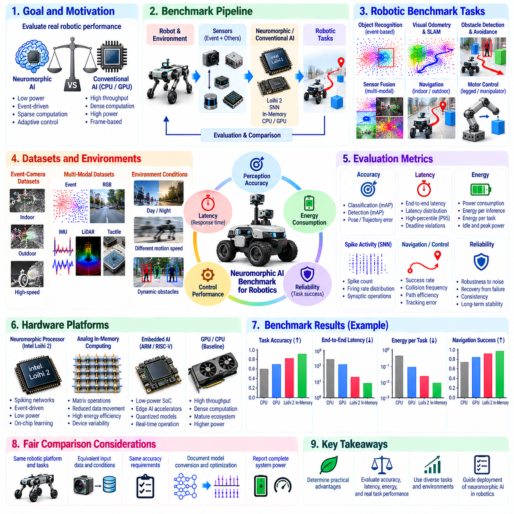{width="7.268055555555556in" height="7.268055555555556in"}

Neuromorphic AI benchmarking for robotics establishes systematic methods for evaluating brain-inspired processors, spiking neural networks, and event-driven sensing architectures under realistic operating conditions. Unlike conventional AI benchmarks that emphasize prediction accuracy and computational throughput, robotic evaluation must consider sensing latency, energy consumption, control responsiveness, and physical task performance. A meaningful benchmark connects computational efficiency with measurable improvements in autonomous behavior.

The primary objective is to determine whether neuromorphic architectures provide practical advantages over conventional CPU, GPU, and embedded AI accelerators. Comparisons must use equivalent robotic tasks, comparable input information, and clearly defined performance requirements. A processor that consumes less power but produces delayed or inaccurate decisions may not improve robotic operation. Benchmark design must therefore evaluate accuracy, latency, energy, reliability, and task completion together.

Benchmark workloads should represent the diversity of computations required by autonomous robots. Relevant tasks include event-based object recognition, visual odometry, obstacle detection, sensor fusion, navigation, and motor control. Each workload exercises different aspects of neuromorphic hardware, including spike communication, neural state updates, memory access, and temporal processing. A balanced benchmark suite prevents conclusions based exclusively on workloads favorable to a particular architecture.

Spiking neural network evaluation requires metrics that reflect both prediction quality and temporal behavior. Classification accuracy alone cannot describe how rapidly a network responds to incoming events or how many spikes it generates. Additional measurements include decision latency, spike count, firing-rate distribution, and synaptic operation estimates. These measurements reveal whether sparse neural activity produces useful computational savings without compromising task accuracy.

Energy consumption is a central metric because neuromorphic systems frequently target battery-powered robots. Measurements should distinguish processor energy, sensor energy, memory activity, communication overhead, and supporting electronics. Energy per inference is useful for isolated workloads, while energy per successful task better represents robotic performance. Power measurements must include idle operation, event bursts, initialization, and any external host processor required for execution.

Latency benchmarking should measure the complete path from sensor observation to actionable robotic output. Event acquisition, preprocessing, neural execution, output decoding, communication, and control integration all contribute to response time. Average latency may conceal occasional delays that threaten real-time operation. Consequently, latency distributions, high-percentile response times, and deadline violations are important indicators of practical suitability.

Event-camera benchmarks must account for the relationship between environmental activity and computational demand. Static scenes may generate few events, while rapid movement or changing illumination can produce dense event streams. Evaluation datasets should include varying motion speeds, lighting conditions, contrast levels, and scene complexity. Reporting event rates alongside accuracy and power consumption helps explain how system performance changes with sensory workload.

Neuromorphic visual odometry and SLAM benchmarks require accurate reference trajectories and representative environmental conditions. Absolute trajectory error, relative pose error, tracking continuity, and recovery after localization failure provide useful performance indicators. Mapping quality and loop-closure consistency may also be evaluated. Tests should include rapid camera motion, low illumination, repetitive environments, and dynamic obstacles to expose weaknesses in event-based estimation.

Robotic navigation benchmarks connect perception performance with actual movement outcomes. A system may achieve excellent event classification accuracy yet fail to avoid obstacles because of delayed decisions or unstable control integration. Evaluation should therefore measure collision frequency, path efficiency, navigation success, response to moving obstacles, and computational energy. Identical robot dynamics and environmental conditions are necessary for meaningful comparisons between competing approaches.

Neuromorphic motor control requires benchmarks that emphasize closed-loop stability and physical interaction. Relevant measurements include trajectory tracking error, disturbance rejection, control response latency, and energy consumed during movement. Legged robots may additionally require gait stability, recovery performance, and cost of transport. These metrics should distinguish improvements from neural computation from those caused by mechanical design or actuator characteristics.

Hardware comparisons must account for differences in computational precision, neural model structure, and supported operations. A neuromorphic processor may execute spiking networks efficiently, while a GPU may favor dense tensor operations. Direct comparisons of nominal operations per second can therefore be misleading. A fair methodology evaluates equivalent task objectives and accuracy constraints while documenting model conversion, preprocessing, and hardware-specific optimization.

Dataset selection strongly influences benchmark validity. Conventional frame-based datasets may require conversion into spike trains, introducing encoding overhead and potentially changing temporal information. Native event-camera datasets preserve asynchronous measurements but may not cover all relevant robotic conditions. Benchmark designers should document sensor characteristics, recording procedures, ground-truth quality, and dataset limitations. Training and evaluation sequences must remain appropriately separated.

Reproducibility requires precise documentation of hardware configurations, software versions, neural parameters, and measurement procedures. Spiking network behavior can depend on simulation time steps, neuron models, synaptic delays, and event scheduling. Small implementation differences may change accuracy, latency, or spike activity. Publishing configurations, evaluation scripts, and measurement boundaries allows independent researchers to verify results and identify the causes of performance differences.

Simulation-based benchmarking provides repeatable conditions for exploring large numbers of neural configurations and robotic scenarios. Simulated environments can generate controlled motion patterns, sensor disturbances, and environmental changes. However, simulated spike activity and processor energy estimates may not accurately represent physical hardware. Hardware-in-the-loop testing and real-robot experiments are therefore necessary to validate timing behavior, energy measurements, and control performance.

Robustness testing examines system behavior under sensor noise, event loss, communication delays, and unexpected environmental conditions. Neuromorphic processors may experience variable computational loads as spike activity changes. Fault injection can reveal whether neural inference remains stable when events are delayed or corrupted. Benchmarks should evaluate degradation patterns, fault detection, recovery mechanisms, and the ability to transition into safe operating modes when required.

Scalability benchmarks investigate how performance changes as neural network size, sensor resolution, event rate, and robotic workload increase. Larger networks may require additional processing cores, memory resources, or interconnect communication. Increasing event density can reduce the advantages of sparse computation. Measurements should identify saturation points, communication bottlenecks, memory constraints, and the relationship between resource utilization and achievable real-time performance.

A comprehensive benchmark framework should distinguish component-level measurements from integrated robotic outcomes. Component tests characterize neural execution, memory efficiency, and processor power, while system tests measure perception quality, navigation success, and operational endurance. Both perspectives are necessary because improvements in isolated computation may disappear after integration. Results should report explicit tradeoffs rather than compressing all performance dimensions into a single score.

Statistical evaluation strengthens benchmark credibility by accounting for variability across trials, environments, and hardware operating conditions. Repeated experiments should report central performance estimates, dispersion, and confidence intervals where appropriate. Thermal state, battery voltage, sensor activity, and background processing can influence measured results. Consistent experimental protocols and transparent reporting help distinguish genuine architectural advantages from incidental measurement differences.

A practical benchmarking roadmap begins with standardized neural workloads and controlled power measurements, then progresses toward event-driven perception and closed-loop robotic experiments. Subsequent stages introduce dynamic environments, multiple sensing modalities, and extended mission testing. Each stage should establish acceptance criteria for accuracy, latency, energy, and reliability. Benchmark results can then guide processor selection, model optimization, and deployment decisions.

The future of neuromorphic AI benchmarking will depend on shared datasets, transparent measurement protocols, and representative robotic applications. Hybrid systems combining spiking processors, analog accelerators, and conventional computing require evaluation across heterogeneous execution environments. Progress should be measured by reproducible improvements in autonomous task performance, responsiveness, and energy efficiency rather than isolated hardware claims. Such benchmarks will provide an evidence-based foundation for deploying neuromorphic intelligence in practical robotic systems.

로봇공학을 위한 뉴로모픽 인공지능 벤치마킹(Neuromorphic AI Benchmarking for Robotics)은 실제 운용 조건(Realistic Operating Conditions)에서 뇌 모방 프로세서(Brain-Inspired Processor), 스파이킹 신경망(Spiking Neural Network), 이벤트 기반 센싱 아키텍처(Event-Driven Sensing Architecture)를 평가하기 위한 체계적인 방법을 확립한다. 예측 정확도(Prediction Accuracy)와 연산 처리량(Computational Throughput)을 강조하는 기존 인공지능 벤치마크(Conventional AI Benchmark)와 달리, 로봇 평가(Robotic Evaluation)에서는 센싱 지연시간(Sensing Latency), 에너지 소비(Energy Consumption), 제어 반응성(Control Responsiveness), 물리적 작업 성능(Physical Task Performance)을 고려해야 한다. 의미 있는 벤치마크는 연산 효율성(Computational Efficiency)을 자율 동작(Autonomous Behavior)의 측정 가능한 개선과 연결한다.

주요 목표는 뉴로모픽 아키텍처(Neuromorphic Architecture)가 기존 중앙처리장치(Central Processing Unit, CPU), 그래픽처리장치(Graphics Processing Unit, GPU), 임베디드 인공지능 가속기(Embedded AI Accelerator)에 비해 실질적인 이점을 제공하는지 판단하는 것이다. 비교에는 동등한 로봇 작업(Equivalent Robotic Task), 비교 가능한 입력 정보(Comparable Input Information), 명확하게 정의된 성능 요구사항(Performance Requirement)을 사용해야 한다. 전력 소비가 적더라도 의사결정이 지연되거나 부정확한 프로세서는 로봇 운용 성능을 향상시키지 못할 수 있다. 따라서 벤치마크 설계(Benchmark Design)는 정확도(Accuracy), 지연시간(Latency), 에너지(Energy), 신뢰성(Reliability), 작업 완료(Task Completion)를 종합적으로 평가해야 한다.

벤치마크 작업 부하(Benchmark Workload)는 자율 로봇(Autonomous Robot)에 필요한 다양한 연산을 대표해야 한다. 관련 작업에는 이벤트 기반 객체 인식(Event-Based Object Recognition), 시각 주행거리 추정(Visual Odometry), 장애물 감지(Obstacle Detection), 센서 융합(Sensor Fusion), 내비게이션(Navigation), 모터 제어(Motor Control)가 포함된다. 각 작업 부하는 스파이크 통신(Spike Communication), 신경 상태 갱신(Neural State Update), 메모리 접근(Memory Access), 시간 정보 처리(Temporal Processing) 등 뉴로모픽 하드웨어(Neuromorphic Hardware)의 서로 다른 특성을 평가한다. 균형 잡힌 벤치마크 모음(Balanced Benchmark Suite)은 특정 아키텍처에 유리한 작업 부하만을 기반으로 결론을 도출하는 것을 방지한다.

스파이킹 신경망(Spiking Neural Network, SNN)의 평가에는 예측 품질(Prediction Quality)과 시간적 동작(Temporal Behavior)을 모두 반영하는 지표가 필요하다. 분류 정확도(Classification Accuracy)만으로는 신경망이 입력 이벤트(Incoming Event)에 얼마나 빠르게 반응하는지 또는 얼마나 많은 스파이크(Spike)를 생성하는지 설명할 수 없다. 추가적인 측정 항목에는 의사결정 지연시간(Decision Latency), 스파이크 수(Spike Count), 발화율 분포(Firing-Rate Distribution), 시냅스 연산 추정값(Synaptic Operation Estimate)이 포함된다. 이러한 측정값은 희소 신경 활동(Sparse Neural Activity)이 작업 정확도를 저하시키지 않으면서 유용한 연산 절감(Computational Saving)을 제공하는지 보여준다.

에너지 소비(Energy Consumption)는 뉴로모픽 시스템(Neuromorphic System)이 배터리 구동 로봇(Battery-Powered Robot)을 주요 대상으로 하는 경우가 많기 때문에 핵심 평가 지표이다. 측정에서는 프로세서 에너지(Processor Energy), 센서 에너지(Sensor Energy), 메모리 활동(Memory Activity), 통신 오버헤드(Communication Overhead), 지원 전자회로(Supporting Electronics)를 구분해야 한다. 추론당 에너지(Energy per Inference)는 개별 작업 부하에 유용하며, 성공적인 작업당 에너지(Energy per Successful Task)는 로봇 성능을 더 잘 나타낸다. 전력 측정(Power Measurement)에는 유휴 동작(Idle Operation), 이벤트 버스트(Event Burst), 초기화(Initialization), 실행에 필요한 외부 호스트 프로세서(External Host Processor)를 포함해야 한다.

지연시간 벤치마킹(Latency Benchmarking)은 센서 관측(Sensor Observation)부터 실행 가능한 로봇 출력(Actionable Robotic Output)까지의 전체 경로를 측정해야 한다. 이벤트 획득(Event Acquisition), 전처리(Preprocessing), 신경망 실행(Neural Execution), 출력 디코딩(Output Decoding), 통신(Communication), 제어 통합(Control Integration)은 모두 응답시간(Response Time)에 영향을 미친다. 평균 지연시간(Average Latency)은 실시간 운용(Real-Time Operation)을 위협하는 간헐적인 지연을 감출 수 있다. 따라서 지연시간 분포(Latency Distribution), 상위 백분위 응답시간(High-Percentile Response Time), 마감시간 위반(Deadline Violation)은 실제 적용 적합성(Practical Suitability)을 판단하는 중요한 지표이다.

이벤트 카메라 벤치마크(Event-Camera Benchmark)는 환경 활동(Environmental Activity)과 연산 요구량(Computational Demand) 사이의 관계를 고려해야 한다. 정적인 장면(Static Scene)은 적은 수의 이벤트를 생성할 수 있지만, 빠른 움직임이나 조명 변화(Changing Illumination)는 밀집 이벤트 스트림(Dense Event Stream)을 발생시킬 수 있다. 평가 데이터셋(Evaluation Dataset)에는 다양한 움직임 속도(Motion Speed), 조명 조건(Lighting Condition), 대비 수준(Contrast Level), 장면 복잡도(Scene Complexity)가 포함되어야 한다. 정확도 및 전력 소비와 함께 이벤트 발생률(Event Rate)을 보고하면 감각 작업 부하(Sensory Workload)에 따른 시스템 성능 변화를 설명하는 데 도움이 된다.

뉴로모픽 시각 주행거리 추정(Neuromorphic Visual Odometry)과 동시 위치 추정 및 지도 작성(Simultaneous Localization and Mapping, SLAM)의 벤치마크에는 정확한 기준 궤적(Reference Trajectory)과 대표적인 환경 조건이 필요하다. 절대 궤적 오차(Absolute Trajectory Error, ATE), 상대 자세 오차(Relative Pose Error, RPE), 추적 연속성(Tracking Continuity), 위치 추정 실패 후 복구(Recovery After Localization Failure)는 유용한 성능 지표이다. 지도 품질(Mapping Quality)과 루프 폐쇄 일관성(Loop-Closure Consistency)도 평가할 수 있다. 시험에는 빠른 카메라 움직임(Rapid Camera Motion), 저조도(Low Illumination), 반복적인 환경(Repetitive Environment), 동적 장애물(Dynamic Obstacle)을 포함하여 이벤트 기반 추정(Event-Based Estimation)의 약점을 드러내야 한다.

로봇 내비게이션 벤치마크(Robotic Navigation Benchmark)는 인지 성능(Perception Performance)을 실제 움직임 결과(Actual Movement Outcome)와 연결한다. 시스템이 우수한 이벤트 분류 정확도(Event Classification Accuracy)를 달성하더라도 의사결정 지연(Delayed Decision)이나 불안정한 제어 통합(Unstable Control Integration)으로 인해 장애물 회피(Obstacle Avoidance)에 실패할 수 있다. 따라서 평가에서는 충돌 빈도(Collision Frequency), 경로 효율성(Path Efficiency), 내비게이션 성공률(Navigation Success), 이동 장애물 대응(Response to Moving Obstacles), 연산 에너지(Computational Energy)를 측정해야 한다. 경쟁 접근 방식(Competing Approach)을 의미 있게 비교하려면 동일한 로봇 동역학(Robot Dynamics)과 환경 조건이 필요하다.

뉴로모픽 모터 제어(Neuromorphic Motor Control)에는 폐루프 안정성(Closed-Loop Stability)과 물리적 상호작용(Physical Interaction)을 강조하는 벤치마크가 필요하다. 관련 측정 항목에는 궤적 추종 오차(Trajectory Tracking Error), 교란 억제(Disturbance Rejection), 제어 응답 지연시간(Control Response Latency), 움직임 중 소비 에너지(Energy Consumed During Movement)가 포함된다. 다족 보행 로봇(Legged Robot)은 추가적으로 보행 안정성(Gait Stability), 복구 성능(Recovery Performance), 이동 에너지 비용(Cost of Transport)을 평가해야 할 수 있다. 이러한 지표는 신경망 연산(Neural Computation)에서 발생한 개선 효과와 기계 설계(Mechanical Design) 또는 액추에이터 특성(Actuator Characteristic)에서 비롯된 효과를 구분해야 한다.

하드웨어 비교(Hardware Comparison)에서는 연산 정밀도(Computational Precision), 신경망 모델 구조(Neural Model Structure), 지원 연산(Supported Operation)의 차이를 고려해야 한다. 뉴로모픽 프로세서(Neuromorphic Processor)는 스파이킹 신경망을 효율적으로 실행할 수 있지만, GPU는 밀집 텐서 연산(Dense Tensor Operation)에 더 적합할 수 있다. 따라서 명목상 초당 연산 횟수(Nominal Operations per Second)를 직접 비교하면 잘못된 결론을 도출할 수 있다. 공정한 방법론(Fair Methodology)은 동등한 작업 목표(Equivalent Task Objective)와 정확도 제약(Accuracy Constraint)을 기준으로 평가하면서 모델 변환(Model Conversion), 전처리, 하드웨어별 최적화(Hardware-Specific Optimization)를 문서화해야 한다.

데이터셋 선택(Dataset Selection)은 벤치마크 타당성(Benchmark Validity)에 큰 영향을 미친다. 기존 프레임 기반 데이터셋(Frame-Based Dataset)은 스파이크 열(Spike Train)로 변환해야 할 수 있으며, 이 과정에서 부호화 오버헤드(Encoding Overhead)가 발생하고 시간 정보(Temporal Information)가 변경될 가능성이 있다. 원시 이벤트 카메라 데이터셋(Native Event-Camera Dataset)은 비동기 측정값(Asynchronous Measurement)을 보존하지만, 모든 로봇 운용 조건을 포함하지는 못할 수 있다. 벤치마크 설계자는 센서 특성(Sensor Characteristic), 기록 절차(Recording Procedure), 실측 기준값 품질(Ground-Truth Quality), 데이터셋 한계(Dataset Limitation)를 문서화해야 한다. 학습 시퀀스(Training Sequence)와 평가 시퀀스(Evaluation Sequence)는 적절하게 분리되어야 한다.

재현성(Reproducibility)을 확보하려면 하드웨어 구성(Hardware Configuration), 소프트웨어 버전(Software Version), 신경망 매개변수(Neural Parameter), 측정 절차(Measurement Procedure)를 정확하게 문서화해야 한다. 스파이킹 신경망의 동작은 시뮬레이션 시간 간격(Simulation Time Step), 뉴런 모델(Neuron Model), 시냅스 지연(Synaptic Delay), 이벤트 스케줄링(Event Scheduling)에 따라 달라질 수 있다. 구현상의 작은 차이도 정확도, 지연시간, 스파이크 활동(Spike Activity)을 변화시킬 수 있다. 구성 정보(Configuration), 평가 스크립트(Evaluation Script), 측정 범위(Measurement Boundary)를 공개하면 독립적인 연구자가 결과를 검증하고 성능 차이의 원인을 식별할 수 있다.

시뮬레이션 기반 벤치마킹(Simulation-Based Benchmarking)은 다양한 신경망 구성(Neural Configuration)과 로봇 시나리오(Robotic Scenario)를 탐색하기 위한 반복 가능한 조건을 제공한다. 시뮬레이션 환경(Simulated Environment)은 제어된 움직임 패턴(Motion Pattern), 센서 교란(Sensor Disturbance), 환경 변화(Environmental Change)를 생성할 수 있다. 그러나 시뮬레이션된 스파이크 활동과 프로세서 에너지 추정값(Processor Energy Estimate)이 실제 하드웨어(Physical Hardware)를 정확하게 반영하지 못할 수 있다. 따라서 타이밍 동작(Timing Behavior), 에너지 측정값(Energy Measurement), 제어 성능(Control Performance)을 검증하려면 하드웨어 인 더 루프 시험(Hardware-in-the-Loop Testing, HIL Testing)과 실제 로봇 실험(Real-Robot Experiment)이 필요하다.

강건성 시험(Robustness Testing)은 센서 잡음(Sensor Noise), 이벤트 손실(Event Loss), 통신 지연(Communication Delay), 예상하지 못한 환경 조건(Unexpected Environmental Condition)에서 시스템의 동작을 조사한다. 뉴로모픽 프로세서는 스파이크 활동의 변화에 따라 가변적인 연산 부하(Variable Computational Load)를 경험할 수 있다. 결함 주입(Fault Injection)은 이벤트가 지연되거나 손상되었을 때 신경망 추론(Neural Inference)이 안정적으로 유지되는지 확인할 수 있다. 벤치마크에서는 성능 저하 패턴(Degradation Pattern), 결함 감지(Fault Detection), 복구 메커니즘(Recovery Mechanism), 필요할 때 안전 운용 모드(Safe Operating Mode)로 전환하는 능력을 평가해야 한다.

확장성 벤치마크(Scalability Benchmark)는 신경망 크기(Neural Network Size), 센서 해상도(Sensor Resolution), 이벤트 발생률(Event Rate), 로봇 작업 부하(Robotic Workload)가 증가할 때 성능이 어떻게 변화하는지 조사한다. 대규모 신경망(Larger Neural Network)은 추가적인 처리 코어(Processing Core), 메모리 자원(Memory Resource), 상호연결 통신(Interconnect Communication)을 필요로 할 수 있다. 이벤트 밀도가 증가하면 희소 연산(Sparse Computation)의 장점이 감소할 수 있다. 측정에서는 포화 지점(Saturation Point), 통신 병목현상(Communication Bottleneck), 메모리 제약(Memory Constraint), 자원 활용률(Resource Utilization)과 달성 가능한 실시간 성능(Achievable Real-Time Performance) 사이의 관계를 식별해야 한다.

포괄적인 벤치마크 프레임워크(Comprehensive Benchmark Framework)는 구성요소 수준 측정(Component-Level Measurement)과 통합 로봇 결과(Integrated Robotic Outcome)를 구분해야 한다. 구성요소 시험(Component Test)은 신경망 실행(Neural Execution), 메모리 효율성(Memory Efficiency), 프로세서 전력(Processor Power)을 특성화하고, 시스템 시험(System Test)은 인지 품질(Perception Quality), 내비게이션 성공률(Navigation Success), 운용 지속시간(Operational Endurance)을 측정한다. 개별 연산(Isolated Computation)의 개선 효과가 시스템 통합(System Integration) 이후 사라질 수 있으므로 두 관점 모두 필요하다. 결과는 모든 성능 차원을 단일 점수(Single Score)로 압축하기보다는 명시적인 절충 관계(Explicit Tradeoff)를 보고해야 한다.

통계적 평가(Statistical Evaluation)는 반복 시험(Repeated Trial), 환경(Environment), 하드웨어 운용 조건(Hardware Operating Condition)에 따른 변동성(Variability)을 고려하여 벤치마크 신뢰성(Benchmark Credibility)을 강화한다. 반복 실험(Repeated Experiment)에서는 중심 성능 추정값(Central Performance Estimate), 산포도(Dispersion), 적절한 경우 신뢰구간(Confidence Interval)을 보고해야 한다. 열적 상태(Thermal State), 배터리 전압(Battery Voltage), 센서 활성도(Sensor Activity), 백그라운드 처리(Background Processing)는 측정 결과에 영향을 미칠 수 있다. 일관된 실험 프로토콜(Consistent Experimental Protocol)과 투명한 결과 보고(Transparent Reporting)는 실제 아키텍처의 장점(Genuine Architectural Advantage)과 우연한 측정 차이(Incidental Measurement Difference)를 구분하는 데 도움이 된다.

실용적인 벤치마킹 로드맵(Practical Benchmarking Roadmap)은 표준화된 신경망 작업 부하(Standardized Neural Workload)와 통제된 전력 측정(Controlled Power Measurement)에서 시작하여 이벤트 기반 인지(Event-Driven Perception)와 폐루프 로봇 실험(Closed-Loop Robotic Experiment)으로 발전한다. 이후 단계에서는 동적 환경(Dynamic Environment), 다중 센싱 방식(Multiple Sensing Modality), 장시간 임무 시험(Extended Mission Testing)을 도입한다. 각 단계에서는 정확도, 지연시간, 에너지, 신뢰성에 대한 수용 기준(Acceptance Criteria)을 확립해야 한다. 벤치마크 결과는 프로세서 선정(Processor Selection), 모델 최적화(Model Optimization), 배포 의사결정(Deployment Decision)을 지원할 수 있다.

뉴로모픽 인공지능 벤치마킹의 미래는 공유 데이터셋(Shared Dataset), 투명한 측정 프로토콜(Transparent Measurement Protocol), 대표적인 로봇 응용(Representative Robotic Application)에 달려 있다. 스파이킹 프로세서(Spiking Processor), 아날로그 가속기(Analog Accelerator), 기존 컴퓨팅(Conventional Computing)을 결합한 하이브리드 시스템(Hybrid System)은 이기종 실행 환경(Heterogeneous Execution Environment) 전반에서 평가해야 한다. 기술적 진보(Progress)는 개별 하드웨어 성능 주장(Isolated Hardware Claim)이 아니라 자율 작업 성능(Autonomous Task Performance), 반응성(Responsiveness), 에너지 효율성(Energy Efficiency)의 재현 가능한 개선(Reproducible Improvement)을 기준으로 측정해야 한다. 이러한 벤치마크는 실제 로봇 시스템(Practical Robotic System)에 뉴로모픽 지능(Neuromorphic Intelligence)을 배포하기 위한 증거 기반 토대(Evidence-Based Foundation)를 제공할 것이다.

## 10.10. Neuromorphic AI Robot Integration Roadmap

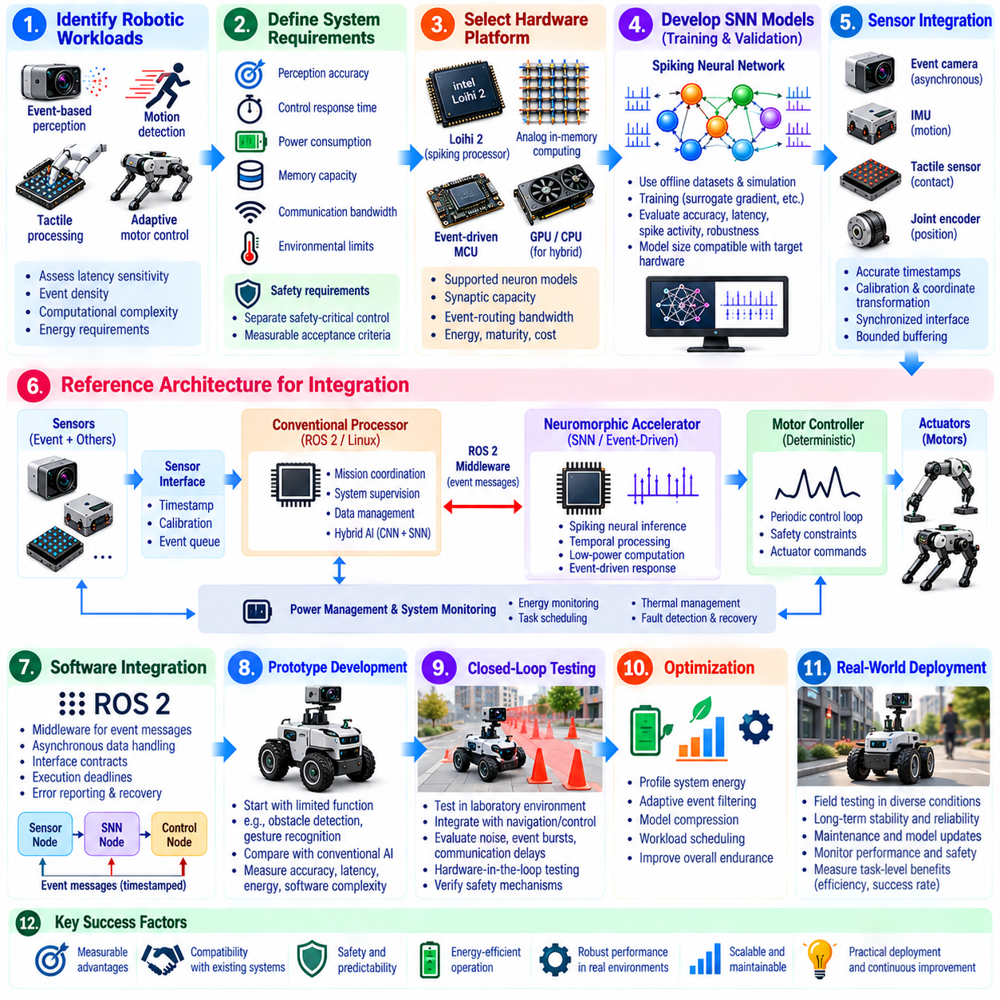{width="7.268055555555556in" height="7.268055555555556in"}

Integrating neuromorphic AI into robotic systems requires a staged roadmap connecting experimental neural algorithms with reliable perception, navigation, and control architectures. Neuromorphic computing introduces event-driven processing, spiking neural networks, and specialized hardware that differ from conventional digital AI. Successful integration depends on demonstrating measurable advantages while preserving compatibility, operational predictability, and safety.

The initial development stage identifies robotic workloads that can benefit from sparse temporal computation. Event-based perception, motion detection, tactile processing, and adaptive motor coordination are potential candidates. Each application should be assessed for latency sensitivity, event density, computational complexity, and energy requirements. Workloads dominated by dense numerical operations may remain more efficient on conventional accelerators.

System requirements must define functional performance before hardware selection begins. Relevant specifications include perception accuracy, control response time, power consumption, memory capacity, communication bandwidth, and environmental operating limits. Safety requirements should distinguish experimental AI functions from independently protected control functions. These constraints establish measurable acceptance criteria for subsequent integration activities.

A reference architecture typically combines conventional processors, neuromorphic accelerators, sensor interfaces, and deterministic motor controllers. The conventional processor manages mission coordination, system supervision, and software services, while neuromorphic modules execute selected temporal neural workloads. This heterogeneous organization enables gradual adoption without replacing established robotic infrastructure or transferring critical safety responsibilities to unverified neural algorithms.

Sensor integration forms an early technical milestone because neuromorphic processing depends on accurate event timing. Event cameras, inertial sensors, tactile arrays, and joint encoders may generate measurements with different rates and synchronization characteristics. Interface software must preserve timestamps, coordinate transformations, and sensor calibration parameters. Reliable event acquisition and bounded buffering are prerequisites for meaningful real-time neural processing.

Spiking neural network development should begin with representative offline datasets and reproducible simulation environments. Neural models must be evaluated for task accuracy, spike activity, response latency, and robustness against measurement disturbances. Training methods may include surrogate gradients, spike-based learning, and hardware-aware optimization. Model complexity should remain compatible with the memory, neuron, and communication resources of the target processor.

Hardware selection follows validated workload characterization rather than assumptions about neuromorphic efficiency. Candidate platforms may include programmable spiking processors, event-driven microcontrollers, and hybrid analog-digital accelerators. Evaluation should examine supported neuron models, synaptic capacity, event-routing bandwidth, development tools, and energy consumption. Hardware maturity, availability, maintenance, and integration costs also influence deployment feasibility.

Software integration requires a middleware layer that connects asynchronous neural computation with conventional robotic applications. ROS 2 interfaces can distribute sensor events, neural inference results, and system diagnostics across software components. Event queues and message timestamps must preserve temporal relationships without introducing uncontrolled delays. Interface contracts should specify data formats, execution deadlines, error reporting, and recovery behavior.

A practical execution architecture separates asynchronous perception from periodic control loops. Neuromorphic modules may detect motion patterns or tactile changes and publish event-driven estimates, while deterministic controllers execute actuator commands at defined intervals. This separation allows rapid neural responses without weakening timing guarantees for motor control. Supervisory logic validates neural outputs before they influence physical movement.

The first integration prototype should focus on a limited function with measurable outcomes. An event-based obstacle detector or low-power gesture recognition module can provide a manageable demonstration. Prototype testing should compare the neuromorphic implementation against a conventional baseline using identical input conditions. Accuracy, end-to-end latency, energy per decision, and software complexity should determine whether further development is justified.

The next stage introduces closed-loop robotic operation under controlled laboratory conditions. Neural perception outputs can influence navigation decisions or manipulation strategies while conventional safety mechanisms remain active. Experiments should examine response to sensor noise, event bursts, communication delays, and changing environmental conditions. Hardware-in-the-loop testing helps identify timing and interface failures before unrestricted physical deployment.

Energy optimization becomes meaningful after functional correctness and timing requirements are established. Profiling should include sensor power, neural processing, host computation, communication, and idle consumption. Adaptive event filtering, model compression, and workload scheduling can reduce unnecessary activity. System-level measurements must determine whether computational savings improve battery endurance rather than merely shifting energy consumption between components.

Hybrid learning architectures may combine spiking neural networks with conventional deep learning models. Dense networks can perform complex semantic interpretation, while spiking modules process rapid temporal changes or local reflex signals. Data conversion between representations introduces latency and energy overhead that must be measured. Partitioning decisions should reflect workload characteristics, hardware constraints, and the required reliability of each robotic function.

Online adaptation requires stronger safeguards than fixed neural inference. Synaptic plasticity and reward-modulated learning may help robots adjust to changing sensor characteristics or movement dynamics. However, uncontrolled parameter changes can alter behavior after validation. Practical systems should impose learning boundaries, monitor performance, maintain versioned model states, and provide rollback mechanisms when adaptation degrades operational reliability.

Safety engineering must accompany every integration stage rather than appear only before deployment. Hazard analysis should identify failures involving missed events, excessive latency, corrupted neural states, and unexpected control recommendations. Independent monitoring and actuator protection must remain effective when neuromorphic components fail. Defined fallback modes allow robots to continue restricted operation or reach a safe state without depending on experimental AI behavior.

Verification and validation should combine software tests, processor measurements, simulation, and physical experiments. Component-level tests establish neural accuracy and execution efficiency, while integrated tests assess navigation success, movement stability, and fault recovery. Repeated experiments across representative environments reveal variability and operational limitations. Acceptance criteria must be documented before each transition to a higher deployment maturity level.

Fleet-level integration introduces additional challenges involving software updates, configuration management, diagnostics, and heterogeneous hardware. Different robot models may require distinct neural parameters or event-processing configurations. Deployment systems should track processor firmware, model versions, calibration records, and performance histories. Centralized monitoring can identify abnormal event rates, energy consumption, and inference failures across deployed robots.

Long-term maintainability depends on development tools that support model conversion, deployment, debugging, and performance profiling. Neuromorphic programming environments remain less standardized than conventional AI software ecosystems. Engineering teams should minimize hardware-specific dependencies where practical and preserve portable interfaces between neural modules and robotic applications. Documentation and reproducible builds reduce the risk of platform obsolescence.

A realistic roadmap progresses from algorithm feasibility to hardware characterization, subsystem integration, controlled robotic trials, and operational deployment. Advancement should depend on demonstrated accuracy, latency, energy efficiency, robustness, and safety rather than predetermined schedules. Economic evaluation must include engineering effort, hardware procurement, software maintenance, and expected battery-life improvements. These factors determine whether neuromorphic integration delivers sustainable operational value.

The long-term direction of neuromorphic robotics is a heterogeneous AI-native architecture combining event-driven intelligence, analog acceleration, conventional computing, and reliable physical control. Neuromorphic modules may improve temporal responsiveness and energy efficiency for selected tasks, while established systems provide spatial reasoning, planning, and safety supervision. Successful adoption requires reproducible evidence that these technologies improve complete robotic missions without compromising reliability or maintainability.

뉴로모픽 인공지능(Neuromorphic AI)을 로봇 시스템(Robotic System)에 통합하려면 실험적 신경망 알고리즘(Experimental Neural Algorithm)을 신뢰성 높은 인지(Perception), 내비게이션(Navigation), 제어 아키텍처(Control Architecture)와 연결하는 단계적 로드맵(Staged Roadmap)이 필요하다. 뉴로모픽 컴퓨팅(Neuromorphic Computing)은 기존 디지털 인공지능(Conventional Digital AI)과 다른 이벤트 기반 처리(Event-Driven Processing), 스파이킹 신경망(Spiking Neural Network), 특수 목적 하드웨어(Specialized Hardware)를 도입한다. 성공적인 통합은 호환성(Compatibility), 운용 예측 가능성(Operational Predictability), 안전성(Safety)을 유지하면서 측정 가능한 이점(Measurable Advantage)을 입증하는 데 달려 있다.

초기 개발 단계(Initial Development Stage)에서는 희소 시간 연산(Sparse Temporal Computation)의 이점을 활용할 수 있는 로봇 작업 부하(Robotic Workload)를 식별한다. 이벤트 기반 인지(Event-Based Perception), 움직임 감지(Motion Detection), 촉각 처리(Tactile Processing), 적응형 모터 협응(Adaptive Motor Coordination)이 잠재적인 적용 대상이다. 각 응용 분야(Application)는 지연시간 민감도(Latency Sensitivity), 이벤트 밀도(Event Density), 연산 복잡도(Computational Complexity), 에너지 요구사항(Energy Requirement)을 기준으로 평가해야 한다. 밀집 수치 연산(Dense Numerical Operation)이 지배적인 작업 부하는 기존 가속기(Conventional Accelerator)에서 더 효율적으로 실행될 수 있다.

시스템 요구사항(System Requirement)은 하드웨어 선정(Hardware Selection)이 시작되기 전에 기능적 성능(Functional Performance)을 정의해야 한다. 관련 사양(Specification)에는 인지 정확도(Perception Accuracy), 제어 응답시간(Control Response Time), 전력 소비(Power Consumption), 메모리 용량(Memory Capacity), 통신 대역폭(Communication Bandwidth), 환경 운용 한계(Environmental Operating Limit)가 포함된다. 안전 요구사항(Safety Requirement)은 실험적 인공지능 기능(Experimental AI Function)과 독립적으로 보호되는 제어 기능(Independently Protected Control Function)을 구분해야 한다. 이러한 제약조건(Constraint)은 후속 통합 활동(Integration Activity)을 위한 측정 가능한 수용 기준(Measurable Acceptance Criteria)을 확립한다.

참조 아키텍처(Reference Architecture)는 일반적으로 기존 프로세서(Conventional Processor), 뉴로모픽 가속기(Neuromorphic Accelerator), 센서 인터페이스(Sensor Interface), 결정론적 모터 제어기(Deterministic Motor Controller)를 결합한다. 기존 프로세서는 임무 협응(Mission Coordination), 시스템 감독(System Supervision), 소프트웨어 서비스(Software Service)를 관리하고, 뉴로모픽 모듈(Neuromorphic Module)은 선택된 시간적 신경망 작업 부하(Temporal Neural Workload)를 실행한다. 이러한 이기종 구성(Heterogeneous Organization)은 기존 로봇 인프라(Robotic Infrastructure)를 교체하거나 핵심 안전 책임(Critical Safety Responsibility)을 검증되지 않은 신경망 알고리즘(Unverified Neural Algorithm)에 이전하지 않고도 점진적인 도입(Gradual Adoption)을 가능하게 한다.

센서 통합(Sensor Integration)은 뉴로모픽 처리(Neuromorphic Processing)가 정확한 이벤트 타이밍(Event Timing)에 의존하므로 초기 기술적 이정표(Technical Milestone)가 된다. 이벤트 카메라(Event Camera), 관성 센서(Inertial Sensor), 촉각 센서 배열(Tactile Array), 관절 엔코더(Joint Encoder)는 서로 다른 측정 주기(Measurement Rate)와 동기화 특성(Synchronization Characteristic)을 가진 데이터를 생성할 수 있다. 인터페이스 소프트웨어(Interface Software)는 타임스탬프(Timestamp), 좌표 변환(Coordinate Transformation), 센서 보정 매개변수(Sensor Calibration Parameter)를 보존해야 한다. 신뢰성 높은 이벤트 획득(Reliable Event Acquisition)과 제한된 버퍼링(Bounded Buffering)은 의미 있는 실시간 신경망 처리(Real-Time Neural Processing)를 위한 필수 조건이다.

스파이킹 신경망(Spiking Neural Network, SNN) 개발은 대표적인 오프라인 데이터셋(Offline Dataset)과 재현 가능한 시뮬레이션 환경(Reproducible Simulation Environment)에서 시작해야 한다. 신경망 모델(Neural Model)은 작업 정확도(Task Accuracy), 스파이크 활동(Spike Activity), 응답 지연시간(Response Latency), 측정 교란(Measurement Disturbance)에 대한 강건성(Robustness)을 기준으로 평가해야 한다. 학습 방법(Training Method)에는 대리 기울기(Surrogate Gradient), 스파이크 기반 학습(Spike-Based Learning), 하드웨어 인식 최적화(Hardware-Aware Optimization)가 포함될 수 있다. 모델 복잡도(Model Complexity)는 대상 프로세서(Target Processor)의 메모리(Memory), 뉴런(Neuron), 통신 자원(Communication Resource)과 호환되는 수준으로 유지되어야 한다.

하드웨어 선정(Hardware Selection)은 뉴로모픽 효율성(Neuromorphic Efficiency)에 대한 가정이 아니라 검증된 작업 부하 특성 분석(Validated Workload Characterization)을 바탕으로 수행해야 한다. 후보 플랫폼(Candidate Platform)에는 프로그래밍 가능한 스파이킹 프로세서(Programmable Spiking Processor), 이벤트 기반 마이크로컨트롤러(Event-Driven Microcontroller), 하이브리드 아날로그-디지털 가속기(Hybrid Analog-Digital Accelerator)가 포함될 수 있다. 평가에서는 지원되는 뉴런 모델(Supported Neuron Model), 시냅스 용량(Synaptic Capacity), 이벤트 라우팅 대역폭(Event-Routing Bandwidth), 개발 도구(Development Tool), 에너지 소비(Energy Consumption)를 검토해야 한다. 하드웨어 성숙도(Hardware Maturity), 공급 가능성(Availability), 유지보수(Maintenance), 통합 비용(Integration Cost)도 배포 실현 가능성(Deployment Feasibility)에 영향을 미친다.

소프트웨어 통합(Software Integration)에는 비동기 신경망 연산(Asynchronous Neural Computation)을 기존 로봇 응용 프로그램(Conventional Robotic Application)과 연결하는 미들웨어 계층(Middleware Layer)이 필요하다. ROS 2 인터페이스(ROS 2 Interface)는 센서 이벤트(Sensor Event), 신경망 추론 결과(Neural Inference Result), 시스템 진단 정보(System Diagnostic Information)를 소프트웨어 구성요소(Software Component) 사이에 배포할 수 있다. 이벤트 큐(Event Queue)와 메시지 타임스탬프(Message Timestamp)는 제어되지 않는 지연(Uncontrolled Delay)을 유발하지 않으면서 시간적 관계(Temporal Relationship)를 보존해야 한다. 인터페이스 계약(Interface Contract)은 데이터 형식(Data Format), 실행 마감시간(Execution Deadline), 오류 보고(Error Reporting), 복구 동작(Recovery Behavior)을 명시해야 한다.

실용적인 실행 아키텍처(Practical Execution Architecture)는 비동기 인지(Asynchronous Perception)를 주기적 제어 루프(Periodic Control Loop)와 분리한다. 뉴로모픽 모듈은 움직임 패턴(Motion Pattern)이나 촉각 변화(Tactile Change)를 감지하고 이벤트 기반 추정값(Event-Driven Estimate)을 발행할 수 있으며, 결정론적 제어기(Deterministic Controller)는 정의된 주기(Defined Interval)에 따라 액추에이터 명령(Actuator Command)을 실행한다. 이러한 분리는 모터 제어(Motor Control)의 타이밍 보장(Timing Guarantee)을 약화시키지 않으면서 빠른 신경망 반응(Rapid Neural Response)을 가능하게 한다. 상위 감독 로직(Supervisory Logic)은 신경망 출력(Neural Output)이 물리적 움직임(Physical Movement)에 영향을 미치기 전에 이를 검증한다.

첫 번째 통합 시제품(Integration Prototype)은 측정 가능한 결과(Measurable Outcome)를 가진 제한적인 기능(Limited Function)에 집중해야 한다. 이벤트 기반 장애물 감지기(Event-Based Obstacle Detector)나 저전력 제스처 인식 모듈(Low-Power Gesture Recognition Module)은 관리 가능한 실증 사례(Manageable Demonstration)를 제공할 수 있다. 시제품 시험(Prototype Testing)은 동일한 입력 조건(Identical Input Condition)에서 뉴로모픽 구현(Neuromorphic Implementation)을 기존 기준 시스템(Conventional Baseline)과 비교해야 한다. 정확도(Accuracy), 종단 간 지연시간(End-to-End Latency), 의사결정당 에너지(Energy per Decision), 소프트웨어 복잡도(Software Complexity)를 기준으로 추가 개발의 타당성을 판단해야 한다.

다음 단계에서는 통제된 실험실 조건(Controlled Laboratory Condition)에서 폐루프 로봇 운용(Closed-Loop Robotic Operation)을 도입한다. 기존 안전 메커니즘(Conventional Safety Mechanism)이 활성화된 상태에서 신경망 인지 출력(Neural Perception Output)이 내비게이션 의사결정(Navigation Decision)이나 조작 전략(Manipulation Strategy)에 영향을 미치도록 할 수 있다. 실험에서는 센서 잡음(Sensor Noise), 이벤트 버스트(Event Burst), 통신 지연(Communication Delay), 변화하는 환경 조건(Changing Environmental Condition)에 대한 반응을 조사해야 한다. 하드웨어 인 더 루프 시험(Hardware-in-the-Loop Testing, HIL Testing)은 제한 없는 물리적 배포(Unrestricted Physical Deployment)에 앞서 타이밍 및 인터페이스 결함(Timing and Interface Failure)을 식별하는 데 도움이 된다.

에너지 최적화(Energy Optimization)는 기능적 정확성(Functional Correctness)과 타이밍 요구사항(Timing Requirement)이 확립된 이후에 의미를 가진다. 성능 프로파일링(Profiling)에는 센서 전력(Sensor Power), 신경망 처리(Neural Processing), 호스트 연산(Host Computation), 통신(Communication), 유휴 전력 소비(Idle Consumption)를 포함해야 한다. 적응형 이벤트 필터링(Adaptive Event Filtering), 모델 압축(Model Compression), 작업 부하 스케줄링(Workload Scheduling)은 불필요한 활동(Unnecessary Activity)을 줄일 수 있다. 시스템 수준 측정(System-Level Measurement)은 연산 절감(Computational Saving)이 단순히 구성요소 사이의 에너지 소비를 이동시키는 것이 아니라 실제 배터리 지속시간(Battery Endurance)을 개선하는지 판단해야 한다.

하이브리드 학습 아키텍처(Hybrid Learning Architecture)는 스파이킹 신경망과 기존 딥러닝 모델(Conventional Deep Learning Model)을 결합할 수 있다. 밀집 신경망(Dense Neural Network)은 복잡한 의미 해석(Semantic Interpretation)을 수행하고, 스파이킹 모듈(Spiking Module)은 빠른 시간적 변화(Rapid Temporal Change)나 국소 반사 신호(Local Reflex Signal)를 처리할 수 있다. 표현 방식 사이의 데이터 변환(Data Conversion Between Representations)은 측정해야 할 지연시간 및 에너지 오버헤드(Latency and Energy Overhead)를 발생시킨다. 연산 분할 결정(Partitioning Decision)은 작업 부하 특성(Workload Characteristic), 하드웨어 제약조건(Hardware Constraint), 각 로봇 기능에 요구되는 신뢰성(Required Reliability)을 반영해야 한다.

온라인 적응(Online Adaptation)은 고정된 신경망 추론(Fixed Neural Inference)보다 강력한 보호 조치(Safeguard)를 요구한다. 시냅스 가소성(Synaptic Plasticity)과 보상 조절 학습(Reward-Modulated Learning)은 로봇이 변화하는 센서 특성(Sensor Characteristic)이나 움직임 동역학(Movement Dynamics)에 적응하도록 지원할 수 있다. 그러나 통제되지 않은 매개변수 변경(Uncontrolled Parameter Change)은 검증 이후의 동작을 변화시킬 수 있다. 실제 시스템은 학습 범위 제한(Learning Boundary), 성능 모니터링(Performance Monitoring), 버전이 관리되는 모델 상태(Versioned Model State), 적응으로 인해 운용 신뢰성(Operational Reliability)이 저하될 때 사용할 롤백 메커니즘(Rollback Mechanism)을 갖추어야 한다.

안전 공학(Safety Engineering)은 배포 직전에만 수행하는 것이 아니라 모든 통합 단계(Integration Stage)에 수반되어야 한다. 위험 분석(Hazard Analysis)은 이벤트 누락(Missed Event), 과도한 지연시간(Excessive Latency), 손상된 신경망 상태(Corrupted Neural State), 예상하지 못한 제어 권고(Unexpected Control Recommendation)와 관련된 고장을 식별해야 한다. 독립적인 모니터링(Independent Monitoring)과 액추에이터 보호(Actuator Protection)는 뉴로모픽 구성요소(Neuromorphic Component)에 결함이 발생하더라도 효과적으로 유지되어야 한다. 정의된 대체 운용 모드(Fallback Mode)는 실험적 인공지능 동작(Experimental AI Behavior)에 의존하지 않고 로봇이 제한된 운용(Restricted Operation)을 계속하거나 안전 상태(Safe State)에 도달하도록 한다.

검증 및 유효성 확인(Verification and Validation, V&V)은 소프트웨어 시험(Software Test), 프로세서 측정(Processor Measurement), 시뮬레이션(Simulation), 물리적 실험(Physical Experiment)을 결합해야 한다. 구성요소 수준 시험(Component-Level Test)은 신경망 정확도(Neural Accuracy)와 실행 효율성(Execution Efficiency)을 확립하고, 통합 시험(Integrated Test)은 내비게이션 성공률(Navigation Success), 움직임 안정성(Movement Stability), 결함 복구(Fault Recovery)를 평가한다. 대표적인 환경(Representative Environment)에서 반복 실험(Repeated Experiment)을 수행하면 변동성(Variability)과 운용 한계(Operational Limitation)를 파악할 수 있다. 각 배포 성숙도 수준(Deployment Maturity Level)으로 전환하기 전에 수용 기준(Acceptance Criteria)을 문서화해야 한다.

로봇 군집 수준 통합(Fleet-Level Integration)은 소프트웨어 업데이트(Software Update), 구성 관리(Configuration Management), 진단(Diagnostics), 이기종 하드웨어(Heterogeneous Hardware)와 관련된 추가 과제를 발생시킨다. 서로 다른 로봇 모델(Robot Model)은 각기 다른 신경망 매개변수(Neural Parameter)나 이벤트 처리 구성(Event-Processing Configuration)을 요구할 수 있다. 배포 시스템(Deployment System)은 프로세서 펌웨어(Processor Firmware), 모델 버전(Model Version), 보정 기록(Calibration Record), 성능 이력(Performance History)을 추적해야 한다. 중앙 집중식 모니터링(Centralized Monitoring)은 배포된 로봇 전반에서 비정상적인 이벤트 발생률(Abnormal Event Rate), 에너지 소비, 추론 실패(Inference Failure)를 식별할 수 있다.

장기 유지보수성(Long-Term Maintainability)은 모델 변환(Model Conversion), 배포(Deployment), 디버깅(Debugging), 성능 프로파일링(Performance Profiling)을 지원하는 개발 도구(Development Tool)에 달려 있다. 뉴로모픽 프로그래밍 환경(Neuromorphic Programming Environment)은 기존 인공지능 소프트웨어 생태계(Conventional AI Software Ecosystem)에 비해 표준화(Standardization)가 덜 진행된 상태이다. 엔지니어링 팀(Engineering Team)은 가능한 범위에서 하드웨어별 종속성(Hardware-Specific Dependency)을 최소화하고 신경망 모듈과 로봇 응용 프로그램 사이의 이식 가능한 인터페이스(Portable Interface)를 유지해야 한다. 문서화(Documentation)와 재현 가능한 빌드(Reproducible Build)는 플랫폼 노후화(Platform Obsolescence)의 위험을 줄인다.

현실적인 로드맵(Realistic Roadmap)은 알고리즘 실현 가능성(Algorithm Feasibility)에서 시작하여 하드웨어 특성 분석(Hardware Characterization), 하위 시스템 통합(Subsystem Integration), 통제된 로봇 시험(Controlled Robotic Trial), 운용 배포(Operational Deployment)로 발전한다. 다음 단계로의 진행은 미리 정해진 일정(Predetermined Schedule)이 아니라 입증된 정확도, 지연시간, 에너지 효율성(Energy Efficiency), 강건성(Robustness), 안전성에 따라 결정되어야 한다. 경제성 평가(Economic Evaluation)에는 엔지니어링 노력(Engineering Effort), 하드웨어 조달(Hardware Procurement), 소프트웨어 유지보수(Software Maintenance), 예상 배터리 수명 개선(Expected Battery-Life Improvement)을 포함해야 한다. 이러한 요소는 뉴로모픽 통합(Neuromorphic Integration)이 지속 가능한 운용 가치(Sustainable Operational Value)를 제공하는지 결정한다.

뉴로모픽 로봇공학(Neuromorphic Robotics)의 장기적 발전 방향(Long-Term Direction)은 이벤트 기반 지능(Event-Driven Intelligence), 아날로그 가속(Analog Acceleration), 기존 컴퓨팅(Conventional Computing), 신뢰성 높은 물리적 제어(Reliable Physical Control)를 결합하는 이기종 인공지능 네이티브 아키텍처(Heterogeneous AI-Native Architecture)이다. 뉴로모픽 모듈은 선택된 작업(Selected Task)의 시간적 반응성(Temporal Responsiveness)과 에너지 효율성을 개선하고, 기존 시스템(Established System)은 공간 추론(Spatial Reasoning), 계획(Planning), 안전 감독(Safety Supervision)을 제공할 수 있다. 성공적인 도입(Successful Adoption)을 위해서는 이러한 기술이 신뢰성(Reliability)이나 유지보수성(Maintainability)을 저해하지 않으면서 전체 로봇 임무(Complete Robotic Mission)를 개선한다는 재현 가능한 증거(Reproducible Evidence)가 필요하다.
