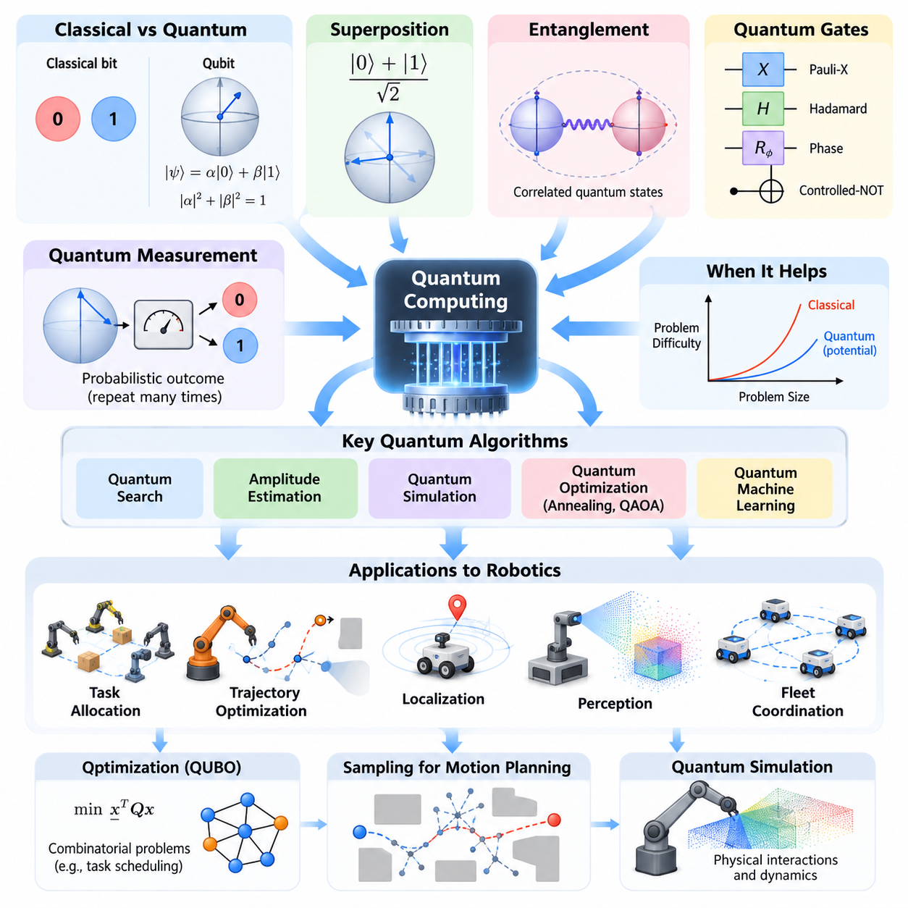
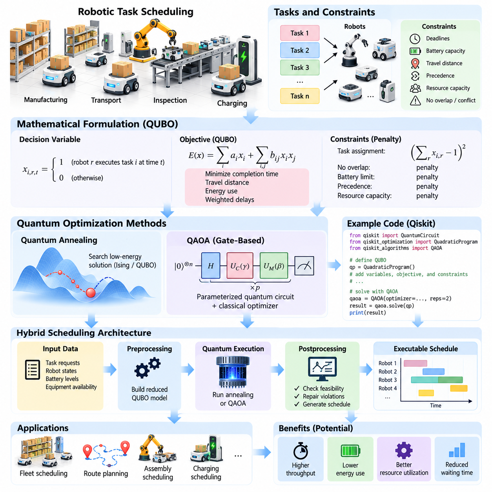
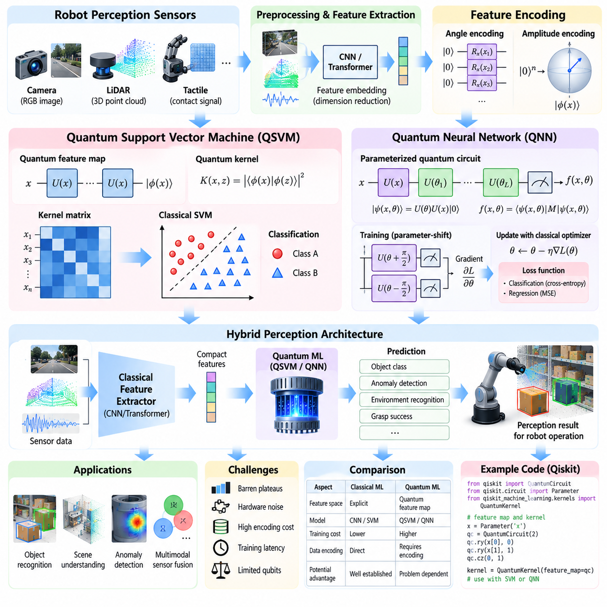
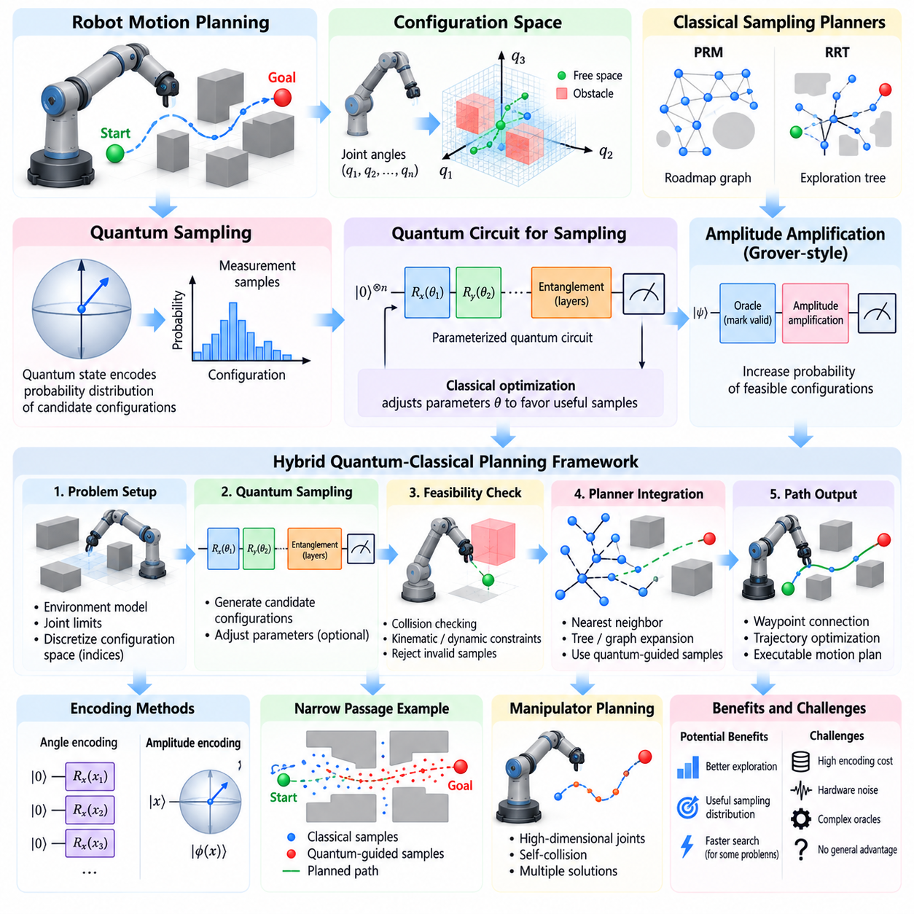
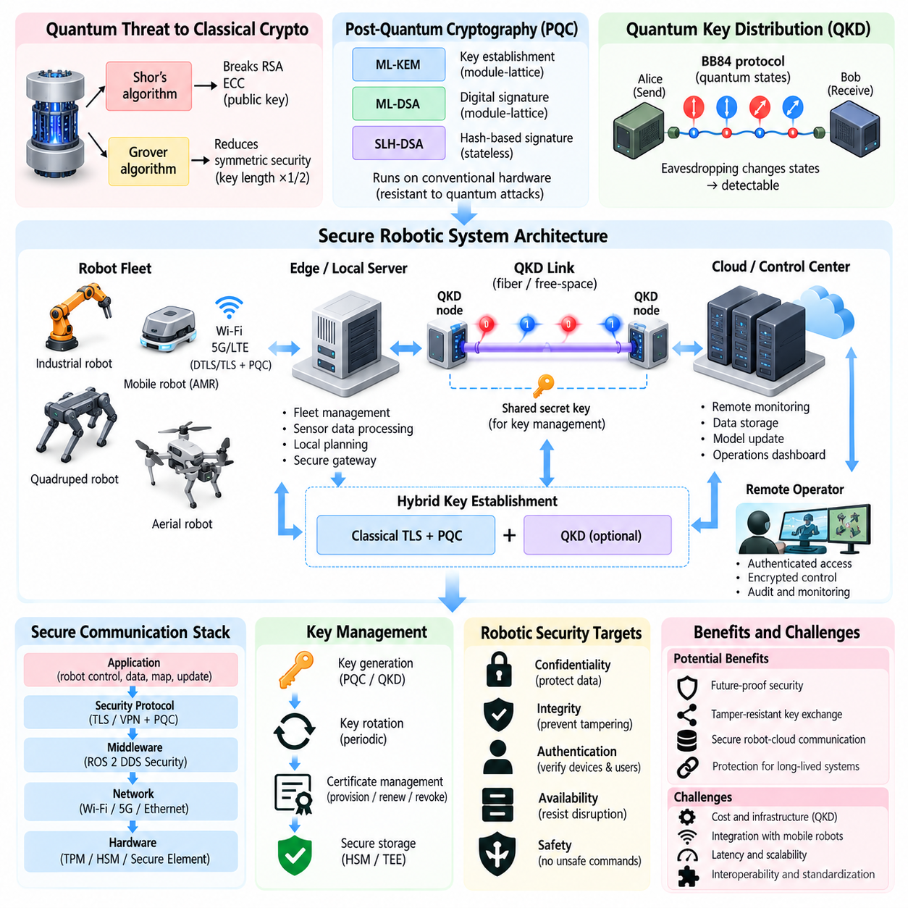
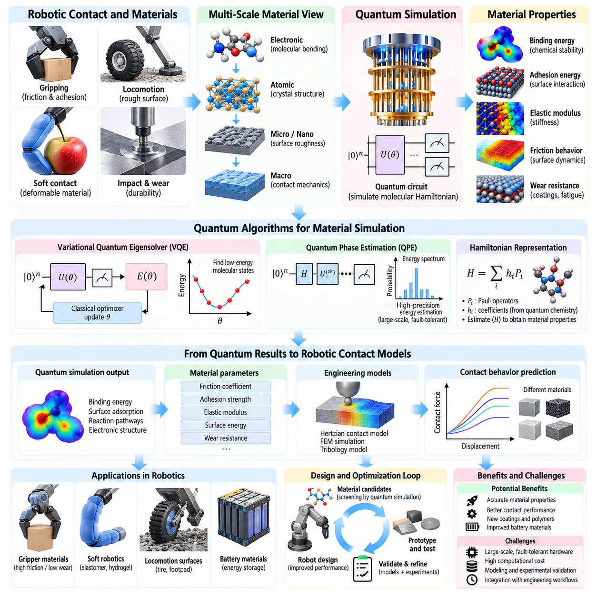
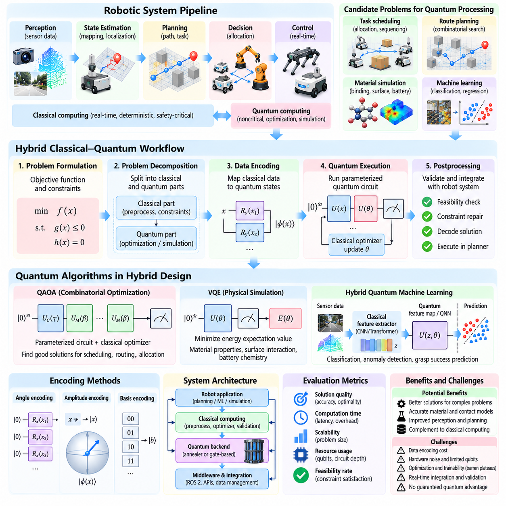
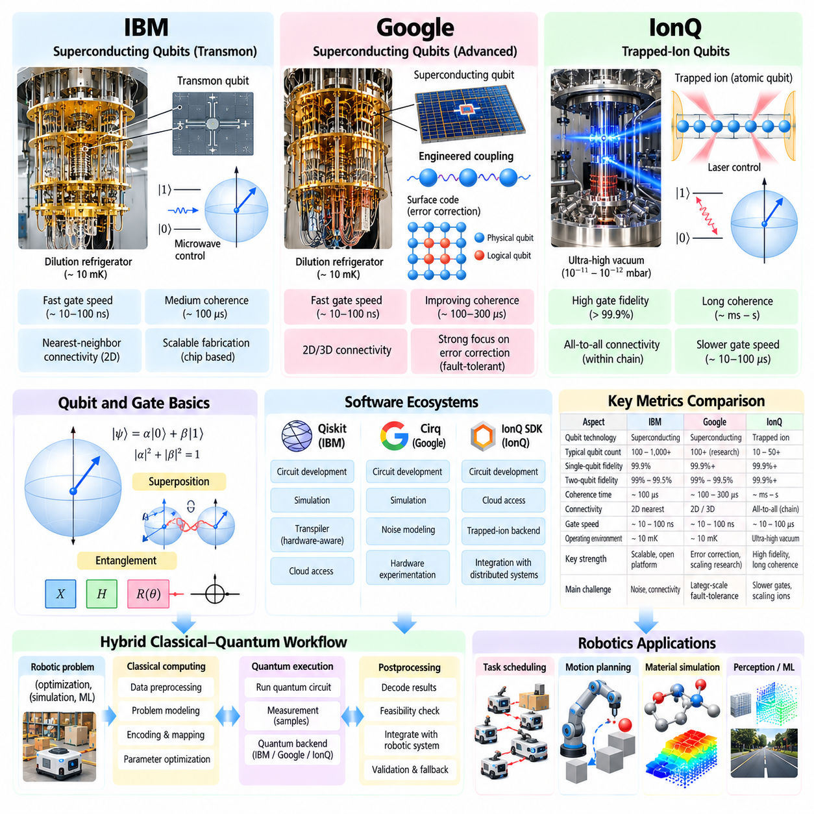
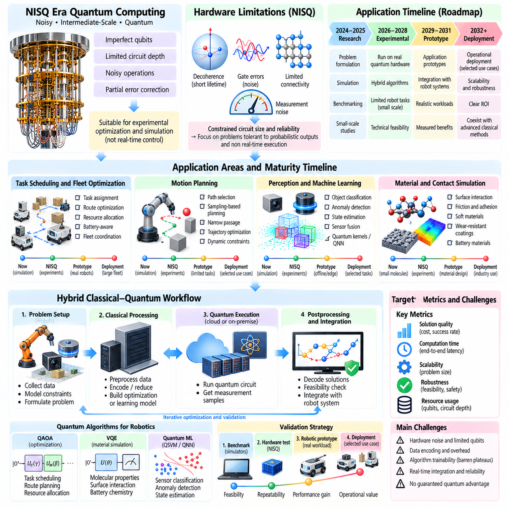
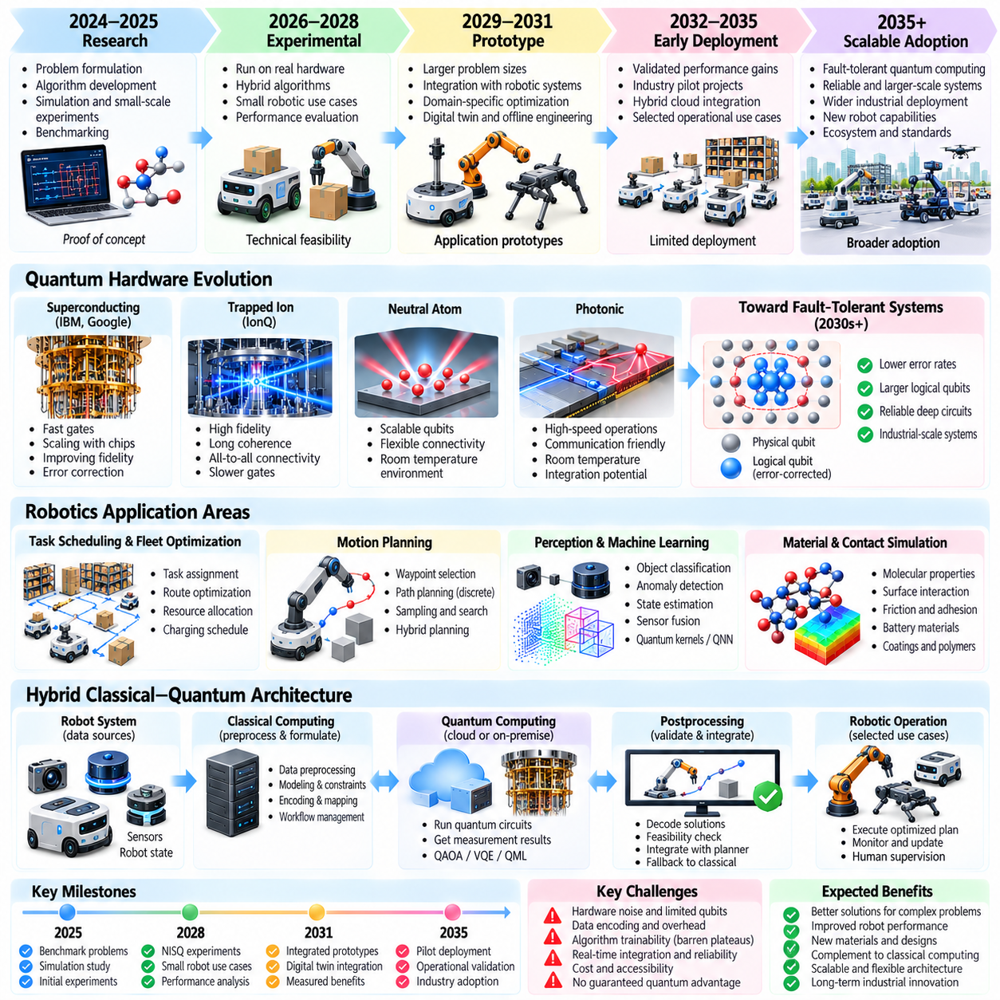

**Volume 27. Future AI Native Robotics**

# Chapter 11. Quantum Computing for Robotics

## 11.01. Quantum Computing Basics for Robot Engineers

{width="7.268055555555556in" height="7.268055555555556in"}

Quantum computing introduces a computational paradigm based on quantum mechanics rather than conventional binary logic. For robotics engineers, its importance lies in the possibility of addressing difficult optimization, simulation, and machine learning problems. Although classical processors remain essential for real-time robot operation, quantum processors may eventually complement them in selected computational tasks requiring extensive exploration of complex solution spaces.

Classical computers represent information using bits that hold either zero or one. Quantum computers use quantum bits, or qubits, whose states can be expressed as combinations of two basis states. A qubit is mathematically represented as \|ψ⟩ = α\|0⟩ + β\|1⟩, where α and β are complex probability amplitudes satisfying \|α\|² + \|β\|² = 1. Measurement produces a classical outcome according to these probabilities.

Superposition allows quantum states to contain amplitudes associated with multiple computational configurations. A register containing n qubits is described by 2ⁿ basis-state amplitudes, although measurement does not reveal all of them simultaneously. Quantum algorithms manipulate these amplitudes through interference, increasing the probability of useful outcomes while suppressing others. This mechanism differs fundamentally from ordinary parallel processing.

Entanglement describes quantum correlations that cannot generally be represented as independent states of individual qubits. When qubits become entangled, the state of the complete register must be considered collectively. Quantum algorithms exploit these correlations together with interference to perform particular computations. Entanglement alone does not guarantee computational acceleration, but it provides an important resource for quantum information processing.

Quantum gates transform qubit states through reversible mathematical operations represented by unitary matrices. Common gates include the Pauli-X gate, Hadamard gate, phase gates, and controlled-NOT gate. The Hadamard gate creates superposition from a computational basis state, while controlled operations can establish entanglement. Sequences of gates form quantum circuits, analogous to instruction sequences executed by conventional processors.

Quantum measurement converts quantum information into classical results. Measuring a qubit in the computational basis produces zero or one according to its probability distribution. Because measurement generally changes the quantum state, algorithms must carefully organize state preparation, gate operations, and measurement. Repeated circuit execution, commonly called shots, allows engineers to estimate output probabilities and evaluate candidate computational solutions statistically.

Quantum computing does not accelerate every mathematical operation. Its potential advantages arise from algorithms designed around specific problem structures, including quantum search, amplitude estimation, quantum simulation, and certain optimization approaches. Classical algorithms may remain faster when data preparation, circuit depth, hardware noise, or communication overhead dominate execution. Robotics engineers must therefore evaluate quantum methods against strong classical computational baselines.

Robot engineering involves computationally demanding problems such as task allocation, trajectory optimization, localization, sensor interpretation, and fleet coordination. Many of these problems contain discrete decisions, continuous variables, nonlinear constraints, and uncertainty. Quantum computing is being investigated as a possible accelerator for selected mathematical subproblems, particularly where optimization or sampling complexity becomes a significant operational bottleneck.

Combinatorial optimization is a natural research area because many robotics decisions involve choosing among large numbers of configurations. A warehouse fleet may need to assign hundreds of delivery tasks while respecting battery capacity, travel distance, deadlines, and traffic restrictions. Such problems can sometimes be formulated using quadratic unconstrained binary optimization, or QUBO, enabling investigation through quantum annealing or gate-based optimization algorithms.

Quantum annealing and gate-based quantum computing represent different computational approaches. Quantum annealing uses controlled evolution toward low-energy configurations of an optimization model, while gate-based systems execute programmable quantum circuits. The Quantum Approximate Optimization Algorithm, or QAOA, is a hybrid gate-based method for exploring approximate solutions. Neither approach currently guarantees superior performance over established classical optimization methods.

Quantum machine learning investigates how quantum circuits might contribute to classification, regression, feature representation, and probabilistic modeling. Robot perception applications could potentially explore quantum kernels or parameterized quantum neural networks for specialized datasets. However, converting camera images, LiDAR measurements, or tactile signals into quantum representations can be expensive. Demonstrating practical benefits requires accounting for encoding cost, training stability, and inference latency.

Quantum sampling offers another possible connection to robot motion planning. Sampling-based planners such as rapidly exploring random trees and probabilistic roadmaps investigate feasible configurations in complex environments. Quantum techniques might eventually assist selected sampling or search operations, but the complete planning process also requires collision checking, dynamic constraints, and trajectory validation. These classical operations remain central to dependable robot navigation.

Quantum simulation is particularly relevant to understanding physical systems at microscopic scales. Quantum computers may eventually support the study of molecular interactions, electronic structures, and advanced materials used in robot batteries, actuators, and sensors. Such applications differ from ordinary rigid-body robot simulation, which is generally well served by classical numerical methods. Potential benefits are strongest where the simulated physical system itself exhibits quantum behavior.

Quantum hardware faces substantial engineering limitations, including decoherence, imperfect gates, measurement errors, limited connectivity, and calibration requirements. Present noisy intermediate-scale quantum systems, commonly called NISQ devices, cannot execute arbitrarily deep circuits reliably. Error mitigation can improve some experimental estimates, but it does not replace fault-tolerant quantum error correction. These limitations strongly influence the practical value of quantum algorithms.

A hybrid classical-quantum architecture is a realistic starting point for robotics research. Classical computers formulate problems, preprocess sensor data, construct quantum circuits, and interpret measurement results. A quantum processing unit executes selected circuit operations and returns statistical outputs. Classical optimization algorithms then update circuit parameters or evaluate candidate solutions, producing an iterative workflow that combines conventional computing with experimental quantum resources.

Real-time constraints create an important architectural boundary. Motor control, emergency stopping, collision avoidance, and safety-critical feedback loops require predictable execution deadlines. Remote quantum services introduce queueing, communication, and execution variability that generally make them unsuitable for direct low-level robot control. More plausible applications involve offline planning, strategic scheduling, design optimization, and computational research where execution deadlines are less restrictive.

Robotics engineers can begin learning quantum computing through circuit simulators and software frameworks such as Qiskit, Cirq, and PennyLane. These environments support quantum state preparation, gate construction, measurement experiments, and hybrid optimization workflows. Engineers can formulate small robotic scheduling problems, compare quantum-inspired and quantum implementations, and measure solution quality against classical solvers before considering physical quantum hardware.

Benchmarking must distinguish theoretical computational advantage from practical engineering improvement. Relevant measurements include optimization objective value, feasibility rate, execution time, circuit depth, qubit count, measurement repetitions, and total computational cost. Experiments should incorporate data preparation, classical optimization, hardware access delays, and postprocessing. Results obtained on small simulated examples should not automatically be interpreted as evidence of industrial scalability.

Security considerations also influence the relationship between quantum computing and robotics. Sufficiently powerful fault-tolerant quantum computers could threaten widely deployed public-key cryptographic algorithms through quantum attacks. Robot communication networks, firmware signing systems, and cloud interfaces therefore need long-term cryptographic migration planning. Post-quantum cryptography provides classical algorithms designed to resist known quantum attacks and should be distinguished from quantum key distribution.

The long-term integration of quantum computing into robotics depends on progress in hardware reliability, logical qubit scalability, error correction, algorithms, and accessible software infrastructure. Improvements in these areas could expand the range of robotic optimization and scientific simulation problems that benefit from quantum acceleration. Nevertheless, meaningful adoption must be driven by verified computational advantages rather than assumptions that quantum hardware is universally faster.

For robot engineers, quantum computing should be understood as an emerging specialized computational resource rather than a replacement for CPUs, GPUs, embedded controllers, or conventional AI accelerators. Its greatest prospective contribution is the ability to complement classical systems on carefully selected problems. Developing expertise in quantum information, mathematical optimization, hybrid algorithms, and rigorous benchmarking establishes a foundation for evaluating future quantum-enabled robotics architectures.

양자 컴퓨팅(Quantum Computing)은 기존의 이진 논리(Binary Logic)가 아닌 양자역학(Quantum Mechanics)을 기반으로 하는 새로운 계산 패러다임(Computational Paradigm)을 제시한다. 로봇 엔지니어에게 양자 컴퓨팅의 중요성은 복잡한 최적화(Optimization), 시뮬레이션(Simulation), 기계학습(Machine Learning) 문제를 해결할 가능성에 있다. 기존 프로세서는 여전히 실시간 로봇 운영에 필수적이지만, 양자 프로세서는 복잡한 해 공간(Solution Space)을 탐색해야 하는 특정 계산 작업에서 이를 보완할 수 있다.

고전 컴퓨터(Classical Computer)는 0 또는 1의 값을 가지는 비트(Bit)를 사용하여 정보를 표현한다. 양자 컴퓨터(Quantum Computer)는 두 기저 상태(Basis State)의 조합으로 표현할 수 있는 양자 비트(Qubit)를 사용한다. 큐비트의 상태는 수학적으로 \|ψ⟩ = α\|0⟩ + β\|1⟩로 표현되며, α와 β는 \|α\|² + \|β\|² = 1을 만족하는 복소 확률 진폭(Complex Probability Amplitude)이다. 측정(Measurement)은 이러한 확률에 따라 고전적인 결과를 생성한다.

중첩(Superposition)은 양자 상태(Quantum State)가 여러 계산 구성(Computational Configuration)에 대응하는 확률 진폭을 동시에 포함하도록 한다. n개의 큐비트로 구성된 레지스터(Register)는 2ⁿ개의 기저 상태에 대한 확률 진폭으로 기술되지만, 측정으로 모든 정보를 동시에 얻을 수는 없다. 양자 알고리즘(Quantum Algorithm)은 간섭(Interference)을 통해 유용한 결과의 확률을 높이고 다른 결과를 억제하며, 이러한 메커니즘은 일반적인 병렬 처리(Parallel Processing)와 근본적으로 다르다.

얽힘(Entanglement)은 개별 큐비트의 독립적인 상태만으로는 일반적으로 표현할 수 없는 양자 상관관계(Quantum Correlation)를 의미한다. 큐비트들이 얽히면 전체 레지스터의 상태를 통합적으로 고려해야 한다. 양자 알고리즘은 이러한 상관관계와 간섭을 함께 활용하여 특정 계산을 수행한다. 얽힘 자체가 계산 가속(Computational Acceleration)을 보장하지는 않지만, 양자 정보 처리(Quantum Information Processing)의 중요한 자원으로 활용된다.

양자 게이트(Quantum Gate)는 유니터리 행렬(Unitary Matrix)로 표현되는 가역 연산(Reversible Operation)을 통해 큐비트 상태를 변환한다. 대표적인 게이트에는 파울리-X 게이트(Pauli-X Gate), 아다마르 게이트(Hadamard Gate), 위상 게이트(Phase Gate), 제어 NOT 게이트(Controlled-NOT Gate)가 있다. 아다마르 게이트는 계산 기저 상태로부터 중첩을 생성하며, 제어 연산은 얽힘을 형성할 수 있다. 이러한 게이트의 연속적인 조합이 양자 회로(Quantum Circuit)를 구성한다.

양자 측정(Quantum Measurement)은 양자 정보를 고전적인 결과로 변환하는 과정이다. 계산 기저(Computational Basis)에서 큐비트를 측정하면 확률 분포(Probability Distribution)에 따라 0 또는 1이 출력된다. 측정은 일반적으로 양자 상태를 변화시키므로 알고리즘은 상태 준비(State Preparation), 게이트 연산(Gate Operation), 측정 과정을 신중하게 구성해야 한다. 샷(Shot)이라고 하는 반복적인 회로 실행을 통해 출력 확률을 추정하고 후보 계산 결과를 통계적으로 평가할 수 있다.

양자 컴퓨팅이 모든 수학적 연산을 가속하는 것은 아니다. 잠재적인 이점은 양자 탐색(Quantum Search), 진폭 추정(Amplitude Estimation), 양자 시뮬레이션(Quantum Simulation), 특정 최적화 접근법처럼 문제 구조에 맞게 설계된 알고리즘에서 나타난다. 데이터 준비(Data Preparation), 회로 깊이(Circuit Depth), 하드웨어 잡음(Hardware Noise), 통신 오버헤드(Communication Overhead)가 큰 경우에는 고전 알고리즘이 더 빠를 수 있다. 따라서 로봇 엔지니어는 우수한 고전 계산 기준선(Classical Computational Baseline)과 비교하여 양자 기법을 평가해야 한다.

로봇 공학(Robot Engineering)에는 작업 할당(Task Allocation), 궤적 최적화(Trajectory Optimization), 위치 추정(Localization), 센서 해석(Sensor Interpretation), 군집 로봇 조정(Fleet Coordination)과 같은 계산 집약적인 문제가 존재한다. 이러한 문제는 이산적 의사결정(Discrete Decision), 연속 변수(Continuous Variable), 비선형 제약조건(Nonlinear Constraint), 불확실성(Uncertainty)을 포함한다. 양자 컴퓨팅은 특히 최적화나 샘플링의 복잡성이 운영상의 병목이 되는 특정 수학적 하위 문제를 가속할 가능성이 연구되고 있다.

조합 최적화(Combinatorial Optimization)는 많은 로봇 의사결정이 방대한 구성 중에서 선택해야 하므로 중요한 연구 분야이다. 창고 로봇 군집은 배터리 용량(Battery Capacity), 이동 거리(Travel Distance), 작업 마감시간(Deadline), 교통 제약조건(Traffic Constraint)을 고려하면서 수백 개의 배송 작업을 할당해야 할 수 있다. 이러한 문제는 경우에 따라 이차 비제약 이진 최적화(Quadratic Unconstrained Binary Optimization, QUBO)로 정식화하여 양자 어닐링(Quantum Annealing)이나 게이트 기반 최적화 알고리즘으로 탐색할 수 있다.

양자 어닐링(Quantum Annealing)과 게이트 기반 양자 컴퓨팅(Gate-Based Quantum Computing)은 서로 다른 계산 접근법이다. 양자 어닐링은 최적화 모델의 낮은 에너지 구성(Low-Energy Configuration)을 향한 제어된 진화를 이용하며, 게이트 기반 시스템은 프로그래밍 가능한 양자 회로를 실행한다. 양자 근사 최적화 알고리즘(Quantum Approximate Optimization Algorithm, QAOA)은 근사해를 탐색하는 하이브리드 게이트 기반 기법이다. 현재 어느 접근법도 기존 고전 최적화 기법보다 우수한 성능을 보장하지는 않는다.

양자 기계학습(Quantum Machine Learning)은 양자 회로가 분류(Classification), 회귀(Regression), 특징 표현(Feature Representation), 확률 모델링(Probabilistic Modeling)에 기여할 가능성을 연구한다. 로봇 인식(Robot Perception)에서는 특정 데이터셋을 대상으로 양자 커널(Quantum Kernel)이나 매개변수화된 양자 신경망(Parameterized Quantum Neural Network)을 검토할 수 있다. 그러나 카메라 영상, 라이다(LiDAR) 측정값, 촉각 신호(Tactile Signal)를 양자 표현으로 변환하는 과정에는 상당한 비용이 발생할 수 있다.

양자 샘플링(Quantum Sampling)은 로봇 동작 계획(Robot Motion Planning)과 연결될 수 있는 또 다른 가능성을 제공한다. 빠르게 탐색하는 무작위 트리(Rapidly Exploring Random Tree, RRT)와 확률적 로드맵(Probabilistic Roadmap, PRM) 같은 샘플링 기반 계획기(Sampling-Based Planner)는 복잡한 환경에서 실행 가능한 구성을 탐색한다. 양자 기법은 특정 샘플링이나 탐색 연산을 지원할 가능성이 있지만, 전체 계획 과정에는 충돌 검사(Collision Checking), 동역학 제약조건(Dynamic Constraint), 궤적 검증(Trajectory Validation)이 여전히 필요하다.

양자 시뮬레이션(Quantum Simulation)은 미시적 규모(Microscopic Scale)의 물리 시스템을 이해하는 데 특히 중요하다. 양자 컴퓨터는 향후 로봇 배터리(Battery), 액추에이터(Actuator), 센서(Sensor)에 사용되는 분자 상호작용(Molecular Interaction), 전자 구조(Electronic Structure), 첨단 소재(Advanced Material)의 연구를 지원할 수 있다. 이는 일반적인 강체 로봇 시뮬레이션(Rigid-Body Robot Simulation)과 구별되며, 양자적 거동을 나타내는 물리 시스템에서 잠재적인 이점이 크다.

양자 하드웨어(Quantum Hardware)는 결맞음 상실(Decoherence), 불완전한 게이트(Imperfect Gate), 측정 오류(Measurement Error), 제한된 연결성(Limited Connectivity), 보정 요구사항(Calibration Requirement)과 같은 공학적 한계에 직면해 있다. 현재의 잡음이 있는 중간 규모 양자 시스템(Noisy Intermediate-Scale Quantum, NISQ)은 임의로 깊은 회로를 안정적으로 실행하기 어렵다. 오류 완화(Error Mitigation)는 일부 실험 결과의 추정 정확도를 개선할 수 있지만, 결함 허용 양자 오류 정정(Fault-Tolerant Quantum Error Correction)을 대체하지는 못한다.

하이브리드 고전-양자 아키텍처(Hybrid Classical-Quantum Architecture)는 로봇 공학 연구에서 현실적인 출발점이다. 고전 컴퓨터는 문제 정식화(Problem Formulation), 센서 데이터 전처리(Sensor Data Preprocessing), 양자 회로 구성, 측정 결과 해석을 담당한다. 양자 처리 장치(Quantum Processing Unit, QPU)는 선택된 회로 연산을 실행하고 통계적 출력을 반환한다. 이후 고전 최적화 알고리즘이 회로 매개변수를 갱신하거나 후보해를 평가하면서 반복적인 계산 작업 흐름(Computational Workflow)을 구성한다.

실시간 제약조건(Real-Time Constraint)은 중요한 아키텍처 경계(Architectural Boundary)를 형성한다. 모터 제어(Motor Control), 비상 정지(Emergency Stop), 충돌 회피(Collision Avoidance), 안전 필수 피드백 루프(Safety-Critical Feedback Loop)는 예측 가능한 실행 마감시간(Execution Deadline)을 요구한다. 원격 양자 서비스(Remote Quantum Service)는 대기열, 통신, 실행 시간의 변동성을 발생시키므로 일반적으로 저수준 로봇 직접 제어에 적합하지 않다. 대신 오프라인 계획, 전략적 일정 수립, 설계 최적화, 계산 연구가 더 현실적인 적용 분야이다.

로봇 엔지니어는 Qiskit, Cirq, PennyLane과 같은 소프트웨어 프레임워크(Software Framework)와 양자 회로 시뮬레이터(Quantum Circuit Simulator)를 통해 양자 컴퓨팅 학습을 시작할 수 있다. 이러한 환경은 양자 상태 준비, 게이트 구성, 측정 실험, 하이브리드 최적화 작업 흐름을 지원한다. 엔지니어는 소규모 로봇 일정 최적화 문제를 정식화하고 양자 영감 알고리즘(Quantum-Inspired Algorithm)과 양자 구현을 비교한 후, 실제 양자 하드웨어 사용 여부를 검토할 수 있다.

벤치마킹(Benchmarking)은 이론적 계산 우위(Theoretical Computational Advantage)와 실제 공학적 개선(Practical Engineering Improvement)을 구분해야 한다. 주요 평가 지표에는 최적화 목적함수 값(Optimization Objective Value), 실행 가능 해의 비율(Feasibility Rate), 실행 시간(Execution Time), 회로 깊이, 큐비트 수(Qubit Count), 측정 반복 횟수, 총 계산 비용(Total Computational Cost)이 포함된다. 실험에서는 데이터 준비, 고전 최적화, 하드웨어 접근 지연, 후처리(Postprocessing)를 모두 고려해야 한다.

보안 고려사항(Security Consideration) 역시 양자 컴퓨팅과 로봇 공학의 관계에 영향을 미친다. 충분한 성능을 갖춘 결함 허용 양자 컴퓨터(Fault-Tolerant Quantum Computer)는 양자 공격(Quantum Attack)을 통해 널리 사용되는 공개키 암호 알고리즘(Public-Key Cryptographic Algorithm)을 위협할 수 있다. 따라서 로봇 통신망, 펌웨어 서명 시스템(Firmware Signing System), 클라우드 인터페이스는 장기적인 암호 전환 계획(Cryptographic Migration Planning)이 필요하다. 양자내성암호(Post-Quantum Cryptography)는 양자 키 분배(Quantum Key Distribution)와 구별되는 고전 암호 기술이다.

로봇 공학에 양자 컴퓨팅을 장기적으로 통합하려면 하드웨어 신뢰성(Hardware Reliability), 논리 큐비트 확장성(Logical Qubit Scalability), 오류 정정(Error Correction), 알고리즘, 소프트웨어 인프라(Software Infrastructure)의 발전이 필요하다. 이러한 분야의 개선은 양자 가속(Quantum Acceleration)의 혜택을 받을 수 있는 로봇 최적화 및 과학적 시뮬레이션 문제의 범위를 확대할 수 있다. 그러나 실질적인 도입은 양자 하드웨어가 보편적으로 빠르다는 가정이 아니라 검증된 계산 성능 향상에 근거해야 한다.

로봇 엔지니어에게 양자 컴퓨팅은 중앙처리장치(Central Processing Unit, CPU), 그래픽처리장치(Graphics Processing Unit, GPU), 임베디드 제어기(Embedded Controller), 기존 인공지능 가속기(AI Accelerator)를 대체하는 기술이 아니라 새로운 전문 계산 자원(Specialized Computational Resource)으로 이해되어야 한다. 가장 중요한 잠재적 기여는 신중하게 선택된 문제에서 고전 시스템을 보완하는 능력이다. 양자 정보, 수학적 최적화, 하이브리드 알고리즘, 엄격한 벤치마킹에 대한 전문성은 미래 양자 기반 로봇 아키텍처(Quantum-Enabled Robotics Architecture)를 평가하는 기반이 된다.

## 11.02. Quantum Optimization for Robot Task Scheduling [w/Code]

{width="7.268055555555556in" height="7.268055555555556in"}

Quantum optimization for robot task scheduling investigates how quantum computing may support the allocation and sequencing of tasks across robotic systems. Industrial robots, autonomous mobile robots, and collaborative platforms must coordinate activities while respecting deadlines, resource limits, and operational priorities. Quantum algorithms offer experimental approaches to selected combinatorial optimization problems, complementing established classical scheduling methods.

Robot task scheduling determines which robot performs each task, when execution begins, and how shared resources are allocated. A manufacturing facility may coordinate assembly stations, transport robots, inspection equipment, and charging infrastructure. Scheduling decisions influence throughput, waiting time, energy consumption, and equipment utilization. As task dependencies and operational constraints increase, the search for effective schedules becomes computationally demanding.

A scheduling problem can be represented using decision variables, objective functions, and constraints. Binary variables may indicate whether robot r executes task i during time slot t. An objective function can minimize completion time, travel distance, energy use, or weighted delays. Constraints enforce task assignment, precedence relationships, robot availability, and resource capacity. The resulting formulation provides a mathematical basis for classical or quantum optimization.

Many robotic scheduling problems belong to combinatorial optimization, where the number of possible assignments grows rapidly with problem size. Exact classical methods can solve numerous practical instances, but difficult cases may require substantial computational effort. Quantum optimization explores alternative search mechanisms based on quantum states and controlled interference. Whether these mechanisms improve real scheduling performance remains an empirical question.

Quadratic Unconstrained Binary Optimization, or QUBO, provides a common representation for quantum scheduling experiments. A QUBO objective can be written as E(x) = Σᵢ aᵢxᵢ + Σᵢⱼ bᵢⱼxᵢxⱼ, where xᵢ represents a binary decision. Linear terms encode individual costs, while quadratic terms describe interactions and penalties. Constraint violations are incorporated through carefully selected penalty coefficients.

For example, assigning every task to exactly one robot can be expressed using a penalty proportional to (Σᵣ xᵢᵣ − 1)². Additional penalties discourage overlapping tasks, insufficient battery capacity, or unavailable equipment. The combined objective balances operational performance against constraint satisfaction. Penalty coefficients must be calibrated carefully because excessively large values can distort optimization and reduce numerical effectiveness.

Quantum annealing approaches scheduling by mapping an optimization objective onto an energy landscape. A quantum annealer attempts to find low-energy configurations corresponding to candidate schedules. The formulation may use an Ising model or an equivalent QUBO representation. Hardware connectivity and embedding requirements can increase physical resource consumption. Classical validation remains necessary because returned configurations may violate operational constraints.

The Quantum Approximate Optimization Algorithm, or QAOA, offers a gate-based alternative for selected scheduling problems. A cost Hamiltonian encodes the optimization objective, while a mixer Hamiltonian supports exploration of candidate solutions. Parameterized quantum circuits generate measurement samples, and a classical optimizer updates circuit parameters. The algorithm seeks favorable schedules through repeated quantum-classical iterations rather than deterministic exhaustive search.

A hybrid scheduling architecture separates operational management from quantum optimization. Classical software collects task requests, robot states, battery levels, and equipment availability. A preprocessing module constructs a reduced optimization problem suitable for the available quantum hardware. Quantum execution produces candidate assignments, while classical postprocessing checks feasibility, repairs violations when possible, and produces an executable schedule.

Task precedence is especially important in manufacturing and logistics environments. A component cannot be inspected before assembly is completed, and a transport task may depend on inventory availability. Precedence constraints can be represented through time-indexed variables or ordering relationships. However, detailed temporal models can require many binary variables. Efficient problem decomposition is therefore essential when targeting resource-limited quantum processors.

Multi-robot scheduling must also consider travel time, congestion, and shared infrastructure. Autonomous mobile robots may compete for narrow corridors, loading stations, elevators, or charging points. Scheduling models can incorporate estimated travel durations and resource occupancy. Classical path planners should validate whether proposed assignments are physically executable. Quantum optimization does not eliminate the need for collision avoidance or traffic coordination.

Battery-aware scheduling introduces energy constraints into the allocation process. Robots with limited charge may require shorter assignments or scheduled charging intervals. Energy consumption depends on travel distance, payload, speed, and operating conditions. A quantum-compatible formulation may approximate these factors using discrete cost coefficients. Detailed battery dynamics and charging feasibility should remain subject to classical engineering models and operational validation.

An illustrative warehouse application could involve six mobile robots transporting packages between storage locations and packing stations. Classical software estimates travel costs, task priorities, and robot availability. A reduced QUBO model represents selected assignment decisions, and a quantum optimizer generates candidate allocations. Classical scheduling software then checks charging requirements, route conflicts, and completion deadlines before execution.

Dynamic scheduling creates additional challenges because new tasks, delays, and equipment failures can invalidate earlier plans. A rolling-horizon approach periodically updates the scheduling problem using current robot states. Quantum computation may be applied to selected optimization windows when sufficient time is available. Conventional scheduling algorithms must remain available for urgent replanning, especially when quantum service latency exceeds operational deadlines.

Quantum hardware limitations strongly affect scheduling feasibility. Encoding many robots, tasks, and time slots can require more qubits than currently practical devices support. Gate errors, measurement noise, circuit depth, and limited connectivity further constrain execution. Decomposition techniques can divide large scheduling problems into smaller subproblems. However, coordination between subproblems may reduce the benefits of quantum optimization.

Benchmarking must compare quantum scheduling approaches with strong classical alternatives. Mixed-integer programming, constraint programming, local search, and metaheuristic algorithms provide established reference methods. Evaluation metrics should include makespan, tardiness, throughput, energy consumption, feasibility rate, and total computation time. Quantum circuit preparation, repeated measurements, and classical optimization overhead must be included in end-to-end comparisons.

A meaningful experimental protocol uses identical scheduling instances and operational constraints across all methods. Small problems can be solved exactly to establish reference solutions. Larger instances require repeated trials, statistical analysis, and carefully controlled computational budgets. Researchers should report both average solution quality and worst-case behavior. Apparent quantum improvements must remain reproducible under realistic hardware conditions.

Integration with robotic middleware can be implemented through a scheduling service that communicates with fleet managers or manufacturing execution systems. The service receives task information, submits selected optimization jobs, and returns validated scheduling proposals. Clear interfaces separate experimental quantum backends from operational controllers. Logging, version control, timeout handling, and fallback procedures support traceability and reliable system operation.

Safety-critical decisions must never depend solely on unverified quantum scheduling outputs. A proposed schedule may contain infeasible assignments, conflicting resource reservations, or missed deadlines. Classical constraint checking must reject invalid solutions before dispatch. Robots must retain independent safety mechanisms for collision prevention and emergency stopping. Quantum optimization should initially function as an advisory scheduling resource rather than a direct controller.

The long-term potential of quantum optimization for robot task scheduling depends on improved hardware, efficient mathematical encoding, and demonstrable system-level benefits. Future fault-tolerant processors may enable larger optimization experiments, but practical quantum advantage is not guaranteed. Successful adoption requires measurable improvements over advanced classical methods while preserving scheduling reliability, operational safety, and economic efficiency.

로봇 작업 스케줄링을 위한 양자 최적화(Quantum Optimization for Robot Task Scheduling)는 양자 컴퓨팅(Quantum Computing)이 로봇 시스템(Robotic System) 전반의 작업 할당(Task Allocation)과 작업 순서 결정(Task Sequencing)을 어떻게 지원할 수 있는지 연구한다. 산업용 로봇(Industrial Robot), 자율이동로봇(Autonomous Mobile Robot), 협동 로봇 플랫폼(Collaborative Robot Platform)은 마감시간(Deadline), 자원 제한(Resource Limit), 운영 우선순위(Operational Priority)를 준수하면서 활동을 조정해야 한다. 양자 알고리즘(Quantum Algorithm)은 기존 스케줄링 방법(Classical Scheduling Method)을 보완하는 특정 조합 최적화 문제(Combinatorial Optimization Problem)에 대한 실험적 접근법을 제공한다.

로봇 작업 스케줄링(Robot Task Scheduling)은 각 작업을 어떤 로봇이 수행할지, 언제 실행을 시작할지, 공유 자원(Shared Resource)을 어떻게 할당할지를 결정한다. 제조 시설(Manufacturing Facility)에서는 조립 스테이션(Assembly Station), 운송 로봇(Transport Robot), 검사 장비(Inspection Equipment), 충전 인프라(Charging Infrastructure)를 조정할 수 있다. 스케줄링 결정(Scheduling Decision)은 처리량(Throughput), 대기시간(Waiting Time), 에너지 소비(Energy Consumption), 장비 활용률(Equipment Utilization)에 영향을 미친다. 작업 의존성(Task Dependency)과 운영 제약조건(Operational Constraint)이 증가하면 효과적인 스케줄을 탐색하는 데 필요한 계산량이 증가한다.

스케줄링 문제(Scheduling Problem)는 결정 변수(Decision Variable), 목적함수(Objective Function), 제약조건(Constraint)을 사용하여 표현할 수 있다. 이진 변수(Binary Variable)는 로봇 r이 시간 슬롯(Time Slot) t에서 작업 i를 수행하는지 나타낼 수 있다. 목적함수는 완료 시간(Completion Time), 이동 거리(Travel Distance), 에너지 사용량(Energy Use), 가중 지연시간(Weighted Delay)을 최소화할 수 있다. 제약조건은 작업 할당(Task Assignment), 선후 관계(Precedence Relationship), 로봇 가용성(Robot Availability), 자원 용량(Resource Capacity)을 강제한다. 이러한 정식화(Formulation)는 기존 최적화와 양자 최적화를 위한 수학적 기반을 제공한다.

많은 로봇 스케줄링 문제는 가능한 할당 조합의 수가 문제 규모(Problem Size)에 따라 급격하게 증가하는 조합 최적화(Combinatorial Optimization)에 속한다. 정확한 기존 해법(Exact Classical Method)은 수많은 실제 문제를 해결할 수 있지만, 어려운 문제에서는 상당한 계산 노력이 필요할 수 있다. 양자 최적화(Quantum Optimization)는 양자 상태(Quantum State)와 제어된 간섭(Controlled Interference)을 기반으로 하는 대안적인 탐색 메커니즘(Search Mechanism)을 연구한다. 이러한 메커니즘이 실제 스케줄링 성능을 향상시키는지는 실험적으로 검증해야 할 문제로 남아 있다.

이차 비제약 이진 최적화(Quadratic Unconstrained Binary Optimization, QUBO)는 양자 스케줄링 실험(Quantum Scheduling Experiment)에 일반적으로 사용되는 표현 방식이다. QUBO 목적함수는 E(x) = Σᵢ aᵢxᵢ + Σᵢⱼ bᵢⱼxᵢxⱼ로 표현할 수 있으며, 여기서 xᵢ는 이진 결정(Binary Decision)을 나타낸다. 선형 항(Linear Term)은 개별 비용(Individual Cost)을 인코딩하고, 이차 항(Quadratic Term)은 상호작용(Interaction)과 페널티(Penalty)를 설명한다. 제약조건 위반(Constraint Violation)은 신중하게 선택된 페널티 계수(Penalty Coefficient)를 통해 목적함수에 포함된다.

예를 들어 모든 작업을 정확히 하나의 로봇에 할당하는 조건은 (Σᵣ xᵢᵣ − 1)²에 비례하는 페널티로 표현할 수 있다. 추가적인 페널티는 작업 중복(Overlapping Task), 배터리 용량 부족(Insufficient Battery Capacity), 장비 사용 불가(Unavailable Equipment)를 억제한다. 결합된 목적함수(Combined Objective Function)는 운영 성능(Operational Performance)과 제약조건 충족(Constraint Satisfaction) 사이의 균형을 유지한다. 지나치게 큰 페널티 값은 최적화(Optimization)를 왜곡하고 수치적 효율성(Numerical Effectiveness)을 감소시킬 수 있으므로 페널티 계수를 신중하게 보정해야 한다.

양자 어닐링(Quantum Annealing)은 최적화 목적함수(Optimization Objective)를 에너지 지형(Energy Landscape)에 매핑하여 스케줄링 문제에 접근한다. 양자 어닐러(Quantum Annealer)는 후보 스케줄(Candidate Schedule)에 해당하는 낮은 에너지 구성(Low-Energy Configuration)을 찾으려고 시도한다. 문제 정식화에는 아이징 모델(Ising Model) 또는 이에 상응하는 QUBO 표현(QUBO Representation)을 사용할 수 있다. 하드웨어 연결성(Hardware Connectivity)과 임베딩 요구사항(Embedding Requirement)은 물리적 자원 소비(Physical Resource Consumption)를 증가시킬 수 있다. 반환된 구성은 운영 제약조건을 위반할 수 있으므로 기존 방식의 검증(Classical Validation)이 여전히 필요하다.

양자 근사 최적화 알고리즘(Quantum Approximate Optimization Algorithm, QAOA)은 특정 스케줄링 문제를 위한 게이트 기반 대안(Gate-Based Alternative)을 제공한다. 비용 해밀토니안(Cost Hamiltonian)은 최적화 목적함수를 인코딩하고, 혼합 해밀토니안(Mixer Hamiltonian)은 후보해(Candidate Solution)의 탐색을 지원한다. 매개변수화된 양자 회로(Parameterized Quantum Circuit)는 측정 샘플(Measurement Sample)을 생성하고, 고전 최적화기(Classical Optimizer)는 회로 매개변수(Circuit Parameter)를 갱신한다. 이 알고리즘은 결정론적 완전 탐색(Deterministic Exhaustive Search)이 아니라 반복적인 양자-고전 연산(Quantum-Classical Iteration)을 통해 유리한 스케줄을 탐색한다.

하이브리드 스케줄링 아키텍처(Hybrid Scheduling Architecture)는 운영 관리(Operational Management)와 양자 최적화(Quantum Optimization)를 분리한다. 기존 소프트웨어(Classical Software)는 작업 요청(Task Request), 로봇 상태(Robot State), 배터리 잔량(Battery Level), 장비 가용성(Equipment Availability)을 수집한다. 전처리 모듈(Preprocessing Module)은 사용 가능한 양자 하드웨어에 적합하도록 축소된 최적화 문제(Reduced Optimization Problem)를 구성한다. 양자 실행(Quantum Execution)은 후보 할당(Candidate Assignment)을 생성하고, 고전 후처리(Classical Postprocessing)는 실행 가능성(Feasibility)을 검사하며 가능한 경우 위반 사항을 수정하여 실행 가능한 스케줄(Executable Schedule)을 생성한다.

작업 선후 관계(Task Precedence)는 제조 및 물류 환경(Manufacturing and Logistics Environment)에서 특히 중요하다. 부품은 조립이 완료되기 전에 검사할 수 없으며, 운송 작업(Transport Task)은 재고 가용성(Inventory Availability)에 따라 달라질 수 있다. 선후 관계 제약조건(Precedence Constraint)은 시간 인덱스 변수(Time-Indexed Variable) 또는 순서 관계(Ordering Relationship)를 통해 표현할 수 있다. 그러나 상세한 시간 모델(Temporal Model)은 많은 이진 변수를 필요로 할 수 있다. 따라서 자원이 제한된 양자 프로세서(Resource-Limited Quantum Processor)를 대상으로 할 때 효율적인 문제 분해(Problem Decomposition)가 필수적이다.

다중 로봇 스케줄링(Multi-Robot Scheduling)은 이동 시간(Travel Time), 혼잡(Congestion), 공유 인프라(Shared Infrastructure)도 고려해야 한다. 자율이동로봇(Autonomous Mobile Robot)은 좁은 통로(Narrow Corridor), 적재 스테이션(Loading Station), 엘리베이터(Elevator), 충전 지점(Charging Point)을 함께 사용하기 위해 경쟁할 수 있다. 스케줄링 모델(Scheduling Model)은 예상 이동 시간(Estimated Travel Duration)과 자원 점유(Resource Occupancy)를 포함할 수 있다. 기존 경로 계획기(Classical Path Planner)는 제안된 할당이 물리적으로 실행 가능한지 검증해야 한다. 양자 최적화가 충돌 회피(Collision Avoidance)나 교통 조정(Traffic Coordination)의 필요성을 없애지는 않는다.

배터리 인식 스케줄링(Battery-Aware Scheduling)은 에너지 제약조건(Energy Constraint)을 작업 할당 과정에 도입한다. 충전량이 제한된 로봇은 더 짧은 작업을 할당받거나 계획된 충전 시간(Scheduled Charging Interval)이 필요할 수 있다. 에너지 소비(Energy Consumption)는 이동 거리(Travel Distance), 적재 하중(Payload), 속도(Speed), 운영 조건(Operating Condition)에 따라 달라진다. 양자 호환 정식화(Quantum-Compatible Formulation)는 이산 비용 계수(Discrete Cost Coefficient)를 사용하여 이러한 요소를 근사할 수 있다. 상세한 배터리 동역학(Battery Dynamics)과 충전 실행 가능성(Charging Feasibility)은 기존 공학 모델(Classical Engineering Model)과 운영 검증(Operational Validation)을 통해 확인해야 한다.

예시 창고 응용 사례(Illustrative Warehouse Application)에서는 6대의 이동로봇(Mobile Robot)이 보관 위치(Storage Location)와 포장 스테이션(Packing Station) 사이에서 물품을 운송할 수 있다. 기존 소프트웨어는 이동 비용(Travel Cost), 작업 우선순위(Task Priority), 로봇 가용성(Robot Availability)을 추정한다. 축소된 QUBO 모델(Reduced QUBO Model)은 선택된 할당 결정(Assignment Decision)을 표현하고, 양자 최적화기(Quantum Optimizer)는 후보 할당을 생성한다. 이후 기존 스케줄링 소프트웨어(Classical Scheduling Software)는 실행 전에 충전 요구사항(Charging Requirement), 경로 충돌(Route Conflict), 완료 마감시간(Completion Deadline)을 검사한다.

동적 스케줄링(Dynamic Scheduling)은 새로운 작업(New Task), 지연(Delay), 장비 고장(Equipment Failure)이 이전 계획을 무효화할 수 있기 때문에 추가적인 과제를 발생시킨다. 이동 계획 구간 접근법(Rolling-Horizon Approach)은 현재 로봇 상태(Current Robot State)를 사용하여 스케줄링 문제를 주기적으로 갱신한다. 충분한 시간이 확보되면 선택된 최적화 구간(Optimization Window)에 양자 계산(Quantum Computation)을 적용할 수 있다. 특히 양자 서비스 지연시간(Quantum Service Latency)이 운영 마감시간(Operational Deadline)을 초과하는 경우에는 긴급 재계획(Urgent Replanning)을 위한 기존 스케줄링 알고리즘(Classical Scheduling Algorithm)을 계속 사용할 수 있어야 한다.

양자 하드웨어의 한계(Quantum Hardware Limitation)는 스케줄링의 실행 가능성(Scheduling Feasibility)에 큰 영향을 미친다. 많은 로봇, 작업, 시간 슬롯을 인코딩하려면 현재 실용적인 장치가 지원하는 것보다 더 많은 큐비트(Qubit)가 필요할 수 있다. 게이트 오류(Gate Error), 측정 잡음(Measurement Noise), 회로 깊이(Circuit Depth), 제한된 연결성(Limited Connectivity)은 실행을 더욱 제약한다. 분해 기법(Decomposition Technique)은 대규모 스케줄링 문제를 더 작은 하위 문제(Subproblem)로 나눌 수 있다. 그러나 하위 문제 사이의 조정(Coordination)은 양자 최적화의 이점을 감소시킬 수 있다.

벤치마킹(Benchmarking)은 양자 스케줄링 접근법(Quantum Scheduling Approach)을 강력한 기존 대안(Classical Alternative)과 비교해야 한다. 혼합정수계획법(Mixed-Integer Programming), 제약 프로그래밍(Constraint Programming), 국소 탐색(Local Search), 메타휴리스틱 알고리즘(Metaheuristic Algorithm)은 확립된 기준 방법(Reference Method)을 제공한다. 평가 지표(Evaluation Metric)에는 총 완료 시간(Makespan), 납기 지연(Tardiness), 처리량(Throughput), 에너지 소비(Energy Consumption), 실행 가능 해의 비율(Feasibility Rate), 총 계산 시간(Total Computation Time)이 포함되어야 한다. 양자 회로 준비(Quantum Circuit Preparation), 반복 측정(Repeated Measurement), 고전 최적화 오버헤드(Classical Optimization Overhead)를 종단 간 비교(End-to-End Comparison)에 포함해야 한다.

의미 있는 실험 프로토콜(Experimental Protocol)은 모든 방법에 동일한 스케줄링 문제 사례(Scheduling Instance)와 운영 제약조건(Operational Constraint)을 적용한다. 소규모 문제(Small Problem)는 정확하게 해결하여 기준해(Reference Solution)를 수립할 수 있다. 더 큰 문제에는 반복 시험(Repeated Trial), 통계 분석(Statistical Analysis), 신중하게 통제된 계산 예산(Computational Budget)이 필요하다. 연구자는 평균 해의 품질(Average Solution Quality)과 최악 조건에서의 거동(Worst-Case Behavior)을 모두 보고해야 한다. 겉으로 나타난 양자 성능 향상(Apparent Quantum Improvement)은 현실적인 하드웨어 조건(Realistic Hardware Condition)에서도 재현 가능해야 한다.

로봇 미들웨어(Robotic Middleware)와의 통합은 군집 관리자(Fleet Manager) 또는 제조실행시스템(Manufacturing Execution System, MES)과 통신하는 스케줄링 서비스(Scheduling Service)를 통해 구현할 수 있다. 이 서비스는 작업 정보(Task Information)를 수신하고 선택된 최적화 작업(Optimization Job)을 제출한 다음 검증된 스케줄링 제안(Validated Scheduling Proposal)을 반환한다. 명확한 인터페이스(Interface)는 실험적 양자 백엔드(Experimental Quantum Backend)를 운영 제어기(Operational Controller)와 분리한다. 로깅(Logging), 버전 관리(Version Control), 시간 초과 처리(Timeout Handling), 대체 절차(Fallback Procedure)는 추적성(Traceability)과 신뢰할 수 있는 시스템 운영(Reliable System Operation)을 지원한다.

안전 필수 의사결정(Safety-Critical Decision)은 검증되지 않은 양자 스케줄링 출력(Unverified Quantum Scheduling Output)에만 의존해서는 안 된다. 제안된 스케줄(Proposed Schedule)에는 실행 불가능한 할당(Infeasible Assignment), 충돌하는 자원 예약(Conflicting Resource Reservation), 마감시간 미준수(Missed Deadline)가 포함될 수 있다. 기존 제약조건 검사(Classical Constraint Checking)는 작업 지시(Dispatch) 전에 유효하지 않은 해(Invalid Solution)를 거부해야 한다. 로봇은 충돌 방지(Collision Prevention)와 비상 정지(Emergency Stopping)를 위한 독립적인 안전 메커니즘(Independent Safety Mechanism)을 유지해야 한다. 양자 최적화는 초기에는 직접 제어기(Direct Controller)가 아니라 스케줄링 의사결정을 지원하는 자문용 자원(Advisory Scheduling Resource)으로 기능해야 한다.

로봇 작업 스케줄링을 위한 양자 최적화(Quantum Optimization for Robot Task Scheduling)의 장기적 잠재력(Long-Term Potential)은 개선된 하드웨어(Improved Hardware), 효율적인 수학적 인코딩(Efficient Mathematical Encoding), 입증 가능한 시스템 수준의 이점(Demonstrable System-Level Benefit)에 달려 있다. 미래의 내결함성 프로세서(Fault-Tolerant Processor)는 더 큰 규모의 최적화 실험(Optimization Experiment)을 가능하게 할 수 있지만, 실용적인 양자 우위(Practical Quantum Advantage)가 보장되는 것은 아니다. 성공적인 도입(Successful Adoption)을 위해서는 스케줄링 신뢰성(Scheduling Reliability), 운영 안전성(Operational Safety), 경제적 효율성(Economic Efficiency)을 유지하면서 고급 기존 방법(Advanced Classical Method)보다 측정 가능한 개선을 달성해야 한다.

## 11.03. Quantum ML for Robot Perception QSVM QNN [w/Code]

{width="7.268055555555556in" height="7.268055555555556in"}

Quantum machine learning introduces quantum computational methods into statistical learning and pattern recognition, creating potential opportunities for robot perception. Quantum Support Vector Machines, or QSVMs, and Quantum Neural Networks, or QNNs, investigate whether quantum feature representations can improve selected classification tasks. Their relevance to robotics includes sensor interpretation, environmental recognition, anomaly detection, and specialized perception problems.

Robot perception transforms raw sensor measurements into meaningful representations of the surrounding environment. Cameras provide visual information, LiDAR sensors measure spatial geometry, and tactile sensors capture physical contact. Conventional deep learning processes these signals using convolutional networks, transformers, and other architectures. Quantum machine learning explores alternative feature transformations that may complement established perception pipelines.

A Quantum Support Vector Machine extends classical kernel-based classification through quantum feature maps. Classical support vector machines separate categories by constructing decision boundaries in feature spaces. Quantum feature maps encode input vectors into quantum states, allowing similarity relationships to be evaluated through quantum circuits. The resulting kernel matrix can be supplied to a conventional support vector machine for classification.

Quantum feature encoding is a critical design decision because robot sensor data usually contains far more dimensions than available quantum hardware can directly accommodate. Angle encoding maps numerical features into quantum gate rotation parameters, while amplitude encoding represents normalized data through quantum state amplitudes. Each approach introduces different circuit requirements and computational costs. Efficient encoding is necessary before any practical advantage can be demonstrated.

A quantum feature map transforms a classical vector x into a quantum state \|φ(x)⟩ through a parameterized circuit U(x). The corresponding quantum kernel can be expressed as K(x,z) = \|⟨φ(x)\|φ(z)⟩\|², measuring similarity between two encoded observations. Quantum circuits estimate these overlaps through repeated measurements. Classical optimization then uses the resulting kernel values to construct a classification decision boundary.

For robot perception, QSVMs may be investigated for compact feature vectors extracted from camera images or LiDAR measurements. A classical encoder can first reduce high-dimensional sensor observations into a smaller latent representation. A quantum feature map then processes these compressed features to estimate similarities between observations. This hybrid arrangement avoids directly encoding complete images while retaining the possibility of specialized quantum representations.

Quantum Neural Networks use trainable quantum circuits to model relationships between input features and predicted outputs. A typical QNN contains data encoding gates, parameterized quantum operations, entangling layers, and measurement operations. Trainable circuit parameters influence the measured output distribution. Classical optimization algorithms update these parameters to minimize a loss function, producing a hybrid quantum-classical learning process.

A parameterized quantum circuit can be represented as \|ψ(x,θ)⟩ = U(θ)U(x)\|0⟩, where x denotes input features and θ represents trainable parameters. Predictions may be obtained from expectation values of measurement operators. For example, an output can be expressed as f(x,θ) = ⟨ψ(x,θ)\|M\|ψ(x,θ)⟩. The resulting value can be transformed into classification probabilities or regression estimates.

Training quantum neural networks requires estimating how changes in circuit parameters affect the loss function. Parameter-shift methods can calculate derivatives for compatible quantum gates by evaluating circuits at shifted parameter values. Classical optimizers then update the parameters through iterative learning. However, measurement noise, circuit depth, and repeated quantum evaluations can substantially increase training costs compared with conventional neural networks.

Barren plateaus represent an important challenge in variational quantum learning. In certain circuit architectures, gradients can become extremely small as the number of qubits or circuit complexity increases. This makes optimization difficult even when a suitable solution theoretically exists. Hardware-efficient circuit design, structured initialization, local cost functions, and carefully selected entanglement patterns may help mitigate these training difficulties.

Quantum perception models must also address the statistical characteristics of robotic sensor data. Camera measurements are affected by illumination, motion blur, and occlusion, while LiDAR observations contain range noise and incomplete geometry. Quantum feature representations do not automatically eliminate these disturbances. Robust preprocessing, normalization, calibration, and data augmentation remain essential for reliable classification under changing environmental conditions.

A practical hybrid perception architecture can combine a conventional neural feature extractor with a quantum classification layer. A convolutional neural network or transformer processes images into compact embeddings, which are encoded into quantum circuits. QSVM or QNN components then perform specialized classification on the reduced representation. Classical software interprets the outputs and integrates them into object recognition or environmental understanding modules.

Quantum models may also be investigated for multimodal sensor fusion, where observations from different sensors must be combined into a unified representation. Visual, spatial, and tactile features can be compressed separately before quantum encoding. Entangling operations may represent interactions among selected features, although their practical benefit must be experimentally demonstrated. Classical fusion methods remain important benchmarks for evaluating any proposed quantum architecture.

An illustrative robot perception experiment could classify surface conditions using camera texture features and LiDAR reflectivity measurements. Classical preprocessing extracts a compact numerical feature vector describing material appearance and geometric characteristics. A QSVM evaluates quantum kernel similarities, while a QNN learns a parameterized classification function. Both models are compared against classical support vector machines and compact neural networks.

Dataset construction is essential for evaluating quantum perception models fairly. Training and testing data should represent realistic operating conditions, including lighting variations, sensor noise, different environments, and previously unseen observations. Data leakage must be prevented through appropriate dataset partitioning. Small experimental datasets can support feasibility studies, but they cannot establish reliable performance in large-scale industrial robot perception.

Model evaluation should include classification accuracy, precision, recall, F1 score, calibration quality, and robustness to sensor disturbances. Computational measurements must account for feature extraction, quantum encoding, circuit execution, repeated measurements, and classical postprocessing. Comparisons should use equivalent datasets and carefully tuned classical baselines. A quantum model should demonstrate meaningful benefits rather than merely achieving competitive accuracy on a limited benchmark.

Current quantum hardware introduces practical restrictions on perception deployment. Limited qubit counts, gate errors, decoherence, and measurement overhead constrain the complexity of executable circuits. Remote quantum processors also introduce communication and queueing delays. These limitations make direct quantum processing unsuitable for many high-frequency perception loops, where deterministic latency and dependable execution are essential for robot safety.

Quantum circuit simulators provide an accessible development environment for robotics engineers. Frameworks such as Qiskit, PennyLane, and Cirq support circuit construction, quantum feature maps, parameterized models, and hybrid experimentation. Engineers can investigate QSVM and QNN behavior using small synthetic or compressed sensor datasets before accessing physical hardware. Simulation results should nevertheless be interpreted cautiously because idealized circuits do not reproduce every hardware limitation.

Integration with ROS 2 can be organized through a modular perception service that receives preprocessed sensor features and returns classification results. A conventional perception pipeline performs sensor acquisition, feature extraction, and real-time safety monitoring. Quantum inference is isolated within an experimental processing component, while classical fallback models maintain operational continuity. This separation prevents uncertain quantum execution times from disrupting critical robot functions.

The future of quantum machine learning for robot perception depends on improvements in hardware scalability, efficient data encoding, trainable circuit architectures, and rigorous demonstrations of computational advantage. QSVMs and QNNs remain exploratory technologies rather than established replacements for deep learning perception systems. Their most promising role is as specialized components within hybrid architectures, evaluated through reproducible experiments and realistic robotic performance requirements.

양자 기계학습(Quantum Machine Learning)은 통계적 학습(Statistical Learning)과 패턴 인식(Pattern Recognition)에 양자 계산 기법(Quantum Computational Method)을 도입하여 로봇 인식(Robot Perception)에 새로운 가능성을 제공한다. 양자 서포트 벡터 머신(Quantum Support Vector Machine, QSVM)과 양자 신경망(Quantum Neural Network, QNN)은 양자 특징 표현(Quantum Feature Representation)이 특정 분류 작업(Classification Task)의 성능을 개선할 수 있는지 연구한다. 로봇 공학에서는 센서 해석(Sensor Interpretation), 환경 인식(Environmental Recognition), 이상 탐지(Anomaly Detection), 특수 인식 문제에 적용할 가능성이 있다.

로봇 인식(Robot Perception)은 원시 센서 측정값(Raw Sensor Measurement)을 주변 환경에 대한 의미 있는 표현으로 변환한다. 카메라(Camera)는 시각 정보(Visual Information)를 제공하고, 라이다(LiDAR)는 공간 기하학적 구조(Spatial Geometry)를 측정하며, 촉각 센서(Tactile Sensor)는 물리적 접촉(Physical Contact)을 감지한다. 기존 딥러닝(Deep Learning)은 합성곱 신경망(Convolutional Neural Network), 트랜스포머(Transformer) 등의 아키텍처를 이용하여 이러한 신호를 처리한다. 양자 기계학습은 기존 인식 파이프라인(Perception Pipeline)을 보완할 수 있는 대안적인 특징 변환(Feature Transformation)을 연구한다.

양자 서포트 벡터 머신(Quantum Support Vector Machine, QSVM)은 양자 특징 맵(Quantum Feature Map)을 통해 기존 커널 기반 분류(Kernel-Based Classification)를 확장한다. 기존 서포트 벡터 머신(Support Vector Machine, SVM)은 특징 공간(Feature Space)에서 결정 경계(Decision Boundary)를 구성하여 범주를 구분한다. 양자 특징 맵은 입력 벡터(Input Vector)를 양자 상태(Quantum State)로 인코딩하여 양자 회로(Quantum Circuit)를 통해 유사도 관계(Similarity Relationship)를 평가할 수 있도록 한다. 생성된 커널 행렬(Kernel Matrix)은 기존 서포트 벡터 머신에 입력되어 분류에 사용된다.

양자 특징 인코딩(Quantum Feature Encoding)은 로봇 센서 데이터의 차원이 사용 가능한 양자 하드웨어가 직접 처리할 수 있는 수준보다 훨씬 크기 때문에 중요한 설계 결정이다. 각도 인코딩(Angle Encoding)은 수치 특징(Numerical Feature)을 양자 게이트 회전 매개변수(Quantum Gate Rotation Parameter)로 변환하며, 진폭 인코딩(Amplitude Encoding)은 정규화된 데이터(Normalized Data)를 양자 상태의 진폭으로 표현한다. 각 접근법은 서로 다른 회로 요구사항(Circuit Requirement)과 계산 비용(Computational Cost)을 발생시키므로 실질적인 이점을 입증하려면 효율적인 인코딩이 필요하다.

양자 특징 맵(Quantum Feature Map)은 매개변수화된 회로(Parameterized Circuit) U(x)를 통해 고전 벡터(Classical Vector) x를 양자 상태 \|φ(x)⟩로 변환한다. 이에 대응하는 양자 커널(Quantum Kernel)은 K(x,z) = \|⟨φ(x)\|φ(z)⟩\|²로 표현되며, 인코딩된 두 관측값(Encoded Observation) 사이의 유사도를 측정한다. 양자 회로는 반복 측정(Repeated Measurement)을 통해 이러한 중첩값(Overlap Value)을 추정한다. 이후 고전 최적화(Classical Optimization)는 생성된 커널 값을 이용하여 분류 결정 경계(Classification Decision Boundary)를 구성한다.

로봇 인식 분야에서 QSVM은 카메라 영상(Camera Image)이나 라이다 측정값(LiDAR Measurement)으로부터 추출한 압축 특징 벡터(Compact Feature Vector)에 적용할 수 있다. 고전 인코더(Classical Encoder)는 먼저 고차원 센서 관측값(High-Dimensional Sensor Observation)을 작은 잠재 표현(Latent Representation)으로 축소한다. 이후 양자 특징 맵은 압축된 특징을 처리하여 관측값 사이의 유사도를 추정한다. 이러한 하이브리드 구성(Hybrid Configuration)은 전체 영상을 직접 인코딩하지 않으면서 특수한 양자 표현의 가능성을 유지한다.

양자 신경망(Quantum Neural Network, QNN)은 학습 가능한 양자 회로(Trainable Quantum Circuit)를 이용하여 입력 특징(Input Feature)과 예측 출력(Predicted Output) 사이의 관계를 모델링한다. 일반적인 QNN은 데이터 인코딩 게이트(Data Encoding Gate), 매개변수화된 양자 연산(Parameterized Quantum Operation), 얽힘 계층(Entangling Layer), 측정 연산(Measurement Operation)으로 구성된다. 학습 가능한 회로 매개변수(Trainable Circuit Parameter)는 측정된 출력 분포에 영향을 미친다. 고전 최적화 알고리즘은 손실함수(Loss Function)를 최소화하도록 매개변수를 갱신하여 하이브리드 양자-고전 학습 과정(Hybrid Quantum-Classical Learning Process)을 구성한다.

매개변수화된 양자 회로(Parameterized Quantum Circuit)는 \|ψ(x,θ)⟩ = U(θ)U(x)\|0⟩로 표현할 수 있으며, 여기서 x는 입력 특징을, θ는 학습 가능한 매개변수를 의미한다. 예측값(Prediction)은 측정 연산자(Measurement Operator)의 기댓값(Expectation Value)으로부터 얻을 수 있다. 예를 들어 출력은 f(x,θ) = ⟨ψ(x,θ)\|M\|ψ(x,θ)⟩로 표현된다. 생성된 값은 분류 확률(Classification Probability) 또는 회귀 추정값(Regression Estimate)으로 변환할 수 있다.

양자 신경망의 학습(Quantum Neural Network Training)에는 회로 매개변수의 변화가 손실함수에 미치는 영향을 추정하는 과정이 필요하다. 매개변수 이동 기법(Parameter-Shift Method)은 호환되는 양자 게이트에 대해 매개변수를 이동시킨 회로를 평가하여 미분값(Derivative)을 계산할 수 있다. 이후 고전 최적화기(Classical Optimizer)는 반복 학습(Iterative Learning)을 통해 매개변수를 갱신한다. 그러나 측정 잡음(Measurement Noise), 회로 깊이(Circuit Depth), 반복적인 양자 평가(Repeated Quantum Evaluation)는 기존 신경망보다 학습 비용을 크게 증가시킬 수 있다.

불모 고원(Barren Plateau)은 변분 양자 학습(Variational Quantum Learning)에서 중요한 문제이다. 특정 회로 아키텍처(Circuit Architecture)에서는 큐비트 수(Qubit Count)나 회로 복잡성(Circuit Complexity)이 증가함에 따라 기울기(Gradient)가 극도로 작아질 수 있다. 이러한 현상은 이론적으로 적절한 해가 존재하더라도 최적화를 어렵게 만든다. 하드웨어 효율적 회로 설계(Hardware-Efficient Circuit Design), 구조화된 초기화(Structured Initialization), 국소 비용함수(Local Cost Function), 신중하게 선택된 얽힘 패턴(Entanglement Pattern)은 이러한 학습 문제를 완화하는 데 도움이 될 수 있다.

양자 인식 모델(Quantum Perception Model)은 로봇 센서 데이터의 통계적 특성(Statistical Characteristic)도 고려해야 한다. 카메라 측정값은 조명(Illumination), 모션 블러(Motion Blur), 가림(Occlusion)의 영향을 받으며, 라이다 관측값에는 거리 잡음(Range Noise)과 불완전한 기하학적 정보(Incomplete Geometry)가 포함된다. 양자 특징 표현이 이러한 교란(Disturbance)을 자동으로 제거하는 것은 아니다. 변화하는 환경 조건에서 신뢰할 수 있는 분류를 수행하려면 강건한 전처리(Robust Preprocessing), 정규화(Normalization), 보정(Calibration), 데이터 증강(Data Augmentation)이 여전히 필수적이다.

실용적인 하이브리드 인식 아키텍처(Hybrid Perception Architecture)는 기존 신경망 특징 추출기(Neural Feature Extractor)와 양자 분류 계층(Quantum Classification Layer)을 결합할 수 있다. 합성곱 신경망(Convolutional Neural Network)이나 트랜스포머(Transformer)는 영상을 압축된 임베딩(Compact Embedding)으로 처리하고, 이를 양자 회로에 인코딩한다. 이후 QSVM 또는 QNN 구성요소는 축소된 표현에 대해 특수 분류(Specialized Classification)를 수행한다. 고전 소프트웨어는 출력을 해석하고 객체 인식(Object Recognition)이나 환경 이해(Environmental Understanding) 모듈에 통합한다.

양자 모델은 서로 다른 센서의 관측값을 통합된 표현(Unified Representation)으로 결합해야 하는 다중모달 센서 융합(Multimodal Sensor Fusion)에도 적용 가능성을 연구할 수 있다. 시각 특징(Visual Feature), 공간 특징(Spatial Feature), 촉각 특징(Tactile Feature)은 양자 인코딩 전에 각각 압축할 수 있다. 얽힘 연산(Entangling Operation)은 선택된 특징 사이의 상호작용을 표현할 수 있지만, 실제 이점은 실험적으로 입증해야 한다. 기존 융합 기법(Classical Fusion Method)은 제안된 양자 아키텍처를 평가하기 위한 중요한 비교 기준으로 유지된다.

로봇 인식 실험의 예시(Illustrative Robot Perception Experiment)로는 카메라 질감 특징(Camera Texture Feature)과 라이다 반사도 측정값(LiDAR Reflectivity Measurement)을 이용한 표면 상태 분류(Surface Condition Classification)를 고려할 수 있다. 고전 전처리(Classical Preprocessing)는 재료의 외관(Material Appearance)과 기하학적 특성(Geometric Characteristic)을 설명하는 압축 수치 특징 벡터를 추출한다. QSVM은 양자 커널 유사도(Quantum Kernel Similarity)를 평가하고, QNN은 매개변수화된 분류 함수(Parameterized Classification Function)를 학습한다. 두 모델은 기존 SVM 및 소형 신경망(Compact Neural Network)과 비교된다.

데이터셋 구성(Dataset Construction)은 양자 인식 모델을 공정하게 평가하는 데 필수적이다. 학습 및 시험 데이터(Training and Testing Data)는 조명 변화(Lighting Variation), 센서 잡음(Sensor Noise), 서로 다른 환경(Different Environment), 이전에 관측하지 못한 데이터(Unseen Observation)를 포함한 실제 운영 조건을 반영해야 한다. 적절한 데이터셋 분할(Dataset Partitioning)을 통해 데이터 누출(Data Leakage)을 방지해야 한다. 소규모 실험 데이터셋은 실현 가능성 연구(Feasibility Study)를 지원할 수 있지만, 대규모 산업용 로봇 인식에서의 신뢰할 수 있는 성능을 입증하기에는 충분하지 않다.

모델 평가(Model Evaluation)에는 분류 정확도(Classification Accuracy), 정밀도(Precision), 재현율(Recall), F1 점수(F1 Score), 보정 품질(Calibration Quality), 센서 교란에 대한 강건성(Robustness)을 포함해야 한다. 계산 성능 측정(Computational Measurement)은 특징 추출(Feature Extraction), 양자 인코딩(Quantum Encoding), 회로 실행(Circuit Execution), 반복 측정, 고전 후처리(Classical Postprocessing)를 모두 고려해야 한다. 비교 실험은 동일한 데이터셋과 충분히 조정된 고전 기준 모델(Classical Baseline)을 사용해야 한다. 양자 모델은 제한된 벤치마크에서 경쟁력 있는 정확도를 달성하는 것에 그치지 않고 의미 있는 이점을 입증해야 한다.

현재 양자 하드웨어(Quantum Hardware)는 로봇 인식 배포(Perception Deployment)에 실질적인 제약을 발생시킨다. 제한된 큐비트 수(Limited Qubit Count), 게이트 오류(Gate Error), 결맞음 상실(Decoherence), 측정 오버헤드(Measurement Overhead)는 실행 가능한 회로의 복잡성을 제한한다. 원격 양자 프로세서(Remote Quantum Processor)는 통신 지연(Communication Delay)과 대기열 지연(Queueing Delay)도 발생시킨다. 이러한 한계로 인해 결정론적 지연시간(Deterministic Latency)과 안정적인 실행이 로봇 안전에 필수적인 고주파 인식 루프(High-Frequency Perception Loop)에서는 직접적인 양자 처리가 적합하지 않은 경우가 많다.

양자 회로 시뮬레이터(Quantum Circuit Simulator)는 로봇 엔지니어에게 접근하기 쉬운 개발 환경(Development Environment)을 제공한다. Qiskit, PennyLane, Cirq와 같은 프레임워크(Framework)는 회로 구성(Circuit Construction), 양자 특징 맵, 매개변수화된 모델(Parameterized Model), 하이브리드 실험(Hybrid Experimentation)을 지원한다. 엔지니어는 실제 하드웨어에 접근하기 전에 소규모 합성 데이터셋(Synthetic Dataset)이나 압축된 센서 데이터셋(Compressed Sensor Dataset)을 사용하여 QSVM과 QNN의 동작을 연구할 수 있다. 다만 이상화된 회로(Idealized Circuit)는 모든 하드웨어 한계를 재현하지 못하므로 시뮬레이션 결과를 신중하게 해석해야 한다.

ROS 2와의 통합(ROS 2 Integration)은 전처리된 센서 특징(Preprocessed Sensor Feature)을 수신하고 분류 결과(Classification Result)를 반환하는 모듈형 인식 서비스(Modular Perception Service)를 통해 구성할 수 있다. 기존 인식 파이프라인은 센서 데이터 수집(Sensor Acquisition), 특징 추출, 실시간 안전 모니터링(Real-Time Safety Monitoring)을 수행한다. 양자 추론(Quantum Inference)은 실험적 처리 구성요소(Experimental Processing Component)로 분리하고, 기존 대체 모델(Classical Fallback Model)은 운영 연속성(Operational Continuity)을 유지한다. 이러한 분리는 불확실한 양자 실행 시간이 중요한 로봇 기능을 방해하지 않도록 한다.

로봇 인식을 위한 양자 기계학습(Quantum Machine Learning for Robot Perception)의 미래는 하드웨어 확장성(Hardware Scalability), 효율적인 데이터 인코딩(Efficient Data Encoding), 학습 가능한 회로 아키텍처(Trainable Circuit Architecture), 계산 우위(Computational Advantage)에 대한 엄격한 실증의 발전에 달려 있다. QSVM과 QNN은 기존 딥러닝 인식 시스템(Deep Learning Perception System)을 대체하는 확립된 기술이 아니라 탐색 단계의 기술(Exploratory Technology)이다. 가장 유망한 역할은 재현 가능한 실험(Reproducible Experiment)과 실제 로봇 성능 요구사항(Realistic Robotic Performance Requirement)을 통해 평가되는 하이브리드 아키텍처의 특수 구성요소(Specialized Component)로 활용되는 것이다.

## 11.04. Quantum Sampling for Robot Motion Planning [w/Code]

{width="7.268055555555556in" height="7.268055555555556in"}

Quantum sampling introduces an experimental approach to robot motion planning by investigating whether quantum computation can improve the exploration of complex configuration spaces. Motion planning requires identifying collision-free trajectories between initial and target states while respecting geometric, kinematic, and dynamic constraints. Quantum sampling methods seek to complement classical planners through alternative probability distributions and quantum-assisted search mechanisms.

Robot motion planning operates within a configuration space representing possible robot positions, orientations, and joint states. For a manipulator with multiple joints, each configuration corresponds to a point in a high-dimensional space. Obstacles create forbidden regions, while joint limits and physical constraints restrict feasible motion. Planning algorithms must discover continuous paths through valid configurations without violating operational safety requirements.

Classical sampling-based planners include Probabilistic Roadmaps, Rapidly Exploring Random Trees, and their optimized variants. These algorithms generate candidate configurations, evaluate collision feasibility, and connect valid samples into graph or tree structures. Their effectiveness depends on sampling distributions, nearest-neighbor searches, collision checking, and exploration strategies. High-dimensional spaces and narrow passages can substantially increase computational effort.

Quantum sampling investigates whether quantum circuits can generate useful candidate distributions for selected planning problems. Quantum states encode probability amplitudes associated with computational basis configurations, and measurement produces samples according to the resulting probability distribution. Carefully designed circuits may emphasize particular candidate regions. However, quantum superposition does not automatically provide efficient exploration or guarantee collision-free configurations.

A quantum-assisted planning framework begins by representing a reduced motion planning problem using discrete variables. Continuous joint coordinates or workspace positions may be quantized into finite intervals, creating candidate configuration indices. Binary variables encode these discrete states for quantum processing. The resulting representation must balance geometric resolution, qubit requirements, and the computational cost of mapping quantum measurements back into robot configurations.

Quantum amplitude amplification provides a theoretical mechanism for increasing the probability of measuring marked states. Grover-style search algorithms can offer quadratic query improvements for suitable unstructured search problems with efficient quantum oracles. In motion planning, marked states might represent configurations satisfying selected feasibility conditions. Nevertheless, implementing reversible collision-checking oracles can require substantial circuit resources and may eliminate practical advantages.

Quantum sampling distributions can also be constructed using parameterized quantum circuits. Rotation gates and entangling operations determine the probability amplitudes associated with encoded configurations. Classical optimization adjusts circuit parameters to favor samples with desirable planning characteristics. This hybrid approach resembles variational quantum optimization, where quantum measurements generate candidate states and classical algorithms evaluate their geometric or dynamic feasibility.

A quantum-assisted Rapidly Exploring Random Tree planner could replace selected random sampling operations with candidates generated by a quantum circuit. The classical planner would still perform nearest-neighbor selection, local steering, collision checking, and tree expansion. Quantum-generated samples might be biased toward promising regions identified through previous exploration. Any improvement must be measured against classical importance sampling and informed sampling techniques.

Narrow passage planning represents a challenging application because feasible configurations may occupy a small fraction of the search space. Uniform random sampling can require many attempts before discovering valid passage configurations. Quantum-assisted sampling could investigate distributions that emphasize geometrically promising regions. However, constructing such distributions requires useful prior information, and no general quantum advantage for narrow passage planning has been established.

Robot manipulator planning introduces additional complexity through joint coupling, self-collision, singularities, and workspace obstacles. A seven-degree-of-freedom manipulator may have many configurations corresponding to similar end-effector positions. Quantum sampling research could explore reduced representations of joint configurations or candidate waypoint selections. Classical forward kinematics, inverse kinematics, and collision detection remain necessary for validating generated motion candidates.

Trajectory optimization requires more than identifying isolated feasible configurations. A robot must connect waypoints through continuous motions satisfying velocity, acceleration, torque, and actuator limits. Quantum optimization may investigate discrete waypoint selection or trajectory parameter combinations. Classical trajectory generation and numerical optimization must subsequently enforce continuous feasibility, dynamic consistency, and smoothness before the resulting path can be executed.

A hybrid quantum-classical motion planner separates candidate generation from physical feasibility verification. Classical software constructs the planning environment, identifies relevant configuration variables, and prepares a reduced quantum problem. Quantum circuits generate candidate configurations or discrete planning decisions. Classical planning modules decode these results, perform collision checks, construct paths, and reject candidates violating robot constraints.

Quantum sampling may also be investigated for multi-robot motion coordination, where individual trajectories interact through shared spaces and timing constraints. Discrete scheduling variables can represent crossing priorities, corridor reservations, or candidate route selections. Quantum optimization can explore selected combinations of these decisions. Continuous multi-robot collision avoidance and real-time coordination remain responsibilities of established classical control and planning systems.

Dynamic environments introduce additional challenges because obstacle locations and robot states change during execution. Classical replanning algorithms continuously update feasible trajectories using sensor measurements and predictive models. Quantum sampling services may be evaluated for noncritical planning horizons, but hardware communication and execution delays limit their usefulness in fast feedback loops. Emergency avoidance must remain independent of uncertain quantum computation.

An illustrative experiment could involve an autonomous mobile robot navigating a warehouse with narrow corridors and multiple alternative routes. A classical planner first constructs a reduced roadmap containing candidate waypoints and connections. Quantum sampling then investigates selected route or waypoint configurations, while classical collision checking validates each candidate. The resulting paths are compared with conventional roadmap search and sampling-based planning methods.

Quantum sampling experiments require careful control of representation size and hardware limitations. Increasing configuration resolution generally increases the number of encoded states and may require additional qubits or deeper circuits. Quantum gate errors, decoherence, limited connectivity, and measurement overhead affect the quality of generated samples. Circuit simulators provide useful development environments, but their results cannot automatically predict performance on physical quantum processors.

Planning performance should be evaluated using success rate, path length, trajectory smoothness, collision-checking workload, computational latency, and robustness across environments. Quantum-specific measurements include qubit count, circuit depth, measurement repetitions, and sampling distribution quality. Comparisons must account for quantum state preparation, hardware execution, classical postprocessing, and feasibility repair rather than measuring only circuit execution time.

Statistical benchmarking is particularly important because both classical sampling planners and quantum measurement processes contain randomness. Experiments should use repeated trials, independent random seeds, equivalent planning environments, and clearly defined computational budgets. Performance distributions and confidence intervals provide stronger evidence than isolated successful demonstrations. Claims of quantum advantage require comparison against well-tuned classical planners under comparable conditions.

Integration with ROS 2 can be implemented through a modular sampling service connected to a conventional motion planning framework. The quantum component receives a compact planning representation and returns candidate samples or discrete route decisions. Classical components maintain environment models, collision checking, trajectory validation, and execution monitoring. A deterministic fallback planner ensures that quantum service failures do not interrupt essential robot operations.

Safety-critical motion execution requires independently verified trajectories regardless of how candidate paths are generated. Every trajectory must satisfy collision clearance, joint limits, actuator capabilities, and relevant timing constraints. Safety monitors must reject invalid plans and trigger established recovery procedures when necessary. Quantum sampling should therefore remain an optional planning accelerator rather than a direct controller of motors or emergency safety functions.

The future of quantum sampling for robot motion planning depends on scalable quantum hardware, efficient configuration encoding, practical feasibility oracles, and effective hybrid algorithms. Near-term research should emphasize reduced planning problems, reproducible benchmarks, and comparisons with advanced classical sampling techniques. Quantum-assisted planning may eventually become useful for specialized combinatorial subproblems, but industrial adoption requires demonstrated improvements in complete planning performance.

양자 샘플링(Quantum Sampling)은 양자 컴퓨팅(Quantum Computing)이 복잡한 구성 공간(Configuration Space)의 탐색을 개선할 수 있는지 연구함으로써 로봇 동작 계획(Robot Motion Planning)에 실험적인 접근법을 제시한다. 동작 계획은 기하학적 제약조건(Geometric Constraint), 운동학적 제약조건(Kinematic Constraint), 동역학적 제약조건(Dynamic Constraint)을 준수하면서 초기 상태(Initial State)와 목표 상태(Target State) 사이의 충돌 없는 궤적(Collision-Free Trajectory)을 찾아야 한다. 양자 샘플링 기법은 대안적인 확률 분포(Probability Distribution)와 양자 지원 탐색 메커니즘(Quantum-Assisted Search Mechanism)을 통해 기존 계획 알고리즘을 보완하고자 한다.

로봇 동작 계획(Robot Motion Planning)은 가능한 로봇 위치(Position), 자세(Orientation), 관절 상태(Joint State)를 표현하는 구성 공간(Configuration Space)에서 수행된다. 여러 관절을 가진 로봇 매니퓰레이터(Robot Manipulator)의 경우 각 구성은 고차원 공간(High-Dimensional Space)의 한 점에 대응한다. 장애물(Obstacle)은 진입할 수 없는 영역(Forbidden Region)을 형성하며, 관절 한계(Joint Limit)와 물리적 제약조건(Physical Constraint)은 실행 가능한 동작을 제한한다. 계획 알고리즘은 운영 안전 요구사항(Operational Safety Requirement)을 위반하지 않으면서 유효한 구성들을 연결하는 연속 경로(Continuous Path)를 찾아야 한다.

기존 샘플링 기반 계획기(Sampling-Based Planner)에는 확률적 로드맵(Probabilistic Roadmap, PRM), 빠르게 탐색하는 무작위 트리(Rapidly Exploring Random Tree, RRT), 그리고 이들의 최적화된 변형 알고리즘이 포함된다. 이러한 알고리즘은 후보 구성(Candidate Configuration)을 생성하고 충돌 가능성(Collision Feasibility)을 평가한 후 유효한 샘플을 그래프(Graph) 또는 트리(Tree) 구조로 연결한다. 성능은 샘플링 분포(Sampling Distribution), 최근접 이웃 탐색(Nearest-Neighbor Search), 충돌 검사(Collision Checking), 탐색 전략(Exploration Strategy)에 따라 달라진다. 고차원 공간과 좁은 통로(Narrow Passage)는 계산 부담을 크게 증가시킬 수 있다.

양자 샘플링(Quantum Sampling)은 양자 회로(Quantum Circuit)가 특정 계획 문제에서 유용한 후보 분포(Candidate Distribution)를 생성할 수 있는지 연구한다. 양자 상태(Quantum State)는 계산 기저 구성(Computational Basis Configuration)에 대응하는 확률 진폭(Probability Amplitude)을 인코딩하며, 측정(Measurement)은 그 결과로 형성된 확률 분포에 따라 샘플을 생성한다. 신중하게 설계된 회로는 특정 후보 영역(Candidate Region)을 강조할 수 있다. 그러나 양자 중첩(Quantum Superposition)이 자동으로 효율적인 탐색을 제공하거나 충돌 없는 구성을 보장하는 것은 아니다.

양자 지원 계획 프레임워크(Quantum-Assisted Planning Framework)는 축소된 동작 계획 문제(Reduced Motion Planning Problem)를 이산 변수(Discrete Variable)로 표현하는 것에서 시작한다. 연속적인 관절 좌표(Continuous Joint Coordinate)나 작업 공간 위치(Workspace Position)를 유한한 구간(Finite Interval)으로 양자화(Quantization)하여 후보 구성 인덱스(Candidate Configuration Index)를 생성할 수 있다. 이진 변수(Binary Variable)는 이러한 이산 상태를 양자 처리에 적합하도록 인코딩한다. 결과 표현은 기하학적 해상도(Geometric Resolution), 큐비트 요구량(Qubit Requirement), 양자 측정 결과를 로봇 구성으로 다시 변환하는 계산 비용 사이에서 균형을 유지해야 한다.

양자 진폭 증폭(Quantum Amplitude Amplification)은 표시된 상태(Marked State)가 측정될 확률을 높이는 이론적 메커니즘을 제공한다. 그로버 방식 탐색 알고리즘(Grover-Style Search Algorithm)은 효율적인 양자 오라클(Quantum Oracle)을 사용할 수 있는 특정 비구조적 탐색 문제(Unstructured Search Problem)에서 질의 횟수(Query Count)의 제곱근 수준 개선을 제공할 수 있다. 동작 계획에서 표시된 상태는 특정 실행 가능성 조건(Feasibility Condition)을 충족하는 구성을 의미할 수 있다. 그러나 가역적 충돌 검사 오라클(Reversible Collision-Checking Oracle)의 구현에는 상당한 회로 자원이 필요할 수 있으며, 이는 실질적인 이점을 감소시킬 수 있다.

양자 샘플링 분포(Quantum Sampling Distribution)는 매개변수화된 양자 회로(Parameterized Quantum Circuit)를 이용하여 구성할 수도 있다. 회전 게이트(Rotation Gate)와 얽힘 연산(Entangling Operation)은 인코딩된 구성에 대응하는 확률 진폭을 결정한다. 고전 최적화(Classical Optimization)는 바람직한 계획 특성(Planning Characteristic)을 가진 샘플이 더 자주 생성되도록 회로 매개변수를 조정한다. 이러한 하이브리드 접근법(Hybrid Approach)은 양자 측정으로 후보 상태를 생성하고 고전 알고리즘으로 기하학적 또는 동역학적 실행 가능성을 평가하는 변분 양자 최적화(Variational Quantum Optimization)와 유사하다.

양자 지원 RRT 계획기(Quantum-Assisted Rapidly Exploring Random Tree Planner)는 일부 무작위 샘플링 연산(Random Sampling Operation)을 양자 회로에서 생성한 후보로 대체할 수 있다. 기존 계획기는 최근접 이웃 선택(Nearest-Neighbor Selection), 국소 조향(Local Steering), 충돌 검사, 트리 확장(Tree Expansion)을 계속 수행한다. 양자 생성 샘플(Quantum-Generated Sample)은 이전 탐색에서 확인된 유망 영역(Promising Region)에 집중하도록 편향될 수 있다. 이러한 개선 효과는 기존 중요도 샘플링(Importance Sampling) 및 정보 기반 샘플링(Informed Sampling) 기법과 비교하여 측정해야 한다.

좁은 통로 계획(Narrow Passage Planning)은 실행 가능한 구성(Feasible Configuration)이 전체 탐색 공간에서 매우 작은 비율을 차지할 수 있기 때문에 어려운 응용 분야이다. 균등 무작위 샘플링(Uniform Random Sampling)은 유효한 통로 구성을 발견하기까지 많은 시도를 필요로 할 수 있다. 양자 지원 샘플링(Quantum-Assisted Sampling)은 기하학적으로 유망한 영역을 강조하는 분포를 연구할 수 있다. 그러나 이러한 분포를 구성하려면 유용한 사전 정보(Prior Information)가 필요하며, 좁은 통로 계획에 대한 일반적인 양자 우위(Quantum Advantage)는 아직 확립되지 않았다.

로봇 매니퓰레이터 동작 계획(Robot Manipulator Motion Planning)은 관절 결합(Joint Coupling), 자체 충돌(Self-Collision), 특이점(Singularity), 작업 공간 장애물(Workspace Obstacle)로 인해 추가적인 복잡성을 가진다. 7자유도 매니퓰레이터(Seven-Degree-of-Freedom Manipulator)는 유사한 말단효과기 위치(End-Effector Position)에 대응하는 여러 구성을 가질 수 있다. 양자 샘플링 연구는 축소된 관절 구성 표현(Reduced Joint Configuration Representation)이나 후보 경유점 선택(Candidate Waypoint Selection)을 탐색할 수 있다. 생성된 동작 후보를 검증하려면 기존 순기구학(Forward Kinematics), 역기구학(Inverse Kinematics), 충돌 탐지(Collision Detection)가 여전히 필요하다.

궤적 최적화(Trajectory Optimization)는 개별적으로 실행 가능한 구성들을 찾는 것 이상의 작업을 요구한다. 로봇은 속도(Velocity), 가속도(Acceleration), 토크(Torque), 액추에이터 한계(Actuator Limit)를 만족하는 연속 동작(Continuous Motion)을 통해 경유점(Waypoint)을 연결해야 한다. 양자 최적화(Quantum Optimization)는 이산 경유점 선택(Discrete Waypoint Selection)이나 궤적 매개변수 조합(Trajectory Parameter Combination)을 탐색할 수 있다. 이후 기존 궤적 생성(Trajectory Generation)과 수치 최적화(Numerical Optimization)는 실제 경로를 실행하기 전에 연속적 실행 가능성(Continuous Feasibility), 동역학적 일관성(Dynamic Consistency), 부드러움(Smoothness)을 보장해야 한다.

하이브리드 양자-고전 동작 계획기(Hybrid Quantum-Classical Motion Planner)는 후보 생성(Candidate Generation)과 물리적 실행 가능성 검증(Physical Feasibility Verification)을 분리한다. 기존 소프트웨어는 계획 환경(Planning Environment)을 구성하고 관련 구성 변수를 식별하며 축소된 양자 문제(Reduced Quantum Problem)를 준비한다. 양자 회로는 후보 구성이나 이산 계획 결정(Discrete Planning Decision)을 생성한다. 기존 계획 모듈(Classical Planning Module)은 결과를 디코딩(Decoding)하고 충돌 검사를 수행하며 경로를 구성하고 로봇 제약조건을 위반하는 후보를 제거한다.

양자 샘플링은 개별 로봇의 궤적이 공유 공간(Shared Space)과 시간 제약조건(Timing Constraint)을 통해 상호작용하는 다중 로봇 동작 조정(Multi-Robot Motion Coordination)에도 적용 가능성을 연구할 수 있다. 이산 스케줄링 변수(Discrete Scheduling Variable)는 교차 우선순위(Crossing Priority), 통로 예약(Corridor Reservation), 후보 경로 선택(Candidate Route Selection)을 표현할 수 있다. 양자 최적화는 이러한 결정의 특정 조합을 탐색할 수 있다. 연속적인 다중 로봇 충돌 회피(Continuous Multi-Robot Collision Avoidance)와 실시간 조정(Real-Time Coordination)은 기존 제어 및 계획 시스템의 책임으로 유지된다.

동적 환경(Dynamic Environment)은 장애물 위치(Obstacle Location)와 로봇 상태(Robot State)가 실행 중 변화하기 때문에 추가적인 문제를 발생시킨다. 기존 재계획 알고리즘(Classical Replanning Algorithm)은 센서 측정값(Sensor Measurement)과 예측 모델(Predictive Model)을 이용하여 실행 가능한 궤적을 지속적으로 갱신한다. 양자 샘플링 서비스(Quantum Sampling Service)는 비안전 필수 계획 구간(Noncritical Planning Horizon)에 대해 평가할 수 있지만, 하드웨어 통신 및 실행 지연(Hardware Communication and Execution Delay)은 빠른 피드백 루프(Fast Feedback Loop)에서의 활용을 제한한다. 비상 회피(Emergency Avoidance)는 불확실한 양자 계산과 독립적으로 유지되어야 한다.

예시 실험(Illustrative Experiment)에서는 좁은 통로와 여러 대체 경로(Alternative Route)가 존재하는 창고를 이동하는 자율이동로봇(Autonomous Mobile Robot, AMR)을 고려할 수 있다. 기존 계획기는 먼저 후보 경유점과 연결 관계를 포함하는 축소된 로드맵(Reduced Roadmap)을 구성한다. 이후 양자 샘플링은 선택된 경로 또는 경유점 구성을 탐색하고, 기존 충돌 검사는 각 후보를 검증한다. 생성된 경로는 기존 로드맵 탐색(Roadmap Search) 및 샘플링 기반 계획 기법(Sampling-Based Planning Method)과 비교된다.

양자 샘플링 실험(Quantum Sampling Experiment)은 표현 크기(Representation Size)와 하드웨어 한계(Hardware Limitation)를 신중하게 관리해야 한다. 구성 해상도(Configuration Resolution)를 높이면 일반적으로 인코딩된 상태의 수가 증가하고 추가 큐비트(Additional Qubit)나 더 깊은 회로(Deeper Circuit)가 필요할 수 있다. 양자 게이트 오류(Quantum Gate Error), 결맞음 상실(Decoherence), 제한된 연결성(Limited Connectivity), 측정 오버헤드(Measurement Overhead)는 생성된 샘플의 품질에 영향을 미친다. 회로 시뮬레이터(Circuit Simulator)는 유용한 개발 환경을 제공하지만, 그 결과가 실제 양자 프로세서의 성능을 자동으로 예측하는 것은 아니다.

계획 성능(Planning Performance)은 성공률(Success Rate), 경로 길이(Path Length), 궤적 부드러움(Trajectory Smoothness), 충돌 검사 작업량(Collision-Checking Workload), 계산 지연시간(Computational Latency), 환경 변화에 대한 강건성(Robustness)을 이용하여 평가해야 한다. 양자 관련 측정 지표에는 큐비트 수(Qubit Count), 회로 깊이(Circuit Depth), 측정 반복 횟수(Measurement Repetition), 샘플링 분포 품질(Sampling Distribution Quality)이 포함된다. 비교에서는 회로 실행 시간만 측정하지 않고 양자 상태 준비(Quantum State Preparation), 하드웨어 실행(Hardware Execution), 고전 후처리(Classical Postprocessing), 실행 가능성 복구(Feasibility Repair)를 모두 고려해야 한다.

통계적 벤치마킹(Statistical Benchmarking)은 기존 샘플링 계획기와 양자 측정 과정 모두 무작위성(Randomness)을 포함하므로 특히 중요하다. 실험은 반복 시행(Repeated Trial), 독립적인 난수 시드(Independent Random Seed), 동등한 계획 환경(Equivalent Planning Environment), 명확하게 정의된 계산 예산(Computational Budget)을 사용해야 한다. 성능 분포(Performance Distribution)와 신뢰구간(Confidence Interval)은 개별적인 성공 사례보다 강력한 근거를 제공한다. 양자 우위에 대한 주장은 비교 가능한 조건에서 충분히 최적화된 기존 계획기(Well-Tuned Classical Planner)와 비교해야 한다.

ROS 2와의 통합(ROS 2 Integration)은 기존 동작 계획 프레임워크(Conventional Motion Planning Framework)에 연결되는 모듈형 샘플링 서비스(Modular Sampling Service)를 통해 구현할 수 있다. 양자 구성요소(Quantum Component)는 압축된 계획 표현(Compact Planning Representation)을 수신하고 후보 샘플 또는 이산 경로 결정(Discrete Route Decision)을 반환한다. 기존 구성요소는 환경 모델(Environment Model), 충돌 검사, 궤적 검증(Trajectory Validation), 실행 모니터링(Execution Monitoring)을 유지한다. 결정론적 대체 계획기(Deterministic Fallback Planner)는 양자 서비스 장애가 필수적인 로봇 운영을 중단시키지 않도록 한다.

안전 필수 동작 실행(Safety-Critical Motion Execution)은 후보 경로의 생성 방식과 관계없이 독립적으로 검증된 궤적(Independently Verified Trajectory)을 요구한다. 모든 궤적은 충돌 여유거리(Collision Clearance), 관절 한계(Joint Limit), 액추에이터 성능(Actuator Capability), 관련 시간 제약조건(Timing Constraint)을 충족해야 한다. 안전 감시기(Safety Monitor)는 유효하지 않은 계획을 거부하고 필요한 경우 확립된 복구 절차(Recovery Procedure)를 실행해야 한다. 따라서 양자 샘플링은 모터나 비상 안전 기능을 직접 제어하는 장치가 아니라 선택적인 계획 가속기(Optional Planning Accelerator)로 유지되어야 한다.

로봇 동작 계획을 위한 양자 샘플링(Quantum Sampling for Robot Motion Planning)의 미래는 확장 가능한 양자 하드웨어(Scalable Quantum Hardware), 효율적인 구성 인코딩(Efficient Configuration Encoding), 실용적인 실행 가능성 오라클(Practical Feasibility Oracle), 효과적인 하이브리드 알고리즘(Effective Hybrid Algorithm)의 발전에 달려 있다. 단기 연구(Near-Term Research)는 축소된 계획 문제(Reduced Planning Problem), 재현 가능한 벤치마크(Reproducible Benchmark), 고급 기존 샘플링 기법(Advanced Classical Sampling Technique)과의 비교에 집중해야 한다. 양자 지원 계획(Quantum-Assisted Planning)은 향후 특수한 조합 최적화 하위 문제(Specialized Combinatorial Subproblem)에 유용해질 수 있지만, 산업적 도입을 위해서는 전체 계획 성능(Complete Planning Performance)의 개선이 입증되어야 한다.

## 11.05. Quantum Cryptography for Robot Security [w/Code]

{width="7.268055555555556in" height="7.268055555555556in"}

Quantum cryptography introduces security technologies designed to address threats associated with quantum computing and quantum communication. Robotic systems depend on secure exchanges of commands, sensor data, software updates, and operational credentials. Advances in quantum computing may threaten certain conventional public-key algorithms. Quantum-safe security therefore combines post-quantum cryptography, quantum key distribution, and established cybersecurity engineering practices.

Robot security architectures must protect communication among embedded controllers, edge computers, fleet management servers, cloud services, and remote operators. Attackers may attempt to intercept commands, impersonate devices, modify firmware, or disrupt coordination. Confidentiality, integrity, authentication, and availability are essential security properties. Quantum-related security mechanisms must preserve these properties without compromising real-time control or functional safety.

Quantum computing threatens widely deployed public-key cryptographic systems through algorithms such as Shor\'s algorithm. A sufficiently capable fault-tolerant quantum computer could solve the mathematical problems underlying RSA and elliptic-curve cryptography more efficiently than known classical methods. Such machines are not currently available at the scale required for these attacks. Nevertheless, long-lived robotic platforms must prepare for future cryptographic migration.

Symmetric cryptography faces a different quantum threat model. Grover\'s algorithm provides a theoretical quadratic improvement for exhaustive key search under appropriate assumptions. Using sufficiently long symmetric keys, such as AES-256, offers a practical strategy for maintaining security margins. Cryptographic hash functions also require appropriate output lengths and security analysis. Quantum resilience depends on complete protocol design rather than selecting one algorithm in isolation.

Post-quantum cryptography uses mathematical problems believed to resist efficient attacks by both classical and quantum computers. Unlike quantum key distribution, these algorithms execute on conventional computing hardware without requiring quantum communication equipment. This makes post-quantum cryptography particularly relevant to distributed robotic systems. Its deployment still requires careful consideration of computational performance, message size, interoperability, and implementation security.

The NIST post-quantum standardization effort provides an important foundation for engineering migration. ML-KEM supports key establishment through a module-lattice-based key encapsulation mechanism. ML-DSA provides digital signatures based on module lattices, while SLH-DSA uses stateless hash-based signatures. These standardized mechanisms offer alternatives to quantum-vulnerable public-key methods, although secure deployment requires validated implementations and appropriate protocol integration.

Robot communication channels frequently use TLS, VPNs, secure middleware, and authenticated device connections. Post-quantum key establishment can be integrated into suitable communication protocols, sometimes through hybrid exchanges combining classical and post-quantum mechanisms. Hybrid designs can provide transitional protection while supporting compatibility requirements. Engineers must verify that their selected libraries, protocol versions, and endpoints actually implement the intended cryptographic protection.

ROS 2 security commonly relies on DDS Security mechanisms for authentication, access control, and protected communication. Quantum-safe migration requires examining how certificates, digital signatures, key establishment, and cryptographic plugins are implemented. Replacing an algorithm does not automatically make the entire DDS security architecture quantum-resistant. Middleware compatibility, certificate infrastructure, hardware support, and security policy enforcement must be evaluated together.

Quantum key distribution uses quantum communication principles to establish shared secret key material between participating endpoints. Protocols such as BB84 exploit quantum measurement behavior to detect certain forms of eavesdropping under specified security assumptions. Authenticated classical communication is still necessary, and practical devices introduce implementation vulnerabilities. Quantum key distribution is therefore a specialized key establishment technology rather than a complete replacement for cybersecurity protocols.

A quantum key distribution system generally requires dedicated optical communication equipment and suitable transmission infrastructure. Fiber-optic links can connect fixed facilities, while free-space optical systems may support specialized applications. Mobile robots introduce challenges involving alignment, movement, vibration, environmental interference, and connectivity interruptions. These constraints make direct quantum key distribution to every mobile robot difficult in many industrial environments.

A practical robotic deployment may use quantum key distribution between fixed infrastructure nodes while protecting mobile robot communication through conventional authenticated encryption. For example, a central operations facility and a remote industrial site could exchange key material over a dedicated optical link. Secure gateways would then manage protected communications with local robot fleets. This architecture separates specialized quantum communication infrastructure from mobile operational networks.

Cryptographic key management remains essential regardless of the underlying algorithm. Robots require secure provisioning, device identity verification, key rotation, certificate renewal, revocation, and recovery procedures. Hardware security modules or trusted execution environments may protect sensitive credentials. Post-quantum algorithms do not eliminate risks caused by stolen keys, insecure manufacturing processes, compromised endpoints, or poorly configured access policies.

Secure boot and firmware integrity are particularly important for long-lived robotic platforms. A robot should verify authorized software before execution and reject unauthorized firmware modifications. Post-quantum digital signatures may eventually protect firmware manifests, update packages, and device identity credentials. However, larger signatures and verification requirements can affect embedded memory, update bandwidth, and startup performance. Migration planning must consider the entire trusted boot chain.

Quantum-safe security also influences over-the-air software updates and fleet lifecycle management. Industrial robots may remain operational for many years while receiving security patches and functional upgrades. Cryptographic agility allows algorithms, keys, certificates, and protocols to evolve without replacing every hardware component. Update mechanisms must support authenticated rollback protection, staged deployment, compatibility testing, and recovery when cryptographic transitions fail.

An illustrative security architecture could connect autonomous mobile robots, edge gateways, and a centralized fleet management platform. Each robot maintains a protected device identity and communicates through authenticated encrypted channels. Gateway services support quantum-resistant key establishment where available, while signed updates protect software integrity. Centralized monitoring records authentication failures, certificate status, policy violations, and suspicious communication patterns.

Performance evaluation must examine cryptographic operations under realistic robotic workloads. Relevant measurements include handshake latency, signature verification time, memory consumption, processor utilization, communication overhead, and battery impact. Embedded controllers may have limited computational resources, while fleet servers can accommodate more demanding operations. Engineers should benchmark standardized post-quantum implementations on representative hardware rather than assuming uniform performance.

Quantum cryptography does not directly prevent denial-of-service attacks, malicious sensor inputs, unsafe command sequences, or physical tampering. A comprehensive robot security architecture requires network segmentation, least-privilege access, intrusion detection, secure logging, and independent safety mechanisms. Cryptographic protections establish trust and protect information, but they cannot guarantee that authenticated commands are operationally safe. Security and functional safety must therefore remain coordinated but distinct disciplines.

Threat modeling should consider harvest-now-decrypt-later attacks, where adversaries record encrypted communications for possible future decryption. Long-term sensitive information, intellectual property, operational credentials, and archived robot telemetry may require earlier migration to quantum-resistant protection. Risk prioritization depends on data confidentiality lifetime, expected equipment service life, attacker capabilities, and migration complexity. Not every robotic communication channel requires identical protection.

Testing and certification require more than demonstrating successful encryption or signature verification. Security validation should include protocol interoperability, key lifecycle testing, implementation robustness, fault handling, and resistance to side-channel attacks. Independent cryptographic libraries and recognized evaluation processes can reduce deployment risk. Quantum key distribution installations additionally require optical hardware assessment, authenticated channel verification, and examination of device-specific vulnerabilities.

The transition toward quantum-safe robotics should begin with a cryptographic inventory identifying algorithms, certificates, communication protocols, and embedded dependencies. Organizations can then prioritize vulnerable public-key mechanisms, introduce cryptographic agility, and evaluate post-quantum migration through controlled pilots. Quantum key distribution should be considered only where its infrastructure and security benefits are justified. The long-term objective is resilient robotic security that remains maintainable as quantum capabilities evolve.

양자 암호기술(Quantum Cryptography)은 양자 컴퓨팅(Quantum Computing)과 양자 통신(Quantum Communication)에 관련된 위협에 대응하기 위해 설계된 보안 기술을 도입한다. 로봇 시스템(Robotic System)은 명령(Command), 센서 데이터(Sensor Data), 소프트웨어 업데이트(Software Update), 운영 자격증명(Operational Credential)의 안전한 교환에 의존한다. 양자 컴퓨팅의 발전은 일부 기존 공개키 암호 알고리즘(Public-Key Cryptographic Algorithm)을 위협할 수 있다. 따라서 양자 안전 보안(Quantum-Safe Security)은 양자내성 암호(Post-Quantum Cryptography), 양자 키 분배(Quantum Key Distribution), 기존 사이버보안 엔지니어링(Cybersecurity Engineering) 기법을 결합한다.

로봇 보안 아키텍처(Robot Security Architecture)는 임베디드 제어기(Embedded Controller), 엣지 컴퓨터(Edge Computer), 로봇 군집 관리 서버(Fleet Management Server), 클라우드 서비스(Cloud Service), 원격 운영자(Remote Operator) 사이의 통신을 보호해야 한다. 공격자는 명령을 가로채거나 장치를 사칭하고, 펌웨어(Firmware)를 변조하거나 협업을 방해할 수 있다. 기밀성(Confidentiality), 무결성(Integrity), 인증(Authentication), 가용성(Availability)은 필수적인 보안 속성이다. 양자 관련 보안 메커니즘은 실시간 제어(Real-Time Control)나 기능 안전(Functional Safety)을 저해하지 않으면서 이러한 속성을 유지해야 한다.

양자 컴퓨팅은 쇼어 알고리즘(Shor\'s Algorithm)과 같은 알고리즘을 통해 널리 사용되는 공개키 암호 시스템(Public-Key Cryptographic System)을 위협한다. 충분한 성능을 갖춘 내결함성 양자 컴퓨터(Fault-Tolerant Quantum Computer)는 RSA와 타원곡선 암호(Elliptic-Curve Cryptography)의 기반이 되는 수학적 문제를 알려진 기존 계산 기법보다 효율적으로 해결할 수 있다. 이러한 공격을 수행할 규모의 양자 컴퓨터는 현재 사용할 수 없다. 그러나 장기간 운영되는 로봇 플랫폼(Long-Lived Robotic Platform)은 미래의 암호 전환(Cryptographic Migration)에 대비해야 한다.

대칭키 암호(Symmetric Cryptography)는 공개키 암호와 다른 양자 위협 모델(Quantum Threat Model)에 직면한다. 그로버 알고리즘(Grover\'s Algorithm)은 적절한 가정하에서 전수 키 탐색(Exhaustive Key Search)에 이론적으로 제곱근 수준의 개선 효과를 제공한다. AES-256과 같이 충분히 긴 대칭키(Symmetric Key)를 사용하는 것은 보안 여유도(Security Margin)를 유지하기 위한 실용적인 전략이다. 암호학적 해시 함수(Cryptographic Hash Function)도 적절한 출력 길이(Output Length)와 보안 분석(Security Analysis)이 필요하다. 양자 내성(Quantum Resilience)은 단일 알고리즘의 선택이 아니라 전체 프로토콜 설계(Protocol Design)에 달려 있다.

양자내성 암호(Post-Quantum Cryptography, PQC)는 기존 컴퓨터와 양자 컴퓨터 모두에서 효율적인 공격이 어려울 것으로 여겨지는 수학적 문제를 활용한다. 양자 키 분배와 달리 이러한 알고리즘은 양자 통신 장비(Quantum Communication Equipment) 없이 기존 컴퓨팅 하드웨어(Conventional Computing Hardware)에서 실행된다. 따라서 양자내성 암호는 분산 로봇 시스템(Distributed Robotic System)에 특히 적합하다. 다만 실제 적용에는 계산 성능(Computational Performance), 메시지 크기(Message Size), 상호운용성(Interoperability), 구현 보안(Implementation Security)을 신중하게 고려해야 한다.

미국 국립표준기술연구소(National Institute of Standards and Technology, NIST)의 양자내성 암호 표준화(Post-Quantum Standardization)는 암호 전환을 위한 중요한 엔지니어링 기반을 제공한다. ML-KEM은 모듈 격자 기반 키 캡슐화 메커니즘(Module-Lattice-Based Key Encapsulation Mechanism)을 통해 키 설정(Key Establishment)을 지원한다. ML-DSA는 모듈 격자(Module Lattice)에 기반한 디지털 서명(Digital Signature)을 제공하며, SLH-DSA는 상태 비저장 해시 기반 서명(Stateless Hash-Based Signature)을 사용한다. 이러한 표준화된 메커니즘은 양자 공격에 취약한 공개키 기법의 대안을 제공하지만, 안전한 배포에는 검증된 구현(Validated Implementation)과 적절한 프로토콜 통합(Protocol Integration)이 필요하다.

로봇 통신 채널(Robot Communication Channel)은 TLS, 가상사설망(Virtual Private Network, VPN), 보안 미들웨어(Secure Middleware), 인증된 장치 연결(Authenticated Device Connection)을 자주 사용한다. 양자내성 키 설정(Post-Quantum Key Establishment)은 적절한 통신 프로토콜에 통합할 수 있으며, 경우에 따라 기존 암호와 양자내성 메커니즘을 결합하는 하이브리드 키 교환(Hybrid Key Exchange)을 사용할 수 있다. 하이브리드 설계(Hybrid Design)는 호환성 요구사항(Compatibility Requirement)을 지원하면서 전환기 보호 기능을 제공할 수 있다. 엔지니어는 선택한 라이브러리(Library), 프로토콜 버전(Protocol Version), 통신 종단점(Endpoint)이 의도한 암호학적 보호를 실제로 구현하는지 확인해야 한다.

ROS 2 보안(ROS 2 Security)은 일반적으로 인증, 접근 제어(Access Control), 보호된 통신(Protected Communication)을 위해 DDS 보안(DDS Security) 메커니즘에 의존한다. 양자 안전 전환(Quantum-Safe Migration)을 위해서는 인증서(Certificate), 디지털 서명, 키 설정, 암호 플러그인(Cryptographic Plugin)이 어떻게 구현되는지 검토해야 한다. 알고리즘 하나를 교체한다고 해서 전체 DDS 보안 아키텍처가 자동으로 양자 내성을 갖추는 것은 아니다. 미들웨어 호환성(Middleware Compatibility), 인증서 기반구조(Certificate Infrastructure), 하드웨어 지원(Hardware Support), 보안 정책 집행(Security Policy Enforcement)을 함께 평가해야 한다.

양자 키 분배(Quantum Key Distribution, QKD)는 양자 통신 원리(Quantum Communication Principle)를 이용하여 통신 종단점 사이에 공유 비밀키 자료(Shared Secret Key Material)를 설정한다. BB84와 같은 프로토콜은 양자 측정 특성(Quantum Measurement Behavior)을 활용하여 특정 보안 가정(Security Assumption)하에서 일부 도청(Eavesdropping) 행위를 탐지한다. 인증된 기존 통신(Authenticated Classical Communication)은 여전히 필요하며, 실제 장치에는 구현 취약점(Implementation Vulnerability)이 존재할 수 있다. 따라서 양자 키 분배는 사이버보안 프로토콜 전체를 대체하는 기술이 아니라 특수한 키 설정 기술(Specialized Key Establishment Technology)이다.

양자 키 분배 시스템(Quantum Key Distribution System)은 일반적으로 전용 광통신 장비(Dedicated Optical Communication Equipment)와 적절한 전송 기반구조(Transmission Infrastructure)를 필요로 한다. 광섬유 링크(Fiber-Optic Link)는 고정 시설(Fixed Facility)을 연결할 수 있으며, 자유공간 광통신 시스템(Free-Space Optical System)은 특수 응용 분야를 지원할 수 있다. 이동 로봇(Mobile Robot)은 광학 정렬(Optical Alignment), 이동(Movement), 진동(Vibration), 환경 간섭(Environmental Interference), 연결 중단(Connectivity Interruption)과 관련된 문제를 발생시킨다. 이러한 제약으로 인해 많은 산업 환경에서는 모든 이동 로봇에 직접 양자 키 분배를 적용하기 어렵다.

실용적인 로봇 배포(Robotic Deployment)에서는 고정 기반구조 노드(Fixed Infrastructure Node) 사이에 양자 키 분배를 사용하면서 이동 로봇 통신은 기존 인증 암호화(Authenticated Encryption)로 보호할 수 있다. 예를 들어 중앙 운영 시설(Central Operations Facility)과 원격 산업 현장(Remote Industrial Site)은 전용 광 링크(Dedicated Optical Link)를 통해 키 자료(Key Material)를 교환할 수 있다. 이후 보안 게이트웨이(Secure Gateway)는 현지 로봇 군집(Local Robot Fleet)과의 보호된 통신을 관리한다. 이러한 아키텍처는 특수 양자 통신 기반구조를 이동 로봇 운영 네트워크(Mobile Operational Network)와 분리한다.

암호키 관리(Cryptographic Key Management)는 기반 알고리즘과 관계없이 필수적이다. 로봇에는 안전한 초기 설정(Secure Provisioning), 장치 신원 확인(Device Identity Verification), 키 교체(Key Rotation), 인증서 갱신(Certificate Renewal), 폐기(Revocation), 복구 절차(Recovery Procedure)가 필요하다. 하드웨어 보안 모듈(Hardware Security Module, HSM)이나 신뢰 실행 환경(Trusted Execution Environment, TEE)은 민감한 자격증명을 보호할 수 있다. 양자내성 알고리즘도 키 탈취(Stolen Key), 안전하지 않은 제조 공정(Insecure Manufacturing Process), 손상된 종단점(Compromised Endpoint), 잘못 설정된 접근 정책(Access Policy)으로 발생하는 위험을 제거하지는 못한다.

보안 부팅(Secure Boot)과 펌웨어 무결성(Firmware Integrity)은 장기간 운영되는 로봇 플랫폼에서 특히 중요하다. 로봇은 소프트웨어 실행 전에 승인 여부를 검증하고 허가되지 않은 펌웨어 변경(Unauthorized Firmware Modification)을 거부해야 한다. 양자내성 디지털 서명(Post-Quantum Digital Signature)은 향후 펌웨어 명세 파일(Firmware Manifest), 업데이트 패키지(Update Package), 장치 신원 자격증명(Device Identity Credential)을 보호할 수 있다. 그러나 서명 크기 증가(Larger Signature)와 검증 요구사항(Verification Requirement)은 임베디드 메모리(Embedded Memory), 업데이트 대역폭(Update Bandwidth), 시작 성능(Startup Performance)에 영향을 줄 수 있다. 전환 계획은 전체 신뢰 부팅 체계(Trusted Boot Chain)를 고려해야 한다.

양자 안전 보안(Quantum-Safe Security)은 무선 소프트웨어 업데이트(Over-the-Air Software Update, OTA)와 로봇 군집 수명주기 관리(Fleet Lifecycle Management)에도 영향을 미친다. 산업용 로봇은 보안 패치(Security Patch)와 기능 업그레이드(Functional Upgrade)를 받으면서 수년 동안 운영될 수 있다. 암호 민첩성(Cryptographic Agility)은 모든 하드웨어 구성요소를 교체하지 않고도 알고리즘, 키, 인증서, 프로토콜을 발전시킬 수 있도록 한다. 업데이트 메커니즘(Update Mechanism)은 인증된 롤백 방지(Authenticated Rollback Protection), 단계적 배포(Staged Deployment), 호환성 시험(Compatibility Testing), 암호 전환 실패 시 복구 기능을 지원해야 한다.

예시 보안 아키텍처(Illustrative Security Architecture)는 자율이동로봇(Autonomous Mobile Robot, AMR), 엣지 게이트웨이(Edge Gateway), 중앙 집중형 로봇 군집 관리 플랫폼(Centralized Fleet Management Platform)을 연결할 수 있다. 각 로봇은 보호된 장치 신원(Protected Device Identity)을 유지하고 인증된 암호화 채널(Authenticated Encrypted Channel)을 통해 통신한다. 게이트웨이 서비스(Gateway Service)는 사용 가능한 경우 양자내성 키 설정을 지원하며, 서명된 업데이트(Signed Update)는 소프트웨어 무결성(Software Integrity)을 보호한다. 중앙 집중형 모니터링(Centralized Monitoring)은 인증 실패(Authentication Failure), 인증서 상태(Certificate Status), 정책 위반(Policy Violation), 의심스러운 통신 패턴(Suspicious Communication Pattern)을 기록한다.

성능 평가(Performance Evaluation)는 실제 로봇 작업 부하(Realistic Robotic Workload)에서 암호 연산(Cryptographic Operation)을 검토해야 한다. 주요 측정 항목에는 핸드셰이크 지연시간(Handshake Latency), 서명 검증 시간(Signature Verification Time), 메모리 소비량(Memory Consumption), 프로세서 사용률(Processor Utilization), 통신 오버헤드(Communication Overhead), 배터리 영향(Battery Impact)이 포함된다. 임베디드 제어기는 계산 자원(Computational Resource)이 제한적일 수 있지만, 로봇 군집 서버(Fleet Server)는 더 많은 계산을 요구하는 작업을 처리할 수 있다. 엔지니어는 모든 장치에서 동일한 성능을 가정하지 않고 대표적인 하드웨어(Representative Hardware)에서 표준화된 양자내성 구현을 벤치마킹해야 한다.

양자 암호기술(Quantum Cryptography)은 서비스 거부 공격(Denial-of-Service Attack), 악의적인 센서 입력(Malicious Sensor Input), 안전하지 않은 명령 시퀀스(Unsafe Command Sequence), 물리적 변조(Physical Tampering)를 직접 방지하지 못한다. 포괄적인 로봇 보안 아키텍처(Comprehensive Robot Security Architecture)에는 네트워크 분할(Network Segmentation), 최소 권한 접근(Least-Privilege Access), 침입 탐지(Intrusion Detection), 보안 로깅(Secure Logging), 독립적인 안전 메커니즘(Independent Safety Mechanism)이 필요하다. 암호학적 보호(Cryptographic Protection)는 신뢰를 확립하고 정보를 보호하지만, 인증된 명령이 운영상 안전하다는 것을 보장하지는 않는다. 따라서 보안(Security)과 기능 안전(Functional Safety)은 서로 협력하면서도 구별되는 엔지니어링 분야로 유지되어야 한다.

위협 모델링(Threat Modeling)은 공격자가 암호화된 통신을 기록한 후 미래에 복호화를 시도하는 선 수집·후 복호화 공격(Harvest-Now-Decrypt-Later Attack)을 고려해야 한다. 장기적으로 민감한 정보(Long-Term Sensitive Information), 지식재산(Intellectual Property), 운영 자격증명(Operational Credential), 보관된 로봇 원격측정 데이터(Archived Robot Telemetry)는 양자내성 보호로의 조기 전환이 필요할 수 있다. 위험 우선순위(Risk Prioritization)는 데이터 기밀 유지 기간(Data Confidentiality Lifetime), 예상 장비 사용 수명(Expected Equipment Service Life), 공격자 역량(Attacker Capability), 전환 복잡성(Migration Complexity)에 따라 결정된다. 모든 로봇 통신 채널에 동일한 수준의 보호가 필요한 것은 아니다.

시험 및 인증(Testing and Certification)은 암호화나 서명 검증의 성공을 입증하는 것 이상의 작업을 요구한다. 보안 검증(Security Validation)에는 프로토콜 상호운용성(Protocol Interoperability), 키 수명주기 시험(Key Lifecycle Testing), 구현 강건성(Implementation Robustness), 오류 처리(Fault Handling), 부채널 공격(Side-Channel Attack)에 대한 저항성 평가가 포함되어야 한다. 독립적인 암호 라이브러리(Independent Cryptographic Library)와 공인된 평가 절차(Recognized Evaluation Process)는 배포 위험(Deployment Risk)을 줄일 수 있다. 양자 키 분배 설비는 추가로 광학 하드웨어 평가(Optical Hardware Assessment), 인증 채널 검증(Authenticated Channel Verification), 장치별 취약점(Device-Specific Vulnerability) 검토가 필요하다.

양자 안전 로봇 시스템(Quantum-Safe Robotics)으로의 전환은 알고리즘, 인증서, 통신 프로토콜, 임베디드 의존성(Embedded Dependency)을 식별하는 암호 자산 목록(Cryptographic Inventory)의 작성에서 시작해야 한다. 이후 조직은 취약한 공개키 메커니즘(Vulnerable Public-Key Mechanism)의 우선순위를 정하고, 암호 민첩성을 도입하며, 통제된 시범 적용(Controlled Pilot)을 통해 양자내성 전환(Post-Quantum Migration)을 평가할 수 있다. 양자 키 분배는 기반구조 비용과 보안상 이점이 정당화되는 경우에만 고려해야 한다. 장기적인 목표는 양자 기술의 발전에 따라 유지보수 가능성(Maintainability)을 확보하면서 지속적인 복원력(Resilience)을 유지하는 로봇 보안 체계를 구축하는 것이다.

## 11.06. Quantum Simulation for Material and Contact [w/Code]

{width="7.268055555555556in" height="7.268055555555556in"}

Quantum simulation offers a potential approach to understanding material properties and physical contact phenomena relevant to robotic systems. Robots interact with surfaces through friction, adhesion, deformation, and impact, making material behavior essential for reliable manipulation and locomotion. Quantum computers may eventually help predict selected molecular and electronic properties that influence these interactions, complementing classical mechanical simulation.

Robot contact mechanics describes how forces and deformations develop when robotic components interact with objects or environments. Grippers, fingertips, wheels, and legged robot feet experience different contact conditions depending on material stiffness, surface texture, and loading. Classical models such as Hertzian contact theory and finite element analysis estimate mechanical responses. Quantum simulation addresses underlying material physics rather than replacing these engineering models.

Material behavior originates partly from interactions among electrons, atomic nuclei, and molecular structures. Electronic bonding influences stiffness, chemical stability, conductivity, and surface adhesion. Quantum mechanics provides the fundamental framework for describing these interactions. Classical computational chemistry methods can approximate many relevant properties, but accurate simulation of strongly correlated electronic systems may become computationally expensive.

Quantum computers represent molecular electronic states using qubits and controlled quantum operations. In principle, quantum algorithms can estimate energies and other properties of molecular Hamiltonians. These calculations may provide information about bonding, reaction pathways, and electronic structure. Their potential value for robotics lies in improving the material parameters used by higher-level engineering simulations and contact models.

A molecular simulation begins with a Hamiltonian describing electronic interactions within a selected material system. The Hamiltonian may be written as H = Σᵢ hᵢPᵢ, where Pᵢ represents operators constructed from Pauli matrices and hᵢ denotes corresponding coefficients. Quantum circuits prepare candidate states and estimate expectation values. Classical software translates these results into material properties or parameters for subsequent modeling.

The Variational Quantum Eigensolver, or VQE, is a hybrid algorithm for estimating low-energy states of molecular systems. A parameterized quantum circuit prepares trial wavefunctions, while measurements estimate the energy expectation value. A classical optimizer updates circuit parameters to minimize the estimated energy. VQE is widely studied for quantum chemistry, although noise, measurement overhead, and optimization difficulties limit current practical capabilities.

Quantum Phase Estimation provides another theoretical approach to determining energy eigenvalues of quantum systems. With sufficiently accurate fault-tolerant quantum hardware, phase estimation may support high-precision molecular calculations. However, its circuit depth and error-correction requirements exceed the capabilities of many current devices. Robotics applications therefore remain primarily prospective, relying on future advances in quantum computing hardware.

Friction between robotic contact surfaces depends on surface roughness, material composition, lubrication, temperature, and loading conditions. Microscopic adhesion and molecular interactions contribute to frictional behavior, but macroscopic friction also depends on multiscale surface mechanics. Quantum simulation may help investigate selected chemical or electronic contributions. Complete friction prediction still requires experimental measurements and classical tribological models.

Robotic gripping illustrates the importance of connecting molecular properties with contact mechanics. A gripper must generate sufficient friction to prevent slipping without damaging fragile objects. Material selection affects fingertip compliance, adhesion, wear resistance, and thermal stability. Quantum-derived material information could eventually inform the design of specialized coatings or polymers, while classical contact models determine operational gripping forces.

Soft robotic systems depend heavily on elastomers, hydrogels, flexible polymers, and composite materials. Their mechanical responses involve nonlinear elasticity, viscoelasticity, hysteresis, and environmental sensitivity. Quantum chemistry may contribute to understanding molecular bonding or chemical modifications within these materials. Predicting full soft-body deformation nevertheless requires continuum mechanics, experimental characterization, and computational models across multiple scales.

Surface adhesion is another potential application of quantum material simulation. Robotic climbing mechanisms, adhesive grippers, and micro-manipulation devices rely on controlled interactions between contact surfaces. Electronic structure calculations may help characterize molecular adsorption and interfacial bonding. However, practical adhesion also depends on contamination, humidity, roughness, and contact geometry, requiring integrated experimental and mechanical analysis.

Quantum simulation may support research into wear-resistant coatings and advanced contact materials. Repeated robot operation causes surface degradation, abrasion, fatigue, and chemical changes. Understanding atomic-scale bonding and reaction mechanisms can guide the development of protective surface treatments. Quantum algorithms could eventually contribute to screening selected material candidates, but durability predictions must still incorporate mechanical loading and long-term experimental testing.

Battery materials also provide an indirect connection between quantum simulation and robotics. Autonomous robots require energy storage systems with favorable capacity, safety, charging performance, and service life. Quantum chemistry can investigate electronic structures and reaction energetics relevant to electrodes and electrolytes. Improved material understanding may support future battery development, although cell-level performance depends on manufacturing, transport phenomena, and thermal management.

A practical multiscale modeling workflow connects molecular simulation with engineering-level predictions. Quantum calculations estimate selected electronic or chemical properties, while classical molecular dynamics explores atomic motion and local interactions. Continuum mechanics models then describe larger-scale deformation and contact forces. Experimental calibration links these levels and determines whether predicted parameters remain valid under realistic robotic operating conditions.

An illustrative research case could investigate a new fingertip coating for handling delicate industrial components. Quantum chemistry calculations examine candidate surface interactions and relative binding energies. Classical molecular simulations estimate local adhesion behavior, while finite element models predict contact pressure distributions. Physical gripping experiments then measure slip resistance, object damage, and coating durability before any operational deployment.

Data exchange between simulation levels requires careful treatment of uncertainty and scale. Molecular predictions may depend on approximations, selected boundary conditions, and limited representations of real surfaces. Errors can propagate when microscopic parameters are transferred into macroscopic contact models. Sensitivity analysis, uncertainty quantification, and experimental validation are therefore necessary to avoid overstating the accuracy of quantum-derived engineering predictions.

Current quantum hardware presents significant limitations for realistic material simulation. Available processors experience gate errors, decoherence, restricted connectivity, and measurement noise. Chemically relevant models may require many logical qubits and extensive error correction. Small quantum experiments can demonstrate algorithms and investigate simplified molecular systems, but they do not establish industrial superiority over mature classical quantum chemistry methods.

Quantum material simulation should be evaluated against established computational techniques such as density functional theory, coupled-cluster methods, and classical molecular dynamics. Relevant metrics include energy accuracy, computational cost, scalability, reproducibility, and agreement with experiments. A meaningful benchmark must account for circuit preparation, repeated measurements, classical optimization, and error mitigation. Quantum advantage requires demonstrated benefits for scientifically relevant problems.

Integration into robotic engineering workflows is more likely to occur through offline material research than through real-time robot control. Quantum simulation services could generate material-property estimates for design databases, digital twins, and contact-model calibration. Classical simulators would use these parameters during mechanical design and validation. Real-time controllers would continue relying on verified physical models and sensor feedback rather than remote quantum calculations.

The long-term potential of quantum simulation for robotics lies in improved material discovery, surface engineering, and physically grounded contact modeling. Progress requires fault-tolerant quantum hardware, efficient algorithms, reliable multiscale coupling, and experimental confirmation. Quantum computation should be viewed as a prospective scientific tool for selected material problems, not a replacement for classical contact mechanics or established robotic simulation practices.

양자 시뮬레이션(Quantum Simulation)은 로봇 시스템(Robotic System)과 관련된 재료 특성(Material Property) 및 물리적 접촉 현상(Physical Contact Phenomenon)을 이해하기 위한 잠재적인 접근법을 제공한다. 로봇은 마찰(Friction), 접착(Adhesion), 변형(Deformation), 충격(Impact)을 통해 표면과 상호작용하므로 재료의 거동(Material Behavior)은 신뢰할 수 있는 조작(Manipulation)과 이동(Locomotion)에 필수적이다. 양자 컴퓨터(Quantum Computer)는 향후 이러한 상호작용에 영향을 미치는 특정 분자 및 전자 특성(Molecular and Electronic Property)을 예측하여 기존 기계적 시뮬레이션(Classical Mechanical Simulation)을 보완할 수 있다.

로봇 접촉 역학(Robot Contact Mechanics)은 로봇 구성요소가 물체 또는 환경과 상호작용할 때 힘(Force)과 변형이 어떻게 발생하는지를 설명한다. 그리퍼(Gripper), 손가락 끝(Fingertip), 바퀴(Wheel), 보행 로봇의 발(Legged Robot Foot)은 재료 강성(Material Stiffness), 표면 질감(Surface Texture), 하중(Loading)에 따라 서로 다른 접촉 조건(Contact Condition)을 경험한다. 헤르츠 접촉 이론(Hertzian Contact Theory)과 유한요소해석(Finite Element Analysis) 같은 기존 모델은 기계적 응답(Mechanical Response)을 추정한다. 양자 시뮬레이션은 이러한 공학 모델을 대체하기보다 재료의 근본적인 물리 현상을 다룬다.

재료의 거동(Material Behavior)은 부분적으로 전자(Electron), 원자핵(Atomic Nucleus), 분자 구조(Molecular Structure) 사이의 상호작용에서 비롯된다. 전자 결합(Electronic Bonding)은 강성(Stiffness), 화학적 안정성(Chemical Stability), 전기전도도(Conductivity), 표면 접착력(Surface Adhesion)에 영향을 미친다. 양자역학(Quantum Mechanics)은 이러한 상호작용을 설명하는 기본적인 이론적 틀을 제공한다. 기존 계산화학(Classical Computational Chemistry) 기법은 관련 특성의 상당 부분을 근사할 수 있지만, 강한 전자 상관관계(Strongly Correlated Electronic System)를 가진 시스템의 정확한 시뮬레이션에는 많은 계산 비용이 필요할 수 있다.

양자 컴퓨터(Quantum Computer)는 큐비트(Qubit)와 제어된 양자 연산(Controlled Quantum Operation)을 사용하여 분자의 전자 상태(Molecular Electronic State)를 표현한다. 원리적으로 양자 알고리즘(Quantum Algorithm)은 분자 해밀토니안(Molecular Hamiltonian)의 에너지와 기타 특성을 추정할 수 있다. 이러한 계산은 결합(Bonding), 반응 경로(Reaction Pathway), 전자 구조(Electronic Structure)에 관한 정보를 제공할 수 있다. 로봇 공학에서의 잠재적 가치는 상위 수준의 공학 시뮬레이션(Engineering Simulation)과 접촉 모델(Contact Model)에 사용되는 재료 매개변수(Material Parameter)를 개선하는 데 있다.

분자 시뮬레이션(Molecular Simulation)은 선택된 재료 시스템 내부의 전자 상호작용(Electronic Interaction)을 설명하는 해밀토니안(Hamiltonian)에서 시작한다. 해밀토니안은 H = Σᵢ hᵢPᵢ로 표현할 수 있으며, 여기서 Pᵢ는 파울리 행렬(Pauli Matrix)로 구성된 연산자(Operator)를, hᵢ는 해당 계수(Coefficient)를 나타낸다. 양자 회로(Quantum Circuit)는 후보 상태(Candidate State)를 준비하고 기댓값(Expectation Value)을 추정한다. 기존 소프트웨어는 이러한 결과를 재료 특성이나 후속 모델링(Subsequent Modeling)에 필요한 매개변수로 변환한다.

변분 양자 고유값 해법(Variational Quantum Eigensolver, VQE)은 분자 시스템(Molecular System)의 낮은 에너지 상태(Low-Energy State)를 추정하기 위한 하이브리드 알고리즘(Hybrid Algorithm)이다. 매개변수화된 양자 회로(Parameterized Quantum Circuit)는 시험 파동함수(Trial Wavefunction)를 준비하고, 측정을 통해 에너지 기댓값(Energy Expectation Value)을 추정한다. 고전 최적화기(Classical Optimizer)는 추정 에너지를 최소화하도록 회로 매개변수를 갱신한다. VQE는 양자화학(Quantum Chemistry) 분야에서 널리 연구되고 있지만, 잡음(Noise), 측정 오버헤드(Measurement Overhead), 최적화의 어려움(Optimization Difficulty)이 현재의 실용적 성능을 제한한다.

양자 위상 추정(Quantum Phase Estimation)은 양자 시스템의 에너지 고유값(Energy Eigenvalue)을 결정하기 위한 또 다른 이론적 접근법을 제공한다. 충분한 정확도를 갖춘 내결함성 양자 하드웨어(Fault-Tolerant Quantum Hardware)를 사용할 수 있다면 위상 추정(Phase Estimation)은 고정밀 분자 계산(High-Precision Molecular Calculation)을 지원할 수 있다. 그러나 필요한 회로 깊이(Circuit Depth)와 오류 정정(Error Correction) 요구사항은 현재 많은 장치의 성능을 초과한다. 따라서 로봇 공학 분야의 응용은 주로 미래 지향적인 단계에 있으며, 향후 양자 컴퓨팅 하드웨어의 발전에 의존한다.

로봇 접촉 표면(Robotic Contact Surface) 사이의 마찰(Friction)은 표면 거칠기(Surface Roughness), 재료 조성(Material Composition), 윤활(Lubrication), 온도(Temperature), 하중 조건(Loading Condition)에 따라 달라진다. 미시적 접착(Microscopic Adhesion)과 분자 상호작용(Molecular Interaction)은 마찰 거동에 기여하지만, 거시적 마찰(Macroscopic Friction)은 다중 규모 표면 역학(Multiscale Surface Mechanics)의 영향도 받는다. 양자 시뮬레이션은 특정 화학적 또는 전자적 기여를 연구하는 데 도움이 될 수 있다. 그러나 완전한 마찰 예측에는 실험 측정(Experimental Measurement)과 기존 마찰·마모학 모델(Classical Tribological Model)이 여전히 필요하다.

로봇 파지(Robotic Gripping)는 분자 특성(Molecular Property)과 접촉 역학(Contact Mechanics)을 연결하는 것이 얼마나 중요한지 보여준다. 그리퍼(Gripper)는 깨지기 쉬운 물체(Fragile Object)를 손상시키지 않으면서 미끄러짐(Slipping)을 방지할 수 있는 충분한 마찰력을 생성해야 한다. 재료 선택(Material Selection)은 손가락 끝의 유연성(Fingertip Compliance), 접착력(Adhesion), 내마모성(Wear Resistance), 열적 안정성(Thermal Stability)에 영향을 미친다. 양자 계산에서 도출된 재료 정보(Quantum-Derived Material Information)는 향후 특수 코팅(Specialized Coating)이나 고분자(Polymer)의 설계에 활용될 수 있으며, 기존 접촉 모델은 실제 작동에 필요한 파지력(Gripping Force)을 결정한다.

소프트 로봇 시스템(Soft Robotic System)은 탄성중합체(Elastomer), 하이드로젤(Hydrogel), 유연 고분자(Flexible Polymer), 복합재료(Composite Material)에 크게 의존한다. 이러한 재료의 기계적 응답(Mechanical Response)에는 비선형 탄성(Nonlinear Elasticity), 점탄성(Viscoelasticity), 이력 현상(Hysteresis), 환경 민감성(Environmental Sensitivity)이 포함된다. 양자화학(Quantum Chemistry)은 이러한 재료 내부의 분자 결합(Molecular Bonding)이나 화학적 변형(Chemical Modification)을 이해하는 데 기여할 수 있다. 그러나 전체 연성체 변형(Soft-Body Deformation)을 예측하려면 연속체 역학(Continuum Mechanics), 실험적 특성 평가(Experimental Characterization), 여러 규모에 걸친 계산 모델(Computational Model)이 필요하다.

표면 접착(Surface Adhesion)은 양자 재료 시뮬레이션(Quantum Material Simulation)의 또 다른 잠재적 응용 분야이다. 로봇 등반 메커니즘(Robotic Climbing Mechanism), 접착식 그리퍼(Adhesive Gripper), 미세 조작 장치(Micro-Manipulation Device)는 접촉 표면 사이의 제어된 상호작용(Controlled Interaction)에 의존한다. 전자 구조 계산(Electronic Structure Calculation)은 분자 흡착(Molecular Adsorption)과 계면 결합(Interfacial Bonding)의 특성을 분석하는 데 도움이 될 수 있다. 그러나 실제 접착 성능은 오염(Contamination), 습도(Humidity), 거칠기(Roughness), 접촉 형상(Contact Geometry)의 영향도 받으므로 통합적인 실험 및 역학 분석(Integrated Experimental and Mechanical Analysis)이 필요하다.

양자 시뮬레이션(Quantum Simulation)은 내마모 코팅(Wear-Resistant Coating)과 첨단 접촉 재료(Advanced Contact Material)의 연구를 지원할 수 있다. 반복적인 로봇 작동(Repeated Robot Operation)은 표면 열화(Surface Degradation), 마모(Abrasion), 피로(Fatigue), 화학적 변화(Chemical Change)를 발생시킨다. 원자 규모 결합(Atomic-Scale Bonding)과 반응 메커니즘(Reaction Mechanism)을 이해하면 보호 표면 처리(Protective Surface Treatment)의 개발 방향을 설정할 수 있다. 양자 알고리즘은 향후 특정 후보 재료(Material Candidate)의 선별에 기여할 수 있지만, 내구성 예측(Durability Prediction)에는 기계적 하중(Mechanical Loading)과 장기 실험 시험(Long-Term Experimental Testing)이 여전히 포함되어야 한다.

배터리 재료(Battery Material)는 양자 시뮬레이션과 로봇 공학 사이의 간접적인 연결 분야이기도 하다. 자율 로봇(Autonomous Robot)은 용량(Capacity), 안전성(Safety), 충전 성능(Charging Performance), 사용 수명(Service Life)이 우수한 에너지 저장 시스템(Energy Storage System)을 필요로 한다. 양자화학은 전극(Electrode)과 전해질(Electrolyte)에 관련된 전자 구조(Electronic Structure) 및 반응 에너지(Reaction Energetics)를 연구할 수 있다. 개선된 재료 이해(Material Understanding)는 미래의 배터리 개발을 지원할 수 있지만, 셀 수준 성능(Cell-Level Performance)은 제조(Manufacturing), 수송 현상(Transport Phenomenon), 열 관리(Thermal Management)에 따라 달라진다.

실용적인 다중 규모 모델링 작업 흐름(Multiscale Modeling Workflow)은 분자 시뮬레이션(Molecular Simulation)을 공학 수준 예측(Engineering-Level Prediction)과 연결한다. 양자 계산(Quantum Calculation)은 특정 전자적 또는 화학적 특성을 추정하고, 기존 분자동역학(Classical Molecular Dynamics)은 원자 운동(Atomic Motion)과 국소 상호작용(Local Interaction)을 분석한다. 이후 연속체 역학 모델(Continuum Mechanics Model)은 더 큰 규모의 변형과 접촉력을 설명한다. 실험적 보정(Experimental Calibration)은 이러한 수준을 연결하고 예측된 매개변수가 실제 로봇 운영 조건(Realistic Robotic Operating Condition)에서도 유효한지 판단한다.

예시 연구 사례(Illustrative Research Case)에서는 섬세한 산업용 부품(Delicate Industrial Component)을 취급하기 위한 새로운 손가락 끝 코팅(Fingertip Coating)을 연구할 수 있다. 양자화학 계산(Quantum Chemistry Calculation)은 후보 표면 상호작용(Candidate Surface Interaction)과 상대 결합 에너지(Relative Binding Energy)를 분석한다. 기존 분자 시뮬레이션(Classical Molecular Simulation)은 국소 접착 거동(Local Adhesion Behavior)을 추정하고, 유한요소 모델(Finite Element Model)은 접촉 압력 분포(Contact Pressure Distribution)를 예측한다. 이후 실제 파지 실험(Physical Gripping Experiment)을 통해 미끄럼 저항(Slip Resistance), 물체 손상(Object Damage), 코팅 내구성(Coating Durability)을 측정한 후 운영 적용 여부를 결정한다.

시뮬레이션 수준(Simulation Level) 사이의 데이터 교환(Data Exchange)에는 불확실성(Uncertainty)과 규모(Scale)에 대한 신중한 처리가 필요하다. 분자 예측(Molecular Prediction)은 근사(Approximation), 선택된 경계조건(Boundary Condition), 실제 표면에 대한 제한된 표현(Limited Representation)에 따라 달라질 수 있다. 미시적 매개변수(Microscopic Parameter)를 거시적 접촉 모델(Macroscopic Contact Model)로 전달할 때 오류가 전파될 수 있다. 따라서 양자 계산에서 도출된 공학 예측(Quantum-Derived Engineering Prediction)의 정확도를 과대평가하지 않으려면 민감도 분석(Sensitivity Analysis), 불확실성 정량화(Uncertainty Quantification), 실험적 검증(Experimental Validation)이 필요하다.

현재 양자 하드웨어(Quantum Hardware)는 현실적인 재료 시뮬레이션(Realistic Material Simulation)에 상당한 제약을 가진다. 사용 가능한 프로세서는 게이트 오류(Gate Error), 결맞음 상실(Decoherence), 제한된 연결성(Restricted Connectivity), 측정 잡음(Measurement Noise)의 영향을 받는다. 화학적으로 의미 있는 모델(Chemically Relevant Model)은 많은 논리 큐비트(Logical Qubit)와 광범위한 오류 정정(Error Correction)을 필요로 할 수 있다. 소규모 양자 실험(Small Quantum Experiment)은 알고리즘을 시연하고 단순화된 분자 시스템(Simplified Molecular System)을 연구할 수 있지만, 성숙한 기존 양자화학 기법(Classical Quantum Chemistry Method)에 대한 산업적 우위를 입증하지는 못한다.

양자 재료 시뮬레이션(Quantum Material Simulation)은 밀도범함수이론(Density Functional Theory, DFT), 결합 클러스터 기법(Coupled-Cluster Method), 기존 분자동역학(Classical Molecular Dynamics)과 같은 확립된 계산 기법과 비교하여 평가해야 한다. 주요 평가 지표에는 에너지 정확도(Energy Accuracy), 계산 비용(Computational Cost), 확장성(Scalability), 재현성(Reproducibility), 실험 결과와의 일치도(Agreement with Experiments)가 포함된다. 의미 있는 벤치마크(Meaningful Benchmark)는 회로 준비(Circuit Preparation), 반복 측정(Repeated Measurement), 고전 최적화(Classical Optimization), 오류 완화(Error Mitigation)를 고려해야 한다. 양자 우위(Quantum Advantage)는 과학적으로 의미 있는 문제(Scientifically Relevant Problem)에 대한 실증적인 이점이 확인되어야 인정할 수 있다.

로봇 공학 작업 흐름(Robotic Engineering Workflow)으로의 통합은 실시간 로봇 제어(Real-Time Robot Control)보다 오프라인 재료 연구(Offline Material Research)를 통해 이루어질 가능성이 높다. 양자 시뮬레이션 서비스(Quantum Simulation Service)는 설계 데이터베이스(Design Database), 디지털 트윈(Digital Twin), 접촉 모델 보정(Contact-Model Calibration)에 필요한 재료 특성 추정값(Material-Property Estimate)을 생성할 수 있다. 기존 시뮬레이터(Classical Simulator)는 기계 설계(Mechanical Design)와 검증(Validation) 과정에서 이러한 매개변수를 활용한다. 실시간 제어기(Real-Time Controller)는 원격 양자 계산(Remote Quantum Calculation) 대신 검증된 물리 모델(Verified Physical Model)과 센서 피드백(Sensor Feedback)에 계속 의존하게 된다.

로봇 공학을 위한 양자 시뮬레이션(Quantum Simulation for Robotics)의 장기적 잠재력은 향상된 재료 발견(Material Discovery), 표면 공학(Surface Engineering), 물리적 근거를 갖춘 접촉 모델링(Physically Grounded Contact Modeling)에 있다. 발전을 위해서는 내결함성 양자 하드웨어(Fault-Tolerant Quantum Hardware), 효율적인 알고리즘(Efficient Algorithm), 신뢰할 수 있는 다중 규모 결합(Reliable Multiscale Coupling), 실험적 확인(Experimental Confirmation)이 필요하다. 양자 계산(Quantum Computation)은 기존 접촉 역학(Classical Contact Mechanics)이나 확립된 로봇 시뮬레이션 기법(Established Robotic Simulation Practice)을 대체하는 기술이 아니라 특정 재료 문제를 연구하기 위한 미래의 과학적 도구(Prospective Scientific Tool)로 이해해야 한다.

## 11.07. Hybrid Classical Quantum Algorithm Design [w/Code]

{width="7.268055555555556in" height="7.268055555555556in"}

Hybrid classical-quantum algorithm design combines conventional computing with quantum processing to address selected computational problems in robotics. Classical processors handle data preparation, system integration, and operational validation, while quantum processors explore specialized optimization or simulation tasks. This division reflects current hardware limitations and provides a practical framework for investigating quantum algorithms without replacing established robotic control architectures.

Robotic systems operate across multiple computational layers, including perception, planning, decision-making, and real-time control. These layers have different latency, reliability, and computational requirements. Quantum computation is generally unsuitable for direct high-frequency motor control because execution times and hardware access may be unpredictable. Hybrid architectures therefore position quantum processing within noncritical optimization, offline analysis, or supervisory planning functions.

The first design step is identifying a robotic problem with a mathematical structure suitable for quantum processing. Candidate problems include discrete task assignment, route selection, resource allocation, and selected machine learning operations. Engineers must distinguish genuinely difficult computational subproblems from operations already handled efficiently by classical algorithms. Quantum processing should be considered only when its representation and execution costs can be justified.

Problem decomposition separates the complete robotic application into classical and quantum components. Classical software manages sensor interpretation, state estimation, constraint generation, and communication with robotic middleware. A reduced optimization or learning problem is then encoded for quantum execution. Quantum results return to classical software for decoding, feasibility checking, and integration into the operational decision process.

A hybrid optimization workflow begins with a mathematical objective function and explicit operational constraints. For binary decisions, a Quadratic Unconstrained Binary Optimization formulation can represent costs and penalties. Continuous variables may require discretization or alternative parameterizations. The resulting quantum problem must preserve the essential structure of the original task while limiting qubit requirements, circuit depth, and measurement overhead.

Variational quantum algorithms provide a common framework for hybrid computation. A parameterized quantum circuit prepares candidate states, and measurements estimate an objective function. A classical optimizer adjusts circuit parameters based on the measured results. This process repeats until convergence, a stopping condition, or a computational budget is reached. Its effectiveness depends on circuit expressivity, noise, parameter initialization, and optimization stability.

The Quantum Approximate Optimization Algorithm, or QAOA, applies this hybrid structure to selected combinatorial optimization problems. A cost Hamiltonian represents the objective, while a mixer Hamiltonian supports exploration of candidate solutions. Alternating quantum operations generate parameterized states that are measured repeatedly. Classical optimization updates the circuit parameters, and the final candidate solutions must be checked against the original robotic constraints.

The Variational Quantum Eigensolver, or VQE, illustrates a related approach for scientific simulation. Quantum circuits estimate energy expectation values, while classical optimization searches for low-energy states. Robotics applications may eventually use these calculations to investigate materials, surface interactions, or battery chemistry. However, the results typically enter offline engineering models rather than real-time robotic decision loops.

Hybrid quantum machine learning combines classical feature extraction with quantum models. A conventional neural network may compress camera or LiDAR observations into compact vectors. Quantum feature maps or parameterized circuits then process the reduced representation for classification or regression. Classical postprocessing interprets the measurements. Such architectures require careful comparison with compact classical models to determine whether the quantum component contributes measurable value.

Data encoding is a central engineering challenge because quantum processors do not directly accept arbitrary classical tensors. Angle encoding, amplitude encoding, and basis encoding transform numerical inputs into quantum states. Their resource requirements differ significantly, and state preparation can dominate execution costs. Engineers must evaluate the complete encoding workflow rather than assuming that quantum processing begins without computational overhead.

Quantum circuit design must account for available qubits, connectivity, native gate sets, and hardware error rates. Deep circuits can accumulate errors and produce unreliable measurements. Hardware-aware compilation maps abstract circuits onto supported physical operations, sometimes increasing gate counts. Circuit-efficient ansatz structures, limited entanglement depth, and problem-specific reductions can improve feasibility, although they do not guarantee quantum advantage.

Classical optimization remains essential for managing noisy quantum outputs. Algorithms such as gradient-based optimization, derivative-free search, and Bayesian optimization may update quantum circuit parameters. Parameter-shift rules can estimate gradients for compatible gates, but repeated measurements increase computational expense. Optimization strategies must balance convergence quality, measurement budgets, noise sensitivity, and the number of hardware evaluations.

A practical hybrid system requires an orchestration layer coordinating classical processors, quantum services, and robotic applications. The orchestration software prepares jobs, submits circuits, manages execution status, and retrieves measurement results. It also handles authentication, timeouts, retries, and resource limits. Clear interfaces allow quantum backends to be replaced by simulators or classical alternatives without modifying safety-critical robot components.

Latency management is particularly important when quantum computation is accessed through remote services. Network communication, queue delays, circuit execution, repeated measurements, and classical optimization contribute to end-to-end processing time. A hybrid scheduler must establish deadlines for quantum jobs and reject results that arrive too late. Asynchronous execution and cached solutions may support noncritical planning, while conventional algorithms maintain immediate operational responsiveness.

An illustrative application could optimize task assignments for a fleet of autonomous mobile robots. Classical software collects robot locations, battery estimates, task priorities, and resource constraints. A preprocessing stage selects a manageable subset of assignment decisions and constructs a QUBO model. A quantum optimizer proposes candidate assignments, while a classical solver verifies feasibility and completes the fleet-wide schedule.

Another application could investigate hybrid motion planning for a robotic manipulator. Classical algorithms construct a collision model and identify candidate waypoint regions. A quantum circuit samples selected discrete waypoint combinations, while classical planning software connects configurations and validates trajectories. This division preserves established collision checking and dynamic constraints. Any claimed improvement must be compared with advanced classical sampling and trajectory optimization methods.

Verification and validation must cover both computational correctness and robotic operational safety. Quantum measurements produce probabilistic outputs that may violate assignment, timing, or physical constraints. Classical validation must reject infeasible results or repair them through verified procedures. A fallback algorithm should provide acceptable decisions when quantum execution fails, exceeds deadlines, or produces insufficient solution quality.

Benchmarking hybrid algorithms requires measuring the entire computational pipeline rather than isolated quantum circuit performance. Relevant metrics include objective quality, constraint satisfaction, execution latency, hardware utilization, energy consumption, and scalability. Classical baselines should receive comparable optimization effort and equivalent problem information. Repeated experiments, statistical confidence intervals, and realistic workloads are necessary for credible performance claims.

Software development can begin with quantum circuit simulators and small representative robotic problems. Frameworks such as Qiskit, PennyLane, and Cirq support circuit construction and hybrid experimentation. Engineers can implement backend-independent interfaces, automated tests, and reproducible benchmarks before evaluating physical processors. Simulation findings must be reassessed under realistic noise, connectivity, and hardware execution conditions.

The long-term value of hybrid classical-quantum robotics depends on identifying computational tasks where quantum processing delivers measurable system-level benefits. Improvements in fault-tolerant hardware, efficient encoding, circuit optimization, and algorithmic theory may expand the range of practical applications. Until then, hybrid architectures should prioritize modularity, classical verification, and operational reliability, treating quantum computation as an optional specialized resource.

하이브리드 고전-양자 알고리즘 설계(Hybrid Classical-Quantum Algorithm Design)는 기존 컴퓨팅(Classical Computing)과 양자 처리(Quantum Processing)를 결합하여 로봇 공학의 특정 계산 문제를 해결하는 접근법이다. 기존 프로세서(Classical Processor)는 데이터 준비(Data Preparation), 시스템 통합(System Integration), 운영 검증(Operational Validation)을 담당하고, 양자 프로세서(Quantum Processor)는 특수한 최적화(Optimization) 또는 시뮬레이션(Simulation) 작업을 탐색한다. 이러한 역할 분담은 현재 하드웨어의 한계를 반영하며, 기존 로봇 제어 아키텍처(Robotic Control Architecture)를 대체하지 않고 양자 알고리즘을 연구할 수 있는 실용적인 프레임워크를 제공한다.

로봇 시스템(Robotic System)은 인식(Perception), 계획(Planning), 의사결정(Decision-Making), 실시간 제어(Real-Time Control)를 포함하는 여러 계산 계층(Computational Layer)에서 작동한다. 이러한 계층은 서로 다른 지연시간(Latency), 신뢰성(Reliability), 계산 요구사항(Computational Requirement)을 가진다. 양자 계산(Quantum Computation)은 실행 시간과 하드웨어 접근(Hardware Access)이 예측하기 어려울 수 있으므로 일반적으로 고주파 모터 제어(High-Frequency Motor Control)에 적합하지 않다. 따라서 하이브리드 아키텍처(Hybrid Architecture)는 양자 처리를 비안전 필수 최적화(Noncritical Optimization), 오프라인 분석(Offline Analysis), 상위 수준 계획(Supervisory Planning) 기능에 배치한다.

첫 번째 설계 단계는 양자 처리에 적합한 수학적 구조(Mathematical Structure)를 가진 로봇 문제를 식별하는 것이다. 후보 문제에는 이산 작업 할당(Discrete Task Assignment), 경로 선택(Route Selection), 자원 할당(Resource Allocation), 특정 기계학습 연산(Machine Learning Operation)이 포함된다. 엔지니어는 실제로 계산이 어려운 하위 문제(Computational Subproblem)와 기존 알고리즘(Classical Algorithm)이 이미 효율적으로 처리하는 연산을 구분해야 한다. 양자 처리는 문제 표현(Problem Representation)과 실행 비용(Execution Cost)을 정당화할 수 있는 경우에만 고려해야 한다.

문제 분해(Problem Decomposition)는 전체 로봇 응용 프로그램(Robotic Application)을 고전 계산 구성요소(Classical Component)와 양자 계산 구성요소(Quantum Component)로 분리한다. 기존 소프트웨어는 센서 해석(Sensor Interpretation), 상태 추정(State Estimation), 제약조건 생성(Constraint Generation), 로봇 미들웨어(Robotic Middleware)와의 통신을 관리한다. 이후 축소된 최적화 또는 학습 문제(Reduced Optimization or Learning Problem)를 양자 실행에 적합하도록 인코딩(Encoding)한다. 양자 계산 결과는 기존 소프트웨어로 반환되어 디코딩(Decoding), 실행 가능성 검사(Feasibility Checking), 운영 의사결정 과정(Operational Decision Process)으로의 통합을 거친다.

하이브리드 최적화 작업 흐름(Hybrid Optimization Workflow)은 수학적 목적함수(Mathematical Objective Function)와 명시적인 운영 제약조건(Operational Constraint)에서 시작한다. 이진 결정(Binary Decision)의 경우 이차 비제약 이진 최적화(Quadratic Unconstrained Binary Optimization, QUBO) 정식화는 비용(Cost)과 페널티(Penalty)를 표현할 수 있다. 연속 변수(Continuous Variable)는 이산화(Discretization) 또는 대안적인 매개변수화(Alternative Parameterization)가 필요할 수 있다. 생성된 양자 문제는 큐비트 요구량(Qubit Requirement), 회로 깊이(Circuit Depth), 측정 오버헤드(Measurement Overhead)를 제한하면서 원래 작업의 핵심 구조를 유지해야 한다.

변분 양자 알고리즘(Variational Quantum Algorithm)은 하이브리드 계산(Hybrid Computation)을 위한 일반적인 프레임워크를 제공한다. 매개변수화된 양자 회로(Parameterized Quantum Circuit)는 후보 상태(Candidate State)를 준비하고, 측정(Measurement)은 목적함수(Objective Function)를 추정한다. 고전 최적화기(Classical Optimizer)는 측정 결과를 바탕으로 회로 매개변수(Circuit Parameter)를 조정한다. 이러한 과정은 수렴(Convergence), 종료 조건(Stopping Condition), 계산 예산(Computational Budget)에 도달할 때까지 반복된다. 효과는 회로 표현력(Circuit Expressivity), 잡음(Noise), 매개변수 초기화(Parameter Initialization), 최적화 안정성(Optimization Stability)에 따라 달라진다.

양자 근사 최적화 알고리즘(Quantum Approximate Optimization Algorithm, QAOA)은 이러한 하이브리드 구조를 특정 조합 최적화 문제(Combinatorial Optimization Problem)에 적용한다. 비용 해밀토니안(Cost Hamiltonian)은 목적함수를 표현하고, 혼합 해밀토니안(Mixer Hamiltonian)은 후보해(Candidate Solution)의 탐색을 지원한다. 양자 연산(Quantum Operation)을 교대로 수행하여 매개변수화된 상태(Parameterized State)를 생성하고 반복적으로 측정한다. 고전 최적화는 회로 매개변수를 갱신하며, 최종 후보해는 원래 로봇 운영 제약조건에 대해 검증되어야 한다.

변분 양자 고유값 해법(Variational Quantum Eigensolver, VQE)은 과학적 시뮬레이션(Scientific Simulation)을 위한 관련 접근법을 보여준다. 양자 회로는 에너지 기댓값(Energy Expectation Value)을 추정하고, 고전 최적화는 낮은 에너지 상태(Low-Energy State)를 탐색한다. 로봇 공학에서는 향후 이러한 계산을 재료(Material), 표면 상호작용(Surface Interaction), 배터리 화학(Battery Chemistry)의 연구에 활용할 수 있다. 그러나 결과는 일반적으로 실시간 로봇 의사결정 루프(Real-Time Robotic Decision Loop)가 아니라 오프라인 공학 모델(Offline Engineering Model)에 반영된다.

하이브리드 양자 기계학습(Hybrid Quantum Machine Learning)은 기존 특징 추출(Classical Feature Extraction)과 양자 모델(Quantum Model)을 결합한다. 기존 신경망(Conventional Neural Network)은 카메라(Camera) 또는 라이다(LiDAR) 관측값을 압축 벡터(Compact Vector)로 변환할 수 있다. 이후 양자 특징 맵(Quantum Feature Map)이나 매개변수화된 회로(Parameterized Circuit)는 축소된 표현(Reduced Representation)을 처리하여 분류(Classification) 또는 회귀(Regression)를 수행한다. 고전 후처리(Classical Postprocessing)는 측정 결과를 해석한다. 이러한 아키텍처는 양자 구성요소가 측정 가능한 가치를 제공하는지 판단하기 위해 소형 기존 모델(Compact Classical Model)과 신중하게 비교해야 한다.

데이터 인코딩(Data Encoding)은 양자 프로세서가 임의의 기존 텐서(Classical Tensor)를 직접 입력받지 못하기 때문에 핵심적인 엔지니어링 과제이다. 각도 인코딩(Angle Encoding), 진폭 인코딩(Amplitude Encoding), 기저 인코딩(Basis Encoding)은 수치 입력(Numerical Input)을 양자 상태(Quantum State)로 변환한다. 각 방법의 자원 요구사항(Resource Requirement)은 상당히 다르며, 상태 준비(State Preparation)가 실행 비용의 대부분을 차지할 수 있다. 엔지니어는 양자 처리가 계산 오버헤드(Computational Overhead) 없이 시작된다고 가정하지 않고 전체 인코딩 작업 흐름(Encoding Workflow)을 평가해야 한다.

양자 회로 설계(Quantum Circuit Design)는 사용 가능한 큐비트(Qubit), 연결성(Connectivity), 기본 게이트 집합(Native Gate Set), 하드웨어 오류율(Hardware Error Rate)을 고려해야 한다. 깊은 회로(Deep Circuit)는 오류를 누적시켜 신뢰할 수 없는 측정 결과를 생성할 수 있다. 하드웨어 인식 컴파일(Hardware-Aware Compilation)은 추상 회로(Abstract Circuit)를 지원되는 물리 연산(Physical Operation)에 매핑하며, 이 과정에서 게이트 수(Gate Count)가 증가할 수 있다. 회로 효율적인 안자츠 구조(Circuit-Efficient Ansatz Structure), 제한된 얽힘 깊이(Limited Entanglement Depth), 문제별 축소(Problem-Specific Reduction)는 실행 가능성을 개선할 수 있지만 양자 우위(Quantum Advantage)를 보장하지는 않는다.

고전 최적화(Classical Optimization)는 잡음이 포함된 양자 출력(Noisy Quantum Output)을 관리하는 데 여전히 필수적이다. 기울기 기반 최적화(Gradient-Based Optimization), 미분 불필요 탐색(Derivative-Free Search), 베이지안 최적화(Bayesian Optimization)와 같은 알고리즘은 양자 회로 매개변수를 갱신할 수 있다. 매개변수 이동 규칙(Parameter-Shift Rule)은 호환되는 게이트의 기울기(Gradient)를 추정할 수 있지만, 반복 측정은 계산 비용을 증가시킨다. 최적화 전략(Optimization Strategy)은 수렴 품질(Convergence Quality), 측정 예산(Measurement Budget), 잡음 민감도(Noise Sensitivity), 하드웨어 평가 횟수(Hardware Evaluation Count) 사이에서 균형을 유지해야 한다.

실용적인 하이브리드 시스템(Hybrid System)은 기존 프로세서, 양자 서비스(Quantum Service), 로봇 응용 프로그램을 조정하는 오케스트레이션 계층(Orchestration Layer)이 필요하다. 오케스트레이션 소프트웨어(Orchestration Software)는 작업(Job)을 준비하고 회로를 제출하며 실행 상태(Execution Status)를 관리하고 측정 결과를 수집한다. 또한 인증(Authentication), 시간 초과(Timeout), 재시도(Retry), 자원 제한(Resource Limit)을 처리한다. 명확한 인터페이스(Interface)를 사용하면 안전 필수 로봇 구성요소(Safety-Critical Robot Component)를 수정하지 않고도 양자 백엔드(Quantum Backend)를 시뮬레이터(Simulator)나 기존 대안(Classical Alternative)으로 교체할 수 있다.

지연시간 관리(Latency Management)는 원격 서비스(Remote Service)를 통해 양자 계산에 접근할 때 특히 중요하다. 네트워크 통신(Network Communication), 대기열 지연(Queue Delay), 회로 실행(Circuit Execution), 반복 측정(Repeated Measurement), 고전 최적화는 종단 간 처리 시간(End-to-End Processing Time)에 영향을 미친다. 하이브리드 스케줄러(Hybrid Scheduler)는 양자 작업의 마감시간(Deadline)을 설정하고 너무 늦게 도착한 결과를 거부해야 한다. 비동기 실행(Asynchronous Execution)과 캐시된 해(Cached Solution)는 비안전 필수 계획(Noncritical Planning)을 지원할 수 있으며, 기존 알고리즘은 즉각적인 운영 응답성(Operational Responsiveness)을 유지한다.

예시 응용 프로그램(Illustrative Application)은 자율이동로봇(Autonomous Mobile Robot, AMR) 군집의 작업 할당(Task Assignment)을 최적화할 수 있다. 기존 소프트웨어는 로봇 위치(Robot Location), 배터리 추정값(Battery Estimate), 작업 우선순위(Task Priority), 자원 제약조건(Resource Constraint)을 수집한다. 전처리 단계(Preprocessing Stage)는 관리 가능한 할당 결정의 부분집합(Subset)을 선택하고 QUBO 모델을 구성한다. 양자 최적화기(Quantum Optimizer)는 후보 할당(Candidate Assignment)을 제안하고, 기존 해법기(Classical Solver)는 실행 가능성을 검증하여 전체 로봇 군집의 스케줄을 완성한다.

또 다른 응용 분야에서는 로봇 매니퓰레이터(Robotic Manipulator)를 위한 하이브리드 동작 계획(Hybrid Motion Planning)을 연구할 수 있다. 기존 알고리즘은 충돌 모델(Collision Model)을 구성하고 후보 경유점 영역(Candidate Waypoint Region)을 식별한다. 양자 회로는 선택된 이산 경유점 조합(Discrete Waypoint Combination)을 샘플링하고, 기존 계획 소프트웨어(Classical Planning Software)는 구성(Configuration)을 연결하여 궤적(Trajectory)을 검증한다. 이러한 역할 분담은 확립된 충돌 검사(Collision Checking)와 동역학적 제약조건(Dynamic Constraint)을 유지한다. 개선 효과에 대한 모든 주장은 고급 기존 샘플링(Advanced Classical Sampling) 및 궤적 최적화(Trajectory Optimization) 기법과 비교해야 한다.

검증 및 유효성 확인(Verification and Validation)은 계산 정확성(Computational Correctness)과 로봇 운영 안전(Robotic Operational Safety)을 모두 포함해야 한다. 양자 측정(Quantum Measurement)은 할당(Assignment), 시간(Timing), 물리적 제약조건(Physical Constraint)을 위반할 수 있는 확률적 출력(Probabilistic Output)을 생성한다. 기존 검증 절차(Classical Validation)는 실행 불가능한 결과(Infeasible Result)를 거부하거나 검증된 절차를 통해 수정해야 한다. 양자 실행이 실패하거나 마감시간을 초과하거나 충분한 해의 품질(Solution Quality)을 제공하지 못할 경우 대체 알고리즘(Fallback Algorithm)이 허용 가능한 결정을 제공해야 한다.

하이브리드 알고리즘 벤치마킹(Hybrid Algorithm Benchmarking)은 개별 양자 회로의 성능이 아니라 전체 계산 파이프라인(Computational Pipeline)을 측정해야 한다. 관련 지표에는 목적함수 품질(Objective Quality), 제약조건 충족(Constraint Satisfaction), 실행 지연시간(Execution Latency), 하드웨어 활용률(Hardware Utilization), 에너지 소비량(Energy Consumption), 확장성(Scalability)이 포함된다. 기존 기준 알고리즘(Classical Baseline)에는 비교 가능한 최적화 노력(Optimization Effort)과 동등한 문제 정보(Equivalent Problem Information)를 제공해야 한다. 신뢰할 수 있는 성능 주장을 위해서는 반복 실험(Repeated Experiment), 통계적 신뢰구간(Statistical Confidence Interval), 현실적인 작업 부하(Realistic Workload)가 필요하다.

소프트웨어 개발(Software Development)은 양자 회로 시뮬레이터(Quantum Circuit Simulator)와 소규모 대표 로봇 문제(Small Representative Robotic Problem)에서 시작할 수 있다. Qiskit, PennyLane, Cirq와 같은 프레임워크(Framework)는 회로 구성(Circuit Construction)과 하이브리드 실험(Hybrid Experimentation)을 지원한다. 엔지니어는 실제 양자 프로세서(Physical Quantum Processor)를 평가하기 전에 백엔드 독립적 인터페이스(Backend-Independent Interface), 자동화 시험(Automated Test), 재현 가능한 벤치마크(Reproducible Benchmark)를 구현할 수 있다. 시뮬레이션 결과(Simulation Finding)는 현실적인 잡음, 연결성, 하드웨어 실행 조건(Hardware Execution Condition)에서 다시 평가해야 한다.

하이브리드 고전-양자 로봇 공학(Hybrid Classical-Quantum Robotics)의 장기적 가치는 양자 처리가 측정 가능한 시스템 수준의 이점(System-Level Benefit)을 제공하는 계산 작업을 식별하는 데 달려 있다. 내결함성 하드웨어(Fault-Tolerant Hardware), 효율적인 인코딩(Efficient Encoding), 회로 최적화(Circuit Optimization), 알고리즘 이론(Algorithmic Theory)의 발전은 실용적인 응용 범위를 확대할 수 있다. 그때까지 하이브리드 아키텍처는 모듈성(Modularity), 고전적 검증(Classical Verification), 운영 신뢰성(Operational Reliability)을 우선시하고, 양자 계산을 선택적으로 활용하는 특수 계산 자원(Optional Specialized Resource)으로 취급해야 한다.

## 11.08. Quantum Hardware IBM Google IonQ Overview

{width="7.268055555555556in" height="7.268055555555556in"}

Quantum hardware provides the physical foundation for executing quantum algorithms that may eventually support robotic optimization, perception, and scientific simulation. IBM, Google, and IonQ represent three important approaches to quantum processor development. Their systems differ in qubit technology, gate implementation, connectivity, operating environment, and software integration. Understanding these differences helps robotics engineers evaluate realistic quantum computing capabilities.

A quantum processing unit operates using qubits that represent quantum states through superposition and entanglement. Unlike classical bits, qubits require precise physical control and measurement. Quantum gates manipulate these states to implement computational circuits. Practical performance depends on gate fidelity, coherence time, connectivity, measurement accuracy, and system stability. Qubit count alone is insufficient for comparing hardware capabilities.

IBM develops quantum processors primarily using superconducting transmon qubits fabricated through microelectronic manufacturing techniques. These qubits operate at extremely low temperatures inside dilution refrigerators. Microwave control signals implement quantum gates, while specialized electronics perform measurement and calibration. IBM\'s approach emphasizes processor engineering, modular quantum systems, error mitigation, and the development of scalable quantum computing architectures.

Superconducting qubits offer relatively fast gate operations and compatibility with established semiconductor fabrication processes. However, their coherence times are limited, and interactions between neighboring qubits can introduce errors. Physical connectivity typically restricts which qubits can interact directly. Quantum circuit compilation must therefore map logical operations onto available hardware connections, potentially introducing additional gates and increasing computational error.

IBM\'s quantum software ecosystem includes Qiskit, an open-source framework for circuit construction, compilation, simulation, and execution. Developers can define quantum algorithms using Python and investigate how circuits behave on simulators or supported quantum processors. Hardware-aware transpilation adapts circuits to backend constraints. Robotics researchers can use this environment to prototype QAOA scheduling models, quantum kernels, and hybrid optimization experiments.

Google Quantum AI also develops superconducting quantum processors, with substantial research focused on quantum error correction and scalable fault-tolerant computation. Its processor architectures use engineered interactions between superconducting qubits to execute quantum circuits. Research demonstrations have explored computational benchmarks and logical qubit behavior. These results contribute to understanding the hardware requirements for reliable large-scale quantum computation.

Google\'s quantum hardware research highlights the importance of suppressing errors through carefully designed physical systems and error-correcting codes. Surface codes distribute logical quantum information across multiple physical qubits. Repeated syndrome measurements help identify error patterns without directly measuring the encoded logical state. Successful scaling requires improvements in physical error rates, control electronics, decoding systems, and logical operation reliability.

Google\'s software environment includes Cirq, a Python framework designed for constructing and analyzing quantum circuits. Cirq supports circuit operations, simulation, and hardware-oriented experimentation. Researchers can study gate arrangements, noise models, and compilation strategies before evaluating supported devices. For robotics applications, this environment can support exploratory investigations into quantum sampling, discrete planning problems, and algorithm robustness.

IonQ follows a different hardware approach based on trapped-ion quantum computing. Individual charged atoms are confined using electromagnetic fields and manipulated with laser-based control systems. Internal atomic states encode qubits, while controlled interactions implement quantum gates. Trapped-ion systems offer distinctive characteristics involving coherence, gate fidelity, and qubit connectivity. Their engineering requirements differ substantially from superconducting platforms.

Trapped-ion processors can support flexible interactions among qubits within suitable ion chains, reducing some connectivity restrictions found in superconducting devices. Their atomic qubits may maintain coherence for relatively long periods under controlled conditions. However, gate operations can be slower, and scaling ion traps introduces challenges involving optical control, ion transport, calibration, and system complexity. Hardware comparisons must account for these architectural tradeoffs.

IonQ provides access to its quantum computing technology through cloud-based services and supported software integrations. Developers can submit quantum circuits using compatible programming interfaces and evaluate results from available backends. This access model allows researchers to investigate trapped-ion execution without operating laboratory hardware. For robotics engineers, cloud integration is useful for offline optimization studies but introduces communication and scheduling delays.

Comparing IBM, Google, and IonQ requires examining more than advertised qubit counts. Relevant metrics include single-qubit and two-qubit gate fidelity, circuit depth, connectivity, coherence, measurement accuracy, compilation overhead, and execution throughput. Error-corrected logical qubits must be distinguished from physical qubits. Benchmark results are meaningful only when test conditions, workload characteristics, and measurement methods are clearly defined.

Quantum volume, randomized benchmarking, and application-oriented performance tests provide different perspectives on hardware capability. No single metric captures every aspect of quantum processor performance. A device performing well on one circuit family may behave differently on another. Robotics engineers should evaluate hardware using representative optimization, sampling, or machine learning circuits rather than relying exclusively on generalized vendor benchmarks.

Quantum error correction is central to the long-term development of useful quantum processors. Physical qubits experience decoherence, control errors, and measurement imperfections. Error-correcting codes encode logical information across multiple physical qubits to detect and correct selected errors. Fault-tolerant computation requires sufficiently low error rates and substantial supporting infrastructure. The overhead can be significant, especially for algorithms requiring many reliable logical operations.

Near-term quantum processors operate under limitations commonly associated with the noisy intermediate-scale quantum era. Noise, restricted circuit depth, imperfect measurements, and hardware availability constrain practical workloads. Error mitigation techniques may improve estimated results without providing full fault tolerance. Variational algorithms and small quantum simulations remain useful research tools, but they have not established broad industrial quantum advantage for robotics.

Cloud quantum computing provides a practical interface between robotic engineering software and remote quantum processors. A typical workflow prepares data on classical computers, constructs a quantum circuit, submits an execution request, and retrieves measurement results. Classical postprocessing interprets the returned samples. This arrangement supports experimentation without integrating quantum hardware into robots, although network latency and queue delays must be included in performance evaluations.

An illustrative robotics benchmark could formulate a small fleet task assignment problem and execute equivalent QAOA circuits on available quantum backends. Researchers would compare solution quality, circuit depth, gate counts, measurement requirements, and total processing time. Hardware-specific compilation could produce different implementations of the same mathematical objective. Classical optimization baselines would remain essential for determining practical value.

Quantum hardware selection should consider software compatibility, backend availability, pricing models, data security, and experimental reproducibility. Some applications benefit from simulators that provide controlled noise models and repeatable execution. Physical hardware becomes important when investigating real device errors and architecture-specific behavior. Engineers should maintain backend-independent interfaces wherever possible to avoid unnecessary dependence on a single technology provider.

The development roadmaps of IBM, Google, and IonQ emphasize different engineering strategies toward more capable quantum systems. Superconducting approaches investigate processor scaling, modularity, and improved error correction, while trapped-ion approaches investigate high-fidelity control and scalable ion-based architectures. Progress cannot be judged solely by announced milestones. Independently reproducible demonstrations and application-level performance remain essential indicators.

For robotics, the most realistic near-term use of quantum hardware is experimental computation outside safety-critical control loops. Task scheduling, quantum machine learning, material simulation, and selected planning subproblems can be evaluated through hybrid classical-quantum workflows. Conventional processors must continue handling perception deadlines, trajectory validation, and motor control. Future adoption will depend on whether quantum hardware delivers verified benefits in complete robotic systems.

양자 하드웨어(Quantum Hardware)는 향후 로봇 최적화(Robotic Optimization), 인식(Perception), 과학적 시뮬레이션(Scientific Simulation)을 지원할 수 있는 양자 알고리즘(Quantum Algorithm)을 실행하기 위한 물리적 기반을 제공한다. IBM, Google, IonQ는 양자 프로세서 개발(Quantum Processor Development)에서 중요한 세 가지 접근법을 대표한다. 이들 시스템은 큐비트 기술(Qubit Technology), 게이트 구현(Gate Implementation), 연결성(Connectivity), 운영 환경(Operating Environment), 소프트웨어 통합(Software Integration)에서 차이를 보인다. 이러한 차이를 이해하면 로봇 엔지니어가 현실적인 양자 컴퓨팅 역량을 평가하는 데 도움이 된다.

양자 처리 장치(Quantum Processing Unit, QPU)는 중첩(Superposition)과 얽힘(Entanglement)을 통해 양자 상태(Quantum State)를 표현하는 큐비트(Qubit)를 사용하여 작동한다. 기존 비트(Classical Bit)와 달리 큐비트는 정밀한 물리적 제어(Physical Control)와 측정(Measurement)이 필요하다. 양자 게이트(Quantum Gate)는 이러한 상태를 조작하여 계산 회로(Computational Circuit)를 구현한다. 실제 성능은 게이트 충실도(Gate Fidelity), 결맞음 시간(Coherence Time), 연결성, 측정 정확도(Measurement Accuracy), 시스템 안정성(System Stability)에 따라 달라진다. 큐비트 수(Qubit Count)만으로 하드웨어 성능을 비교하는 것은 충분하지 않다.

IBM은 주로 마이크로전자 제조 기술(Microelectronic Manufacturing Technique)을 통해 제작한 초전도 트랜스몬 큐비트(Superconducting Transmon Qubit)를 사용하여 양자 프로세서를 개발한다. 이러한 큐비트는 희석 냉동기(Dilution Refrigerator) 내부의 극저온(Extremely Low Temperature)에서 작동한다. 마이크로파 제어 신호(Microwave Control Signal)는 양자 게이트를 구현하고, 특수 전자장치(Specialized Electronics)는 측정과 보정(Calibration)을 수행한다. IBM의 접근법은 프로세서 엔지니어링(Processor Engineering), 모듈형 양자 시스템(Modular Quantum System), 오류 완화(Error Mitigation), 확장 가능한 양자 컴퓨팅 아키텍처(Scalable Quantum Computing Architecture)의 개발을 강조한다.

초전도 큐비트(Superconducting Qubit)는 상대적으로 빠른 게이트 연산(Fast Gate Operation)과 기존 반도체 제조 공정(Semiconductor Fabrication Process)과의 호환성을 제공한다. 그러나 결맞음 시간(Coherence Time)이 제한적이며, 인접한 큐비트 사이의 상호작용(Interaction)이 오류를 발생시킬 수 있다. 물리적 연결성(Physical Connectivity)은 일반적으로 직접 상호작용할 수 있는 큐비트를 제한한다. 따라서 양자 회로 컴파일(Quantum Circuit Compilation)은 논리 연산(Logical Operation)을 사용 가능한 하드웨어 연결에 매핑(Mapping)해야 하며, 이 과정에서 추가 게이트가 도입되고 계산 오류(Computational Error)가 증가할 수 있다.

IBM의 양자 소프트웨어 생태계(Quantum Software Ecosystem)에는 회로 구성(Circuit Construction), 컴파일(Compilation), 시뮬레이션(Simulation), 실행(Execution)을 위한 오픈소스 프레임워크(Open-Source Framework)인 Qiskit이 포함된다. 개발자는 Python을 사용하여 양자 알고리즘을 정의하고 시뮬레이터(Simulator) 또는 지원되는 양자 프로세서에서 회로의 동작을 연구할 수 있다. 하드웨어 인식 트랜스파일( Hardware-Aware Transpilation)은 회로를 백엔드 제약조건(Backend Constraint)에 맞게 조정한다. 로봇 연구자는 이 환경을 활용하여 QAOA 스케줄링 모델(QAOA Scheduling Model), 양자 커널(Quantum Kernel), 하이브리드 최적화 실험(Hybrid Optimization Experiment)의 프로토타입을 개발할 수 있다.

Google Quantum AI 역시 초전도 양자 프로세서(Superconducting Quantum Processor)를 개발하며, 양자 오류 정정(Quantum Error Correction)과 확장 가능한 내결함성 계산(Scalable Fault-Tolerant Computation)에 상당한 연구 역량을 집중하고 있다. 해당 프로세서 아키텍처(Processor Architecture)는 초전도 큐비트 사이에 설계된 상호작용(Engineered Interaction)을 사용하여 양자 회로를 실행한다. 연구 시연(Research Demonstration)에서는 계산 벤치마크(Computational Benchmark)와 논리 큐비트 거동(Logical Qubit Behavior)을 탐구해 왔다. 이러한 결과는 신뢰할 수 있는 대규모 양자 계산(Large-Scale Quantum Computation)에 필요한 하드웨어 요구사항을 이해하는 데 기여한다.

Google의 양자 하드웨어 연구(Quantum Hardware Research)는 신중하게 설계된 물리 시스템(Physical System)과 오류 정정 코드(Error-Correcting Code)를 통해 오류를 억제하는 것의 중요성을 강조한다. 표면 코드(Surface Code)는 여러 물리 큐비트(Physical Qubit)에 논리 양자 정보(Logical Quantum Information)를 분산하여 저장한다. 반복적인 신드롬 측정(Syndrome Measurement)은 인코딩된 논리 상태(Encoded Logical State)를 직접 측정하지 않고 오류 패턴(Error Pattern)을 식별하는 데 도움이 된다. 성공적인 확장을 위해서는 물리적 오류율(Physical Error Rate), 제어 전자장치(Control Electronics), 디코딩 시스템(Decoding System), 논리 연산 신뢰성(Logical Operation Reliability)의 개선이 필요하다.

Google의 소프트웨어 환경(Software Environment)에는 양자 회로를 구성하고 분석하도록 설계된 Python 프레임워크인 Cirq가 포함된다. Cirq는 회로 연산(Circuit Operation), 시뮬레이션, 하드웨어 지향 실험(Hardware-Oriented Experimentation)을 지원한다. 연구자는 지원되는 장치를 평가하기 전에 게이트 배치(Gate Arrangement), 잡음 모델(Noise Model), 컴파일 전략(Compilation Strategy)을 연구할 수 있다. 로봇 응용 분야에서는 양자 샘플링(Quantum Sampling), 이산 계획 문제(Discrete Planning Problem), 알고리즘 강건성(Algorithm Robustness)에 대한 탐색적 연구를 지원할 수 있다.

IonQ는 포획 이온 양자 컴퓨팅(Trapped-Ion Quantum Computing)에 기반한 다른 하드웨어 접근법을 사용한다. 개별적으로 전하를 띤 원자(Charged Atom)는 전자기장(Electromagnetic Field)을 이용하여 가두고, 레이저 기반 제어 시스템(Laser-Based Control System)으로 조작한다. 원자 내부 상태(Internal Atomic State)는 큐비트를 인코딩하고, 제어된 상호작용(Controlled Interaction)은 양자 게이트를 구현한다. 포획 이온 시스템(Trapped-Ion System)은 결맞음(Coherence), 게이트 충실도(Gate Fidelity), 큐비트 연결성(Qubit Connectivity)에서 고유한 특성을 제공한다. 엔지니어링 요구사항은 초전도 플랫폼(Superconducting Platform)과 상당히 다르다.

포획 이온 프로세서(Trapped-Ion Processor)는 적절한 이온 사슬(Ion Chain) 내부에서 큐비트 사이의 유연한 상호작용(Flexible Interaction)을 지원할 수 있으며, 초전도 장치에서 나타나는 일부 연결성 제약(Connection Constraint)을 줄일 수 있다. 원자 큐비트(Atomic Qubit)는 제어된 조건에서 상대적으로 긴 결맞음 시간(Coherence Time)을 유지할 수 있다. 그러나 게이트 연산은 더 느릴 수 있으며, 이온 트랩(Ion Trap)의 확장에는 광학 제어(Optical Control), 이온 수송(Ion Transport), 보정(Calibration), 시스템 복잡성(System Complexity)과 관련된 문제가 발생한다. 하드웨어 비교에서는 이러한 아키텍처의 상충관계(Architectural Tradeoff)를 고려해야 한다.

IonQ는 클라우드 기반 서비스(Cloud-Based Service)와 지원되는 소프트웨어 통합(Software Integration)을 통해 양자 컴퓨팅 기술에 대한 접근을 제공한다. 개발자는 호환되는 프로그래밍 인터페이스(Programming Interface)를 사용하여 양자 회로를 제출하고 사용 가능한 백엔드(Backend)에서 결과를 평가할 수 있다. 이러한 접근 방식(Access Model)은 연구자가 실험실 하드웨어(Laboratory Hardware)를 직접 운영하지 않고도 포획 이온 실행(Trapped-Ion Execution)을 연구할 수 있도록 한다. 로봇 엔지니어에게 클라우드 통합(Cloud Integration)은 오프라인 최적화 연구(Offline Optimization Study)에 유용하지만, 통신 지연(Communication Delay)과 스케줄링 지연(Scheduling Delay)을 발생시킨다.

IBM, Google, IonQ를 비교하려면 발표된 큐비트 수(Advertised Qubit Count) 이상의 요소를 검토해야 한다. 관련 지표에는 단일 큐비트 및 이중 큐비트 게이트 충실도(Single-Qubit and Two-Qubit Gate Fidelity), 회로 깊이(Circuit Depth), 연결성(Connectivity), 결맞음(Coherence), 측정 정확도(Measurement Accuracy), 컴파일 오버헤드(Compilation Overhead), 실행 처리량(Execution Throughput)이 포함된다. 오류 정정된 논리 큐비트(Error-Corrected Logical Qubit)는 물리 큐비트(Physical Qubit)와 구별해야 한다. 벤치마크 결과(Benchmark Result)는 시험 조건(Test Condition), 작업 부하 특성(Workload Characteristic), 측정 방법(Measurement Method)이 명확하게 정의된 경우에만 의미가 있다.

양자 볼륨(Quantum Volume), 무작위 벤치마킹(Randomized Benchmarking), 응용 중심 성능 시험(Application-Oriented Performance Test)은 하드웨어 성능(Hardware Capability)에 대해 서로 다른 관점을 제공한다. 단일 지표(Single Metric)만으로 양자 프로세서 성능의 모든 측면을 설명할 수는 없다. 특정 회로 계열(Circuit Family)에서 우수한 성능을 보이는 장치가 다른 회로에서는 다르게 작동할 수 있다. 로봇 엔지니어는 일반화된 공급업체 벤치마크(Vendor Benchmark)에만 의존하지 않고 대표적인 최적화(Optimization), 샘플링(Sampling), 기계학습(Machine Learning) 회로를 사용하여 하드웨어를 평가해야 한다.

양자 오류 정정(Quantum Error Correction)은 유용한 양자 프로세서 개발의 장기적인 핵심 요소이다. 물리 큐비트(Physical Qubit)는 결맞음 상실(Decoherence), 제어 오류(Control Error), 측정 불완전성(Measurement Imperfection)의 영향을 받는다. 오류 정정 코드(Error-Correcting Code)는 여러 물리 큐비트에 논리 정보(Logical Information)를 인코딩하여 특정 오류를 탐지하고 수정한다. 내결함성 계산(Fault-Tolerant Computation)에는 충분히 낮은 오류율(Error Rate)과 상당한 지원 기반구조(Supporting Infrastructure)가 필요하다. 특히 신뢰할 수 있는 논리 연산(Logical Operation)을 많이 요구하는 알고리즘에서는 오버헤드(Overhead)가 상당할 수 있다.

근시일 내의 양자 프로세서(Near-Term Quantum Processor)는 잡음이 있는 중간 규모 양자 시대(Noisy Intermediate-Scale Quantum Era, NISQ)와 일반적으로 연관된 한계 속에서 작동한다. 잡음(Noise), 제한된 회로 깊이(Restricted Circuit Depth), 불완전한 측정(Imperfect Measurement), 하드웨어 가용성(Hardware Availability)은 실제 작업 부하(Practical Workload)를 제한한다. 오류 완화 기법(Error Mitigation Technique)은 완전한 내결함성(Full Fault Tolerance)을 제공하지 않으면서 추정 결과를 개선할 수 있다. 변분 알고리즘(Variational Algorithm)과 소규모 양자 시뮬레이션(Small Quantum Simulation)은 여전히 유용한 연구 도구이지만, 로봇 공학에서 광범위한 산업적 양자 우위(Industrial Quantum Advantage)를 확립하지는 못했다.

클라우드 양자 컴퓨팅(Cloud Quantum Computing)은 로봇 엔지니어링 소프트웨어(Robotic Engineering Software)와 원격 양자 프로세서(Remote Quantum Processor) 사이의 실용적인 인터페이스(Interface)를 제공한다. 일반적인 작업 흐름(Workflow)은 기존 컴퓨터에서 데이터를 준비하고 양자 회로를 구성한 다음 실행 요청(Execution Request)을 제출하고 측정 결과(Measurement Result)를 수집한다. 고전 후처리(Classical Postprocessing)는 반환된 샘플을 해석한다. 이러한 구성은 양자 하드웨어를 로봇에 직접 통합하지 않고도 실험을 지원하지만, 네트워크 지연시간(Network Latency)과 대기열 지연(Queue Delay)을 성능 평가에 포함해야 한다.

예시 로봇 벤치마크(Illustrative Robotics Benchmark)에서는 소규모 로봇 군집 작업 할당 문제(Fleet Task Assignment Problem)를 정식화하고, 사용 가능한 양자 백엔드(Quantum Backend)에서 동등한 QAOA 회로를 실행할 수 있다. 연구자는 해의 품질(Solution Quality), 회로 깊이(Circuit Depth), 게이트 수(Gate Count), 측정 요구사항(Measurement Requirement), 총 처리 시간(Total Processing Time)을 비교한다. 하드웨어별 컴파일(Hardware-Specific Compilation)은 동일한 수학적 목적함수(Mathematical Objective Function)에 대해 서로 다른 구현을 생성할 수 있다. 실용적 가치(Practical Value)를 판단하기 위해서는 기존 최적화 기준 알고리즘(Classical Optimization Baseline)이 여전히 필수적이다.

양자 하드웨어 선택(Quantum Hardware Selection)에서는 소프트웨어 호환성(Software Compatibility), 백엔드 가용성(Backend Availability), 가격 모델(Pricing Model), 데이터 보안(Data Security), 실험 재현성(Experimental Reproducibility)을 고려해야 한다. 일부 응용 분야에서는 제어된 잡음 모델(Controlled Noise Model)과 반복 가능한 실행(Repeatable Execution)을 제공하는 시뮬레이터(Simulator)가 유리하다. 실제 하드웨어(Physical Hardware)는 장치의 실제 오류(Real Device Error)와 아키텍처별 거동(Architecture-Specific Behavior)을 연구할 때 중요해진다. 엔지니어는 단일 기술 공급업체(Technology Provider)에 대한 불필요한 의존을 방지하기 위해 가능한 한 백엔드 독립적 인터페이스(Backend-Independent Interface)를 유지해야 한다.

IBM, Google, IonQ의 개발 로드맵(Development Roadmap)은 더 높은 성능의 양자 시스템(Quantum System)을 향한 서로 다른 엔지니어링 전략(Engineering Strategy)을 강조한다. 초전도 접근법(Superconducting Approach)은 프로세서 확장(Processor Scaling), 모듈성(Modularity), 개선된 오류 정정(Improved Error Correction)을 연구하는 반면, 포획 이온 접근법(Trapped-Ion Approach)은 고충실도 제어(High-Fidelity Control)와 확장 가능한 이온 기반 아키텍처(Scalable Ion-Based Architecture)를 연구한다. 발전 수준은 발표된 이정표(Announced Milestone)만으로 판단할 수 없다. 독립적으로 재현 가능한 실증(Independently Reproducible Demonstration)과 응용 수준 성능(Application-Level Performance)이 여전히 핵심적인 평가 지표이다.

로봇 공학에서 양자 하드웨어(Quantum Hardware)의 가장 현실적인 단기 활용(Near-Term Use)은 안전 필수 제어 루프(Safety-Critical Control Loop) 외부에서 수행하는 실험적 계산(Experimental Computation)이다. 작업 스케줄링(Task Scheduling), 양자 기계학습(Quantum Machine Learning), 재료 시뮬레이션(Material Simulation), 특정 계획 하위 문제(Planning Subproblem)는 하이브리드 고전-양자 작업 흐름(Hybrid Classical-Quantum Workflow)을 통해 평가할 수 있다. 기존 프로세서(Classical Processor)는 인식 마감시간(Perception Deadline), 궤적 검증(Trajectory Validation), 모터 제어(Motor Control)를 계속 담당해야 한다. 향후 도입 여부는 양자 하드웨어가 전체 로봇 시스템(Complete Robotic System)에서 검증된 이점(Verified Benefit)을 제공할 수 있는지에 따라 결정될 것이다.

## 11.09. NISQ Era Quantum Robot Application Timeline

{width="7.268055555555556in" height="7.268055555555556in"}

The Noisy Intermediate-Scale Quantum era, commonly called NISQ, represents a transitional stage in quantum computing characterized by imperfect qubits, limited circuit depth, and incomplete error correction. For robotics, this period offers opportunities for experimental optimization and simulation rather than immediate replacement of classical computing. A realistic application timeline must distinguish laboratory demonstrations, engineering prototypes, and operationally validated deployments.

NISQ processors experience decoherence, gate errors, measurement noise, and restricted hardware connectivity. These limitations constrain the complexity of quantum circuits and reduce the reliability of computational results. Robotics applications introduce additional requirements involving deadlines, safety, and repeatability. Consequently, early quantum robotics research should focus on computational tasks that tolerate probabilistic outputs and delayed execution.

The initial research stage, extending through the mid-2020s, emphasizes mathematical problem formulation and software simulation. Researchers translate selected robotic scheduling, routing, and allocation problems into quantum-compatible representations. Classical quantum simulators evaluate circuit behavior before physical hardware experiments. This stage establishes reproducible benchmarks and determines whether candidate problems possess useful quantum structures.

During the late 2020s, experimental projects may increasingly evaluate small robotic optimization problems on accessible quantum processors. Examples include simplified fleet scheduling, discrete task assignment, and limited path-selection problems. Hybrid classical-quantum algorithms coordinate quantum circuit execution with classical optimization. Their principal objective is to establish technical feasibility rather than demonstrate guaranteed industrial performance improvements.

The Quantum Approximate Optimization Algorithm, or QAOA, is a prominent candidate for near-term combinatorial optimization research. Robotic task assignment and resource allocation can sometimes be formulated using binary decision variables and penalty functions. QAOA explores candidate solutions through parameterized quantum circuits. Classical postprocessing must verify feasibility, and performance should be compared against established classical optimization methods.

Quantum machine learning represents another experimental research direction during the NISQ period. Hybrid models may combine classical neural networks with quantum feature maps or parameterized circuits. Potential investigations include compact sensor classification, anomaly detection, and reduced-dimensional state estimation. However, practical advantages remain uncertain because data encoding, measurement overhead, and classical alternatives can dominate performance.

Material simulation may develop along a different timeline from robotic optimization. Variational quantum algorithms can investigate simplified molecular systems relevant to surface coatings, batteries, and specialized robotic materials. Early experiments primarily validate computational techniques and compare energy estimates with established chemistry methods. Industrially useful material discovery may require substantially improved quantum hardware and error correction.

By the transition into the early 2030s, some research programs may attempt application-oriented hybrid quantum robotics prototypes. Such systems could connect quantum optimization services with fleet management platforms, digital twins, or offline engineering tools. Classical software would retain responsibility for operational constraints, safety validation, and fallback decisions. Deployment readiness would depend on measured benefits rather than calendar milestones alone.

Quantum hardware development will strongly influence the pace of these applications. Improvements in gate fidelity, coherence, qubit connectivity, and control electronics can enable more demanding experiments. Error mitigation may improve selected results without delivering full fault tolerance. Nevertheless, larger physical qubit counts do not automatically translate into better robotic optimization performance, particularly when circuit depth and execution overhead remain restrictive.

Cloud access will likely remain an important delivery mechanism for experimental quantum robotics. Robotic software can prepare optimization problems locally and submit selected computations to remote quantum services. Returned samples are interpreted by classical algorithms before any operational decision is accepted. Queue delays, communication latency, service availability, and cost must be included when evaluating whether such architectures provide practical value.

A staged validation strategy can reduce the risks associated with premature quantum integration. Initial studies use mathematical benchmarks and classical simulators, followed by noisy simulation and physical quantum experiments. Subsequent prototypes integrate the algorithms with realistic robotic workloads. Only after repeatable improvements are demonstrated should quantum components be considered for production workflows that can tolerate their execution characteristics.

Fleet-level task scheduling provides a useful example of progressive application maturity. Early studies optimize a small number of robots and tasks using simplified constraints. Later experiments introduce battery limits, task priorities, charging availability, and dynamic requests. Full-scale deployment would require robust scheduling under changing conditions. Quantum methods must demonstrate improvements over advanced classical solvers under equivalent computational budgets.

Robot motion planning presents greater challenges because continuous configuration spaces and collision constraints are difficult to encode efficiently. NISQ investigations may focus on reduced discrete planning subproblems rather than complete trajectories. Classical planners would still handle geometry, dynamics, and safety checks. Quantum-generated candidates could be evaluated experimentally, but their usefulness depends on total computation time and verified trajectory quality.

The timeline for quantum-enhanced robotic perception is particularly uncertain. Modern perception systems process high-dimensional camera, LiDAR, and tactile data using efficient classical accelerators. Transferring such information into quantum states can introduce substantial encoding costs. Near-term studies may therefore investigate small feature vectors or specialized classification tasks. Claims of superior perception performance require rigorous comparisons with optimized classical models.

Quantum error correction represents a major transition point beyond conventional NISQ experimentation. Logical qubits protected by error-correcting codes could eventually support deeper and more reliable algorithms. However, useful fault-tolerant computation requires substantial physical hardware and control infrastructure. The timing of this transition remains uncertain, and robotics roadmaps should avoid assuming that large-scale logical quantum processors will become available on fixed dates.

Economic feasibility must develop alongside technical capability. Quantum execution costs include hardware access, circuit compilation, repeated measurements, classical optimization, and software maintenance. A hybrid algorithm may achieve acceptable solution quality yet remain economically unattractive compared with conventional computing. Practical adoption requires measurable improvements in throughput, operating cost, energy efficiency, or engineering capability at the complete system level.

Robotic safety and certification requirements will also shape adoption. Quantum algorithms may produce stochastic solutions and may not meet deterministic execution deadlines. Safety-critical controllers must therefore remain independent of unverified quantum outputs. Classical validation, timeout handling, operational monitoring, and fallback algorithms are essential. Quantum services are better positioned initially as advisory or offline computational resources.

A realistic technology roadmap should use capability-based milestones instead of relying exclusively on predicted years. Relevant milestones include reproducible circuit performance, demonstrated optimization quality, reliable cloud integration, verified robotic workload benefits, and sustainable operational costs. Each stage should include objective acceptance criteria. Progress can then be evaluated even when quantum hardware development advances faster or slower than expected.

Research collaboration among robotics developers, quantum hardware providers, universities, and industrial users can accelerate meaningful evaluation. Shared benchmarks should represent realistic robotic constraints and include strong classical baselines. Open datasets, documented experimental configurations, and repeatable performance measurements improve credibility. Such collaboration helps distinguish scientific progress from demonstrations that lack operational relevance.

The NISQ-era application timeline for robotics is therefore best understood as an evolving sequence of research, experimentation, prototype integration, and evidence-based deployment. Near-term value lies in algorithm development and identifying suitable computational problems. More advanced applications depend on improved hardware and demonstrable quantum advantage. Classical robotics will remain the operational foundation while quantum computing develops into a potentially useful specialized capability.

잡음이 있는 중간 규모 양자 시대(Noisy Intermediate-Scale Quantum Era, NISQ)는 불완전한 큐비트(Imperfect Qubit), 제한된 회로 깊이(Limited Circuit Depth), 불완전한 오류 정정(Incomplete Error Correction)을 특징으로 하는 양자 컴퓨팅(Quantum Computing)의 과도기적 단계이다. 로봇 공학(Robotics)에서 이 시기는 기존 컴퓨팅(Classical Computing)을 즉시 대체하기보다는 실험적 최적화(Experimental Optimization)와 시뮬레이션(Simulation)을 위한 기회를 제공한다. 현실적인 응용 일정(Application Timeline)은 실험실 시연(Laboratory Demonstration), 엔지니어링 프로토타입(Engineering Prototype), 운영 검증을 완료한 배포(Operationally Validated Deployment)를 구분해야 한다.

NISQ 프로세서(NISQ Processor)는 결맞음 상실(Decoherence), 게이트 오류(Gate Error), 측정 잡음(Measurement Noise), 제한된 하드웨어 연결성(Restricted Hardware Connectivity)의 영향을 받는다. 이러한 한계는 양자 회로(Quantum Circuit)의 복잡성을 제한하고 계산 결과의 신뢰성(Reliability)을 감소시킨다. 로봇 응용 분야(Robotics Application)에는 마감시간(Deadline), 안전성(Safety), 반복 가능성(Repeatability)에 관한 추가 요구사항이 존재한다. 따라서 초기 양자 로봇 연구(Quantum Robotics Research)는 확률적 출력(Probabilistic Output)과 지연된 실행(Delayed Execution)을 허용할 수 있는 계산 작업(Computational Task)에 집중해야 한다.

2020년대 중반까지 이어지는 초기 연구 단계(Initial Research Stage)는 수학적 문제 정식화(Mathematical Problem Formulation)와 소프트웨어 시뮬레이션(Software Simulation)을 강조한다. 연구자들은 선택된 로봇 스케줄링(Robotic Scheduling), 경로 설정(Routing), 자원 할당(Resource Allocation) 문제를 양자 호환 표현(Quantum-Compatible Representation)으로 변환한다. 고전적 양자 시뮬레이터(Classical Quantum Simulator)는 실제 양자 하드웨어 실험(Physical Hardware Experiment)에 앞서 회로의 동작을 평가한다. 이 단계에서는 재현 가능한 벤치마크(Reproducible Benchmark)를 구축하고 후보 문제가 유용한 양자 구조(Quantum Structure)를 가지고 있는지 판단한다.

2020년대 후반에는 실험 프로젝트(Experimental Project)가 접근 가능한 양자 프로세서(Quantum Processor)에서 소규모 로봇 최적화 문제(Small Robotic Optimization Problem)를 점차 평가할 수 있다. 예시에는 단순화된 군집 스케줄링(Simplified Fleet Scheduling), 이산 작업 할당(Discrete Task Assignment), 제한된 경로 선택 문제(Limited Path-Selection Problem)가 포함된다. 하이브리드 고전-양자 알고리즘(Hybrid Classical-Quantum Algorithm)은 양자 회로 실행과 고전 최적화(Classical Optimization)를 조정한다. 주요 목표는 산업적 성능 향상(Industrial Performance Improvement)을 보장하는 것이 아니라 기술적 실현 가능성(Technical Feasibility)을 입증하는 것이다.

양자 근사 최적화 알고리즘(Quantum Approximate Optimization Algorithm, QAOA)은 단기 조합 최적화 연구(Near-Term Combinatorial Optimization Research)의 대표적인 후보이다. 로봇 작업 할당(Robotic Task Assignment)과 자원 할당(Resource Allocation)은 경우에 따라 이진 결정 변수(Binary Decision Variable)와 페널티 함수(Penalty Function)를 사용하여 정식화할 수 있다. QAOA는 매개변수화된 양자 회로(Parameterized Quantum Circuit)를 통해 후보해(Candidate Solution)를 탐색한다. 고전 후처리(Classical Postprocessing)는 실행 가능성(Feasibility)을 검증해야 하며, 성능은 확립된 기존 최적화 방법(Classical Optimization Method)과 비교해야 한다.

양자 기계학습(Quantum Machine Learning)은 NISQ 시대의 또 다른 실험적 연구 방향(Experimental Research Direction)이다. 하이브리드 모델(Hybrid Model)은 기존 신경망(Classical Neural Network)을 양자 특징 맵(Quantum Feature Map) 또는 매개변수화된 회로(Parameterized Circuit)와 결합할 수 있다. 잠재적인 연구 대상에는 압축된 센서 데이터 분류(Compact Sensor Classification), 이상 탐지(Anomaly Detection), 차원 축소된 상태 추정(Reduced-Dimensional State Estimation)이 포함된다. 그러나 데이터 인코딩(Data Encoding), 측정 오버헤드(Measurement Overhead), 기존 대안(Classical Alternative)이 성능을 좌우할 수 있으므로 실제적인 이점은 여전히 불확실하다.

재료 시뮬레이션(Material Simulation)은 로봇 최적화(Robotic Optimization)와 다른 발전 일정(Timeline)을 따를 수 있다. 변분 양자 알고리즘(Variational Quantum Algorithm)은 표면 코팅(Surface Coating), 배터리(Battery), 특수 로봇 재료(Specialized Robotic Material)와 관련된 단순화된 분자 시스템(Simplified Molecular System)을 연구할 수 있다. 초기 실험은 주로 계산 기법(Computational Technique)을 검증하고 에너지 추정값(Energy Estimate)을 확립된 화학 계산 방법(Established Chemistry Method)과 비교한다. 산업적으로 유용한 재료 발견(Material Discovery)에는 상당히 개선된 양자 하드웨어(Quantum Hardware)와 오류 정정(Error Correction)이 필요할 수 있다.

2030년대 초반으로 전환되는 시기에는 일부 연구 프로그램(Research Program)이 응용 중심의 하이브리드 양자 로봇 프로토타입(Application-Oriented Hybrid Quantum Robotics Prototype)을 시도할 수 있다. 이러한 시스템은 양자 최적화 서비스(Quantum Optimization Service)를 군집 관리 플랫폼(Fleet Management Platform), 디지털 트윈(Digital Twin), 오프라인 엔지니어링 도구(Offline Engineering Tool)와 연결할 수 있다. 기존 소프트웨어(Classical Software)는 운영 제약조건(Operational Constraint), 안전 검증(Safety Validation), 대체 의사결정(Fallback Decision)에 대한 책임을 유지한다. 배포 준비 수준(Deployment Readiness)은 단순한 연도별 이정표(Calendar Milestone)가 아니라 측정된 이점(Measured Benefit)에 따라 결정된다.

양자 하드웨어 개발(Quantum Hardware Development)은 이러한 응용 분야의 발전 속도에 큰 영향을 미친다. 게이트 충실도(Gate Fidelity), 결맞음(Coherence), 큐비트 연결성(Qubit Connectivity), 제어 전자장치(Control Electronics)의 개선은 더 복잡한 실험을 가능하게 할 수 있다. 오류 완화(Error Mitigation)는 완전한 내결함성(Full Fault Tolerance)을 제공하지 않으면서 특정 결과를 개선할 수 있다. 그러나 물리 큐비트 수(Physical Qubit Count)의 증가가 로봇 최적화 성능(Robotic Optimization Performance)의 향상으로 자동 연결되지는 않으며, 특히 회로 깊이(Circuit Depth)와 실행 오버헤드(Execution Overhead)가 제한 요인으로 남아 있는 경우 더욱 그렇다.

클라우드 접근(Cloud Access)은 실험적 양자 로봇 공학(Experimental Quantum Robotics)의 중요한 제공 방식(Delivery Mechanism)으로 계속 활용될 가능성이 높다. 로봇 소프트웨어(Robotic Software)는 로컬 환경에서 최적화 문제(Optimization Problem)를 준비하고 선택된 계산을 원격 양자 서비스(Remote Quantum Service)에 제출할 수 있다. 반환된 샘플(Returned Sample)은 운영 의사결정(Operational Decision)이 승인되기 전에 기존 알고리즘(Classical Algorithm)에 의해 해석된다. 이러한 아키텍처가 실질적인 가치를 제공하는지 평가할 때는 대기열 지연(Queue Delay), 통신 지연시간(Communication Latency), 서비스 가용성(Service Availability), 비용(Cost)을 포함해야 한다.

단계적 검증 전략(Staged Validation Strategy)은 성급한 양자 통합(Premature Quantum Integration)과 관련된 위험을 줄일 수 있다. 초기 연구는 수학적 벤치마크(Mathematical Benchmark)와 고전 시뮬레이터(Classical Simulator)를 사용하고, 이후 잡음 시뮬레이션(Noisy Simulation)과 실제 양자 실험(Physical Quantum Experiment)으로 확장한다. 후속 프로토타입(Subsequent Prototype)은 알고리즘을 현실적인 로봇 작업 부하(Realistic Robotic Workload)와 통합한다. 반복 가능한 성능 향상(Repeatable Improvement)이 입증된 이후에만 양자 구성요소(Quantum Component)의 실행 특성(Execution Characteristic)을 수용할 수 있는 생산 운영 흐름(Production Workflow)에 적용하는 것을 고려해야 한다.

로봇 군집 수준의 작업 스케줄링(Fleet-Level Task Scheduling)은 응용 성숙도(Application Maturity)가 단계적으로 발전하는 과정을 보여주는 유용한 사례이다. 초기 연구에서는 단순화된 제약조건(Simplified Constraint)을 사용하여 소수의 로봇과 작업을 최적화한다. 이후 실험에서는 배터리 제한(Battery Limit), 작업 우선순위(Task Priority), 충전 가용성(Charging Availability), 동적 요청(Dynamic Request)을 도입한다. 전체 규모 배포(Full-Scale Deployment)에는 변화하는 조건에서 강건한 스케줄링(Robust Scheduling)이 필요하다. 양자 기법(Quantum Method)은 동등한 계산 예산(Equivalent Computational Budget)에서 고급 기존 해법기(Advanced Classical Solver)보다 우수한 성능을 입증해야 한다.

로봇 동작 계획(Robot Motion Planning)은 연속 구성 공간(Continuous Configuration Space)과 충돌 제약조건(Collision Constraint)을 효율적으로 인코딩하기 어렵기 때문에 더 큰 과제를 제시한다. NISQ 연구는 완전한 궤적(Complete Trajectory)보다는 축소된 이산 계획 하위 문제(Reduced Discrete Planning Subproblem)에 집중할 수 있다. 기존 계획기(Classical Planner)는 여전히 기하학(Geometry), 동역학(Dynamics), 안전 검사(Safety Check)를 처리한다. 양자 계산으로 생성된 후보(Quantum-Generated Candidate)는 실험적으로 평가할 수 있지만, 유용성은 총 계산 시간(Total Computation Time)과 검증된 궤적 품질(Verified Trajectory Quality)에 따라 달라진다.

양자 기술로 강화된 로봇 인식(Quantum-Enhanced Robotic Perception)의 발전 일정은 특히 불확실하다. 현대의 인식 시스템(Perception System)은 효율적인 기존 가속기(Classical Accelerator)를 사용하여 고차원 카메라(Camera), 라이다(LiDAR), 촉각 데이터(Tactile Data)를 처리한다. 이러한 정보를 양자 상태(Quantum State)로 변환하는 과정은 상당한 인코딩 비용(Encoding Cost)을 발생시킬 수 있다. 따라서 단기 연구(Near-Term Study)는 소규모 특징 벡터(Small Feature Vector) 또는 특수 분류 작업(Specialized Classification Task)을 조사할 수 있다. 우수한 인식 성능(Superior Perception Performance)에 대한 주장은 최적화된 기존 모델(Optimized Classical Model)과의 엄격한 비교를 필요로 한다.

양자 오류 정정(Quantum Error Correction)은 기존 NISQ 실험을 넘어서는 중요한 전환점(Transition Point)을 나타낸다. 오류 정정 코드(Error-Correcting Code)로 보호되는 논리 큐비트(Logical Qubit)는 향후 더 깊고 신뢰할 수 있는 알고리즘(Algorithm)을 지원할 수 있다. 그러나 유용한 내결함성 계산(Fault-Tolerant Computation)에는 상당한 물리적 하드웨어(Physical Hardware)와 제어 기반구조(Control Infrastructure)가 필요하다. 이러한 전환 시점은 여전히 불확실하며, 로봇 기술 로드맵(Robotics Roadmap)은 대규모 논리 양자 프로세서(Large-Scale Logical Quantum Processor)가 정해진 날짜에 사용 가능해질 것이라고 가정해서는 안 된다.

경제적 실현 가능성(Economic Feasibility)은 기술적 역량(Technical Capability)과 함께 발전해야 한다. 양자 실행 비용(Quantum Execution Cost)에는 하드웨어 접근(Hardware Access), 회로 컴파일(Circuit Compilation), 반복 측정(Repeated Measurement), 고전 최적화(Classical Optimization), 소프트웨어 유지보수(Software Maintenance)가 포함된다. 하이브리드 알고리즘(Hybrid Algorithm)은 허용 가능한 해의 품질(Solution Quality)을 달성하더라도 기존 컴퓨팅과 비교하면 경제적 매력이 부족할 수 있다. 실용적인 도입(Practical Adoption)을 위해서는 전체 시스템 수준(Complete System Level)에서 처리량(Throughput), 운영 비용(Operating Cost), 에너지 효율(Energy Efficiency), 엔지니어링 역량(Engineering Capability)의 측정 가능한 개선이 필요하다.

로봇 안전(Robotic Safety)과 인증 요구사항(Certification Requirement)도 기술 도입에 영향을 미친다. 양자 알고리즘(Quantum Algorithm)은 확률적 해(Stochastic Solution)를 생성할 수 있으며, 결정론적 실행 마감시간(Deterministic Execution Deadline)을 충족하지 못할 수 있다. 따라서 안전 필수 제어기(Safety-Critical Controller)는 검증되지 않은 양자 출력(Unverified Quantum Output)으로부터 독립적으로 유지되어야 한다. 고전적 검증(Classical Validation), 시간 초과 처리(Timeout Handling), 운영 모니터링(Operational Monitoring), 대체 알고리즘(Fallback Algorithm)은 필수적이다. 양자 서비스(Quantum Service)는 초기에는 자문용 또는 오프라인 계산 자원(Advisory or Offline Computational Resource)으로 활용하는 것이 더 적합하다.

현실적인 기술 로드맵(Technology Roadmap)은 예측된 연도에만 의존하기보다 역량 기반 이정표(Capability-Based Milestone)를 사용해야 한다. 관련 이정표에는 재현 가능한 회로 성능(Reproducible Circuit Performance), 입증된 최적화 품질(Demonstrated Optimization Quality), 신뢰할 수 있는 클라우드 통합(Reliable Cloud Integration), 검증된 로봇 작업 부하 이점(Verified Robotic Workload Benefit), 지속 가능한 운영 비용(Sustainable Operational Cost)이 포함된다. 각 단계에는 객관적인 승인 기준(Objective Acceptance Criteria)이 포함되어야 한다. 이를 통해 양자 하드웨어 개발이 예상보다 빠르거나 느리게 진행되더라도 발전 수준을 평가할 수 있다.

로봇 개발자(Robotics Developer), 양자 하드웨어 공급업체(Quantum Hardware Provider), 대학(University), 산업 사용자(Industrial User) 사이의 연구 협력(Research Collaboration)은 의미 있는 평가를 가속할 수 있다. 공유 벤치마크(Shared Benchmark)는 현실적인 로봇 제약조건(Realistic Robotic Constraint)을 반영하고 강력한 기존 기준 알고리즘(Classical Baseline)을 포함해야 한다. 공개 데이터셋(Open Dataset), 문서화된 실험 구성(Documented Experimental Configuration), 반복 가능한 성능 측정(Repeatable Performance Measurement)은 신뢰성을 향상시킨다. 이러한 협력은 과학적 발전(Scientific Progress)과 운영상 관련성이 부족한 시연(Demonstration)을 구분하는 데 도움이 된다.

따라서 로봇 공학을 위한 NISQ 시대 응용 일정(NISQ-Era Application Timeline for Robotics)은 연구(Research), 실험(Experimentation), 프로토타입 통합(Prototype Integration), 증거 기반 배포(Evidence-Based Deployment)로 이어지는 진화 과정으로 이해하는 것이 가장 적절하다. 단기적 가치(Near-Term Value)는 알고리즘 개발(Algorithm Development)과 적합한 계산 문제(Suitable Computational Problem)의 식별에 있다. 더 발전된 응용 분야는 개선된 하드웨어(Improved Hardware)와 입증 가능한 양자 우위(Demonstrable Quantum Advantage)에 의존한다. 양자 컴퓨팅이 잠재적으로 유용한 특수 역량(Specialized Capability)으로 발전하는 동안 기존 로봇 공학(Classical Robotics)은 운영의 기반(Operational Foundation)으로 유지될 것이다.

## 11.10. Quantum Computing Roadmap for Robotics 2030s

{width="7.268055555555556in" height="7.268055555555556in"}

The quantum computing roadmap for robotics in the 2030s describes a potential transition from experimental quantum algorithms toward specialized engineering applications. This transition depends on improvements in quantum hardware, error correction, algorithm efficiency, and system integration. Robotics will continue relying on classical computing for real-time control, while quantum processors may contribute to selected optimization, simulation, and scientific discovery tasks.

The early 2030s may represent a period of increasingly capable hybrid classical-quantum computing systems. Quantum processors could support larger experiments involving robotic task allocation, resource scheduling, and discrete planning. Classical processors would manage sensor processing, operational constraints, and result verification. Practical adoption will depend on demonstrated performance advantages rather than assumptions about future quantum hardware capabilities.

Quantum hardware development remains the primary uncertainty in this roadmap. Superconducting qubits, trapped ions, neutral atoms, and photonic approaches offer different engineering tradeoffs. Progress requires improvements in physical error rates, coherence, connectivity, control systems, and manufacturing scalability. The number of available qubits alone cannot establish computational usefulness without considering logical reliability and application-level performance.

Fault-tolerant quantum computing could become a major technological milestone during or beyond the 2030s, although its timing remains uncertain. Quantum error correction encodes logical information across multiple physical qubits to suppress computational errors. Reliable logical operations may eventually enable deeper quantum algorithms. However, substantial hardware overhead and control infrastructure will be necessary before complex industrial workloads become practical.

Robotic optimization represents one possible early application area. Fleet management, warehouse scheduling, task assignment, and resource allocation often involve combinatorial search problems. Quantum optimization algorithms may investigate selected subproblems within these workflows. Their practical value must be measured against advanced classical solvers, including mixed-integer optimization, constraint programming, and specialized heuristic methods.

Hybrid optimization architectures are likely to remain important throughout the 2030s. Classical software can formulate objectives, encode constraints, and prepare quantum execution requests. Quantum processors may generate candidate solutions or evaluate specialized mathematical structures. Classical postprocessing then verifies feasibility and operational suitability. This architecture maintains system reliability while allowing quantum algorithms to evolve independently.

Quantum-enhanced motion planning may emerge through carefully selected discrete optimization tasks. Robotic manipulators and mobile platforms require collision avoidance, trajectory feasibility, and dynamic stability. Quantum methods could explore reduced waypoint selections or task-level route combinations. Classical motion planners would continue handling continuous geometry and physical constraints, ensuring that experimental quantum outputs do not bypass established safety checks.

Quantum machine learning may provide another research direction for future robotic intelligence. Hybrid models could combine classical perception networks with quantum feature representations or specialized quantum kernels. Potential applications include anomaly detection, compact state classification, and selected pattern recognition tasks. Meaningful advantages will require overcoming data encoding costs and demonstrating improvements over efficient classical learning architectures.

Quantum simulation may offer a stronger long-term scientific motivation than direct robotic control. Accurate molecular and electronic calculations could contribute to research on battery materials, surface coatings, lubricants, and specialized polymers. These advances might improve robot energy storage, gripping surfaces, and mechanical durability. Nevertheless, engineering benefits would require multiscale modeling, manufacturing validation, and experimental confirmation.

Digital twins could provide an integration environment for quantum-assisted engineering. Quantum calculations might estimate selected material properties or optimization parameters used by classical simulation platforms. Engineers could evaluate alternative robot configurations, maintenance schedules, or operating strategies offline. This approach separates experimental quantum computation from real-time physical control while maintaining traceable engineering validation.

Cloud-based quantum computing will likely remain important for accessing specialized processors. Robotics organizations may submit optimization or simulation workloads through standardized service interfaces. Hybrid orchestration systems would coordinate classical preprocessing, quantum execution, and result validation. Network latency, queue delays, data protection, service reliability, and total computational cost must be considered before operational integration.

As quantum processors improve, distributed computing architectures may incorporate quantum resources alongside CPUs, GPUs, and specialized AI accelerators. A workload scheduler could select the most appropriate computational backend according to problem structure, deadlines, and cost. Quantum processing would remain optional when classical methods provide superior results. Such flexibility can reduce technology dependence and support gradual adoption.

A practical roadmap should establish measurable milestones for quantum algorithm maturity. Initial milestones include reproducible experiments and verified circuit execution. Later milestones involve improved solution quality, larger problem instances, and stable integration with robotic software. Production readiness requires evidence of operational benefit, maintainability, and predictable failure handling. Calendar targets alone cannot substitute for these acceptance criteria.

Benchmarking must evolve from isolated quantum demonstrations toward complete robotic workflows. Evaluation should include data preparation, encoding, circuit compilation, hardware execution, measurement, and classical postprocessing. Metrics should cover solution accuracy, latency, scalability, energy consumption, and operational cost. Strong classical baselines and statistically reproducible experiments are essential for determining whether quantum processing provides genuine advantages.

Safety engineering will remain a fundamental boundary for quantum-enabled robotics. Industrial robots, autonomous vehicles, and collaborative systems require dependable behavior under changing conditions. Quantum outputs may be probabilistic, delayed, or computationally uncertain. Verified classical controllers must therefore retain authority over safety-critical actions. Timeout policies, constraint validation, monitoring, and fallback algorithms should be designed into every hybrid architecture.

Cybersecurity and data governance will become increasingly important as quantum services connect with industrial robotic platforms. Sensitive production data, optimization models, and engineering parameters may pass through remote computing infrastructure. Secure authentication, encryption, access control, and audit logging will be necessary. Future cryptographic migration planning should also consider quantum-resistant security standards without assuming that current quantum processors can break deployed encryption.

Workforce development will influence the practical adoption of quantum robotics. Engineers will need knowledge spanning robotics, optimization, quantum algorithms, software architecture, and experimental benchmarking. Universities and industrial research groups can establish interdisciplinary training programs. Open-source tools and shared benchmarks can reduce entry barriers, but successful deployment will require expertise in both quantum computation and conventional robotic engineering.

Industry adoption may initially concentrate in organizations that already operate large optimization or simulation workloads. Logistics networks, manufacturing facilities, materials laboratories, and advanced robotics developers could evaluate quantum-assisted services. Smaller organizations may access these capabilities through cloud platforms rather than dedicated hardware. Commercial adoption will depend on reliable service delivery and demonstrable economic returns.

The later 2030s could bring broader experimentation with fault-tolerant algorithms if hardware development reaches the required reliability and scale. Potential applications include more demanding molecular simulation and specialized optimization problems. However, quantum advantage is problem-dependent, and useful capabilities may arrive at different times. Roadmaps should therefore maintain alternative scenarios rather than presenting a single technological forecast as inevitable.

The strategic objective for quantum computing in robotics is not to replace classical intelligence but to expand the available computational toolkit. Progress should be evaluated through verified improvements in engineering capability, operational efficiency, and scientific understanding. A successful 2030s roadmap combines modular hybrid architectures, rigorous benchmarks, safety-preserving integration, and adaptable investment decisions while recognizing the uncertainty of quantum technology development.

2030년대 로봇 공학을 위한 양자 컴퓨팅 로드맵(Quantum Computing Roadmap for Robotics)은 실험적 양자 알고리즘(Experimental Quantum Algorithm)에서 특수 공학 응용(Specialized Engineering Application)으로의 잠재적인 전환을 설명한다. 이러한 전환은 양자 하드웨어(Quantum Hardware), 오류 정정(Error Correction), 알고리즘 효율성(Algorithm Efficiency), 시스템 통합(System Integration)의 개선에 달려 있다. 로봇 공학은 실시간 제어(Real-Time Control)를 위해 기존 컴퓨팅(Classical Computing)에 계속 의존하지만, 양자 프로세서(Quantum Processor)는 특정 최적화(Optimization), 시뮬레이션(Simulation), 과학적 발견(Scientific Discovery) 작업에 기여할 수 있다.

2030년대 초반은 점차 높은 성능을 갖춘 하이브리드 고전-양자 컴퓨팅 시스템(Hybrid Classical-Quantum Computing System)이 등장하는 시기가 될 수 있다. 양자 프로세서는 로봇 작업 할당(Robotic Task Allocation), 자원 스케줄링(Resource Scheduling), 이산 계획(Discrete Planning)과 관련된 더 큰 규모의 실험을 지원할 수 있다. 기존 프로세서(Classical Processor)는 센서 처리(Sensor Processing), 운영 제약조건(Operational Constraint), 결과 검증(Result Verification)을 관리한다. 실질적인 도입(Practical Adoption)은 미래 양자 하드웨어의 성능에 대한 가정이 아니라 입증된 성능상의 이점(Demonstrated Performance Advantage)에 따라 결정될 것이다.

양자 하드웨어 개발(Quantum Hardware Development)은 이 로드맵에서 가장 중요한 불확실성(Uncertainty)으로 남아 있다. 초전도 큐비트(Superconducting Qubit), 포획 이온(Trapped Ion), 중성 원자(Neutral Atom), 광자 기반 접근법(Photonic Approach)은 서로 다른 엔지니어링 상충관계(Engineering Tradeoff)를 제공한다. 발전을 위해서는 물리적 오류율(Physical Error Rate), 결맞음(Coherence), 연결성(Connectivity), 제어 시스템(Control System), 제조 확장성(Manufacturing Scalability)의 개선이 필요하다. 사용 가능한 큐비트 수만으로는 논리적 신뢰성(Logical Reliability)과 응용 수준 성능(Application-Level Performance)을 고려하지 않고 계산의 유용성(Computational Usefulness)을 입증할 수 없다.

내결함성 양자 컴퓨팅(Fault-Tolerant Quantum Computing)은 정확한 시점이 불확실하지만 2030년대 또는 그 이후에 중요한 기술적 이정표(Technological Milestone)가 될 수 있다. 양자 오류 정정(Quantum Error Correction)은 계산 오류(Computational Error)를 억제하기 위해 여러 물리 큐비트(Physical Qubit)에 논리 정보(Logical Information)를 인코딩한다. 신뢰할 수 있는 논리 연산(Logical Operation)은 향후 더 깊은 양자 알고리즘(Deeper Quantum Algorithm)을 가능하게 할 수 있다. 그러나 복잡한 산업 작업 부하(Industrial Workload)를 실용적으로 처리하려면 상당한 하드웨어 오버헤드(Hardware Overhead)와 제어 기반구조(Control Infrastructure)가 필요하다.

로봇 최적화(Robotic Optimization)는 초기 응용 분야 중 하나가 될 수 있다. 군집 관리(Fleet Management), 창고 스케줄링(Warehouse Scheduling), 작업 할당(Task Assignment), 자원 할당(Resource Allocation)은 조합 탐색 문제(Combinatorial Search Problem)를 포함하는 경우가 많다. 양자 최적화 알고리즘(Quantum Optimization Algorithm)은 이러한 작업 흐름(Workflow) 내의 특정 하위 문제(Subproblem)를 연구할 수 있다. 실질적인 가치는 혼합정수 최적화(Mixed-Integer Optimization), 제약 프로그래밍(Constraint Programming), 특수 휴리스틱 기법(Specialized Heuristic Method)을 포함한 고급 기존 해법기(Advanced Classical Solver)와 비교하여 측정해야 한다.

하이브리드 최적화 아키텍처(Hybrid Optimization Architecture)는 2030년대 전반에 걸쳐 중요한 역할을 유지할 가능성이 높다. 기존 소프트웨어(Classical Software)는 목적함수(Objective Function)를 정식화하고 제약조건(Constraint)을 인코딩하며 양자 실행 요청(Quantum Execution Request)을 준비할 수 있다. 양자 프로세서는 후보해(Candidate Solution)를 생성하거나 특수한 수학적 구조(Mathematical Structure)를 평가할 수 있다. 이후 고전 후처리(Classical Postprocessing)는 실행 가능성(Feasibility)과 운영 적합성(Operational Suitability)을 검증한다. 이러한 아키텍처는 양자 알고리즘이 독립적으로 발전할 수 있도록 하면서 시스템 신뢰성(System Reliability)을 유지한다.

양자 기술로 강화된 동작 계획(Quantum-Enhanced Motion Planning)은 신중하게 선택된 이산 최적화 작업(Discrete Optimization Task)을 통해 등장할 수 있다. 로봇 매니퓰레이터(Robotic Manipulator)와 이동 플랫폼(Mobile Platform)은 충돌 회피(Collision Avoidance), 궤적 실행 가능성(Trajectory Feasibility), 동적 안정성(Dynamic Stability)을 필요로 한다. 양자 기법(Quantum Method)은 축소된 경유점 선택(Reduced Waypoint Selection)이나 작업 수준 경로 조합(Task-Level Route Combination)을 탐색할 수 있다. 기존 동작 계획기(Classical Motion Planner)는 연속 기하학(Continuous Geometry)과 물리적 제약조건(Physical Constraint)을 계속 처리하여 실험적 양자 출력(Experimental Quantum Output)이 확립된 안전 검사를 우회하지 않도록 한다.

양자 기계학습(Quantum Machine Learning)은 미래 로봇 지능(Robotic Intelligence)을 위한 또 다른 연구 방향이 될 수 있다. 하이브리드 모델(Hybrid Model)은 기존 인식 네트워크(Classical Perception Network)를 양자 특징 표현(Quantum Feature Representation) 또는 특수 양자 커널(Specialized Quantum Kernel)과 결합할 수 있다. 잠재적인 응용 분야에는 이상 탐지(Anomaly Detection), 압축 상태 분류(Compact State Classification), 특정 패턴 인식 작업(Pattern Recognition Task)이 포함된다. 의미 있는 이점을 확보하려면 데이터 인코딩 비용(Data Encoding Cost)을 극복하고 효율적인 기존 학습 아키텍처(Classical Learning Architecture)보다 우수한 성능을 입증해야 한다.

양자 시뮬레이션(Quantum Simulation)은 직접적인 로봇 제어(Direct Robotic Control)보다 장기적으로 더 강력한 과학적 동기(Scientific Motivation)를 제공할 수 있다. 정확한 분자 및 전자 계산(Molecular and Electronic Calculation)은 배터리 재료(Battery Material), 표면 코팅(Surface Coating), 윤활제(Lubricant), 특수 고분자(Specialized Polymer) 연구에 기여할 수 있다. 이러한 발전은 로봇 에너지 저장(Robot Energy Storage), 파지 표면(Gripping Surface), 기계적 내구성(Mechanical Durability)을 개선할 수 있다. 그러나 공학적 이점(Engineering Benefit)을 실현하려면 다중 규모 모델링(Multiscale Modeling), 제조 검증(Manufacturing Validation), 실험적 확인(Experimental Confirmation)이 필요하다.

디지털 트윈(Digital Twin)은 양자 지원 엔지니어링(Quantum-Assisted Engineering)을 위한 통합 환경(Integration Environment)을 제공할 수 있다. 양자 계산(Quantum Calculation)은 기존 시뮬레이션 플랫폼(Classical Simulation Platform)에서 사용되는 특정 재료 특성(Material Property)이나 최적화 매개변수(Optimization Parameter)를 추정할 수 있다. 엔지니어는 대안적인 로봇 구성(Robot Configuration), 유지보수 일정(Maintenance Schedule), 운영 전략(Operating Strategy)을 오프라인에서 평가할 수 있다. 이러한 접근법은 실험적 양자 계산(Experimental Quantum Computation)을 실시간 물리 제어(Real-Time Physical Control)와 분리하면서 추적 가능한 공학 검증(Traceable Engineering Validation)을 유지한다.

클라우드 기반 양자 컴퓨팅(Cloud-Based Quantum Computing)은 특수 양자 프로세서(Specialized Quantum Processor)에 접근하는 중요한 방식으로 계속 활용될 가능성이 높다. 로봇 관련 조직(Robotics Organization)은 표준화된 서비스 인터페이스(Standardized Service Interface)를 통해 최적화 또는 시뮬레이션 작업 부하(Optimization or Simulation Workload)를 제출할 수 있다. 하이브리드 오케스트레이션 시스템(Hybrid Orchestration System)은 고전 전처리(Classical Preprocessing), 양자 실행(Quantum Execution), 결과 검증(Result Validation)을 조정한다. 운영 통합(Operational Integration)에 앞서 네트워크 지연시간(Network Latency), 대기열 지연(Queue Delay), 데이터 보호(Data Protection), 서비스 신뢰성(Service Reliability), 총 계산 비용(Total Computational Cost)을 고려해야 한다.

양자 프로세서가 개선됨에 따라 분산 컴퓨팅 아키텍처(Distributed Computing Architecture)는 CPU, GPU, 특수 AI 가속기(Specialized AI Accelerator)와 함께 양자 자원(Quantum Resource)을 포함할 수 있다. 작업 부하 스케줄러(Workload Scheduler)는 문제 구조(Problem Structure), 마감시간(Deadline), 비용(Cost)에 따라 가장 적합한 계산 백엔드(Computational Backend)를 선택할 수 있다. 기존 방법(Classical Method)이 더 우수한 결과를 제공하는 경우 양자 처리는 선택 사항으로 유지된다. 이러한 유연성(Flexibility)은 기술 의존성(Technology Dependence)을 줄이고 점진적인 도입(Gradual Adoption)을 지원할 수 있다.

실용적인 로드맵(Practical Roadmap)은 양자 알고리즘 성숙도(Quantum Algorithm Maturity)에 대한 측정 가능한 이정표(Measurable Milestone)를 수립해야 한다. 초기 이정표에는 재현 가능한 실험(Reproducible Experiment)과 검증된 회로 실행(Verified Circuit Execution)이 포함된다. 이후 이정표에는 향상된 해의 품질(Solution Quality), 더 큰 문제 규모(Larger Problem Instance), 로봇 소프트웨어와의 안정적인 통합(Stable Integration)이 포함된다. 생산 준비 수준(Production Readiness)에는 운영상 이점(Operational Benefit), 유지보수성(Maintainability), 예측 가능한 실패 처리(Predictable Failure Handling)에 대한 증거가 필요하다. 연도별 목표(Calendar Target)만으로는 이러한 승인 기준(Acceptance Criteria)을 대체할 수 없다.

벤치마킹(Benchmarking)은 개별 양자 시연(Isolated Quantum Demonstration)에서 전체 로봇 작업 흐름(Complete Robotic Workflow)으로 발전해야 한다. 평가에는 데이터 준비(Data Preparation), 인코딩(Encoding), 회로 컴파일(Circuit Compilation), 하드웨어 실행(Hardware Execution), 측정(Measurement), 고전 후처리(Classical Postprocessing)가 포함되어야 한다. 평가 지표(Metric)는 해의 정확도(Solution Accuracy), 지연시간(Latency), 확장성(Scalability), 에너지 소비량(Energy Consumption), 운영 비용(Operational Cost)을 포괄해야 한다. 강력한 기존 기준 알고리즘(Classical Baseline)과 통계적으로 재현 가능한 실험(Statistically Reproducible Experiment)은 양자 처리가 실질적인 이점을 제공하는지 판단하는 데 필수적이다.

안전 공학(Safety Engineering)은 양자 기술이 적용된 로봇 공학(Quantum-Enabled Robotics)에서 기본적인 경계조건(Fundamental Boundary)으로 유지될 것이다. 산업용 로봇(Industrial Robot), 자율주행 차량(Autonomous Vehicle), 협동 시스템(Collaborative System)은 변화하는 조건에서 신뢰할 수 있는 동작(Dependable Behavior)을 필요로 한다. 양자 출력(Quantum Output)은 확률적(Probabilistic)이거나 지연될 수 있으며 계산상 불확실성(Computational Uncertainty)을 포함할 수 있다. 따라서 검증된 기존 제어기(Verified Classical Controller)는 안전 필수 동작(Safety-Critical Action)에 대한 제어 권한을 유지해야 한다. 시간 초과 정책(Timeout Policy), 제약조건 검증(Constraint Validation), 모니터링(Monitoring), 대체 알고리즘(Fallback Algorithm)은 모든 하이브리드 아키텍처에 포함되어야 한다.

사이버보안(Cybersecurity)과 데이터 거버넌스(Data Governance)는 양자 서비스(Quantum Service)가 산업용 로봇 플랫폼(Industrial Robotic Platform)과 연결됨에 따라 더욱 중요해질 것이다. 민감한 생산 데이터(Sensitive Production Data), 최적화 모델(Optimization Model), 엔지니어링 매개변수(Engineering Parameter)가 원격 컴퓨팅 기반구조(Remote Computing Infrastructure)를 통해 전달될 수 있다. 안전한 인증(Secure Authentication), 암호화(Encryption), 접근 제어(Access Control), 감사 로그(Audit Logging)가 필요하다. 향후 암호 기술 전환 계획(Cryptographic Migration Planning)에서는 현재의 양자 프로세서가 배포된 암호화를 해독할 수 있다고 가정하지 않으면서 양자 내성 보안 표준(Quantum-Resistant Security Standard)도 고려해야 한다.

인력 개발(Workforce Development)은 양자 로봇 공학(Quantum Robotics)의 실질적인 도입에 영향을 미칠 것이다. 엔지니어는 로봇 공학(Robotics), 최적화(Optimization), 양자 알고리즘(Quantum Algorithm), 소프트웨어 아키텍처(Software Architecture), 실험적 벤치마킹(Experimental Benchmarking)을 아우르는 지식을 필요로 한다. 대학과 산업 연구기관(Industrial Research Group)은 학제 간 교육 프로그램(Interdisciplinary Training Program)을 구축할 수 있다. 오픈소스 도구(Open-Source Tool)와 공유 벤치마크(Shared Benchmark)는 진입 장벽(Entry Barrier)을 낮출 수 있지만, 성공적인 배포에는 양자 계산(Quantum Computation)과 기존 로봇 엔지니어링(Conventional Robotic Engineering) 양쪽의 전문성이 필요하다.

산업적 도입(Industry Adoption)은 이미 대규모 최적화 또는 시뮬레이션 작업 부하(Large Optimization or Simulation Workload)를 운영하는 조직에서 먼저 집중적으로 이루어질 수 있다. 물류 네트워크(Logistics Network), 제조 시설(Manufacturing Facility), 재료 연구소(Materials Laboratory), 첨단 로봇 개발업체(Advanced Robotics Developer)는 양자 지원 서비스(Quantum-Assisted Service)를 평가할 수 있다. 소규모 조직(Smaller Organization)은 전용 하드웨어(Dedicated Hardware)보다 클라우드 플랫폼(Cloud Platform)을 통해 이러한 역량에 접근할 수 있다. 상업적 도입(Commercial Adoption)은 신뢰할 수 있는 서비스 제공(Reliable Service Delivery)과 입증 가능한 경제적 수익(Demonstrable Economic Return)에 달려 있다.

2030년대 후반에는 하드웨어 개발이 필요한 신뢰성(Reliability)과 규모(Scale)에 도달할 경우 내결함성 알고리즘(Fault-Tolerant Algorithm)에 대한 더욱 폭넓은 실험이 이루어질 수 있다. 잠재적인 응용 분야에는 더 복잡한 분자 시뮬레이션(Molecular Simulation)과 특수 최적화 문제(Specialized Optimization Problem)가 포함된다. 그러나 양자 우위(Quantum Advantage)는 문제에 따라 달라지며, 유용한 역량(Useful Capability)은 서로 다른 시점에 등장할 수 있다. 따라서 로드맵은 단일 기술 예측(Technological Forecast)을 필연적인 미래로 제시하기보다 대안적 시나리오(Alternative Scenario)를 유지해야 한다.

로봇 공학에서 양자 컴퓨팅(Quantum Computing)의 전략적 목표(Strategic Objective)는 기존 지능(Classical Intelligence)을 대체하는 것이 아니라 활용 가능한 계산 도구 집합(Computational Toolkit)을 확장하는 것이다. 발전 수준은 엔지니어링 역량(Engineering Capability), 운영 효율성(Operational Efficiency), 과학적 이해(Scientific Understanding)에서 검증된 개선을 통해 평가해야 한다. 성공적인 2030년대 로드맵은 양자 기술 개발(Quantum Technology Development)의 불확실성을 인식하면서 모듈형 하이브리드 아키텍처(Modular Hybrid Architecture), 엄격한 벤치마크(Rigorous Benchmark), 안전성을 유지하는 통합(Safety-Preserving Integration), 적응형 투자 의사결정(Adaptable Investment Decision)을 결합해야 한다.
