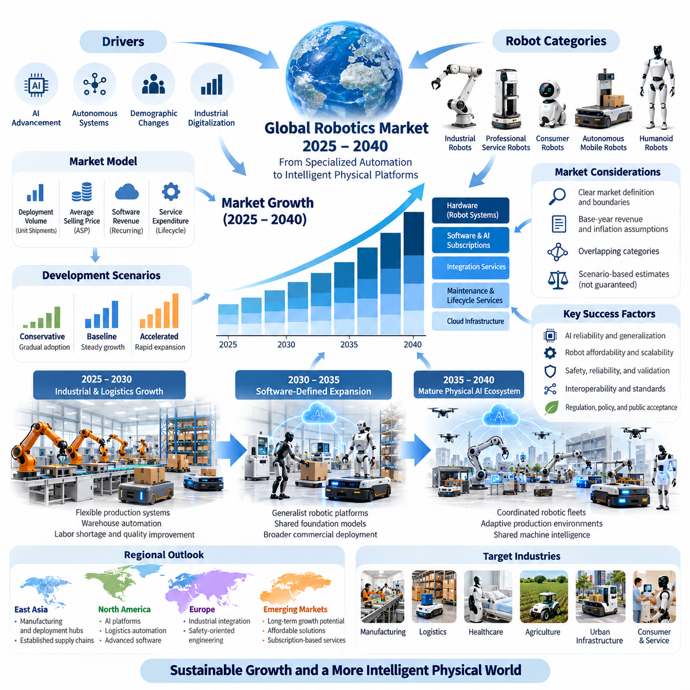
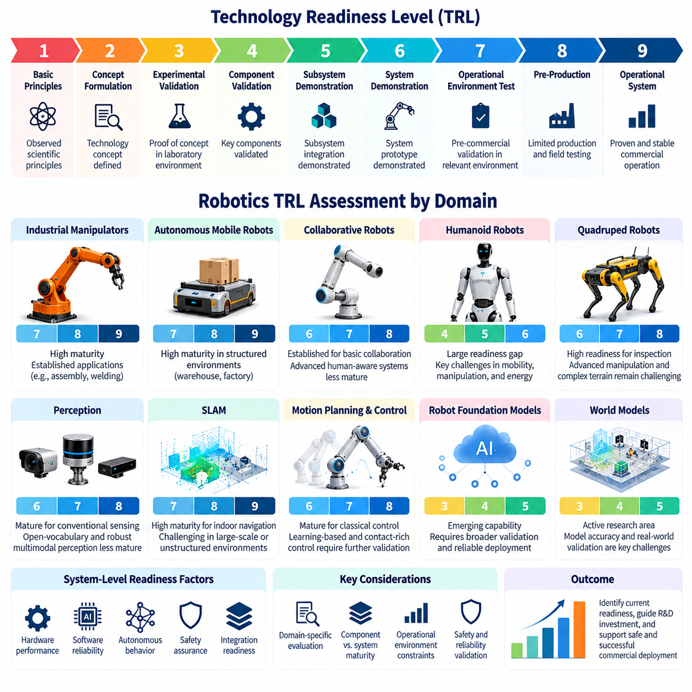
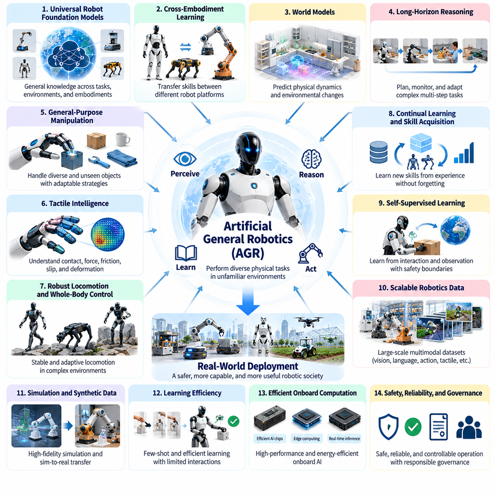
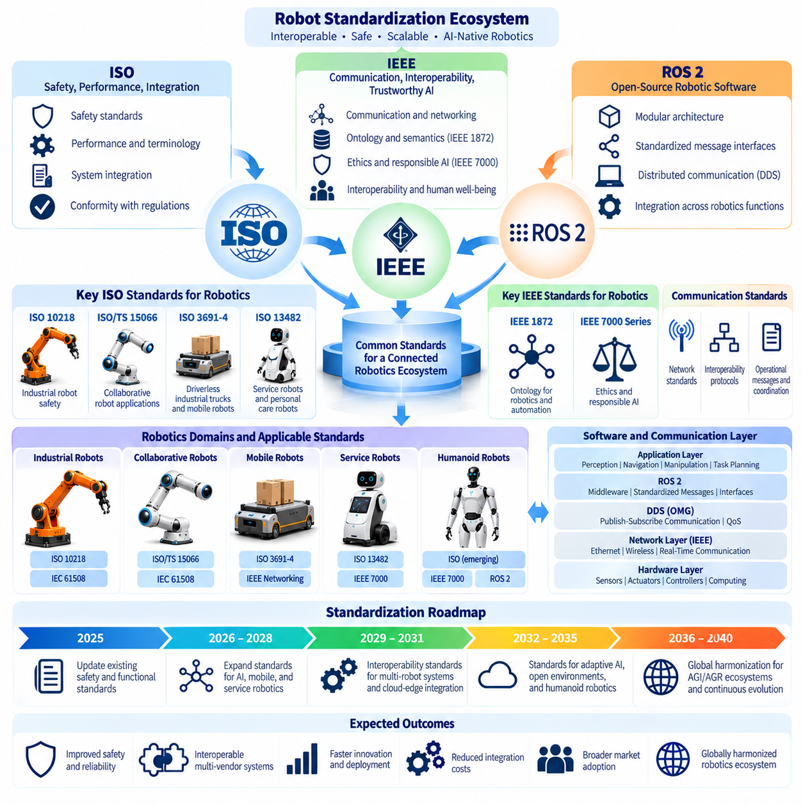
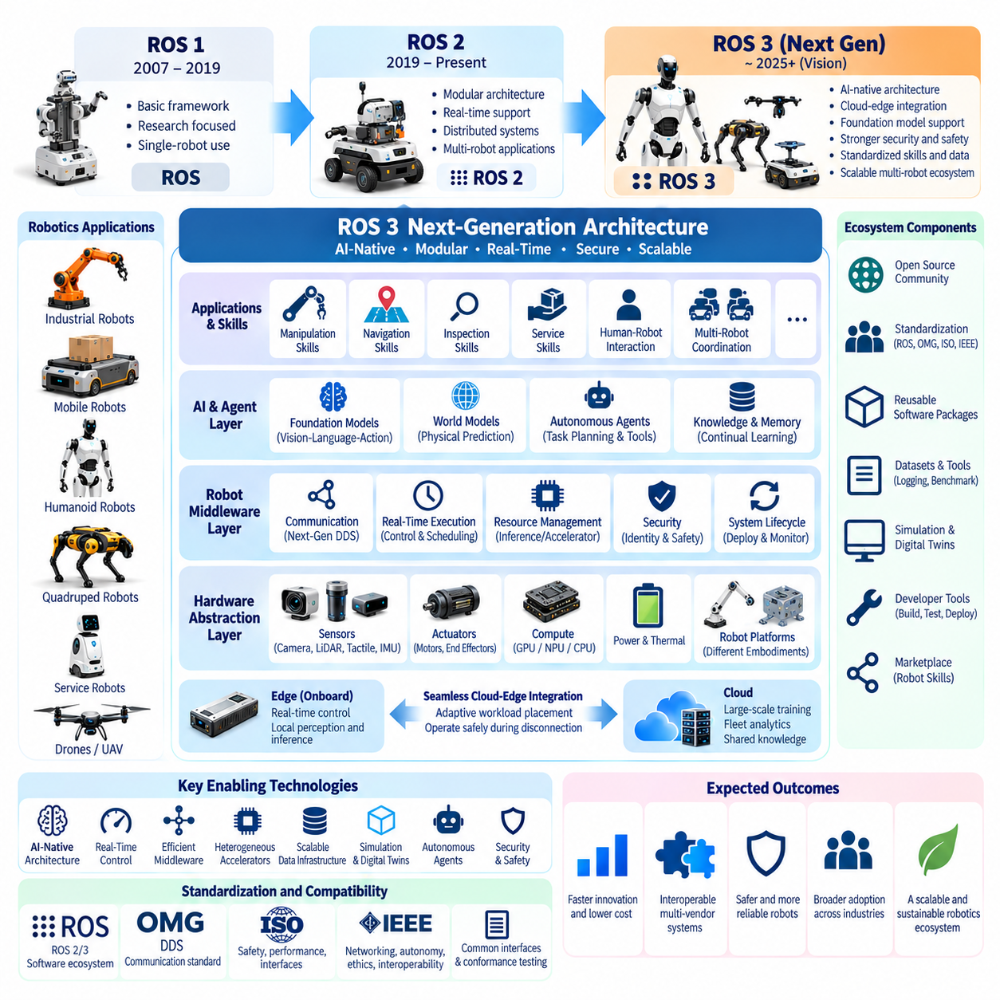
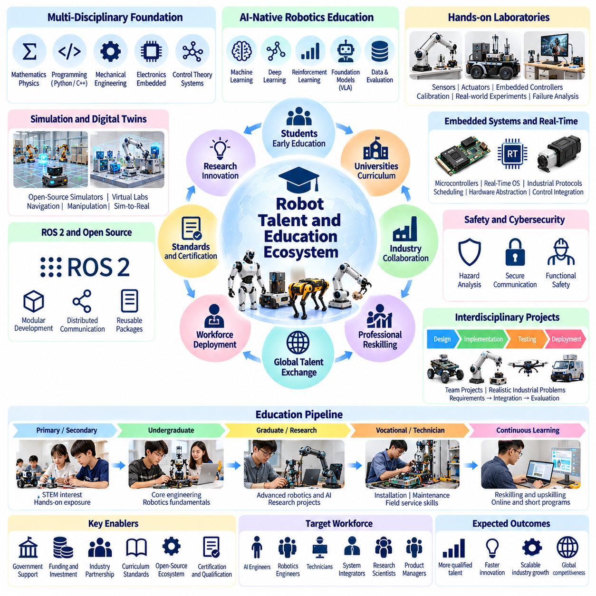
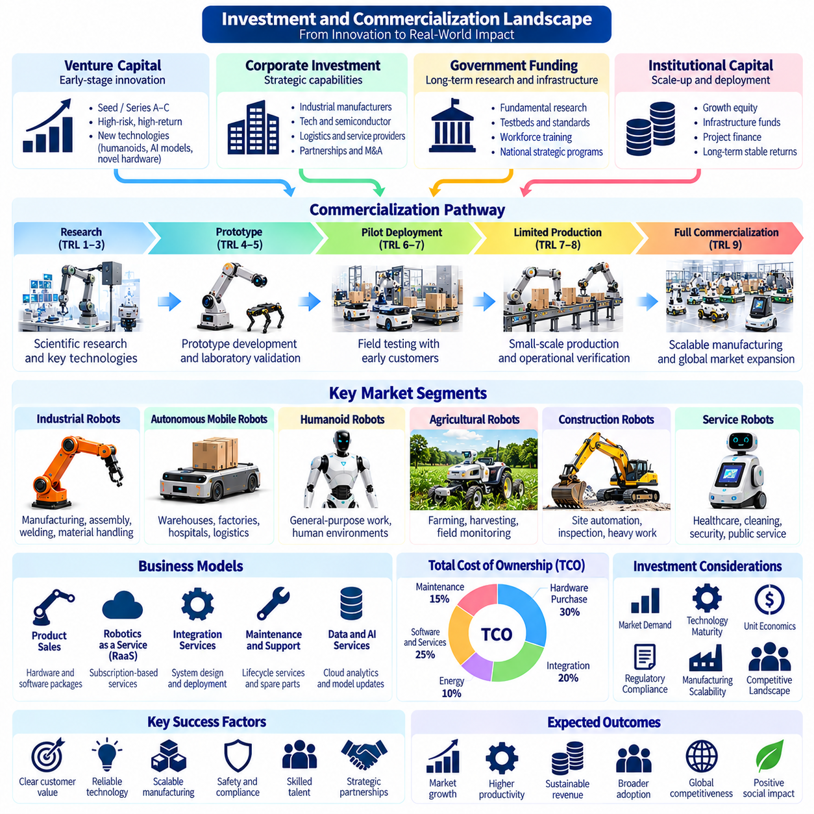
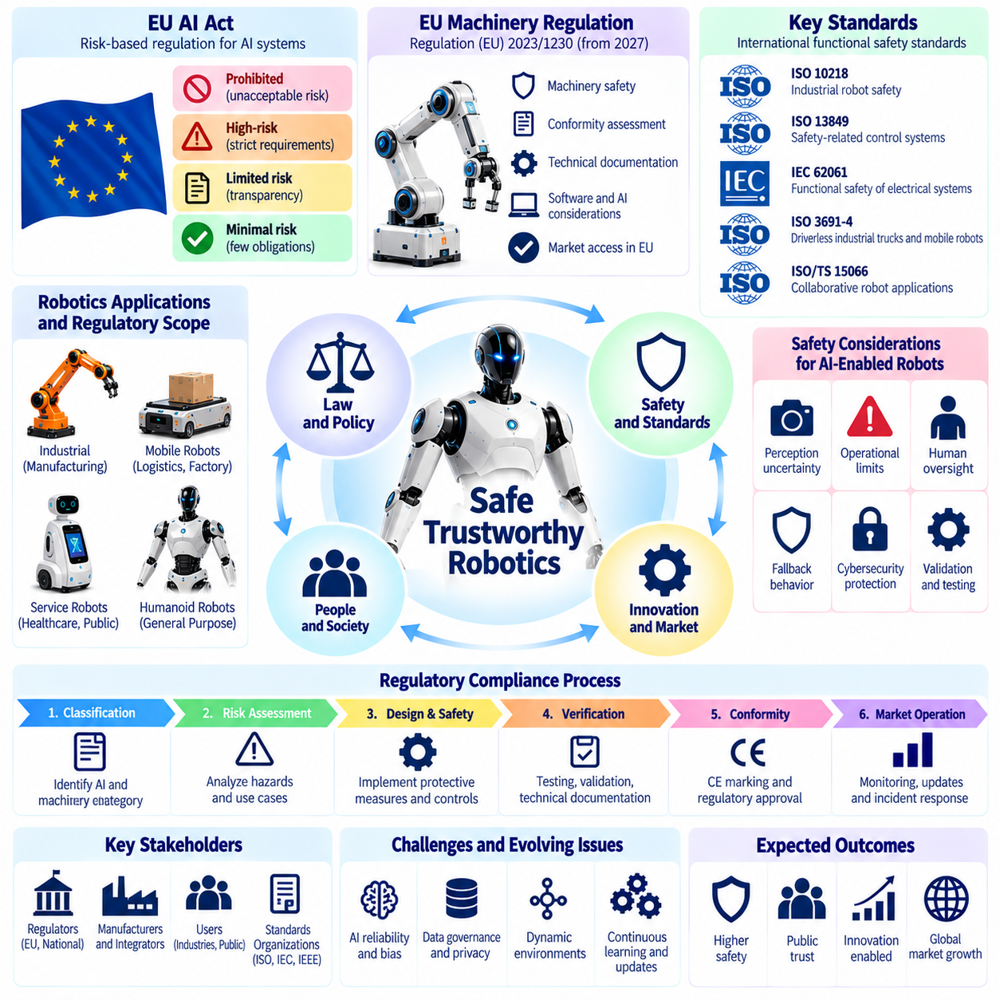
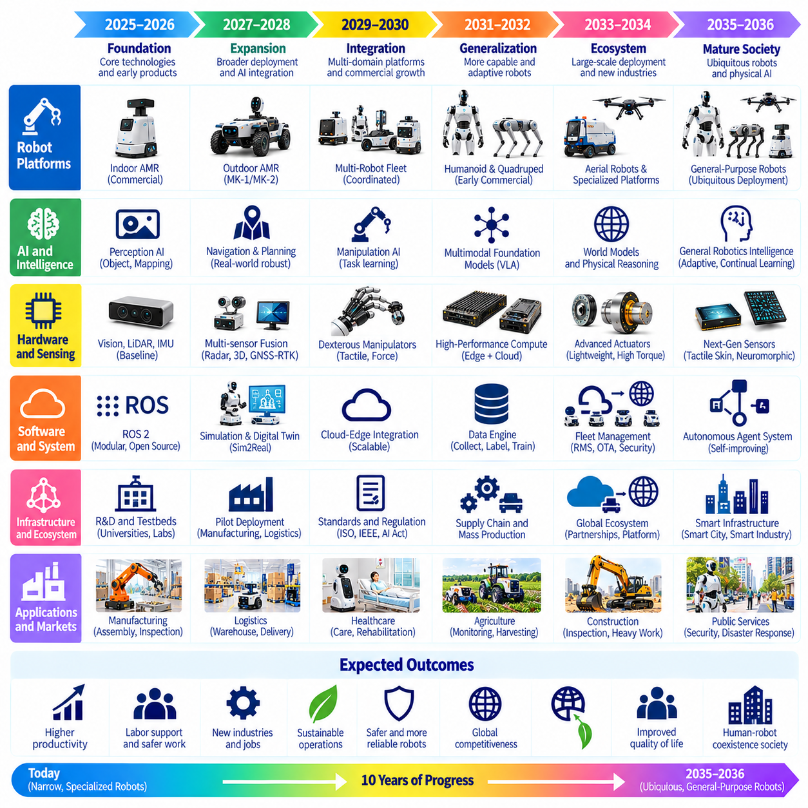
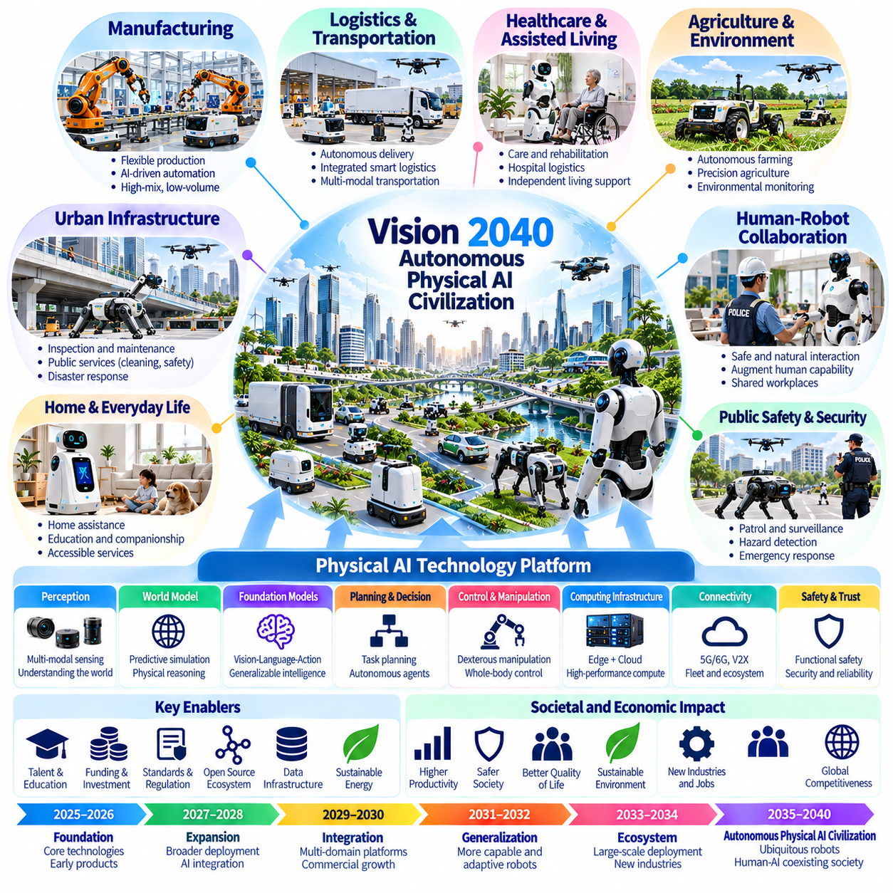

**Volume 27. Future AI Native Robotics**


# Chapter 12. Future Robotics Roadmap

##  

## 12.01. Global Robotics Market Forecast 2025--2040

{width="7.268055555555556in" height="7.268055555555556in"}

The global robotics market between 2025 and 2040 is expected to undergo a structural transformation driven by artificial intelligence, autonomous systems, demographic changes, and industrial digitalization. Robotics will progressively evolve from specialized automation equipment into intelligent physical platforms capable of perception, reasoning, manipulation, and adaptive decision-making across diverse operating environments.

Market forecasting requires a clear distinction between industrial robots, professional service robots, consumer robots, autonomous mobile robots, and emerging humanoid systems. Each category exhibits different adoption cycles, revenue structures, and technological constraints. A comprehensive forecast must also account for software platforms, AI subscriptions, integration services, maintenance, and cloud infrastructure.

The 2025 market baseline represents an important transition from conventional programmed automation toward AI-native robotics. Industrial manipulators remain central to manufacturing automation, while warehouse mobile robots, inspection platforms, and healthcare service robots demonstrate expanding commercial applications. Humanoid robots and general-purpose embodied AI remain comparatively immature markets with uncertain deployment economics.

Historical robotics market estimates vary considerably because research organizations apply different definitions of robot shipments, installed systems, software revenue, and associated services. Consequently, any projection through 2040 should specify its market boundaries, base-year revenue, inflation assumptions, and treatment of overlapping categories. Long-term numerical estimates should be interpreted as scenarios rather than guaranteed outcomes.

A practical forecasting model separates market expansion into robot deployment volume, average system selling price, recurring software revenue, and lifecycle service expenditure. Annual market revenue can be estimated by multiplying unit shipments by average selling prices and adding separately attributable software and service income. Installed-base projections additionally require assumptions concerning retirement, replacement, utilization, and operational lifetime.

Three development scenarios provide a useful framework for evaluating market uncertainty. A conservative scenario assumes gradual adoption, persistent integration costs, and strict operational restrictions. A baseline scenario assumes steady improvements in AI reliability and robot affordability. An accelerated scenario assumes major advances in general-purpose manipulation, foundation models, and scalable robot manufacturing.

During 2025--2030, industrial automation and logistics robotics are likely to remain important commercial growth engines. Manufacturers will continue adopting flexible robotic production systems to address labor shortages, improve quality consistency, and increase equipment utilization. Warehouse automation will expand through autonomous mobile robots, robotic picking systems, and integrated fleet orchestration platforms.

Artificial intelligence will increasingly influence purchasing decisions during this initial period. Traditional robot specifications emphasize payload, repeatability, speed, and mechanical reliability. AI-native platforms introduce additional performance dimensions, including task generalization, semantic understanding, autonomous recovery, and adaptation to unfamiliar objects. These capabilities may reduce application engineering costs when sufficiently validated.

Between 2030 and 2035, market development could shift toward broader deployment of software-defined and generalist robotic platforms. Shared foundation models may support multiple robot configurations, allowing manufacturers to reuse perception, planning, and manipulation capabilities. Commercial success will depend on whether model transfer reduces training requirements without compromising safety, reliability, or task-specific performance.

Humanoid robotics represents a potentially significant but highly uncertain market segment. Human-compatible morphology may provide advantages in facilities designed around existing human tools, workstations, and access routes. However, mechanical complexity, energy consumption, maintenance requirements, and safety constraints could limit adoption relative to specialized mobile manipulators and conventional industrial robots.

The 2035--2040 period could introduce more mature physical AI ecosystems characterized by coordinated robotic fleets, adaptive production environments, and shared machine intelligence. Robots may increasingly exchange learned capabilities through secure cloud-edge architectures. Nevertheless, large-scale deployment will require robust interoperability, predictable operational performance, and independent validation of continuously evolving AI components.

Regional market development will reflect differences in industrial structure, labor economics, infrastructure, and government policy. East Asian economies are positioned to remain important robotics manufacturing and deployment centers because of established automation supply chains. North America may emphasize AI platforms, logistics automation, and advanced robotics software, while European markets may prioritize industrial integration and safety-oriented engineering.

Emerging economies present substantial long-term opportunities, although adoption patterns may differ from those of highly industrialized regions. Infrastructure costs, technical workforce availability, financing conditions, and local maintenance capacity will influence deployment feasibility. Affordable modular platforms and subscription-based services could lower initial investment barriers, particularly for smaller manufacturing and logistics enterprises.

The economic competitiveness of robotics cannot be evaluated through hardware acquisition prices alone. Total cost of ownership includes installation, integration, electricity, maintenance, software licensing, cybersecurity, operator training, and downtime. A commercially viable robot must demonstrate measurable operational value through increased throughput, improved quality, reduced workplace exposure, or more reliable service delivery.

Robot-as-a-Service business models may progressively change industry revenue composition. Instead of purchasing equipment outright, customers can obtain robotic capabilities through recurring operational contracts. This arrangement shifts certain maintenance and technology risks toward service providers while potentially improving accessibility. Sustainable profitability requires careful management of utilization, financing, replacement costs, and service obligations.

AI software could become an increasingly important source of differentiation and recurring revenue. Foundation models, vision-language-action policies, fleet optimization engines, and digital twin platforms may support capability upgrades throughout a robot\'s operational life. However, software monetization will depend on demonstrable performance improvements, cybersecurity protection, licensing transparency, and customer acceptance of ongoing subscription expenses.

Technology costs will strongly influence market expansion. Improvements in actuators, batteries, sensors, embedded processors, and manufacturing processes may reduce the cost of deploying capable robotic systems. Yet falling component prices do not automatically produce lower total ownership costs. System integration, safety validation, environmental adaptation, and field maintenance may remain substantial expenses for complex autonomous platforms.

Market growth will also depend on the availability of high-quality training data and scalable simulation infrastructure. Synthetic environments, digital twins, teleoperation demonstrations, and fleet-generated operational records can support AI development. The economic value of these resources depends on data diversity, physical realism, traceability, and the ability to translate simulated performance into reliable real-world behavior.

Safety certification and regulatory compliance will become increasingly influential market factors. Industrial robots, collaborative systems, mobile platforms, and autonomous machines operate under different safety requirements. AI-native architectures introduce additional challenges involving model updates, uncertain behavior, and changing operating conditions. Certification costs may therefore affect commercialization timelines and competitive positioning.

Labor market dynamics will shape both demand and public acceptance. Aging populations and shortages of skilled workers may increase interest in automation across manufacturing, logistics, agriculture, and healthcare. At the same time, workforce displacement concerns may influence procurement and regulation. Successful adoption will require investment in technical education, human-robot collaboration, and occupational transition programs.

Energy consumption and environmental sustainability represent additional forecasting variables. Large robotic fleets consume electricity through locomotion, manipulation, onboard computing, charging infrastructure, and cloud-based AI services. Energy-efficient actuators, optimized motion planning, and specialized AI processors could improve operating economics. Lifecycle assessments must also consider manufacturing emissions, battery replacement, and equipment recycling.

Long-term forecasting should use sensitivity analysis rather than relying on a single compound annual growth rate. Important variables include deployment growth, average selling prices, AI inference costs, robot utilization, labor substitution economics, and regulatory delays. Monte Carlo simulations and scenario-based financial models can quantify uncertainty, although their outputs remain dependent on the quality of the underlying assumptions.

An effective market monitoring framework should track annual robot shipments, installed-base growth, recurring revenue per deployed system, autonomous task completion rates, and customer retention. Additional indicators include mean time between failures, integration time, safety incidents, and operating cost per completed task. These operational measures help distinguish genuine commercial adoption from prototype demonstrations and speculative investment activity.

Investment patterns may gradually shift from isolated hardware development toward integrated robotics ecosystems. Competitive advantages could emerge from proprietary operational datasets, reusable AI models, reliable deployment infrastructure, and extensive service networks. Nevertheless, open-source software and standardized interfaces may reduce entry barriers and encourage competition, making ecosystem interoperability an important strategic consideration.

The 2040 robotics market should ultimately be evaluated by the economic productivity and societal value of deployed systems rather than by robot population alone. A future dominated by specialized automation would differ substantially from one characterized by affordable general-purpose physical AI. Both outcomes remain plausible, with intermediate combinations likely across industries, geographic regions, and operational environments.

For robotics manufacturers and platform developers, the strategic implication is to pursue scalable architectures while maintaining disciplined commercial validation. Investments in modular hardware, reusable software, foundation models, simulation, cybersecurity, and lifecycle support can preserve flexibility across uncertain market scenarios. The strongest long-term position will depend on converting technological capability into dependable, economically sustainable robotic services.

2025년부터 2040년까지 세계 로봇 시장(Global Robotics Market)은 인공지능(Artificial Intelligence), 자율 시스템(Autonomous Systems), 인구 구조 변화(Demographic Changes), 산업 디지털화(Industrial Digitalization)에 의해 구조적 전환을 겪을 것으로 전망된다. 로봇 기술(Robotics Technology)은 특정 작업을 수행하는 자동화 장비에서 벗어나 다양한 운영 환경에서 인식(Perception), 추론(Reasoning), 조작(Manipulation), 적응형 의사결정(Adaptive Decision-Making)을 수행하는 지능형 물리 플랫폼(Intelligent Physical Platform)으로 발전할 것이다.

시장 예측(Market Forecasting)에서는 산업용 로봇(Industrial Robots), 전문 서비스 로봇(Professional Service Robots), 소비자용 로봇(Consumer Robots), 자율이동로봇(Autonomous Mobile Robots), 신흥 휴머노이드 시스템(Emerging Humanoid Systems)을 명확하게 구분해야 한다. 각 분야는 서로 다른 도입 주기(Adoption Cycle), 수익 구조(Revenue Structure), 기술적 제약(Technological Constraints)을 가진다. 종합적인 시장 전망에는 소프트웨어 플랫폼(Software Platforms), AI 구독 서비스(AI Subscriptions), 시스템 통합 서비스(Integration Services), 유지보수(Maintenance), 클라우드 인프라(Cloud Infrastructure)도 포함되어야 한다.

2025년 시장 기준선(Market Baseline)은 기존의 프로그래밍 기반 자동화(Programmed Automation)에서 AI 네이티브 로봇(AI-Native Robotics)으로 전환하는 중요한 시점을 나타낸다. 산업용 매니퓰레이터(Industrial Manipulators)는 제조 자동화의 핵심을 유지하며, 창고 이동로봇(Warehouse Mobile Robots), 검사 로봇(Inspection Robots), 의료 서비스 로봇(Healthcare Service Robots)은 상업적 활용을 확대하고 있다. 반면 휴머노이드 로봇(Humanoid Robots)과 범용 체화 인공지능(General-Purpose Embodied AI)은 상용화 성숙도가 상대적으로 낮고 도입 경제성에도 불확실성이 존재한다.

과거 로봇 시장 규모 추정치(Historical Robotics Market Estimates)는 조사 기관마다 상당한 차이를 보인다. 이는 로봇 출하량(Robot Shipments), 설치 시스템(Installed Systems), 소프트웨어 매출(Software Revenue), 관련 서비스(Associated Services)를 정의하는 기준이 다르기 때문이다. 따라서 2040년까지의 장기 예측(Long-Term Forecast)은 시장 범위(Market Boundaries), 기준 연도 매출(Base-Year Revenue), 물가 상승 가정(Inflation Assumptions), 중복 시장 분류 처리 기준을 명확하게 제시해야 한다. 장기 수치 전망은 확정적인 결과가 아니라 시나리오(Scenario)로 해석해야 한다.

실용적인 시장 예측 모델(Market Forecasting Model)은 로봇 배치 규모(Robot Deployment Volume), 평균 시스템 판매가격(Average System Selling Price), 반복적 소프트웨어 매출(Recurring Software Revenue), 수명주기 서비스 지출(Lifecycle Service Expenditure)을 구분한다. 연간 시장 매출(Annual Market Revenue)은 로봇 출하량에 평균 판매가격을 곱하고 별도로 귀속되는 소프트웨어 및 서비스 매출을 더하여 추정할 수 있다. 누적 설치 기반(Installed Base)을 예측하려면 폐기(Retirement), 교체(Replacement), 가동률(Utilization), 운영 수명(Operational Lifetime)에 관한 가정도 필요하다.

세 가지 발전 시나리오(Development Scenarios)는 시장 불확실성을 평가하는 유용한 분석 체계를 제공한다. 보수적 시나리오(Conservative Scenario)는 점진적인 도입, 지속적인 시스템 통합 비용, 엄격한 운영 제한을 가정한다. 기준 시나리오(Baseline Scenario)는 AI 신뢰성과 로봇 경제성이 꾸준히 개선되는 상황을 전제로 한다. 가속 시나리오(Accelerated Scenario)는 범용 조작(General-Purpose Manipulation), 파운데이션 모델(Foundation Models), 확장 가능한 로봇 제조(Scalable Robot Manufacturing)에서 중대한 기술적 돌파구가 확보되는 상황을 가정한다.

2025년부터 2030년까지 산업 자동화(Industrial Automation)와 물류 로봇(Logistics Robotics)은 주요 상업적 성장 동력으로 유지될 가능성이 높다. 제조기업은 노동력 부족(Labor Shortages)에 대응하고 품질 일관성(Quality Consistency)과 설비 가동률(Equipment Utilization)을 개선하기 위해 유연한 로봇 생산 시스템(Flexible Robotic Production Systems)을 지속적으로 도입할 것이다. 창고 자동화(Warehouse Automation)는 자율이동로봇, 로봇 피킹 시스템(Robotic Picking Systems), 통합 플릿 운영 플랫폼(Integrated Fleet Orchestration Platforms)을 중심으로 확대될 것이다.

초기 시장 확대 과정에서 인공지능은 로봇 구매 의사결정(Purchasing Decisions)에 점점 더 큰 영향을 미칠 것이다. 기존 로봇 사양은 가반하중(Payload), 반복정밀도(Repeatability), 속도(Speed), 기계적 신뢰성(Mechanical Reliability)을 강조한다. 반면 AI 네이티브 플랫폼(AI-Native Platforms)은 작업 일반화(Task Generalization), 의미 이해(Semantic Understanding), 자율 복구(Autonomous Recovery), 미지 객체 적응(Unfamiliar Object Adaptation)과 같은 새로운 성능 지표를 도입한다. 이러한 기능이 충분히 검증된다면 응용 엔지니어링 비용(Application Engineering Costs)을 줄일 수 있다.

2030년부터 2035년까지 시장은 소프트웨어 정의 로봇(Software-Defined Robots)과 범용 로봇 플랫폼(Generalist Robotic Platforms)의 광범위한 배치로 이동할 수 있다. 공유 파운데이션 모델(Shared Foundation Models)은 다양한 로봇 구성에서 인식, 계획(Planning), 조작 기능을 재사용하도록 지원할 것이다. 상업적 성공 여부는 모델 전이(Model Transfer)가 안전성(Safety), 신뢰성(Reliability), 작업별 성능(Task-Specific Performance)을 저하시키지 않으면서 학습 요구량을 줄일 수 있는지에 달려 있다.

휴머노이드 로봇(Humanoid Robotics)은 잠재적으로 중요한 시장 분야이지만 불확실성이 매우 크다. 인간 친화적 신체 구조(Human-Compatible Morphology)는 기존 인간용 도구, 작업대, 이동 통로를 중심으로 설계된 시설에서 장점을 제공할 수 있다. 그러나 기계적 복잡성(Mechanical Complexity), 에너지 소비(Energy Consumption), 유지보수 요구사항(Maintenance Requirements), 안전 제약(Safety Constraints)은 특수 목적 이동형 매니퓰레이터(Specialized Mobile Manipulators)와 기존 산업용 로봇에 비해 도입을 제한할 수 있다.

2035년부터 2040년까지는 협력형 로봇 플릿(Coordinated Robotic Fleets), 적응형 생산 환경(Adaptive Production Environments), 공유 기계 지능(Shared Machine Intelligence)을 특징으로 하는 성숙한 피지컬 AI 생태계(Physical AI Ecosystem)가 등장할 수 있다. 로봇은 보안이 확보된 클라우드-엣지 아키텍처(Cloud-Edge Architecture)를 통해 학습된 능력을 교환할 가능성이 높다. 그러나 대규모 배치(Large-Scale Deployment)를 위해서는 강력한 상호운용성(Interoperability), 예측 가능한 운영 성능(Predictable Operational Performance), 지속적으로 진화하는 AI 구성요소에 대한 독립적인 검증(Independent Validation)이 필요하다.

지역별 시장 발전(Regional Market Development)은 산업 구조(Industrial Structure), 노동 경제성(Labor Economics), 인프라(Infrastructure), 정부 정책(Government Policy)의 차이에 따라 달라질 것이다. 동아시아 경제권(East Asian Economies)은 확립된 자동화 공급망(Automation Supply Chains)을 바탕으로 주요 로봇 제조 및 도입 중심지로 유지될 가능성이 높다. 북미(North America)는 AI 플랫폼, 물류 자동화, 첨단 로봇 소프트웨어에 집중할 수 있으며, 유럽(Europe)은 산업 시스템 통합(Industrial Integration)과 안전 중심 엔지니어링(Safety-Oriented Engineering)을 우선시할 가능성이 있다.

신흥 경제권(Emerging Economies)은 상당한 장기 성장 기회를 제공하지만, 도입 양상은 고도로 산업화된 지역과 다를 수 있다. 인프라 비용(Infrastructure Costs), 기술 인력 확보(Technical Workforce Availability), 금융 조건(Financing Conditions), 현지 유지보수 역량(Local Maintenance Capacity)이 로봇 배치 가능성을 결정한다. 저비용 모듈형 플랫폼(Affordable Modular Platforms)과 구독 기반 서비스(Subscription-Based Services)는 특히 중소 제조기업과 물류기업의 초기 투자 장벽(Initial Investment Barriers)을 낮출 수 있다.

로봇의 경제적 경쟁력(Economic Competitiveness)은 하드웨어 구매가격(Hardware Acquisition Price)만으로 평가할 수 없다. 총소유비용(Total Cost of Ownership, TCO)에는 설치(Installation), 시스템 통합(Integration), 전력(Electricity), 유지보수(Maintenance), 소프트웨어 라이선스(Software Licensing), 사이버보안(Cybersecurity), 운영자 교육(Operator Training), 가동 중단(Downtime)이 포함된다. 상업적으로 성공 가능한 로봇은 처리량(Throughput) 증가, 품질 개선, 작업자 위험 노출 감소, 안정적인 서비스 제공을 통해 측정 가능한 운영 가치(Measurable Operational Value)를 입증해야 한다.

서비스형 로봇(Robot-as-a-Service, RaaS) 비즈니스 모델(Business Model)은 산업의 매출 구성을 점진적으로 변화시킬 수 있다. 고객은 장비를 직접 구매하는 대신 반복적인 운영 계약(Recurring Operational Contracts)을 통해 로봇 기능을 이용할 수 있다. 이러한 방식은 유지보수와 기술적 위험의 일부를 서비스 제공업체(Service Providers)로 이전하면서 접근성을 개선할 수 있다. 지속 가능한 수익성(Sustainable Profitability)을 확보하려면 가동률, 금융 비용, 장비 교체비용, 서비스 의무를 체계적으로 관리해야 한다.

AI 소프트웨어(AI Software)는 점차 중요한 차별화 요소(Differentiation Factor)이자 반복 매출(Recurring Revenue)의 원천이 될 수 있다. 파운데이션 모델, 비전-언어-행동 정책(Vision-Language-Action Policies), 플릿 최적화 엔진(Fleet Optimization Engines), 디지털 트윈 플랫폼(Digital Twin Platforms)은 로봇 운영 수명 전체에 걸친 기능 업그레이드(Capability Upgrades)를 지원할 수 있다. 그러나 소프트웨어 수익화(Software Monetization)는 검증 가능한 성능 개선, 사이버보안, 투명한 라이선스 체계, 지속적인 구독 비용에 대한 고객 수용성에 달려 있다.

기술 비용(Technology Costs)은 시장 확대에 강력한 영향을 미칠 것이다. 액추에이터(Actuators), 배터리(Batteries), 센서(Sensors), 임베디드 프로세서(Embedded Processors), 제조 공정(Manufacturing Processes)의 개선은 고성능 로봇 시스템의 배치 비용을 낮출 수 있다. 그러나 부품 가격 하락이 총소유비용 감소로 자동 연결되지는 않는다. 복잡한 자율 플랫폼에서는 시스템 통합, 안전 검증(Safety Validation), 환경 적응(Environmental Adaptation), 현장 유지보수(Field Maintenance)가 여전히 상당한 비용을 차지할 수 있다.

시장 성장은 고품질 학습 데이터(High-Quality Training Data)와 확장 가능한 시뮬레이션 인프라(Scalable Simulation Infrastructure)의 확보에도 영향을 받는다. 합성 환경(Synthetic Environments), 디지털 트윈(Digital Twins), 원격조작 시연(Teleoperation Demonstrations), 플릿 운영 데이터(Fleet-Generated Operational Records)는 AI 개발을 지원할 수 있다. 이러한 자원의 경제적 가치는 데이터 다양성(Data Diversity), 물리적 사실성(Physical Realism), 추적성(Traceability), 시뮬레이션 성능을 실제 환경의 신뢰성 있는 동작으로 전환하는 능력에 달려 있다.

안전 인증(Safety Certification)과 규제 준수(Regulatory Compliance)는 점차 중요한 시장 요인이 될 것이다. 산업용 로봇, 협동로봇(Collaborative Robots), 이동형 플랫폼(Mobile Platforms), 자율 기계(Autonomous Machines)는 서로 다른 안전 요구사항(Safety Requirements)을 적용받는다. AI 네이티브 아키텍처(AI-Native Architectures)는 모델 업데이트(Model Updates), 불확실한 동작(Uncertain Behavior), 변화하는 운영 조건(Changing Operating Conditions)과 관련된 추가적인 과제를 제기한다. 따라서 인증 비용(Certification Costs)은 상용화 일정(Commercialization Timelines)과 경쟁 구도(Competitive Positioning)에 영향을 미칠 수 있다.

노동시장 변화(Labor Market Dynamics)는 로봇 수요와 사회적 수용성(Public Acceptance)을 동시에 형성할 것이다. 인구 고령화(Aging Populations)와 숙련 인력 부족(Skilled Worker Shortages)은 제조, 물류, 농업, 의료 분야의 자동화 수요를 증가시킬 수 있다. 동시에 일자리 대체(Workforce Displacement)에 대한 우려는 구매 결정과 규제 정책에 영향을 미칠 수 있다. 성공적인 도입을 위해서는 기술 교육(Technical Education), 인간-로봇 협업(Human-Robot Collaboration), 직업 전환 프로그램(Occupational Transition Programs)에 대한 투자가 필요하다.

에너지 소비(Energy Consumption)와 환경 지속가능성(Environmental Sustainability)은 추가적인 시장 예측 변수이다. 대규모 로봇 플릿은 이동(Locomotion), 조작(Manipulation), 온보드 컴퓨팅(Onboard Computing), 충전 인프라(Charging Infrastructure), 클라우드 기반 AI 서비스(Cloud-Based AI Services)를 통해 전력을 소비한다. 고효율 액추에이터(Energy-Efficient Actuators), 최적화된 동작 계획(Optimized Motion Planning), 특수 목적 AI 프로세서(Specialized AI Processors)는 운영 경제성을 개선할 수 있다. 수명주기 평가(Lifecycle Assessment)에는 제조 과정의 탄소배출, 배터리 교체, 장비 재활용도 포함되어야 한다.

장기 시장 예측(Long-Term Market Forecasting)은 단일 연평균 성장률(Compound Annual Growth Rate, CAGR)에 의존하기보다 민감도 분석(Sensitivity Analysis)을 활용해야 한다. 주요 변수에는 로봇 배치 증가율(Deployment Growth), 평균 판매가격, AI 추론 비용(AI Inference Costs), 로봇 가동률, 노동 대체 경제성(Labor Substitution Economics), 규제 지연(Regulatory Delays)이 포함된다. 몬테카를로 시뮬레이션(Monte Carlo Simulation)과 시나리오 기반 재무 모델(Scenario-Based Financial Models)은 불확실성을 정량화할 수 있지만, 결과의 신뢰성은 기초 가정의 품질에 좌우된다.

효과적인 시장 모니터링 체계(Market Monitoring Framework)는 연간 로봇 출하량(Annual Robot Shipments), 누적 설치 기반 증가율(Installed-Base Growth), 배치 시스템당 반복 매출(Recurring Revenue per Deployed System), 자율 작업 완료율(Autonomous Task Completion Rates), 고객 유지율(Customer Retention)을 추적해야 한다. 추가 지표로는 평균 고장 간격(Mean Time Between Failures, MTBF), 시스템 통합 시간(Integration Time), 안전 사고(Safety Incidents), 작업당 운영 비용(Operating Cost per Completed Task)이 있다. 이러한 운영 지표는 실제 상업적 도입을 시제품 시연(Prototype Demonstrations)이나 투기적 투자(Speculative Investment)와 구분하는 데 도움이 된다.

투자 구조(Investment Patterns)는 개별 하드웨어 개발에서 통합 로봇 생태계(Integrated Robotics Ecosystems) 중심으로 점진적으로 이동할 수 있다. 독점적 운영 데이터셋(Proprietary Operational Datasets), 재사용 가능한 AI 모델(Reusable AI Models), 신뢰성 있는 배치 인프라(Reliable Deployment Infrastructure), 광범위한 서비스 네트워크(Extensive Service Networks)가 경쟁우위(Competitive Advantages)의 원천이 될 수 있다. 그러나 오픈소스 소프트웨어(Open-Source Software)와 표준화된 인터페이스(Standardized Interfaces)는 진입 장벽을 낮추고 경쟁을 촉진할 수 있으므로 생태계 상호운용성이 중요한 전략적 고려사항이 된다.

2040년 로봇 시장은 궁극적으로 로봇 보유 대수(Robot Population)만이 아니라 배치된 시스템이 창출하는 경제적 생산성(Economic Productivity)과 사회적 가치(Societal Value)를 기준으로 평가해야 한다. 특수 목적 자동화(Specialized Automation)가 지배하는 미래는 경제적인 범용 피지컬 AI(General-Purpose Physical AI)가 널리 보급된 미래와 상당히 다를 것이다. 두 가지 결과 모두 실현 가능성이 있으며, 산업, 지역, 운영 환경에 따라 이들이 결합된 중간 형태가 나타날 가능성이 높다.

로봇 제조기업(Robotics Manufacturers)과 플랫폼 개발기업(Platform Developers)에 대한 전략적 시사점(Strategic Implication)은 엄격한 상업적 검증(Commercial Validation)을 유지하면서 확장 가능한 아키텍처(Scalable Architectures)를 추구해야 한다는 것이다. 모듈형 하드웨어(Modular Hardware), 재사용 가능한 소프트웨어(Reusable Software), 파운데이션 모델, 시뮬레이션(Simulation), 사이버보안, 수명주기 지원(Lifecycle Support)에 대한 투자는 불확실한 시장 시나리오에 대응할 수 있는 유연성을 제공한다. 장기적인 경쟁력은 기술적 능력을 신뢰할 수 있고 경제적으로 지속 가능한 로봇 서비스(Dependable and Economically Sustainable Robotic Services)로 전환하는 역량에 달려 있다.

##  

## 12.02. Technology Readiness Level TRL Assessment by Domain

{width="7.268055555555556in" height="7.268055555555556in"}

Technology Readiness Level (TRL) assessment provides a systematic framework for evaluating the maturity of robotics technologies before commercial deployment. The framework distinguishes scientific feasibility, laboratory validation, prototype demonstration, and operational qualification. For future AI-native robotics, TRL assessment must consider not only hardware performance but also software reliability, autonomous behavior, safety assurance, and integration readiness.

The conventional TRL framework contains nine maturity levels, beginning with observed scientific principles at TRL 1 and ending with proven operational systems at TRL 9. Intermediate levels describe concept formulation, experimental proof of concept, component validation, and system demonstration. Robotics applications require additional interpretation because mechanical, computational, and intelligent subsystems frequently mature at different rates.

A robot cannot be considered commercially mature simply because its individual components have achieved high readiness levels. A navigation algorithm may perform reliably in simulation while failing under unexpected lighting, sensor degradation, or environmental changes. System-level readiness therefore depends on the combined maturity of perception, planning, control, communication, cybersecurity, and operational safety mechanisms.

Industrial robotic manipulators represent one of the most mature robotics domains, with established applications commonly operating at TRL 9. Automotive assembly, welding, material handling, and precision manufacturing demonstrate decades of operational validation. However, emerging capabilities such as open-world manipulation and autonomous task adaptation may remain at substantially lower readiness levels despite using mature mechanical platforms.

Autonomous mobile robots operating in structured warehouses and factories have achieved high maturity in many commercial applications. Established navigation, obstacle avoidance, charging, and fleet management functions can reach TRL 8 or TRL 9 within defined operating environments. Their readiness decreases when systems must navigate highly dynamic outdoor terrain, unstructured construction sites, or environments with unpredictable human behavior.

Collaborative robotics exhibits differentiated maturity depending on interaction complexity. Conventional collaborative manipulators with validated force limitations and protective functions are commercially established. More advanced systems that interpret human intentions, predict collaborative actions, and dynamically reorganize shared tasks remain less mature. Their assessment must consider human factors, safety validation, and the reliability of interaction models.

Humanoid robotics presents a particularly wide readiness gap between component technologies and integrated autonomous performance. Individual actuators, joint controllers, and perception modules may demonstrate high technical maturity. Nevertheless, sustained bipedal mobility, dexterous manipulation, energy-efficient operation, and autonomous recovery across diverse environments require further validation before general-purpose humanoid systems can achieve operational maturity.

Quadruped robots have demonstrated considerable progress in locomotion, terrain adaptation, and autonomous inspection. Commercial platforms operating within specified industrial inspection environments can achieve high readiness levels. However, advanced manipulation, complex obstacle negotiation, and long-duration autonomous missions in uncertain environments may remain at intermediate readiness levels, depending on operational constraints and reliability requirements.

Robot perception technologies exhibit varying maturity across sensing modalities and application conditions. Conventional camera inspection, industrial LiDAR mapping, and calibrated sensor fusion are well established in controlled environments. Open-vocabulary object recognition, tactile scene understanding, and robust multimodal perception under severe environmental uncertainty remain active development areas requiring broader operational evidence.

Simultaneous Localization and Mapping (SLAM) has reached operational maturity in many indoor navigation applications. LiDAR-based localization and mapping systems are widely deployed in commercial mobile robots. Nevertheless, persistent mapping across changing environments, large-scale semantic understanding, and reliable localization in visually degraded or feature-poor conditions introduce additional challenges that can reduce readiness.

Motion planning and robot control technologies must be evaluated according to task complexity and environmental variability. Classical trajectory generation, industrial servo control, and constrained path planning are mature technologies. Learning-based whole-body control, contact-rich manipulation, and long-horizon autonomous planning often require additional verification because their performance depends on training coverage and uncertain physical interactions.

Robot foundation models and vision-language-action architectures represent emerging capabilities with substantial research momentum. These systems aim to generalize knowledge across tasks, objects, and robot embodiments. Although laboratory demonstrations can establish experimental feasibility, broader readiness requires reproducible performance, predictable failure behavior, efficient inference, and systematic validation across unfamiliar operating conditions.

World-model-based robotics introduces predictive representations of physical environments to support planning and decision-making. Learned models can simulate possible future states and improve action selection in research settings. However, model inaccuracies, accumulated prediction errors, and uncertain contact dynamics limit operational confidence. Readiness must therefore be evaluated through real-world prediction accuracy and safety-constrained decision performance.

Self-improving robotic systems introduce additional maturity challenges because their behavior can change after deployment. Offline retraining and controlled software updates are relatively established engineering practices. Autonomous online policy modification, curiosity-driven exploration, and continuous skill acquisition require stronger safeguards. Validation must demonstrate that learning improvements do not introduce unacceptable operational risks.

Cloud robotics combines mature distributed computing technologies with emerging robotic intelligence services. Remote monitoring, fleet analytics, software deployment, and centralized data processing are established commercial capabilities. Cloud-hosted planning and shared knowledge systems may reach intermediate readiness, while safety-critical remote control remains constrained by communication latency, network availability, and fault tolerance.

Neuromorphic computing and analog AI represent promising but comparatively immature approaches for robotic intelligence. Spiking neural networks, event-driven processors, and in-memory computation may improve energy efficiency for selected workloads. However, practical readiness depends on programming tools, hardware availability, reproducible benchmarks, and demonstrated advantages over conventional processors in complete robotic systems.

Quantum computing applications in robotics generally remain exploratory. Quantum optimization, quantum machine learning, and quantum-assisted motion planning have been investigated through theoretical models, simulations, and limited experimental implementations. Their readiness must be assessed against classical alternatives, considering hardware noise, data encoding overhead, scalability, and the absence of demonstrated operational advantages in most robotics applications.

Autonomous aerial robotics requires domain-specific readiness assessment because flight introduces stringent safety and reliability requirements. Conventional stabilized flight control and waypoint navigation are mature in many operational contexts. Advanced autonomous cargo delivery, dynamic airspace integration, and learning-based flight optimization require additional qualification, particularly when operating near populated areas or beyond visual line of sight.

Agricultural and construction robotics demonstrate substantial variation in maturity. Structured agricultural guidance and selected automated harvesting applications have reached commercial deployment. However, generalized crop manipulation, autonomous construction assembly, and adaptive operation under changing terrain and weather conditions remain more challenging. Environmental variability and economic feasibility strongly influence readiness.

Healthcare and assistive robotics require assessment criteria that extend beyond technical performance. Surgical robotic platforms and selected hospital logistics systems are commercially established. Autonomous patient assistance, socially adaptive care robots, and physically interactive rehabilitation systems face additional clinical, ethical, and regulatory requirements. High readiness requires evidence of safety, usability, effectiveness, and dependable long-term operation.

Technology readiness should be assessed separately from manufacturing readiness and commercial viability. A system may demonstrate operational performance while remaining expensive to manufacture, difficult to maintain, or unsuitable for large-scale deployment. Manufacturing Readiness Level, integration maturity, supply-chain stability, and lifecycle support capabilities therefore provide complementary evidence when evaluating commercialization potential.

For AI-native robotics, traditional TRL assessment benefits from additional dimensions covering data readiness, model robustness, and behavioral assurance. Training datasets must represent relevant operating conditions, while evaluation procedures must identify distribution shifts and failure boundaries. Model versioning, traceability, cybersecurity, and controlled updates become essential when learned policies influence physical actions.

A domain-specific TRL assessment should begin by defining the intended operating environment and measurable system requirements. Evaluators must identify critical technologies, establish representative test conditions, and collect objective evidence of performance. Laboratory demonstrations, simulation campaigns, hardware-in-the-loop testing, field trials, and sustained operational records provide progressively stronger validation evidence.

Readiness evaluation should also distinguish technology maturity from operational autonomy. A remotely supervised robot may achieve high readiness for a narrowly defined service while remaining incapable of independent mission execution. Consequently, autonomy level, human intervention frequency, task completion reliability, and recovery capability should be reported alongside TRL to avoid overstating system intelligence.

The transition from TRL 6 to TRL 9 is particularly demanding for intelligent robotic systems. Successful prototype demonstrations must be followed by integrated testing, environmental qualification, safety verification, and sustained field operation. Failures discovered during extended deployment frequently involve rare events, maintenance conditions, communication interruptions, or interactions that were inadequately represented during development.

A practical robotics technology roadmap should prioritize capabilities according to their current maturity, expected development effort, and strategic importance. Mature technologies can support near-term commercialization, while intermediate-readiness capabilities require targeted integration and validation programs. Early-stage technologies should remain within structured research portfolios until experimental evidence justifies broader engineering investment.

By 2040, many currently emerging robotics technologies may achieve substantially greater maturity, but progress will differ across domains. Industrial automation and structured mobile robotics are likely to continue evolving incrementally, while generalist intelligence, autonomous self-improvement, and unconventional computing face greater uncertainty. TRL assessment provides a disciplined mechanism for separating demonstrated capability from technological aspiration.

기술 성숙도 수준(Technology Readiness Level, TRL) 평가는 로봇 기술(Robotics Technology)이 상업적으로 배치되기 전에 기술적 성숙도를 체계적으로 평가하는 프레임워크(Framework)를 제공한다. 이 프레임워크는 과학적 실현 가능성(Scientific Feasibility), 실험실 검증(Laboratory Validation), 시제품 실증(Prototype Demonstration), 운영 적격성 평가(Operational Qualification)를 구분한다. 미래의 AI 네이티브 로봇(AI-Native Robotics)에 대한 TRL 평가는 하드웨어 성능뿐만 아니라 소프트웨어 신뢰성(Software Reliability), 자율 동작(Autonomous Behavior), 안전성 보증(Safety Assurance), 시스템 통합 준비도(Integration Readiness)까지 고려해야 한다.

기존의 기술 성숙도 수준(TRL) 프레임워크는 과학적 원리가 관찰되는 TRL 1부터 실제 운영 환경에서 성능이 입증된 TRL 9까지 총 9단계로 구성된다. 중간 단계에서는 개념 정립(Concept Formulation), 실험적 개념 증명(Experimental Proof of Concept), 구성요소 검증(Component Validation), 시스템 실증(System Demonstration)을 평가한다. 로봇 응용 분야에서는 기계적 구성요소(Mechanical Components), 컴퓨팅 구성요소(Computational Components), 지능형 하위 시스템(Intelligent Subsystems)의 성숙도가 서로 다른 속도로 발전하는 경우가 많으므로 추가적인 해석이 필요하다.

로봇의 개별 구성요소가 높은 기술 성숙도 수준에 도달했다고 해서 전체 로봇 시스템이 상업적으로 성숙했다고 판단할 수는 없다. 내비게이션 알고리즘(Navigation Algorithm)은 시뮬레이션(Simulation)에서 안정적으로 작동하더라도 예상하지 못한 조명 변화(Lighting Changes), 센서 성능 저하(Sensor Degradation), 환경 변화(Environmental Changes)에서는 실패할 수 있다. 따라서 시스템 수준의 준비도(System-Level Readiness)는 인식(Perception), 계획(Planning), 제어(Control), 통신(Communication), 사이버보안(Cybersecurity), 운영 안전 메커니즘(Operational Safety Mechanisms)의 통합 성숙도에 따라 결정된다.

산업용 로봇 매니퓰레이터(Industrial Robotic Manipulators)는 가장 성숙한 로봇 기술 분야 중 하나이며, 확립된 응용 분야에서는 일반적으로 TRL 9 수준으로 운영된다. 자동차 조립(Automotive Assembly), 용접(Welding), 자재 취급(Material Handling), 정밀 제조(Precision Manufacturing)는 수십 년에 걸친 운영 검증(Operational Validation) 사례를 제공한다. 그러나 개방형 환경 조작(Open-World Manipulation)과 자율 작업 적응(Autonomous Task Adaptation) 같은 새로운 기능은 성숙한 기계 플랫폼을 사용하더라도 기술 성숙도가 상당히 낮을 수 있다.

구조화된 창고와 공장에서 운영되는 자율이동로봇(Autonomous Mobile Robots, AMR)은 많은 상업적 응용 분야에서 높은 성숙도에 도달했다. 검증된 내비게이션(Navigation), 장애물 회피(Obstacle Avoidance), 충전(Charging), 플릿 관리(Fleet Management) 기능은 정의된 운영 환경에서 TRL 8 또는 TRL 9에 도달할 수 있다. 그러나 매우 동적인 실외 지형(Dynamic Outdoor Terrain), 비정형 건설 현장(Unstructured Construction Sites), 예측하기 어려운 인간 행동(Human Behavior)이 존재하는 환경에서는 기술 준비도가 낮아질 수 있다.

협동로봇(Collaborative Robotics)의 기술 성숙도는 인간과 로봇 사이의 상호작용 복잡성(Interaction Complexity)에 따라 차이가 나타난다. 검증된 힘 제한(Force Limitation)과 보호 기능(Protective Functions)을 갖춘 기존 협동 매니퓰레이터(Collaborative Manipulators)는 상업적으로 확립된 기술이다. 반면 인간 의도 인식(Human Intention Recognition), 협업 행동 예측(Collaborative Action Prediction), 공유 작업의 동적 재구성(Dynamic Task Reorganization)을 수행하는 고급 시스템은 상대적으로 성숙도가 낮다. 이러한 시스템의 평가에서는 인간 요인(Human Factors), 안전성 검증(Safety Validation), 상호작용 모델의 신뢰성(Interaction Model Reliability)을 고려해야 한다.

휴머노이드 로봇(Humanoid Robotics)은 구성요소 기술(Component Technologies)과 통합 자율 성능(Integrated Autonomous Performance) 사이에 특히 큰 기술 준비도 격차(Readiness Gap)를 보인다. 개별 액추에이터(Actuators), 관절 제어기(Joint Controllers), 인식 모듈(Perception Modules)은 높은 기술적 성숙도를 입증할 수 있다. 그러나 다양한 환경에서 지속적인 이족보행(Sustained Bipedal Mobility), 정교한 조작(Dexterous Manipulation), 에너지 효율적 운영(Energy-Efficient Operation), 자율 복구(Autonomous Recovery)를 수행하려면 추가적인 검증이 필요하다. 범용 휴머노이드 시스템(General-Purpose Humanoid Systems)이 운영 성숙도(Operational Maturity)에 도달하기 위해서는 이러한 기능의 신뢰성이 확보되어야 한다.

사족보행 로봇(Quadruped Robots)은 보행(Locomotion), 지형 적응(Terrain Adaptation), 자율 검사(Autonomous Inspection) 분야에서 상당한 발전을 이루었다. 특정 산업 검사 환경(Industrial Inspection Environments)에서 운영되는 상용 플랫폼은 높은 기술 성숙도 수준에 도달할 수 있다. 그러나 고급 조작(Advanced Manipulation), 복잡한 장애물 극복(Complex Obstacle Negotiation), 불확실한 환경에서의 장시간 자율 임무(Long-Duration Autonomous Missions)는 운영 제약과 신뢰성 요구사항에 따라 중간 수준의 기술 준비도에 머물 수 있다.

로봇 인식 기술(Robot Perception Technologies)은 센싱 방식(Sensing Modalities)과 적용 환경(Application Conditions)에 따라 서로 다른 성숙도를 보인다. 기존 카메라 검사(Camera Inspection), 산업용 라이다 매핑(Industrial LiDAR Mapping), 보정된 센서 융합(Calibrated Sensor Fusion)은 통제된 환경에서 충분히 확립된 기술이다. 반면 개방형 어휘 객체 인식(Open-Vocabulary Object Recognition), 촉각 기반 장면 이해(Tactile Scene Understanding), 심각한 환경 불확실성에서의 강건한 다중모달 인식(Robust Multimodal Perception)은 더 광범위한 운영 검증이 필요한 활발한 연구 분야이다.

동시적 위치추정 및 지도작성(Simultaneous Localization and Mapping, SLAM)은 많은 실내 내비게이션 응용 분야에서 운영 성숙도에 도달했다. 라이다 기반 위치추정 및 지도작성 시스템(LiDAR-Based Localization and Mapping Systems)은 상용 이동로봇에 널리 적용되고 있다. 그러나 변화하는 환경에서의 지속적 지도 관리(Persistent Mapping), 대규모 의미 이해(Large-Scale Semantic Understanding), 시각 정보가 저하되거나 특징이 부족한 환경에서의 안정적인 위치추정(Reliable Localization)은 기술 준비도를 낮출 수 있는 추가적인 과제를 제기한다.

동작 계획(Motion Planning)과 로봇 제어(Robot Control) 기술은 작업 복잡성(Task Complexity)과 환경 가변성(Environmental Variability)에 따라 평가해야 한다. 기존 궤적 생성(Classical Trajectory Generation), 산업용 서보 제어(Industrial Servo Control), 제약조건 기반 경로 계획(Constrained Path Planning)은 성숙한 기술이다. 반면 학습 기반 전신 제어(Learning-Based Whole-Body Control), 접촉이 많은 조작(Contact-Rich Manipulation), 장기 구간 자율 계획(Long-Horizon Autonomous Planning)은 학습 데이터의 포괄성(Training Coverage)과 불확실한 물리적 상호작용에 성능이 좌우되므로 추가적인 검증이 필요한 경우가 많다.

로봇 파운데이션 모델(Robot Foundation Models)과 비전-언어-행동 아키텍처(Vision-Language-Action Architectures)는 상당한 연구 발전이 이루어지고 있는 신흥 기술이다. 이러한 시스템은 다양한 작업, 객체, 로봇 형태(Robot Embodiments)에 걸쳐 지식을 일반화하는 것을 목표로 한다. 실험실 시연(Laboratory Demonstrations)은 실험적 실현 가능성을 입증할 수 있지만, 더 높은 기술 준비도를 확보하려면 재현 가능한 성능(Reproducible Performance), 예측 가능한 실패 동작(Predictable Failure Behavior), 효율적인 추론(Efficient Inference), 익숙하지 않은 운영 조건에서의 체계적인 검증(Systematic Validation)이 필요하다.

월드 모델 기반 로봇(World-Model-Based Robotics)은 계획과 의사결정을 지원하기 위해 물리적 환경의 예측 표현(Predictive Representations)을 도입한다. 학습된 모델(Learned Models)은 가능한 미래 상태(Future States)를 시뮬레이션하고 연구 환경에서 행동 선택(Action Selection)을 개선할 수 있다. 그러나 모델 부정확성(Model Inaccuracies), 누적 예측 오차(Accumulated Prediction Errors), 불확실한 접촉 동역학(Uncertain Contact Dynamics)은 운영 신뢰성을 제한한다. 따라서 기술 준비도는 실제 환경의 예측 정확도(Real-World Prediction Accuracy)와 안전 제약 기반 의사결정 성능(Safety-Constrained Decision Performance)을 통해 평가해야 한다.

자기 개선 로봇 시스템(Self-Improving Robotic Systems)은 배치 이후에도 동작이 변경될 수 있기 때문에 추가적인 성숙도 평가 과제를 제기한다. 오프라인 재학습(Offline Retraining)과 통제된 소프트웨어 업데이트(Controlled Software Updates)는 비교적 확립된 엔지니어링 방식이다. 그러나 자율적인 온라인 정책 수정(Autonomous Online Policy Modification), 호기심 기반 탐색(Curiosity-Driven Exploration), 지속적인 기술 습득(Continuous Skill Acquisition)에는 더욱 강력한 안전장치(Safeguards)가 필요하다. 검증 과정에서는 학습 성능의 개선이 허용할 수 없는 운영 위험(Unacceptable Operational Risks)을 초래하지 않는다는 사실을 입증해야 한다.

클라우드 로봇(Cloud Robotics)은 성숙한 분산 컴퓨팅 기술(Distributed Computing Technologies)과 새로운 로봇 지능 서비스(Robotic Intelligence Services)를 결합한다. 원격 모니터링(Remote Monitoring), 플릿 분석(Fleet Analytics), 소프트웨어 배포(Software Deployment), 중앙집중식 데이터 처리(Centralized Data Processing)는 상업적으로 확립된 기능이다. 클라우드 기반 계획(Cloud-Hosted Planning)과 공유 지식 시스템(Shared Knowledge Systems)은 중간 수준의 기술 준비도에 도달할 수 있지만, 안전 필수 원격 제어(Safety-Critical Remote Control)는 통신 지연(Communication Latency), 네트워크 가용성(Network Availability), 결함 허용성(Fault Tolerance)의 제약을 받는다.

뉴로모픽 컴퓨팅(Neuromorphic Computing)과 아날로그 AI(Analog AI)는 로봇 지능을 위한 유망하지만 상대적으로 성숙도가 낮은 기술 접근법이다. 스파이킹 신경망(Spiking Neural Networks), 이벤트 기반 프로세서(Event-Driven Processors), 메모리 내 연산(In-Memory Computing)은 특정 작업 부하(Workloads)에서 에너지 효율을 개선할 수 있다. 그러나 실제 기술 준비도는 프로그래밍 도구(Programming Tools), 하드웨어 가용성(Hardware Availability), 재현 가능한 벤치마크(Reproducible Benchmarks), 완전한 로봇 시스템에서 기존 프로세서 대비 입증된 성능상 이점에 따라 결정된다.

로봇 분야의 양자 컴퓨팅(Quantum Computing) 응용은 일반적으로 탐색적 연구 단계(Exploratory Stage)에 머물러 있다. 양자 최적화(Quantum Optimization), 양자 기계학습(Quantum Machine Learning), 양자 지원 동작 계획(Quantum-Assisted Motion Planning)은 이론적 모델(Theoretical Models), 시뮬레이션, 제한적인 실험 구현(Limited Experimental Implementations)을 통해 연구되고 있다. 이러한 기술의 준비도는 하드웨어 잡음(Hardware Noise), 데이터 인코딩 오버헤드(Data Encoding Overhead), 확장성(Scalability), 대부분의 로봇 응용에서 아직 입증되지 않은 운영상 이점을 고려하여 기존 컴퓨팅 방식과 비교 평가해야 한다.

자율 항공 로봇(Autonomous Aerial Robotics)은 비행이 엄격한 안전성과 신뢰성을 요구하므로 분야별 기술 준비도 평가(Domain-Specific Readiness Assessment)가 필요하다. 기존의 안정화 비행 제어(Stabilized Flight Control)와 경유점 내비게이션(Waypoint Navigation)은 많은 운영 환경에서 성숙한 기술이다. 그러나 고급 자율 화물 운송(Advanced Autonomous Cargo Delivery), 동적 공역 통합(Dynamic Airspace Integration), 학습 기반 비행 최적화(Learning-Based Flight Optimization)는 추가적인 적격성 평가(Qualification)가 필요하다. 특히 인구 밀집 지역이나 비가시권 비행(Beyond Visual Line of Sight, BVLOS) 환경에서는 더욱 엄격한 검증이 요구된다.

농업 및 건설 로봇(Agricultural and Construction Robotics)은 기술 성숙도에서 상당한 차이를 보인다. 구조화된 농업 주행 안내(Structured Agricultural Guidance)와 일부 자동 수확 응용(Automated Harvesting Applications)은 상업적 배치 단계에 도달했다. 그러나 범용 작물 조작(Generalized Crop Manipulation), 자율 건설 조립(Autonomous Construction Assembly), 변화하는 지형과 기상 조건에서의 적응형 운영(Adaptive Operation)은 여전히 더 어려운 과제이다. 환경 가변성과 경제적 실현 가능성(Economic Feasibility)은 기술 준비도에 강한 영향을 미친다.

의료 및 보조 로봇(Healthcare and Assistive Robotics)은 기술적 성능을 넘어서는 평가 기준이 필요하다. 수술 로봇 플랫폼(Surgical Robotic Platforms)과 일부 병원 물류 시스템(Hospital Logistics Systems)은 상업적으로 확립되어 있다. 그러나 자율 환자 지원(Autonomous Patient Assistance), 사회적 적응형 돌봄 로봇(Socially Adaptive Care Robots), 신체적 상호작용을 수행하는 재활 시스템(Physically Interactive Rehabilitation Systems)은 추가적인 임상적(Clinical), 윤리적(Ethical), 규제적(Regulatory) 요구사항에 직면한다. 높은 기술 준비도를 확보하려면 안전성, 사용성(Usability), 효과성(Effectiveness), 신뢰할 수 있는 장기 운영(Long-Term Operation)에 대한 증거가 필요하다.

기술 준비도(Technology Readiness)는 제조 준비도(Manufacturing Readiness) 및 상업적 실현 가능성(Commercial Viability)과 별도로 평가해야 한다. 시스템이 운영 성능을 입증하더라도 제조 비용이 높거나 유지보수가 어렵거나 대규모 배치에 적합하지 않을 수 있다. 따라서 제조 성숙도 수준(Manufacturing Readiness Level, MRL), 시스템 통합 성숙도(Integration Maturity), 공급망 안정성(Supply-Chain Stability), 수명주기 지원 역량(Lifecycle Support Capabilities)은 상용화 가능성을 평가할 때 보완적인 근거를 제공한다.

AI 네이티브 로봇에서는 기존 기술 성숙도 평가에 데이터 준비도(Data Readiness), 모델 강건성(Model Robustness), 행동 보증(Behavioral Assurance)을 포함하는 추가적인 평가 차원이 필요하다. 학습 데이터셋(Training Datasets)은 관련 운영 조건을 대표해야 하며, 평가 절차(Evaluation Procedures)는 분포 변화(Distribution Shifts)와 실패 경계(Failure Boundaries)를 식별해야 한다. 학습된 정책(Learned Policies)이 물리적 행동에 영향을 미치는 경우 모델 버전 관리(Model Versioning), 추적성(Traceability), 사이버보안, 통제된 업데이트(Controlled Updates)가 필수적이다.

분야별 기술 성숙도 평가(Domain-Specific TRL Assessment)는 목표 운영 환경(Intended Operating Environment)과 측정 가능한 시스템 요구사항(Measurable System Requirements)을 정의하는 것에서 시작해야 한다. 평가자는 핵심 기술(Critical Technologies)을 식별하고 대표적인 시험 조건(Representative Test Conditions)을 수립하며 객관적인 성능 증거(Objective Performance Evidence)를 수집해야 한다. 실험실 시연, 시뮬레이션 시험(Simulation Campaigns), 하드웨어 인 더 루프 시험(Hardware-in-the-Loop Testing), 현장 시험(Field Trials), 지속적인 운영 기록(Sustained Operational Records)은 점진적으로 더 강력한 검증 근거를 제공한다.

기술 준비도 평가에서는 기술 성숙도(Technology Maturity)와 운영 자율성(Operational Autonomy)을 구분해야 한다. 원격 감독(Remote Supervision)을 받는 로봇은 좁게 정의된 서비스에서 높은 기술 준비도에 도달할 수 있지만, 독립적인 임무 수행(Independent Mission Execution)은 불가능할 수 있다. 따라서 시스템 지능(System Intelligence)을 과대평가하지 않도록 자율성 수준(Autonomy Level), 인간 개입 빈도(Human Intervention Frequency), 작업 완료 신뢰성(Task Completion Reliability), 복구 능력(Recovery Capability)을 TRL과 함께 보고해야 한다.

TRL 6에서 TRL 9로의 전환은 지능형 로봇 시스템(Intelligent Robotic Systems)에서 특히 어려운 과정이다. 성공적인 시제품 실증(Prototype Demonstration) 이후에는 통합 시험(Integrated Testing), 환경 적격성 평가(Environmental Qualification), 안전성 검증(Safety Verification), 지속적인 현장 운영(Sustained Field Operation)이 수행되어야 한다. 장기간 배치 과정에서 발견되는 실패는 개발 단계에서 충분히 반영되지 않았던 드문 사건(Rare Events), 유지보수 조건(Maintenance Conditions), 통신 중단(Communication Interruptions), 상호작용 문제와 관련되는 경우가 많다.

실용적인 로봇 기술 로드맵(Robotics Technology Roadmap)은 현재 성숙도(Current Maturity), 예상 개발 노력(Expected Development Effort), 전략적 중요성(Strategic Importance)에 따라 기술 역량의 우선순위를 결정해야 한다. 성숙한 기술(Mature Technologies)은 단기 상용화(Near-Term Commercialization)를 지원할 수 있으며, 중간 수준의 기술 준비도를 가진 기능은 목표 지향적인 시스템 통합 및 검증 프로그램(Targeted Integration and Validation Programs)이 필요하다. 초기 단계 기술(Early-Stage Technologies)은 실험적 증거가 더 광범위한 엔지니어링 투자를 정당화할 때까지 체계적인 연구 포트폴리오(Structured Research Portfolios) 내에서 관리되어야 한다.

2040년까지 현재 등장하고 있는 많은 로봇 기술은 상당히 높은 성숙도에 도달할 수 있지만, 발전 속도는 분야마다 다를 것이다. 산업 자동화(Industrial Automation)와 구조화된 환경의 이동로봇(Structured Mobile Robotics)은 점진적으로 발전할 가능성이 높은 반면, 범용 로봇 지능(Generalist Robot Intelligence), 자율적 자기 개선(Autonomous Self-Improvement), 비전통적 컴퓨팅(Unconventional Computing)은 더 큰 불확실성에 직면한다. 기술 성숙도 수준(TRL) 평가는 실제로 입증된 기술 역량(Demonstrated Capability)과 미래 기술에 대한 기대(Technological Aspiration)를 구분하는 체계적인 판단 수단을 제공한다.

##  

## 12.03. Key Breakthrough Technologies Needed for AGR

{width="7.268055555555556in" height="7.268055555555556in"}

Artificial General Robotics (AGR) represents the long-term objective of developing robotic systems capable of performing diverse physical tasks across unfamiliar environments without extensive task-specific programming. Achieving AGR requires breakthroughs beyond conventional automation, combining general-purpose intelligence, physical reasoning, adaptive control, and reliable interaction with the real world. Progress depends on advances across multiple interconnected technologies.

A fundamental challenge is the development of universal robot foundation models capable of transferring knowledge between tasks, environments, and mechanical embodiments. Existing learning systems often depend on specialized training datasets and limited operational domains. AGR requires models that understand reusable physical concepts while adapting their outputs to different sensors, actuators, kinematic structures, and task constraints.

Cross-embodiment learning is essential because robots differ substantially in morphology, degrees of freedom, and actuation mechanisms. A universal policy must distinguish abstract task objectives from embodiment-specific execution requirements. Shared representations of objects, spatial relationships, contact events, and manipulation intentions could enable knowledge transfer between humanoids, mobile manipulators, quadrupeds, and industrial robotic arms.

World models constitute another critical breakthrough technology for general robotic intelligence. These models must predict how environments evolve in response to robotic actions, external disturbances, and interactions with other agents. Reliable physical prediction requires understanding object dynamics, contact mechanics, uncertainty, and temporal dependencies. Such capabilities could support planning beyond immediate sensor observations.

Long-horizon reasoning remains a major limitation of contemporary robotic intelligence. Complex tasks require robots to decompose objectives into intermediate actions, monitor execution progress, and revise plans when conditions change. AGR systems must integrate symbolic reasoning, learned representations, and feedback-driven planning while maintaining consistency between high-level intentions and low-level physical execution.

General-purpose manipulation presents one of the most demanding technical challenges. Robots must handle rigid, articulated, flexible, fragile, and previously unseen objects using adaptable grasping and contact strategies. Achieving human-comparable manipulation versatility requires advances in tactile sensing, force estimation, dexterous end effectors, and control policies capable of responding to uncertain physical interactions.

Tactile intelligence must evolve beyond simple contact detection toward detailed interpretation of pressure distribution, friction, slip, deformation, and object stability. High-resolution tactile sensors combined with multimodal learning could enable robots to regulate manipulation forces dynamically. Such systems would improve performance in assembly, textile handling, delicate object manipulation, and other contact-intensive tasks.

Robust locomotion and whole-body coordination are equally important for mobile generalist robots. Humanoids and legged platforms must maintain balance while navigating uneven terrain, carrying objects, and interacting with surrounding structures. Future control systems will need to combine learned motion strategies with model-based stability constraints, enabling adaptation without sacrificing predictable safety behavior.

A major breakthrough is needed in continual learning and autonomous skill acquisition. AGR systems should improve through experience without repeatedly retraining entire models or forgetting previously acquired capabilities. Effective lifelong learning requires stable memory architectures, selective knowledge updates, uncertainty estimation, and mechanisms for identifying when new experiences justify changes to established policies.

Self-supervised learning could reduce dependence on expensive human demonstrations and manually annotated robotics datasets. Robots may acquire useful representations by observing environmental changes, predicting sensory outcomes, and evaluating the consequences of their actions. However, autonomous exploration must operate within explicit safety boundaries to prevent damage, hazardous behavior, or uncontrolled experimentation.

Data scalability remains a central obstacle to general robotic intelligence. Internet-scale visual and language datasets provide valuable semantic knowledge but contain limited information about physical forces, contact dynamics, and executable actions. AGR development therefore requires large-scale multimodal datasets integrating vision, language, proprioception, tactile signals, robot actions, and measured environmental outcomes.

Simulation and synthetic data generation will play an important role in overcoming physical data collection limitations. High-fidelity simulators can produce diverse training experiences involving object interactions, locomotion, manipulation, and environmental disturbances. Nevertheless, improvements in simulation realism, contact modeling, and sim-to-real transfer are necessary to prevent policies from exploiting unrealistic simulated behavior.

Learning efficiency represents another essential breakthrough area. Robots cannot safely perform millions of uncontrolled physical experiments to acquire every new skill. Few-shot adaptation, imitation learning, offline reinforcement learning, and structured exploration could reduce the number of required interactions. Generalist systems must learn from limited demonstrations while maintaining reliable behavior outside familiar training conditions.

Efficient onboard computation is necessary because AGR systems must execute perception, reasoning, planning, and control under strict latency and power constraints. Large foundation models introduce substantial memory bandwidth, computational, and energy requirements. Model compression, adaptive inference, specialized accelerators, and hierarchical processing architectures could enable advanced intelligence within practical robotic hardware.

Cloud-edge intelligence may provide a scalable solution for distributing computational workloads. Cloud infrastructure can support large-scale training, shared knowledge retrieval, and computationally intensive planning, while onboard processors handle time-critical perception and control. Successful integration requires predictable communication behavior, secure data exchange, graceful degradation, and autonomous operation during network interruptions.

Memory and knowledge organization represent another important research frontier. AGR systems require persistent representations of objects, locations, learned skills, task histories, and previous failures. Combining semantic memory, episodic memory, and procedural knowledge could support long-term adaptation. Reliable memory retrieval must also account for changing environments, outdated information, and conflicting observations.

Causal reasoning and common-sense physical understanding are necessary for reliable generalization. Recognizing correlations between observations and actions is insufficient when robots encounter unfamiliar situations. AGR systems must infer why events occur, predict the consequences of interventions, and distinguish causal relationships from incidental patterns. Such reasoning could improve planning reliability and recovery from unexpected failures.

Uncertainty-aware decision-making is essential for safe operation in open environments. Generalist robots must recognize unfamiliar objects, ambiguous instructions, degraded sensors, and situations outside their validated capabilities. Probabilistic reasoning, calibrated confidence estimation, and conservative fallback strategies can help determine when autonomous execution is appropriate and when human intervention is required.

Safety assurance represents a fundamental barrier between experimental intelligence and deployable AGR. Learned policies may generate actions that are difficult to predict through conventional software verification methods. Future architectures will require independent safety monitors, constrained action interfaces, runtime verification, and systematic testing across operational boundaries. Safety-critical functions must remain dependable even when AI components fail.

Human-robot communication must progress toward grounded, context-sensitive interaction. Natural-language instructions should be translated into physically feasible actions while accounting for environmental conditions and user intent. Robots must identify ambiguous requests, communicate uncertainty, and provide understandable explanations of their decisions. Effective collaboration also requires interpreting gestures, attention, and human movement.

Multi-robot knowledge sharing could accelerate the development of general intelligence through collective experience. Distributed robotic fleets may exchange validated skills, environmental models, and failure information across deployment sites. However, shared learning introduces challenges involving data compatibility, policy transfer, cybersecurity, and quality assurance. Collective improvements must be evaluated before deployment to heterogeneous robots.

Hardware innovation remains indispensable despite advances in AI software. General-purpose robots require reliable actuators, efficient transmissions, compact power systems, robust sensors, and maintainable mechanical structures. Improvements in energy density, thermal management, compliant actuation, and modular components could extend operational endurance while reducing lifecycle costs and mechanical failure rates.

Evaluation methodology must evolve alongside general robotic capabilities. Traditional benchmarks often measure isolated tasks under controlled conditions, providing limited evidence of general intelligence. AGR assessment should examine unfamiliar task completion, cross-domain transfer, adaptation speed, intervention frequency, long-horizon reliability, and recovery performance. Reproducible testing across diverse physical environments is essential.

The convergence of these technologies will likely occur through progressive integration rather than a single revolutionary discovery. Foundation models, world models, dexterous manipulation, continual learning, efficient computing, and safety assurance must mature together. The decisive breakthrough for AGR will be the ability to combine broad task competence with dependable physical execution, allowing robots to generalize beyond their original training and deployment assumptions.

범용 로봇 인공지능(Artificial General Robotics, AGR)은 광범위한 작업별 프로그래밍(Task-Specific Programming) 없이도 익숙하지 않은 환경에서 다양한 물리적 작업을 수행할 수 있는 로봇 시스템을 개발하는 장기적인 목표를 의미한다. AGR을 실현하려면 기존 자동화(Conventional Automation)를 넘어서는 기술적 돌파구가 필요하며, 범용 지능(General-Purpose Intelligence), 물리적 추론(Physical Reasoning), 적응형 제어(Adaptive Control), 실제 세계와의 신뢰성 있는 상호작용(Reliable Interaction)을 통합해야 한다. 이러한 발전은 서로 긴밀하게 연결된 여러 기술 분야의 진보에 달려 있다.

핵심적인 과제는 작업, 환경, 기계적 구현 형태(Mechanical Embodiments) 사이에서 지식을 전이할 수 있는 범용 로봇 파운데이션 모델(Universal Robot Foundation Models)을 개발하는 것이다. 기존 학습 시스템(Learning Systems)은 특수한 학습 데이터셋(Specialized Training Datasets)과 제한된 운영 영역(Operational Domains)에 의존하는 경우가 많다. AGR은 재사용 가능한 물리적 개념(Reusable Physical Concepts)을 이해하면서 서로 다른 센서(Sensors), 액추에이터(Actuators), 운동학적 구조(Kinematic Structures), 작업 제약조건(Task Constraints)에 맞게 출력을 조정할 수 있는 모델을 필요로 한다.

서로 다른 로봇 구현 형태 간 학습(Cross-Embodiment Learning)은 로봇의 형태(Morphology), 자유도(Degrees of Freedom), 구동 메커니즘(Actuation Mechanisms)이 상당히 다르기 때문에 필수적이다. 범용 정책(Universal Policy)은 추상적인 작업 목표(Abstract Task Objectives)와 로봇 구현 형태에 특화된 실행 요구사항(Embodiment-Specific Execution Requirements)을 구분해야 한다. 객체(Objects), 공간적 관계(Spatial Relationships), 접촉 이벤트(Contact Events), 조작 의도(Manipulation Intentions)에 대한 공유 표현(Shared Representations)은 휴머노이드(Humanoids), 이동형 매니퓰레이터(Mobile Manipulators), 사족보행 로봇(Quadrupeds), 산업용 로봇 팔(Industrial Robotic Arms) 사이의 지식 전이를 가능하게 할 수 있다.

월드 모델(World Models)은 범용 로봇 지능(General Robotic Intelligence)을 실현하기 위한 또 다른 핵심 돌파 기술이다. 이러한 모델은 로봇의 행동(Robotic Actions), 외부 교란(External Disturbances), 다른 에이전트(Agents)와의 상호작용에 따라 환경이 어떻게 변화하는지 예측해야 한다. 신뢰성 있는 물리적 예측(Reliable Physical Prediction)을 위해서는 객체 동역학(Object Dynamics), 접촉 역학(Contact Mechanics), 불확실성(Uncertainty), 시간적 의존성(Temporal Dependencies)에 대한 이해가 필요하다. 이러한 능력은 즉각적인 센서 관측을 넘어서는 계획(Planning)을 지원할 수 있다.

장기 구간 추론(Long-Horizon Reasoning)은 현대 로봇 지능의 주요 한계 중 하나이다. 복잡한 작업에서는 로봇이 목표를 중간 행동(Intermediate Actions)으로 분해하고, 실행 진행 상황(Execution Progress)을 모니터링하며, 조건이 변화하면 계획을 수정해야 한다. AGR 시스템은 고수준 의도(High-Level Intentions)와 저수준 물리적 실행(Low-Level Physical Execution) 사이의 일관성을 유지하면서 기호적 추론(Symbolic Reasoning), 학습된 표현(Learned Representations), 피드백 기반 계획(Feedback-Driven Planning)을 통합해야 한다.

범용 조작(General-Purpose Manipulation)은 가장 어려운 기술적 과제 중 하나이다. 로봇은 강체(Rigid Objects), 관절형 객체(Articulated Objects), 유연한 객체(Flexible Objects), 깨지기 쉬운 객체(Fragile Objects), 이전에 관찰하지 못한 객체(Unseen Objects)를 적응형 파지(Adaptive Grasping)와 접촉 전략(Contact Strategies)을 사용하여 다룰 수 있어야 한다. 인간에 준하는 조작 범용성(Human-Comparable Manipulation Versatility)을 확보하려면 촉각 센싱(Tactile Sensing), 힘 추정(Force Estimation), 정교한 말단 효과기(Dexterous End Effectors), 불확실한 물리적 상호작용에 대응할 수 있는 제어 정책(Control Policies)의 발전이 필요하다.

촉각 지능(Tactile Intelligence)은 단순한 접촉 감지(Contact Detection)를 넘어 압력 분포(Pressure Distribution), 마찰(Friction), 미끄러짐(Slip), 변형(Deformation), 객체 안정성(Object Stability)을 상세하게 해석하는 수준으로 발전해야 한다. 고해상도 촉각 센서(High-Resolution Tactile Sensors)와 다중모달 학습(Multimodal Learning)을 결합하면 로봇이 조작 힘(Manipulation Forces)을 동적으로 조절할 수 있다. 이러한 시스템은 조립(Assembly), 섬유 취급(Textile Handling), 섬세한 객체 조작(Delicate Object Manipulation), 기타 접촉 집약적 작업(Contact-Intensive Tasks)의 성능을 개선할 것이다.

강건한 보행(Robust Locomotion)과 전신 협응(Whole-Body Coordination)은 이동형 범용 로봇(Mobile Generalist Robots)에도 중요하다. 휴머노이드와 다족보행 플랫폼(Legged Platforms)은 불균일한 지형(Uneven Terrain)을 이동하고 물체를 운반하며 주변 구조물과 상호작용하는 동안 균형(Balance)을 유지해야 한다. 미래 제어 시스템은 학습된 동작 전략(Learned Motion Strategies)과 모델 기반 안정성 제약조건(Model-Based Stability Constraints)을 결합하여 예측 가능한 안전 동작(Predictable Safety Behavior)을 희생하지 않으면서 적응성을 확보해야 한다.

지속 학습(Continual Learning)과 자율 기술 습득(Autonomous Skill Acquisition)에서는 중대한 기술적 돌파구가 필요하다. AGR 시스템은 전체 모델을 반복적으로 재학습하거나 기존에 습득한 능력을 잊어버리지 않으면서 경험을 통해 성능을 개선해야 한다. 효과적인 평생 학습(Lifelong Learning)을 위해서는 안정적인 메모리 아키텍처(Stable Memory Architectures), 선택적 지식 업데이트(Selective Knowledge Updates), 불확실성 추정(Uncertainty Estimation), 새로운 경험이 기존 정책의 변경을 정당화하는지 판단하는 메커니즘이 필요하다.

자기지도학습(Self-Supervised Learning)은 비용이 많이 드는 인간 시연(Human Demonstrations)과 수동으로 주석 처리된 로봇 데이터셋(Manually Annotated Robotics Datasets)에 대한 의존도를 줄일 수 있다. 로봇은 환경 변화(Environmental Changes)를 관찰하고, 감각 결과(Sensory Outcomes)를 예측하며, 자신의 행동 결과(Action Consequences)를 평가함으로써 유용한 표현을 학습할 수 있다. 그러나 자율 탐색(Autonomous Exploration)은 손상(Damage), 위험한 행동(Hazardous Behavior), 통제되지 않은 실험(Uncontrolled Experimentation)을 방지하기 위해 명시적인 안전 경계(Safety Boundaries) 내에서 수행되어야 한다.

데이터 확장성(Data Scalability)은 범용 로봇 지능의 핵심적인 장애요인으로 남아 있다. 인터넷 규모의 시각 및 언어 데이터셋(Internet-Scale Visual and Language Datasets)은 유용한 의미 지식(Semantic Knowledge)을 제공하지만, 물리적 힘(Physical Forces), 접촉 동역학(Contact Dynamics), 실행 가능한 행동(Executable Actions)에 관한 정보는 제한적이다. 따라서 AGR 개발에는 시각(Vision), 언어(Language), 고유수용감각(Proprioception), 촉각 신호(Tactile Signals), 로봇 행동(Robot Actions), 측정된 환경 결과(Measured Environmental Outcomes)를 통합하는 대규모 다중모달 데이터셋(Large-Scale Multimodal Datasets)이 필요하다.

시뮬레이션(Simulation)과 합성 데이터 생성(Synthetic Data Generation)은 물리적 데이터 수집(Physical Data Collection)의 한계를 극복하는 데 중요한 역할을 할 것이다. 고충실도 시뮬레이터(High-Fidelity Simulators)는 객체 상호작용(Object Interactions), 보행(Locomotion), 조작(Manipulation), 환경 교란(Environmental Disturbances)을 포함하는 다양한 학습 경험을 생성할 수 있다. 그러나 정책이 비현실적인 시뮬레이션 동작(Unrealistic Simulated Behavior)을 악용하지 않도록 시뮬레이션 사실성(Simulation Realism), 접촉 모델링(Contact Modeling), 시뮬레이션-현실 전이(Sim-to-Real Transfer)를 개선해야 한다.

학습 효율성(Learning Efficiency)은 또 다른 필수적인 기술 돌파 분야이다. 로봇은 새로운 기술을 습득하기 위해 수백만 번의 통제되지 않은 물리적 실험(Uncontrolled Physical Experiments)을 안전하게 수행할 수 없다. 소수 샘플 적응(Few-Shot Adaptation), 모방학습(Imitation Learning), 오프라인 강화학습(Offline Reinforcement Learning), 구조화된 탐색(Structured Exploration)은 필요한 상호작용 횟수를 줄일 수 있다. 범용 시스템은 제한된 시연(Limited Demonstrations)으로부터 학습하면서 익숙한 학습 조건을 벗어난 상황에서도 신뢰성 있는 동작을 유지해야 한다.

효율적인 온보드 컴퓨팅(Efficient Onboard Computation)은 AGR 시스템이 엄격한 지연시간(Latency)과 전력 제약(Power Constraints) 아래에서 인식, 추론, 계획, 제어를 수행해야 하므로 필수적이다. 대규모 파운데이션 모델(Large Foundation Models)은 상당한 메모리 대역폭(Memory Bandwidth), 연산 자원(Computational Resources), 에너지를 요구한다. 모델 압축(Model Compression), 적응형 추론(Adaptive Inference), 특수 목적 가속기(Specialized Accelerators), 계층적 처리 아키텍처(Hierarchical Processing Architectures)는 실용적인 로봇 하드웨어에서 고급 지능을 구현할 수 있도록 지원할 것이다.

클라우드-엣지 지능(Cloud-Edge Intelligence)은 연산 작업 부하(Computational Workloads)를 분산하기 위한 확장 가능한 해결책을 제공할 수 있다. 클라우드 인프라(Cloud Infrastructure)는 대규모 학습(Large-Scale Training), 공유 지식 검색(Shared Knowledge Retrieval), 연산 집약적 계획(Computationally Intensive Planning)을 지원하며, 온보드 프로세서(Onboard Processors)는 시간 제약이 엄격한 인식 및 제어(Time-Critical Perception and Control)를 담당한다. 성공적인 통합을 위해서는 예측 가능한 통신 동작(Predictable Communication Behavior), 안전한 데이터 교환(Secure Data Exchange), 점진적 성능 저하 대응(Graceful Degradation), 네트워크 중단 시 자율 운영(Autonomous Operation)이 필요하다.

메모리 및 지식 조직화(Memory and Knowledge Organization)는 또 다른 중요한 연구 영역이다. AGR 시스템은 객체, 위치, 학습된 기술, 작업 이력(Task Histories), 과거 실패(Previous Failures)에 대한 지속적인 표현(Persistent Representations)을 필요로 한다. 의미 기억(Semantic Memory), 일화 기억(Episodic Memory), 절차적 지식(Procedural Knowledge)을 결합하면 장기 적응(Long-Term Adaptation)을 지원할 수 있다. 신뢰성 있는 메모리 검색(Reliable Memory Retrieval)은 변화하는 환경, 오래된 정보(Outdated Information), 상충되는 관측(Conflicting Observations)도 고려해야 한다.

인과적 추론(Causal Reasoning)과 상식적 물리 이해(Common-Sense Physical Understanding)는 신뢰성 있는 일반화(Reliable Generalization)를 위해 필요하다. 로봇이 익숙하지 않은 상황에 직면했을 때 관측과 행동 사이의 상관관계(Correlations)를 인식하는 것만으로는 충분하지 않다. AGR 시스템은 사건이 발생하는 원인을 추론하고, 개입(Interventions)의 결과를 예측하며, 인과관계(Causal Relationships)와 우연한 패턴(Incidental Patterns)을 구분해야 한다. 이러한 추론 능력은 계획 신뢰성(Planning Reliability)과 예상하지 못한 실패로부터의 복구(Recovery)를 개선할 수 있다.

불확실성을 고려한 의사결정(Uncertainty-Aware Decision-Making)은 개방형 환경(Open Environments)에서 안전하게 운영하기 위한 필수 조건이다. 범용 로봇은 익숙하지 않은 객체, 모호한 명령(Ambiguous Instructions), 성능이 저하된 센서(Degraded Sensors), 검증된 능력 범위를 벗어난 상황을 인식해야 한다. 확률적 추론(Probabilistic Reasoning), 보정된 신뢰도 추정(Calibrated Confidence Estimation), 보수적 대체 전략(Conservative Fallback Strategies)은 자율 실행이 적절한 상황과 인간 개입(Human Intervention)이 필요한 상황을 판단하는 데 도움이 된다.

안전성 보증(Safety Assurance)은 실험적 지능(Experimental Intelligence)과 실제 배치 가능한 AGR(Deployable AGR)을 구분하는 근본적인 장벽이다. 학습된 정책(Learned Policies)은 기존 소프트웨어 검증(Conventional Software Verification) 방법으로 예측하기 어려운 행동을 생성할 수 있다. 미래 아키텍처에는 독립적인 안전 모니터(Independent Safety Monitors), 제약조건 기반 행동 인터페이스(Constrained Action Interfaces), 런타임 검증(Runtime Verification), 운영 경계 전반에 대한 체계적인 시험(Systematic Testing)이 필요하다. AI 구성요소가 실패하더라도 안전 필수 기능(Safety-Critical Functions)은 신뢰성 있게 유지되어야 한다.

인간-로봇 의사소통(Human-Robot Communication)은 실제 환경에 기반한 상황 인식형 상호작용(Grounded, Context-Sensitive Interaction)으로 발전해야 한다. 자연어 명령(Natural-Language Instructions)은 환경 조건(Environmental Conditions)과 사용자 의도(User Intent)를 고려하면서 물리적으로 실행 가능한 행동(Physically Feasible Actions)으로 변환되어야 한다. 로봇은 모호한 요청(Ambiguous Requests)을 식별하고, 불확실성을 전달하며, 자신의 결정에 대해 이해할 수 있는 설명(Understandable Explanations)을 제공해야 한다. 효과적인 협업을 위해서는 제스처(Gestures), 주의 집중(Attention), 인간의 움직임(Human Movement)을 해석하는 능력도 필요하다.

다중 로봇 지식 공유(Multi-Robot Knowledge Sharing)는 집단 경험(Collective Experience)을 통해 범용 지능의 발전을 가속할 수 있다. 분산 로봇 플릿(Distributed Robotic Fleets)은 서로 다른 배치 현장(Deployment Sites)에서 검증된 기술(Validated Skills), 환경 모델(Environmental Models), 실패 정보(Failure Information)를 교환할 수 있다. 그러나 공유 학습(Shared Learning)은 데이터 호환성(Data Compatibility), 정책 전이(Policy Transfer), 사이버보안(Cybersecurity), 품질 보증(Quality Assurance)과 관련된 과제를 발생시킨다. 집단적으로 개선된 기능은 이기종 로봇(Heterogeneous Robots)에 배포하기 전에 반드시 평가되어야 한다.

AI 소프트웨어의 발전에도 불구하고 하드웨어 혁신(Hardware Innovation)은 필수적이다. 범용 로봇은 신뢰성 있는 액추에이터(Reliable Actuators), 고효율 동력전달장치(Efficient Transmissions), 소형 전력 시스템(Compact Power Systems), 강건한 센서(Robust Sensors), 유지보수가 용이한 기계 구조(Maintainable Mechanical Structures)를 필요로 한다. 에너지 밀도(Energy Density), 열 관리(Thermal Management), 유연 구동(Compliant Actuation), 모듈형 구성요소(Modular Components)의 개선은 운영 지속시간(Operational Endurance)을 늘리는 동시에 수명주기 비용(Lifecycle Costs)과 기계적 고장률(Mechanical Failure Rates)을 낮출 수 있다.

평가 방법론(Evaluation Methodology)은 범용 로봇 능력(General Robotic Capabilities)의 발전과 함께 진화해야 한다. 기존 벤치마크(Traditional Benchmarks)는 통제된 조건에서 개별 작업을 측정하는 경우가 많아 범용 지능에 대한 제한적인 증거만 제공한다. AGR 평가는 미지 작업 완료(Unfamiliar Task Completion), 영역 간 지식 전이(Cross-Domain Transfer), 적응 속도(Adaptation Speed), 인간 개입 빈도(Intervention Frequency), 장기 구간 신뢰성(Long-Horizon Reliability), 복구 성능(Recovery Performance)을 검토해야 한다. 다양한 물리적 환경에서 재현 가능한 시험(Reproducible Testing)을 수행하는 것이 필수적이다.

이러한 기술들의 융합(Technology Convergence)은 단일한 혁명적 발견(Single Revolutionary Discovery)보다는 점진적인 통합(Progressive Integration)을 통해 이루어질 가능성이 높다. 파운데이션 모델(Foundation Models), 월드 모델(World Models), 정교한 조작(Dexterous Manipulation), 지속 학습(Continual Learning), 효율적인 컴퓨팅(Efficient Computing), 안전성 보증(Safety Assurance)은 함께 성숙해야 한다. AGR의 결정적인 기술적 돌파구(Decisive Breakthrough)는 광범위한 작업 수행 능력(Broad Task Competence)과 신뢰성 있는 물리적 실행(Dependable Physical Execution)을 결합하여 로봇이 기존 학습 및 배치 가정(Training and Deployment Assumptions)을 넘어 일반화할 수 있도록 만드는 능력이 될 것이다.

##  

## 12.04. Robot Standardization Roadmap ISO IEEE ROS

{width="7.268055555555556in" height="7.268055555555556in"}

Robot standardization is a fundamental requirement for building interoperable, safe, and scalable robotic ecosystems. As robotics evolves toward AI-native platforms, standardized interfaces must connect mechanical systems, software architectures, communication networks, and intelligent decision-making components. International organizations such as ISO and IEEE, together with open-source ecosystems including ROS, provide complementary foundations for this transformation.

The International Organization for Standardization (ISO) establishes technical requirements supporting robot safety, performance, terminology, and system integration. ISO standards help manufacturers demonstrate conformity with recognized engineering practices and regulatory expectations. Their importance increases as robots operate beyond controlled industrial environments and interact with humans, infrastructure, and autonomous machines.

ISO 10218 provides a central safety framework for industrial robots and robot applications, addressing hazards associated with robot design, integration, and operation. Its requirements influence protective measures, risk reduction, and system validation. The 2025 revision reflects evolving industrial robotics practices, including the need to assess complete robotic applications rather than treating individual components as isolated safety systems.

ISO/TS 15066 provides guidance for collaborative robot applications, particularly where humans and robots share operational spaces. Collaborative safety assessment involves contact forces, separation distances, operating modes, and application-specific hazards. Future standardization must address increasingly adaptive robot behavior while preserving measurable safety requirements and independent protective mechanisms.

Mobile robotics introduces additional standardization requirements because autonomous systems navigate shared environments containing people, equipment, and infrastructure. ISO 3691-4 addresses safety requirements for driverless industrial trucks and their systems. Its application depends on vehicle classification and intended operating conditions. Future mobile robot standards will need to accommodate more complex autonomy while maintaining verifiable operational boundaries.

Service robotics requires safety frameworks that account for human proximity, environmental uncertainty, and diverse applications. ISO 13482 addresses selected personal care robot categories, establishing requirements for hazards associated with physical interaction and mobility. However, industrial, medical, and specialized autonomous systems may fall under different regulatory frameworks, making application-specific classification essential.

Functional safety provides another important foundation for robotic standardization. Standards such as IEC 61508 establish principles for managing safety-related electrical, electronic, and programmable systems. Robotics manufacturers must translate these principles into hazard analysis, safety integrity requirements, verification procedures, and lifecycle management. AI components introduce challenges when their behavior cannot be fully specified through deterministic logic.

The Institute of Electrical and Electronics Engineers (IEEE) contributes standards relevant to communication, interoperability, autonomy, and trustworthy intelligent systems. IEEE 1872 establishes an ontology framework for robotics and automation, supporting consistent representations of concepts and relationships. Shared semantic definitions can improve communication between heterogeneous robots, engineering tools, and intelligent software services.

IEEE 7000-series standards provide additional perspectives on ethical considerations in autonomous and intelligent systems. These approaches emphasize transparency, accountability, human well-being, and responsible system design. For AI-native robotics, ethical standardization complements physical safety by addressing decisions that affect human autonomy, privacy, accessibility, and social trust.

Communication interoperability is essential for future multi-vendor robotic environments. Industrial Ethernet, wireless networking, middleware protocols, and standardized application interfaces must exchange information reliably. IEEE networking standards provide underlying communication capabilities, while robotics-specific specifications define operational messages, command semantics, and coordination procedures across heterogeneous platforms.

The Robot Operating System 2 (ROS 2) ecosystem provides an open-source software foundation for modular robotic applications. ROS 2 uses middleware abstractions, standardized message definitions, and distributed communication mechanisms to connect robotic components. Its architecture supports integration across perception, navigation, manipulation, and control systems, although ROS 2 adoption alone does not establish compliance with safety standards.

The Data Distribution Service (DDS), standardized by the Object Management Group (OMG), supports data-centric publish-subscribe communication used by many ROS 2 deployments. DDS quality-of-service policies define reliability, durability, history, and timing-related behavior. Effective interoperability requires compatible implementations, carefully configured policies, and systematic testing under realistic network conditions.

ROS 2 standardization should distinguish stable application interfaces from implementation-specific dependencies. Message schemas, coordinate conventions, lifecycle management, parameter interfaces, and execution semantics influence portability between robot platforms. Common interface definitions reduce integration effort, but compatibility testing remains necessary because software distributions, middleware implementations, and hardware configurations evolve independently.

Industrial fleet interoperability increasingly depends on shared communication specifications. VDA 5050 defines an interface between mobile robot fleet control systems and vehicles within supported operational models. Such specifications can reduce dependence on proprietary fleet interfaces. However, standardized messages do not automatically guarantee equivalent navigation behavior, traffic management capabilities, or operational safety.

Standardization for AI-native robotics must extend beyond conventional hardware and communication interfaces. Foundation models, vision-language-action policies, world models, and autonomous planning agents introduce new requirements for model descriptions, capability boundaries, and behavioral validation. Standardized metadata could identify supported tasks, training assumptions, operational limitations, and relevant evaluation evidence.

AI model interoperability presents challenges because learned representations and action spaces vary across robot embodiments. A policy trained for one manipulator cannot necessarily control another without adaptation. Future interface specifications may separate abstract task intentions from embodiment-specific control commands. This separation could improve model portability while preserving hardware constraints and independent safety enforcement.

Robot data standardization will become increasingly important as organizations share training datasets, operational records, and simulation environments. Common representations for sensor calibration, timestamps, coordinate frames, object annotations, and action trajectories can improve reproducibility. Data provenance, access permissions, licensing, and privacy requirements must accompany technical schemas to support trustworthy collaboration.

Simulation standardization can improve the transfer of robotic capabilities between development environments and physical systems. Consistent descriptions of robot geometry, dynamics, sensors, and environmental conditions support reproducible experiments. Existing formats such as URDF and emerging simulation interchange approaches provide useful foundations, although differences in physics engines and contact models remain significant obstacles.

Cybersecurity standards must become integral to robotic interoperability. Network-connected robots expose interfaces for telemetry, remote control, software updates, and cloud services. Security engineering should incorporate identity management, authentication, authorization, encryption, vulnerability handling, and secure update procedures. IEC 62443 provides relevant industrial cybersecurity principles, while application-specific threat models remain necessary.

A practical standardization roadmap for 2025--2030 should prioritize consistent safety interpretation, mature ROS 2 interfaces, secure communication, and interoperable fleet management. Manufacturers can improve deployment reliability by adopting documented APIs, automated conformance testing, and traceable safety requirements. Collaboration between standards organizations and open-source communities can reduce fragmentation without restricting technological innovation.

During 2030--2035, standardization efforts may increasingly address foundation-model interfaces, reusable robot skills, multimodal data exchange, and AI behavior evaluation. Shared benchmarks could assess task completion, robustness, uncertainty handling, and recovery performance. Such standards should remain adaptable to rapid technical change while preserving reproducibility and clearly defined operational acceptance criteria.

The 2035--2040 horizon may require broader interoperability frameworks connecting industrial robots, service robots, autonomous vehicles, aerial systems, and distributed physical AI infrastructure. Common capability descriptions and semantic communication mechanisms could support coordinated operations across domains. However, universal standards must accommodate substantial differences in physical dynamics, regulatory obligations, and safety criticality.

Conformance assessment will remain essential throughout this evolution. Standards provide requirements and common terminology, but implementation quality must be demonstrated through testing, inspection, and documented evidence. Hardware-in-the-loop evaluation, interoperability testing, cybersecurity assessment, and operational validation can establish whether robotic systems satisfy applicable requirements under defined conditions.

Open-source governance and international standardization serve different but complementary purposes. Open-source communities accelerate implementation, experimentation, and ecosystem adoption, while formal standards organizations establish consensus-based specifications and conformity frameworks. Effective cooperation requires stable interfaces, transparent change management, reference implementations, and accessible compliance documentation.

For robotics platform developers, the strategic objective is to build standards-aware architectures without assuming that every emerging technology already has an established specification. Modular software, hardware abstraction, versioned interfaces, safety isolation, and traceable verification evidence enable adaptation as standards evolve. The long-term roadmap should align interoperability, safety, cybersecurity, and AI governance with practical deployment requirements.

By 2040, successful robot standardization could support an ecosystem in which diverse machines exchange capabilities, coordinate operations, and integrate with shared digital infrastructure. Achieving this vision will require sustained cooperation among ISO, IEEE, OMG, ROS communities, regulators, manufacturers, and research institutions. Standardization will ultimately provide the technical and institutional foundation for trustworthy, scalable artificial general robotics.

로봇 표준화(Robot Standardization)는 상호운용성(Interoperability), 안전성(Safety), 확장성(Scalability)을 갖춘 로봇 생태계(Robotic Ecosystem)를 구축하기 위한 기본 요구사항이다. 로봇 기술이 AI 네이티브 플랫폼(AI-Native Platforms)으로 발전함에 따라 표준화된 인터페이스(Standardized Interfaces)는 기계 시스템(Mechanical Systems), 소프트웨어 아키텍처(Software Architectures), 통신 네트워크(Communication Networks), 지능형 의사결정 구성요소(Intelligent Decision-Making Components)를 연결해야 한다. 국제표준화기구(International Organization for Standardization, ISO), 전기전자공학자협회(Institute of Electrical and Electronics Engineers, IEEE), 로봇 운영체제(Robot Operating System, ROS)를 포함한 오픈소스 생태계(Open-Source Ecosystems)는 이러한 전환을 위한 상호 보완적인 기반을 제공한다.

국제표준화기구(ISO)는 로봇 안전성(Robot Safety), 성능(Performance), 용어(Terminology), 시스템 통합(System Integration)을 지원하는 기술 요구사항(Technical Requirements)을 수립한다. ISO 표준은 제조업체가 인정된 엔지니어링 관행(Engineering Practices)과 규제 요구사항(Regulatory Expectations)에 대한 적합성(Conformity)을 입증하도록 지원한다. 로봇이 통제된 산업 환경을 벗어나 인간, 기반시설(Infrastructure), 자율 기계(Autonomous Machines)와 상호작용하게 되면서 이러한 표준의 중요성은 더욱 커지고 있다.

ISO 10218은 산업용 로봇(Industrial Robots)과 로봇 응용 시스템(Robot Applications)을 위한 핵심 안전 프레임워크(Safety Framework)를 제공하며, 로봇 설계(Design), 통합(Integration), 운영(Operation)과 관련된 위험요인(Hazards)을 다룬다. 이 표준의 요구사항은 보호 조치(Protective Measures), 위험 감소(Risk Reduction), 시스템 검증(System Validation)에 영향을 미친다. 2025년 개정판은 개별 구성요소를 독립적인 안전 시스템으로 취급하기보다 전체 로봇 응용 시스템을 평가해야 한다는 필요성을 포함하여 변화하는 산업용 로봇 기술 관행을 반영한다.

ISO/TS 15066은 특히 인간과 로봇이 작업 공간(Operational Spaces)을 공유하는 협동로봇 응용(Collaborative Robot Applications)에 대한 지침을 제공한다. 협업 안전성 평가(Collaborative Safety Assessment)에는 접촉력(Contact Forces), 분리 거리(Separation Distances), 운영 모드(Operating Modes), 응용 분야별 위험요인(Application-Specific Hazards)이 포함된다. 미래 표준화는 측정 가능한 안전 요구사항(Measurable Safety Requirements)과 독립적인 보호 메커니즘(Independent Protective Mechanisms)을 유지하면서 점점 더 적응적으로 변화하는 로봇 동작(Adaptive Robot Behavior)을 다루어야 한다.

이동로봇(Mobile Robotics)은 사람, 장비, 기반시설이 공존하는 공유 환경(Shared Environments)을 자율 시스템이 이동하기 때문에 추가적인 표준화 요구사항이 발생한다. ISO 3691-4는 무인 산업용 트럭(Driverless Industrial Trucks)과 관련 시스템의 안전 요구사항을 규정한다. 이 표준의 적용 여부는 차량 분류(Vehicle Classification)와 의도된 운영 조건(Intended Operating Conditions)에 따라 결정된다. 미래 이동로봇 표준은 검증 가능한 운영 경계(Verifiable Operational Boundaries)를 유지하면서 더욱 복잡한 자율 기능(Autonomy)을 수용해야 한다.

서비스 로봇(Service Robotics)은 인간과의 근접성(Human Proximity), 환경 불확실성(Environmental Uncertainty), 다양한 응용 분야(Diverse Applications)를 고려하는 안전 프레임워크가 필요하다. ISO 13482는 특정 개인 돌봄 로봇(Personal Care Robots) 범주를 대상으로 물리적 상호작용(Physical Interaction)과 이동성(Mobility)에 관련된 위험요인에 대한 요구사항을 수립한다. 그러나 산업용, 의료용, 특수 목적 자율 시스템(Specialized Autonomous Systems)은 서로 다른 규제 프레임워크(Regulatory Frameworks)의 적용을 받을 수 있으므로 응용 분야별 분류(Application-Specific Classification)가 필수적이다.

기능 안전(Functional Safety)은 로봇 표준화를 위한 또 다른 중요한 기반이다. IEC 61508과 같은 표준은 안전 관련 전기·전자·프로그램 가능 시스템(Safety-Related Electrical, Electronic, and Programmable Systems)을 관리하기 위한 원칙을 수립한다. 로봇 제조업체는 이러한 원칙을 위험요인 분석(Hazard Analysis), 안전 무결성 요구사항(Safety Integrity Requirements), 검증 절차(Verification Procedures), 수명주기 관리(Lifecycle Management)에 반영해야 한다. AI 구성요소(AI Components)는 그 동작을 결정론적 논리(Deterministic Logic)만으로 완전히 명세할 수 없는 경우 새로운 과제를 발생시킨다.

전기전자공학자협회(IEEE)는 통신(Communication), 상호운용성(Interoperability), 자율성(Autonomy), 신뢰할 수 있는 지능형 시스템(Trustworthy Intelligent Systems)과 관련된 표준을 개발한다. IEEE 1872는 로봇 및 자동화 온톨로지 프레임워크(Ontology Framework for Robotics and Automation)를 수립하여 개념과 관계에 대한 일관된 표현(Consistent Representations)을 지원한다. 공유된 의미 정의(Shared Semantic Definitions)는 이기종 로봇(Heterogeneous Robots), 엔지니어링 도구(Engineering Tools), 지능형 소프트웨어 서비스(Intelligent Software Services) 사이의 의사소통을 개선할 수 있다.

IEEE 7000 계열 표준(IEEE 7000-Series Standards)은 자율 및 지능형 시스템(Autonomous and Intelligent Systems)의 윤리적 고려사항(Ethical Considerations)에 대한 추가적인 관점을 제공한다. 이러한 접근법은 투명성(Transparency), 책임성(Accountability), 인간의 복지(Human Well-Being), 책임 있는 시스템 설계(Responsible System Design)를 강조한다. AI 네이티브 로봇에서 윤리적 표준화(Ethical Standardization)는 인간의 자율성(Human Autonomy), 개인정보 보호(Privacy), 접근성(Accessibility), 사회적 신뢰(Social Trust)에 영향을 미치는 의사결정을 다룸으로써 물리적 안전성(Physical Safety)을 보완한다.

통신 상호운용성(Communication Interoperability)은 미래의 다중 공급업체 로봇 환경(Multi-Vendor Robotic Environments)에 필수적이다. 산업용 이더넷(Industrial Ethernet), 무선 네트워킹(Wireless Networking), 미들웨어 프로토콜(Middleware Protocols), 표준화된 응용 인터페이스(Standardized Application Interfaces)는 정보를 신뢰성 있게 교환해야 한다. IEEE 네트워킹 표준(Networking Standards)은 기본 통신 기능을 제공하며, 로봇 분야별 명세(Robotics-Specific Specifications)는 이기종 플랫폼 간 운영 메시지(Operational Messages), 명령 의미(Command Semantics), 협조 절차(Coordination Procedures)를 정의한다.

로봇 운영체제 2(Robot Operating System 2, ROS 2) 생태계는 모듈형 로봇 응용 프로그램(Modular Robotic Applications)을 위한 오픈소스 소프트웨어 기반(Open-Source Software Foundation)을 제공한다. ROS 2는 미들웨어 추상화(Middleware Abstractions), 표준화된 메시지 정의(Standardized Message Definitions), 분산 통신 메커니즘(Distributed Communication Mechanisms)을 사용하여 로봇 구성요소를 연결한다. 이러한 아키텍처는 인식(Perception), 내비게이션(Navigation), 조작(Manipulation), 제어(Control) 시스템 전반의 통합을 지원하지만, ROS 2를 채택했다는 사실만으로 안전 표준(Safety Standards)에 대한 적합성이 확보되는 것은 아니다.

객체관리그룹(Object Management Group, OMG)이 표준화한 데이터 분산 서비스(Data Distribution Service, DDS)는 많은 ROS 2 배포 환경에서 사용하는 데이터 중심 발행-구독 통신(Data-Centric Publish-Subscribe Communication)을 지원한다. DDS 서비스 품질 정책(Quality-of-Service Policies)은 신뢰성(Reliability), 지속성(Durability), 이력(History), 시간 관련 동작(Timing-Related Behavior)을 정의한다. 효과적인 상호운용성을 확보하려면 호환 가능한 구현(Compatible Implementations), 신중하게 구성된 정책(Carefully Configured Policies), 실제 네트워크 조건을 반영한 체계적인 시험(Systematic Testing)이 필요하다.

ROS 2 표준화에서는 안정적인 응용 인터페이스(Stable Application Interfaces)와 구현별 종속성(Implementation-Specific Dependencies)을 구분해야 한다. 메시지 스키마(Message Schemas), 좌표계 규약(Coordinate Conventions), 수명주기 관리(Lifecycle Management), 매개변수 인터페이스(Parameter Interfaces), 실행 의미(Execution Semantics)는 로봇 플랫폼 간 이식성(Portability)에 영향을 미친다. 공통 인터페이스 정의(Common Interface Definitions)는 통합 노력을 줄이지만, 소프트웨어 배포판(Software Distributions), 미들웨어 구현(Middleware Implementations), 하드웨어 구성(Hardware Configurations)이 독립적으로 발전하므로 호환성 시험(Compatibility Testing)은 계속 필요하다.

산업용 플릿 상호운용성(Industrial Fleet Interoperability)은 공유 통신 명세(Shared Communication Specifications)에 점점 더 의존하고 있다. VDA 5050은 지원되는 운영 모델(Operational Models) 내에서 이동로봇 플릿 제어 시스템(Mobile Robot Fleet Control Systems)과 차량 사이의 인터페이스를 정의한다. 이러한 명세는 독점적인 플릿 인터페이스(Proprietary Fleet Interfaces)에 대한 의존도를 줄일 수 있다. 그러나 표준화된 메시지(Standardized Messages)가 동일한 내비게이션 동작(Navigation Behavior), 교통 관리 기능(Traffic Management Capabilities), 운영 안전성(Operational Safety)을 자동으로 보장하지는 않는다.

AI 네이티브 로봇을 위한 표준화는 기존 하드웨어 및 통신 인터페이스를 넘어 확장되어야 한다. 파운데이션 모델(Foundation Models), 비전-언어-행동 정책(Vision-Language-Action Policies), 월드 모델(World Models), 자율 계획 에이전트(Autonomous Planning Agents)는 모델 설명(Model Descriptions), 능력 경계(Capability Boundaries), 행동 검증(Behavioral Validation)에 관한 새로운 요구사항을 제기한다. 표준화된 메타데이터(Standardized Metadata)는 지원되는 작업(Supported Tasks), 학습 가정(Training Assumptions), 운영 한계(Operational Limitations), 관련 평가 증거(Evaluation Evidence)를 식별하는 데 활용될 수 있다.

AI 모델 상호운용성(AI Model Interoperability)은 학습된 표현(Learned Representations)과 행동 공간(Action Spaces)이 로봇 구현 형태(Robot Embodiments)에 따라 달라지기 때문에 어려움이 존재한다. 하나의 매니퓰레이터(Manipulator)를 위해 학습된 정책(Policy)이 적응 과정(Adaptation) 없이 다른 매니퓰레이터를 반드시 제어할 수 있는 것은 아니다. 미래 인터페이스 명세(Interface Specifications)는 추상적인 작업 의도(Abstract Task Intentions)와 로봇 구현 형태별 제어 명령(Embodiment-Specific Control Commands)을 분리할 수 있다. 이러한 분리는 하드웨어 제약조건(Hardware Constraints)과 독립적인 안전 강제 기능(Independent Safety Enforcement)을 유지하면서 모델 이식성(Model Portability)을 향상할 수 있다.

로봇 데이터 표준화(Robot Data Standardization)는 조직들이 학습 데이터셋(Training Datasets), 운영 기록(Operational Records), 시뮬레이션 환경(Simulation Environments)을 공유함에 따라 더욱 중요해질 것이다. 센서 보정(Sensor Calibration), 타임스탬프(Timestamps), 좌표 프레임(Coordinate Frames), 객체 주석(Object Annotations), 행동 궤적(Action Trajectories)에 대한 공통 표현(Common Representations)은 재현성(Reproducibility)을 개선할 수 있다. 신뢰할 수 있는 협업(Trustworthy Collaboration)을 지원하려면 데이터 출처(Data Provenance), 접근 권한(Access Permissions), 라이선스(Licensing), 개인정보 보호 요구사항(Privacy Requirements)이 기술적 스키마(Technical Schemas)와 함께 제공되어야 한다.

시뮬레이션 표준화(Simulation Standardization)는 개발 환경(Development Environments)과 실제 물리 시스템(Physical Systems) 사이의 로봇 능력 전이(Capability Transfer)를 개선할 수 있다. 로봇 형상(Robot Geometry), 동역학(Dynamics), 센서(Sensors), 환경 조건(Environmental Conditions)에 대한 일관된 설명은 재현 가능한 실험(Reproducible Experiments)을 지원한다. 통합 로봇 기술 형식(Unified Robot Description Format, URDF)과 새로운 시뮬레이션 교환 방식(Simulation Interchange Approaches) 같은 기존 형식은 유용한 기반을 제공하지만, 물리 엔진(Physics Engines)과 접촉 모델(Contact Models) 사이의 차이는 여전히 중요한 장애요인이다.

사이버보안 표준(Cybersecurity Standards)은 로봇 상호운용성의 필수적인 부분이 되어야 한다. 네트워크에 연결된 로봇(Network-Connected Robots)은 원격 측정(Telemetry), 원격 제어(Remote Control), 소프트웨어 업데이트(Software Updates), 클라우드 서비스(Cloud Services)를 위한 인터페이스를 외부에 노출한다. 보안 엔지니어링(Security Engineering)에는 신원 관리(Identity Management), 인증(Authentication), 권한 부여(Authorization), 암호화(Encryption), 취약점 관리(Vulnerability Handling), 안전한 업데이트 절차(Secure Update Procedures)가 포함되어야 한다. IEC 62443은 관련 산업 사이버보안 원칙(Industrial Cybersecurity Principles)을 제공하지만, 응용 분야별 위협 모델(Application-Specific Threat Models)은 여전히 필요하다.

2025년부터 2030년까지의 실용적인 표준화 로드맵(Standardization Roadmap)은 일관된 안전성 해석(Consistent Safety Interpretation), 성숙한 ROS 2 인터페이스(Mature ROS 2 Interfaces), 안전한 통신(Secure Communication), 상호운용 가능한 플릿 관리(Interoperable Fleet Management)를 우선해야 한다. 제조업체는 문서화된 응용 프로그래밍 인터페이스(Documented Application Programming Interfaces, APIs), 자동화된 적합성 시험(Automated Conformance Testing), 추적 가능한 안전 요구사항(Traceable Safety Requirements)을 채택함으로써 배치 신뢰성(Deployment Reliability)을 향상할 수 있다. 표준화 기구(Standards Organizations)와 오픈소스 커뮤니티(Open-Source Communities) 간 협력은 기술 혁신을 제한하지 않으면서 파편화(Fragmentation)를 줄일 수 있다.

2030년부터 2035년까지 표준화 활동은 파운데이션 모델 인터페이스(Foundation-Model Interfaces), 재사용 가능한 로봇 기술(Reusable Robot Skills), 다중모달 데이터 교환(Multimodal Data Exchange), AI 행동 평가(AI Behavior Evaluation)를 점점 더 중요하게 다룰 수 있다. 공유 벤치마크(Shared Benchmarks)는 작업 완료(Task Completion), 강건성(Robustness), 불확실성 처리(Uncertainty Handling), 복구 성능(Recovery Performance)을 평가할 수 있다. 이러한 표준은 재현성과 명확하게 정의된 운영 수용 기준(Operational Acceptance Criteria)을 유지하면서 빠른 기술 변화에 적응할 수 있어야 한다.

2035년부터 2040년까지는 산업용 로봇(Industrial Robots), 서비스 로봇(Service Robots), 자율주행 차량(Autonomous Vehicles), 항공 시스템(Aerial Systems), 분산형 피지컬 AI 인프라(Distributed Physical AI Infrastructure)를 연결하는 보다 광범위한 상호운용성 프레임워크(Interoperability Frameworks)가 필요할 수 있다. 공통 능력 설명(Common Capability Descriptions)과 의미 기반 통신 메커니즘(Semantic Communication Mechanisms)은 서로 다른 영역 간 협조 운영(Coordinated Operations)을 지원할 수 있다. 그러나 범용 표준(Universal Standards)은 물리적 동역학(Physical Dynamics), 규제 의무(Regulatory Obligations), 안전 중요도(Safety Criticality)의 상당한 차이를 수용해야 한다.

적합성 평가(Conformance Assessment)는 이러한 발전 과정 전반에서 필수적인 역할을 유지할 것이다. 표준은 요구사항과 공통 용어(Common Terminology)를 제공하지만, 구현 품질(Implementation Quality)은 시험(Testing), 검사(Inspection), 문서화된 증거(Documented Evidence)를 통해 입증해야 한다. 하드웨어 인 더 루프 평가(Hardware-in-the-Loop Evaluation), 상호운용성 시험(Interoperability Testing), 사이버보안 평가(Cybersecurity Assessment), 운영 검증(Operational Validation)은 로봇 시스템이 정의된 조건에서 적용 가능한 요구사항을 충족하는지 확인할 수 있다.

오픈소스 거버넌스(Open-Source Governance)와 국제 표준화(International Standardization)는 서로 다르지만 상호 보완적인 목적을 수행한다. 오픈소스 커뮤니티는 구현(Implementation), 실험(Experimentation), 생태계 채택(Ecosystem Adoption)을 가속하는 반면, 공식 표준화 기구(Formal Standards Organizations)는 합의 기반 명세(Consensus-Based Specifications)와 적합성 프레임워크(Conformity Frameworks)를 수립한다. 효과적인 협력을 위해서는 안정적인 인터페이스(Stable Interfaces), 투명한 변경 관리(Transparent Change Management), 참조 구현(Reference Implementations), 접근 가능한 적합성 문서(Accessible Compliance Documentation)가 필요하다.

로봇 플랫폼 개발자(Robotics Platform Developers)의 전략적 목표는 모든 신흥 기술에 이미 확립된 명세가 존재한다고 가정하지 않으면서 표준을 고려한 아키텍처(Standards-Aware Architectures)를 구축하는 것이다. 모듈형 소프트웨어(Modular Software), 하드웨어 추상화(Hardware Abstraction), 버전 관리형 인터페이스(Versioned Interfaces), 안전 기능 격리(Safety Isolation), 추적 가능한 검증 증거(Traceable Verification Evidence)는 표준의 발전에 따라 시스템을 적응시킬 수 있도록 한다. 장기 로드맵(Long-Term Roadmap)은 상호운용성, 안전성, 사이버보안, AI 거버넌스(AI Governance)를 실제 배치 요구사항(Practical Deployment Requirements)과 연계해야 한다.

2040년까지 성공적인 로봇 표준화는 다양한 기계가 능력(Capabilities)을 교환하고, 운영을 조율하며, 공유 디지털 인프라(Shared Digital Infrastructure)와 통합되는 생태계를 지원할 수 있다. 이러한 비전을 실현하려면 ISO, IEEE, OMG, ROS 커뮤니티, 규제기관(Regulators), 제조업체(Manufacturers), 연구기관(Research Institutions) 사이의 지속적인 협력이 필요하다. 궁극적으로 표준화는 신뢰할 수 있고(Trustworthy), 확장 가능하며(Scalable), 범용적인 로봇 인공지능(Artificial General Robotics)을 위한 기술적·제도적 기반(Technical and Institutional Foundation)을 제공할 것이다.

##  

## 12.05. Open Source Ecosystem Evolution ROS3 Next Gen

{width="7.268055555555556in" height="7.268055555555556in"}

The evolution of open-source robotics ecosystems will play a central role in the development of AI-native robotic platforms. ROS 2 has established a modular software foundation for distributed robot applications, but future systems will require stronger integration of artificial intelligence, real-time control, cybersecurity, and cloud services. A possible next-generation architecture, often discussed conceptually as ROS 3, would extend these capabilities rather than simply replace existing middleware.

ROS 2 provides standardized communication mechanisms, lifecycle management, reusable software packages, and interfaces for heterogeneous robotic hardware. Its distributed architecture supports perception, navigation, manipulation, and fleet coordination. However, increasing dependence on foundation models, autonomous agents, and large-scale data processing creates requirements that extend beyond conventional message-passing frameworks and component-oriented software design.

A next-generation robotics framework should adopt AI-native architecture as a fundamental design principle. Intelligent components would become managed system resources rather than externally attached applications. Model execution, inference scheduling, memory allocation, accelerator access, and policy lifecycle management could be integrated into common runtime services, allowing developers to deploy intelligent capabilities consistently across different robotic platforms.

The integration of robot foundation models introduces new requirements for standardized model interfaces. Vision-language-action systems, multimodal perception models, and world models operate with different input representations and computational demands. Future open-source frameworks could provide common abstractions for model loading, inference requests, capability descriptions, and action generation while maintaining compatibility with conventional robotic control interfaces.

Real-time execution remains essential because intelligent robots must coordinate computationally intensive reasoning with deterministic physical control. A next-generation architecture should separate safety-critical control loops from variable-latency AI inference. Hierarchical execution mechanisms could combine high-frequency motor control, intermediate motion planning, and slower semantic reasoning without allowing unpredictable model execution times to compromise operational safety.

Communication middleware must evolve to accommodate heterogeneous computing resources and distributed intelligence. Traditional publish-subscribe communication remains useful, but AI-native workloads also require efficient tensor exchange, shared memory, streaming sensor processing, and remote inference services. Zero-copy transport, adaptive quality-of-service policies, and hardware-aware scheduling could reduce latency and computational overhead.

Cloud-edge integration will become increasingly important as robotic applications distribute intelligence across onboard processors, local servers, and remote infrastructure. Future frameworks should support workload placement based on latency, bandwidth, energy consumption, and operational criticality. Robots must retain essential autonomous functions during network interruptions, while cloud resources provide training, large-scale planning, fleet analytics, and shared knowledge services.

Open-source robotics ecosystems must also improve support for heterogeneous hardware accelerators. GPUs, neural processing units, specialized inference processors, and emerging neuromorphic devices introduce different execution models. Standardized acceleration interfaces could reduce vendor dependence and simplify deployment. Hardware abstraction must preserve performance while preventing application software from becoming tightly coupled to specific processors.

Robot data infrastructure will require substantial modernization to support large-scale physical AI development. Sensor streams, action trajectories, tactile measurements, language instructions, and operational outcomes must be recorded in consistent formats. Future frameworks could integrate dataset versioning, metadata management, synchronized logging, and automated quality assessment, enabling reproducible training and evaluation across laboratories and commercial deployments.

Simulation integration should become a first-class capability of next-generation open-source robotics platforms. Developers need consistent interfaces connecting digital environments, physical robots, and learning pipelines. Standardized descriptions of robot dynamics, sensor models, environmental conditions, and task objectives could improve reproducibility. However, simulation accuracy and sim-to-real transfer must remain explicit validation concerns.

Digital twins could extend simulation infrastructure into continuous operational monitoring. A digital representation of each robot may track configuration, component health, software versions, and environmental conditions. Integrating digital twins with runtime telemetry could support predictive maintenance, fault diagnosis, and performance optimization. Reliable synchronization between physical systems and digital representations would be essential.

Autonomous agent integration represents another significant architectural transition. Future robots may combine language-based task interpretation, symbolic planning, learned policies, and tool execution. An open-source agent framework should define capability discovery, task delegation, execution monitoring, and recovery interfaces. Independent safety constraints must govern physical actions regardless of the reasoning model or agent implementation.

Reusable robot skills could become standardized software artifacts within future ecosystems. A skill may encapsulate manipulation, navigation, inspection, or interaction behavior together with its preconditions and operational limitations. Skill registries could support discovery, versioning, validation, and controlled deployment. Cross-embodiment compatibility would require separating abstract task objectives from robot-specific execution mechanisms.

Security architecture must advance beyond optional middleware configuration toward integrated protection throughout the software lifecycle. Identity management, authenticated communication, access control, secure boot, signed software packages, and vulnerability management should be supported systematically. AI-native systems also require protection against malicious model updates, manipulated sensor data, and unauthorized execution of physical actions.

Functional safety and cybersecurity must remain distinguishable while operating within a coordinated engineering architecture. Open-source components can support safety-related development, but their availability does not automatically establish safety certification. Future frameworks should facilitate requirements traceability, runtime monitoring, fault containment, and verification evidence while allowing safety-critical functions to remain independently protected.

Software deployment and maintenance will become increasingly complex as robotic systems incorporate large models and distributed services. Containerized applications, reproducible builds, dependency management, and staged updates can improve operational reliability. Future open-source platforms should support rollback mechanisms, compatibility checking, and controlled model deployment to prevent software changes from introducing unexpected physical behavior.

Fleet-level intelligence requires standardized interfaces for coordinating large numbers of robots with different capabilities. Shared task allocation, traffic management, charging coordination, and operational analytics must operate across heterogeneous platforms. Open-source frameworks could integrate fleet orchestration with established interoperability specifications while maintaining clear distinctions between scheduling decisions and local safety responsibilities.

Developer productivity will depend on improved tools for debugging intelligent robotic behavior. Traditional logs and message traces are insufficient when failures arise from learned representations, uncertain perception, or complex agent reasoning. Future development environments should connect sensor observations, model outputs, planning decisions, and actuator commands into traceable execution records that support systematic failure analysis.

Testing infrastructure must expand beyond isolated software unit tests to include scenario-based evaluation and continuous system validation. Automated simulation campaigns, hardware-in-the-loop testing, fault injection, and regression benchmarks can identify failures introduced by software or model changes. Reproducible evaluation pipelines will be essential for maintaining confidence in rapidly evolving open-source robotic systems.

Community governance will strongly influence the sustainability of next-generation robotics platforms. Open standards, transparent technical decisions, long-term maintenance policies, and clear contribution processes help prevent fragmentation. Collaboration among universities, research laboratories, manufacturers, semiconductor vendors, and software developers can accelerate innovation while reducing duplicated infrastructure development.

The evolution toward a hypothetical ROS 3 should not be interpreted as a confirmed release schedule or officially established architecture. Future capabilities may emerge through continued ROS 2 development, complementary frameworks, or a formally defined successor. The important objective is architectural convergence around AI-native execution, dependable communication, reusable intelligence, and verifiable operational behavior.

Between 2025 and 2030, ecosystem development is likely to emphasize ROS 2 reliability, accelerator integration, cloud connectivity, and improved AI development tools. During the following decade, reusable robot skills, shared world models, autonomous agent frameworks, and large-scale fleet intelligence may become increasingly important. Actual adoption will depend on technical maturity, community coordination, and commercial requirements.

By 2040, an advanced open-source robotics ecosystem could provide a common software foundation for industrial robots, humanoids, autonomous vehicles, aerial platforms, and service robots. Such an ecosystem would enable developers to share intelligence, tools, and validated capabilities across different embodiments. Its long-term success will depend on combining open innovation with interoperability, security, safety assurance, and sustainable software governance.

오픈소스 로봇 생태계(Open-Source Robotics Ecosystem)의 발전은 AI 네이티브 로봇 플랫폼(AI-Native Robotic Platforms)의 개발에서 핵심적인 역할을 수행할 것이다. ROS 2는 분산 로봇 응용 프로그램(Distributed Robot Applications)을 위한 모듈형 소프트웨어 기반(Modular Software Foundation)을 구축했지만, 미래 시스템은 인공지능(Artificial Intelligence), 실시간 제어(Real-Time Control), 사이버보안(Cybersecurity), 클라우드 서비스(Cloud Services)의 더욱 긴밀한 통합을 필요로 한다. 개념적으로 ROS 3라고 논의되는 차세대 아키텍처(Next-Generation Architecture)는 기존 미들웨어(Middleware)를 단순히 대체하기보다 이러한 기능을 확장하는 방향으로 발전할 수 있다.

ROS 2는 표준화된 통신 메커니즘(Standardized Communication Mechanisms), 수명주기 관리(Lifecycle Management), 재사용 가능한 소프트웨어 패키지(Reusable Software Packages), 이기종 로봇 하드웨어(Heterogeneous Robotic Hardware)를 위한 인터페이스를 제공한다. 분산 아키텍처(Distributed Architecture)는 인식(Perception), 내비게이션(Navigation), 조작(Manipulation), 플릿 협조(Fleet Coordination)를 지원한다. 그러나 파운데이션 모델(Foundation Models), 자율 에이전트(Autonomous Agents), 대규모 데이터 처리(Large-Scale Data Processing)에 대한 의존도가 증가하면서 기존 메시지 전달 프레임워크(Message-Passing Frameworks)와 구성요소 지향 소프트웨어 설계(Component-Oriented Software Design)를 넘어서는 요구사항이 발생하고 있다.

차세대 로봇 프레임워크(Next-Generation Robotics Framework)는 AI 네이티브 아키텍처(AI-Native Architecture)를 기본 설계 원칙(Fundamental Design Principle)으로 채택해야 한다. 지능형 구성요소(Intelligent Components)는 외부에 부착되는 응용 프로그램이 아니라 관리되는 시스템 자원(Managed System Resources)이 될 것이다. 모델 실행(Model Execution), 추론 스케줄링(Inference Scheduling), 메모리 할당(Memory Allocation), 가속기 접근(Accelerator Access), 정책 수명주기 관리(Policy Lifecycle Management)를 공통 런타임 서비스(Common Runtime Services)에 통합하면 개발자가 서로 다른 로봇 플랫폼에 지능형 기능을 일관되게 배포할 수 있다.

로봇 파운데이션 모델(Robot Foundation Models)의 통합은 표준화된 모델 인터페이스(Standardized Model Interfaces)에 대한 새로운 요구사항을 발생시킨다. 비전-언어-행동 시스템(Vision-Language-Action Systems), 다중모달 인식 모델(Multimodal Perception Models), 월드 모델(World Models)은 서로 다른 입력 표현(Input Representations)과 연산 요구사항(Computational Demands)을 가진다. 미래 오픈소스 프레임워크는 기존 로봇 제어 인터페이스(Conventional Robotic Control Interfaces)와의 호환성을 유지하면서 모델 로딩(Model Loading), 추론 요청(Inference Requests), 기능 설명(Capability Descriptions), 행동 생성(Action Generation)을 위한 공통 추상화(Common Abstractions)를 제공할 수 있다.

실시간 실행(Real-Time Execution)은 지능형 로봇이 연산 집약적인 추론(Computationally Intensive Reasoning)과 결정론적 물리 제어(Deterministic Physical Control)를 조율해야 하므로 여전히 필수적이다. 차세대 아키텍처는 안전 필수 제어 루프(Safety-Critical Control Loops)를 가변 지연시간 AI 추론(Variable-Latency AI Inference)과 분리해야 한다. 계층적 실행 메커니즘(Hierarchical Execution Mechanisms)은 고주파 모터 제어(High-Frequency Motor Control), 중간 수준의 동작 계획(Intermediate Motion Planning), 상대적으로 느린 의미적 추론(Semantic Reasoning)을 결합하면서 예측하기 어려운 모델 실행시간이 운영 안전성(Operational Safety)을 저해하지 않도록 할 수 있다.

통신 미들웨어(Communication Middleware)는 이기종 컴퓨팅 자원(Heterogeneous Computing Resources)과 분산 지능(Distributed Intelligence)을 수용하도록 발전해야 한다. 기존 발행-구독 통신(Publish-Subscribe Communication)은 여전히 유용하지만, AI 네이티브 작업 부하(AI-Native Workloads)는 효율적인 텐서 교환(Tensor Exchange), 공유 메모리(Shared Memory), 스트리밍 센서 처리(Streaming Sensor Processing), 원격 추론 서비스(Remote Inference Services)도 필요로 한다. 무복사 전송(Zero-Copy Transport), 적응형 서비스 품질 정책(Adaptive Quality-of-Service Policies), 하드웨어 인식 스케줄링(Hardware-Aware Scheduling)은 지연시간과 연산 오버헤드(Computational Overhead)를 줄일 수 있다.

클라우드-엣지 통합(Cloud-Edge Integration)은 로봇 응용 프로그램이 온보드 프로세서(Onboard Processors), 로컬 서버(Local Servers), 원격 인프라(Remote Infrastructure)에 지능을 분산하면서 더욱 중요해질 것이다. 미래 프레임워크는 지연시간(Latency), 대역폭(Bandwidth), 에너지 소비(Energy Consumption), 운영 중요도(Operational Criticality)에 따라 작업 부하 배치(Workload Placement)를 지원해야 한다. 로봇은 네트워크 중단(Network Interruptions) 중에도 필수적인 자율 기능(Essential Autonomous Functions)을 유지해야 하며, 클라우드 자원은 학습(Training), 대규모 계획(Large-Scale Planning), 플릿 분석(Fleet Analytics), 공유 지식 서비스(Shared Knowledge Services)를 제공해야 한다.

오픈소스 로봇 생태계는 이기종 하드웨어 가속기(Heterogeneous Hardware Accelerators)에 대한 지원도 개선해야 한다. 그래픽 처리장치(Graphics Processing Units, GPUs), 신경망 처리장치(Neural Processing Units, NPUs), 특수 목적 추론 프로세서(Specialized Inference Processors), 새로운 뉴로모픽 장치(Neuromorphic Devices)는 서로 다른 실행 모델(Execution Models)을 도입한다. 표준화된 가속 인터페이스(Standardized Acceleration Interfaces)는 특정 공급업체에 대한 의존도(Vendor Dependence)를 줄이고 배포를 단순화할 수 있다. 하드웨어 추상화(Hardware Abstraction)는 응용 소프트웨어가 특정 프로세서에 강하게 결합되지 않도록 하면서 성능을 유지해야 한다.

로봇 데이터 인프라(Robot Data Infrastructure)는 대규모 피지컬 AI(Physical AI) 개발을 지원하기 위해 상당한 현대화가 필요하다. 센서 스트림(Sensor Streams), 행동 궤적(Action Trajectories), 촉각 측정값(Tactile Measurements), 언어 명령(Language Instructions), 운영 결과(Operational Outcomes)는 일관된 형식으로 기록되어야 한다. 미래 프레임워크는 데이터셋 버전 관리(Dataset Versioning), 메타데이터 관리(Metadata Management), 동기화된 로깅(Synchronized Logging), 자동화된 품질 평가(Automated Quality Assessment)를 통합하여 연구실과 상업적 배치 환경 전반에서 재현 가능한 학습 및 평가(Reproducible Training and Evaluation)를 지원할 수 있다.

시뮬레이션 통합(Simulation Integration)은 차세대 오픈소스 로봇 플랫폼의 핵심 기능(First-Class Capability)이 되어야 한다. 개발자는 디지털 환경(Digital Environments), 물리적 로봇(Physical Robots), 학습 파이프라인(Learning Pipelines)을 연결하는 일관된 인터페이스가 필요하다. 로봇 동역학(Robot Dynamics), 센서 모델(Sensor Models), 환경 조건(Environmental Conditions), 작업 목표(Task Objectives)에 대한 표준화된 설명은 재현성(Reproducibility)을 개선할 수 있다. 그러나 시뮬레이션 정확도(Simulation Accuracy)와 시뮬레이션-현실 전이(Sim-to-Real Transfer)는 명시적인 검증 과제로 계속 관리되어야 한다.

디지털 트윈(Digital Twins)은 시뮬레이션 인프라(Simulation Infrastructure)를 지속적인 운영 모니터링(Continuous Operational Monitoring)으로 확장할 수 있다. 각 로봇의 디지털 표현(Digital Representation)은 구성(Configuration), 구성요소 상태(Component Health), 소프트웨어 버전(Software Versions), 환경 조건(Environmental Conditions)을 추적할 수 있다. 디지털 트윈을 런타임 원격 측정(Runtime Telemetry)과 통합하면 예지보전(Predictive Maintenance), 고장 진단(Fault Diagnosis), 성능 최적화(Performance Optimization)를 지원할 수 있다. 물리 시스템과 디지털 표현 사이의 신뢰성 있는 동기화(Reliable Synchronization)는 필수적이다.

자율 에이전트 통합(Autonomous Agent Integration)은 또 다른 중요한 아키텍처 전환(Architectural Transition)을 의미한다. 미래 로봇은 언어 기반 작업 해석(Language-Based Task Interpretation), 기호적 계획(Symbolic Planning), 학습된 정책(Learned Policies), 도구 실행(Tool Execution)을 결합할 수 있다. 오픈소스 에이전트 프레임워크(Open-Source Agent Framework)는 기능 검색(Capability Discovery), 작업 위임(Task Delegation), 실행 모니터링(Execution Monitoring), 복구 인터페이스(Recovery Interfaces)를 정의해야 한다. 추론 모델(Reasoning Model)이나 에이전트 구현(Agent Implementation)에 관계없이 독립적인 안전 제약조건(Independent Safety Constraints)이 물리적 행동을 통제해야 한다.

재사용 가능한 로봇 기술(Reusable Robot Skills)은 미래 생태계에서 표준화된 소프트웨어 산출물(Standardized Software Artifacts)이 될 수 있다. 하나의 기술(Skill)은 조작(Manipulation), 내비게이션(Navigation), 검사(Inspection), 상호작용(Interaction) 동작과 함께 사전조건(Preconditions) 및 운영 한계(Operational Limitations)를 포함할 수 있다. 기술 레지스트리(Skill Registries)는 검색(Discovery), 버전 관리(Versioning), 검증(Validation), 통제된 배포(Controlled Deployment)를 지원할 수 있다. 서로 다른 로봇 구현 형태 간 호환성(Cross-Embodiment Compatibility)을 확보하려면 추상적인 작업 목표(Abstract Task Objectives)와 로봇별 실행 메커니즘(Robot-Specific Execution Mechanisms)을 분리해야 한다.

보안 아키텍처(Security Architecture)는 선택적인 미들웨어 설정(Optional Middleware Configuration)을 넘어 소프트웨어 수명주기(Software Lifecycle) 전반에 통합된 보호 체계로 발전해야 한다. 신원 관리(Identity Management), 인증된 통신(Authenticated Communication), 접근 제어(Access Control), 보안 부팅(Secure Boot), 서명된 소프트웨어 패키지(Signed Software Packages), 취약점 관리(Vulnerability Management)를 체계적으로 지원해야 한다. AI 네이티브 시스템은 악의적인 모델 업데이트(Malicious Model Updates), 조작된 센서 데이터(Manipulated Sensor Data), 승인되지 않은 물리적 행동 실행(Unauthorized Execution of Physical Actions)에 대한 보호도 필요로 한다.

기능 안전(Functional Safety)과 사이버보안(Cybersecurity)은 서로 구분되는 개념으로 유지하면서 조율된 엔지니어링 아키텍처(Coordinated Engineering Architecture) 내에서 함께 작동해야 한다. 오픈소스 구성요소(Open-Source Components)는 안전 관련 개발(Safety-Related Development)을 지원할 수 있지만, 해당 구성요소를 사용할 수 있다는 사실만으로 안전 인증(Safety Certification)이 자동으로 성립하지는 않는다. 미래 프레임워크는 요구사항 추적성(Requirements Traceability), 런타임 모니터링(Runtime Monitoring), 결함 격리(Fault Containment), 검증 증거(Verification Evidence)를 지원하면서 안전 필수 기능(Safety-Critical Functions)이 독립적으로 보호될 수 있도록 해야 한다.

로봇 시스템에 대규모 모델(Large Models)과 분산 서비스(Distributed Services)가 통합되면서 소프트웨어 배포 및 유지보수(Software Deployment and Maintenance)는 점점 더 복잡해질 것이다. 컨테이너화된 응용 프로그램(Containerized Applications), 재현 가능한 빌드(Reproducible Builds), 종속성 관리(Dependency Management), 단계적 업데이트(Staged Updates)는 운영 신뢰성(Operational Reliability)을 향상할 수 있다. 미래 오픈소스 플랫폼은 소프트웨어 변경으로 인해 예상하지 못한 물리적 동작(Unexpected Physical Behavior)이 발생하지 않도록 롤백 메커니즘(Rollback Mechanisms), 호환성 검사(Compatibility Checking), 통제된 모델 배포(Controlled Model Deployment)를 지원해야 한다.

플릿 수준 지능(Fleet-Level Intelligence)은 서로 다른 기능을 가진 다수의 로봇을 조율하기 위한 표준화된 인터페이스(Standardized Interfaces)를 필요로 한다. 공유 작업 할당(Shared Task Allocation), 교통 관리(Traffic Management), 충전 조율(Charging Coordination), 운영 분석(Operational Analytics)은 이기종 플랫폼(Heterogeneous Platforms) 전반에서 작동해야 한다. 오픈소스 프레임워크는 스케줄링 의사결정(Scheduling Decisions)과 로컬 안전 책임(Local Safety Responsibilities)을 명확하게 구분하면서 기존 상호운용성 명세(Interoperability Specifications)와 플릿 오케스트레이션(Fleet Orchestration)을 통합할 수 있다.

개발자 생산성(Developer Productivity)은 지능형 로봇 동작(Intelligent Robotic Behavior)을 디버깅(Debugging)하기 위한 개선된 도구에 달려 있다. 기존 로그(Logs)와 메시지 추적(Message Traces)만으로는 학습된 표현(Learned Representations), 불확실한 인식(Uncertain Perception), 복잡한 에이전트 추론(Complex Agent Reasoning)에서 발생하는 실패를 충분히 분석하기 어렵다. 미래 개발 환경은 센서 관측(Sensor Observations), 모델 출력(Model Outputs), 계획 의사결정(Planning Decisions), 액추에이터 명령(Actuator Commands)을 추적 가능한 실행 기록(Traceable Execution Records)으로 연결하여 체계적인 실패 분석(Systematic Failure Analysis)을 지원해야 한다.

시험 인프라(Testing Infrastructure)는 개별 소프트웨어 단위 시험(Unit Tests)을 넘어 시나리오 기반 평가(Scenario-Based Evaluation)와 지속적인 시스템 검증(Continuous System Validation)을 포함하도록 확장되어야 한다. 자동화된 시뮬레이션 시험(Automated Simulation Campaigns), 하드웨어 인 더 루프 시험(Hardware-in-the-Loop Testing), 결함 주입(Fault Injection), 회귀 벤치마크(Regression Benchmarks)는 소프트웨어 또는 모델 변경으로 발생한 실패를 식별할 수 있다. 재현 가능한 평가 파이프라인(Reproducible Evaluation Pipelines)은 빠르게 발전하는 오픈소스 로봇 시스템에 대한 신뢰를 유지하는 데 필수적이다.

커뮤니티 거버넌스(Community Governance)는 차세대 로봇 플랫폼(Next-Generation Robotics Platforms)의 지속 가능성(Sustainability)에 큰 영향을 미칠 것이다. 개방형 표준(Open Standards), 투명한 기술적 의사결정(Transparent Technical Decisions), 장기 유지보수 정책(Long-Term Maintenance Policies), 명확한 기여 절차(Clear Contribution Processes)는 생태계의 파편화(Fragmentation)를 방지하는 데 도움이 된다. 대학(Universities), 연구소(Research Laboratories), 제조업체(Manufacturers), 반도체 공급업체(Semiconductor Vendors), 소프트웨어 개발자(Software Developers) 사이의 협력은 중복된 인프라 개발(Duplicated Infrastructure Development)을 줄이면서 혁신을 가속할 수 있다.

가상의 ROS 3(Hypothetical ROS 3)를 향한 발전을 공식적으로 확정된 출시 일정(Confirmed Release Schedule)이나 이미 수립된 아키텍처(Officially Established Architecture)로 해석해서는 안 된다. 미래 기능은 ROS 2의 지속적인 개발(Continued ROS 2 Development), 보완적인 프레임워크(Complementary Frameworks), 공식적으로 정의된 후속 시스템(Formally Defined Successor)을 통해 등장할 수 있다. 중요한 목표는 AI 네이티브 실행(AI-Native Execution), 신뢰성 있는 통신(Dependable Communication), 재사용 가능한 지능(Reusable Intelligence), 검증 가능한 운영 동작(Verifiable Operational Behavior)을 중심으로 아키텍처를 융합하는 것이다.

2025년부터 2030년까지 생태계 개발(Ecosystem Development)은 ROS 2의 신뢰성(Reliability), 가속기 통합(Accelerator Integration), 클라우드 연결성(Cloud Connectivity), 개선된 AI 개발 도구(AI Development Tools)를 강조할 가능성이 높다. 이후 10년 동안 재사용 가능한 로봇 기술(Reusable Robot Skills), 공유 월드 모델(Shared World Models), 자율 에이전트 프레임워크(Autonomous Agent Frameworks), 대규모 플릿 지능(Large-Scale Fleet Intelligence)의 중요성이 점차 증가할 수 있다. 실제 채택(Actual Adoption)은 기술 성숙도(Technical Maturity), 커뮤니티 협력(Community Coordination), 상업적 요구사항(Commercial Requirements)에 따라 결정될 것이다.

2040년까지 발전된 오픈소스 로봇 생태계(Advanced Open-Source Robotics Ecosystem)는 산업용 로봇(Industrial Robots), 휴머노이드(Humanoids), 자율주행 차량(Autonomous Vehicles), 항공 플랫폼(Aerial Platforms), 서비스 로봇(Service Robots)을 위한 공통 소프트웨어 기반(Common Software Foundation)을 제공할 수 있다. 이러한 생태계는 개발자가 서로 다른 로봇 구현 형태(Robot Embodiments) 사이에서 지능(Intelligence), 도구(Tools), 검증된 기능(Validated Capabilities)을 공유할 수 있도록 할 것이다. 장기적인 성공은 개방형 혁신(Open Innovation)을 상호운용성(Interoperability), 보안(Security), 안전성 보증(Safety Assurance), 지속 가능한 소프트웨어 거버넌스(Sustainable Software Governance)와 결합하는 능력에 달려 있다.

##  

## 12.06. Robot Talent and Education Ecosystem Development

{width="7.268055555555556in" height="7.268055555555556in"}

The development of a sustainable robotics talent and education ecosystem is essential for advancing AI-native robotics and Artificial General Robotics (AGR). Future robotic systems require expertise spanning artificial intelligence, mechanical engineering, embedded computing, control theory, and human-robot interaction. Education strategies must therefore move beyond isolated technical disciplines toward integrated learning environments that connect theoretical knowledge with practical system development.

Traditional robotics education often separates mechanical design, electronics, software engineering, and artificial intelligence into independent curricula. However, modern robotic platforms depend on interactions between these domains. A comprehensive educational framework should emphasize systems engineering, multidisciplinary problem-solving, and architectural thinking, enabling students to understand how individual technologies influence complete robotic systems.

Foundational education should establish strong competencies in mathematics, physics, programming, and engineering principles. Linear algebra, probability, optimization, dynamics, and control theory provide essential tools for understanding robotic behavior. Students should also develop practical experience with Python, C++, Linux, and software development workflows, creating a technical foundation for advanced robotics and AI applications.

AI-native robotics education must incorporate machine learning, deep learning, reinforcement learning, and robot foundation models. Students should understand neural network architectures, representation learning, policy optimization, and multimodal perception. Equally important is the ability to evaluate model limitations, dataset quality, generalization performance, and computational requirements before integrating learned intelligence into physical machines.

Hands-on laboratory education is indispensable because robotic systems operate under physical constraints that cannot be fully understood through software simulations alone. Students should work with sensors, actuators, embedded controllers, and robotic platforms while investigating calibration, communication delays, mechanical tolerances, and unexpected failures. Practical experimentation develops engineering judgment and strengthens the connection between theoretical models and real-world behavior.

Simulation-based education can expand access to advanced robotics training without requiring expensive physical hardware for every learner. Open-source simulators, digital twins, and virtual laboratories enable students to explore navigation, manipulation, locomotion, and autonomous decision-making. Effective programs should combine simulated experiments with physical validation to demonstrate the limitations of simulation fidelity and sim-to-real transfer.

ROS 2 and related open-source technologies provide valuable educational infrastructure for modular robotics development. Students can learn distributed communication, component lifecycle management, sensor integration, and navigation through reusable software packages. Standardized development environments also encourage collaborative projects, reproducible experiments, and the exchange of educational materials across universities and training institutions.

Embedded systems and real-time computing should remain central components of robotics education. Intelligent robots require reliable interfaces between high-level AI software and low-level physical control. Students must understand microcontrollers, industrial communication protocols, scheduling, memory management, and hardware abstraction. These competencies help engineers distinguish computational intelligence from deterministic control and safety-critical execution.

Robot safety and cybersecurity education must be integrated throughout the curriculum rather than treated as optional specialization topics. Learners should study hazard identification, risk assessment, functional safety, secure communication, and software verification. Practical exercises can demonstrate how perception errors, communication failures, unauthorized commands, and incorrect control decisions produce physical consequences.

Interdisciplinary project-based learning provides an effective mechanism for integrating diverse robotics competencies. Teams can develop autonomous mobile robots, robotic manipulators, inspection systems, or collaborative applications through complete engineering workflows. Projects should include requirements definition, architecture design, implementation, integration testing, performance evaluation, and documentation to reflect industrial development practices.

Technical and vocational education plays an important role in developing the workforce required for widespread robotics deployment. Robot technicians, maintenance specialists, automation integrators, and field service engineers require practical skills distinct from research-oriented AI development. Training programs should address installation, calibration, troubleshooting, preventive maintenance, and safe operation across industrial environments.

Industry-academia collaboration can reduce the gap between educational outcomes and workforce requirements. Manufacturers, robotics startups, universities, and vocational institutions can jointly develop curricula, laboratory equipment, internships, and applied research projects. Realistic industrial problems expose learners to constraints involving reliability, production costs, maintainability, certification, and operational performance.

Professional reskilling will become increasingly important as automation transforms existing engineering and manufacturing occupations. Mechanical engineers may need additional software and AI competencies, while software developers may require stronger understanding of dynamics and physical safety. Modular training programs, short technical courses, and employer-supported learning pathways can help experienced workers transition into robotics-related roles.

Competency-based certification could provide a common framework for evaluating practical robotics skills. Instead of relying exclusively on academic credentials, assessments may require candidates to demonstrate software integration, system debugging, safety analysis, and autonomous task execution. Transparent performance criteria and reproducible practical examinations can improve recognition of skills across organizations and employment sectors.

Advanced robotics research education must cultivate expertise in emerging technologies such as world models, dexterous manipulation, continual learning, and cross-embodiment intelligence. Graduate programs should connect theoretical research with experimental platforms and rigorous evaluation methods. Research training must emphasize reproducibility, scientific integrity, uncertainty analysis, and careful interpretation of experimental results.

Educational datasets and shared benchmarking infrastructure can support more consistent robotics training. Public datasets containing sensor measurements, action trajectories, object interactions, and operational outcomes enable comparative experimentation. However, educational institutions must also teach dataset governance, licensing, privacy protection, and the limitations of training data collected under restricted environmental conditions.

Accessible robotics education requires attention to cost, language, infrastructure, and geographical differences. Low-cost hardware platforms, cloud-based development environments, open educational resources, and remote laboratories can reduce barriers to participation. Inclusive curriculum design should support learners with different educational backgrounds while preserving rigorous technical expectations and measurable learning outcomes.

Teacher and instructor development is essential for maintaining educational quality in a rapidly evolving technological field. Robotics instructors require continuing professional education covering new software frameworks, AI methods, hardware platforms, and safety practices. Shared teaching repositories, industrial placements, and collaborative curriculum development can help institutions update learning materials without duplicating unnecessary effort.

Entrepreneurship education should connect technical innovation with commercialization and operational sustainability. Students developing robotic products must understand customer requirements, system reliability, manufacturing costs, intellectual property, regulatory obligations, and service delivery. Exposure to robotics-as-a-service business models and lifecycle economics can prepare future engineers to translate research prototypes into viable products.

National and regional robotics strategies should coordinate educational investment with industrial capabilities and long-term technology priorities. Governments can support specialized laboratories, research centers, workforce development programs, and collaborative test facilities. Effective policy should balance foundational research, applied engineering, technical training, and industrial deployment rather than concentrating resources exclusively on highly visible demonstration projects.

The development of international educational partnerships can accelerate knowledge exchange and reduce fragmentation. Universities and research institutions may collaborate through shared curricula, open-source contributions, student exchanges, and joint experimental platforms. Common technical terminology, interoperable software environments, and transparent assessment methods can improve the portability of robotics competencies across national boundaries.

Between 2025 and 2030, robotics education should prioritize multidisciplinary foundations, ROS 2 proficiency, AI integration, simulation, and safety engineering. During 2030--2035, curricula may increasingly emphasize foundation models, autonomous agents, world-model-based planning, and large-scale fleet intelligence. These transitions should follow demonstrated technological maturity rather than assumptions about inevitable breakthroughs.

By 2040, a mature robotics education ecosystem could support continuous learning throughout an engineer\'s professional career. Universities, technical institutes, industrial laboratories, and online platforms may operate as interconnected knowledge networks. The central objective is to develop professionals capable of designing, validating, deploying, and maintaining trustworthy robotic systems while adapting to emerging technologies and changing societal needs.

지속 가능한 로봇 인재 및 교육 생태계(Robotics Talent and Education Ecosystem)의 발전은 AI 네이티브 로봇(AI-Native Robotics)과 범용 로봇 인공지능(Artificial General Robotics, AGR)의 발전에 필수적이다. 미래 로봇 시스템은 인공지능(Artificial Intelligence), 기계공학(Mechanical Engineering), 임베디드 컴퓨팅(Embedded Computing), 제어 이론(Control Theory), 인간-로봇 상호작용(Human-Robot Interaction)을 포괄하는 전문지식을 필요로 한다. 따라서 교육 전략(Education Strategies)은 개별 기술 분야에 국한된 접근법에서 벗어나 이론적 지식과 실제 시스템 개발을 연결하는 통합 학습 환경(Integrated Learning Environments)으로 발전해야 한다.

전통적인 로봇 교육(Traditional Robotics Education)은 기계 설계(Mechanical Design), 전자공학(Electronics), 소프트웨어 공학(Software Engineering), 인공지능을 독립적인 교육과정(Curricula)으로 분리하는 경우가 많다. 그러나 현대 로봇 플랫폼(Modern Robotic Platforms)은 이러한 분야 사이의 상호작용에 의존한다. 포괄적인 교육 프레임워크(Comprehensive Educational Framework)는 시스템 공학(Systems Engineering), 다학제적 문제 해결(Multidisciplinary Problem-Solving), 아키텍처적 사고(Architectural Thinking)를 강조하여 학생들이 개별 기술이 전체 로봇 시스템에 미치는 영향을 이해할 수 있도록 해야 한다.

기초 교육(Foundational Education)은 수학(Mathematics), 물리학(Physics), 프로그래밍(Programming), 공학 원리(Engineering Principles)에 대한 탄탄한 역량을 확립해야 한다. 선형대수학(Linear Algebra), 확률론(Probability), 최적화(Optimization), 동역학(Dynamics), 제어 이론(Control Theory)은 로봇 동작을 이해하는 데 필수적인 도구를 제공한다. 학생들은 또한 파이썬(Python), C++, 리눅스(Linux), 소프트웨어 개발 워크플로(Software Development Workflows)에 대한 실무 경험을 축적하여 고급 로봇 기술과 AI 응용을 위한 기술적 기반을 마련해야 한다.

AI 네이티브 로봇 교육(AI-Native Robotics Education)은 기계학습(Machine Learning), 딥러닝(Deep Learning), 강화학습(Reinforcement Learning), 로봇 파운데이션 모델(Robot Foundation Models)을 포함해야 한다. 학생들은 신경망 아키텍처(Neural Network Architectures), 표현 학습(Representation Learning), 정책 최적화(Policy Optimization), 다중모달 인식(Multimodal Perception)을 이해해야 한다. 학습된 지능(Learned Intelligence)을 물리적 기계에 통합하기 전에 모델의 한계(Model Limitations), 데이터셋 품질(Dataset Quality), 일반화 성능(Generalization Performance), 연산 요구사항(Computational Requirements)을 평가하는 능력도 중요하다.

실습 중심의 실험실 교육(Hands-On Laboratory Education)은 로봇 시스템이 소프트웨어 시뮬레이션(Software Simulations)만으로 완전히 이해할 수 없는 물리적 제약조건(Physical Constraints) 아래에서 작동하기 때문에 필수적이다. 학생들은 센서(Sensors), 액추에이터(Actuators), 임베디드 제어기(Embedded Controllers), 로봇 플랫폼(Robotic Platforms)을 직접 다루면서 보정(Calibration), 통신 지연(Communication Delays), 기계적 공차(Mechanical Tolerances), 예상하지 못한 고장(Unexpected Failures)을 분석해야 한다. 실제 실험(Practical Experimentation)은 공학적 판단력(Engineering Judgment)을 발전시키고 이론적 모델과 실제 동작 사이의 연계를 강화한다.

시뮬레이션 기반 교육(Simulation-Based Education)은 모든 학습자에게 고가의 물리적 하드웨어를 제공하지 않고도 고급 로봇 교육에 대한 접근성을 확대할 수 있다. 오픈소스 시뮬레이터(Open-Source Simulators), 디지털 트윈(Digital Twins), 가상 실험실(Virtual Laboratories)은 학생들이 내비게이션(Navigation), 조작(Manipulation), 보행(Locomotion), 자율 의사결정(Autonomous Decision-Making)을 탐구할 수 있도록 한다. 효과적인 교육 프로그램은 시뮬레이션 실험(Simulated Experiments)과 물리적 검증(Physical Validation)을 결합하여 시뮬레이션 충실도(Simulation Fidelity)와 시뮬레이션-현실 전이(Sim-to-Real Transfer)의 한계를 이해하도록 해야 한다.

ROS 2와 관련 오픈소스 기술(Open-Source Technologies)은 모듈형 로봇 개발(Modular Robotics Development)을 위한 유용한 교육 인프라(Educational Infrastructure)를 제공한다. 학생들은 재사용 가능한 소프트웨어 패키지(Reusable Software Packages)를 활용하여 분산 통신(Distributed Communication), 구성요소 수명주기 관리(Component Lifecycle Management), 센서 통합(Sensor Integration), 내비게이션을 학습할 수 있다. 표준화된 개발 환경(Standardized Development Environments)은 대학과 교육기관 사이의 협업 프로젝트(Collaborative Projects), 재현 가능한 실험(Reproducible Experiments), 교육 자료 교환(Exchange of Educational Materials)도 촉진한다.

임베디드 시스템(Embedded Systems)과 실시간 컴퓨팅(Real-Time Computing)은 로봇 교육의 핵심 구성요소로 유지되어야 한다. 지능형 로봇(Intelligent Robots)은 고수준 AI 소프트웨어(High-Level AI Software)와 저수준 물리 제어(Low-Level Physical Control) 사이의 신뢰성 있는 인터페이스를 필요로 한다. 학생들은 마이크로컨트롤러(Microcontrollers), 산업용 통신 프로토콜(Industrial Communication Protocols), 스케줄링(Scheduling), 메모리 관리(Memory Management), 하드웨어 추상화(Hardware Abstraction)를 이해해야 한다. 이러한 역량은 엔지니어가 계산 지능(Computational Intelligence)을 결정론적 제어(Deterministic Control) 및 안전 필수 실행(Safety-Critical Execution)과 구분하는 데 도움이 된다.

로봇 안전(Robot Safety)과 사이버보안(Cybersecurity) 교육은 선택적인 전문 과목으로 취급하기보다 전체 교육과정에 통합되어야 한다. 학습자는 위험요인 식별(Hazard Identification), 위험성 평가(Risk Assessment), 기능 안전(Functional Safety), 보안 통신(Secure Communication), 소프트웨어 검증(Software Verification)을 학습해야 한다. 실습에서는 인식 오류(Perception Errors), 통신 장애(Communication Failures), 승인되지 않은 명령(Unauthorized Commands), 잘못된 제어 의사결정(Incorrect Control Decisions)이 어떻게 물리적 결과(Physical Consequences)를 초래하는지 보여줄 수 있다.

학제 간 프로젝트 기반 학습(Interdisciplinary Project-Based Learning)은 다양한 로봇 역량을 통합하는 효과적인 방법을 제공한다. 학생 팀은 완전한 엔지니어링 워크플로(Engineering Workflows)를 통해 자율이동로봇(Autonomous Mobile Robots), 로봇 매니퓰레이터(Robotic Manipulators), 검사 시스템(Inspection Systems), 협업 응용 시스템(Collaborative Applications)을 개발할 수 있다. 프로젝트에는 요구사항 정의(Requirements Definition), 아키텍처 설계(Architecture Design), 구현(Implementation), 통합 시험(Integration Testing), 성능 평가(Performance Evaluation), 문서화(Documentation)를 포함하여 산업 개발 관행(Industrial Development Practices)을 반영해야 한다.

기술 및 직업교육(Technical and Vocational Education)은 로봇의 광범위한 배치에 필요한 인력을 양성하는 데 중요한 역할을 한다. 로봇 기술자(Robot Technicians), 유지보수 전문가(Maintenance Specialists), 자동화 시스템 통합 전문가(Automation Integrators), 현장 서비스 엔지니어(Field Service Engineers)는 연구 중심의 AI 개발과 구별되는 실무 기술을 필요로 한다. 교육 프로그램은 산업 환경 전반에서 설치(Installation), 보정(Calibration), 문제 해결(Troubleshooting), 예방보전(Preventive Maintenance), 안전한 운영(Safe Operation)을 다루어야 한다.

산학 협력(Industry-Academia Collaboration)은 교육 성과(Educational Outcomes)와 산업 인력 요구사항(Workforce Requirements) 사이의 격차를 줄일 수 있다. 제조업체(Manufacturers), 로봇 스타트업(Robotics Startups), 대학(Universities), 직업교육기관(Vocational Institutions)은 교육과정, 실험실 장비(Laboratory Equipment), 인턴십(Internships), 응용 연구 프로젝트(Applied Research Projects)를 공동으로 개발할 수 있다. 실제 산업 문제(Realistic Industrial Problems)는 학습자가 신뢰성(Reliability), 생산 비용(Production Costs), 유지보수성(Maintainability), 인증(Certification), 운영 성능(Operational Performance)과 관련된 제약조건을 경험하도록 한다.

전문 인력 재교육(Professional Reskilling)은 자동화(Automation)가 기존 엔지니어링 및 제조 직무를 변화시키면서 점점 더 중요해질 것이다. 기계 엔지니어(Mechanical Engineers)는 추가적인 소프트웨어 및 AI 역량이 필요할 수 있으며, 소프트웨어 개발자(Software Developers)는 동역학(Dynamics)과 물리적 안전성(Physical Safety)에 대한 더 깊은 이해가 필요할 수 있다. 모듈형 교육 프로그램(Modular Training Programs), 단기 기술 교육과정(Short Technical Courses), 고용주 지원 학습 경로(Employer-Supported Learning Pathways)는 숙련된 근로자가 로봇 관련 직무로 전환하는 데 도움이 될 수 있다.

역량 기반 인증(Competency-Based Certification)은 실무 로봇 기술(Practical Robotics Skills)을 평가하기 위한 공통 프레임워크(Common Framework)를 제공할 수 있다. 학문적 자격(Academic Credentials)에만 의존하는 대신, 평가에서는 응시자가 소프트웨어 통합(Software Integration), 시스템 디버깅(System Debugging), 안전성 분석(Safety Analysis), 자율 작업 실행(Autonomous Task Execution)을 실제로 입증하도록 요구할 수 있다. 투명한 성능 기준(Transparent Performance Criteria)과 재현 가능한 실기 시험(Reproducible Practical Examinations)은 조직과 고용 분야 전반에서 기술 역량의 인정(Recognition of Skills)을 개선할 수 있다.

고급 로봇 연구 교육(Advanced Robotics Research Education)은 월드 모델(World Models), 정교한 조작(Dexterous Manipulation), 지속 학습(Continual Learning), 서로 다른 로봇 구현 형태 간 지능(Cross-Embodiment Intelligence)과 같은 신흥 기술에 대한 전문성을 육성해야 한다. 대학원 교육과정(Graduate Programs)은 이론 연구(Theoretical Research)를 실험 플랫폼(Experimental Platforms) 및 엄격한 평가 방법(Rigorous Evaluation Methods)과 연결해야 한다. 연구 교육(Research Training)은 재현성(Reproducibility), 과학적 진실성(Scientific Integrity), 불확실성 분석(Uncertainty Analysis), 실험 결과에 대한 신중한 해석(Careful Interpretation)을 강조해야 한다.

교육용 데이터셋(Educational Datasets)과 공유 벤치마킹 인프라(Shared Benchmarking Infrastructure)는 더욱 일관된 로봇 교육을 지원할 수 있다. 센서 측정값(Sensor Measurements), 행동 궤적(Action Trajectories), 객체 상호작용(Object Interactions), 운영 결과(Operational Outcomes)를 포함하는 공개 데이터셋(Public Datasets)은 비교 실험(Comparative Experimentation)을 가능하게 한다. 그러나 교육기관은 데이터셋 거버넌스(Dataset Governance), 라이선스(Licensing), 개인정보 보호(Privacy Protection), 제한된 환경 조건에서 수집된 학습 데이터의 한계(Limitations of Training Data)도 교육해야 한다.

접근 가능한 로봇 교육(Accessible Robotics Education)을 위해서는 비용(Cost), 언어(Language), 인프라(Infrastructure), 지리적 차이(Geographical Differences)를 고려해야 한다. 저비용 하드웨어 플랫폼(Low-Cost Hardware Platforms), 클라우드 기반 개발 환경(Cloud-Based Development Environments), 개방형 교육 자료(Open Educational Resources), 원격 실험실(Remote Laboratories)은 교육 참여 장벽(Barriers to Participation)을 낮출 수 있다. 포용적인 교육과정 설계(Inclusive Curriculum Design)는 엄격한 기술적 기대 수준(Rigorous Technical Expectations)과 측정 가능한 학습 성과(Measurable Learning Outcomes)를 유지하면서 서로 다른 교육 배경을 가진 학습자를 지원해야 한다.

교사 및 강사 역량 개발(Teacher and Instructor Development)은 빠르게 발전하는 기술 분야에서 교육 품질(Educational Quality)을 유지하는 데 필수적이다. 로봇 교육 담당자는 새로운 소프트웨어 프레임워크(Software Frameworks), AI 방법론(AI Methods), 하드웨어 플랫폼(Hardware Platforms), 안전 관행(Safety Practices)을 다루는 지속적인 전문 교육(Continuing Professional Education)이 필요하다. 공유 교육 저장소(Shared Teaching Repositories), 산업 현장 연수(Industrial Placements), 협력적 교육과정 개발(Collaborative Curriculum Development)은 교육기관이 불필요한 중복 작업 없이 학습 자료를 최신 상태로 유지하도록 지원할 수 있다.

기업가정신 교육(Entrepreneurship Education)은 기술 혁신(Technical Innovation)을 상용화(Commercialization) 및 운영 지속 가능성(Operational Sustainability)과 연결해야 한다. 로봇 제품을 개발하는 학생들은 고객 요구사항(Customer Requirements), 시스템 신뢰성(System Reliability), 제조 비용(Manufacturing Costs), 지식재산권(Intellectual Property), 규제 의무(Regulatory Obligations), 서비스 제공(Service Delivery)을 이해해야 한다. 서비스형 로봇(Robotics-as-a-Service, RaaS) 비즈니스 모델과 수명주기 경제성(Lifecycle Economics)에 대한 학습은 미래 엔지니어가 연구 시제품(Research Prototypes)을 실현 가능한 제품(Viable Products)으로 전환할 수 있도록 준비시킨다.

국가 및 지역 로봇 전략(National and Regional Robotics Strategies)은 교육 투자(Educational Investment)를 산업 역량(Industrial Capabilities) 및 장기 기술 우선순위(Long-Term Technology Priorities)와 연계해야 한다. 정부는 전문 실험실(Specialized Laboratories), 연구센터(Research Centers), 인력 개발 프로그램(Workforce Development Programs), 공동 시험 시설(Collaborative Test Facilities)을 지원할 수 있다. 효과적인 정책(Effective Policy)은 가시성이 높은 시연 프로젝트(High-Visibility Demonstration Projects)에만 자원을 집중하기보다 기초 연구(Foundational Research), 응용 공학(Applied Engineering), 기술 교육(Technical Training), 산업 배치(Industrial Deployment) 사이의 균형을 유지해야 한다.

국제 교육 협력(International Educational Partnerships)의 발전은 지식 교환(Knowledge Exchange)을 가속하고 파편화(Fragmentation)를 줄일 수 있다. 대학과 연구기관은 공동 교육과정(Shared Curricula), 오픈소스 기여(Open-Source Contributions), 학생 교류(Student Exchanges), 공동 실험 플랫폼(Joint Experimental Platforms)을 통해 협력할 수 있다. 공통 기술 용어(Common Technical Terminology), 상호운용 가능한 소프트웨어 환경(Interoperable Software Environments), 투명한 평가 방법(Transparent Assessment Methods)은 국가 간 로봇 역량의 이전 가능성(Portability of Robotics Competencies)을 개선할 수 있다.

2025년부터 2030년까지 로봇 교육은 다학제적 기초 역량(Multidisciplinary Foundations), ROS 2 활용 능력(ROS 2 Proficiency), AI 통합(AI Integration), 시뮬레이션(Simulation), 안전 공학(Safety Engineering)을 우선해야 한다. 2030년부터 2035년까지 교육과정은 파운데이션 모델(Foundation Models), 자율 에이전트(Autonomous Agents), 월드 모델 기반 계획(World-Model-Based Planning), 대규모 플릿 지능(Large-Scale Fleet Intelligence)을 점점 더 강조할 수 있다. 이러한 전환은 기술적 돌파구가 필연적으로 발생할 것이라는 가정보다 실제로 입증된 기술 성숙도(Demonstrated Technological Maturity)에 따라 이루어져야 한다.

2040년까지 성숙한 로봇 교육 생태계(Mature Robotics Education Ecosystem)는 엔지니어의 전체 직업 생애(Professional Career)에 걸친 지속적인 학습(Continuous Learning)을 지원할 수 있다. 대학(Universities), 기술교육기관(Technical Institutes), 산업 연구소(Industrial Laboratories), 온라인 플랫폼(Online Platforms)은 상호 연결된 지식 네트워크(Interconnected Knowledge Networks)로 운영될 수 있다. 핵심 목표는 새로운 기술(Emerging Technologies)과 변화하는 사회적 요구(Changing Societal Needs)에 적응하면서 신뢰할 수 있는 로봇 시스템(Trustworthy Robotic Systems)을 설계(Design), 검증(Validate), 배포(Deploy), 유지보수(Maintain)할 수 있는 전문 인력을 양성하는 것이다.

##  

## 12.07. Investment and Commercialization Landscape

{width="7.268055555555556in" height="7.268055555555556in"}

The investment and commercialization landscape of robotics is evolving as artificial intelligence transforms robots from specialized automation equipment into adaptable physical intelligence platforms. Capital allocation increasingly spans hardware manufacturing, foundation models, software infrastructure, and recurring services. Successful commercialization requires alignment between technological maturity, customer demand, operational reliability, and sustainable economic performance.

Robotics investment differs from conventional software investment because physical systems require substantial engineering, manufacturing, and deployment resources. Prototype development involves actuators, sensors, computing hardware, mechanical integration, and extensive testing. Investors must therefore evaluate capital intensity, development timelines, production scalability, and field reliability alongside software innovation and artificial intelligence capabilities.

Venture capital plays an important role in financing early-stage robotics companies developing differentiated technologies. Investment interest may concentrate on humanoids, autonomous manipulation, industrial mobile robots, and AI foundation models. However, technological demonstrations alone provide insufficient evidence of commercial viability. Investors increasingly need measurable proof of customer adoption, deployment performance, and repeatable revenue generation.

Corporate investment provides another major source of robotics financing. Industrial manufacturers, semiconductor companies, logistics providers, and technology corporations invest in robotics to secure strategic capabilities and future market positions. Corporate partnerships can provide access to manufacturing facilities, operational datasets, distribution channels, and engineering expertise that emerging robotics companies cannot easily develop independently.

Government funding and public research programs remain important for technologies with long development horizons and uncertain near-term profitability. Fundamental research in manipulation, locomotion, embodied intelligence, and advanced computing may require sustained support before commercial applications become feasible. Public investment can also establish shared laboratories, testing infrastructure, standards development, and workforce training programs.

The commercialization pathway typically progresses from scientific research through prototype demonstration, pilot deployment, limited production, and scalable commercial operations. Each stage introduces different technical and financial risks. Laboratory success must be translated into repeatable field performance, while pilot projects must demonstrate customer value under realistic operating conditions before large-scale capital commitments are justified.

Technology Readiness Level assessments can support investment decisions by distinguishing experimental capabilities from operationally proven systems. Nevertheless, technical maturity does not guarantee commercial readiness. Manufacturing readiness, regulatory compliance, service infrastructure, customer integration costs, and supply-chain stability must also be evaluated. Investment strategies should reflect the weakest critical dimension rather than the most impressive demonstration.

Industrial robotics offers relatively established commercialization pathways because customers can evaluate productivity, cycle time, quality, and equipment utilization. Automotive manufacturing, electronics assembly, and material handling provide measurable operating environments. New AI capabilities may expand these markets by enabling flexible production, smaller batch sizes, and adaptation to changing product configurations without extensive reprogramming.

Autonomous mobile robots represent an attractive commercialization category where operational requirements can be clearly defined. Warehouses, factories, hospitals, and logistics centers may benefit from automated transportation and coordinated fleet operations. Commercial success depends on navigation reliability, integration with existing workflows, fleet utilization, maintenance costs, and the ability to operate safely around human workers.

Humanoid robotics attracts strategic investment because a general-purpose physical platform could potentially address diverse labor-intensive activities. However, commercialization remains constrained by manipulation reliability, energy efficiency, safety assurance, production costs, and task-level productivity. Early deployments are likely to focus on narrowly defined operations where economic benefits can be measured rather than unrestricted general-purpose autonomy.

Agricultural, construction, and service robotics present opportunities in sectors experiencing labor shortages and demanding physical working conditions. Nevertheless, environmental variability, seasonal utilization, fragmented customer requirements, and maintenance complexity can challenge profitability. Commercial strategies must consider application-specific economics rather than assuming that technical automation automatically produces positive financial returns.

Robotics-as-a-Service (RaaS) models can reduce customer adoption barriers by replacing large upfront equipment purchases with recurring service payments. Providers may bundle robots, software, maintenance, monitoring, and operational support into contractual offerings. This approach can improve customer accessibility, but providers must manage financing costs, asset depreciation, service expenses, utilization rates, and long-term reliability.

The total cost of ownership is a decisive metric for evaluating robotics investments. Hardware purchase prices represent only one component of operating economics. Installation, system integration, energy consumption, maintenance, software subscriptions, downtime, and eventual replacement influence financial performance. Customers should compare these costs with measurable benefits in productivity, quality, safety, and operational continuity.

Return on investment analysis must incorporate realistic assumptions about deployment conditions and workforce integration. Labor savings alone may not capture the complete value of robotic automation. Reduced defects, improved traceability, extended operating hours, and lower exposure to hazardous tasks can contribute additional benefits. However, financial projections should include uncertainty, implementation delays, and ongoing human supervision requirements.

AI-native robotics introduces new software commercialization opportunities beyond traditional equipment sales. Robot foundation models, perception services, simulation platforms, fleet orchestration systems, and developer tools may support subscription or usage-based revenue. Their economic value depends on measurable improvements in robotic performance, interoperability, deployment efficiency, and customer retention rather than model complexity alone.

Data infrastructure may become a strategic asset within the robotics economy. Operational datasets containing sensor observations, action trajectories, contact information, and failure records can improve model development and system validation. However, commercial value depends on data quality, lawful collection, ownership rights, privacy protection, and transferability across robot platforms and operating environments.

Manufacturing scalability remains a central challenge for robotics commercialization. Moving from prototypes to repeatable production requires reliable suppliers, standardized components, quality assurance, assembly processes, and serviceable designs. Production volume may reduce unit costs, but premature scaling can increase financial exposure when product specifications, customer requirements, or field reliability remain unstable.

Supply-chain strategy influences both profitability and technological independence. Critical components such as precision actuators, reducers, batteries, sensors, and AI processors may create dependencies on specialized suppliers. Robotics companies must balance vertical integration against external sourcing while considering production capacity, intellectual property, geopolitical exposure, and the costs of maintaining alternative component options.

Commercial partnerships can accelerate adoption by connecting robotics developers with system integrators, equipment manufacturers, and industry-specific service providers. Integrators understand operational constraints and can adapt robotic solutions to customer environments. Effective partnership structures should clarify responsibility for installation, safety validation, software updates, maintenance, and performance guarantees throughout the product lifecycle.

Regulation and certification significantly influence investment risk, particularly in healthcare, transportation, collaborative robotics, and autonomous aerial systems. Compliance requirements can extend development timelines and increase validation costs. Investors should assess whether product architectures support traceable safety requirements, cybersecurity controls, documented testing, and future regulatory changes before assuming rapid market entry.

Investment portfolios should balance mature commercial technologies with emerging research-intensive capabilities. Established industrial automation may offer more predictable deployment economics, while generalist robotics and advanced embodied AI present greater uncertainty and potentially broader future opportunities. Diversification across technology maturity, customer segments, and revenue models can reduce dependence on a single breakthrough.

Between 2025 and 2030, commercialization efforts are likely to emphasize proven industrial applications, structured mobile robotics, and targeted AI enhancements. During 2030--2035, improved manipulation, foundation-model integration, and reusable robot skills could expand commercially viable tasks. These scenarios remain conditional on safety, reliability, hardware economics, and sustained customer demand.

By 2040, robotics investment may increasingly resemble investment in interconnected physical AI infrastructure rather than isolated machines. Hardware platforms, intelligent software, cloud services, operational data, and lifecycle support could form integrated commercial ecosystems. Long-term success will depend on converting technological advances into dependable services with transparent economics, scalable operations, and demonstrable customer value.

로봇 산업의 투자 및 상용화 환경(Investment and Commercialization Landscape)은 인공지능(Artificial Intelligence)이 로봇을 특수 목적의 자동화 장비(Specialized Automation Equipment)에서 적응형 물리 지능 플랫폼(Adaptable Physical Intelligence Platforms)으로 전환하면서 발전하고 있다. 자본 배분(Capital Allocation)은 하드웨어 제조(Hardware Manufacturing), 파운데이션 모델(Foundation Models), 소프트웨어 인프라(Software Infrastructure), 반복적인 서비스(Recurring Services)로 점차 확대되고 있다. 성공적인 상용화(Commercialization)를 위해서는 기술 성숙도(Technological Maturity), 고객 수요(Customer Demand), 운영 신뢰성(Operational Reliability), 지속 가능한 경제적 성과(Sustainable Economic Performance) 사이의 정합성이 필요하다.

로봇 투자는 물리 시스템(Physical Systems)에 상당한 엔지니어링, 제조 및 배포 자원이 필요하다는 점에서 기존 소프트웨어 투자(Conventional Software Investment)와 차이가 있다. 시제품 개발(Prototype Development)에는 액추에이터(Actuators), 센서(Sensors), 컴퓨팅 하드웨어(Computing Hardware), 기계적 통합(Mechanical Integration), 광범위한 시험(Extensive Testing)이 포함된다. 따라서 투자자는 소프트웨어 혁신(Software Innovation)과 인공지능 역량(Artificial Intelligence Capabilities)뿐만 아니라 자본 집약도(Capital Intensity), 개발 일정(Development Timelines), 생산 확장성(Production Scalability), 현장 신뢰성(Field Reliability)을 평가해야 한다.

벤처캐피털(Venture Capital)은 차별화된 기술(Differentiated Technologies)을 개발하는 초기 단계 로봇 기업(Early-Stage Robotics Companies)에 자금을 공급하는 중요한 역할을 한다. 투자 관심은 휴머노이드(Humanoids), 자율 조작(Autonomous Manipulation), 산업용 이동로봇(Industrial Mobile Robots), AI 파운데이션 모델(AI Foundation Models)에 집중될 수 있다. 그러나 기술 시연(Technological Demonstrations)만으로는 상업적 실현 가능성(Commercial Viability)을 입증하기에 충분하지 않다. 투자자는 고객 채택(Customer Adoption), 배포 성능(Deployment Performance), 반복 가능한 매출 창출(Repeatable Revenue Generation)에 대한 측정 가능한 증거를 점점 더 필요로 한다.

기업 투자(Corporate Investment)는 로봇 산업의 또 다른 주요 자금 조달원이다. 산업용 제조업체(Industrial Manufacturers), 반도체 기업(Semiconductor Companies), 물류 서비스 제공업체(Logistics Providers), 기술 기업(Technology Corporations)은 전략적 역량(Strategic Capabilities)과 미래 시장 지위(Future Market Positions)를 확보하기 위해 로봇 기술에 투자한다. 기업 간 파트너십(Corporate Partnerships)은 신생 로봇 기업이 독자적으로 확보하기 어려운 제조 시설(Manufacturing Facilities), 운영 데이터셋(Operational Datasets), 유통 채널(Distribution Channels), 엔지니어링 전문지식(Engineering Expertise)에 대한 접근성을 제공할 수 있다.

정부 자금 지원(Government Funding)과 공공 연구 프로그램(Public Research Programs)은 개발 기간이 길고 단기 수익성(Near-Term Profitability)이 불확실한 기술에 여전히 중요하다. 조작(Manipulation), 보행(Locomotion), 체화 지능(Embodied Intelligence), 첨단 컴퓨팅(Advanced Computing)에 관한 기초 연구(Fundamental Research)는 상업적 응용이 실현 가능해지기 전에 지속적인 지원이 필요할 수 있다. 공공 투자(Public Investment)는 공동 실험실(Shared Laboratories), 시험 인프라(Testing Infrastructure), 표준 개발(Standards Development), 인력 양성 프로그램(Workforce Training Programs)을 구축하는 데도 기여할 수 있다.

상용화 경로(Commercialization Pathway)는 일반적으로 과학 연구(Scientific Research)에서 시제품 시연(Prototype Demonstration), 시범 배포(Pilot Deployment), 제한적 생산(Limited Production), 확장 가능한 상업 운영(Scalable Commercial Operations)으로 발전한다. 각 단계에서는 서로 다른 기술적 위험(Technical Risks)과 재무적 위험(Financial Risks)이 발생한다. 실험실에서의 성공은 반복 가능한 현장 성능(Repeatable Field Performance)으로 전환되어야 하며, 시범 프로젝트(Pilot Projects)는 대규모 자본 투입(Large-Scale Capital Commitments)을 정당화하기 전에 실제 운영 조건(Realistic Operating Conditions)에서 고객 가치(Customer Value)를 입증해야 한다.

기술성숙도(Technology Readiness Level, TRL) 평가는 실험적 기능(Experimental Capabilities)과 운영 환경에서 검증된 시스템(Operationally Proven Systems)을 구분함으로써 투자 의사결정(Investment Decisions)을 지원할 수 있다. 그러나 기술적 성숙도(Technical Maturity)가 상업적 준비도(Commercial Readiness)를 보장하지는 않는다. 제조 준비도(Manufacturing Readiness), 규제 준수(Regulatory Compliance), 서비스 인프라(Service Infrastructure), 고객 통합 비용(Customer Integration Costs), 공급망 안정성(Supply-Chain Stability)도 평가해야 한다. 투자 전략은 가장 인상적인 기술 시연보다 가장 취약한 핵심 요소(Weakest Critical Dimension)를 기준으로 수립되어야 한다.

산업용 로봇(Industrial Robotics)은 고객이 생산성(Productivity), 사이클 타임(Cycle Time), 품질(Quality), 장비 활용률(Equipment Utilization)을 평가할 수 있기 때문에 비교적 확립된 상용화 경로(Established Commercialization Pathways)를 제공한다. 자동차 제조(Automotive Manufacturing), 전자제품 조립(Electronics Assembly), 자재 취급(Material Handling)은 측정 가능한 운영 환경(Measurable Operating Environments)을 제공한다. 새로운 AI 기능(AI Capabilities)은 유연 생산(Flexible Production), 소량 생산(Smaller Batch Sizes), 광범위한 재프로그래밍(Extensive Reprogramming) 없이 변화하는 제품 구성에 적응하는 기능을 제공함으로써 이러한 시장을 확대할 수 있다.

자율이동로봇(Autonomous Mobile Robots, AMRs)은 운영 요구사항(Operational Requirements)을 명확하게 정의할 수 있는 분야에서 매력적인 상용화 대상이다. 창고(Warehouses), 공장(Factories), 병원(Hospitals), 물류센터(Logistics Centers)는 자동화된 운송(Automated Transportation)과 협조된 플릿 운영(Coordinated Fleet Operations)의 혜택을 받을 수 있다. 상업적 성공은 내비게이션 신뢰성(Navigation Reliability), 기존 업무 흐름과의 통합(Integration with Existing Workflows), 플릿 활용률(Fleet Utilization), 유지보수 비용(Maintenance Costs), 인간 작업자 주변에서 안전하게 운영할 수 있는 능력에 달려 있다.

휴머노이드 로봇(Humanoid Robotics)은 범용 물리 플랫폼(General-Purpose Physical Platform)이 다양한 노동 집약적 활동(Labor-Intensive Activities)을 수행할 가능성이 있기 때문에 전략적 투자(Strategic Investment)를 유치하고 있다. 그러나 상용화는 조작 신뢰성(Manipulation Reliability), 에너지 효율(Energy Efficiency), 안전성 보증(Safety Assurance), 생산 비용(Production Costs), 작업 수준 생산성(Task-Level Productivity)에 의해 여전히 제약받고 있다. 초기 배포(Early Deployments)는 제한 없는 범용 자율성(Unrestricted General-Purpose Autonomy)보다 경제적 편익(Economic Benefits)을 측정할 수 있는 명확하게 정의된 작업에 집중할 가능성이 높다.

농업용 로봇(Agricultural Robotics), 건설 로봇(Construction Robotics), 서비스 로봇(Service Robotics)은 노동력 부족(Labor Shortages)과 까다로운 물리적 작업 환경(Demanding Physical Working Conditions)에 직면한 산업에서 기회를 제공한다. 그러나 환경적 변동성(Environmental Variability), 계절적 활용률(Seasonal Utilization), 세분화된 고객 요구사항(Fragmented Customer Requirements), 유지보수 복잡성(Maintenance Complexity)은 수익성(Profitability)을 저해할 수 있다. 상용화 전략(Commercial Strategies)은 기술적 자동화(Technical Automation)가 자동으로 긍정적인 재무적 수익(Positive Financial Returns)을 창출한다고 가정하기보다 응용 분야별 경제성(Application-Specific Economics)을 고려해야 한다.

서비스형 로봇(Robotics-as-a-Service, RaaS) 모델은 대규모 초기 장비 구매 비용(Large Upfront Equipment Purchases)을 반복적인 서비스 요금(Recurring Service Payments)으로 대체하여 고객의 도입 장벽(Customer Adoption Barriers)을 낮출 수 있다. 서비스 제공업체(Providers)는 로봇, 소프트웨어, 유지보수, 모니터링, 운영 지원을 계약형 서비스(Contractual Offerings)로 묶어 제공할 수 있다. 이러한 접근법은 고객 접근성(Customer Accessibility)을 향상할 수 있지만, 제공업체는 금융 비용(Financing Costs), 자산 감가상각(Asset Depreciation), 서비스 비용(Service Expenses), 활용률(Utilization Rates), 장기 신뢰성(Long-Term Reliability)을 관리해야 한다.

총소유비용(Total Cost of Ownership, TCO)은 로봇 투자를 평가하는 결정적인 지표이다. 하드웨어 구매 가격(Hardware Purchase Prices)은 운영 경제성(Operating Economics)을 구성하는 여러 요소 중 하나에 불과하다. 설치(Installation), 시스템 통합(System Integration), 에너지 소비(Energy Consumption), 유지보수(Maintenance), 소프트웨어 구독(Software Subscriptions), 가동 중단시간(Downtime), 최종 교체(Eventual Replacement)는 재무적 성과(Financial Performance)에 영향을 미친다. 고객은 이러한 비용을 생산성, 품질, 안전성, 운영 연속성(Operational Continuity)에서 얻을 수 있는 측정 가능한 편익(Measurable Benefits)과 비교해야 한다.

투자수익률(Return on Investment, ROI) 분석은 배포 조건(Deployment Conditions)과 인력 통합(Workforce Integration)에 관한 현실적인 가정을 포함해야 한다. 인건비 절감(Labor Savings)만으로는 로봇 자동화(Robotic Automation)의 전체 가치를 설명하지 못할 수 있다. 불량 감소(Reduced Defects), 추적성 향상(Improved Traceability), 운영시간 확대(Extended Operating Hours), 위험 작업에 대한 노출 감소(Lower Exposure to Hazardous Tasks)는 추가적인 편익을 제공할 수 있다. 그러나 재무 예측(Financial Projections)에는 불확실성(Uncertainty), 구현 지연(Implementation Delays), 지속적인 인간 감독 요구사항(Ongoing Human Supervision Requirements)을 포함해야 한다.

AI 네이티브 로봇(AI-Native Robotics)은 기존 장비 판매(Traditional Equipment Sales)를 넘어 새로운 소프트웨어 상용화 기회(Software Commercialization Opportunities)를 창출한다. 로봇 파운데이션 모델(Robot Foundation Models), 인식 서비스(Perception Services), 시뮬레이션 플랫폼(Simulation Platforms), 플릿 오케스트레이션 시스템(Fleet Orchestration Systems), 개발자 도구(Developer Tools)는 구독형 매출(Subscription Revenue) 또는 사용량 기반 매출(Usage-Based Revenue)을 지원할 수 있다. 이러한 서비스의 경제적 가치는 모델의 복잡성(Model Complexity) 자체보다 로봇 성능(Robotic Performance), 상호운용성(Interoperability), 배포 효율(Deployment Efficiency), 고객 유지율(Customer Retention)의 측정 가능한 개선에 달려 있다.

데이터 인프라(Data Infrastructure)는 로봇 경제(Robotics Economy)에서 전략적 자산(Strategic Asset)이 될 수 있다. 센서 관측(Sensor Observations), 행동 궤적(Action Trajectories), 접촉 정보(Contact Information), 고장 기록(Failure Records)을 포함하는 운영 데이터셋(Operational Datasets)은 모델 개발(Model Development)과 시스템 검증(System Validation)을 개선할 수 있다. 그러나 상업적 가치(Commercial Value)는 데이터 품질(Data Quality), 적법한 수집(Lawful Collection), 소유권(Ownership Rights), 개인정보 보호(Privacy Protection), 로봇 플랫폼과 운영 환경 사이의 전이 가능성(Transferability)에 달려 있다.

제조 확장성(Manufacturing Scalability)은 로봇 상용화의 핵심 과제로 남아 있다. 시제품(Prototype)에서 반복 가능한 생산(Repeatable Production)으로 전환하려면 신뢰할 수 있는 공급업체(Reliable Suppliers), 표준화된 구성요소(Standardized Components), 품질 보증(Quality Assurance), 조립 공정(Assembly Processes), 유지보수가 용이한 설계(Serviceable Designs)가 필요하다. 생산량(Production Volume)이 증가하면 단위당 비용(Unit Costs)이 감소할 수 있지만, 제품 사양(Product Specifications), 고객 요구사항(Customer Requirements), 현장 신뢰성(Field Reliability)이 불안정한 상태에서 성급하게 생산을 확대하면 재무적 위험(Financial Exposure)이 증가할 수 있다.

공급망 전략(Supply-Chain Strategy)은 수익성(Profitability)과 기술적 독립성(Technological Independence)에 모두 영향을 미친다. 정밀 액추에이터(Precision Actuators), 감속기(Reducers), 배터리(Batteries), 센서(Sensors), AI 프로세서(AI Processors)와 같은 핵심 구성요소(Critical Components)는 전문 공급업체(Specialized Suppliers)에 대한 의존성을 발생시킬 수 있다. 로봇 기업은 생산 능력(Production Capacity), 지식재산권(Intellectual Property), 지정학적 위험(Geopolitical Exposure), 대체 구성요소(Alternative Component Options)를 유지하는 비용을 고려하면서 수직계열화(Vertical Integration)와 외부 조달(External Sourcing) 사이의 균형을 유지해야 한다.

상업적 파트너십(Commercial Partnerships)은 로봇 개발업체를 시스템 통합업체(System Integrators), 장비 제조업체(Equipment Manufacturers), 산업별 서비스 제공업체(Industry-Specific Service Providers)와 연결하여 기술 도입을 가속할 수 있다. 시스템 통합업체는 운영 제약조건(Operational Constraints)을 이해하고 로봇 솔루션(Robotic Solutions)을 고객 환경에 맞게 조정할 수 있다. 효과적인 파트너십 구조(Effective Partnership Structures)는 제품 수명주기(Product Lifecycle) 전반에서 설치(Installation), 안전성 검증(Safety Validation), 소프트웨어 업데이트(Software Updates), 유지보수(Maintenance), 성능 보증(Performance Guarantees)에 대한 책임을 명확하게 정의해야 한다.

규제(Regulation)와 인증(Certification)은 특히 의료(Healthcare), 운송(Transportation), 협동로봇(Collaborative Robotics), 자율 항공 시스템(Autonomous Aerial Systems) 분야에서 투자 위험(Investment Risk)에 상당한 영향을 미친다. 규제 준수 요구사항(Compliance Requirements)은 개발 일정을 연장하고 검증 비용(Validation Costs)을 증가시킬 수 있다. 투자자는 신속한 시장 진입(Rapid Market Entry)을 가정하기 전에 제품 아키텍처(Product Architectures)가 추적 가능한 안전 요구사항(Traceable Safety Requirements), 사이버보안 통제(Cybersecurity Controls), 문서화된 시험(Documented Testing), 향후 규제 변경(Future Regulatory Changes)을 지원하는지 평가해야 한다.

투자 포트폴리오(Investment Portfolios)는 성숙한 상용 기술(Mature Commercial Technologies)과 연구 집약적인 신흥 기술(Emerging Research-Intensive Capabilities) 사이의 균형을 유지해야 한다. 기존 산업 자동화(Established Industrial Automation)는 보다 예측 가능한 배포 경제성(Deployment Economics)을 제공할 수 있지만, 범용 로봇(Generalist Robotics)과 첨단 체화 인공지능(Advanced Embodied AI)은 더 큰 불확실성과 잠재적으로 더 광범위한 미래 기회를 제공한다. 기술 성숙도(Technology Maturity), 고객 세그먼트(Customer Segments), 수익 모델(Revenue Models)에 걸친 분산 투자(Diversification)는 단일 기술적 돌파구(Single Breakthrough)에 대한 의존도를 줄일 수 있다.

2025년부터 2030년까지 상용화 노력(Commercialization Efforts)은 검증된 산업 응용(Proven Industrial Applications), 구조화된 환경의 이동로봇(Structured Mobile Robotics), 특정 목적의 AI 기능 향상(Targeted AI Enhancements)에 집중될 가능성이 높다. 2030년부터 2035년까지는 개선된 조작 능력(Improved Manipulation), 파운데이션 모델 통합(Foundation-Model Integration), 재사용 가능한 로봇 기술(Reusable Robot Skills)이 상업적으로 실현 가능한 작업(Commercially Viable Tasks)의 범위를 확대할 수 있다. 이러한 시나리오(Scenarios)는 안전성(Safety), 신뢰성(Reliability), 하드웨어 경제성(Hardware Economics), 지속적인 고객 수요(Sustained Customer Demand)가 충족된다는 조건에 따라 달라진다.

2040년까지 로봇 투자는 개별 기계(Isolated Machines)에 대한 투자보다 상호 연결된 피지컬 AI 인프라(Interconnected Physical AI Infrastructure)에 대한 투자와 점점 더 유사해질 수 있다. 하드웨어 플랫폼(Hardware Platforms), 지능형 소프트웨어(Intelligent Software), 클라우드 서비스(Cloud Services), 운영 데이터(Operational Data), 수명주기 지원(Lifecycle Support)은 통합된 상업 생태계(Integrated Commercial Ecosystems)를 형성할 수 있다. 장기적인 성공(Long-Term Success)은 기술 발전(Technological Advances)을 투명한 경제성(Transparent Economics), 확장 가능한 운영(Scalable Operations), 입증 가능한 고객 가치(Demonstrable Customer Value)를 갖춘 신뢰성 있는 서비스(Dependable Services)로 전환하는 능력에 달려 있다.

##  

## 12.08. Regulatory Evolution EU AI Act Robot Safety Law

{width="7.268055555555556in" height="7.268055555555556in"}

The regulatory evolution of robotics is becoming increasingly important as artificial intelligence moves from digital applications into physical systems. Autonomous robots can affect human safety, infrastructure, property, and public environments through direct mechanical actions. Regulatory frameworks must therefore address both algorithmic decision-making and physical operational risks while supporting technological innovation, market access, and public trust.

The European Union Artificial Intelligence Act establishes a risk-based regulatory framework for AI systems, including certain applications involving robotics. Its requirements depend on the intended purpose, deployment context, and legal classification of the AI system. Robotics developers must distinguish between prohibited practices, high-risk applications, transparency obligations, and systems subject to more limited requirements rather than assuming all intelligent robots share one classification.

High-risk AI requirements are particularly relevant when AI functions serve as safety components of regulated products or operate in specified high-risk application areas. Applicable obligations may include risk management, data governance, technical documentation, logging, human oversight, accuracy, robustness, and cybersecurity. Regulatory classification requires examining the actual system function and applicable legislation rather than relying on the presence of machine learning alone.

The EU Machinery Regulation provides another important regulatory foundation for industrial and service robots covered by machinery legislation. Regulation (EU) 2023/1230 is scheduled to apply from January 2027, replacing the existing Machinery Directive framework. It addresses machinery safety, conformity assessment, technical documentation, and relevant digital technologies, including safety implications associated with evolving software and autonomous behavior.

Robot manufacturers must consider how AI legislation and machinery safety requirements interact within a single product architecture. An autonomous robot may incorporate AI components subject to specific regulatory obligations while the complete machine must satisfy applicable product safety requirements. Compliance planning should identify responsible economic operators, applicable conformity procedures, documentation boundaries, and evidence needed to demonstrate regulatory conformity.

International functional safety standards remain essential engineering references for robotics development. ISO 10218 addresses industrial robot safety, while ISO 13849 and IEC 62061 provide frameworks for safety-related control systems. ISO 3691-4 addresses driverless industrial trucks and their systems. Standards help translate safety objectives into engineering practices, although legal applicability depends on jurisdiction, product classification, and applicable regulatory references.

Collaborative robotics introduces safety challenges because humans and robots may operate within shared workspaces. Risk assessment must consider foreseeable contact, robot speed, force, payload, tooling, and environmental conditions. Protective measures may involve monitored stopping, speed and separation monitoring, power and force limitation, or physical safeguarding. Compliance requires validating the complete application rather than assuming a collaborative robot is inherently safe.

AI-enabled perception introduces uncertainty into safety engineering because learned models may produce incorrect classifications under unfamiliar conditions. Lighting changes, sensor degradation, occlusion, and distribution shifts can affect recognition performance. Safety architectures should therefore establish operational limits, independent protective functions, uncertainty monitoring, and predictable fallback behavior instead of treating probabilistic model outputs as unconditional safety guarantees.

Human oversight is an important regulatory and operational principle for high-risk autonomous systems. Effective oversight requires operators to understand system capabilities, limitations, warnings, and intervention procedures. Human supervision should be designed around realistic response times and operational workloads. Simply providing an emergency interface does not establish meaningful oversight when hazardous events develop faster than human intervention is possible.

Cybersecurity regulation increasingly intersects with robotic safety because compromised software or communication channels can produce physical hazards. Secure development, authenticated updates, vulnerability handling, access control, and incident response should be incorporated throughout the product lifecycle. In Europe, cybersecurity obligations may arise from multiple legal instruments, making coordinated compliance management important for connected robotic products.

Autonomous mobile robots and service robots face additional challenges when operating outside controlled industrial environments. Public accessibility, unpredictable pedestrian behavior, changing infrastructure, and interaction with vulnerable individuals complicate risk assessment. Regulatory approaches may differ between indoor facilities, private industrial sites, public roads, and shared urban spaces, requiring deployment-specific analysis rather than universal approval assumptions.

Humanoid and general-purpose robots may challenge regulatory models originally designed around predictable machinery functions. A platform capable of performing many tasks can encounter hazards that vary substantially between applications. Future regulatory approaches may increasingly emphasize defined operational design domains, task-specific validation, controlled capability updates, and clear allocation of responsibility among manufacturers, integrators, and operators.

Adaptive learning creates a difficult compliance question because robotic behavior may change after initial deployment. Online learning, model replacement, and policy updates can alter performance characteristics and introduce new hazards. Manufacturers need controlled change-management procedures, regression testing, configuration traceability, and reassessment criteria. Whether an update requires renewed conformity assessment depends on the applicable legal framework and significance of the modification.

Regulatory evidence must extend beyond isolated AI accuracy measurements. Robotics assurance requires linking system requirements, hazard analyses, software verification, hardware validation, and operational testing. Scenario-based evaluation, fault injection, simulation, and physical trials can support safety arguments when their limitations are documented. Traceable evidence helps regulators, certification bodies, manufacturers, and customers understand the basis of safety claims.

Between 2025 and 2030, robotics regulation is expected to focus increasingly on implementing AI obligations, updated machinery requirements, cybersecurity provisions, and more systematic assurance practices. Beyond 2030, broader deployment of general-purpose physical AI may motivate additional guidance for adaptive autonomy, shared responsibility, and cross-domain interoperability. These developments remain uncertain and will depend on legislative decisions and practical deployment experience.

By 2040, effective robotics governance could combine technology-neutral legal principles with application-specific safety requirements and continuously maintained technical standards. International harmonization may reduce unnecessary duplication while preserving jurisdictional differences. The central objective is not to eliminate every operational risk, but to establish accountable, verifiable, and proportionate safeguards that enable trustworthy autonomous physical systems.

로봇 규제 체계의 발전(Regulatory Evolution of Robotics)은 인공지능(Artificial Intelligence)이 디지털 응용 프로그램(Digital Applications)에서 물리적 시스템(Physical Systems)으로 확장되면서 점점 더 중요해지고 있다. 자율 로봇(Autonomous Robots)은 직접적인 기계적 동작(Mechanical Actions)을 통해 인간의 안전(Human Safety), 기반시설(Infrastructure), 재산(Property), 공공 환경(Public Environments)에 영향을 미칠 수 있다. 따라서 규제 프레임워크(Regulatory Frameworks)는 기술 혁신(Technological Innovation), 시장 접근성(Market Access), 공공 신뢰(Public Trust)를 지원하면서 알고리즘 의사결정(Algorithmic Decision-Making)과 물리적 운영 위험(Physical Operational Risks)을 모두 다루어야 한다.

유럽연합 인공지능법(European Union Artificial Intelligence Act, EU AI Act)은 로봇과 관련된 일부 응용 분야를 포함하여 AI 시스템(AI Systems)에 대한 위험 기반 규제 프레임워크(Risk-Based Regulatory Framework)를 수립한다. 해당 요구사항은 의도된 목적(Intended Purpose), 배포 환경(Deployment Context), AI 시스템의 법적 분류(Legal Classification)에 따라 달라진다. 로봇 개발자는 모든 지능형 로봇(Intelligent Robots)이 동일한 규제 분류에 속한다고 가정하지 않고, 금지된 AI 관행(Prohibited AI Practices), 고위험 응용 분야(High-Risk Applications), 투명성 의무(Transparency Obligations), 제한적인 요구사항이 적용되는 시스템을 구분해야 한다.

고위험 AI 요구사항(High-Risk AI Requirements)은 AI 기능이 규제 대상 제품(Regulated Products)의 안전 구성요소(Safety Components)로 사용되거나 법률에 명시된 고위험 응용 분야에서 작동하는 경우 특히 중요하다. 적용 가능한 의무에는 위험 관리(Risk Management), 데이터 거버넌스(Data Governance), 기술 문서(Technical Documentation), 로깅(Logging), 인간 감독(Human Oversight), 정확성(Accuracy), 강건성(Robustness), 사이버보안(Cybersecurity)이 포함될 수 있다. 규제 분류(Regulatory Classification)는 기계학습(Machine Learning)의 사용 여부만으로 판단하기보다 실제 시스템 기능(Actual System Function)과 적용 법률(Applicable Legislation)을 검토해야 한다.

유럽연합 기계류 규정(EU Machinery Regulation)은 기계류 관련 법률(Machinery Legislation)의 적용을 받는 산업용 로봇(Industrial Robots)과 서비스 로봇(Service Robots)을 위한 또 다른 중요한 규제 기반을 제공한다. 규정(EU) 2023/1230(Regulation (EU) 2023/1230)은 기존 기계류 지침(Machinery Directive) 체계를 대체하여 2027년 1월부터 적용될 예정이다. 이 규정은 기계 안전(Machinery Safety), 적합성 평가(Conformity Assessment), 기술 문서(Technical Documentation), 소프트웨어의 변화와 자율 동작(Autonomous Behavior)에 따른 안전상 영향을 포함하는 관련 디지털 기술(Digital Technologies)을 다룬다.

로봇 제조업체(Robot Manufacturers)는 AI 관련 법률(AI Legislation)과 기계 안전 요구사항(Machinery Safety Requirements)이 하나의 제품 아키텍처(Product Architecture) 안에서 어떻게 상호작용하는지 고려해야 한다. 자율 로봇은 특정 규제 의무(Regulatory Obligations)가 적용되는 AI 구성요소(AI Components)를 포함할 수 있으며, 동시에 완성된 기계(Complete Machine)는 해당 제품 안전 요구사항(Product Safety Requirements)을 충족해야 한다. 규제 준수 계획(Compliance Planning)은 책임을 지는 경제 운영 주체(Economic Operators), 적용 가능한 적합성 평가 절차(Conformity Procedures), 문서화 범위(Documentation Boundaries), 규제 적합성(Regulatory Conformity)을 입증하는 데 필요한 증거를 식별해야 한다.

국제 기능 안전 표준(International Functional Safety Standards)은 로봇 개발을 위한 필수적인 엔지니어링 참고 기준으로 유지되고 있다. ISO 10218은 산업용 로봇 안전(Industrial Robot Safety)을 다루며, ISO 13849와 IEC 62061은 안전 관련 제어 시스템(Safety-Related Control Systems)을 위한 프레임워크를 제공한다. ISO 3691-4는 무인 산업용 트럭(Driverless Industrial Trucks)과 관련 시스템을 다룬다. 이러한 표준은 안전 목표(Safety Objectives)를 엔지니어링 실무(Engineering Practices)로 전환하는 데 도움이 되지만, 법적 적용 가능성(Legal Applicability)은 관할권(Jurisdiction), 제품 분류(Product Classification), 적용되는 규제 참조 기준(Regulatory References)에 따라 달라진다.

협동로봇(Collaborative Robotics)은 인간과 로봇이 공유 작업공간(Shared Workspaces)에서 작동할 수 있기 때문에 새로운 안전 과제를 발생시킨다. 위험성 평가(Risk Assessment)는 예측 가능한 접촉(Foreseeable Contact), 로봇 속도(Robot Speed), 힘(Force), 가반하중(Payload), 공구(Tooling), 환경 조건(Environmental Conditions)을 고려해야 한다. 보호 조치(Protective Measures)에는 감시 정지(Monitored Stopping), 속도 및 이격거리 감시(Speed and Separation Monitoring), 동력 및 힘 제한(Power and Force Limitation), 물리적 안전 방호(Physical Safeguarding)가 포함될 수 있다. 규제 준수(Compliance)를 위해서는 협동로봇이 본질적으로 안전하다고 가정하기보다 전체 응용 시스템(Complete Application)을 검증해야 한다.

AI 기반 인식(AI-Enabled Perception)은 학습된 모델(Learned Models)이 익숙하지 않은 조건에서 잘못된 분류(Incorrect Classifications)를 생성할 수 있기 때문에 안전 공학(Safety Engineering)에 불확실성(Uncertainty)을 도입한다. 조명 변화(Lighting Changes), 센서 성능 저하(Sensor Degradation), 가림(Occlusion), 데이터 분포 변화(Distribution Shifts)는 인식 성능(Recognition Performance)에 영향을 미칠 수 있다. 따라서 안전 아키텍처(Safety Architectures)는 확률적 모델 출력(Probabilistic Model Outputs)을 무조건적인 안전 보장(Unconditional Safety Guarantees)으로 취급하기보다 운영 한계(Operational Limits), 독립적인 보호 기능(Independent Protective Functions), 불확실성 모니터링(Uncertainty Monitoring), 예측 가능한 대체 동작(Predictable Fallback Behavior)을 확립해야 한다.

인간 감독(Human Oversight)은 고위험 자율 시스템(High-Risk Autonomous Systems)에 대한 중요한 규제 및 운영 원칙이다. 효과적인 감독(Effective Oversight)을 위해서는 운영자가 시스템 기능(System Capabilities), 한계(Limitations), 경고(Warning), 개입 절차(Intervention Procedures)를 이해해야 한다. 인간 감독은 현실적인 대응시간(Realistic Response Times)과 운영 작업 부하(Operational Workloads)를 고려하여 설계되어야 한다. 위험한 상황이 인간의 개입보다 빠르게 전개되는 경우 단순히 비상 인터페이스(Emergency Interface)를 제공하는 것만으로는 실질적인 감독(Meaningful Oversight)이 성립하지 않는다.

사이버보안 규제(Cybersecurity Regulation)는 소프트웨어 또는 통신 채널(Communication Channels)이 침해되면 물리적 위험(Physical Hazards)이 발생할 수 있기 때문에 로봇 안전(Robotic Safety)과 점점 더 밀접하게 연결되고 있다. 보안 개발(Secure Development), 인증된 업데이트(Authenticated Updates), 취약점 처리(Vulnerability Handling), 접근 제어(Access Control), 사고 대응(Incident Response)은 제품 수명주기(Product Lifecycle) 전반에 통합되어야 한다. 유럽에서는 여러 법률 체계(Legal Instruments)에서 사이버보안 의무(Cybersecurity Obligations)가 발생할 수 있으므로 연결형 로봇 제품(Connected Robotic Products)에 대한 조율된 규제 준수 관리(Coordinated Compliance Management)가 중요하다.

자율이동로봇(Autonomous Mobile Robots)과 서비스 로봇(Service Robots)은 통제된 산업 환경(Controlled Industrial Environments) 밖에서 작동할 때 추가적인 과제에 직면한다. 공공 접근성(Public Accessibility), 예측하기 어려운 보행자 행동(Unpredictable Pedestrian Behavior), 변화하는 기반시설(Changing Infrastructure), 취약한 개인(Vulnerable Individuals)과의 상호작용은 위험성 평가(Risk Assessment)를 복잡하게 만든다. 규제 접근법(Regulatory Approaches)은 실내 시설(Indoor Facilities), 민간 산업 현장(Private Industrial Sites), 공공 도로(Public Roads), 공유 도시 공간(Shared Urban Spaces)에 따라 달라질 수 있으므로 보편적인 승인(Universal Approval)을 가정하기보다 배포 환경별 분석(Deployment-Specific Analysis)이 필요하다.

휴머노이드 로봇(Humanoid Robots)과 범용 로봇(General-Purpose Robots)은 예측 가능한 기계 기능(Predictable Machinery Functions)을 중심으로 설계된 기존 규제 모델(Regulatory Models)에 새로운 과제를 제기할 수 있다. 다양한 작업을 수행할 수 있는 플랫폼은 응용 분야에 따라 크게 달라지는 위험요인(Hazards)에 직면할 수 있다. 미래 규제 접근법은 정의된 운영설계영역(Operational Design Domains), 작업별 검증(Task-Specific Validation), 통제된 기능 업데이트(Controlled Capability Updates), 제조업체(Manufacturers), 시스템 통합업체(Integrators), 운영자(Operators) 사이의 명확한 책임 배분(Allocation of Responsibility)을 점점 더 강조할 수 있다.

적응형 학습(Adaptive Learning)은 로봇의 동작이 최초 배포(Initial Deployment) 이후 변경될 수 있기 때문에 어려운 규제 준수 문제(Compliance Question)를 발생시킨다. 온라인 학습(Online Learning), 모델 교체(Model Replacement), 정책 업데이트(Policy Updates)는 성능 특성(Performance Characteristics)을 변경하고 새로운 위험요인(Hazards)을 도입할 수 있다. 제조업체는 통제된 변경 관리 절차(Controlled Change-Management Procedures), 회귀 시험(Regression Testing), 구성 추적성(Configuration Traceability), 재평가 기준(Reassessment Criteria)을 마련해야 한다. 업데이트에 새로운 적합성 평가(Renewed Conformity Assessment)가 필요한지는 적용 법률 체계(Applicable Legal Framework)와 변경의 중요도(Significance of the Modification)에 따라 결정된다.

규제 증거(Regulatory Evidence)는 개별 AI 정확도 측정(Isolated AI Accuracy Measurements)을 넘어 확장되어야 한다. 로봇 보증(Robotics Assurance)은 시스템 요구사항(System Requirements), 위험요인 분석(Hazard Analyses), 소프트웨어 검증(Software Verification), 하드웨어 검증(Hardware Validation), 운영 시험(Operational Testing)을 연결해야 한다. 시나리오 기반 평가(Scenario-Based Evaluation), 결함 주입(Fault Injection), 시뮬레이션(Simulation), 물리적 시험(Physical Trials)은 한계가 문서화된 경우 안전성 논증(Safety Arguments)을 뒷받침할 수 있다. 추적 가능한 증거(Traceable Evidence)는 규제기관(Regulators), 인증기관(Certification Bodies), 제조업체, 고객이 안전성 주장(Safety Claims)의 근거를 이해하도록 돕는다.

2025년부터 2030년까지 로봇 규제(Robotics Regulation)는 AI 관련 의무(AI Obligations), 개정된 기계류 요구사항(Updated Machinery Requirements), 사이버보안 규정(Cybersecurity Provisions), 더욱 체계적인 보증 관행(Systematic Assurance Practices)의 이행에 점점 더 집중할 것으로 예상된다. 2030년 이후에는 범용 피지컬 AI(General-Purpose Physical AI)의 배포 확대가 적응형 자율성(Adaptive Autonomy), 공동 책임(Shared Responsibility), 분야 간 상호운용성(Cross-Domain Interoperability)에 관한 추가 지침(Additional Guidance)의 필요성을 높일 수 있다. 이러한 발전은 여전히 불확실하며 입법적 결정(Legislative Decisions)과 실제 배포 경험(Practical Deployment Experience)에 따라 달라질 것이다.

2040년까지 효과적인 로봇 거버넌스(Effective Robotics Governance)는 기술 중립적인 법적 원칙(Technology-Neutral Legal Principles)을 응용 분야별 안전 요구사항(Application-Specific Safety Requirements) 및 지속적으로 유지·관리되는 기술 표준(Continuously Maintained Technical Standards)과 결합할 수 있다. 국제적 조화(International Harmonization)는 관할권별 차이(Jurisdictional Differences)를 유지하면서 불필요한 중복(Unnecessary Duplication)을 줄일 수 있다. 핵심 목표는 모든 운영 위험(Operational Risks)을 제거하는 것이 아니라, 신뢰할 수 있는 자율 물리 시스템(Trustworthy Autonomous Physical Systems)의 구현을 가능하게 하는 책임성(Accountability), 검증 가능성(Verifiability), 비례성을 갖춘 보호 조치(Proportionate Safeguards)를 확립하는 것이다.

##  

## 12.09. Robotics 10 Year Technology Roadmap

{width="7.268055555555556in" height="7.268055555555556in"}

A ten-year robotics technology roadmap provides a structured pathway for transforming current automation systems into intelligent, adaptable, and commercially sustainable robotic platforms. The roadmap for 2026--2035 should integrate artificial intelligence, hardware engineering, software architecture, safety assurance, and industrial deployment. Its success depends on measurable technical progress rather than speculative expectations about general-purpose autonomy.

The initial development phase, spanning 2026--2027, should establish a reliable software-defined robotics foundation. Modular architectures, ROS 2 integration, standardized interfaces, and reproducible development environments are essential priorities. Hardware abstraction layers should separate application software from sensors, actuators, and computing devices, allowing robotic capabilities to evolve without requiring complete system redesign.

AI-native software architecture should become a central development priority during the foundational phase. Perception, planning, control, and learning components must operate through clearly defined interfaces and managed execution environments. Foundation models may provide semantic understanding and task interpretation, but deterministic control loops and independent safety mechanisms must remain protected from unpredictable inference latency and model failures.

A common robotics data infrastructure should be established early to support continuous technological improvement. Sensor recordings, action trajectories, environmental observations, and operational failures should be collected using consistent data formats. Dataset versioning, synchronized timestamps, metadata management, and quality validation will create the foundation for reproducible learning, benchmarking, and cross-platform model development.

During 2028--2029, development should emphasize reliable autonomous operation within defined environments. Mobile robots should demonstrate robust localization, navigation, obstacle avoidance, and task execution under realistic operating conditions. Manipulation platforms should improve grasp planning, force control, and object handling. Performance must be evaluated through repeatable field trials rather than isolated laboratory demonstrations.

Robot foundation models are expected to become increasingly relevant during this intermediate development phase. Vision-language-action models could connect natural-language instructions with perception and physical execution. However, successful integration requires grounding model outputs in verified robot capabilities, checking action feasibility, and maintaining operational constraints. Model size or benchmark accuracy alone cannot establish physical task reliability.

World-model-based robotics should develop alongside foundation-model integration. Predictive representations of objects, environments, and action consequences can support planning under uncertainty. Early applications should focus on constrained manipulation, navigation prediction, and recovery from unexpected events. Validation must compare predicted outcomes with measured physical behavior to identify modeling errors and prevent unsafe decisions.

Hardware development should prioritize reliability, energy efficiency, and maintainability throughout the roadmap. Improved actuators, compact motor drives, force sensors, embedded processors, and battery management systems can expand practical robotic capabilities. Mechanical designs should support modular replacement, standardized diagnostics, and manufacturing scalability rather than optimizing only for impressive prototype performance.

The 2030--2031 phase should target broader task adaptability and reusable robotic intelligence. Standardized skill interfaces could allow robots to combine navigation, perception, manipulation, and inspection functions. Skills should include explicit preconditions, execution limits, expected outcomes, and recovery procedures. Cross-platform reuse will depend on separating abstract task definitions from embodiment-specific control and hardware constraints.

Fleet intelligence should evolve from centralized task dispatch toward coordinated multi-robot optimization. Shared maps, traffic management, charging schedules, and workload allocation can improve operational efficiency. Fleet systems should incorporate communication resilience and local autonomy so individual robots remain safe during network failures. Coordination performance must be measured against throughput, availability, congestion, and recovery requirements.

Cloud-edge intelligence will become important as robotic workloads exceed onboard computing capabilities. Edge processors should handle time-critical perception and control, while cloud infrastructure supports large-scale model training, fleet analytics, and computationally intensive planning. Dynamic workload placement may improve efficiency, but communication interruptions must never disable essential safety functions or critical local decision-making.

Simulation and digital twin technologies should support continuous development, deployment, and maintenance. High-fidelity simulation can accelerate scenario generation, regression testing, and reinforcement learning. Digital twins may track hardware configurations, software versions, component health, and operating conditions. Physical validation remains necessary because simulated performance cannot independently guarantee reliable operation in real environments.

During 2032--2033, robotics development should increasingly emphasize supervised generalization across tasks and environments. Robots may combine foundation models, world models, skill libraries, and adaptive planning to perform broader task families. Nevertheless, autonomy should remain bounded by validated operational domains. Expansion into new environments must require evidence of acceptable performance, safety, and recovery capability.

Safety engineering must progress in parallel with every increase in robotic autonomy. Hazard analysis, independent protective functions, runtime monitoring, cybersecurity controls, and controlled software updates should be integrated into the development lifecycle. Adaptive AI components require configuration traceability and regression evaluation. Compliance with applicable machinery, functional safety, and AI regulations must be assessed for each deployment context.

Commercialization should advance through staged deployment rather than immediate large-scale expansion. Early industrial customers can validate measurable productivity, reliability, and maintenance requirements. Pilot programs should establish baseline performance, operational costs, and customer acceptance criteria. Scaling decisions should depend on demonstrated total cost of ownership, service capacity, manufacturing readiness, and repeatable field performance.

The final roadmap phase, covering 2034--2035, should consolidate technologies into scalable AI-native robotics platforms. Shared software services, reusable intelligence modules, standardized hardware interfaces, and automated validation pipelines can reduce development duplication. Platform maturity should be demonstrated through sustained operation across multiple customer environments, not merely through increasingly complex demonstrations of autonomous behavior.

Progress must be governed by quantitative technology readiness indicators. Relevant measures include task completion rate, intervention frequency, safety incidents, system availability, energy consumption, recovery time, and deployment cost. AI components should additionally be assessed for generalization, uncertainty calibration, and performance degradation under distribution shifts. Each roadmap milestone should define explicit acceptance criteria and supporting verification evidence.

Research and development investment should balance near-term commercial capabilities with longer-term technological exploration. Reliable navigation, industrial manipulation, and fleet orchestration may provide earlier returns, while dexterous manipulation, continual learning, and generalist robot intelligence require greater research uncertainty. Portfolio decisions should reflect technical maturity, customer demand, available expertise, and realistic engineering resources.

Talent development is another essential condition for achieving the roadmap. Robotics engineers must combine mechanical systems knowledge, embedded computing, software engineering, AI development, and safety practices. Universities, industrial laboratories, and technical training institutions should establish shared curricula and practical validation facilities. Workforce development must accompany platform evolution to avoid deployment bottlenecks.

Partnerships and open-source ecosystems can accelerate technological progress by distributing development costs and encouraging interoperability. Collaboration around ROS 2, simulation frameworks, robot interfaces, and evaluation benchmarks can reduce redundant engineering. However, organizations should maintain clear ownership of safety responsibilities, product integration, cybersecurity maintenance, and commercial support commitments.

The roadmap must remain adaptable because robotics progress is affected by component availability, regulatory changes, AI research outcomes, and customer adoption. Annual technical reviews should compare actual performance with planned milestones and revise investment priorities accordingly. Unsuccessful experiments should generate reusable engineering knowledge rather than being concealed behind demonstration-focused performance claims.

By 2035, successful execution of this roadmap could produce dependable robotics platforms capable of performing multiple validated tasks across industrial and service environments. Such systems would combine modular hardware, AI-native software, reusable skills, predictive world models, and coordinated fleet intelligence. The ultimate achievement would be a scalable foundation for trustworthy physical AI, rather than an unsupported claim of unrestricted artificial general robotics.

10개년 로봇 기술 로드맵(Ten-Year Robotics Technology Roadmap)은 현재의 자동화 시스템(Current Automation Systems)을 지능적이고 적응 가능하며 상업적으로 지속 가능한 로봇 플랫폼(Intelligent, Adaptable, and Commercially Sustainable Robotic Platforms)으로 전환하기 위한 체계적인 발전 경로를 제공한다. 2026년부터 2035년까지의 로드맵은 인공지능(Artificial Intelligence), 하드웨어 공학(Hardware Engineering), 소프트웨어 아키텍처(Software Architecture), 안전성 보증(Safety Assurance), 산업 현장 배포(Industrial Deployment)를 통합해야 한다. 성공 여부는 범용 자율성(General-Purpose Autonomy)에 대한 추측성 기대보다 측정 가능한 기술적 진보(Measurable Technical Progress)에 달려 있다.

2026년부터 2027년까지의 초기 개발 단계(Initial Development Phase)에서는 신뢰성 있는 소프트웨어 정의 로봇 기반(Software-Defined Robotics Foundation)을 구축해야 한다. 모듈형 아키텍처(Modular Architectures), ROS 2 통합(ROS 2 Integration), 표준화된 인터페이스(Standardized Interfaces), 재현 가능한 개발 환경(Reproducible Development Environments)이 핵심 우선순위이다. 하드웨어 추상화 계층(Hardware Abstraction Layers)은 응용 소프트웨어(Application Software)를 센서(Sensors), 액추에이터(Actuators), 컴퓨팅 장치(Computing Devices)로부터 분리하여 전체 시스템을 재설계하지 않고도 로봇 기능을 발전시킬 수 있도록 해야 한다.

AI 네이티브 소프트웨어 아키텍처(AI-Native Software Architecture)는 기반 구축 단계(Foundational Phase)의 핵심 개발 우선순위가 되어야 한다. 인식(Perception), 계획(Planning), 제어(Control), 학습(Learning) 구성요소는 명확하게 정의된 인터페이스(Clearly Defined Interfaces)와 관리되는 실행 환경(Managed Execution Environments)을 통해 작동해야 한다. 파운데이션 모델(Foundation Models)은 의미적 이해(Semantic Understanding)와 작업 해석(Task Interpretation)을 제공할 수 있지만, 결정론적 제어 루프(Deterministic Control Loops)와 독립적인 안전 메커니즘(Independent Safety Mechanisms)은 예측하기 어려운 추론 지연시간(Inference Latency)과 모델 실패(Model Failures)로부터 보호되어야 한다.

공통 로봇 데이터 인프라(Common Robotics Data Infrastructure)는 지속적인 기술 개선(Continuous Technological Improvement)을 지원하기 위해 초기 단계부터 구축되어야 한다. 센서 기록(Sensor Recordings), 행동 궤적(Action Trajectories), 환경 관측(Environmental Observations), 운영 실패(Operational Failures)는 일관된 데이터 형식(Consistent Data Formats)을 사용하여 수집해야 한다. 데이터셋 버전 관리(Dataset Versioning), 동기화된 타임스탬프(Synchronized Timestamps), 메타데이터 관리(Metadata Management), 품질 검증(Quality Validation)은 재현 가능한 학습(Reproducible Learning), 벤치마킹(Benchmarking), 플랫폼 간 모델 개발(Cross-Platform Model Development)을 위한 기반을 형성할 것이다.

2028년부터 2029년까지의 개발 단계에서는 정의된 환경(Defined Environments) 내에서 신뢰성 있는 자율 운영(Reliable Autonomous Operation)을 구현하는 데 중점을 두어야 한다. 이동로봇(Mobile Robots)은 실제 운영 조건(Realistic Operating Conditions)에서 강건한 위치 추정(Robust Localization), 내비게이션(Navigation), 장애물 회피(Obstacle Avoidance), 작업 실행(Task Execution)을 입증해야 한다. 조작 플랫폼(Manipulation Platforms)은 파지 계획(Grasp Planning), 힘 제어(Force Control), 객체 취급(Object Handling) 능력을 향상해야 한다. 성능은 개별적인 실험실 시연(Isolated Laboratory Demonstrations)이 아니라 반복 가능한 현장 시험(Repeatable Field Trials)을 통해 평가되어야 한다.

로봇 파운데이션 모델(Robot Foundation Models)은 이러한 중간 개발 단계(Intermediate Development Phase)에서 점점 더 중요해질 것으로 예상된다. 비전-언어-행동 모델(Vision-Language-Action Models)은 자연어 명령(Natural-Language Instructions)을 인식(Perception) 및 물리적 실행(Physical Execution)과 연결할 수 있다. 그러나 성공적인 통합을 위해서는 모델 출력(Model Outputs)을 검증된 로봇 기능(Verified Robot Capabilities)에 연결하고, 행동 실행 가능성(Action Feasibility)을 확인하며, 운영 제약조건(Operational Constraints)을 유지해야 한다. 모델 크기(Model Size)나 벤치마크 정확도(Benchmark Accuracy)만으로는 물리적 작업 신뢰성(Physical Task Reliability)을 입증할 수 없다.

월드 모델 기반 로봇 기술(World-Model-Based Robotics)은 파운데이션 모델 통합(Foundation-Model Integration)과 함께 발전해야 한다. 객체(Objects), 환경(Environments), 행동 결과(Action Consequences)에 대한 예측 표현(Predictive Representations)은 불확실성 아래에서의 계획(Planning Under Uncertainty)을 지원할 수 있다. 초기 응용 분야는 제약된 조작(Constrained Manipulation), 내비게이션 예측(Navigation Prediction), 예상하지 못한 사건으로부터의 복구(Recovery from Unexpected Events)에 집중해야 한다. 검증 과정에서는 예측 결과(Predicted Outcomes)를 실제 측정된 물리적 동작(Measured Physical Behavior)과 비교하여 모델링 오류(Modeling Errors)를 식별하고 안전하지 않은 의사결정(Unsafe Decisions)을 방지해야 한다.

하드웨어 개발(Hardware Development)은 로드맵 전반에 걸쳐 신뢰성(Reliability), 에너지 효율(Energy Efficiency), 유지보수성(Maintainability)을 우선해야 한다. 개선된 액추에이터(Improved Actuators), 소형 모터 드라이브(Compact Motor Drives), 힘 센서(Force Sensors), 임베디드 프로세서(Embedded Processors), 배터리 관리 시스템(Battery Management Systems)은 실제 로봇 기능을 확대할 수 있다. 기계 설계(Mechanical Designs)는 인상적인 시제품 성능(Prototype Performance)만을 최적화하기보다 모듈형 교체(Modular Replacement), 표준화된 진단(Standardized Diagnostics), 제조 확장성(Manufacturing Scalability)을 지원해야 한다.

2030년부터 2031년까지의 개발 단계에서는 더욱 폭넓은 작업 적응성(Task Adaptability)과 재사용 가능한 로봇 지능(Reusable Robotic Intelligence)을 목표로 해야 한다. 표준화된 스킬 인터페이스(Standardized Skill Interfaces)는 로봇이 내비게이션, 인식, 조작, 검사(Inspection) 기능을 결합할 수 있도록 지원할 수 있다. 각 스킬(Skill)에는 명시적인 사전조건(Explicit Preconditions), 실행 한계(Execution Limits), 예상 결과(Expected Outcomes), 복구 절차(Recovery Procedures)가 포함되어야 한다. 플랫폼 간 재사용(Cross-Platform Reuse)은 추상적인 작업 정의(Abstract Task Definitions)를 로봇 구현 형태별 제어(Embodiment-Specific Control) 및 하드웨어 제약조건(Hardware Constraints)과 분리하는 능력에 달려 있다.

플릿 지능(Fleet Intelligence)은 중앙집중식 작업 배차(Centralized Task Dispatch)에서 협조적 다중 로봇 최적화(Coordinated Multi-Robot Optimization)로 발전해야 한다. 공유 지도(Shared Maps), 교통 관리(Traffic Management), 충전 일정(Charging Schedules), 작업 부하 할당(Workload Allocation)은 운영 효율(Operational Efficiency)을 향상할 수 있다. 플릿 시스템은 통신 복원력(Communication Resilience)과 로컬 자율성(Local Autonomy)을 통합하여 네트워크 장애(Network Failures)가 발생하더라도 개별 로봇이 안전을 유지하도록 해야 한다. 협조 성능(Coordination Performance)은 처리량(Throughput), 가용성(Availability), 혼잡도(Congestion), 복구 요구사항(Recovery Requirements)을 기준으로 측정되어야 한다.

클라우드-엣지 지능(Cloud-Edge Intelligence)은 로봇 작업 부하(Robotic Workloads)가 온보드 컴퓨팅 능력(Onboard Computing Capabilities)을 초과하면서 중요해질 것이다. 엣지 프로세서(Edge Processors)는 시간 임계적인 인식(Time-Critical Perception)과 제어(Control)를 처리하고, 클라우드 인프라(Cloud Infrastructure)는 대규모 모델 학습(Large-Scale Model Training), 플릿 분석(Fleet Analytics), 연산 집약적 계획(Computationally Intensive Planning)을 지원해야 한다. 동적 작업 부하 배치(Dynamic Workload Placement)는 효율성을 개선할 수 있지만, 통신 중단(Communication Interruptions)이 필수 안전 기능(Essential Safety Functions)이나 중요한 로컬 의사결정(Critical Local Decision-Making)을 비활성화해서는 안 된다.

시뮬레이션(Simulation)과 디지털 트윈(Digital Twin) 기술은 지속적인 개발(Continuous Development), 배포(Deployment), 유지보수(Maintenance)를 지원해야 한다. 고충실도 시뮬레이션(High-Fidelity Simulation)은 시나리오 생성(Scenario Generation), 회귀 시험(Regression Testing), 강화학습(Reinforcement Learning)을 가속할 수 있다. 디지털 트윈은 하드웨어 구성(Hardware Configurations), 소프트웨어 버전(Software Versions), 구성요소 상태(Component Health), 운영 조건(Operating Conditions)을 추적할 수 있다. 시뮬레이션 성능(Simulated Performance)만으로는 실제 환경(Real Environments)에서의 신뢰성 있는 운영을 보장할 수 없으므로 물리적 검증(Physical Validation)은 여전히 필요하다.

2032년부터 2033년까지 로봇 개발은 작업과 환경 전반에 걸친 감독하 일반화(Supervised Generalization Across Tasks and Environments)를 점점 더 강조해야 한다. 로봇은 파운데이션 모델(Foundation Models), 월드 모델(World Models), 스킬 라이브러리(Skill Libraries), 적응형 계획(Adaptive Planning)을 결합하여 더욱 폭넓은 작업군(Task Families)을 수행할 수 있다. 그러나 자율성(Autonomy)은 검증된 운영 영역(Validated Operational Domains) 내로 제한되어야 한다. 새로운 환경으로 확장하려면 허용 가능한 성능(Acceptable Performance), 안전성(Safety), 복구 능력(Recovery Capability)에 대한 증거가 필요하다.

안전 공학(Safety Engineering)은 로봇 자율성(Robotic Autonomy)이 향상되는 모든 단계와 병행하여 발전해야 한다. 위험요인 분석(Hazard Analysis), 독립적인 보호 기능(Independent Protective Functions), 런타임 모니터링(Runtime Monitoring), 사이버보안 통제(Cybersecurity Controls), 통제된 소프트웨어 업데이트(Controlled Software Updates)는 개발 수명주기(Development Lifecycle)에 통합되어야 한다. 적응형 AI 구성요소(Adaptive AI Components)는 구성 추적성(Configuration Traceability)과 회귀 평가(Regression Evaluation)가 필요하다. 적용 가능한 기계류 규정(Machinery Regulations), 기능 안전 규정(Functional Safety Regulations), AI 규제(AI Regulations)에 대한 준수 여부는 각 배포 환경(Deployment Context)에 맞추어 평가해야 한다.

상용화(Commercialization)는 즉각적인 대규모 확장(Immediate Large-Scale Expansion)보다 단계적 배포(Staged Deployment)를 통해 추진되어야 한다. 초기 산업 고객(Early Industrial Customers)은 측정 가능한 생산성(Productivity), 신뢰성(Reliability), 유지보수 요구사항(Maintenance Requirements)을 검증할 수 있다. 시범 프로그램(Pilot Programs)은 기준 성능(Baseline Performance), 운영 비용(Operational Costs), 고객 수용 기준(Customer Acceptance Criteria)을 확립해야 한다. 확장 결정(Scaling Decisions)은 입증된 총소유비용(Total Cost of Ownership), 서비스 역량(Service Capacity), 제조 준비도(Manufacturing Readiness), 반복 가능한 현장 성능(Repeatable Field Performance)에 따라 이루어져야 한다.

2034년부터 2035년까지의 최종 로드맵 단계(Final Roadmap Phase)에서는 기술들을 확장 가능한 AI 네이티브 로봇 플랫폼(Scalable AI-Native Robotics Platforms)으로 통합해야 한다. 공유 소프트웨어 서비스(Shared Software Services), 재사용 가능한 지능 모듈(Reusable Intelligence Modules), 표준화된 하드웨어 인터페이스(Standardized Hardware Interfaces), 자동화된 검증 파이프라인(Automated Validation Pipelines)은 중복 개발(Development Duplication)을 줄일 수 있다. 플랫폼 성숙도(Platform Maturity)는 점점 더 복잡해지는 자율 동작 시연(Autonomous Behavior Demonstrations)만이 아니라 여러 고객 환경(Multiple Customer Environments)에서의 지속적인 운영(Sustained Operation)을 통해 입증되어야 한다.

기술 발전(Progress)은 정량적인 기술 준비도 지표(Quantitative Technology Readiness Indicators)를 통해 관리되어야 한다. 관련 측정 지표에는 작업 완료율(Task Completion Rate), 개입 빈도(Intervention Frequency), 안전 사고(Safety Incidents), 시스템 가용성(System Availability), 에너지 소비(Energy Consumption), 복구 시간(Recovery Time), 배포 비용(Deployment Cost)이 포함된다. AI 구성요소는 일반화(Generalization), 불확실성 보정(Uncertainty Calibration), 데이터 분포 변화(Distribution Shifts)에 따른 성능 저하(Performance Degradation)도 평가해야 한다. 각 로드맵 마일스톤(Roadmap Milestone)은 명시적인 수용 기준(Explicit Acceptance Criteria)과 이를 뒷받침하는 검증 증거(Verification Evidence)를 정의해야 한다.

연구개발 투자(Research and Development Investment)는 단기 상업적 역량(Near-Term Commercial Capabilities)과 장기 기술 탐색(Longer-Term Technological Exploration) 사이의 균형을 유지해야 한다. 신뢰성 있는 내비게이션(Reliable Navigation), 산업용 조작(Industrial Manipulation), 플릿 오케스트레이션(Fleet Orchestration)은 상대적으로 빠른 투자 성과(Earlier Returns)를 제공할 수 있지만, 정교한 조작(Dexterous Manipulation), 지속 학습(Continual Learning), 범용 로봇 지능(Generalist Robot Intelligence)은 더 큰 연구 불확실성(Research Uncertainty)을 수반한다. 투자 포트폴리오 결정(Portfolio Decisions)은 기술 성숙도(Technical Maturity), 고객 수요(Customer Demand), 가용 전문인력(Available Expertise), 현실적인 엔지니어링 자원(Realistic Engineering Resources)을 반영해야 한다.

인재 양성(Talent Development)은 로드맵 달성을 위한 또 다른 필수 조건이다. 로봇 엔지니어(Robotics Engineers)는 기계 시스템 지식(Mechanical Systems Knowledge), 임베디드 컴퓨팅(Embedded Computing), 소프트웨어 공학(Software Engineering), AI 개발(AI Development), 안전 실무(Safety Practices)를 결합해야 한다. 대학(Universities), 산업 연구소(Industrial Laboratories), 기술교육기관(Technical Training Institutions)은 공동 교육과정(Shared Curricula)과 실무 검증 시설(Practical Validation Facilities)을 구축해야 한다. 인력 개발(Workforce Development)은 배포 병목현상(Deployment Bottlenecks)을 방지하기 위해 플랫폼 발전(Platform Evolution)과 함께 추진되어야 한다.

파트너십(Partnerships)과 오픈소스 생태계(Open-Source Ecosystems)는 개발 비용(Development Costs)을 분산하고 상호운용성(Interoperability)을 촉진하여 기술 발전을 가속할 수 있다. ROS 2, 시뮬레이션 프레임워크(Simulation Frameworks), 로봇 인터페이스(Robot Interfaces), 평가 벤치마크(Evaluation Benchmarks)를 중심으로 한 협력은 중복 엔지니어링(Redundant Engineering)을 줄일 수 있다. 그러나 조직은 안전 책임(Safety Responsibilities), 제품 통합(Product Integration), 사이버보안 유지보수(Cybersecurity Maintenance), 상업적 지원 의무(Commercial Support Commitments)에 대한 명확한 책임 소재를 유지해야 한다.

로봇 기술의 발전은 구성요소 가용성(Component Availability), 규제 변화(Regulatory Changes), AI 연구 성과(AI Research Outcomes), 고객 채택(Customer Adoption)의 영향을 받기 때문에 로드맵은 적응 가능성(Adaptability)을 유지해야 한다. 연례 기술 검토(Annual Technical Reviews)는 실제 성능(Actual Performance)을 계획된 마일스톤(Planned Milestones)과 비교하고 그 결과에 따라 투자 우선순위(Investment Priorities)를 수정해야 한다. 실패한 실험(Unsuccessful Experiments)은 시연 중심의 성능 주장(Demonstration-Focused Performance Claims) 뒤에 숨겨지기보다 재사용 가능한 엔지니어링 지식(Reusable Engineering Knowledge)을 생성해야 한다.

2035년까지 이 로드맵이 성공적으로 실행된다면 산업 및 서비스 환경(Industrial and Service Environments) 전반에서 검증된 여러 작업(Multiple Validated Tasks)을 수행할 수 있는 신뢰성 높은 로봇 플랫폼(Dependable Robotics Platforms)을 구현할 수 있을 것이다. 이러한 시스템은 모듈형 하드웨어(Modular Hardware), AI 네이티브 소프트웨어(AI-Native Software), 재사용 가능한 스킬(Reusable Skills), 예측형 월드 모델(Predictive World Models), 협조적 플릿 지능(Coordinated Fleet Intelligence)을 결합할 것이다. 궁극적인 성과는 제한 없는 범용 로봇 인공지능(Unrestricted Artificial General Robotics)을 근거 없이 주장하는 것이 아니라, 신뢰할 수 있는 피지컬 AI(Trustworthy Physical AI)를 위한 확장 가능한 기반(Scalable Foundation)을 구축하는 것이다.

##  

## 12.10. Vision 2040 Autonomous Physical AI Civilization

{width="7.268055555555556in" height="7.268055555555556in"}

The vision of an autonomous Physical AI civilization by 2040 describes a society in which intelligent machines become integrated into production, transportation, infrastructure, healthcare, and everyday services. Robots would evolve from isolated automation devices into interconnected physical intelligence systems capable of perceiving environments, reasoning about tasks, and executing actions. This vision remains conditional on technological progress, economic feasibility, safety, and public acceptance.

Physical AI represents the convergence of artificial intelligence, robotics, sensing, actuation, and computational infrastructure. Unlike purely digital AI, embodied intelligence must interact with physical objects under uncertainty, dynamic constraints, and safety requirements. By 2040, advanced robotic platforms could combine multimodal perception, predictive world models, adaptive planning, and real-time control to perform increasingly complex tasks in human environments.

Artificial General Robotics (AGR) represents a long-term research objective rather than an established technological capability. Its realization would require robots to transfer knowledge across tasks, environments, and physical embodiments while maintaining dependable behavior. Progress toward AGR should be evaluated through measurable generalization, autonomous recovery, physical reasoning, and task execution rather than demonstrations that imply unrestricted intelligence.

Future robotic intelligence may emerge from coordinated architectures combining foundation models, world models, symbolic reasoning, and learned control policies. Foundation models could interpret human instructions and environmental context, while world models predict physical consequences. Task planners would translate objectives into executable behaviors, and independent control systems would maintain stability, enforce safety constraints, and manage physical interaction.

Industrial production could undergo significant transformation as intelligent robots become capable of adapting to changing manufacturing requirements. Flexible robotic cells may perform assembly, inspection, material handling, and equipment servicing without extensive manual reprogramming. Human engineers would increasingly supervise production objectives, system configuration, and exception handling, while autonomous platforms execute validated operational procedures.

Logistics networks may evolve toward coordinated physical intelligence infrastructures connecting warehouses, distribution centers, transportation systems, and delivery platforms. Autonomous mobile robots, robotic manipulators, and intelligent scheduling services could share operational information to optimize material movement. Reliable interoperability, cybersecurity, and local safety autonomy would remain essential as system scale and interdependence increase.

Healthcare and assisted living could benefit from robots supporting rehabilitation, hospital logistics, mobility assistance, and selected caregiving activities. These applications require especially careful attention to human dignity, informed consent, privacy, and physical safety. Robotic systems should augment professional caregivers and individual independence rather than assume that technical automation can replace human judgment, empathy, or responsibility.

Agricultural and environmental robotics may contribute to resource efficiency and sustainable operations. Autonomous machines could monitor crop conditions, perform selective harvesting, manage irrigation, and support environmental inspection. Their effectiveness would depend on robust perception under changing weather, soil, and biological conditions. Environmental benefits must be assessed against energy consumption, equipment lifecycle impacts, and operational costs.

Urban infrastructure could incorporate autonomous systems for inspection, maintenance, cleaning, emergency support, and transportation assistance. Connected robots may collaborate with digital twins, sensor networks, and infrastructure management platforms to detect faults and coordinate interventions. However, public deployment would require clear operational boundaries, accessibility safeguards, emergency procedures, and transparent accountability.

Human-robot collaboration will become a defining characteristic of an advanced Physical AI society. Intelligent machines may perform repetitive, hazardous, or physically demanding work while humans retain responsibility for objectives, ethical decisions, and critical oversight. Effective collaboration requires understandable robot behavior, predictable interaction, accessible intervention mechanisms, and education that enables workers to supervise and improve automated systems.

Economic transformation will depend on whether robotics produces sustainable productivity gains rather than merely transferring costs between organizations and workers. Automation could expand production capacity and improve service availability, but its benefits may be distributed unevenly. Workforce reskilling, accessible education, fair competition, and responsible deployment policies will influence whether Physical AI contributes to broad social prosperity.

A global robotics ecosystem will require common technical standards and interoperable software architectures. Open-source frameworks, standardized robot skills, secure communication protocols, and reusable AI components could reduce development duplication. Shared interfaces should enable heterogeneous machines to cooperate while preserving manufacturer accountability, intellectual property rights, cybersecurity protections, and independently validated safety functions.

Energy efficiency and environmental sustainability must become core design objectives for large-scale robotic deployment. Intelligent machines consume resources through manufacturing, computing, charging, maintenance, and eventual disposal. Future systems should optimize energy-aware planning, component durability, repairability, and material recovery. The environmental value of automation must be demonstrated through lifecycle assessment rather than assumed from improved operational efficiency alone.

Safety governance will remain fundamental as robots gain greater autonomy and access to public environments. Regulatory frameworks should address functional safety, cybersecurity, AI accountability, and adaptive software behavior through proportionate requirements. Continuous monitoring, documented validation, controlled updates, and incident reporting could support trustworthy operation. No level of AI sophistication should eliminate the need for accountable human governance.

By 2040, the most significant achievement may not be the emergence of unrestricted general-purpose robots, but the establishment of dependable Physical AI infrastructure across multiple industries. Success would mean that autonomous systems perform validated tasks safely, efficiently, and transparently while remaining understandable and controllable. An autonomous Physical AI civilization should ultimately be measured by improvements in human well-being, resilience, sustainability, and shared opportunity.

2040년 자율 피지컬 AI 문명(Autonomous Physical AI Civilization)의 비전은 지능형 기계(Intelligent Machines)가 생산(Production), 운송(Transportation), 기반시설(Infrastructure), 의료(Healthcare), 일상 서비스(Everyday Services)에 통합되는 사회를 설명한다. 로봇은 독립적인 자동화 장치(Isolated Automation Devices)에서 환경을 인식하고, 작업을 추론하며, 행동을 실행할 수 있는 상호 연결된 물리 지능 시스템(Interconnected Physical Intelligence Systems)으로 발전할 것이다. 이러한 비전의 실현은 기술 발전(Technological Progress), 경제적 실현 가능성(Economic Feasibility), 안전성(Safety), 사회적 수용성(Public Acceptance)에 달려 있다.

피지컬 AI(Physical AI)는 인공지능(Artificial Intelligence), 로봇공학(Robotics), 센싱(Sensing), 구동(Actuation), 컴퓨팅 인프라(Computational Infrastructure)의 융합을 의미한다. 순수 디지털 AI(Purely Digital AI)와 달리 체화 지능(Embodied Intelligence)은 불확실성(Uncertainty), 동적 제약조건(Dynamic Constraints), 안전 요구사항(Safety Requirements) 아래에서 물리적 객체(Physical Objects)와 상호작용해야 한다. 2040년까지 첨단 로봇 플랫폼(Advanced Robotic Platforms)은 다중모달 인식(Multimodal Perception), 예측형 월드 모델(Predictive World Models), 적응형 계획(Adaptive Planning), 실시간 제어(Real-Time Control)를 결합하여 인간 환경(Human Environments)에서 점점 더 복잡한 작업을 수행할 수 있을 것이다.

범용 로봇 인공지능(Artificial General Robotics, AGR)은 이미 확립된 기술적 역량(Established Technological Capability)이 아니라 장기적인 연구 목표(Long-Term Research Objective)를 의미한다. 이를 실현하려면 로봇이 신뢰성 있는 동작(Dependable Behavior)을 유지하면서 서로 다른 작업(Tasks), 환경(Environments), 물리적 구현 형태(Physical Embodiments) 사이에서 지식을 전이할 수 있어야 한다. AGR를 향한 발전은 제한 없는 지능(Unrestricted Intelligence)을 암시하는 기술 시연보다 측정 가능한 일반화(Measurable Generalization), 자율 복구(Autonomous Recovery), 물리적 추론(Physical Reasoning), 작업 실행(Task Execution)을 통해 평가되어야 한다.

미래 로봇 지능(Future Robotic Intelligence)은 파운데이션 모델(Foundation Models), 월드 모델(World Models), 기호적 추론(Symbolic Reasoning), 학습된 제어 정책(Learned Control Policies)을 결합하는 협조적 아키텍처(Coordinated Architectures)에서 구현될 수 있다. 파운데이션 모델은 인간의 명령(Human Instructions)과 환경적 맥락(Environmental Context)을 해석하고, 월드 모델은 물리적 결과(Physical Consequences)를 예측할 수 있다. 작업 계획기(Task Planners)는 목표(Objectives)를 실행 가능한 동작(Executable Behaviors)으로 변환하며, 독립적인 제어 시스템(Independent Control Systems)은 안정성(Stability)을 유지하고 안전 제약조건(Safety Constraints)을 적용하며 물리적 상호작용(Physical Interaction)을 관리할 것이다.

산업 생산(Industrial Production)은 지능형 로봇(Intelligent Robots)이 변화하는 제조 요구사항(Manufacturing Requirements)에 적응할 수 있게 되면서 상당한 변화를 겪을 수 있다. 유연한 로봇 셀(Flexible Robotic Cells)은 광범위한 수동 재프로그래밍(Manual Reprogramming) 없이 조립(Assembly), 검사(Inspection), 자재 취급(Material Handling), 설비 정비(Equipment Servicing)를 수행할 수 있다. 인간 엔지니어(Human Engineers)는 생산 목표(Production Objectives), 시스템 구성(System Configuration), 예외 상황 처리(Exception Handling)를 점점 더 많이 감독하고, 자율 플랫폼(Autonomous Platforms)은 검증된 운영 절차(Validated Operational Procedures)를 실행하게 될 것이다.

물류 네트워크(Logistics Networks)는 창고(Warehouses), 물류센터(Distribution Centers), 운송 시스템(Transportation Systems), 배송 플랫폼(Delivery Platforms)을 연결하는 협조적 물리 지능 인프라(Coordinated Physical Intelligence Infrastructures)로 발전할 수 있다. 자율이동로봇(Autonomous Mobile Robots), 로봇 매니퓰레이터(Robotic Manipulators), 지능형 스케줄링 서비스(Intelligent Scheduling Services)는 운영 정보(Operational Information)를 공유하여 자재 이동(Material Movement)을 최적화할 수 있다. 시스템 규모(System Scale)와 상호의존성(Interdependence)이 증가함에 따라 신뢰성 있는 상호운용성(Reliable Interoperability), 사이버보안(Cybersecurity), 로컬 안전 자율성(Local Safety Autonomy)은 필수적인 요소로 유지될 것이다.

의료(Healthcare)와 생활 지원(Assisted Living) 분야에서는 재활(Rehabilitation), 병원 물류(Hospital Logistics), 이동 지원(Mobility Assistance), 일부 돌봄 활동(Selected Caregiving Activities)을 지원하는 로봇의 혜택을 받을 수 있다. 이러한 응용 분야에서는 인간의 존엄성(Human Dignity), 충분한 설명에 근거한 동의(Informed Consent), 개인정보 보호(Privacy), 물리적 안전(Physical Safety)에 특히 세심한 주의가 필요하다. 로봇 시스템(Robotic Systems)은 기술적 자동화(Technical Automation)가 인간의 판단(Human Judgment), 공감(Empathy), 책임(Responsibility)을 대체할 수 있다고 가정하기보다 전문 돌봄 인력(Professional Caregivers)을 보조하고 개인의 자립성(Individual Independence)을 강화해야 한다.

농업 및 환경 로봇(Agricultural and Environmental Robotics)은 자원 효율(Resource Efficiency)과 지속 가능한 운영(Sustainable Operations)에 기여할 수 있다. 자율 기계(Autonomous Machines)는 작물 상태(Crop Conditions)를 모니터링하고, 선택적 수확(Selective Harvesting)을 수행하며, 관개(Irrigation)를 관리하고, 환경 검사(Environmental Inspection)를 지원할 수 있다. 이러한 시스템의 효과성(Effectiveness)은 변화하는 기상 조건(Weather Conditions), 토양 조건(Soil Conditions), 생물학적 조건(Biological Conditions)에서도 강건한 인식(Robust Perception)을 유지하는 능력에 달려 있다. 환경적 편익(Environmental Benefits)은 에너지 소비(Energy Consumption), 장비 수명주기 영향(Equipment Lifecycle Impacts), 운영 비용(Operational Costs)을 고려하여 평가해야 한다.

도시 기반시설(Urban Infrastructure)은 검사(Inspection), 유지보수(Maintenance), 청소(Cleaning), 비상 지원(Emergency Support), 교통 지원(Transportation Assistance)을 위한 자율 시스템(Autonomous Systems)을 통합할 수 있다. 연결형 로봇(Connected Robots)은 디지털 트윈(Digital Twins), 센서 네트워크(Sensor Networks), 기반시설 관리 플랫폼(Infrastructure Management Platforms)과 협력하여 결함(Faults)을 감지하고 대응 활동(Interventions)을 조율할 수 있다. 그러나 공공 환경 배포(Public Deployment)에는 명확한 운영 경계(Operational Boundaries), 접근성 보호 조치(Accessibility Safeguards), 비상 절차(Emergency Procedures), 투명한 책임성(Transparent Accountability)이 필요하다.

인간-로봇 협업(Human-Robot Collaboration)은 발전된 피지컬 AI 사회(Advanced Physical AI Society)를 정의하는 핵심 특성이 될 것이다. 지능형 기계(Intelligent Machines)는 반복적(Repetitive), 위험한(Hazardous), 육체적으로 부담이 큰(Physically Demanding) 작업을 수행할 수 있으며, 인간은 목표(Objectives), 윤리적 의사결정(Ethical Decisions), 핵심 감독(Critical Oversight)에 대한 책임을 유지할 것이다. 효과적인 협업(Effective Collaboration)을 위해서는 이해 가능한 로봇 동작(Understandable Robot Behavior), 예측 가능한 상호작용(Predictable Interaction), 접근 가능한 개입 메커니즘(Accessible Intervention Mechanisms), 작업자가 자동화 시스템(Automated Systems)을 감독하고 개선할 수 있도록 하는 교육(Education)이 필요하다.

경제적 전환(Economic Transformation)은 로봇 기술이 조직과 근로자 사이에서 비용을 단순히 이전하는 것이 아니라 지속 가능한 생산성 향상(Sustainable Productivity Gains)을 창출하는지에 달려 있다. 자동화(Automation)는 생산 능력(Production Capacity)을 확대하고 서비스 가용성(Service Availability)을 개선할 수 있지만, 그 편익(Benefits)은 불균등하게 분배될 수 있다. 인력 재교육(Workforce Reskilling), 접근 가능한 교육(Accessible Education), 공정한 경쟁(Fair Competition), 책임 있는 배포 정책(Responsible Deployment Policies)은 피지컬 AI가 광범위한 사회적 번영(Broad Social Prosperity)에 기여할 수 있는지를 결정하는 중요한 요소가 될 것이다.

글로벌 로봇 생태계(Global Robotics Ecosystem)는 공통 기술 표준(Common Technical Standards)과 상호운용 가능한 소프트웨어 아키텍처(Interoperable Software Architectures)를 필요로 할 것이다. 오픈소스 프레임워크(Open-Source Frameworks), 표준화된 로봇 스킬(Standardized Robot Skills), 보안 통신 프로토콜(Secure Communication Protocols), 재사용 가능한 AI 구성요소(Reusable AI Components)는 중복 개발(Development Duplication)을 줄일 수 있다. 공유 인터페이스(Shared Interfaces)는 제조업체의 책임성(Manufacturer Accountability), 지식재산권(Intellectual Property Rights), 사이버보안 보호(Cybersecurity Protections), 독립적으로 검증된 안전 기능(Independently Validated Safety Functions)을 유지하면서 이기종 기계(Heterogeneous Machines) 사이의 협력을 가능하게 해야 한다.

에너지 효율(Energy Efficiency)과 환경적 지속 가능성(Environmental Sustainability)은 대규모 로봇 배포(Large-Scale Robotic Deployment)의 핵심 설계 목표(Core Design Objectives)가 되어야 한다. 지능형 기계(Intelligent Machines)는 제조(Manufacturing), 컴퓨팅(Computing), 충전(Charging), 유지보수(Maintenance), 최종 폐기(Eventual Disposal) 과정에서 자원을 소비한다. 미래 시스템은 에너지 인식 계획(Energy-Aware Planning), 구성요소 내구성(Component Durability), 수리 가능성(Repairability), 자재 회수(Material Recovery)를 최적화해야 한다. 자동화의 환경적 가치(Environmental Value)는 운영 효율(Operational Efficiency)의 향상만으로 가정해서는 안 되며, 수명주기 평가(Lifecycle Assessment)를 통해 입증되어야 한다.

안전 거버넌스(Safety Governance)는 로봇이 더 높은 자율성(Autonomy)을 확보하고 공공 환경(Public Environments)에 접근함에 따라 근본적인 중요성을 유지할 것이다. 규제 프레임워크(Regulatory Frameworks)는 비례적인 요구사항(Proportionate Requirements)을 통해 기능 안전(Functional Safety), 사이버보안(Cybersecurity), AI 책임성(AI Accountability), 적응형 소프트웨어 동작(Adaptive Software Behavior)을 다루어야 한다. 지속적인 모니터링(Continuous Monitoring), 문서화된 검증(Documented Validation), 통제된 업데이트(Controlled Updates), 사고 보고(Incident Reporting)는 신뢰할 수 있는 운영(Trustworthy Operation)을 지원할 수 있다. 어떠한 수준의 AI 고도화(AI Sophistication)도 책임성 있는 인간 거버넌스(Accountable Human Governance)의 필요성을 제거해서는 안 된다.

2040년까지 가장 중요한 성과는 제한 없는 범용 로봇(Unrestricted General-Purpose Robots)의 출현이 아니라 여러 산업 전반에 걸쳐 신뢰할 수 있는 피지컬 AI 인프라(Dependable Physical AI Infrastructure)를 구축하는 것일 수 있다. 성공은 자율 시스템(Autonomous Systems)이 검증된 작업(Validated Tasks)을 안전하고 효율적이며 투명하게 수행하면서 인간이 이해하고 통제할 수 있는 상태(Understandable and Controllable State)를 유지하는 것을 의미한다. 궁극적으로 자율 피지컬 AI 문명(Autonomous Physical AI Civilization)은 인간의 삶의 질(Human Well-Being), 회복탄력성(Resilience), 지속 가능성(Sustainability), 공동의 기회(Shared Opportunity)를 얼마나 향상하는지를 기준으로 평가되어야 한다.
